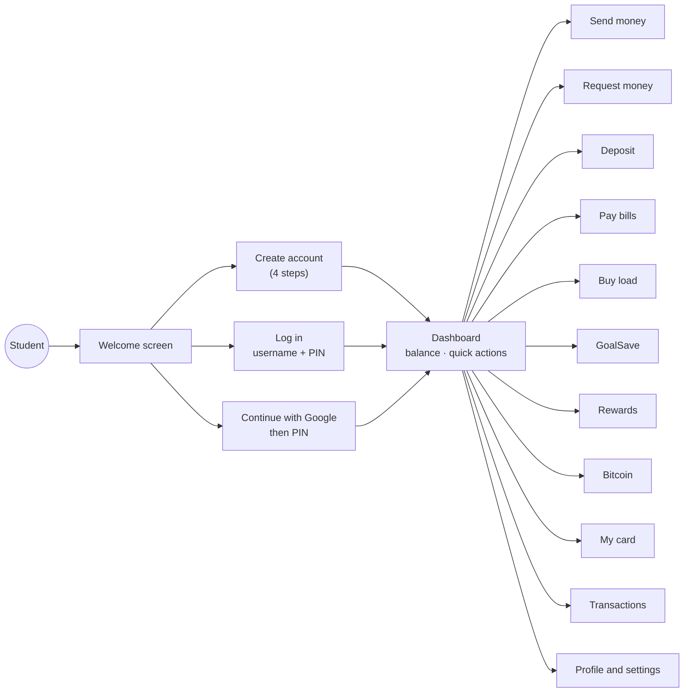

# Project overview

**What you will learn:** what GoBank Express does, who it is for, the full feature list, the technology stack, and the numbers that describe the codebase. Read this first; every other page goes deeper into one part of it.

---

## The one-paragraph pitch

GoBank Express is a **mobile-first digital bank for students**. A student opens an account with a username and a 6-digit PIN, gets a **physical and a virtual card**, and can then **send and request money**, **pay bills**, **buy mobile load**, **save toward up to five goals that earn 4% a year**, **earn reward points** on spending, and **practice Bitcoin trading at live market prices**. Every peso is stored as a whole number of centavos in a PostgreSQL database, and every change to a balance goes through one small, carefully locked piece of code called **the ledger**, so no amount of double-clicking or simultaneous requests can create or lose money.

Say this out loud a few times. It answers "What is your project?" in under 30 seconds.

---

## Who uses it and how

There is one kind of user: the account holder. There is no admin screen; billers and demo accounts are added by a seed script ([Seed data](../03-database/03-seed-data.md)).

---

## Feature list

| Feature | What the user can do | Main code | Explained in |
| --- | --- | --- | --- |
| Registration | Pick a username, create a PIN, choose a card network, enter details, review, agree to terms | `src/features/auth` | [Registration and sign-in](../05-features/01-registration-and-sign-in.md) |
| Sign-in | Username + 6-digit PIN; 5 wrong PINs lock the account for 15 minutes | `auth.service.ts`, `pin.ts` | [Registration and sign-in](../05-features/01-registration-and-sign-in.md) |
| Google sign-in | Continue with Google, then confirm with the PIN; link Google from Edit profile | `src/features/auth/google` | [Google sign-in](../05-features/02-google-sign-in.md) |
| Sessions | Stay signed in for 30 idle minutes; one session belongs to one browser tab | `src/server/session.ts` | [Sessions](../04-server-core/03-sessions.md) |
| Cards | A physical and a virtual card, different networks, each can be locked; one shared daily limit; reveal the CVV | `src/features/card` | [Cards](../05-features/04-cards.md) |
| Send money | Find a person by username, account number, mobile or linked Gmail; send with a note; pick the card | `src/features/transfers` | [Send money](../05-features/05-send-money.md) |
| Request money | Ask someone for money; they pay or decline; you can cancel | `src/features/requests`, `notifications` | [Request money](../05-features/06-request-money-and-notifications.md) |
| Deposit | Add up to ₱50,000 at a time (simulated cash-in) | `src/features/deposit` | [Deposit, bills and load](../05-features/07-deposit-bills-and-load.md) |
| Pay bills | Electric, water, internet and credit-card billers | `src/features/bills` | [Deposit, bills and load](../05-features/07-deposit-bills-and-load.md) |
| Buy load | ₱10 to ₱10,000 of mobile load for any `09…` number | `src/features/load` | [Deposit, bills and load](../05-features/07-deposit-bills-and-load.md) |
| GoalSave | Up to 5 savings goals, optional target, 4% a year compounded daily | `src/features/goals`, `savings-interest.ts` | [GoalSave](../05-features/08-goalsave.md) |
| Rewards | 1 point per ₱50 on transfers and bills; 100 points = ₱1.00 cash back | `src/features/rewards` | [Rewards](../05-features/09-rewards.md) |
| Transactions | Full history, All / Incoming / Outgoing filters, receipts with the card used | `src/features/activity` | [Transactions and receipts](../05-features/10-transactions-and-receipts.md) |
| Profile | Edit name and mobile, upload a photo, change PIN, sign out | `src/features/account` | [Account and profile](../05-features/03-account-and-profile.md) |
| Bitcoin | Live BTC/PHP price, 5 chart ranges, buy and sell from the main balance, fixed ₱10 fee | `src/features/bitcoin` | [Bitcoin](../05-features/12-bitcoin.md) |

> **Important honesty point for the defense:** money in GoBank Express is **simulated**. Deposits, loads and bill payments are recorded correctly in the database, but they are not connected to real banks, telcos or billers. Bitcoin trades use **real live prices** but no real Bitcoin is bought. Say this clearly if asked; it is a normal scope limit for a capstone ([Limitations](../09-defense/03-limitations-and-future-work.md)).

---

## Technology stack

Versions come from [`gobank/package.json`](https://github.com/neilacapuccino/gobank-express/blob/7be1eb5/gobank/package.json).

| Layer | Technology | Version | What it does here | Learn it in |
| --- | --- | --- | --- | --- |
| Language | TypeScript | 5.8 | JavaScript with types; catches mistakes before the app runs | [TypeScript and tooling](../01-foundations/01-typescript-and-tooling.md) |
| Runtime | Node.js | 22 | Runs the server, scripts and tests | same |
| Web framework | Next.js (App Router) | 15 | Pages, routing, server rendering, API routes | [Next.js and React](../01-foundations/02-nextjs-and-react.md) |
| UI library | React | 19 | Builds the screens out of components | same |
| API layer | tRPC | 11 | Type-safe function calls from browser to server | [tRPC, Zod and React Query](../01-foundations/03-trpc-zod-and-react-query.md) |
| Validation | Zod | 3 | Checks every input on the server | same |
| Data transport | SuperJSON | 2 | Sends `Date` and `BigInt` values safely as JSON | same |
| Client data cache | TanStack Query (React Query) | 5 | Loads, caches and refreshes server data in the browser | same |
| Database | PostgreSQL on Neon | — | Stores everything; hosted in Singapore | [Prisma and PostgreSQL](../01-foundations/04-prisma-and-postgresql.md) |
| ORM | Prisma | 6 | Type-safe database queries and migrations | same |
| Styling | Tailwind CSS | 4 | Utility classes and theme colors | [Styling and accessibility](../06-frontend/04-styling-and-accessibility.md) |
| Icons | Lucide React | 1.x | Line icons | same |
| Images | sharp | 0.34.5 | Cleans and resizes profile photos on the server | [Account and profile](../05-features/03-account-and-profile.md) |
| Env checking | @t3-oss/env-nextjs | 0.12 | Refuses to start with a missing or invalid setting | [Configuration files](../02-architecture/03-configuration-files.md) |
| Unit tests | Node's built-in test runner + tsx | — | Fast tests for rules and calculations | [Testing](../07-testing/01-testing.md) |
| Browser tests | Playwright | 1.64.1 | Clicks through the real app in Chrome | same |
| Code quality | ESLint 9, Prettier 3, GitHub Actions | — | Lint, format, typecheck and build on every push | [Configuration files](../02-architecture/03-configuration-files.md) |

---

## The codebase in numbers

All counts were measured on commit `7be1eb5`.

| Measure | Count |
| --- | --- |
| Files in the repository | 258 (256 without the lockfile and the favicon) |
| TypeScript lines in `gobank/src` | about 15,600 in 211 files |
| Feature folders in `src/features` | 14 |
| React component files (`.tsx`) in `features` and `shared` | 79 |
| Pages / layouts / API route files in `src/app` | 21 / 3 / 4 |
| tRPC procedures (API endpoints) | 40, of which 7 work without signing in |
| Database tables / enums | 9 / 5 |
| Database migrations | 19 |
| Unit test files / unit tests | 11 / 63 |
| Integration scripts (real database) | 2 |
| Browser (Playwright) tests | 3 |
| Commits | 53, from 10 Oct to 4 Nov 2026 |

---

## The ideas that make it safe (memorize these five)

1. **Money is an integer number of centavos.** ₱100.00 is stored as `10000`. Integers never have rounding errors; decimals (floats) do. See [money.ts](../06-frontend/03-shared-lib-hooks-and-trpc-client.md#moneyts-the-money-rules).
2. **Only the ledger changes balances.** Every deposit, transfer, bill, load, reward, goal move and Bitcoin trade calls `post()` in [`src/server/ledger.ts`](../04-server-core/04-ledger.md).
3. **Every money movement is one database transaction.** Either every step succeeds or nothing is saved. A transfer never debits one person without crediting the other.
4. **Balances are updated with a condition, and rows are locked.** The update says "subtract ₱100 *only if* the balance is at least ₱100", and the account row is locked (`SELECT … FOR UPDATE`) while the payment is checked. Two simultaneous payments cannot both pass.
5. **The server never trusts the browser.** The browser checks inputs for a friendly experience, but the server checks everything again with Zod and the database checks it a third time with `CHECK` constraints.

These five points come up again and again in [Panel questions](../09-defense/01-panel-questions.md).

---

## Defense questions

**Q: What problem does your system solve?**
A: Students handle small amounts of money often (allowances, splitting bills, load, saving for gadgets or trips) but traditional banking apps are not designed for them. GoBank Express puts sending, requesting, bill payment, load, goal-based savings with interest and cash-back rewards in one simple mobile-first app, and it keeps every peso accurate on the server.

**Q: Is this a real bank?**
A: No. It is a working prototype of a digital bank. All the banking rules (balances, limits, card locks, interest, rewards, receipts) really work and are stored in a real PostgreSQL database, but money only enters through a simulated deposit and leaves through simulated bills and load. Connecting to real payment networks requires licensing from the Bangko Sentral ng Pilipinas, which is outside the scope of a capstone.

**Q: Why build it as a web app instead of an Android app?**
A: A web app runs on every phone and computer without installation, one codebase serves all devices, and Next.js lets the same project contain both the screens and the server. The layout is designed for phone screens first (it works from 320 px wide up to desktop).

---

## Check yourself

How is ₱1,234.50 stored in the database?

As the integer `123450` (centavos), in an `INTEGER` column.

Which single function changes a user's balance?

`post()` in `gobank/src/server/ledger.ts`. `spend()` and `transfer()` are built on top of it.

How many API procedures are there, and how many work without signing in?

40 procedures; 7 are public (`auth.prepareCard`, `auth.usernameAvailable`, `auth.register`, `auth.signIn`, `auth.signInWithGooglePin`, `auth.signOut`, `bills.billers`).

