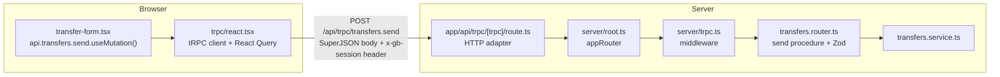

# tRPC, Zod and React Query

**What you will learn:** how a button in the browser calls a function on the server with full type safety (tRPC), how every input is validated (Zod), how dates and big numbers survive the trip (SuperJSON), and how the browser caches and refreshes server data (React Query). This is the "plumbing" every feature uses.

---

## 1. The problem tRPC solves

In a classic REST API you write an endpoint (`POST /api/transfers`), then separately write browser code that sends JSON to it and *hopes* the shapes match. If the server renames `amount` to `amountCentavos`, the browser breaks at runtime.

**tRPC** lets the browser call server functions as if they were local. For example (illustrative values; the real call is in `transfer-form.tsx`, lines 121–126):

```ts
send.mutate({ to: "@dante", amount: 10000, note: "lunch", card: "physical" });
```

TypeScript knows the exact input and output types because it reads them from the server code. Rename a field on the server and the browser code **fails to compile**. No REST routes, no hand-written API types.



### The vocabulary

| Term | Meaning | Where |
| --- | --- | --- |
| **Procedure** | One API function: a **query** (reads) or a **mutation** (changes data). | `send: protectedProcedure.input(…).mutation(…)` |
| **Router** | A group of procedures, one per feature. | `transfers.router.ts`, `goals.router.ts`… |
| **App router** | The root router that combines all feature routers. | `server/root.ts` |
| **Context (`ctx`)** | Data available to every procedure. After the sign-in middleware, `ctx.userId` is the signed-in user. | `server/trpc.ts` |
| **Middleware** | Code that runs around a procedure (checks, error translation). | `friendlyErrors`, `requireSession` |
| **Adapter** | Connects tRPC to HTTP. | `app/api/trpc/[trpc]/route.ts` |

---

## 2. Anatomy of a procedure

<!-- code: gobank/src/features/transfers/transfers.router.ts -->
**`gobank/src/features/transfers/transfers.router.ts`** · all 31 lines

```ts
 1 │ import { z } from "zod";
 2 │ import { cardKind, centavos, optionalText } from "~/shared/lib/schemas";
 3 │ import { createTRPCRouter, protectedProcedure } from "~/server/trpc";
 4 │ import {
 5 │   findRecipient,
 6 │   getRecentRecipients,
 7 │   sendMoney,
 8 │ } from "./transfers.service";
 9 │
10 │ export const transfersRouter = createTRPCRouter({
11 │   recent: protectedProcedure.query(({ ctx }) =>
12 │     getRecentRecipients(ctx.userId),
13 │   ),
14 │
15 │   recipient: protectedProcedure
16 │     .input(z.object({ to: z.string().trim().min(1) }))
17 │     .query(({ ctx, input }) => findRecipient(input.to, ctx.userId)),
18 │
19 │   send: protectedProcedure
20 │     .input(
21 │       z.object({
22 │         to: z.string().trim().min(1),
23 │         amount: centavos,
24 │         note: optionalText(120),
25 │         card: cardKind,
26 │       }),
27 │     )
28 │     .mutation(({ ctx, input }) =>
29 │       sendMoney(ctx.userId, input.to, input.amount, input.note, input.card),
30 │     ),
31 │ });
```
<!-- /code -->

Read `send` (lines 19–30) like a sentence:

1. `protectedProcedure`: only signed-in users. The middleware puts their ID in `ctx.userId` ([tRPC setup](../04-server-core/02-trpc-setup.md)).
2. `.input(z.object({...}))`: the input **must** match this Zod schema. If not, the request is rejected with `BAD_REQUEST` *before* any of our code runs.
3. `.mutation(({ ctx, input }) => sendMoney(...))`: the handler. It only *delegates* to the service. Routers stay thin; logic lives in services.

> **Security point:** the sender is `ctx.userId`, taken from the session on the server. The browser never sends "who am I". A user cannot send money *from* someone else's account by editing the request.

---

## 3. Zod: checking every input on the server

Zod describes the shape and rules of data, then checks real data against it.

<!-- code: gobank/src/shared/lib/schemas.ts -->
**`gobank/src/shared/lib/schemas.ts`** · all 27 lines

```ts
 1 │ import { z } from "zod";
 2 │ import { normalizeMobile, validateMobile } from "./contact";
 3 │ import { MAX_TRANSACTION_CENTAVOS } from "./money";
 4 │
 5 │ const blankToNull = (value: string) => value || null;
 6 │
 7 │ export const centavos = z
 8 │   .number()
 9 │   .int()
10 │   .positive()
11 │   .max(MAX_TRANSACTION_CENTAVOS);
12 │
13 │ export const mobile = z
14 │   .string()
15 │   .trim()
16 │   .refine((value) => !validateMobile(value), "Use the format 09XXXXXXXXX")
17 │   .transform((value) => blankToNull(normalizeMobile(value)));
18 │
19 │ export const cardKind = z.enum(["physical", "virtual"]);
20 │
21 │ export const optionalText = (max: number) =>
22 │   z.string().trim().max(max).transform(blankToNull);
23 │
24 │ export const profileFields = {
25 │   fullName: z.string().trim().min(2, "Enter your full name").max(80),
26 │   mobile,
27 │ };
```
<!-- /code -->

| Schema | Rule | Used by |
| --- | --- | --- |
| `centavos` | whole number, above 0, at most ₱1,000,000 | every amount |
| `mobile` | trimmed; empty or a valid `09XXXXXXXXX`; normalized (`+63 917…` becomes `0917…`); empty becomes `null` | profile, load |
| `cardKind` | exactly `"physical"` or `"virtual"` | every card payment |
| `optionalText(120)` | trimmed, at most 120 characters, empty becomes `null` | transfer and request notes |
| `profileFields` | full name 2–80 characters + mobile | registration, edit profile |

Zod features you will meet:

| Feature | What it does | Example |
| --- | --- | --- |
| `.refine(check, message)` | custom rule | `mobile` above (line 16) |
| `.superRefine` | custom rule with a custom error | `pin` in `auth.schemas.ts` |
| `.transform(fn)` | change the value after checking | `"" → null` |
| `.pipe(schema)` | check again with another schema after transforming | `existingUsername` strips `@`, then checks length |
| `.default(x)` | value used when missing | `limit: z.number()…default(20)` |
| `.nullish()` | may be `null` or missing | `targetAmount: centavos.nullish()` |
| `z.discriminatedUnion("action", [...])` | different shapes for buy and sell | `bitcoin.router.ts` |
| `z.custom(fn)` | any check function | `cardBrand` uses `isSupportedCardBrand` |
| `safeParse` | check without throwing; returns `{ success, data \| error }` | `usernameAvailable`, `/api/session` |

> **Concept: validate on both sides.** Forms check input in the browser for instant feedback, but a hacker can skip the browser and call the API directly. So the **server's Zod schema is the real gate**, and the database's `CHECK` constraints are the last line of defense. GoBank does all three ([Security model](../08-security/01-security-model.md)).

---

## 4. SuperJSON: keeping types intact over the network

JSON has no `Date` or `BigInt`. Plain `JSON.stringify(new Date())` becomes a string, and `JSON.stringify(10n)` throws an error. GoBank configures **SuperJSON** as the tRPC transformer on both sides (`initTRPC…create({ transformer: superjson })` in `server/trpc.ts` and `transformer: SuperJSON` in `trpc/react.tsx`). So:

- `createdAt` arrives in the browser as a real `Date` (that is why `dateTime(entry.createdAt)` works),
- Bitcoin amounts (`bitcoinUnits`, a PostgreSQL `BIGINT`) arrive as real `bigint` values with no precision loss.

---

## 5. React Query: the browser's data cache

tRPC's React integration wraps **TanStack Query** (React Query). Every procedure gets hooks:

| Hook | Used for | Key fields |
| --- | --- | --- |
| `api.x.y.useQuery(input, options)` | reading data | `data`, `isPending`, `isError`, `error`, `refetch()`, `isFetching` |
| `api.x.y.useMutation(options)` | changing data | `mutate(input)`, `isPending`, `isSuccess`, `data`, `error`, `reset()` |
| `api.x.y.useInfiniteQuery(input, { getNextPageParam })` | page-by-page lists | `data.pages`, `fetchNextPage()`, `hasNextPage` |
| `api.useUtils()` | direct cache access | `utils.card.get.setData(...)`, `utils.client.card.revealCvv.query(...)` |

### The project's cache rules

<!-- code: gobank/src/trpc/query-client.ts -->
**`gobank/src/trpc/query-client.ts`** · all 19 lines

```ts
 1 │ import { MutationCache, QueryClient } from "@tanstack/react-query";
 2 │
 3 │ export const createQueryClient = () => {
 4 │   const queryClient: QueryClient = new QueryClient({
 5 │     defaultOptions: {
 6 │       queries: {
 7 │         staleTime: 30 * 1000,
 8 │       },
 9 │     },
10 │     mutationCache: new MutationCache({
11 │       onSettled: (_data, _error, _variables, _context, mutation) => {
12 │         const [path] = mutation.options.mutationKey ?? [];
13 │         if (Array.isArray(path) && path[0] === "auth") return;
14 │         void queryClient.invalidateQueries();
15 │       },
16 │     }),
17 │   });
18 │   return queryClient;
19 │ };
```
<!-- /code -->

- **Line 7:** data counts as fresh for 30 seconds; React Query will not re-download it on every screen visit within that time.
- **Lines 10–16:** after *any* mutation finishes (success or error), **invalidate every cached query**, so the next time a screen needs data it reloads it. After a transfer, the balance, history and rewards all show the new values. Mutations whose path starts with `auth` (sign-in, register…) are skipped because those screens clear the whole cache themselves (`queryClient.clear()`).

> **Why invalidate everything?** A single transfer changes the balance, the history, the daily-limit remaining, the points and the recent recipients. Invalidating all queries is simple and always correct; for an app this size, the extra reloads are cheap.

### Batching and streaming

<!-- code: gobank/src/trpc/react.tsx 25-60 -->
**`gobank/src/trpc/react.tsx`** · lines 25–60

```tsx
25 │ export const api = createTRPCReact<AppRouter>();
26 │
27 │ export type RouterOutputs = inferRouterOutputs<AppRouter>;
28 │
29 │ const link = {
30 │   transformer: SuperJSON,
31 │   url: getBaseUrl() + "/api/trpc",
32 │   headers: () => {
33 │     const sessionId = clientSessionId();
34 │     return sessionId ? { [SESSION_HEADER]: sessionId } : {};
35 │   },
36 │ };
37 │
38 │ export function TRPCReactProvider(props: { children: React.ReactNode }) {
39 │   const queryClient = getQueryClient();
40 │
41 │   const [trpcClient] = useState(() =>
42 │     api.createClient({
43 │       links: [
44 │         splitLink({
45 │           condition: (op) => op.type === "mutation",
46 │           true: httpBatchLink(link),
47 │           false: httpBatchStreamLink(link),
48 │         }),
49 │       ],
50 │     }),
51 │   );
52 │
53 │   return (
54 │     <QueryClientProvider client={queryClient}>
55 │       <api.Provider client={trpcClient} queryClient={queryClient}>
56 │         {props.children}
57 │       </api.Provider>
58 │     </QueryClientProvider>
59 │   );
60 │ }
```
<!-- /code -->

- **Line 25:** `createTRPCReact<AppRouter>()`. This is where the browser learns every procedure's types, imported *as a type only* from `server/root.ts`, so no server code is shipped to the browser.
- **Lines 29–36:** every request goes to `/api/trpc` and carries the `x-gb-session` header holding the tab's session ID ([Sessions](../04-server-core/03-sessions.md)).
- **Lines 43–48:** `splitLink` sends **mutations** through `httpBatchLink` and **queries** through `httpBatchStreamLink`. Both *batch* calls made at the same moment into one HTTP request. The streaming link sends each query result as soon as it is ready, so a slow query does not delay fast ones. Mutations use the non-streaming link because a streamed response has already sent its headers, and mutations such as sign-in must set a **cookie**, which is a header.
- **Lines 53–58:** the providers make the cache and the client available to every component.

---

## 6. Errors, from server to screen

1. A service calls `fail("BAD_REQUEST", "Insufficient balance")`.
2. The `friendlyErrors` middleware converts it to a `TRPCError` with that code and message ([tRPC setup](../04-server-core/02-trpc-setup.md)).
3. tRPC sends it with an HTTP status: `BAD_REQUEST` 400, `UNAUTHORIZED` 401, `NOT_FOUND` 404, `CONFLICT` 409, `TOO_MANY_REQUESTS` 429, anything unexpected 500 (the message is hidden in production).
4. In the browser, the mutation's `error` is set, and `errorMessage()` picks what to show:

<!-- code: gobank/src/trpc/error-message.ts -->
**`gobank/src/trpc/error-message.ts`** · all 11 lines

```ts
 1 │ import type { TRPCClientErrorLike } from "@trpc/client";
 2 │ import type { AppRouter } from "~/server/root";
 3 │
 4 │ export function errorMessage(error: TRPCClientErrorLike<AppRouter> | null) {
 5 │   if (!error) return null;
 6 │
 7 │   const fieldErrors = error.data?.zodError?.fieldErrors ?? {};
 8 │   const firstFieldError = Object.values(fieldErrors).flat()[0];
 9 │
10 │   return firstFieldError ?? error.message;
11 │ }
```
<!-- /code -->

If Zod rejected the input, the first field message is shown (for example "Use the format 09XXXXXXXXX"); otherwise, the server's message.

---

## Defense questions

**Q: Why tRPC instead of REST?**
A: Both the browser and the server are TypeScript in the same project, so tRPC lets the browser call server procedures with types inferred end to end. If the server changes an input or output, the browser code fails to compile instead of failing in production. It also gives request batching and input validation with Zod for free.

**Q: If you validate in the browser, why validate again on the server?**
A: The browser can be bypassed: anyone can send requests with tools like Postman. Browser checks are for user experience; the server's Zod schemas are the security boundary, and database constraints are the final safety net.

**Q: How does the dashboard update after I send money?**
A: When a mutation finishes, the query client invalidates all cached queries (`query-client.ts`), and the transfer screen calls `router.refresh()` so the server-rendered dashboard is rebuilt with the new balance.

---

## Check yourself

<details>
<summary>Where does <code>ctx.userId</code> come from, and could a user fake it?</summary>

From the `requireSession` middleware in `server/trpc.ts`, which reads the session cookie and the `x-gb-session` header on the server. The browser never sends a user ID, so it cannot be faked.
</details>

<details>
<summary>Why do mutations use <code>httpBatchLink</code> instead of the streaming link?</summary>

Streaming responses send headers before the procedures finish, and mutations such as sign-in and register must set cookies (headers) when they finish.
</details>
