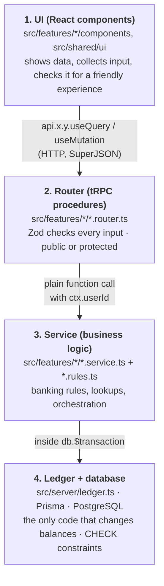
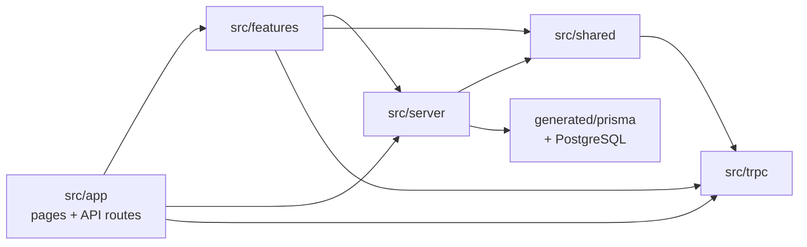

# Layers and folders

**What you will learn:** the architecture of GoBank Express. That means the four layers every request passes through, what lives in every folder, the file-naming rules that tell you a file's job from its name, and which parts are allowed to depend on which. Be ready to draw the layer diagram from memory.

---

## 1. The four layers



| Layer | Job | Must not |
| --- | --- | --- |
| **UI** | Render screens, hold form state, give instant feedback, call procedures | Be trusted. Every check here is repeated below. |
| **Router** | Declare each endpoint: name, public/protected, **input schema** | Contain business logic (each handler is one line that calls a service) |
| **Service** | Apply the banking rules: who is the recipient, is the biller active, how many goals exist… | Change a balance directly (it must call the ledger) |
| **Ledger + DB** | Move money atomically, with locks and conditional updates; the database enforces final rules | Know about screens or HTTP |

> **Is it MVC?** Not strictly. It is a **layered, feature-based** ("vertical slice") architecture. If a panel insists on MVC terms: components are the *View*, routers act as *Controllers*, services + ledger + Prisma models are the *Model*.

### Why layers?

- **One place per rule.** "Balance can't go negative" lives in the ledger (and the DB), not in ten screens.
- **Security by structure.** Routers force validation; protected procedures force sign-in; the ledger forces locking. A new feature gets these by following the pattern.
- **Testability.** `*.rules.ts` files are pure functions with no database, so they are unit tested in milliseconds.

---

## 2. The folder map

```text
gobank-express/
├── .github/workflows/ci.yml     GitHub Actions: format, lint, typecheck, test, build
├── .github/CODEOWNERS           who reviews pull requests
├── .githooks/pre-push           optional hook: run all checks before pushing
├── .gitattributes               force LF line endings everywhere
├── README.md                    project README (setup, architecture, limits)
└── gobank/                      the application
    ├── e2e/                     Playwright browser tests
    ├── prisma/
    │   ├── schema.prisma        the database design
    │   ├── migrations/          19 SQL migrations, applied in order
    │   └── seed.ts              billers + demo users
    ├── public/favicon.ico       browser tab icon
    ├── scripts/                 card-key setup + two integration test scripts
    ├── src/
    │   ├── app/                 Next.js routes: pages, layouts, API route handlers
    │   ├── features/            14 feature folders (the bulk of the code)
    │   ├── server/              shared backend: tRPC, ledger, sessions, db, errors
    │   ├── shared/              shared frontend + pure helpers: ui/, lib/, hooks/
    │   ├── styles/globals.css   Tailwind import, theme colors, animations
    │   ├── trpc/                tRPC clients (browser + server) and cache rules
    │   └── env.ts               validated environment variables
    ├── generated/               Prisma client (generated, git-ignored)
    └── package.json, tsconfig.json, next.config.ts, eslint.config.ts,
        prisma.config.ts, playwright.config.ts, postcss.config.json, …
```

### `src/features`: one folder per feature

| Folder | Backend files | Frontend files | Explained in |
| --- | --- | --- | --- |
| `account` | router, service, rules, profile-photo schema/server/client | profile screen, edit form, photo picker, avatar, Gmail link | [Account and profile](../05-features/03-account-and-profile.md) |
| `activity` | router, service, rules, fields | history screen, rows, icons, receipt | [Transactions and receipts](../05-features/10-transactions-and-receipts.md) |
| `auth` | router, service, rules, schemas, pin, card-preview service, session rules/client, `google/` | welcome, sign-in, registration steps, change PIN, session guard | [Registration](../05-features/01-registration-and-sign-in.md), [Google](../05-features/02-google-sign-in.md), [Sessions](../04-server-core/03-sessions.md) |
| `bills` | router, service, categories | bill payment, biller and category cards | [Deposit, bills and load](../05-features/07-deposit-bills-and-load.md) |
| `bitcoin` | router, service, rules, types, market/fx/cache, candles, chart geometry, trade input, live socket | screen, chart, market, holdings, trade form, review, history, hooks | [Bitcoin](../05-features/12-bitcoin.md) |
| `card` | router, service, rules, brands, generation, CVV crypto, credentials, label | bank card, details, settings, picker, locked notice, brand logos, secrets hook | [Cards](../05-features/04-cards.md) |
| `dashboard` | — | dashboard screen, balance card, quick actions, feature grid | [Dashboard](../05-features/11-dashboard-and-navigation.md) |
| `deposit` | router, service, rules | deposit form | [Deposit, bills and load](../05-features/07-deposit-bills-and-load.md) |
| `goals` | router, service, rules | GoalSave screen, goal detail, forms, tabs, art, icon picker, hook | [GoalSave](../05-features/08-goalsave.md) |
| `load` | router, service, rules | load form | [Deposit, bills and load](../05-features/07-deposit-bills-and-load.md) |
| `notifications` | router, service | notifications (requests) screen | [Request money](../05-features/06-request-money-and-notifications.md) |
| `requests` | router, service, rules | request form | [Request money](../05-features/06-request-money-and-notifications.md) |
| `rewards` | router, service, rules | rewards screen, history | [Rewards](../05-features/09-rewards.md) |
| `transfers` | router, service | transfer form | [Send money](../05-features/05-send-money.md) |

---

## 3. File names tell you the job

| Suffix / folder | Holds | Example |
| --- | --- | --- |
| `*.router.ts` | tRPC procedures + Zod input schemas | `goals.router.ts` |
| `*.service.ts` | business logic and database work | `goals.service.ts` |
| `*.rules.ts` | **pure** constants and calculations (no database), safe to use in the browser and easy to unit test | `goals.rules.ts`, `auth.rules.ts` |
| `*.schemas.ts` | reusable Zod schemas | `auth.schemas.ts` |
| `*.server.ts` | code that must **only** run on the server (secrets, Node APIs); usually starts with `import "server-only"` | `card-cvv.server.ts`, `google.server.ts` |
| `*.client.ts` | code that only runs in the browser (`"use client"`) | `session.client.ts`, `profile-photo.client.ts` |
| `*.types.ts`, `*.fields.ts` | shared types / Prisma `select` objects | `bitcoin.types.ts`, `activity.fields.ts` |
| `*.test.ts` | unit tests next to the code they test | `goals.rules.test.ts` |
| `components/` | React components (kebab-case file names) | `goal-detail.tsx` |
| `hooks/` | custom React hooks (`use-…`) | `use-goal-icon.ts` |

---

## 4. Who may import whom



The general direction is **pages → features → server/shared → database**. The real import graph (measured with `grep` on commit `7be1eb5`) has these deliberate cross-links:

| From → to | Why |
| --- | --- |
| `server/root.ts` → every `*.router.ts` | The root router must combine all feature routers. |
| `server/session.ts` → `features/auth/session.rules.ts` | Session constants (30 minutes, header name) are shared with the browser, so they live in a pure rules file. |
| `server/ledger.ts`, `server/errors.ts` → `shared/lib/money.ts`, `savings-interest.ts` | Money constants and the interest formula are pure, shared helpers. |
| `auth` → `card` (14 imports) | Registration issues the two cards and shows the card preview. |
| `transfers`, `bills`, `load`, `notifications` → `card` | Payment screens show the card picker and the "both cards locked" notice. |
| `requests`, `notifications` → `transfers` | Reuse `findRecipient` and the `PARTY` field list. |
| `rewards`, `account`, `dashboard` → `activity` | Reuse the activity row fields and list component. |
| `account` ↔ `auth` | Profile fields are shared by registration and Edit profile; Edit profile shows the "Link Google" control. |
| `shared/ui/money-form-ui.tsx` → `account/components/profile-avatar` | Recipient rows show the person's photo. |
| `shared/hooks/*` → `trpc/react` | Shared hooks call the API. |

> **Rule that is never broken:** browser code never imports server-only code. `server-only` makes the build fail if a client component imports `db.ts`, the CVV encryption, or Google secrets.

---

## Defense questions

**Q: Describe your system architecture.**
A: It is a Next.js full-stack app with four layers. React components render the UI and call typed tRPC procedures. The routers validate every input with Zod and check sign-in. Services apply the banking rules. And a single ledger module moves money inside PostgreSQL transactions using row locks and conditional updates. The code is organized by feature (transfers, goals, cards…), and each feature folder contains its router, service, pure rules, tests and components.

**Q: Why organize by feature instead of by type (all controllers together, all models together)?**
A: Everything about one feature is in one folder, so a change to GoalSave touches one place. Shared building blocks (ledger, sessions, UI kit) live in `server` and `shared`.

**Q: Where would you add a new feature, say "pay with QR"?**
A: Create `src/features/qr/` with `qr.router.ts` (Zod input), `qr.service.ts` (look up the merchant, then call `spend()` from the ledger), `qr.rules.ts` for limits, components for the screen, register the router in `server/root.ts`, and add a page under `src/app/(app)/qr/`.

---

## Check yourself

<details>
<summary>A file is named <code>card-cvv.server.ts</code>. What can you tell without opening it?</summary>

It belongs to the card feature and runs only on the server (it starts with `import "server-only"`, so importing it from the browser would fail the build). It deals with CVVs, so it is the encryption code.
</details>

<details>
<summary>Which layer is allowed to change <code>User.balance</code>?</summary>

Only the ledger (`src/server/ledger.ts`), always inside a database transaction. Services call ledger functions; they never update balances directly (checked with `grep` across every `*.service.ts`). The one exception outside the app is the seed script, which creates the demo users with an opening balance and a matching "Opening deposit" history row.
</details>
