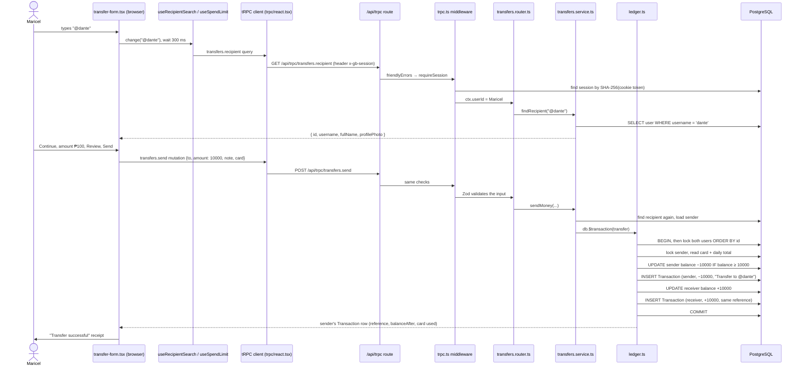

# Life of a request: "Send ₱100 to @dante"

**What you will learn:** exactly what happens, file by file and line by line, when a signed-in user sends money. If you can retell this page, you can answer almost any "how does it work?" question, because every other feature uses the same path.

The story: **Maricel** is signed in, opens **Send money**, types `@dante`, enters **₱100**, chooses her **physical card** and taps **Send ₱100.00**.

---

## The whole journey on one diagram



---

## Step 1: The screen keeps the form state

`/transfer` renders `TransferForm`, a client component with three steps (`recipient` → `amount` → `review`):

<!-- code: gobank/src/features/transfers/components/transfer-form.tsx 94-127 -->
**`gobank/src/features/transfers/components/transfer-form.tsx`** · lines 94–127

```tsx
 94 │ export function TransferForm() {
 95 │   const router = useRouter();
 96 │   const [step, setStep] = useState<MoneyStep>("recipient");
 97 │   const [amount, setAmount] = useState("");
 98 │   const [note, setNote] = useState("");
 99 │
100 │   const search = useRecipientSearch(() => setStep("amount"));
101 │   const limit = useSpendLimit(MAX_TRANSACTION_CENTAVOS);
102 │   const send = api.transfers.send.useMutation();
103 │
104 │   const amountCentavos = toCentavos(Number(amount));
105 │   const validAmount = limit.valid(amountCentavos);
106 │   const recipient = search.recipient;
107 │
108 │   const back = () => {
109 │     send.reset();
110 │     setStep(step === "review" ? "amount" : "recipient");
111 │   };
112 │
113 │   const finish = () => {
114 │     router.push("/dashboard");
115 │     router.refresh();
116 │   };
117 │
118 │   const sendMoney = () => {
119 │     if (!recipient || !validAmount || send.isPending) return;
120 │
121 │     send.mutate({
122 │       to: `@${recipient.username}`,
123 │       amount: amountCentavos,
124 │       note: note.trim(),
125 │       card: limit.card,
126 │     });
127 │   };
```
<!-- /code -->

- Lines 96–98: what step we are on, and the typed amount and note (as text).
- Line 100: `useRecipientSearch` runs the lookup and moves to the amount step when a person is chosen.
- Line 101: `useSpendLimit` loads the balance, the remaining daily limit and both cards, and checks the amount ([Shared helpers](../06-frontend/03-shared-lib-hooks-and-trpc-client.md)).
- Line 102: `send` is the mutation; nothing is sent until `send.mutate(...)` runs.
- Line 104: `toCentavos(Number("100"))` is `10000`. The browser sends **centavos**, never pesos.
- Lines 118–127: `sendMoney()` refuses to run if there is no recipient, the amount is invalid, or a request is already in flight (**a double tap cannot send twice from the UI**; the ledger also protects against it on the server).
- Line 122: the recipient is sent as `@username`, so the server looks the person up again instead of trusting the browser's copy.

## Step 2: The request leaves the browser

The tRPC client (`src/trpc/react.tsx`) turns `send.mutate(input)` into an HTTP `POST` to `/api/trpc/transfers.send`, with the input encoded by SuperJSON and the header `x-gb-session: <this tab's session ID>`. The `gb_session` cookie is attached automatically by the browser ([tRPC, Zod and React Query](../01-foundations/03-trpc-zod-and-react-query.md)).

## Step 3: Next.js hands the request to tRPC

<!-- code: gobank/src/app/api/trpc/[trpc]/route.ts -->
**`gobank/src/app/api/trpc/[trpc]/route.ts`** · all 26 lines

```ts
 1 │ import { fetchRequestHandler } from "@trpc/server/adapters/fetch";
 2 │ import { type NextRequest } from "next/server";
 3 │
 4 │ import { env } from "~/env";
 5 │ import { appRouter } from "~/server/root";
 6 │ import { SESSION_HEADER } from "~/features/auth/session.rules";
 7 │
 8 │ const handler = (req: NextRequest) =>
 9 │   fetchRequestHandler({
10 │     endpoint: "/api/trpc",
11 │     req,
12 │     router: appRouter,
13 │     createContext: () => ({
14 │       browserSession: { id: req.headers.get(SESSION_HEADER) },
15 │     }),
16 │     onError:
17 │       env.NODE_ENV === "development"
18 │         ? ({ path, error }) => {
19 │             console.error(
20 │               `tRPC failed on ${path ?? "<no-path>"}: ${error.message}`,
21 │             );
22 │           }
23 │         : undefined,
24 │   });
25 │
26 │ export { handler as GET, handler as POST };
```
<!-- /code -->

- `[trpc]` is a dynamic segment, so this one file receives every `/api/trpc/…` call.
- Line 14: the **context** records which session ID this browser tab claims, read from the `x-gb-session` header.
- Lines 16–23: in development, failed calls are printed to the terminal.
- Line 26: both `GET` (queries) and `POST` (mutations) use the same handler.

## Step 4: Middleware: translate errors, require a session

<!-- code: gobank/src/server/trpc.ts 51-82 -->
**`gobank/src/server/trpc.ts`** · lines 51–82

```ts
51 │ const friendlyErrors = t.middleware(async ({ next }) => {
52 │   const result = await next();
53 │   if (result.ok) return result;
54 │
55 │   const error = toTRPCError(result.error.cause);
56 │   if (error) throw error;
57 │
58 │   return result;
59 │ });
60 │
61 │ const requireSession = t.middleware(async ({ ctx, next }) => {
62 │   const session = await currentSession();
63 │   const otherTab =
64 │     ctx.browserSession !== undefined && ctx.browserSession.id !== session?.id;
65 │
66 │   if (!session || otherTab) {
67 │     throw new TRPCError({
68 │       code: "UNAUTHORIZED",
69 │       message: MESSAGES.signInRequired,
70 │     });
71 │   }
72 │
73 │   return next({ ctx: { userId: session.userId } });
74 │ });
75 │
76 │ export const createCallerFactory = t.createCallerFactory;
77 │
78 │ export const createTRPCRouter = t.router;
79 │
80 │ export const publicProcedure = t.procedure.use(friendlyErrors);
81 │
82 │ export const protectedProcedure = publicProcedure.use(requireSession);
```
<!-- /code -->

1. `protectedProcedure` = `publicProcedure` (with `friendlyErrors`) + `requireSession`.
2. `requireSession` calls `currentSession()`, which reads the `gb_session` cookie, hashes it with SHA-256 and finds that row in the `Session` table, unexpired ([Sessions](../04-server-core/03-sessions.md)).
3. Line 63–64: the tab's header must equal that session's ID. A request from a tab that does not own the session, or from another website (which cannot add custom headers), is refused with `UNAUTHORIZED`.
4. Line 73: `ctx.userId` is now Maricel's ID **taken from the server-side session**.
5. `friendlyErrors` waits for the result; if the procedure failed with one of our errors or a known database error, it converts it into a clean tRPC error (step 9).

## Step 5: Zod validates the input

<!-- code: gobank/src/features/transfers/transfers.router.ts 19-30 -->
**`gobank/src/features/transfers/transfers.router.ts`** · lines 19–30

```ts
19 │   send: protectedProcedure
20 │     .input(
21 │       z.object({
22 │         to: z.string().trim().min(1),
23 │         amount: centavos,
24 │         note: optionalText(120),
25 │         card: cardKind,
26 │       }),
27 │     )
28 │     .mutation(({ ctx, input }) =>
29 │       sendMoney(ctx.userId, input.to, input.amount, input.note, input.card),
30 │     ),
```
<!-- /code -->

`to` must be non-empty text, `amount` a whole positive number of centavos ≤ ₱1,000,000, `note` at most 120 characters (empty becomes `null`), `card` `physical` or `virtual`. Anything else is rejected with `BAD_REQUEST` and the first field message, before the service runs.

## Step 6: The service resolves people and opens a transaction

<!-- code: gobank/src/features/transfers/transfers.service.ts 78-95 -->
**`gobank/src/features/transfers/transfers.service.ts`** · lines 78–95

```ts
78 │ export async function sendMoney(
79 │   userId: string,
80 │   to: string,
81 │   amount: number,
82 │   note: string | null,
83 │   card: CardKind,
84 │ ) {
85 │   const receiver = await findRecipient(to, userId);
86 │
87 │   const sender = await db.user.findUniqueOrThrow({
88 │     where: { id: userId },
89 │     select: { id: true, username: true },
90 │   });
91 │
92 │   return db.$transaction((tx) =>
93 │     transfer(tx, sender, receiver, amount, card, note),
94 │   );
95 │ }
```
<!-- /code -->

- Line 85: find the recipient **again on the server**. It also refuses sending to yourself ("That is your own account").
- Lines 87–90: load the sender's ID and username (needed for the "Transfer from @maricel" title).
- Lines 92–94: open **one database transaction** and run the ledger's `transfer` inside it.

## Step 7: The ledger moves the money

<!-- code: gobank/src/server/ledger.ts 171-210 -->
**`gobank/src/server/ledger.ts`** · lines 171–210

```ts
171 │ export async function transfer(
172 │   tx: Tx,
173 │   from: Party,
174 │   to: Party,
175 │   amount: number,
176 │   card: CardKind,
177 │   note?: string | null,
178 │ ) {
179 │   await tx.$queryRaw`
180 │     SELECT "id" FROM "User"
181 │     WHERE "id" IN (${from.id}, ${to.id})
182 │     ORDER BY "id" FOR UPDATE
183 │   `;
184 │
185 │   const reference = newReference();
186 │   const details = note ? { note } : undefined;
187 │
188 │   const sent = await spend(tx, {
189 │     userId: from.id,
190 │     kind: "transfer",
191 │     title: `Transfer to @${to.username}`,
192 │     amount,
193 │     reference,
194 │     counterpartyId: to.id,
195 │     details,
196 │     card,
197 │   });
198 │
199 │   await post(tx, {
200 │     userId: to.id,
201 │     kind: "transfer",
202 │     title: `Transfer from @${from.username}`,
203 │     amount,
204 │     reference,
205 │     counterpartyId: from.id,
206 │     details,
207 │   });
208 │
209 │   return sent;
210 │ }
```
<!-- /code -->

1. **Lines 179–183:** lock *both* user rows in ID order (no deadlocks, no interference).
2. **Line 185:** one reference (for example `GB7KQ2M9XA`) shared by both sides.
3. **Lines 188–197:** `spend()` checks the chosen card exists and is unlocked and that today's spending plus ₱100 is within the daily limit, then debits ₱100 with `post()` and awards `floor(10000 / 5000) = 2` reward points.
4. **Lines 199–207:** `post()` credits Dante ₱100 (no points for receiving).
5. **Line 209:** returns Maricel's new transaction row.

The full line-by-line explanation is in [The ledger](../04-server-core/04-ledger.md).

## Step 8: The database commits

When the callback returns, Prisma sends `COMMIT`. At this instant, and only now, both balance changes and both history rows become visible to everyone. If any line above had thrown, PostgreSQL would have rolled everything back.

What is now stored (abridged; example values from a freshly seeded test database, where both demo users start with ₱5,000 and card numbers are random):

| Table | Row |
| --- | --- |
| `User` (Maricel) | `balance` 500000 → 490000, `points` 0 → 2 |
| `User` (Dante) | `balance` 500000 → 510000 |
| `Transaction` | userId Maricel, kind `transfer`, title "Transfer to @dante", amount −10000, balanceAfter 490000, points 2, counterparty Dante, details `{ card: { kind: "physical", network: "discover", last4: "8954" } }` |
| `Transaction` | userId Dante, kind `transfer`, title "Transfer from @maricel", amount +10000, balanceAfter 510000, counterparty Maricel, **same reference** |

## Step 9: The answer travels back

The sender's row is serialized with SuperJSON (so `createdAt` stays a `Date`) and returned. If something failed instead:

| Failure | Thrown by | User sees |
| --- | --- | --- |
| Not signed in / other tab | `requireSession` | "Sign in to continue" (401) |
| Bad input | Zod | first field message (400) |
| Unknown recipient | `findRecipient` | "No GoBank account matches that" (404) |
| Card locked | `spend()` | "This card is locked. Unlock it or pay with your other card." (400) |
| Over the daily limit | `spend()` | "This goes over your daily limit" (400) |
| Balance too low | `post()` | "Insufficient balance" (400) |
| Unexpected bug | anything | "Something went wrong. Please try again." in production (500) |

## Step 10: The screen shows a receipt and everything refreshes

<!-- code: gobank/src/features/transfers/components/transfer-form.tsx 129-145 -->
**`gobank/src/features/transfers/components/transfer-form.tsx`** · lines 129–145

```tsx
129 │   if (send.data && recipient) {
130 │     return (
131 │       <TransactionReceipt title="Transfer successful" onDone={finish}>
132 │         <MoneySummary
133 │           recipient={recipient}
134 │           amount={Math.abs(send.data.amount)}
135 │           note={note.trim()}
136 │           details={[
137 │             { label: "Reference", value: send.data.reference },
138 │             { label: "Date", value: dateTime(send.data.createdAt) },
139 │             { label: "Balance", value: peso(send.data.balanceAfter) },
140 │             ...paidWithDetail(send.data.details),
141 │           ]}
142 │         />
143 │       </TransactionReceipt>
144 │     );
145 │   }
```
<!-- /code -->

- `send.data` is the returned row, so the receipt shows the reference, date, new balance and "Paid with Physical · Discover •••• 8954" (`paidWithDetail`).
- Meanwhile `query-client.ts` invalidates every cached query, so balances, history and rewards reload.
- **Done** pushes `/dashboard` and calls `router.refresh()`, so the server re-renders the dashboard with the new balance.

---

## Defense questions

**Q: Walk us through what happens when a user sends money.**
A: (Use the 10 steps above, short version.) The form converts pesos to centavos and calls the `transfers.send` mutation. On the server, the tRPC route builds the context, middleware checks the session cookie and the tab header, and Zod validates the input. The service looks up the recipient again and opens a database transaction, and the ledger locks both accounts, checks the card and the daily limit, debits the sender only if the balance is enough, credits the receiver and writes two history rows with one reference. PostgreSQL commits, and the receipt is returned and shown.

**Q: Where is the sender's identity taken from?**
A: From the server-side session (`ctx.userId`), never from the request body.

**Q: How many times is the amount checked?**
A: In the browser (`useSpendLimit`) for instant feedback, by Zod on the server (format and maximum), by `spend()` (daily limit), by `post()`'s conditional update (balance) and by the database's `CHECK (balance >= 0)` as the last safety net.
