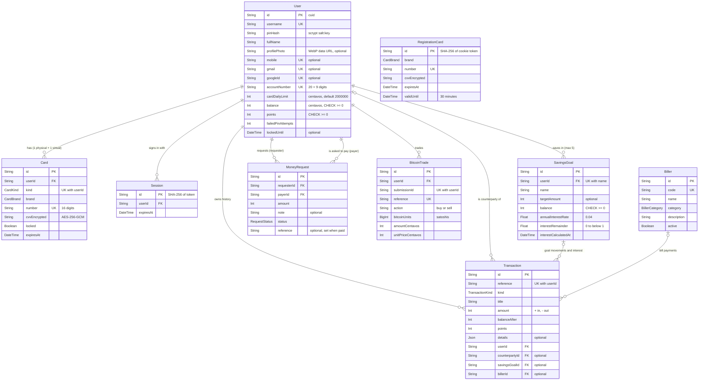

# Database schema

**What you will learn:** every table (model), column, enum, relation, index and database rule in GoBank Express, and the reason behind each design choice. The source is `gobank/prisma/schema.prisma` plus the `CHECK` constraints that live only in the SQL migrations. Every claim below was checked against a fresh PostgreSQL 16 database built from the 19 migrations.

---

## 1. The big picture (ERD)



`RegistrationCard` stands alone on purpose: it holds the card preview of a person who has **not registered yet**, so it cannot point to a user.

---

## 2. How money is represented

| Value | Column type | Unit | Why |
| --- | --- | --- | --- |
| Balances, amounts, limits, targets | `Int` (PostgreSQL `INTEGER`) | **centavos** (₱1.00 = 100) | Integers are exact. Floating point cannot represent 0.1 exactly (`0.1 + 0.2 = 0.30000000000000004`), which is unacceptable for money. |
| Bitcoin quantity | `BigInt` (`BIGINT`) | **satoshis** (1 BTC = 100,000,000) | Holdings can exceed the 32-bit range; BigInt keeps every satoshi exact |
| Interest rate | `Float` | fraction (0.04 = 4%) | A rate is a parameter, not money |
| Interest remainder | `Float` | fraction of one centavo (always `0 ≤ r < 1`) | Keeps the part of a centavo that is not paid yet, so no interest is ever lost to rounding |

`INTEGER` tops out at 2,147,483,647, which is why `MAX_BALANCE_CENTAVOS` is that number (about ₱21.47 million). The ledger refuses any update that would cross it (see [The ledger](../04-server-core/04-ledger.md)).

---

## 3. The schema file, model by model

### Generator and datasource

<!-- code: gobank/prisma/schema.prisma 1-10 -->
**`gobank/prisma/schema.prisma`** · lines 1–10

```prisma
 1 │ generator client {
 2 │   provider = "prisma-client-js"
 3 │   output   = "../generated/prisma"
 4 │ }
 5 │
 6 │ datasource db {
 7 │   provider  = "postgresql"
 8 │   url       = env("DATABASE_URL")
 9 │   directUrl = env("DIRECT_URL")
10 │ }
```
<!-- /code -->

Explained in [Prisma and PostgreSQL](../01-foundations/04-prisma-and-postgresql.md#2-prisma-the-orm): the client is generated into `gobank/generated/prisma`; the app uses the pooled `DATABASE_URL`, migrations use `DIRECT_URL`.

### Enums

<!-- code: gobank/prisma/schema.prisma 12-47 -->
**`gobank/prisma/schema.prisma`** · lines 12–47

```prisma
12 │ enum CardBrand {
13 │   visa
14 │   mastercard
15 │   jcb
16 │   discover
17 │ }
18 │
19 │ enum CardKind {
20 │   physical
21 │   virtual
22 │ }
23 │
24 │ enum BillerCategory {
25 │   electric
26 │   water
27 │   internet
28 │   credit_card
29 │ }
30 │
31 │ enum TransactionKind {
32 │   deposit
33 │   transfer
34 │   bill
35 │   load
36 │   stash
37 │   reward
38 │   interest
39 │   exchange
40 │ }
41 │
42 │ enum RequestStatus {
43 │   pending
44 │   paid
45 │   declined
46 │   cancelled
47 │ }
```
<!-- /code -->

| Enum | Values | Meaning |
| --- | --- | --- |
| `CardBrand` | visa, mastercard, jcb, discover | The card network chosen at registration (an older `gobank` value was removed in the last migration) |
| `CardKind` | physical, virtual | Each user has exactly one of each |
| `BillerCategory` | electric, water, internet, credit_card | Groups billers on the Pay bills screen |
| `TransactionKind` | deposit, transfer, bill, load, **stash**, reward, interest, **exchange** | What a history row is. `stash` = a GoalSave deposit or withdrawal (the feature was called "Stash" before it was renamed GoalSave; the enum value was kept). `exchange` = a Bitcoin purchase or sale |
| `RequestStatus` | pending, paid, declined, cancelled | Life cycle of a money request |

### `User`: the account

<!-- code: gobank/prisma/schema.prisma 49-75 -->
**`gobank/prisma/schema.prisma`** · lines 49–75

```prisma
49 │ model User {
50 │   id                String    @id @default(cuid())
51 │   username          String    @unique
52 │   pinHash           String
53 │   fullName          String
54 │   profilePhoto      String?
55 │   mobile            String?   @unique
56 │   gmail             String?   @unique
57 │   googleId          String?   @unique
58 │   accountNumber     String    @unique
59 │   cardDailyLimit    Int       @default(2000000)
60 │   balance           Int       @default(0)
61 │   points            Int       @default(0)
62 │   failedPinAttempts Int       @default(0)
63 │   lockedUntil       DateTime?
64 │   createdAt         DateTime  @default(now())
65 │   updatedAt         DateTime  @updatedAt
66 │
67 │   cards            Card[]
68 │   sessions         Session[]
69 │   savingsGoals     SavingsGoal[]
70 │   transactions     Transaction[]
71 │   counterpartyOf   Transaction[]  @relation("Counterparty")
72 │   requestsSent     MoneyRequest[] @relation("Requester")
73 │   requestsReceived MoneyRequest[] @relation("Payer")
74 │   bitcoinTrades    BitcoinTrade[]
75 │ }
```
<!-- /code -->

| Field | Rule | Meaning / written by |
| --- | --- | --- |
| `id` | `@default(cuid())` | Random, collision-resistant ID. Unlike 1, 2, 3… it does not reveal how many users exist |
| `username` | unique | Lowercase `[a-z0-9_]`, 3–20 chars, checked by `auth.schemas.ts` |
| `pinHash` | required | `salt:key` from scrypt (161 characters) — never the PIN itself |
| `fullName` | required | Printed on the card; 2–80 characters |
| `profilePhoto` | optional | A 256×256 WebP image stored as a `data:` URL string (≤ 200 KB) |
| `mobile` | optional, unique | Normalized `09XXXXXXXXX`; lets friends pay you by number |
| `gmail` | optional, unique | Set only when Google is linked |
| `googleId` | optional, unique | Google's permanent user ID (`sub`) |
| `accountNumber` | unique | `"20"` + 9 random digits (`identifiers.ts`) |
| `cardDailyLimit` | default `2000000` (₱20,000) | **Shared** by both cards; `CHECK >= 0`; max ₱100,000 enforced in the router |
| `balance` | default 0, `CHECK >= 0` | Main balance in centavos; changed **only** by `ledger.post()` |
| `points` | default 0, `CHECK >= 0` | Reward points |
| `failedPinAttempts`, `lockedUntil` | — | PIN lockout state ([Registration and sign-in](../05-features/01-registration-and-sign-in.md)) |
| `createdAt`, `updatedAt` | automatic | "Member since" on the profile |
| relation lists (lines 67–74) | — | Not columns; they let Prisma navigate from a user to their cards, sessions, goals… Two names are needed for transactions (`transactions`, `counterpartyOf`) and requests (`requestsSent`, `requestsReceived`) because those tables point at `User` twice |

### `BitcoinTrade`: one row per buy or sell

<!-- code: gobank/prisma/schema.prisma 77-91 -->
**`gobank/prisma/schema.prisma`** · lines 77–91

```prisma
77 │ model BitcoinTrade {
78 │   id                String   @id @default(cuid())
79 │   userId            String
80 │   submissionId      String
81 │   reference         String?  @unique
82 │   action            String
83 │   bitcoinUnits      BigInt
84 │   amountCentavos    Int
85 │   unitPriceCentavos Int
86 │   createdAt         DateTime @default(now())
87 │   user              User     @relation(fields: [userId], references: [id], onDelete: Cascade)
88 │
89 │   @@unique([userId, submissionId])
90 │   @@index([userId, createdAt(sort: Desc)])
91 │ }
```
<!-- /code -->

| Field | Meaning |
| --- | --- |
| `submissionId` | A UUID made by the browser for one click on "Confirm". `@@unique([userId, submissionId])` makes retries **idempotent**: the same submission can only ever create one trade |
| `reference` | The same reference as the matching `exchange` row in `Transaction` (links the trade to the receipt) |
| `action` | `"buy"` or `"sell"` (a database `CHECK` enforces it) |
| `bitcoinUnits` | satoshis bought or sold (`> 0`) |
| `amountCentavos` | PHP paid (buy, fee included) or received (sell, fee deducted) (`> 0`) |
| `unitPriceCentavos` | Price of 1 BTC in centavos at execution (`> 0`) |
| index `(userId, createdAt DESC)` | Fast "my trades, newest first" |

There is **no holdings table**: the current Bitcoin balance, cost basis and profit are computed by replaying these rows ([Bitcoin](../05-features/12-bitcoin.md)).

### `Session`

<!-- code: gobank/prisma/schema.prisma 93-103 -->
**`gobank/prisma/schema.prisma`** · lines 93–103

```prisma
 93 │ model Session {
 94 │   id        String   @id
 95 │   userId    String
 96 │   expiresAt DateTime
 97 │   createdAt DateTime @default(now())
 98 │
 99 │   user User @relation(fields: [userId], references: [id], onDelete: Cascade)
100 │
101 │   @@index([userId])
102 │   @@index([expiresAt])
103 │ }
```
<!-- /code -->

`id` has no default because the server sets it: it is the **SHA-256 hash of the random token** in the browser's cookie. Indexes on `userId` (sign out other devices) and `expiresAt` (delete expired sessions). `onDelete: Cascade`: deleting a user deletes their sessions ([Sessions](../04-server-core/03-sessions.md)).

### `Card`

<!-- code: gobank/prisma/schema.prisma 105-120 -->
**`gobank/prisma/schema.prisma`** · lines 105–120

```prisma
105 │ model Card {
106 │   id           String    @id @default(cuid())
107 │   userId       String
108 │   kind         CardKind  @default(physical)
109 │   brand        CardBrand @default(discover)
110 │   number       String    @unique
111 │   cvvEncrypted String
112 │   locked       Boolean   @default(false)
113 │   expiresAt    DateTime
114 │   createdAt    DateTime  @default(now())
115 │   updatedAt    DateTime  @updatedAt
116 │
117 │   user User @relation(fields: [userId], references: [id], onDelete: Cascade)
118 │
119 │   @@unique([userId, kind])
120 │ }
```
<!-- /code -->

- `@@unique([userId, kind])`: at most **one physical and one virtual** card per user. It also gives Prisma the compound key `userId_kind`, used as `where: { userId_kind: { userId, kind } }` in `card.service.ts`.
- `number` is unique across all cards. `cvvEncrypted` is never sent to the browser by `card.get` ([Cards](../05-features/04-cards.md)).
- `locked` is **per card** (since migration `20261103010000_per_card_lock`); the daily limit is **per user**.

### `RegistrationCard`: the card preview during sign-up

<!-- code: gobank/prisma/schema.prisma 122-132 -->
**`gobank/prisma/schema.prisma`** · lines 122–132

```prisma
122 │ model RegistrationCard {
123 │   id           String    @id
124 │   brand        CardBrand
125 │   number       String    @unique
126 │   cvvEncrypted String
127 │   expiresAt    DateTime
128 │   validUntil   DateTime
129 │   createdAt    DateTime  @default(now())
130 │
131 │   @@index([validUntil])
132 │ }
```
<!-- /code -->

Created when the registration flow reaches the card step; `id` is the SHA-256 of a token kept in an `httpOnly` cookie; `validUntil` is 30 minutes later (indexed so expired previews can be deleted quickly). When the account is created the row is **consumed** (deleted) and becomes the user's physical card.

### `SavingsGoal`: GoalSave

<!-- code: gobank/prisma/schema.prisma 134-150 -->
**`gobank/prisma/schema.prisma`** · lines 134–150

```prisma
134 │ model SavingsGoal {
135 │   id                   String   @id @default(cuid())
136 │   userId               String
137 │   name                 String
138 │   targetAmount         Int?
139 │   balance              Int      @default(0)
140 │   annualInterestRate   Float    @default(0.04)
141 │   interestRemainder    Float    @default(0)
142 │   interestCalculatedAt DateTime @default(now())
143 │   createdAt            DateTime @default(now())
144 │   updatedAt            DateTime @updatedAt
145 │
146 │   user         User          @relation(fields: [userId], references: [id], onDelete: Cascade)
147 │   transactions Transaction[]
148 │
149 │   @@unique([userId, name])
150 │ }
```
<!-- /code -->

| Field | Meaning |
| --- | --- |
| `name` | 1–40 characters; `@@unique([userId, name])` means no two goals of one user share a name ("That name is already taken") |
| `targetAmount` | optional target in centavos (for the progress ring) |
| `balance` | money in the goal, `CHECK >= 0` |
| `annualInterestRate` | 0.04 by default; `CHECK` keeps it between 0 and 1 |
| `interestRemainder` | the fraction of a centavo not yet paid; `CHECK` keeps it in `[0, 1)` |
| `interestCalculatedAt` | interest has been settled up to this moment |

### `Biller`

<!-- code: gobank/prisma/schema.prisma 152-163 -->
**`gobank/prisma/schema.prisma`** · lines 152–163

```prisma
152 │ model Biller {
153 │   id          String         @id @default(cuid())
154 │   code        String         @unique
155 │   name        String
156 │   category    BillerCategory
157 │   description String
158 │   active      Boolean        @default(true)
159 │
160 │   transactions Transaction[]
161 │
162 │   @@index([category])
163 │ }
```
<!-- /code -->

`code` is a stable human key (`meralco`) used by the seed's `upsert`. `active = false` hides a biller and makes payments to it fail with "This biller is not available." (the history keeps old payments because the transaction link is `SetNull`, not cascade).

### `Transaction`: the history and audit trail

<!-- code: gobank/prisma/schema.prisma 165-187 -->
**`gobank/prisma/schema.prisma`** · lines 165–187

```prisma
165 │ model Transaction {
166 │   id             String          @id @default(cuid())
167 │   reference      String
168 │   kind           TransactionKind
169 │   title          String
170 │   amount         Int
171 │   balanceAfter   Int
172 │   points         Int             @default(0)
173 │   details        Json?
174 │   userId         String
175 │   counterpartyId String?
176 │   savingsGoalId  String?
177 │   billerId       String?
178 │   createdAt      DateTime        @default(now())
179 │
180 │   user         User         @relation(fields: [userId], references: [id], onDelete: Cascade)
181 │   counterparty User?        @relation("Counterparty", fields: [counterpartyId], references: [id], onDelete: SetNull)
182 │   savingsGoal  SavingsGoal? @relation(fields: [savingsGoalId], references: [id], onDelete: SetNull)
183 │   biller       Biller?      @relation(fields: [billerId], references: [id], onDelete: SetNull)
184 │
185 │   @@unique([reference, userId])
186 │   @@index([userId, createdAt(sort: Desc)])
187 │ }
```
<!-- /code -->

| Field | Meaning |
| --- | --- |
| `reference` | Receipt code `GB` + 8 characters. `@@unique([reference, userId])`: a reference is unique **per user**. A transfer writes two rows (sender and receiver) with the **same** reference |
| `kind`, `title` | e.g. `transfer`, "Transfer to @dante" |
| `amount` | **positive = money in, negative = money out** of the main balance |
| `balanceAfter` | the main balance right after this row; receipts can show it without recalculating |
| `points` | points earned (positive) or redeemed (negative) |
| `details` | flexible JSON; shape depends on the kind (table below) |
| `counterpartyId`, `savingsGoalId`, `billerId` | optional links, all `onDelete: SetNull` so history survives deletions |
| index `(userId, createdAt DESC)` | Fast "my latest transactions" for the dashboard and history |

What `details` holds:

| Kind | `details` |
| --- | --- |
| transfer (sender), bill, load | `card: { kind, network, last4 }` (the card used), plus `note` (transfer), `accountNumber` (bill) or `mobile` (load) |
| transfer (receiver) | `{ note }` if there was a note |
| interest | `{ savingsBalanceAfter, annualRate, days }` |
| exchange | `{ satoshis, priceCentavos, feeCentavos }` |
| deposit, stash, reward | none |

> **Note on `interest` rows:** interest is added to the *goal*, not the main balance, so an interest row has `amount` = interest earned but `balanceAfter` = the unchanged main balance. Interest rows are hidden from the main history and shown in the goal's Transactions tab instead.

### `MoneyRequest`

<!-- code: gobank/prisma/schema.prisma 189-205 -->
**`gobank/prisma/schema.prisma`** · lines 189–205

```prisma
189 │ model MoneyRequest {
190 │   id          String        @id @default(cuid())
191 │   requesterId String
192 │   payerId     String
193 │   amount      Int
194 │   note        String?
195 │   status      RequestStatus @default(pending)
196 │   reference   String?
197 │   createdAt   DateTime      @default(now())
198 │   updatedAt   DateTime      @updatedAt
199 │
200 │   requester User @relation("Requester", fields: [requesterId], references: [id], onDelete: Cascade)
201 │   payer     User @relation("Payer", fields: [payerId], references: [id], onDelete: Cascade)
202 │
203 │   @@index([payerId, status])
204 │   @@index([requesterId])
205 │ }
```
<!-- /code -->

The requester asks the payer for `amount`. `status` moves from `pending` to exactly one of `paid`, `declined` or `cancelled`. When paid, `reference` stores the transfer's reference so the request can link to its receipt. Indexes match the two screens: requests I must pay that are pending (`payerId, status`) and requests I sent (`requesterId`).

---

## 4. Database rules that are not in `schema.prisma`

Prisma cannot express `CHECK` constraints, so they were added in raw SQL migrations. Queried from the live database:

| Table | Constraint | Rule | Added in |
| --- | --- | --- | --- |
| User | `User_balance_check` | `balance >= 0` | `20260923000000_init` |
| User | `User_points_check` | `points >= 0` | `20260923000000_init` |
| User | `User_cardDailyLimit_check` | `cardDailyLimit >= 0` | `20261008010000_dual_cards_shared_policy` |
| SavingsGoal | `SavingsGoal_balance_check` | `balance >= 0` | `init` (as `Stash_balance_check`) |
| SavingsGoal | `SavingsGoal_valid_interest` | rate in `[0, 1]`, remainder in `[0, 1)` | `20261006000400_stash_compound_interest` |
| BitcoinTrade | `BitcoinTrade_valid` | action is buy/sell; units, amount and price `> 0` | `20261006000300_bitcoin_trade_history` |

> **Defense in depth:** even if a future bug skipped the ledger's checks, PostgreSQL itself would refuse a negative balance and the whole transaction would roll back.

---

## 5. Indexes and the queries they serve

| Index | Serves |
| --- | --- |
| `Transaction(userId, createdAt DESC)` | dashboard "recent transactions", history pages, today's spending total |
| `Transaction(reference, userId)` unique | opening a receipt `/transactions/GB…` |
| `Session(expiresAt)` | deleting expired sessions at every sign-in |
| `Session(userId)` | "sign out other devices" after a PIN change |
| `MoneyRequest(payerId, status)`, `MoneyRequest(requesterId)` | the received / sent request lists |
| `BitcoinTrade(userId, createdAt DESC)` and `(userId, submissionId)` unique | trade history; idempotency lookup |
| `RegistrationCard(validUntil)` | cleaning expired previews |
| `Biller(category)` | billers by category |
| every `@unique` | fast lookups by username, mobile, Gmail, Google ID, account number, card number |

---

## 6. Design decisions to defend

| Decision | Reason |
| --- | --- |
| Store the balance **and** keep every transaction | Reading one number is fast; the history is the audit trail. They stay consistent because `post()` updates the balance and inserts the row in the same transaction |
| Two rows per transfer with one reference | Each person sees their own side (sign, title, balance after); together they always sum to zero (verified by `verify-core.ts`) |
| `balanceAfter` snapshot | Receipts and statements do not need to replay history |
| `title` stored as text | History screens are a single fast query; titles stay readable even if a biller or goal is later renamed or deleted |
| `details` as JSON | Different kinds need different extra data; JSON avoids many mostly empty columns |
| `onDelete: SetNull` on history links | Deleting a goal or deactivating a biller must never delete money history |
| cuid IDs | Non-guessable, do not reveal counts |
| Hashed session and preview IDs | A database leak does not reveal usable cookies |

---

## Defense questions

**Q: Explain your ERD.**
A: `User` is the center. Each user has two `Card`s (physical and virtual), many `Session`s, up to five `SavingsGoal`s, many `Transaction`s, `MoneyRequest`s as requester or payer, and `BitcoinTrade`s. `Transaction` is the history: it belongs to one user and can point to a counterparty user, a savings goal or a biller. `Biller` is reference data. `RegistrationCard` holds a card preview before the account exists.

**Q: Is your database normalized?**
A: Mostly, to third normal form. A few fields are deliberately stored redundantly for speed and auditability: `balance` (also derivable from history), `balanceAfter`, `title` and the card details in `details`. The ledger writes them in the same atomic transaction, so they cannot disagree.

**Q: Why integers for money?**
A: Floating-point numbers cannot represent most decimal fractions exactly, so rounding errors accumulate. Centavos as integers are exact, and the database can enforce `balance >= 0` exactly.

**Q: Why is there a `CHECK` constraint if the code already checks the balance?**
A: Defense in depth. The code is the first line; the database is the last line, which cannot be bypassed by a bug, a script or a manual query.

---

## Check yourself

<details>
<summary>Why does <code>Transaction</code> need both <code>userId</code> and <code>counterpartyId</code> pointing at <code>User</code>?</summary>

`userId` is whose history the row belongs to; `counterpartyId` is the other person in a transfer. Prisma needs a named relation (`"Counterparty"`) to tell the two links apart.
</details>

<details>
<summary>Two transfers between the same people get the same reference. Why doesn't the unique constraint fail?</summary>

They do not get the same reference: each *transfer* gets a new reference, and that reference appears in two rows with **different** `userId`s. The constraint is on `(reference, userId)`, so this is allowed.
</details>

<details>
<summary>Where would you look to find a user's Bitcoin balance?</summary>

There is no column for it. It is computed by replaying the user's `BitcoinTrade` rows (`summarizeTrades` in `bitcoin.rules.ts`).
</details>
