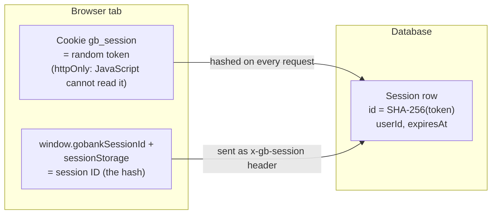
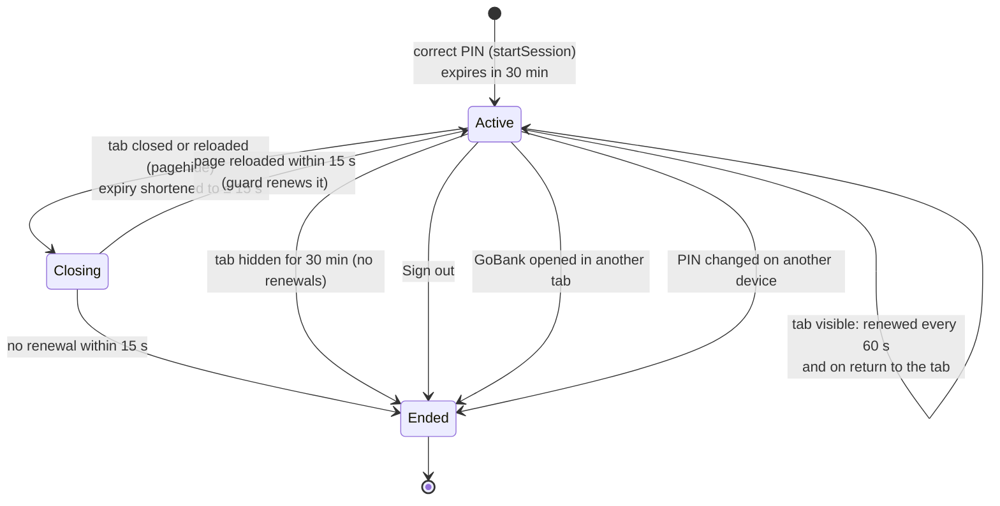

# Sessions: how GoBank remembers you are signed in

**What you will learn:** the complete session system: what is stored in the cookie, the database and the browser tab; how a session starts, is renewed, expires and ends; why opening GoBank in a second tab signs you out; and how reloading a page keeps you signed in. Six files work together:

| File | Role |
| --- | --- |
| `src/features/auth/session.rules.ts` | the constants (shared by server and browser) |
| `src/server/session.ts` | create, find, renew, shorten and end sessions (server) |
| `src/app/api/session/route.ts` | the small HTTP endpoint the browser uses to renew or close its session |
| `src/features/auth/session.client.ts` | remembers which session this **tab** owns (browser) |
| `src/features/auth/components/session-guard.tsx` | keeps the session alive while the app is open (browser) |
| `src/app/(app)/layout.tsx` | refuses to render signed-in pages without a session (server) |

---

## 1. The three places a session lives



| Where | What | Who can read it |
| --- | --- | --- |
| `gb_session` cookie | the **token**: 32 random bytes (256 bits) | only the server (the cookie is `httpOnly`) |
| `Session` table | `id` = **SHA-256(token)**, `userId`, `expiresAt` | only the server |
| the tab (`window` + `sessionStorage`) | the **session ID** (the hash) | page JavaScript, to send the `x-gb-session` header |

A request is accepted only when the cookie hashes to an **unexpired** session *and* (for browser calls) the header equals that session's ID.

---

## 2. The constants

<!-- code: gobank/src/features/auth/session.rules.ts -->
**`gobank/src/features/auth/session.rules.ts`** · all 4 lines

```ts
1 │ export const SESSION_TTL_MS = 30 * 60_000;
2 │ export const SESSION_CLOSE_GRACE_MS = 15_000;
3 │ export const SESSION_HEADER = "x-gb-session";
4 │ export const SESSION_STORAGE_KEY = "gobank:active-session";
```
<!-- /code -->

- A session lives **30 minutes** after its last renewal.
- When a tab closes, the session gets a **15-second** grace period (enough to survive a page reload).
- The header name and the `sessionStorage` key.

---

## 3. The server side: `src/server/session.ts`

<!-- code: gobank/src/server/session.ts -->
**`gobank/src/server/session.ts`** · all 142 lines

```ts
  1 │ import { createHash, randomBytes, randomUUID } from "node:crypto";
  2 │ import { cookies } from "next/headers";
  3 │ import { cache } from "react";
  4 │ import { env } from "~/env";
  5 │ import { db } from "~/server/db";
  6 │ import {
  7 │   SESSION_TTL_MS,
  8 │   SESSION_CLOSE_GRACE_MS,
  9 │ } from "~/features/auth/session.rules";
 10 │
 11 │ const COOKIE = "gb_session";
 12 │
 13 │ const runtime = globalThis as unknown as {
 14 │   gobankDevelopmentSessionId?: string;
 15 │ };
 16 │
 17 │ const developmentId =
 18 │   env.NODE_ENV === "development"
 19 │     ? (runtime.gobankDevelopmentSessionId ??= randomUUID())
 20 │     : null;
 21 │
 22 │ const hash = (token: string) =>
 23 │   createHash("sha256").update(token).digest("hex");
 24 │
 25 │ export async function startSession(userId: string) {
 26 │   const secret = randomBytes(32).toString("base64url");
 27 │   const token = developmentId ? `${developmentId}.${secret}` : secret;
 28 │   const now = new Date();
 29 │
 30 │   const store = await cookies();
 31 │   const previous = store.get(COOKIE)?.value;
 32 │
 33 │   await Promise.all([
 34 │     db.session.deleteMany({
 35 │       where: {
 36 │         OR: [
 37 │           { expiresAt: { lt: now } },
 38 │           ...(previous ? [{ id: hash(previous) }] : []),
 39 │         ],
 40 │       },
 41 │     }),
 42 │     db.session.create({
 43 │       data: {
 44 │         id: hash(token),
 45 │         userId,
 46 │         expiresAt: new Date(now.getTime() + SESSION_TTL_MS),
 47 │       },
 48 │     }),
 49 │   ]);
 50 │
 51 │   store.set(COOKIE, token, {
 52 │     httpOnly: true,
 53 │     sameSite: "lax",
 54 │     secure: env.NODE_ENV === "production",
 55 │     path: "/",
 56 │   });
 57 │
 58 │   return { sessionId: hash(token) };
 59 │ }
 60 │
 61 │ export const currentSession = cache(async () => {
 62 │   const token = (await cookies()).get(COOKIE)?.value;
 63 │   if (!token) return null;
 64 │   if (developmentId && !token.startsWith(`${developmentId}.`)) return null;
 65 │
 66 │   const session = await db.session.findUnique({
 67 │     where: { id: hash(token) },
 68 │     select: { id: true, userId: true, expiresAt: true },
 69 │   });
 70 │   if (!session) return null;
 71 │
 72 │   if (session.expiresAt <= new Date()) {
 73 │     await db.session.deleteMany({
 74 │       where: { id: session.id, expiresAt: session.expiresAt },
 75 │     });
 76 │     return null;
 77 │   }
 78 │
 79 │   return session;
 80 │ });
 81 │
 82 │ export async function renewSession(sessionId: string) {
 83 │   const session = await currentSession();
 84 │   if (session?.id !== sessionId) return null;
 85 │
 86 │   const now = new Date();
 87 │   const expiresAt = new Date(now.getTime() + SESSION_TTL_MS);
 88 │
 89 │   const renewed = await db.session.updateMany({
 90 │     where: { id: session.id, expiresAt: { gt: now } },
 91 │     data: { expiresAt },
 92 │   });
 93 │
 94 │   return renewed.count ? { expiresAt: expiresAt.toISOString() } : null;
 95 │ }
 96 │
 97 │ export async function closeSession(sessionId: string, expectedExpiry: Date) {
 98 │   const session = await currentSession();
 99 │   if (session?.id !== sessionId) return;
100 │
101 │   const now = new Date();
102 │   const expiresAt = new Date(
103 │     Math.min(
104 │       session.expiresAt.getTime(),
105 │       now.getTime() + SESSION_CLOSE_GRACE_MS,
106 │     ),
107 │   );
108 │
109 │   const closed = await db.session.updateMany({
110 │     where: { id: session.id, expiresAt: expectedExpiry },
111 │     data: { expiresAt },
112 │   });
113 │   if (!closed.count) return;
114 │
115 │   const cleanup = setTimeout(
116 │     () => {
117 │       void db.session
118 │         .deleteMany({ where: { id: session.id, expiresAt } })
119 │         .catch(() => undefined);
120 │     },
121 │     Math.max(0, expiresAt.getTime() - now.getTime()),
122 │   );
123 │   cleanup.unref();
124 │ }
125 │
126 │ export async function endOtherSessions(userId: string) {
127 │   const token = (await cookies()).get(COOKIE)?.value ?? "";
128 │
129 │   await db.session.deleteMany({ where: { userId, id: { not: hash(token) } } });
130 │ }
131 │
132 │ export async function endSession(expectedSessionId?: string | null) {
133 │   const store = await cookies();
134 │   const token = store.get(COOKIE)?.value;
135 │
136 │   if (expectedSessionId !== undefined) {
137 │     if (!token || hash(token) !== expectedSessionId) return;
138 │   }
139 │
140 │   if (token) await db.session.deleteMany({ where: { id: hash(token) } });
141 │   store.delete(COOKIE);
142 │ }
```
<!-- /code -->

### Lines 11–23: setup

- Line 11: the cookie's name.
- **Lines 13–20: development-only server ID.** When running `npm run dev`, a random ID is created once per dev-server process (kept on `globalThis` so hot reloads keep it) and put in front of every token: `<devId>.<secret>`. `currentSession` rejects tokens without the current prefix (line 64), so **restarting the dev server signs everyone out**, a clean slate for development. In production `developmentId` is `null` and tokens are just the secret.
- Lines 22–23: `hash()` = SHA-256 in hex (64 characters). It is fast, which is fine because the token is random ([Security concepts](../01-foundations/05-security-concepts.md#3-random-tokens-stored-hashed)).

### Lines 25–59: `startSession(userId)`: after a correct PIN or registration

1. **Line 26:** a new 256-bit random secret (base64url, safe in cookies).
2. **Lines 30–31:** read the cookie this browser *already* has, if any.
3. **Lines 33–49, in parallel:**
   - delete every **expired** session in the whole table (housekeeping, served by the `expiresAt` index) **and** the browser's previous session, so signing in again never leaves an old session alive;
   - create the new row: `id = hash(token)`, `expiresAt = now + 30 minutes`.
4. **Lines 51–56:** set the cookie: `httpOnly` (no JavaScript access), `sameSite: "lax"` (not sent on cross-site POSTs), `secure` in production (HTTPS only), `path: "/"`. There is no `maxAge`, so it is a *browser-session cookie*, deleted when the browser closes.
5. **Line 58:** return the session **ID** (the hash), which the browser stores for its tab.

> **Session fixation** (an attacker planting a known session ID before you sign in) is impossible: every sign-in creates a brand-new random token, and the previous session is deleted.

### Lines 61–80: `currentSession()`: who is this?

Reads the cookie (no cookie → `null`), checks the development prefix, then looks up `hash(token)`. If the row exists but has expired (line 72), it is deleted and `null` is returned. Expired sessions are cleaned up **lazily**: when someone tries to use them, and at every sign-in. Wrapped in React `cache` so a server render looks it up once.

### Lines 82–95: `renewSession(sessionId)`: "I'm still here"

Only the session the cookie belongs to can be renewed (line 84). The update (lines 89–92) sets `expiresAt = now + 30 min` **only if the session has not already expired** (`expiresAt > now`), so an expired session cannot be revived. Returns the new expiry, or `null`.

### Lines 97–124: `closeSession(sessionId, expectedExpiry)`: the tab is going away

1. New expiry = the **earlier** of the current expiry and now + 15 seconds (lines 101–107).
2. Lines 109–113: update **only if** the stored expiry still equals `expectedExpiry`, the value the tab last received. If a renewal happened in between (for example a reload already renewed it), this is a no-op, so a stale "close" message cannot cut a fresh session short.
3. Lines 115–123: schedule deletion after the grace period (only if still unrenewed). `unref()` lets the server shut down without waiting for the timer. If the timer never runs (serverless platforms freeze idle functions), the session still expires correctly because `expiresAt` is always checked.

### Lines 126–130: `endOtherSessions(userId)`

Deletes every session of the user **except the current one**. Called after a successful PIN change, so a thief who knew the old PIN is kicked out everywhere ("Any other devices have been signed out").

### Lines 132–142: `endSession(expectedSessionId?)`

Deletes the current session row and the cookie. If an expected ID is given, it must match the cookie's hash, so a request that does not know this tab's session ID (for example from another site) cannot sign you out.

---

## 4. The browser side: which tab owns the session

<!-- code: gobank/src/features/auth/session.client.ts -->
**`gobank/src/features/auth/session.client.ts`** · all 47 lines

```ts
 1 │ "use client";
 2 │
 3 │ import { SESSION_STORAGE_KEY } from "./session.rules";
 4 │
 5 │ type SessionWindow = Window & { gobankSessionId?: string };
 6 │
 7 │ const sessionWindow = () => window as SessionWindow;
 8 │
 9 │ function wasReloaded() {
10 │   const [navigation] = performance.getEntriesByType("navigation") as
11 │     PerformanceNavigationTiming[] | [];
12 │
13 │   return navigation?.type === "reload";
14 │ }
15 │
16 │ export function activateClientSession(sessionId: string) {
17 │   sessionWindow().gobankSessionId = sessionId;
18 │
19 │   try {
20 │     sessionStorage.setItem(SESSION_STORAGE_KEY, sessionId);
21 │   } catch {
22 │     return;
23 │   }
24 │ }
25 │
26 │ export function clearClientSession() {
27 │   delete sessionWindow().gobankSessionId;
28 │
29 │   try {
30 │     sessionStorage.removeItem(SESSION_STORAGE_KEY);
31 │   } catch {
32 │     return;
33 │   }
34 │ }
35 │
36 │ export function clientSessionId() {
37 │   if (typeof window === "undefined") return null;
38 │
39 │   const active = sessionWindow().gobankSessionId;
40 │   if (active) return active;
41 │
42 │   try {
43 │     return wasReloaded() ? sessionStorage.getItem(SESSION_STORAGE_KEY) : null;
44 │   } catch {
45 │     return null;
46 │   }
47 │ }
```
<!-- /code -->

| Function | What it does |
| --- | --- |
| `activateClientSession(id)` (lines 16–24) | Called after sign-in/registration and by the guard: stores the ID on `window` (lives until the page is unloaded) and in `sessionStorage` (lives as long as **this tab**, survives reloads, is not shared with other tabs) |
| `clearClientSession()` (lines 26–34) | Forgets both |
| `clientSessionId()` (lines 36–47) | The ID this tab owns: the `window` value if present; otherwise, **only if this page load was a reload** (lines 9–14 read the browser's navigation type), the `sessionStorage` value; otherwise `null` |

The `try/catch` blocks exist because `sessionStorage` can throw (private browsing, storage disabled); the app must not crash then.

> **Why only on reload?** Some browsers copy `sessionStorage` into a tab opened from another tab. Accepting it only on a reload means a *new* tab never inherits the session.

---

## 5. The keeper: `SessionGuard`

Every signed-in page is wrapped in it by `(app)/layout.tsx`, which passes the session ID the server found.

<!-- code: gobank/src/features/auth/components/session-guard.tsx -->
**`gobank/src/features/auth/components/session-guard.tsx`** · all 125 lines

```tsx
  1 │ "use client";
  2 │
  3 │ import { useQueryClient } from "@tanstack/react-query";
  4 │ import { useEffect, useState, type ReactNode } from "react";
  5 │ import {
  6 │   activateClientSession,
  7 │   clearClientSession,
  8 │   clientSessionId,
  9 │ } from "../session.client";
 10 │
 11 │ const CHECK_EVERY_MS = 60_000;
 12 │
 13 │ const postSession = (body: Record<string, string>, keepalive = false) =>
 14 │   fetch("/api/session", {
 15 │     method: "POST",
 16 │     headers: { "Content-Type": "application/json" },
 17 │     body: JSON.stringify(body),
 18 │     cache: "no-store",
 19 │     keepalive,
 20 │   });
 21 │
 22 │ const isSignedOut = (response: Response) =>
 23 │   response.status === 401 || response.status === 403;
 24 │
 25 │ export function SessionGuard({
 26 │   sessionId,
 27 │   children,
 28 │ }: {
 29 │   sessionId: string;
 30 │   children: ReactNode;
 31 │ }) {
 32 │   const queryClient = useQueryClient();
 33 │   const [ready, setReady] = useState(false);
 34 │
 35 │   useEffect(() => {
 36 │     let active = true;
 37 │     let renewing = false;
 38 │     let expiresAt: string | null = null;
 39 │
 40 │     const signOutHere = () => {
 41 │       if (!active) return;
 42 │
 43 │       active = false;
 44 │       clearClientSession();
 45 │       queryClient.clear();
 46 │       setReady(false);
 47 │       window.location.replace("/signin");
 48 │     };
 49 │
 50 │     const openedInAnotherTab = clientSessionId() !== sessionId;
 51 │     if (openedInAnotherTab) {
 52 │       void postSession({ action: "end", sessionId }).then(
 53 │         signOutHere,
 54 │         signOutHere,
 55 │       );
 56 │       return () => {
 57 │         active = false;
 58 │       };
 59 │     }
 60 │
 61 │     activateClientSession(sessionId);
 62 │     setReady(true);
 63 │
 64 │     const renew = async () => {
 65 │       if (!active || renewing) return;
 66 │       renewing = true;
 67 │
 68 │       try {
 69 │         const response = await postSession({ action: "resume", sessionId });
 70 │         if (!active) return;
 71 │
 72 │         if (isSignedOut(response)) {
 73 │           signOutHere();
 74 │           return;
 75 │         }
 76 │
 77 │         if (!response.ok) throw new Error("Session check failed");
 78 │
 79 │         const result = (await response.json()) as { expiresAt: string };
 80 │         expiresAt = result.expiresAt;
 81 │       } catch {
 82 │         const expired =
 83 │           expiresAt !== null && Date.parse(expiresAt) <= Date.now();
 84 │         if (expired) signOutHere();
 85 │       } finally {
 86 │         renewing = false;
 87 │       }
 88 │     };
 89 │
 90 │     const shortenOnLeave = () => {
 91 │       if (!expiresAt) return;
 92 │
 93 │       void postSession({ action: "close", sessionId, expiresAt }, true).catch(
 94 │         () => undefined,
 95 │       );
 96 │     };
 97 │
 98 │     const renewIfVisible = () => {
 99 │       if (document.visibilityState === "visible") void renew();
100 │     };
101 │
102 │     void renew();
103 │     const timer = window.setInterval(renewIfVisible, CHECK_EVERY_MS);
104 │     window.addEventListener("pagehide", shortenOnLeave);
105 │     window.addEventListener("pageshow", renewIfVisible);
106 │     document.addEventListener("visibilitychange", renewIfVisible);
107 │
108 │     return () => {
109 │       shortenOnLeave();
110 │       active = false;
111 │       window.clearInterval(timer);
112 │       window.removeEventListener("pagehide", shortenOnLeave);
113 │       window.removeEventListener("pageshow", renewIfVisible);
114 │       document.removeEventListener("visibilitychange", renewIfVisible);
115 │     };
116 │   }, [sessionId, queryClient]);
117 │
118 │   if (ready) return children;
119 │
120 │   return (
121 │     <p role="status" className="text-ink-muted py-8 text-center text-sm">
122 │       Checking your session…
123 │     </p>
124 │   );
125 │ }
```
<!-- /code -->

| Lines | Behavior |
| --- | --- |
| 13–20 | `postSession()` calls `/api/session`. `keepalive: true` lets the "close" request finish even while the page is unloading |
| 40–48 | `signOutHere()`: forget the session, empty the data cache, go to `/signin` |
| **50–59** | **The one-tab rule.** If this tab does not own the server's session (new tab, typed address, bookmark), the guard asks the server to **end** the session, then signs out here. The session cannot be shared between tabs |
| 61–62 | Otherwise: claim the session for this tab and show the page |
| 64–88 | `renew()`: "resume". 401/403 means the session is gone, so sign out. A network error signs out only if the last known expiry has passed |
| 90–96 | `shortenOnLeave()`: "close" with the last known expiry |
| 98–100 | renew only while the tab is **visible** |
| 102–106 | renew now, every 60 seconds, when the page is shown again and when the tab becomes visible; close on `pagehide` |
| 108–115 | cleanup when the component unmounts |
| 118–124 | until ready, show "Checking your session…" |

### The renewal endpoint: `src/app/api/session/route.ts`

<!-- code: gobank/src/app/api/session/route.ts -->
**`gobank/src/app/api/session/route.ts`** · all 44 lines

```ts
 1 │ import { NextResponse } from "next/server";
 2 │ import { z } from "zod";
 3 │ import { closeSession, endSession, renewSession } from "~/server/session";
 4 │
 5 │ const sessionRequest = z
 6 │   .object({
 7 │     action: z.enum(["resume", "close", "end"]),
 8 │     sessionId: z.string().regex(/^[a-f0-9]{64}$/),
 9 │     expiresAt: z.string().datetime().optional(),
10 │   })
11 │   .refine((input) => input.action !== "close" || !!input.expiresAt);
12 │
13 │ const NO_STORE = { "Cache-Control": "no-store" };
14 │
15 │ const reply = (body: unknown, status: number) =>
16 │   NextResponse.json(body, { status, headers: NO_STORE });
17 │
18 │ const isSameOrigin = (request: Request) =>
19 │   request.headers.get("origin") === new URL(request.url).origin;
20 │
21 │ export async function POST(request: Request) {
22 │   if (!isSameOrigin(request)) return reply({ error: "Forbidden" }, 403);
23 │
24 │   const body: unknown = await request.json().catch(() => null);
25 │   const input = sessionRequest.safeParse(body);
26 │   if (!input.success) return reply({ error: "Invalid session request" }, 400);
27 │
28 │   const { action, sessionId, expiresAt } = input.data;
29 │
30 │   if (action === "resume") {
31 │     const session = await renewSession(sessionId);
32 │     return session
33 │       ? reply(session, 200)
34 │       : reply({ error: "Sign in to continue" }, 401);
35 │   }
36 │
37 │   if (action === "close" && expiresAt) {
38 │     await closeSession(sessionId, new Date(expiresAt));
39 │   }
40 │
41 │   if (action === "end") await endSession(sessionId);
42 │
43 │   return new NextResponse(null, { status: 204, headers: NO_STORE });
44 │ }
```
<!-- /code -->

- **Lines 18–22:** `isSameOrigin`: the browser's `Origin` header must equal this site's origin. Requests from other websites get `403`. Another **CSRF** defense.
- **Lines 5–11 and 24–26:** Zod validates the body: an action of `resume`, `close` or `end`; a `sessionId` that looks like a SHA-256 hex string (64 characters); for `close`, an ISO `expiresAt`.
- **Lines 30–35:** `resume` → `renewSession` → `200 { expiresAt }` or `401`.
- **Lines 37–41:** `close` → `closeSession`; `end` → `endSession`. Both reply `204 No Content`.
- **Line 13:** `Cache-Control: no-store`, so no proxy or browser caches session answers.

---

## 6. Every scenario, explained



| What the user does | What happens |
| --- | --- |
| Signs in | New token, cookie set, row created, tab claims the ID |
| Moves between screens | In-app navigation keeps `window.gobankSessionId`; the guard sees a match |
| Leaves the tab open on screen | Renewed every minute, so it stays signed in |
| Switches to another app for over 30 minutes | Renewals pause while hidden. On return the guard's renewal gets `401` and the user is sent to sign in |
| Reloads the page (F5) | `pagehide` shortens the session to 15 s, the page reloads, `clientSessionId()` reads `sessionStorage` (it was a reload), and the guard renews it to 30 minutes |
| Closes the tab | The session expires 15 seconds later |
| Opens GoBank in a second tab, or types the address again | The new page does not own the session, so the guard **ends** it and signs out; the first tab's next renewal fails and it signs out too |
| Taps Sign out | `auth.signOut` → `endSession(header ID)` deletes the row and cookie; the browser forgets the ID and clears cached data |
| Changes the PIN | `endOtherSessions` ends every other session of the account |
| Restarts the dev server | The development prefix changes, so old tokens are rejected (development only) |

> **Precise wording for the defense:** the README says sessions expire "after 30 idle minutes". In the code, "idle" means *the GoBank tab has not been visible*: an open, visible tab is renewed every minute even if nobody touches it. Real banking apps usually also time out after a period without taps or keystrokes; that would be a small addition to `SessionGuard` (see [Limitations](../09-defense/03-limitations-and-future-work.md)).

---

## Defense questions

**Q: How do you manage sessions? Do you use JWT?**
A: No JWT. Sessions are stored in the database: the browser holds a random 256-bit token in an httpOnly cookie, and the database stores only its SHA-256 hash with an expiry. Because sessions are server-side, we can end them instantly: sign out, PIN change and the one-tab rule all delete rows.

**Q: Why does opening a new tab sign me out?**
A: It is a deliberate security rule, like many banking apps: one session belongs to one tab. The tab proves ownership with the session ID it received at sign-in, kept in `sessionStorage`, which is per tab. A page that does not have it ends the session.

**Q: Why does a reload not sign me out?**
A: On `pagehide` the session is only shortened to 15 seconds. The reloaded page recognizes the reload through the browser's navigation timing, reads its session ID from `sessionStorage`, and renews the session.

**Q: If someone steals the database, can they sign in as users?**
A: No. The `Session` table holds only hashes of the tokens; the real tokens exist only in users' cookies, and a hash cannot be reversed into a token.

**Q: How do you protect against CSRF?**
A: The session cookie is `SameSite=Lax`, protected API calls must carry the `x-gb-session` header (other sites cannot add custom headers to your requests), and `/api/session` rejects requests whose `Origin` is not GoBank.

---

## Check yourself

<details>
<summary>What is the difference between the session token and the session ID?</summary>

The token is the random secret in the `httpOnly` cookie. The session ID is SHA-256(token), stored in the database and kept by the tab to send as the `x-gb-session` header.
</details>

<details>
<summary>Why does <code>closeSession</code> require <code>expiresAt</code> to equal <code>expectedExpiry</code>?</summary>

So a late "close" message cannot shorten a session that was already renewed (for example by the reloaded page).
</details>

<details>
<summary>A user leaves GoBank open and visible on their desk for two hours. Are they signed out?</summary>

No. While the tab is visible, `SessionGuard` renews the session every 60 seconds. Expiry happens only after 30 minutes without the tab being visible (or 15 seconds after it is closed).
</details>
