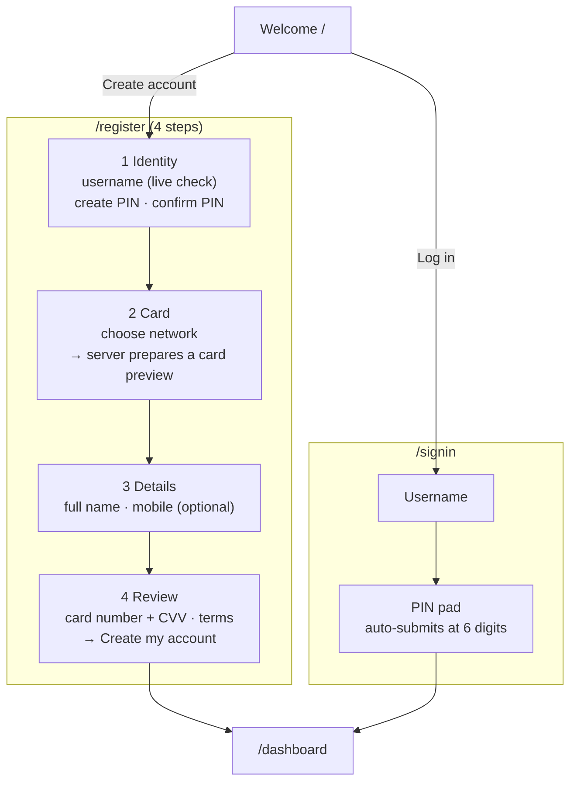

# Registration and sign-in

**What you will learn:** how an account is created (the 4-step sign-up with a real card preview), how sign-in with username + 6-digit PIN works, how wrong PINs lock an account, how a PIN is changed, and every rule a username or PIN must pass. Google sign-in has [its own page](02-google-sign-in.md); the session that sign-in starts is explained in [Sessions](../04-server-core/03-sessions.md).

| Layer | Files |
| --- | --- |
| Rules and schemas | `src/features/auth/auth.rules.ts`, `auth.schemas.ts`, `pin.ts` |
| API | `src/features/auth/auth.router.ts` |
| Services | `src/features/auth/auth.service.ts`, `card-preview.service.ts` |
| Screens | `welcome-screen.tsx`, `welcome-actions.tsx`, `welcome-mascot.tsx`, `registration-flow.tsx`, `step-identity.tsx`, `step-card.tsx`, `step-details.tsx`, `step-review.tsx`, `sign-in-flow.tsx`, `change-pin-flow.tsx`, `sign-out-button.tsx`, `auth-heading.tsx`, `or-divider.tsx` |
| Hook | `src/features/auth/hooks/use-username-check.ts` |
| Pages | `src/app/page.tsx`, `src/app/(auth)/layout.tsx`, `(auth)/register/page.tsx`, `(auth)/signin/page.tsx`, `(app)/settings/pin/page.tsx` |
| Tests | `src/features/auth/auth.test.ts` (7 tests) |

---

## 1. The flows at a glance



---

## 2. The rules: `auth.rules.ts`

These are **pure** functions: no database, safe in the browser *and* the server, unit tested.

<!-- code: gobank/src/features/auth/auth.rules.ts -->
**`gobank/src/features/auth/auth.rules.ts`** · all 97 lines

```ts
 1 │ import type { CardBrandId } from "~/features/card/card-brands";
 2 │
 3 │ export const PIN_LENGTH = 6;
 4 │ export const MAX_PIN_ATTEMPTS = 5;
 5 │ export const PIN_LOCK_MINUTES = 15;
 6 │ export const USERNAME_MIN = 3;
 7 │ export const USERNAME_MAX = 20;
 8 │
 9 │ const RESERVED_USERNAMES = [
10 │   "admin",
11 │   "administrator",
12 │   "support",
13 │   "help",
14 │   "gobank",
15 │   "gobankexpress",
16 │   "root",
17 │   "system",
18 │   "security",
19 │   "billing",
20 │ ];
21 │
22 │ export type UsernameCheck =
23 │   | { state: "idle" }
24 │   | { state: "checking" }
25 │   | { state: "invalid"; message: string }
26 │   | { state: "taken"; message: string }
27 │   | { state: "error"; message: string }
28 │   | { state: "available" };
29 │
30 │ export const cleanUsernameInput = (raw: string) =>
31 │   raw.toLowerCase().replace(/[^a-z0-9_]/g, "");
32 │
33 │ export function validateUsername(raw: string): UsernameCheck {
34 │   const value = raw.trim().toLowerCase();
35 │
36 │   if (value.length === 0) return { state: "idle" };
37 │   if (value.length < USERNAME_MIN) {
38 │     return {
39 │       state: "invalid",
40 │       message: `At least ${USERNAME_MIN} characters`,
41 │     };
42 │   }
43 │   if (value.length > USERNAME_MAX) {
44 │     return {
45 │       state: "invalid",
46 │       message: `At most ${USERNAME_MAX} characters`,
47 │     };
48 │   }
49 │   if (!/^[a-z0-9_]+$/.test(value)) {
50 │     return {
51 │       state: "invalid",
52 │       message: "Letters, numbers and underscore only",
53 │     };
54 │   }
55 │   if (RESERVED_USERNAMES.includes(value)) {
56 │     return { state: "taken", message: "This name is reserved" };
57 │   }
58 │   return { state: "available" };
59 │ }
60 │
61 │ export function validatePin(pin: string): string | null {
62 │   if (!/^\d{6}$/.test(pin)) return `Use ${PIN_LENGTH} digits`;
63 │
64 │   const sameDigitRepeated = /^(\d)\1+$/.test(pin);
65 │   if (sameDigitRepeated) return "Avoid repeating the same digit";
66 │
67 │   const isSequence = "0123456789".includes(pin) || "9876543210".includes(pin);
68 │   if (isSequence) return "Avoid sequences like 123456";
69 │
70 │   return null;
71 │ }
72 │
73 │ export const lockExpiry = (now: Date) =>
74 │   new Date(now.getTime() + PIN_LOCK_MINUTES * 60_000);
75 │
76 │ export function lockMinutesLeft(lockedUntil: Date | null, now: Date) {
77 │   if (!lockedUntil) return 0;
78 │
79 │   const millisecondsLeft = lockedUntil.getTime() - now.getTime();
80 │   return Math.max(0, Math.ceil(millisecondsLeft / 60_000));
81 │ }
82 │
83 │ export type RegistrationDraft = {
84 │   username: string;
85 │   pin: string;
86 │   brand: CardBrandId;
87 │   fullName: string;
88 │   mobile: string;
89 │ };
90 │
91 │ export const EMPTY_DRAFT: RegistrationDraft = {
92 │   username: "",
93 │   pin: "",
94 │   brand: "discover",
95 │   fullName: "",
96 │   mobile: "",
97 │ };
```
<!-- /code -->

### Usernames (lines 6–7, 9–20, 30–59)

| Check | Result |
| --- | --- |
| empty | `idle` (no message while nothing is typed) |
| fewer than 3 characters | "At least 3 characters" |
| more than 20 | "At most 20 characters" |
| anything except `a–z`, `0–9`, `_` | "Letters, numbers and underscore only" |
| one of the 10 reserved names (`admin`, `support`, `gobank`, `root`, `security`, `billing`…) | "This name is reserved" (so nobody can impersonate staff) |
| otherwise | `available` (the server still has to confirm nobody owns it) |

`cleanUsernameInput` (line 30) runs **while typing**: it lowercases and silently removes any other character, so `Maria Clara!` becomes `mariaclara`. The `@` is shown as a fixed prefix in the text field, not typed.

### PINs (lines 61–71)

| PIN | Result | Why |
| --- | --- | --- |
| `12345`, `12a456` | "Use 6 digits" | exactly six digits |
| `111111`, `000000` | "Avoid repeating the same digit" | `^(\d)\1+$` = one digit repeated |
| `123456`, `345678`, `987654`, `012345` | "Avoid sequences like 123456" | the PIN appears inside `0123456789` or `9876543210` |
| `135790`, `246802` | accepted | |

> These rules block the most commonly guessed PINs. They do not block every weak PIN (for example `112233` or a birthday), which is why the lockout below matters.

### Lockout helpers (lines 73–81)

- `lockExpiry(now)` = now + 15 minutes.
- `lockMinutesLeft(lockedUntil, now)` rounds **up** to whole minutes and never goes below 0: with 1 millisecond left it still says "1 minute".

### The registration draft (lines 83–97)

The data the browser collects across the four steps. The default card network is **Discover**.

---

## 3. The server-side schemas: `auth.schemas.ts`

<!-- code: gobank/src/features/auth/auth.schemas.ts -->
**`gobank/src/features/auth/auth.schemas.ts`** · all 55 lines

```ts
 1 │ import { z } from "zod";
 2 │ import {
 3 │   PIN_LENGTH,
 4 │   USERNAME_MAX,
 5 │   USERNAME_MIN,
 6 │   validatePin,
 7 │   validateUsername,
 8 │ } from "./auth.rules";
 9 │ import {
10 │   isSupportedCardBrand,
11 │   type CardBrandId,
12 │ } from "~/features/card/card-brands";
13 │
14 │ export const cardBrand = z.custom<CardBrandId>(
15 │   isSupportedCardBrand,
16 │   "Choose a supported card network",
17 │ );
18 │
19 │ export const pinDigits = z
20 │   .string()
21 │   .regex(/^\d{6}$/, `Use ${PIN_LENGTH} digits`);
22 │
23 │ export const pin = pinDigits.superRefine((value, context) => {
24 │   const message = validatePin(value);
25 │   if (message) context.addIssue({ code: z.ZodIssueCode.custom, message });
26 │ });
27 │
28 │ export const pinChange = z
29 │   .object({ currentPin: pinDigits, newPin: pin })
30 │   .refine((input) => input.currentPin !== input.newPin, {
31 │     message: "Choose a different PIN",
32 │     path: ["newPin"],
33 │   });
34 │
35 │ export const username = z
36 │   .string()
37 │   .trim()
38 │   .toLowerCase()
39 │   .refine(
40 │     (value) => validateUsername(value).state === "available",
41 │     "Choose another username",
42 │   );
43 │
44 │ export const existingUsername = z
45 │   .string()
46 │   .trim()
47 │   .toLowerCase()
48 │   .transform((value) => value.replace(/^@/, ""))
49 │   .pipe(
50 │     z
51 │       .string()
52 │       .min(USERNAME_MIN)
53 │       .max(USERNAME_MAX)
54 │       .regex(/^[a-z0-9_]+$/),
55 │   );
```
<!-- /code -->

| Schema | Used for | Note |
| --- | --- | --- |
| `cardBrand` (14–17) | the chosen network | uses the type guard from `card-brands.ts` |
| `pinDigits` (19–21) | **existing** PINs (sign-in, current PIN) | only "6 digits", so an old PIN created before the rules existed still works |
| `pin` (23–26) | **new** PINs (registration, new PIN) | 6 digits **and** `validatePin` |
| `pinChange` (28–33) | changing the PIN | the new PIN must differ from the current one; the error is attached to the `newPin` field |
| `username` (35–42) | **new** usernames | trimmed, lowercased, must be `available` (reserved names fail) |
| `existingUsername` (44–55) | sign-in | trimmed, lowercased, a leading `@` removed, then length and characters checked |

---

## 4. The API: `auth.router.ts`

<!-- code: gobank/src/features/auth/auth.router.ts -->
**`gobank/src/features/auth/auth.router.ts`** · all 64 lines

```ts
 1 │ import { z } from "zod";
 2 │ import { profileFields } from "~/shared/lib/schemas";
 3 │ import {
 4 │   cardBrand,
 5 │   existingUsername,
 6 │   pin,
 7 │   pinChange,
 8 │   pinDigits,
 9 │   username,
10 │ } from "./auth.schemas";
11 │ import { endSession } from "~/server/session";
12 │ import {
13 │   createTRPCRouter,
14 │   protectedProcedure,
15 │   publicProcedure,
16 │ } from "~/server/trpc";
17 │ import { changePin, isUsernameFree, register, signIn } from "./auth.service";
18 │ import { prepareRegistrationCard } from "./card-preview.service";
19 │ import { signInWithGooglePin } from "./google/google.service";
20 │
21 │ export const authRouter = createTRPCRouter({
22 │   prepareCard: publicProcedure
23 │     .input(z.object({ brand: cardBrand }))
24 │     .mutation(({ input }) => prepareRegistrationCard(input.brand)),
25 │
26 │   usernameAvailable: publicProcedure
27 │     .input(z.object({ username: z.string() }))
28 │     .query(({ input }) => {
29 │       const parsed = username.safeParse(input.username);
30 │       return parsed.success ? isUsernameFree(parsed.data) : false;
31 │     }),
32 │
33 │   register: publicProcedure
34 │     .input(
35 │       z.object({
36 │         username,
37 │         pin,
38 │         brand: cardBrand,
39 │         withGoogle: z.boolean().default(false),
40 │         ...profileFields,
41 │       }),
42 │     )
43 │     .mutation(({ input: { withGoogle, ...profile } }) =>
44 │       register(profile, withGoogle),
45 │     ),
46 │
47 │   signIn: publicProcedure
48 │     .input(z.object({ username: existingUsername, pin: pinDigits }))
49 │     .mutation(({ input }) => signIn(input.username, input.pin)),
50 │
51 │   signInWithGooglePin: publicProcedure
52 │     .input(z.object({ pin: pinDigits }))
53 │     .mutation(({ input }) => signInWithGooglePin(input.pin)),
54 │
55 │   signOut: publicProcedure.mutation(({ ctx }) =>
56 │     endSession(ctx.browserSession?.id),
57 │   ),
58 │
59 │   changePin: protectedProcedure
60 │     .input(pinChange)
61 │     .mutation(({ ctx, input }) =>
62 │       changePin(ctx.userId, input.currentPin, input.newPin),
63 │     ),
64 │ });
```
<!-- /code -->

| Procedure | Access | Does |
| --- | --- | --- |
| `prepareCard` | public | create the card preview for the chosen network |
| `usernameAvailable` | public | `true` only if the name passes the rules **and** no user has it |
| `register` | public | create the account and sign in |
| `signIn` | public | username + PIN → session |
| `signInWithGooglePin` | public | PIN after Google → session ([Google sign-in](02-google-sign-in.md)) |
| `signOut` | public | end this tab's session (only if the tab's session-ID header matches the cookie) |
| `changePin` | **protected** | current PIN + new PIN |

They are public because a signed-out person must be able to call them. `signOut` is public so it still works when the session has already expired.

---

## 5. The card preview: `card-preview.service.ts`

Before the account exists, the user already sees **their real card number and CVV** on the review screen. That needs a card generated *before* registration, kept on the server, and guaranteed to be the one actually issued.

<!-- code: gobank/src/features/auth/card-preview.service.ts -->
**`gobank/src/features/auth/card-preview.service.ts`** · all 96 lines

```ts
 1 │ import { createHash, randomBytes } from "node:crypto";
 2 │ import { cookies } from "next/headers";
 3 │ import type { Prisma } from "../../../generated/prisma";
 4 │ import type { CardBrandId } from "~/features/card/card-brands";
 5 │ import { newCardCredentials } from "~/features/card/card-credentials.server";
 6 │ import { db } from "~/server/db";
 7 │ import { fail } from "~/server/errors";
 8 │
 9 │ const COOKIE = "gb_registration_card";
10 │ const MAX_AGE_SECONDS = 30 * 60;
11 │
12 │ export const cardDraftId = (token: string) =>
13 │   createHash("sha256").update(token).digest("hex");
14 │
15 │ export async function createCardPreview(brand: CardBrandId) {
16 │   const token = randomBytes(32).toString("base64url");
17 │   const { card, cvv } = newCardCredentials(brand);
18 │   const validUntil = new Date(Date.now() + MAX_AGE_SECONDS * 1000);
19 │
20 │   await db.registrationCard.deleteMany({
21 │     where: { validUntil: { lte: new Date() } },
22 │   });
23 │   await db.registrationCard.create({
24 │     data: { id: cardDraftId(token), ...card, validUntil },
25 │   });
26 │
27 │   return {
28 │     token,
29 │     preview: {
30 │       brand,
31 │       number: card.number,
32 │       cvv,
33 │       expiresAt: card.expiresAt.toISOString(),
34 │       validUntil: validUntil.toISOString(),
35 │     },
36 │   };
37 │ }
38 │
39 │ export async function prepareRegistrationCard(brand: CardBrandId) {
40 │   const store = await cookies();
41 │   const previousToken = store.get(COOKIE)?.value;
42 │
43 │   const prepared = await createCardPreview(brand);
44 │
45 │   if (previousToken) {
46 │     await db.registrationCard.deleteMany({
47 │       where: { id: cardDraftId(previousToken) },
48 │     });
49 │   }
50 │
51 │   store.set(COOKIE, prepared.token, {
52 │     httpOnly: true,
53 │     sameSite: "strict",
54 │     secure: process.env.NODE_ENV === "production",
55 │     path: "/",
56 │     maxAge: MAX_AGE_SECONDS,
57 │   });
58 │
59 │   return prepared.preview;
60 │ }
61 │
62 │ export async function registrationCardToken() {
63 │   return (await cookies()).get(COOKIE)?.value ?? "";
64 │ }
65 │
66 │ export async function clearRegistrationCard() {
67 │   (await cookies()).delete(COOKIE);
68 │ }
69 │
70 │ export async function consumeRegistrationCard(
71 │   tx: Prisma.TransactionClient,
72 │   token: string,
73 │   brand: CardBrandId,
74 │ ) {
75 │   const id = cardDraftId(token);
76 │   const card = await tx.registrationCard.findUnique({ where: { id } });
77 │
78 │   const usable = card?.brand === brand && card.validUntil > new Date();
79 │   if (!card || !usable) {
80 │     return fail("BAD_REQUEST", "Refresh your card details before confirming.");
81 │   }
82 │
83 │   const consumed = await tx.registrationCard.deleteMany({
84 │     where: { id, brand, validUntil: { gt: new Date() } },
85 │   });
86 │   if (consumed.count !== 1) {
87 │     return fail("CONFLICT", "This card preview has already been used.");
88 │   }
89 │
90 │   return {
91 │     brand: card.brand,
92 │     number: card.number,
93 │     cvvEncrypted: card.cvvEncrypted,
94 │     expiresAt: card.expiresAt,
95 │   };
96 │ }
```
<!-- /code -->

| Lines | Step |
| --- | --- |
| 9–13 | Cookie name, 30-minute life, and `cardDraftId(token)` = SHA-256 of the token |
| 15–37 | `createCardPreview`: make a random 256-bit token; generate a card (number, encrypted CVV, expiry) **and** keep the plain CVV for the screen; delete all expired previews; store the preview under `id = hash(token)`; return the token and what the screen shows |
| 39–60 | `prepareRegistrationCard`: create a new preview, delete the browser's previous one (changing the network does not leave old cards behind), and store the token in an `httpOnly`, `SameSite=Strict` cookie for 30 minutes |
| 70–96 | `consumeRegistrationCard` (inside the registration transaction): find the preview by `hash(token)`; it must match the chosen network and be unexpired ("Refresh your card details before confirming."); then delete it **with the same conditions** and require exactly 1 deleted row, so it can be consumed only once even if two registrations race ("This card preview has already been used."); return the card data |

> **Why a cookie and a hash?** The browser cannot read or forge the token (`httpOnly`), and the database stores only its hash. Even someone with database access cannot claim another person's preview. The integration test proves a used token cannot create a second account.

---

## 6. Creating the account: `auth.service.ts` (lines 43–107)

<!-- code: gobank/src/features/auth/auth.service.ts 43-107 -->
**`gobank/src/features/auth/auth.service.ts`** · lines 43–107

```ts
 43 │ const SLOW_TRANSACTION = { maxWait: 30_000, timeout: 30_000 };
 44 │
 45 │ export async function isUsernameFree(username: string) {
 46 │   const taken = await db.user.findUnique({
 47 │     where: { username },
 48 │     select: { id: true },
 49 │   });
 50 │
 51 │   return !taken;
 52 │ }
 53 │
 54 │ export async function createRegisteredAccount(
 55 │   { pin, brand, ...profile }: Registration,
 56 │   token: string,
 57 │ ) {
 58 │   const pinHash = await hashPin(pin);
 59 │
 60 │   return db.$transaction(async (tx) => {
 61 │     const physical = await consumeRegistrationCard(tx, token, brand);
 62 │     const physicalCvv = decryptCvv(
 63 │       physical.cvvEncrypted,
 64 │       physical.number,
 65 │       env.CARD_ENCRYPTION_KEY,
 66 │     );
 67 │
 68 │     const virtual = newCardCredentials(virtualCardBrand(brand), physicalCvv);
 69 │
 70 │     return tx.user.create({
 71 │       data: {
 72 │         ...profile,
 73 │         pinHash,
 74 │         accountNumber: newAccountNumber(),
 75 │         cards: {
 76 │           create: [
 77 │             { ...physical, kind: "physical" },
 78 │             { ...virtual.card, kind: "virtual" },
 79 │           ],
 80 │         },
 81 │       },
 82 │       select: { id: true },
 83 │     });
 84 │   }, SLOW_TRANSACTION);
 85 │ }
 86 │
 87 │ export async function register(profile: Registration, withGoogle: boolean) {
 88 │   const google = withGoogle ? await pendingGoogleIdentity() : null;
 89 │   if (withGoogle && !google) {
 90 │     fail("UNAUTHORIZED", "Your Google sign-in expired. Choose Google again.");
 91 │   }
 92 │
 93 │   const registration = google
 94 │     ? { ...profile, googleId: google.sub, gmail: google.gmail }
 95 │     : profile;
 96 │
 97 │   const user = await createRegisteredAccount(
 98 │     registration,
 99 │     await registrationCardToken(),
100 │   );
101 │
102 │   const session = await startSession(user.id);
103 │   await clearRegistrationCard();
104 │   await forgetGoogleIdentity();
105 │
106 │   return { created: true, ...session };
107 │ }
```
<!-- /code -->

### `createRegisteredAccount` (lines 54–85)

1. **Line 58: hash the PIN *before* opening the transaction.** scrypt is deliberately slow; doing it outside keeps the transaction (and its locks) short.
2. **Line 61:** consume the card preview. It becomes the **physical** card.
3. **Lines 62–66:** decrypt the physical card's CVV, only so that…
4. **Line 68:** …the **virtual** card gets a *different* CVV and a *different* network (`virtualCardBrand`: Visa → Mastercard, everything else → Visa).
5. **Lines 70–83:** create the user with the PIN hash, a new account number and **both cards** in one nested `create`.
6. **Line 84:** `SLOW_TRANSACTION` (30 s wait, 30 s timeout) instead of Prisma's defaults (2 s, 5 s), to tolerate slow moments such as a sleeping Neon database waking up.

If anything fails (for example the username was taken a moment ago and the insert hits the unique constraint → "That username is already taken"), the transaction rolls back, **including the preview deletion**, so the user can simply try again.

### `register` (lines 87–107)

1. **Lines 88–91:** if the sign-up started with Google, the pending Google identity must still be valid (a signed cookie, 15 minutes), otherwise "Your Google sign-in expired. Choose Google again."
2. **Lines 93–95:** with Google, add `googleId` and `gmail` to the new account.
3. **Lines 97–100:** create the account using the preview token from the cookie.
4. **Lines 102–104:** start a session, delete the preview cookie, forget the Google identity.
5. **Line 106:** return `{ created: true, sessionId }`. The browser claims the session for its tab.

---

## 7. Checking a PIN, safely: `auth.service.ts` (lines 109–180)

<!-- code: gobank/src/features/auth/auth.service.ts 109-180 -->
**`gobank/src/features/auth/auth.service.ts`** · lines 109–180

```ts
109 │ async function checkPinAndUpdateAttempts(
110 │   userId: string,
111 │   pin: string,
112 │   newPinHash?: string,
113 │ ) {
114 │   return db.$transaction(async (tx) => {
115 │     const [user] = await tx.$queryRaw<PinAccount[]>`
116 │       SELECT "pinHash", "failedPinAttempts", "lockedUntil"
117 │       FROM "User" WHERE "id" = ${userId} FOR UPDATE
118 │     `;
119 │     if (!user) return fail("NOT_FOUND", MESSAGES.accountNotFound);
120 │
121 │     const now = new Date();
122 │     const minutesLeft = lockMinutesLeft(user.lockedUntil, now);
123 │     if (minutesLeft > 0) return { correct: false, minutesLeft };
124 │
125 │     const correct = await verifyPin(pin, user.pinHash);
126 │     const attempts = correct ? 0 : user.failedPinAttempts + 1;
127 │     const lockNow = attempts >= MAX_PIN_ATTEMPTS;
128 │
129 │     await tx.user.update({
130 │       where: { id: userId },
131 │       data: {
132 │         failedPinAttempts: lockNow ? 0 : attempts,
133 │         lockedUntil: lockNow ? lockExpiry(now) : null,
134 │         ...(correct && newPinHash ? { pinHash: newPinHash } : {}),
135 │       },
136 │       select: { id: true },
137 │     });
138 │
139 │     return { correct, minutesLeft: lockNow ? PIN_LOCK_MINUTES : 0 };
140 │   }, SLOW_TRANSACTION);
141 │ }
142 │
143 │ export async function verifyAccountPin(
144 │   userId: string,
145 │   pin: string,
146 │   wrongMessage: string,
147 │   newPinHash?: string,
148 │ ) {
149 │   const outcome = await checkPinAndUpdateAttempts(userId, pin, newPinHash);
150 │   if (outcome.correct) return;
151 │
152 │   if (outcome.minutesLeft > 0) {
153 │     fail("TOO_MANY_REQUESTS", MESSAGES.pinLocked(outcome.minutesLeft));
154 │   }
155 │
156 │   fail("UNAUTHORIZED", wrongMessage);
157 │ }
158 │
159 │ export async function signIn(username: string, pin: string) {
160 │   const user = await db.user.findUnique({
161 │     where: { username },
162 │     select: { id: true },
163 │   });
164 │   if (!user) return fail("UNAUTHORIZED", MESSAGES.wrongCredentials);
165 │
166 │   await verifyAccountPin(user.id, pin, MESSAGES.wrongCredentials);
167 │
168 │   return startSession(user.id);
169 │ }
170 │
171 │ export async function changePin(
172 │   userId: string,
173 │   currentPin: string,
174 │   newPin: string,
175 │ ) {
176 │   const newPinHash = await hashPin(newPin);
177 │
178 │   await verifyAccountPin(userId, currentPin, MESSAGES.wrongPin, newPinHash);
179 │   await endOtherSessions(userId);
180 │ }
```
<!-- /code -->

### `checkPinAndUpdateAttempts` (lines 109–141): the lockout

| Lines | Step | Why |
| --- | --- | --- |
| 115–118 | read the PIN hash and attempt counters **with `FOR UPDATE`** | Locks the user's row, so 100 guesses sent at once are processed **one at a time** and each one counts. Without the lock, parallel guesses could all read "0 failed attempts" |
| 119 | user vanished → "This account no longer exists." | |
| 121–123 | still locked → return how many minutes remain, **without checking the PIN** | During a lock even the correct PIN is refused |
| 125 | `verifyPin` (scrypt + constant-time compare) | |
| 126 | correct → reset to 0; wrong → +1 | |
| 127 | 5 failures → lock now | |
| 129–137 | save: on lock, reset the counter to 0 and set `lockedUntil` = now + 15 min; otherwise store the count and clear `lockedUntil`; if correct **and** a new PIN hash was given, swap in the new hash in the **same** update | |
| 139 | report `{ correct, minutesLeft }` | the 5th wrong PIN immediately reports a 15-minute lock |

### `verifyAccountPin` (lines 143–157)

Turns the outcome into errors: locked → `TOO_MANY_REQUESTS` "Too many wrong PINs. Try again in N minutes."; wrong → `UNAUTHORIZED` with the caller's message.

### `signIn` (lines 159–169)

Unknown username → the **same** "Wrong username or PIN" as a wrong PIN, so the error does not reveal which usernames exist. Then verify the PIN, then `startSession`.

### `changePin` (lines 171–180)

1. Hash the **new** PIN first (outside the transaction).
2. Verify the **current** PIN with the lockout rules; if correct, the new hash is saved in the same update. A wrong current PIN therefore counts toward the lockout, just like a wrong sign-in.
3. `endOtherSessions`: every other device is signed out.

### Timeline of a lockout

| Attempt | Result |
| --- | --- |
| Wrong PIN #1–#4 | "Wrong username or PIN"; counter 1…4 |
| Wrong PIN #5 | locked; "Too many wrong PINs. Try again in 15 minutes." |
| Any PIN within 15 minutes, even the right one | "…Try again in N minutes." (counts down) |
| After 15 minutes, correct PIN | signed in; counter back to 0 |

---

## 8. Hashing the PIN: `pin.ts`

scrypt with a random 16-byte salt, stored as `salt:key` (161 characters), verified with `timingSafeEqual`. Line-by-line in [Security concepts](../01-foundations/05-security-concepts.md#2-hashing-pins-properly).

---

## 9. The screens

### Welcome (`/`)

`src/app/page.tsx` (a server component) decides whether Google is enabled and turns a `?google=…` code into a message. Only known codes are accepted (`Object.hasOwn`), so a crafted link cannot inject text. `WelcomeScreen` shows the logo, **Gobi** the mascot (`welcome-mascot.tsx`: an SVG coin character with three floating chips "₱500 sent", "+10 points", "GoalSave 4% p.a."; the chips are decorative and hidden from screen readers, the SVG has a descriptive label), the headline "Send, save and earn in one app.", an error notice if any, and `WelcomeActions`: **Create account**, **Log in**, and **Continue with Google** when configured.

### Registration: `registration-flow.tsx`

<!-- code: gobank/src/features/auth/components/registration-flow.tsx 86-162 -->
**`gobank/src/features/auth/components/registration-flow.tsx`** · lines 86–162

```tsx
 86 │ export function RegistrationFlow({
 87 │   initialFullName,
 88 │   gmail,
 89 │   withGoogle,
 90 │ }: RegistrationFlowProps) {
 91 │   const router = useRouter();
 92 │   const queryClient = useQueryClient();
 93 │
 94 │   const [draft, setDraft] = useState<RegistrationDraft>({
 95 │     ...EMPTY_DRAFT,
 96 │     fullName: initialFullName,
 97 │   });
 98 │   const [step, setStep] = useState<number>(STEP.identity);
 99 │   const [card, setCard] = useState<CardPreview | null>(null);
100 │   const preparingCard = useRef(false);
101 │
102 │   const prepare = api.auth.prepareCard.useMutation();
103 │   const register = api.auth.register.useMutation({
104 │     onSuccess: ({ sessionId }) => {
105 │       activateClientSession(sessionId);
106 │       queryClient.clear();
107 │       router.replace("/dashboard");
108 │       router.refresh();
109 │     },
110 │   });
111 │
112 │   const busy = () => preparingCard.current || register.isPending;
113 │
114 │   const patch = (next: Partial<RegistrationDraft>) => {
115 │     setDraft((current) => ({ ...current, ...next }));
116 │     register.reset();
117 │   };
118 │
119 │   const prepareCard = (goToDetails: boolean) => {
120 │     if (busy()) return;
121 │
122 │     if (goToDetails && stillValid(card, draft.brand)) {
123 │       prepare.reset();
124 │       setStep(STEP.details);
125 │       return;
126 │     }
127 │
128 │     preparingCard.current = true;
129 │     setCard(null);
130 │     register.reset();
131 │
132 │     prepare.mutate(
133 │       { brand: draft.brand },
134 │       {
135 │         onSuccess: (preview) => {
136 │           setCard(preview);
137 │           if (goToDetails) setStep(STEP.details);
138 │         },
139 │         onSettled: () => {
140 │           preparingCard.current = false;
141 │         },
142 │       },
143 │     );
144 │   };
145 │
146 │   const selectBrand = (brand: CardBrandId) => {
147 │     if (preparingCard.current || brand === draft.brand) return;
148 │
149 │     patch({ brand });
150 │     setCard(null);
151 │     prepare.reset();
152 │   };
153 │
154 │   const submit = () =>
155 │     register.mutate({
156 │       username: draft.username,
157 │       pin: draft.pin,
158 │       brand: draft.brand,
159 │       fullName: draft.fullName,
160 │       mobile: draft.mobile,
161 │       withGoogle,
162 │     });
```
<!-- /code -->

| Lines | Behavior |
| --- | --- |
| 94–100 | The draft (prefilled with the Google name if any), the current step, the card preview, and `preparingCard`, a **ref** used as a lock so two quick taps cannot request two previews |
| 102–110 | `prepare` and `register` mutations; on successful registration: claim the session for this tab, clear cached data, go to the dashboard |
| 112 | `busy()` = preparing a card or creating the account |
| 114–117 | `patch()` updates the draft and clears an old error |
| 119–144 | `prepareCard(goToDetails)`: reuse a still-valid preview of the same network instead of making a new one; otherwise ask the server for one |
| 146–152 | changing the network discards the old preview |
| 154–162 | `submit()` sends everything (plus whether it started with Google) |

`stillValid` (lines 29–30) treats a preview as reusable only if it has the same network and has not passed `validUntil`.

### Step 1, Identity: `step-identity.tsx` + `use-username-check.ts`

<!-- code: gobank/src/features/auth/hooks/use-username-check.ts -->
**`gobank/src/features/auth/hooks/use-username-check.ts`** · all 44 lines

```ts
 1 │ import { useDebouncedValue } from "~/shared/hooks/use-debounced-value";
 2 │ import { api } from "~/trpc/react";
 3 │ import { validateUsername, type UsernameCheck } from "../auth.rules";
 4 │
 5 │ const TYPING_PAUSE_MS = 380;
 6 │
 7 │ type Lookup = {
 8 │   waiting: boolean;
 9 │   failed: boolean;
10 │   available: boolean | undefined;
11 │ };
12 │
13 │ function describeLookup({ waiting, failed, available }: Lookup): UsernameCheck {
14 │   if (waiting) return { state: "checking" };
15 │   if (failed) {
16 │     return { state: "error", message: "Could not check this username." };
17 │   }
18 │
19 │   return available
20 │     ? { state: "available" }
21 │     : { state: "taken", message: "Already taken" };
22 │ }
23 │
24 │ export function useUsernameCheck(username: string) {
25 │   const debounced = useDebouncedValue(username, TYPING_PAUSE_MS);
26 │   const local = validateUsername(username);
27 │   const doneTyping = debounced === username;
28 │
29 │   const lookup = api.auth.usernameAvailable.useQuery(
30 │     { username: debounced },
31 │     { enabled: local.state === "available" && doneTyping },
32 │   );
33 │
34 │   const check =
35 │     local.state === "available"
36 │       ? describeLookup({
37 │           waiting: !doneTyping || lookup.isPending,
38 │           failed: lookup.isError,
39 │           available: lookup.data,
40 │         })
41 │       : local;
42 │
43 │   return { check, retry: () => lookup.refetch() };
44 │ }
```
<!-- /code -->

1. The username is validated **locally** on every keystroke (instant messages, no network).
2. Only when it is locally valid **and** the user has paused typing for 380 ms (`useDebouncedValue`) does it ask the server `usernameAvailable`.
3. The result becomes one of `checking`, `available` (green check), `taken` ("Already taken") or `error` ("Could not check this username." with **Try again**).

<!-- code: gobank/src/features/auth/components/step-identity.tsx 117-165 -->
**`gobank/src/features/auth/components/step-identity.tsx`** · lines 117–165

```tsx
117 │ export function StepIdentity({
118 │   username,
119 │   onUsernameChange,
120 │   onComplete,
121 │ }: StepIdentityProps) {
122 │   const [phase, setPhase] = useState<Phase>("username");
123 │   const [pin, setPin] = useState("");
124 │   const [confirmation, setConfirmation] = useState("");
125 │   const [pinError, setPinError] = useState<string | null>(null);
126 │
127 │   const startOver = (error: string | null) => {
128 │     setPinError(error);
129 │     setPin("");
130 │     setConfirmation("");
131 │   };
132 │
133 │   const enterPin = (value: string) => {
134 │     setPinError(null);
135 │     setPin(value);
136 │     if (value.length < PIN_LENGTH) return;
137 │
138 │     const problem = validatePin(value);
139 │     if (problem) {
140 │       startOver(problem);
141 │       return;
142 │     }
143 │
144 │     setConfirmation("");
145 │     setPhase("confirm");
146 │   };
147 │
148 │   const confirmPin = (value: string) => {
149 │     setPinError(null);
150 │     setConfirmation(value);
151 │     if (value.length < PIN_LENGTH) return;
152 │
153 │     if (value !== pin) {
154 │       startOver("Those did not match. Start again.");
155 │       setPhase("pin");
156 │       return;
157 │     }
158 │
159 │     onComplete(pin);
160 │   };
161 │
162 │   const goBack = () => {
163 │     startOver(null);
164 │     setPhase(phase === "confirm" ? "pin" : "username");
165 │   };
```
<!-- /code -->

Then the PIN pad asks twice. A PIN that breaks the rules is rejected immediately with the reason (lines 138–142); a confirmation that does not match restarts PIN entry with "Those did not match. Start again." (lines 153–157). Back from "confirm" returns to "create"; back from "create" returns to the username.

### Step 2, Card: `step-card.tsx`

A live `BankCard` preview in the chosen network with the name typed so far ("YOUR NAME" if empty), and four network buttons (`aria-pressed` marks the selected one). **Continue** calls `prepareCard(true)`, and the button reads "Preparing card…" while the server works.

### Step 3, Details: `step-details.tsx`

`ProfileFields` (full name, required, 2–80 characters, "Printed on your card."; mobile, optional, `09XXXXXXXXX`, "Lets friends pay you by number."). If the sign-up came from Google, the linked Gmail is displayed. Continue is disabled until the fields are valid.

### Step 4, Review: `step-review.tsx`

- The card with its **number** (shown by default, with a hide toggle) and expiry.
- Rows: username, **PIN** (hidden as dots until you tap the eye), network, **CVV** (hidden; when shown it can be copied), full name, mobile ("Not set" if empty).
- A terms checkbox. A visually hidden real `<input type="checkbox">` keeps it keyboard- and screen-reader-accessible while a styled box is drawn next to it.
- **Create my account** is disabled until the terms are accepted. While submitting it shows a spinner and "Opening your account". If the server refuses (for example the preview expired), the error appears with **Refresh card details**, which prepares a fresh preview.

### Sign-in: `sign-in-flow.tsx`

<!-- code: gobank/src/features/auth/components/sign-in-flow.tsx 116-172 -->
**`gobank/src/features/auth/components/sign-in-flow.tsx`** · lines 116–172

```tsx
116 │ export function SignInFlow({ googleEnabled, googleUsername }: SignInFlowProps) {
117 │   const router = useRouter();
118 │   const queryClient = useQueryClient();
119 │   const viaGoogle = Boolean(googleUsername);
120 │
121 │   const [phase, setPhase] = useState<"username" | "pin">(
122 │     viaGoogle ? "pin" : "username",
123 │   );
124 │   const [username, setUsername] = useState(googleUsername ?? "");
125 │   const [pin, setPin] = useState("");
126 │
127 │   const finishSignIn = ({ sessionId }: { sessionId: string }) => {
128 │     activateClientSession(sessionId);
129 │     queryClient.clear();
130 │     router.replace("/dashboard");
131 │     router.refresh();
132 │   };
133 │
134 │   const clearPin = () => setPin("");
135 │
136 │   const manualSignIn = api.auth.signIn.useMutation({
137 │     onSuccess: finishSignIn,
138 │     onError: clearPin,
139 │   });
140 │   const googleSignIn = api.auth.signInWithGooglePin.useMutation({
141 │     onSuccess: finishSignIn,
142 │     onError: clearPin,
143 │   });
144 │   const signIn = viaGoogle ? googleSignIn : manualSignIn;
145 │
146 │   const busy = signIn.isPending || signIn.isSuccess;
147 │
148 │   const enterPin = (next: string) => {
149 │     if (busy) return;
150 │     if (signIn.isError) signIn.reset();
151 │
152 │     setPin(next);
153 │     if (next.length < PIN_LENGTH) return;
154 │
155 │     if (viaGoogle) {
156 │       googleSignIn.mutate({ pin: next });
157 │     } else {
158 │       manualSignIn.mutate({ username, pin: next });
159 │     }
160 │   };
161 │
162 │   const backToUsername = () => {
163 │     setPin("");
164 │     signIn.reset();
165 │
166 │     if (viaGoogle) {
167 │       router.replace("/signin");
168 │       return;
169 │     }
170 │
171 │     setPhase("username");
172 │   };
```
<!-- /code -->

- Two phases: username, then PIN (Google mode starts directly at the PIN with the username filled in).
- **Lines 148–160:** the PIN pad **submits automatically on the 6th digit**; no "Log in" button is needed.
- **Lines 136–143:** on error, the PIN is cleared, the row of dots shakes (`invalid` adds the `animate-shake` animation), and the server's message shows in red ("Wrong username or PIN" or the lock message).
- **Lines 127–132:** on success: claim the session for this tab, clear cached data, replace the URL with `/dashboard` (so Back does not return to the PIN pad), refresh.
- While waiting: "Checking", then "Opening your account".

`src/app/(auth)/signin/page.tsx` handles `?google=pin`: it looks up the pending Google account on the server and redirects to the right place (no pending identity → `/?google=failed`; new person → `/register?google=new`; Gmail belongs to someone else → `/?google=email-in-use`). The `key` prop forces a fresh component when switching between Google and normal mode.

### Changing the PIN: `change-pin-flow.tsx` (`/settings/pin`)

<!-- code: gobank/src/features/auth/components/change-pin-flow.tsx 31-84 -->
**`gobank/src/features/auth/components/change-pin-flow.tsx`** · lines 31–84

```tsx
31 │ const EMPTY = { current: "", next: "", confirm: "" };
32 │
33 │ function checkNewPin(newPin: string, currentPin: string) {
34 │   const problem = validatePin(newPin);
35 │   if (problem) return problem;
36 │
37 │   return newPin === currentPin ? "Choose a different PIN" : null;
38 │ }
39 │
40 │ export function ChangePinFlow() {
41 │   const [step, setStep] = useState<Step>("current");
42 │   const [pins, setPins] = useState(EMPTY);
43 │   const [problem, setProblem] = useState<string | null>(null);
44 │
45 │   const restart = (message: string | null, from: Step) => {
46 │     setProblem(message);
47 │     setPins((kept) =>
48 │       from === "current" ? EMPTY : { ...kept, next: "", confirm: "" },
49 │     );
50 │     setStep(from);
51 │   };
52 │
53 │   const change = api.auth.changePin.useMutation({
54 │     onError: (error) => restart(errorMessage(error), "current"),
55 │   });
56 │
57 │   const enter = (value: string) => {
58 │     if (change.isPending) return;
59 │     if (change.isError) change.reset();
60 │
61 │     const entered = { ...pins, [step]: value };
62 │     setProblem(null);
63 │     setPins(entered);
64 │     if (value.length < PIN_LENGTH) return;
65 │
66 │     if (step === "current") {
67 │       setStep("next");
68 │       return;
69 │     }
70 │
71 │     if (step === "next") {
72 │       const problem = checkNewPin(value, entered.current);
73 │       if (problem) restart(problem, "next");
74 │       else setStep("confirm");
75 │       return;
76 │     }
77 │
78 │     if (value !== entered.next) {
79 │       restart("Those did not match. Start again.", "next");
80 │       return;
81 │     }
82 │
83 │     change.mutate({ currentPin: entered.current, newPin: value });
84 │   };
```
<!-- /code -->

Three PIN pads: current → new → confirm. The new PIN is checked in the browser (rules and "Choose a different PIN") before the server is called; a mismatch restarts at the new PIN. A server error (wrong current PIN, lock) restarts from the current PIN with the message. Success shows "PIN changed. Use your new PIN next time you sign in. Any other devices have been signed out."

### Signing out: `sign-out-button.tsx`

Calls `auth.signOut`, then forgets the tab's session ID, clears all cached data and goes to `/signin`. It is styled bright red (Tailwind's `!` important modifier overrides the default button color) so it cannot be mistaken for another action.

---

## 10. Tests: `auth.test.ts`

<!-- code: gobank/src/features/auth/auth.test.ts -->
**`gobank/src/features/auth/auth.test.ts`** · all 64 lines

```ts
 1 │ import assert from "node:assert/strict";
 2 │ import { test } from "node:test";
 3 │ import { lockExpiry, lockMinutesLeft, PIN_LOCK_MINUTES } from "./auth.rules";
 4 │ import { pin, pinChange, username } from "./auth.schemas";
 5 │ import { hashPin, verifyPin } from "./pin";
 6 │
 7 │ void test("usernames are trimmed, lower-cased and must not be reserved", () => {
 8 │   assert.equal(username.parse(" Student_1 "), "student_1");
 9 │
10 │   for (const value of ["ADMIN", "student-name"]) {
11 │     assert.equal(username.safeParse(value).success, false, value);
12 │   }
13 │ });
14 │
15 │ void test("a new PIN must be six digits and not too easy to guess", () => {
16 │   assert.equal(pin.parse("246802"), "246802");
17 │
18 │   for (const value of ["12345", "12x456", "111111", "123456"]) {
19 │     assert.equal(pin.safeParse(value).success, false, value);
20 │   }
21 │ });
22 │
23 │ void test("changing a PIN requires a different new PIN", () => {
24 │   const different = { currentPin: "123456", newPin: "246802" };
25 │   const same = { currentPin: "246802", newPin: "246802" };
26 │
27 │   assert.equal(pinChange.safeParse(different).success, true);
28 │   assert.equal(pinChange.safeParse(same).success, false);
29 │ });
30 │
31 │ void test("a PIN lock lasts fifteen minutes and counts down", () => {
32 │   const now = new Date("2026-01-01T00:00:00Z");
33 │   const expiry = lockExpiry(now);
34 │   const oneMillisecondBefore = new Date(expiry.getTime() - 1);
35 │
36 │   assert.equal(expiry.getTime() - now.getTime(), PIN_LOCK_MINUTES * 60_000);
37 │   assert.equal(lockMinutesLeft(expiry, now), 15);
38 │   assert.equal(lockMinutesLeft(expiry, oneMillisecondBefore), 1);
39 │   assert.equal(lockMinutesLeft(expiry, expiry), 0);
40 │   assert.equal(lockMinutesLeft(null, now), 0);
41 │ });
42 │
43 │ void test("hashing the same PIN twice gives different hashes", async () => {
44 │   const first = await hashPin("246802");
45 │   const second = await hashPin("246802");
46 │
47 │   assert.notEqual(first, second);
48 │ });
49 │
50 │ void test("a PIN hash accepts only the correct PIN", async () => {
51 │   const stored = await hashPin("246802");
52 │
53 │   assert.equal(await verifyPin("246802", stored), true);
54 │   assert.equal(await verifyPin("246803", stored), false);
55 │ });
56 │
57 │ void test("a broken PIN hash never matches", async () => {
58 │   const stored = await hashPin("246802");
59 │   const brokenHashes = ["invalid", stored.slice(0, -1), `${stored}:extra`];
60 │
61 │   for (const value of brokenHashes) {
62 │     assert.equal(await verifyPin("246802", value), false);
63 │   }
64 │ });
```
<!-- /code -->

| Test | Proves |
| --- | --- |
| usernames | `" Student_1 "` becomes `student_1`; `ADMIN` (reserved) and `student-name` (hyphen) are refused |
| new PIN rules | `246802` accepted; too short, letters, `111111`, `123456` refused |
| PIN change | the new PIN must differ from the current one |
| lock timing | exactly 15 minutes; counts down; 1 ms left shows 1 minute; 0 at expiry; no lock → 0 |
| hashing twice | same PIN → different hashes (random salt) |
| verification | the right PIN matches, a different one does not |
| broken hashes | malformed or tampered stored hashes never match |

The real-database test `scripts/verify-core.ts` additionally proves registration issues two different cards with different CVVs, that a used card preview cannot register again, and that a wrong PIN is refused ([Testing](../07-testing/01-testing.md)).

---

## Defense questions

**Q: Why a 6-digit PIN instead of a password?**
A: It matches how mobile banking and e-wallet apps in the Philippines work and is quick on a phone. It is protected by scrypt hashing, rules against obvious PINs, and a lockout after 5 wrong attempts. The lockout is the main defense, because a 6-digit space is small.

**Q: What stops someone from guessing PINs?**
A: Five wrong PINs lock the account for 15 minutes, and during the lock even the correct PIN is refused. The attempt counter is read with a row lock, so sending many guesses at once does not bypass it: they are processed one by one.

**Q: Can someone find out which usernames exist from the login page?**
A: The login error is the same for an unknown username and a wrong PIN. (The sign-up page's availability check does reveal whether a username is taken; that is necessary for the sign-up experience and is listed as a limitation.)

**Q: Why prepare the card before the account exists?**
A: So the review screen can show the exact card number and CVV that will be issued. The preview is stored server-side under a hashed token in an httpOnly cookie, expires in 30 minutes, and is consumed exactly once inside the registration transaction.

**Q: What happens if two people register the same username at the same time?**
A: Both may see "available", but the database's unique constraint on `username` lets only one insert succeed. The other gets "That username is already taken", and its whole transaction, including the card preview consumption, is rolled back.

---

## Check yourself

<details>
<summary>Is <code>135790</code> a valid new PIN? Is <code>456789</code>?</summary>

`135790` is valid (not repeated, not a consecutive run). `456789` is refused because it appears inside `0123456789`.
</details>

<details>
<summary>Why is <code>pinDigits</code> (not <code>pin</code>) used for sign-in?</summary>

Sign-in must accept any existing 6-digit PIN, including ones created before the rules. Only *new* PINs must pass the rules.
</details>

<details>
<summary>Why does <code>registration-flow.tsx</code> use a ref (<code>preparingCard</code>) instead of state for "preparing"?</summary>

A ref changes immediately and synchronously, so a second quick tap sees it at once. A state update would only be visible after the next render, too late to block a double request.
</details>
