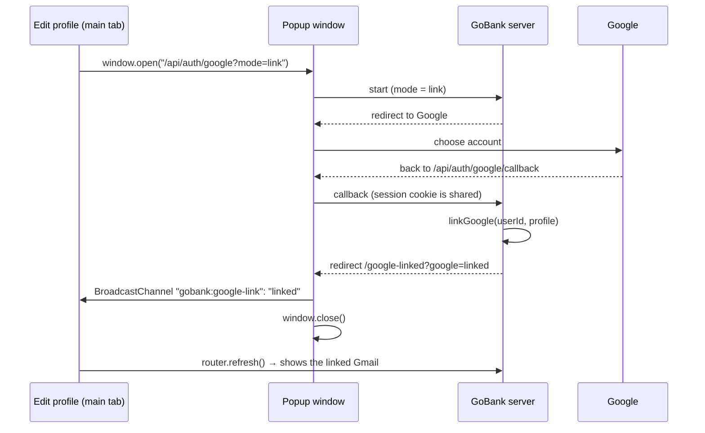

# Google sign-in

**What you will learn:** how "Continue with Google" works end to end: the OAuth 2.0 flow with `state` and PKCE, how GoBank decides between "enter your PIN", "create an account" and "this Gmail belongs to someone else", the signed cookie that remembers a Google identity for 15 minutes, and how an existing user links Google from **Edit profile** using a popup. Background: [Security concepts §8](../01-foundations/05-security-concepts.md#8-oauth-20-openid-connect-and-pkce-continue-with-google).

| Layer | Files |
| --- | --- |
| Settings and messages | `src/features/auth/google/google.rules.ts` |
| Talking to Google | `src/features/auth/google/google.server.ts` |
| Decisions | `src/features/auth/google/google.service.ts` |
| Signed identity cookie | `google-identity.server.ts`, `signed-token.ts` (+ `signed-token.test.ts`) |
| HTTP routes | `src/app/api/auth/google/route.ts`, `src/app/api/auth/google/callback/route.ts` |
| Screens | `google-button.tsx`, `google-mark.tsx`, `src/features/account/components/gmail-link.tsx`, `google-link-result.tsx`, `src/app/google-linked/page.tsx`; Google handling in `src/app/page.tsx`, `(auth)/signin/page.tsx`, `(auth)/register/page.tsx` |

> **Key design rule:** Google alone never opens an account. After Google, the user must still enter their **6-digit PIN** (or, for a new person, complete registration and create a PIN). Google proves *who you are on Google*; the PIN proves *you own this GoBank account*.

---

## 1. When is Google available?

<!-- code: gobank/src/features/auth/google/google.server.ts 25-26 -->
**`gobank/src/features/auth/google/google.server.ts`** · lines 25–26

```ts
25 │ export const googleEnabled = () =>
26 │   Boolean(env.GOOGLE_CLIENT_ID && env.GOOGLE_CLIENT_SECRET && env.AUTH_SECRET);
```
<!-- /code -->

All three settings (`GOOGLE_CLIENT_ID`, `GOOGLE_CLIENT_SECRET` and `AUTH_SECRET`) must be present. Otherwise the Google buttons are hidden, and the routes redirect with `?google=unavailable` ("Google sign-in is not set up yet.").

---

## 2. Step one: send the user to Google

<!-- code: gobank/src/app/api/auth/google/route.ts -->
**`gobank/src/app/api/auth/google/route.ts`** · all 35 lines

```ts
 1 │ import { cookies } from "next/headers";
 2 │ import { NextResponse, type NextRequest } from "next/server";
 3 │ import { env } from "~/env";
 4 │ import {
 5 │   googleEnabled,
 6 │   startGoogleSignIn,
 7 │ } from "~/features/auth/google/google.server";
 8 │ import {
 9 │   GOOGLE_COOKIE,
10 │   GOOGLE_COOKIE_PATH,
11 │ } from "~/features/auth/google/google.rules";
12 │
13 │ export const dynamic = "force-dynamic";
14 │
15 │ export async function GET(request: NextRequest) {
16 │   const { origin, searchParams } = request.nextUrl;
17 │   const mode = searchParams.get("mode") === "link" ? "link" : "signin";
18 │
19 │   if (!googleEnabled()) {
20 │     const page = mode === "link" ? "/google-linked" : "/";
21 │     return NextResponse.redirect(new URL(`${page}?google=unavailable`, origin));
22 │   }
23 │
24 │   const { url, state, verifier } = startGoogleSignIn(origin);
25 │
26 │   (await cookies()).set(GOOGLE_COOKIE, `${state}.${verifier}.${mode}`, {
27 │     httpOnly: true,
28 │     sameSite: "lax",
29 │     secure: env.NODE_ENV === "production",
30 │     path: GOOGLE_COOKIE_PATH,
31 │     maxAge: 10 * 60,
32 │   });
33 │
34 │   return NextResponse.redirect(url);
35 │ }
```
<!-- /code -->

<!-- code: gobank/src/features/auth/google/google.server.ts 1-52 -->
**`gobank/src/features/auth/google/google.server.ts`** · lines 1–52

```ts
 1 │ import { createHash, randomBytes } from "node:crypto";
 2 │ import { z } from "zod";
 3 │ import { env } from "~/env";
 4 │
 5 │ const AUTH_URL = "https://accounts.google.com/o/oauth2/v2/auth";
 6 │ const TOKEN_URL = "https://oauth2.googleapis.com/token";
 7 │ const USERINFO_URL = "https://openidconnect.googleapis.com/v1/userinfo";
 8 │
 9 │ const tokenResponse = z.object({ access_token: z.string().min(1) });
10 │
11 │ const profileResponse = z.object({
12 │   sub: z.string().min(1),
13 │   email: z.string().optional(),
14 │   email_verified: z.boolean().optional(),
15 │   name: z.string().optional(),
16 │ });
17 │
18 │ export type GoogleProfile = {
19 │   sub: string;
20 │   email: string | null;
21 │   emailVerified: boolean;
22 │   name: string;
23 │ };
24 │
25 │ export const googleEnabled = () =>
26 │   Boolean(env.GOOGLE_CLIENT_ID && env.GOOGLE_CLIENT_SECRET && env.AUTH_SECRET);
27 │
28 │ const redirectUri = (origin: string) => `${origin}/api/auth/google/callback`;
29 │
30 │ const randomToken = () => randomBytes(32).toString("base64url");
31 │
32 │ const codeChallengeFor = (verifier: string) =>
33 │   createHash("sha256").update(verifier).digest("base64url");
34 │
35 │ export function startGoogleSignIn(origin: string) {
36 │   const state = randomToken();
37 │   const verifier = randomToken();
38 │
39 │   const url = new URL(AUTH_URL);
40 │   url.search = new URLSearchParams({
41 │     client_id: env.GOOGLE_CLIENT_ID ?? "",
42 │     redirect_uri: redirectUri(origin),
43 │     response_type: "code",
44 │     scope: "openid email profile",
45 │     state,
46 │     code_challenge: codeChallengeFor(verifier),
47 │     code_challenge_method: "S256",
48 │     prompt: "select_account",
49 │   }).toString();
50 │
51 │   return { url: url.toString(), state, verifier };
52 │ }
```
<!-- /code -->

| Lines (google.server.ts) | Meaning |
| --- | --- |
| 5–7 | Google's three endpoints: the consent page, the token exchange and the user-info API |
| 9–16 | Zod schemas: never trust the shape of Google's answers either |
| 28 | The callback address is built from the current site (`origin`), so it works locally and when deployed |
| 30 | Random tokens: 32 bytes as base64url |
| 32–33 | PKCE: `code_challenge = base64url(SHA-256(verifier))` |
| 36–37 | Fresh random `state` and `verifier` for every attempt |
| 40–49 | The Google URL: our client ID, callback, "give us a code", scopes `openid email profile`, `state`, the challenge (method `S256`), and `prompt=select_account` so the user can choose which Google account |

The route (lines 15–35 of `route.ts`):

- `mode` is `link` for "Link Google" from Edit profile, otherwise `signin`.
- It stores `state.verifier.mode` in the cookie **`gb_google_oauth`**: `httpOnly`, `SameSite=Lax` (it must come back with the top-level redirect from Google), `secure` in production, **only sent to `/api/auth/google…`** (`GOOGLE_COOKIE_PATH`), expiring after **10 minutes**. Base64url never contains a dot, so joining the three parts with `.` is safe.
- It redirects the browser to Google.

---

## 3. Step two: Google sends the user back

<!-- code: gobank/src/app/api/auth/google/callback/route.ts -->
**`gobank/src/app/api/auth/google/callback/route.ts`** · all 64 lines

```ts
 1 │ import { cookies } from "next/headers";
 2 │ import { NextResponse, type NextRequest } from "next/server";
 3 │ import { currentSession } from "~/server/session";
 4 │ import {
 5 │   linkGoogle,
 6 │   signInWithGoogle,
 7 │ } from "~/features/auth/google/google.service";
 8 │ import {
 9 │   fetchGoogleProfile,
10 │   googleEnabled,
11 │ } from "~/features/auth/google/google.server";
12 │ import {
13 │   GOOGLE_COOKIE,
14 │   GOOGLE_COOKIE_PATH,
15 │ } from "~/features/auth/google/google.rules";
16 │
17 │ export const dynamic = "force-dynamic";
18 │
19 │ export async function GET(request: NextRequest) {
20 │   const { origin, searchParams } = request.nextUrl;
21 │   const go = (path: string) => NextResponse.redirect(new URL(path, origin));
22 │
23 │   const store = await cookies();
24 │   const saved = store.get(GOOGLE_COOKIE)?.value;
25 │   store.delete({ name: GOOGLE_COOKIE, path: GOOGLE_COOKIE_PATH });
26 │
27 │   const [state, verifier, mode] = saved?.split(".") ?? [];
28 │   const done = mode === "link" ? "/google-linked?google=" : "/?google=";
29 │   const code = searchParams.get("code");
30 │
31 │   if (searchParams.get("error")) return go(`${done}cancelled`);
32 │
33 │   if (
34 │     !googleEnabled() ||
35 │     !state ||
36 │     !verifier ||
37 │     !code ||
38 │     searchParams.get("state") !== state
39 │   ) {
40 │     return go(`${done}failed`);
41 │   }
42 │
43 │   let profile;
44 │   try {
45 │     profile = await fetchGoogleProfile(code, verifier, origin);
46 │   } catch {
47 │     return go(`${done}failed`);
48 │   }
49 │
50 │   if (!profile.emailVerified) return go(`${done}unverified`);
51 │
52 │   if (mode === "link") {
53 │     const session = await currentSession();
54 │     if (!session) return go(`${done}signed-out`);
55 │
56 │     return go(`${done}${await linkGoogle(session.userId, profile)}`);
57 │   }
58 │
59 │   const result = await signInWithGoogle(profile);
60 │   if (result.status === "pin") return go("/signin?google=pin");
61 │   if (result.status === "register") return go("/register?google=new");
62 │
63 │   return go("/?google=email-in-use");
64 │ }
```
<!-- /code -->

| Lines | Check | On failure |
| --- | --- | --- |
| 23–25 | read **and immediately delete** the OAuth cookie, so it can be used only once | |
| 27–29 | split it into `state`, `verifier`, `mode`; choose where results go (`/?google=` or `/google-linked?google=`) | |
| 31 | the user pressed Cancel at Google (`?error=…`) | `cancelled` |
| 33–41 | Google configured, cookie parts present, `code` present, and **the `state` from Google equals the `state` in our cookie** | `failed` |
| 43–48 | exchange the code and fetch the profile | `failed` |
| 50 | Google says the email is verified | `unverified` |
| 52–57 | **link mode:** must already be signed in to GoBank, then link | `signed-out`, or the link result |
| 59–63 | **sign-in mode:** decide (section 5) | `/signin?google=pin`, `/register?google=new`, or `/?google=email-in-use` |

### Exchanging the code: `fetchGoogleProfile`

<!-- code: gobank/src/features/auth/google/google.server.ts 54-99 -->
**`gobank/src/features/auth/google/google.server.ts`** · lines 54–99

```ts
54 │ async function exchangeCodeForAccessToken(
55 │   code: string,
56 │   verifier: string,
57 │   origin: string,
58 │ ) {
59 │   const reply = await fetch(TOKEN_URL, {
60 │     method: "POST",
61 │     headers: { "content-type": "application/x-www-form-urlencoded" },
62 │     body: new URLSearchParams({
63 │       code,
64 │       code_verifier: verifier,
65 │       client_id: env.GOOGLE_CLIENT_ID ?? "",
66 │       client_secret: env.GOOGLE_CLIENT_SECRET ?? "",
67 │       redirect_uri: redirectUri(origin),
68 │       grant_type: "authorization_code",
69 │     }),
70 │     cache: "no-store",
71 │   });
72 │   if (!reply.ok) throw new Error("Google rejected the sign-in code");
73 │
74 │   const { access_token } = tokenResponse.parse(await reply.json());
75 │   return access_token;
76 │ }
77 │
78 │ export async function fetchGoogleProfile(
79 │   code: string,
80 │   verifier: string,
81 │   origin: string,
82 │ ): Promise<GoogleProfile> {
83 │   const accessToken = await exchangeCodeForAccessToken(code, verifier, origin);
84 │
85 │   const reply = await fetch(USERINFO_URL, {
86 │     headers: { authorization: `Bearer ${accessToken}` },
87 │     cache: "no-store",
88 │   });
89 │   if (!reply.ok) throw new Error("Google did not return a profile");
90 │
91 │   const profile = profileResponse.parse(await reply.json());
92 │
93 │   return {
94 │     sub: profile.sub,
95 │     email: profile.email ?? null,
96 │     emailVerified: profile.email_verified === true,
97 │     name: profile.name?.trim() ?? "",
98 │   };
99 │ }
```
<!-- /code -->

1. **Lines 59–71:** POST the `code` **together with the `code_verifier`** and the client secret to Google's token endpoint. Google hashes the verifier and checks it equals the challenge from step one. A stolen code without the verifier is useless.
2. **Lines 72–75:** a non-OK answer throws; the access token is validated with Zod.
3. **Lines 85–91:** call the OpenID Connect user-info endpoint with the token.
4. **Lines 93–98:** keep only what GoBank needs: `sub` (Google's permanent user ID), email, whether it is verified (`=== true`, so a missing value counts as *not* verified) and the name.

---

## 4. The messages

<!-- code: gobank/src/features/auth/google/google.rules.ts -->
**`gobank/src/features/auth/google/google.rules.ts`** · all 25 lines

```ts
 1 │ export const GOOGLE_COOKIE = "gb_google_oauth";
 2 │ export const GOOGLE_COOKIE_PATH = "/api/auth/google";
 3 │
 4 │ export const GOOGLE_NOTICES: Record<string, string> = {
 5 │   cancelled: "Google sign-in was cancelled.",
 6 │   failed: "Google sign-in did not work. Please try again.",
 7 │   unverified: "Your Google email is not verified.",
 8 │   unavailable: "Google sign-in is not set up yet.",
 9 │   "email-in-use":
10 │     "That Gmail already belongs to a GoBank account. Sign in with your username and PIN.",
11 │ };
12 │
13 │ export const GOOGLE_LINK_CHANNEL = "gobank:google-link";
14 │
15 │ export const GOOGLE_LINK_NOTICES: Record<string, string> = {
16 │   linked: "Google account linked.",
17 │   cancelled: "Linking Google was cancelled.",
18 │   failed: "Linking Google did not work. Please try again.",
19 │   unverified: "Your Google email is not verified.",
20 │   unavailable: "Google sign-in is not set up yet.",
21 │   "not-gmail": "Choose a Gmail account to link.",
22 │   "email-in-use": "That Gmail already belongs to another GoBank account.",
23 │   "already-linked": "This account already has a Google account linked.",
24 │   "signed-out": "Sign in to GoBank first, then link Google.",
25 │ };
```
<!-- /code -->

The `?google=<code>` in the redirect is turned into a message by the welcome page (`GOOGLE_NOTICES`) or the link-result page (`GOOGLE_LINK_NOTICES`). Both pages accept only codes that exist in these lists (`Object.hasOwn`), so a crafted link cannot make GoBank display arbitrary text.

---

## 5. Deciding what happens: `google.service.ts`

<!-- code: gobank/src/features/auth/google/google.service.ts -->
**`gobank/src/features/auth/google/google.service.ts`** · all 132 lines

```ts
  1 │ import { db } from "~/server/db";
  2 │ import { asDatabaseError, fail, MESSAGES } from "~/server/errors";
  3 │ import { startSession } from "~/server/session";
  4 │ import { normalizeGmail } from "~/shared/lib/contact";
  5 │ import { verifyAccountPin } from "../auth.service";
  6 │ import {
  7 │   forgetGoogleIdentity,
  8 │   pendingGoogleIdentity,
  9 │   rememberGoogleIdentity,
 10 │   type GoogleIdentity,
 11 │ } from "./google-identity.server";
 12 │ import { GOOGLE_NOTICES } from "./google.rules";
 13 │ import type { GoogleProfile } from "./google.server";
 14 │
 15 │ const ACCOUNT_FIELDS = {
 16 │   id: true,
 17 │   username: true,
 18 │   googleId: true,
 19 │   gmail: true,
 20 │ } as const;
 21 │
 22 │ const EMAIL_IN_USE = GOOGLE_NOTICES["email-in-use"] ?? MESSAGES.unexpected;
 23 │
 24 │ const isDuplicateValue = (error: unknown) =>
 25 │   asDatabaseError(error)?.code === "P2002";
 26 │
 27 │ const gmailOf = (profile: GoogleProfile) =>
 28 │   profile.email ? normalizeGmail(profile.email) : null;
 29 │
 30 │ async function findAccountByGoogle(identity: GoogleIdentity) {
 31 │   const byGoogleId = await db.user.findUnique({
 32 │     where: { googleId: identity.sub },
 33 │     select: ACCOUNT_FIELDS,
 34 │   });
 35 │   if (byGoogleId || !identity.gmail) return byGoogleId;
 36 │
 37 │   return db.user.findUnique({
 38 │     where: { gmail: identity.gmail },
 39 │     select: ACCOUNT_FIELDS,
 40 │   });
 41 │ }
 42 │
 43 │ async function findGoogleAccount(identity: GoogleIdentity) {
 44 │   const account = await findAccountByGoogle(identity);
 45 │   if (!account) return { status: "register" as const };
 46 │
 47 │   const linkedToAnotherGoogle =
 48 │     account.googleId !== null && account.googleId !== identity.sub;
 49 │   if (linkedToAnotherGoogle) return { status: "email-in-use" as const };
 50 │
 51 │   return { status: "pin" as const, identity, account };
 52 │ }
 53 │
 54 │ export async function getPendingGoogleAccount() {
 55 │   const identity = await pendingGoogleIdentity();
 56 │   if (!identity) return { status: "missing" as const };
 57 │
 58 │   return findGoogleAccount(identity);
 59 │ }
 60 │
 61 │ export async function signInWithGoogle(profile: GoogleProfile) {
 62 │   const identity = {
 63 │     sub: profile.sub,
 64 │     gmail: gmailOf(profile),
 65 │     name: profile.name,
 66 │   };
 67 │
 68 │   const result = await findGoogleAccount(identity);
 69 │
 70 │   if (result.status === "email-in-use") {
 71 │     await forgetGoogleIdentity();
 72 │   } else {
 73 │     await rememberGoogleIdentity(identity);
 74 │   }
 75 │
 76 │   return result;
 77 │ }
 78 │
 79 │ export async function linkGoogle(userId: string, profile: GoogleProfile) {
 80 │   const gmail = gmailOf(profile);
 81 │   if (!gmail) return "not-gmail";
 82 │
 83 │   try {
 84 │     const linked = await db.user.updateMany({
 85 │       where: { id: userId, googleId: null },
 86 │       data: { googleId: profile.sub, gmail },
 87 │     });
 88 │
 89 │     return linked.count ? "linked" : "already-linked";
 90 │   } catch (error) {
 91 │     if (isDuplicateValue(error)) return "email-in-use";
 92 │     throw error;
 93 │   }
 94 │ }
 95 │
 96 │ async function attachGoogleId(accountId: string, identity: GoogleIdentity) {
 97 │   const sameGoogle = { googleId: identity.sub };
 98 │   const unlinkedSameGmail = identity.gmail
 99 │     ? [{ googleId: null, gmail: identity.gmail }]
100 │     : [];
101 │
102 │   try {
103 │     const linked = await db.user.updateMany({
104 │       where: { id: accountId, OR: [sameGoogle, ...unlinkedSameGmail] },
105 │       data: { googleId: identity.sub },
106 │     });
107 │
108 │     if (!linked.count) fail("CONFLICT", EMAIL_IN_USE);
109 │   } catch (error) {
110 │     if (isDuplicateValue(error)) fail("CONFLICT", EMAIL_IN_USE);
111 │     throw error;
112 │   }
113 │ }
114 │
115 │ export async function signInWithGooglePin(pin: string) {
116 │   const pending = await getPendingGoogleAccount();
117 │
118 │   if (pending.status === "email-in-use") fail("CONFLICT", EMAIL_IN_USE);
119 │   if (pending.status !== "pin") {
120 │     fail("UNAUTHORIZED", "Choose Google again to continue.");
121 │   }
122 │
123 │   const { account, identity } = pending;
124 │
125 │   await verifyAccountPin(account.id, pin, MESSAGES.wrongPin);
126 │   await attachGoogleId(account.id, identity);
127 │
128 │   const session = await startSession(account.id);
129 │   await forgetGoogleIdentity();
130 │
131 │   return session;
132 │ }
```
<!-- /code -->

### Finding the account (lines 30–52)

1. Look for a user whose **`googleId`** equals Google's `sub`. This is the reliable link, because an email can change but `sub` never does.
2. Only if none is found, and the Google email is a **Gmail** address (`gmailOf` uses `normalizeGmail`, which accepts only `@gmail.com` / `@googlemail.com`), look for a user with that **`gmail`**.
3. Decide:

| Found | Status | Next |
| --- | --- | --- |
| nobody | `register` | `/register?google=new`: create a new account (name and Gmail prefilled) |
| an account already linked to a **different** Google account | `email-in-use` | `/?google=email-in-use`: "That Gmail already belongs to a GoBank account. Sign in with your username and PIN." |
| the account linked to this Google account (or with this Gmail and no Google link yet) | `pin` | `/signin?google=pin`: enter the PIN |

> Note: an existing account that never linked Google (no `googleId` and no `gmail`) is **not** found, so "Continue with Google" leads to creating a new account. To use Google with an existing account, the user first links it from **Edit profile** (section 7).

### Remembering the Google identity between pages (lines 61–77)

The decision is made in the callback, but the PIN is entered on another page. `signInWithGoogle` stores `{ sub, gmail, name }` in a **signed** cookie (`rememberGoogleIdentity`) for the `pin` and `register` outcomes, and forgets it for `email-in-use`.

### Finishing with the PIN (lines 115–132)

1. Re-read the pending identity from the signed cookie and re-decide (lines 116–121); if it expired: "Choose Google again to continue."
2. **Verify the PIN** with the same lockout rules as normal sign-in (line 125).
3. `attachGoogleId` (lines 96–113): save `googleId` **only if** the account already has this `googleId`, or has this Gmail and no Google link yet. Otherwise, or if another account already uses that Google ID (`P2002`), refuse with "email-in-use". An account linked to Google A can never be silently re-linked to Google B.
4. Start the session and forget the pending identity.

---

## 6. The signed identity cookie

<!-- code: gobank/src/features/auth/google/google-identity.server.ts -->
**`gobank/src/features/auth/google/google-identity.server.ts`** · all 43 lines

```ts
 1 │ import { cookies } from "next/headers";
 2 │ import { z } from "zod";
 3 │ import { env } from "~/env";
 4 │ import { readToken, signToken } from "./signed-token";
 5 │
 6 │ const COOKIE = "gb_google_identity";
 7 │ const MAX_AGE_SECONDS = 15 * 60;
 8 │
 9 │ const identity = z.object({
10 │   sub: z.string().min(1),
11 │   gmail: z.string().nullable(),
12 │   name: z.string(),
13 │ });
14 │
15 │ export type GoogleIdentity = z.infer<typeof identity>;
16 │
17 │ export async function rememberGoogleIdentity(value: GoogleIdentity) {
18 │   if (!env.AUTH_SECRET) throw new Error("AUTH_SECRET is not set");
19 │
20 │   const token = signToken(value, env.AUTH_SECRET, MAX_AGE_SECONDS * 1000);
21 │
22 │   (await cookies()).set(COOKIE, token, {
23 │     httpOnly: true,
24 │     sameSite: "lax",
25 │     secure: env.NODE_ENV === "production",
26 │     path: "/",
27 │     maxAge: MAX_AGE_SECONDS,
28 │   });
29 │ }
30 │
31 │ export async function pendingGoogleIdentity(): Promise<GoogleIdentity | null> {
32 │   const token = (await cookies()).get(COOKIE)?.value;
33 │   if (!token || !env.AUTH_SECRET) return null;
34 │
35 │   const verified = readToken(token, env.AUTH_SECRET);
36 │   const parsed = identity.safeParse(verified?.payload);
37 │
38 │   return parsed.success ? parsed.data : null;
39 │ }
40 │
41 │ export async function forgetGoogleIdentity() {
42 │   (await cookies()).delete(COOKIE);
43 │ }
```
<!-- /code -->

- Cookie `gb_google_identity`, `httpOnly`, 15 minutes.
- Signing requires `AUTH_SECRET` (line 18).
- Reading verifies the signature and expiry (`readToken`) **and** re-validates the payload's shape with Zod (lines 35–38).

<!-- code: gobank/src/features/auth/google/signed-token.ts -->
**`gobank/src/features/auth/google/signed-token.ts`** · all 48 lines

```ts
 1 │ import { createHmac, timingSafeEqual } from "node:crypto";
 2 │
 3 │ type SignedBody = { payload?: unknown; expiresAt?: unknown };
 4 │
 5 │ const sign = (body: string, secret: string) =>
 6 │   createHmac("sha256", secret).update(body).digest("base64url");
 7 │
 8 │ const encode = (value: unknown) =>
 9 │   Buffer.from(JSON.stringify(value)).toString("base64url");
10 │
11 │ function decode(body: string): SignedBody | null {
12 │   try {
13 │     return JSON.parse(Buffer.from(body, "base64url").toString()) as SignedBody;
14 │   } catch {
15 │     return null;
16 │   }
17 │ }
18 │
19 │ function signaturesMatch(body: string, signature: string, secret: string) {
20 │   const expected = Buffer.from(sign(body, secret));
21 │   const given = Buffer.from(signature);
22 │
23 │   return expected.length === given.length && timingSafeEqual(expected, given);
24 │ }
25 │
26 │ export function signToken(
27 │   payload: unknown,
28 │   secret: string,
29 │   ttlMs: number,
30 │   now = Date.now(),
31 │ ) {
32 │   const body = encode({ payload, expiresAt: now + ttlMs });
33 │
34 │   return `${body}.${sign(body, secret)}`;
35 │ }
36 │
37 │ export function readToken(token: string, secret: string, now = Date.now()) {
38 │   const [body, signature, extra] = token.split(".");
39 │
40 │   const wellFormed = body && signature && extra === undefined;
41 │   if (!wellFormed || !signaturesMatch(body, signature, secret)) return null;
42 │
43 │   const decoded = decode(body);
44 │   const expiresAt = decoded?.expiresAt;
45 │   if (typeof expiresAt !== "number" || expiresAt <= now) return null;
46 │
47 │   return { payload: decoded?.payload };
48 │ }
```
<!-- /code -->

| Lines | Meaning |
| --- | --- |
| 5–6 | `sign` = HMAC-SHA256(body, secret), base64url |
| 8–9 | `encode` = JSON → base64url |
| 11–17 | `decode` returns `null` instead of crashing on garbage |
| 19–24 | compare signatures in constant time; a length check first, because `timingSafeEqual` throws on different lengths |
| 26–35 | `signToken`: body = `{ payload, expiresAt }`, token = `body.signature` |
| 37–48 | `readToken`: exactly two parts, valid signature, unexpired (`expiresAt > now`), otherwise `null` |

The `now` parameter (defaulting to `Date.now()`) exists so tests can control time.

### Its tests

<!-- code: gobank/src/features/auth/google/signed-token.test.ts -->
**`gobank/src/features/auth/google/signed-token.test.ts`** · all 41 lines

```ts
 1 │ import assert from "node:assert/strict";
 2 │ import { test } from "node:test";
 3 │ import { readToken, signToken } from "./signed-token";
 4 │
 5 │ const SECRET = "a".repeat(32);
 6 │ const OTHER_SECRET = "b".repeat(32);
 7 │ const NOW = Date.parse("2026-01-01T00:00:00Z");
 8 │ const ONE_MINUTE = 60_000;
 9 │
10 │ const newToken = () => signToken({ sub: "123" }, SECRET, ONE_MINUTE, NOW);
11 │
12 │ void test("a signed token can be read until it expires", () => {
13 │   const token = newToken();
14 │
15 │   assert.deepEqual(readToken(token, SECRET, NOW + ONE_MINUTE - 1_000), {
16 │     payload: { sub: "123" },
17 │   });
18 │   assert.equal(readToken(token, SECRET, NOW + ONE_MINUTE), null);
19 │ });
20 │
21 │ void test("a token with a swapped payload is rejected", () => {
22 │   const [, signature] = newToken().split(".");
23 │   const forgedBody = Buffer.from(
24 │     JSON.stringify({ payload: { sub: "999" }, expiresAt: NOW + ONE_MINUTE }),
25 │   ).toString("base64url");
26 │
27 │   assert.equal(readToken(`${forgedBody}.${signature}`, SECRET, NOW), null);
28 │ });
29 │
30 │ void test("a token signed with another secret is rejected", () => {
31 │   assert.equal(readToken(newToken(), OTHER_SECRET, NOW), null);
32 │ });
33 │
34 │ void test("tokens in the wrong shape are rejected", () => {
35 │   const token = newToken();
36 │   const [body] = token.split(".");
37 │
38 │   assert.equal(readToken(`${body}.`, SECRET, NOW), null);
39 │   assert.equal(readToken("not-a-token", SECRET, NOW), null);
40 │   assert.equal(readToken(`${token}.extra`, SECRET, NOW), null);
41 │ });
```
<!-- /code -->

Valid until one second before expiry and invalid at expiry; a swapped payload with the old signature is rejected; a different secret is rejected; malformed tokens (`body.`, no dot, three parts) are rejected.

---

## 7. Linking Google from Edit profile (popup)



<!-- code: gobank/src/features/account/components/gmail-link.tsx 11-34 -->
**`gobank/src/features/account/components/gmail-link.tsx`** · lines 11–34

```tsx
11 │ const LINK_URL = "/api/auth/google?mode=link";
12 │ const POPUP_FEATURES = "popup,width=480,height=640";
13 │
14 │ export function GmailLink({ gmail }: { gmail?: string | null }) {
15 │   const router = useRouter();
16 │   const [notice, setNotice] = useState<string | null>(null);
17 │
18 │   useEffect(() => {
19 │     const channel = new BroadcastChannel(GOOGLE_LINK_CHANNEL);
20 │
21 │     channel.onmessage = ({ data }: MessageEvent<unknown>) => {
22 │       if (typeof data !== "string") return;
23 │       if (data === "linked") router.refresh();
24 │       setNotice(data === "linked" ? null : (GOOGLE_LINK_NOTICES[data] ?? null));
25 │     };
26 │
27 │     return () => channel.close();
28 │   }, [router]);
29 │
30 │   const linkGoogle = () => {
31 │     setNotice(null);
32 │     const popup = window.open(LINK_URL, "gobank-google-link", POPUP_FEATURES);
33 │     if (!popup) setNotice("Allow pop-ups for GoBank to link Google.");
34 │   };
```
<!-- /code -->

- **Lines 18–28:** listen on a `BroadcastChannel`, a browser feature that lets windows of the same site send each other messages. "linked" refreshes the page; anything else shows the matching message.
- **Lines 30–34:** open the popup; if the browser blocked it, explain "Allow pop-ups for GoBank to link Google."

The server side of linking:

<!-- code: gobank/src/features/auth/google/google.service.ts 79-94 -->
**`gobank/src/features/auth/google/google.service.ts`** · lines 79–94

```ts
79 │ export async function linkGoogle(userId: string, profile: GoogleProfile) {
80 │   const gmail = gmailOf(profile);
81 │   if (!gmail) return "not-gmail";
82 │
83 │   try {
84 │     const linked = await db.user.updateMany({
85 │       where: { id: userId, googleId: null },
86 │       data: { googleId: profile.sub, gmail },
87 │     });
88 │
89 │     return linked.count ? "linked" : "already-linked";
90 │   } catch (error) {
91 │     if (isDuplicateValue(error)) return "email-in-use";
92 │     throw error;
93 │   }
94 │ }
```
<!-- /code -->

- **Lines 80–81:** only a Gmail address can be linked, otherwise `not-gmail` ("Choose a Gmail account to link.").
- **Lines 84–87:** a *conditional* update: it only matches the user if they have **no** Google link yet (`googleId: null`), so an existing link is never replaced.
- **Line 89:** one row updated means `linked`; zero means the account was already linked (`already-linked`).
- **Line 91:** if the Gmail or Google ID already belongs to another account, the unique constraint fails (`P2002`) and the result is `email-in-use`.

The integration test checks all four outcomes on a real database: a school address gives `not-gmail`, the first link gives `linked`, linking again gives `already-linked`, and the same Gmail for another account gives `email-in-use`.

<!-- code: gobank/src/app/google-linked/page.tsx -->
**`gobank/src/app/google-linked/page.tsx`** · all 18 lines

```tsx
 1 │ import type { Metadata } from "next";
 2 │ import { GoogleLinkResult } from "~/features/account/components/google-link-result";
 3 │ import { GOOGLE_LINK_NOTICES } from "~/features/auth/google/google.rules";
 4 │
 5 │ export const metadata: Metadata = {
 6 │   title: "Link Google",
 7 │ };
 8 │
 9 │ export default async function GoogleLinkedPage({
10 │   searchParams,
11 │ }: {
12 │   searchParams: Promise<{ google?: string }>;
13 │ }) {
14 │   const { google = "" } = await searchParams;
15 │   const status = Object.hasOwn(GOOGLE_LINK_NOTICES, google) ? google : "failed";
16 │
17 │   return <GoogleLinkResult status={status} />;
18 │ }
```
<!-- /code -->

<!-- code: gobank/src/features/account/components/google-link-result.tsx -->
**`gobank/src/features/account/components/google-link-result.tsx`** · all 26 lines

```tsx
 1 │ "use client";
 2 │
 3 │ import { useEffect } from "react";
 4 │ import {
 5 │   GOOGLE_LINK_CHANNEL,
 6 │   GOOGLE_LINK_NOTICES,
 7 │ } from "~/features/auth/google/google.rules";
 8 │
 9 │ export function GoogleLinkResult({ status }: { status: string }) {
10 │   useEffect(() => {
11 │     const channel = new BroadcastChannel(GOOGLE_LINK_CHANNEL);
12 │     channel.postMessage(status);
13 │     channel.close();
14 │
15 │     window.close();
16 │   }, [status]);
17 │
18 │   return (
19 │     <main className="flex flex-1 flex-col items-center justify-center gap-2 px-6 text-center">
20 │       <p className="text-ink text-[15px] font-medium">
21 │         {GOOGLE_LINK_NOTICES[status]}
22 │       </p>
23 │       <p className="text-ink-muted text-[13px]">You can close this window.</p>
24 │     </main>
25 │   );
26 │ }
```
<!-- /code -->

The result page validates the status, posts it to the channel and closes the popup. If the window cannot close itself, it shows the message and "You can close this window."

> **Why is `/google-linked` outside the `(app)` route group?** Pages in `(app)` run `SessionGuard`, which ends the session when a page that does not own it opens (one session per tab). The popup is a *new window*, so it must not render `SessionGuard`; it only shows a message and closes. The callback still uses the shared session cookie to know who is linking.

---

## 8. Registering with Google

`(auth)/register/page.tsx`: with `?google=new`, the server reads the pending identity and passes the Google **name** (prefilled in step 3) and **Gmail** (shown, already linked) to `RegistrationFlow` with `withGoogle = true`. `auth.register` then attaches `googleId` and `gmail` to the new account ([Registration and sign-in](01-registration-and-sign-in.md#6-creating-the-account-authservicets-lines-43107)).

---

## 9. Security summary

| Protection | Stops |
| --- | --- |
| `state` compared with the cookie | login CSRF (finishing someone else's Google sign-in in your browser) |
| PKCE (`S256`) | a stolen authorization code being exchanged by someone else |
| OAuth cookie: `httpOnly`, path-limited, 10 minutes, deleted on first use | theft and replay of `state`/`verifier` |
| `email_verified` required | accounts with unverified emails |
| matching by `googleId` (`sub`) first | email address changes and look-alike emails |
| Gmail-only linking | linking work or school addresses that might be reassigned |
| HMAC-signed identity cookie, 15 minutes | editing the cookie to claim another Google account |
| PIN required after Google | a stolen Google session alone opening the bank account |
| conditional `updateMany` for links | silently re-linking an account to a different Google account |

---

## Defense questions

**Q: Explain your Google login.**
A: We use OAuth 2.0 with PKCE. We generate a random `state` and a random verifier, keep them in an httpOnly cookie and send Google the state and the SHA-256 of the verifier. Google sends back a code; we check the state matches, exchange the code together with the verifier and our client secret for an access token, and read the verified Google profile. Then we look up the GoBank account by Google ID or Gmail. Even after Google, the user must enter their PIN.

**Q: What is PKCE for, if you also have a client secret?**
A: Defense in depth. Even if an attacker intercepted the authorization code, they could not exchange it without the code verifier, which never leaves our server and the user's httpOnly cookie.

**Q: What if someone signs in with a Gmail that belongs to another GoBank account?**
A: If that account is already linked to a different Google ID, we refuse with "That Gmail already belongs to a GoBank account". Linking also refuses a Gmail that another account already uses, because of the unique constraint.

**Q: Why do you need `AUTH_SECRET`?**
A: To sign (HMAC-SHA256) the short-lived cookie that remembers the verified Google identity between the Google callback and the PIN or registration page, so it cannot be forged or edited.

---

## Check yourself

<details>
<summary>Why is the OAuth cookie deleted at the very start of the callback, before any checks?</summary>

So it can only ever be used once. Even if the callback fails, a replay of the same callback URL finds no cookie.
</details>

<details>
<summary>A user with no linked Google taps "Continue with Google". What happens?</summary>

No account matches their Google ID or Gmail, so the outcome is `register`: they are sent to create a new account. To use Google with their existing account, they must first sign in normally and link Google from Edit profile.
</details>
