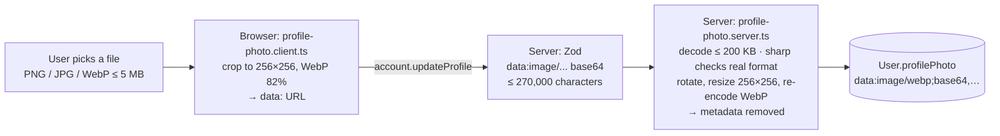

# Account and profile

**What you will learn:** the four `account` procedures (the dashboard overview, the spending summary used by every payment form, the profile and profile updates), the contact rules for names, mobile numbers and Gmail, and the **profile-photo pipeline**: how a photo is shrunk in the browser and then fully re-processed on the server so that only a small, clean, metadata-free image is ever stored.

| Layer | Files |
| --- | --- |
| API | `src/features/account/account.router.ts` |
| Service | `src/features/account/account.service.ts`, `account.rules.ts` |
| Contact rules | `src/shared/lib/contact.ts` |
| Photo pipeline | `profile-photo.schema.ts`, `profile-photo.client.ts`, `profile-photo.server.ts`, `profile-photo.test.ts` |
| Screens | `profile-screen.tsx`, `edit-profile-form.tsx`, `profile-fields.tsx`, `profile-photo-picker.tsx`, `profile-avatar.tsx` (and `gmail-link.tsx`, `google-link-result.tsx`, explained in [Google sign-in](02-google-sign-in.md#7-linking-google-from-edit-profile-popup)) |
| Pages | `src/app/(app)/settings/page.tsx` (`/settings`), `src/app/(app)/settings/profile/page.tsx` (`/settings/profile`) |

---

## 1. The API

<!-- code: gobank/src/features/account/account.router.ts -->
**`gobank/src/features/account/account.router.ts`** · all 22 lines

```ts
 1 │ import { z } from "zod";
 2 │ import { profileFields } from "~/shared/lib/schemas";
 3 │ import { createTRPCRouter, protectedProcedure } from "~/server/trpc";
 4 │ import { profilePhotoInput } from "./profile-photo.schema";
 5 │ import {
 6 │   getOverview,
 7 │   getProfile,
 8 │   getSpending,
 9 │   updateProfile,
10 │ } from "./account.service";
11 │
12 │ export const accountRouter = createTRPCRouter({
13 │   overview: protectedProcedure.query(({ ctx }) => getOverview(ctx.userId)),
14 │
15 │   spending: protectedProcedure.query(({ ctx }) => getSpending(ctx.userId)),
16 │
17 │   profile: protectedProcedure.query(({ ctx }) => getProfile(ctx.userId)),
18 │
19 │   updateProfile: protectedProcedure
20 │     .input(z.object({ ...profileFields, profilePhoto: profilePhotoInput }))
21 │     .mutation(({ ctx, input }) => updateProfile(ctx.userId, input)),
22 │ });
```
<!-- /code -->

All four procedures are **protected**: they always act on `ctx.userId`, so one user can never read or edit another's profile.

---

## 2. The service

<!-- code: gobank/src/features/account/account.service.ts -->
**`gobank/src/features/account/account.service.ts`** · all 93 lines

```ts
 1 │ import { db } from "~/server/db";
 2 │ import { spentToday } from "~/server/ledger";
 3 │ import {
 4 │   activityFields,
 5 │   MAIN_ACCOUNT_KINDS,
 6 │ } from "~/features/activity/activity.fields";
 7 │ import { normalizeProfilePhoto } from "./profile-photo.server";
 8 │
 9 │ export const getOverview = (userId: string) =>
10 │   db.user.findUniqueOrThrow({
11 │     where: { id: userId },
12 │     select: {
13 │       username: true,
14 │       fullName: true,
15 │       profilePhoto: true,
16 │       accountNumber: true,
17 │       balance: true,
18 │       points: true,
19 │       _count: { select: { savingsGoals: true } },
20 │       transactions: {
21 │         where: { kind: MAIN_ACCOUNT_KINDS },
22 │         select: activityFields,
23 │         orderBy: [{ createdAt: "desc" }, { id: "desc" }],
24 │         take: 5,
25 │       },
26 │     },
27 │   });
28 │
29 │ export const getSpending = async (userId: string) => {
30 │   const [account, spent] = await Promise.all([
31 │     db.user.findUniqueOrThrow({
32 │       where: { id: userId },
33 │       select: {
34 │         balance: true,
35 │         cardDailyLimit: true,
36 │         cards: {
37 │           select: { kind: true, brand: true, number: true, locked: true },
38 │           orderBy: { kind: "asc" },
39 │         },
40 │       },
41 │     }),
42 │     spentToday(db, userId),
43 │   ]);
44 │
45 │   const { cards, ...limits } = account;
46 │
47 │   return {
48 │     ...limits,
49 │     dailyLeft: Math.max(0, account.cardDailyLimit - spent),
50 │     cards: cards.map(({ number, ...card }) => ({
51 │       ...card,
52 │       last4: number.slice(-4),
53 │     })),
54 │   };
55 │ };
56 │
57 │ export const getProfile = async (userId: string) => {
58 │   const profile = await db.user.findUniqueOrThrow({
59 │     where: { id: userId },
60 │     select: {
61 │       username: true,
62 │       fullName: true,
63 │       profilePhoto: true,
64 │       mobile: true,
65 │       gmail: true,
66 │       googleId: true,
67 │       accountNumber: true,
68 │       createdAt: true,
69 │     },
70 │   });
71 │   const { googleId, ...details } = profile;
72 │   return { ...details, gmail: googleId ? details.gmail : null };
73 │ };
74 │
75 │ type ProfileUpdate = {
76 │   fullName: string;
77 │   mobile: string | null;
78 │   profilePhoto?: string | null;
79 │ };
80 │
81 │ export const updateProfile = async (userId: string, profile: ProfileUpdate) => {
82 │   const { profilePhoto, ...fields } = profile;
83 │   return db.user.update({
84 │     where: { id: userId },
85 │     data: {
86 │       ...fields,
87 │       ...(profilePhoto !== undefined
88 │         ? { profilePhoto: await normalizeProfilePhoto(profilePhoto) }
89 │         : {}),
90 │     },
91 │     select: { id: true },
92 │   });
93 │ };
```
<!-- /code -->

### `getOverview` (lines 9–27): everything the dashboard needs, in one call

Username, name, photo, account number, balance, points, **how many goals** (`_count`, line 19) and the **5 latest transactions** (lines 20–25) except interest rows (`MAIN_ACCOUNT_KINDS` = kind is not `interest`, because interest belongs to goals, not the main account). Prisma runs this one call as **two SQL statements** (captured from PostgreSQL's statement log): the first reads the user row with the goal count joined in (`LEFT JOIN (SELECT "userId", COUNT(*) … GROUP BY "userId")`), the second reads the transactions (`WHERE kind <> 'interest' AND "userId" IN (…) ORDER BY "createdAt" DESC, id DESC LIMIT 5`). The dashboard page calls it directly on the server ([Dashboard](11-dashboard-and-navigation.md)).

### `getSpending` (lines 29–55): what payment forms need

| Field | Meaning |
| --- | --- |
| `balance` | main balance |
| `cardDailyLimit` | the shared daily limit |
| `dailyLeft` | limit − card spending today (never below 0), using the ledger's `spentToday` |
| `cards` | for each card: `kind`, `brand`, `locked` and **only the last 4 digits** (lines 50–53 remove the full number) |

Lines 30–43 run the account query and the "spent today" sum **in parallel** with `Promise.all`. This is a read-only estimate for the screen; the real check happens again, under a row lock, when the payment is made ([The ledger](../04-server-core/04-ledger.md#7-spend-paying-with-a-card-lines-131169)). Cards are ordered by `kind` (physical first, the enum order).

### `getProfile` (lines 57–73)

Returns the profile fields, then **drops `googleId`** from the result (line 71). The Gmail is only shown if Google is actually linked (line 72), so a stored but unlinked Gmail from older data is not displayed as if it were verified.

### `updateProfile` (lines 75–93)

- Name and mobile are always saved.
- The photo is only touched if the request includes the `profilePhoto` field (`!== undefined`, line 87): a new photo is cleaned by `normalizeProfilePhoto`, and `null` removes it.
- If another account already uses the mobile number, the unique constraint fails and the user sees "That mobile is already taken".

### `account.rules.ts`

<!-- code: gobank/src/features/account/account.rules.ts -->
**`gobank/src/features/account/account.rules.ts`** · all 4 lines

```ts
1 │ type Named = { fullName: string | null; username: string };
2 │
3 │ export const displayName = ({ fullName, username }: Named) =>
4 │   fullName ?? `@${username}`;
```
<!-- /code -->

The name shown on the profile: the full name, or `@username` if there is no name.

---

## 3. Contact rules: `src/shared/lib/contact.ts`

<!-- code: gobank/src/shared/lib/contact.ts -->
**`gobank/src/shared/lib/contact.ts`** · all 37 lines

```ts
 1 │ const PH_MOBILE = /^09\d{9}$/;
 2 │ const GMAIL_ADDRESS = /^[a-z0-9][a-z0-9._+-]*@(gmail|googlemail)\.com$/;
 3 │
 4 │ export function normalizeMobile(raw: string) {
 5 │   const digits = raw.replace(/\D/g, "");
 6 │
 7 │   return digits.startsWith("63") ? `0${digits.slice(2)}` : digits;
 8 │ }
 9 │
10 │ export function validateMobile(raw: string): string | null {
11 │   if (raw.trim().length === 0) return null;
12 │
13 │   return PH_MOBILE.test(normalizeMobile(raw))
14 │     ? null
15 │     : "Use the format 09XXXXXXXXX";
16 │ }
17 │
18 │ export function validateFullName(raw: string): string | null {
19 │   const length = raw.trim().length;
20 │
21 │   if (length < 2) return "Enter your full name";
22 │   if (length > 80) return "Use at most 80 characters";
23 │   return null;
24 │ }
25 │
26 │ export function normalizeGmail(raw: string): string | null {
27 │   const value = raw.trim().toLowerCase();
28 │
29 │   return GMAIL_ADDRESS.test(value) ? value : null;
30 │ }
31 │
32 │ export function formatMobile(raw: string) {
33 │   const value = normalizeMobile(raw);
34 │   if (value.length !== 11) return raw;
35 │
36 │   return `${value.slice(0, 4)} ${value.slice(4, 7)} ${value.slice(7)}`;
37 │ }
```
<!-- /code -->

| Function | Behavior | Examples |
| --- | --- | --- |
| `normalizeMobile` (4–8) | keep digits; a leading `63` (country code) becomes `0` | `+63 917-123-4567` → `09171234567` |
| `validateMobile` (10–16) | empty is allowed (mobile is optional); otherwise must be `09` + 9 digits | `0917123456` → "Use the format 09XXXXXXXXX" |
| `validateFullName` (18–24) | 2 to 80 characters after trimming | `"A"` → "Enter your full name" |
| `normalizeGmail` (26–30) | lowercase; must be `@gmail.com` or `@googlemail.com`, starting with a letter or digit | `Juan.Dela.Cruz@Gmail.com` → `juan.dela.cruz@gmail.com`; `x@school.edu` → `null` |
| `formatMobile` (32–37) | display as `0917 123 4567` | |

These run in the browser (instant messages) and on the server (inside the Zod `mobile` and `profileFields` schemas in `shared/lib/schemas.ts`), so both sides apply exactly the same rules.

---

## 4. The profile-photo pipeline



### The limits: `profile-photo.schema.ts`

<!-- code: gobank/src/features/account/profile-photo.schema.ts -->
**`gobank/src/features/account/profile-photo.schema.ts`** · all 12 lines

```ts
 1 │ import { z } from "zod";
 2 │
 3 │ export const PHOTO_TYPES = ["image/jpeg", "image/png", "image/webp"];
 4 │ export const MAX_PHOTO_BYTES = 200_000;
 5 │ export const PHOTO_PATTERN =
 6 │   /^data:image\/(jpeg|png|webp);base64,([A-Za-z0-9+/]+={0,2})$/;
 7 │ export const profilePhotoInput = z
 8 │   .string()
 9 │   .max(270_000)
10 │   .regex(PHOTO_PATTERN, "Choose a PNG, JPG or WebP photo.")
11 │   .nullable()
12 │   .optional();
```
<!-- /code -->

- Only three types are accepted (line 3). SVG is excluded on purpose: an SVG is a document that can contain scripts.
- The decoded image may be at most **200,000 bytes** (line 4).
- Line 5–6: the value must be exactly `data:image/<jpeg|png|webp>;base64,<base64 characters>`. A URL such as `https://…` is rejected, so the app never loads images from arbitrary sites.
- Line 9: at most 270,000 characters. Base64 uses 4 characters per 3 bytes, so 200,000 bytes is about 266,667 characters plus the short prefix.

### In the browser: `profile-photo.client.ts`

<!-- code: gobank/src/features/account/profile-photo.client.ts -->
**`gobank/src/features/account/profile-photo.client.ts`** · all 51 lines

```ts
 1 │ "use client";
 2 │
 3 │ import { MAX_PHOTO_BYTES, PHOTO_TYPES } from "./profile-photo.schema";
 4 │
 5 │ const AVATAR_SIZE = 256;
 6 │ const WEBP_QUALITY = 0.82;
 7 │ const MAX_UPLOAD_BYTES = 5 * 1024 * 1024;
 8 │ const MAX_DATA_URL_LENGTH = Math.ceil((MAX_PHOTO_BYTES * 4) / 3) + 30;
 9 │
10 │ function drawCovering(context: CanvasRenderingContext2D, image: ImageBitmap) {
11 │   const scale = Math.max(AVATAR_SIZE / image.width, AVATAR_SIZE / image.height);
12 │   const width = image.width * scale;
13 │   const height = image.height * scale;
14 │
15 │   const left = (AVATAR_SIZE - width) / 2;
16 │   const top = (AVATAR_SIZE - height) / 2;
17 │
18 │   context.drawImage(image, left, top, width, height);
19 │ }
20 │
21 │ export async function prepareProfilePhoto(file: File) {
22 │   if (!PHOTO_TYPES.includes(file.type)) {
23 │     throw new Error("Choose a PNG, JPG or WebP photo.");
24 │   }
25 │
26 │   if (file.size > MAX_UPLOAD_BYTES) {
27 │     throw new Error("Choose a photo smaller than 5 MB.");
28 │   }
29 │
30 │   const image = await createImageBitmap(file);
31 │
32 │   try {
33 │     const canvas = document.createElement("canvas");
34 │     canvas.width = AVATAR_SIZE;
35 │     canvas.height = AVATAR_SIZE;
36 │
37 │     const context = canvas.getContext("2d");
38 │     if (!context) throw new Error("Couldn’t prepare this photo.");
39 │
40 │     drawCovering(context, image);
41 │
42 │     const photo = canvas.toDataURL("image/webp", WEBP_QUALITY);
43 │     if (photo.length > MAX_DATA_URL_LENGTH) {
44 │       throw new Error("Try a smaller photo.");
45 │     }
46 │
47 │     return photo;
48 │   } finally {
49 │     image.close();
50 │   }
51 │ }
```
<!-- /code -->

| Lines | Step |
| --- | --- |
| 22–28 | refuse other file types and files over 5 MB, with clear messages |
| 30 | decode the image (`createImageBitmap`) |
| 33–35 | a 256×256 canvas |
| 10–19 | **cover-crop**: scale so the image fills the square, then center it (like a profile picture in any app) |
| 42 | export as **WebP at 82% quality**, a small modern format |
| 43–45 | still too big? "Try a smaller photo." |
| 48–50 | free the decoded image's memory whatever happens (`finally`) |

This makes uploads small and fast. But a modified browser could skip all of it, so…

### On the server: `profile-photo.server.ts`

<!-- code: gobank/src/features/account/profile-photo.server.ts -->
**`gobank/src/features/account/profile-photo.server.ts`** · all 43 lines

```ts
 1 │ import "server-only";
 2 │ import sharp from "sharp";
 3 │ import { fail } from "~/server/errors";
 4 │ import {
 5 │   MAX_PHOTO_BYTES,
 6 │   PHOTO_PATTERN,
 7 │   profilePhotoInput,
 8 │ } from "./profile-photo.schema";
 9 │
10 │ export async function normalizeProfilePhoto(value: string | null) {
11 │   if (value === null) return null;
12 │
13 │   const match = PHOTO_PATTERN.exec(value);
14 │   if (!match || !profilePhotoInput.safeParse(value).success) {
15 │     return fail("BAD_REQUEST", "Choose a valid PNG, JPG or WebP photo.");
16 │   }
17 │
18 │   const [, format, base64 = ""] = match;
19 │   const bytes = Buffer.from(base64, "base64");
20 │   if (bytes.length > MAX_PHOTO_BYTES) {
21 │     fail("BAD_REQUEST", "Photo is too large. Choose a smaller image.");
22 │   }
23 │
24 │   try {
25 │     const image = sharp(bytes, { limitInputPixels: 16_777_216 });
26 │     const metadata = await image.metadata();
27 │     if (metadata.format !== format || (metadata.pages ?? 1) > 1) {
28 │       throw new Error("Unsupported photo");
29 │     }
30 │
31 │     const result = await image
32 │       .rotate()
33 │       .resize(256, 256, { fit: "cover" })
34 │       .webp({ quality: 82 })
35 │       .toBuffer();
36 │     return `data:image/webp;base64,${result.toString("base64")}`;
37 │   } catch {
38 │     return fail(
39 │       "BAD_REQUEST",
40 │       "Couldn’t read that photo. Choose a PNG, JPG or WebP.",
41 │     );
42 │   }
43 │ }
```
<!-- /code -->

| Lines | Step | Protects against |
| --- | --- | --- |
| 11 | `null` = remove the photo | |
| 13–16 | re-check the pattern and the schema | malformed input |
| 18–22 | decode; over 200,000 bytes → "Photo is too large." | oversized uploads |
| 25 | `limitInputPixels: 16,777,216` (4096 × 4096) | **decompression bombs**: tiny files that expand into gigantic images and exhaust memory |
| 26–29 | the **real** format must equal the declared one, and the image must be a single frame | files lying about their type, animated images |
| 31–35 | `rotate()` applies the camera's orientation; resize to 256×256 (cover); **re-encode as WebP** | sideways photos; hidden content in the original file |
| 36 | store the clean image as a data URL | |
| 37–42 | anything sharp cannot read → "Couldn’t read that photo. Choose a PNG, JPG or WebP." | corrupt files |

> **Privacy:** re-encoding with sharp drops the original file's metadata, such as EXIF (which can contain the GPS location where the photo was taken, the phone model and the date) and color profiles. The test below proves it.

### The tests: `profile-photo.test.ts`

<!-- code: gobank/src/features/account/profile-photo.test.ts -->
**`gobank/src/features/account/profile-photo.test.ts`** · all 52 lines

```ts
 1 │ import assert from "node:assert/strict";
 2 │ import test from "node:test";
 3 │ import sharp from "sharp";
 4 │ import { normalizeProfilePhoto } from "./profile-photo.server";
 5 │ import { MAX_PHOTO_BYTES } from "./profile-photo.schema";
 6 │
 7 │ const toDataUrl = (bytes: Buffer, type = "png") =>
 8 │   `data:image/${type};base64,${bytes.toString("base64")}`;
 9 │
10 │ const fromDataUrl = (photo: string) =>
11 │   Buffer.from(photo.split(",")[1] ?? "", "base64");
12 │
13 │ void test("a photo becomes a 256 by 256 WebP without hidden metadata", async () => {
14 │   const original = await sharp({
15 │     create: { width: 400, height: 300, channels: 3, background: "#71d5f3" },
16 │   })
17 │     .png()
18 │     .withMetadata({ exif: { IFD0: { Artist: "test" } } })
19 │     .toBuffer();
20 │
21 │   const photo = await normalizeProfilePhoto(toDataUrl(original));
22 │   assert.ok(photo);
23 │   assert.ok(photo.startsWith("data:image/webp;base64,"));
24 │
25 │   const metadata = await sharp(fromDataUrl(photo)).metadata();
26 │   assert.equal(metadata.format, "webp");
27 │   assert.deepEqual([metadata.width, metadata.height], [256, 256]);
28 │   assert.equal(metadata.exif, undefined);
29 │   assert.equal(metadata.icc, undefined);
30 │ });
31 │
32 │ void test("removing the photo saves nothing", async () => {
33 │   assert.equal(await normalizeProfilePhoto(null), null);
34 │ });
35 │
36 │ void test("links, SVGs and broken images are rejected", async () => {
37 │   const invalidPhotos = [
38 │     "https://example.com/photo.png",
39 │     "data:image/svg+xml;base64,PHN2Zz48L3N2Zz4=",
40 │     "data:image/png;base64,AAAA",
41 │   ];
42 │
43 │   for (const value of invalidPhotos) {
44 │     await assert.rejects(normalizeProfilePhoto(value));
45 │   }
46 │ });
47 │
48 │ void test("a photo over the size limit is rejected", async () => {
49 │   const tooLarge = Buffer.alloc(MAX_PHOTO_BYTES + 1);
50 │
51 │   await assert.rejects(normalizeProfilePhoto(toDataUrl(tooLarge)), /too large/);
52 │ });
```
<!-- /code -->

1. A 400×300 PNG **with an EXIF "Artist" tag** becomes a 256×256 WebP with **no EXIF and no ICC profile**.
2. Removing the photo stores `null`.
3. A web link, an SVG, and broken image bytes are all rejected.
4. A file one byte over the limit is rejected with "too large".

The integration test (`verify-core.ts`) also proves a failed photo update changes **nothing**, including the name sent with it.

### Why store the photo in the database?

At most ~200 KB per user, it needs no separate file storage service, and it is always consistent with the account (deleted with it). A larger app would use object storage (for example S3) and store only a URL ([Limitations](../09-defense/03-limitations-and-future-work.md)).

---

## 5. The screens

### `/settings`: `profile-screen.tsx` (a server component)

<!-- code: gobank/src/features/account/components/profile-screen.tsx 26-86 -->
**`gobank/src/features/account/components/profile-screen.tsx`** · lines 26–86

```tsx
26 │ export function ProfileScreen({ profile }: { profile: Profile }) {
27 │   const details = [
28 │     { label: "Account number", value: formatAccount(profile.accountNumber) },
29 │     {
30 │       label: "Mobile",
31 │       value: profile.mobile ? formatMobile(profile.mobile) : null,
32 │     },
33 │     { label: "Gmail", value: profile.gmail },
34 │     { label: "Member since", value: SINCE.format(profile.createdAt) },
35 │   ];
36 │
37 │   return (
38 │     <div className="flex flex-1 flex-col">
39 │       <PageHeader title="Profile" back="/dashboard" />
40 │
41 │       <section className="mt-9 flex flex-col items-center text-center">
42 │         <Link
43 │           href="/settings/profile"
44 │           aria-label="Change profile photo"
45 │           className="focus-visible:outline-sky relative rounded-full focus-visible:outline-2 focus-visible:outline-offset-4"
46 │         >
47 │           <ProfileAvatar photo={profile.profilePhoto} />
48 │           <span className="border-surface text-sky absolute right-0 bottom-0 grid h-6 w-6 place-items-center rounded-full border-2 bg-[#2b373d]">
49 │             <Camera size={12} aria-hidden />
50 │           </span>
51 │         </Link>
52 │         <p className="text-ink mt-4 text-[19px] font-semibold tracking-tight">
53 │           {displayName(profile)}
54 │         </p>
55 │         {profile.fullName ? (
56 │           <p className="text-ink-muted mt-0.5 text-[13.5px]">
57 │             @{profile.username}
58 │           </p>
59 │         ) : null}
60 │       </section>
61 │
62 │       <dl className="divide-line border-line mt-8 divide-y rounded-2xl border">
63 │         {details.map((row) => (
64 │           <DetailRow key={row.label} label={row.label} value={row.value} />
65 │         ))}
66 │       </dl>
67 │
68 │       <nav className="mt-4 flex flex-col gap-2.5">
69 │         <ShortcutRow
70 │           href="/settings/profile"
71 │           label="Edit profile"
72 │           icon={UserPen}
73 │         />
74 │         <ShortcutRow href="/settings/pin" label="Change PIN" icon={KeyRound} />
75 │         <ShortcutRow href="/card" label="Card controls" icon={CreditCard} />
76 │         <ShortcutRow href="/rewards" label="Rewards" icon={Sparkles} />
77 │       </nav>
78 │
79 │       <div className="flex-1" />
80 │
81 │       <div className="mt-10">
82 │         <SignOutButton />
83 │       </div>
84 │     </div>
85 │   );
86 │ }
```
<!-- /code -->

- The page (`settings/page.tsx`) loads the profile on the server with `api.account.profile()`, so it renders complete with no loading state.
- **Lines 27–35:** the detail rows: account number formatted in groups of four (`2004 2640 684`), mobile formatted, the linked Gmail, and "Member since" (month and year). Missing values show "Not set".
- **Lines 42–51:** the avatar links to Edit profile, with a camera badge.
- **Lines 68–77:** shortcuts: Edit profile, Change PIN, Card controls (`/card`), Rewards.
- **Lines 81–83:** the red Sign out button ([Registration and sign-in](01-registration-and-sign-in.md#signing-out-sign-out-buttontsx)).

### `/settings/profile`: `edit-profile-form.tsx`

<!-- code: gobank/src/features/account/components/edit-profile-form.tsx 20-62 -->
**`gobank/src/features/account/components/edit-profile-form.tsx`** · lines 20–62

```tsx
20 │ export function EditProfileForm({ profile }: { profile: Profile }) {
21 │   const router = useRouter();
22 │   const [photo, setPhoto] = useState(profile.profilePhoto);
23 │   const [preparingPhoto, setPreparingPhoto] = useState(false);
24 │   const [photoError, setPhotoError] = useState<string | null>(null);
25 │   const [value, setValue] = useState<ProfileValues>({
26 │     fullName: profile.fullName ?? "",
27 │     mobile: profile.mobile ?? "",
28 │   });
29 │
30 │   const save = api.account.updateProfile.useMutation({
31 │     onSuccess: () => {
32 │       router.push("/settings");
33 │       router.refresh();
34 │     },
35 │   });
36 │
37 │   const busy = preparingPhoto || save.isPending || save.isSuccess;
38 │
39 │   const submit = () => {
40 │     if (preparingPhoto || save.isPending) return;
41 │     save.mutate({ ...value, profilePhoto: photo });
42 │   };
43 │
44 │   const removePhoto = () => {
45 │     setPhoto(null);
46 │     setPhotoError(null);
47 │   };
48 │
49 │   const selectPhoto = async (file: File) => {
50 │     setPreparingPhoto(true);
51 │     setPhotoError(null);
52 │
53 │     try {
54 │       setPhoto(await prepareProfilePhoto(file));
55 │     } catch (error) {
56 │       setPhotoError(
57 │         error instanceof Error ? error.message : "Couldn’t read that photo.",
58 │       );
59 │     } finally {
60 │       setPreparingPhoto(false);
61 │     }
62 │   };
```
<!-- /code -->

| Lines | Behavior |
| --- | --- |
| 22–28 | state: the photo (starting from the saved one), "preparing photo", a photo error, and the name and mobile fields |
| 30–35 | on save: go back to `/settings` and refresh it from the server |
| 37 | the form is busy while a photo is being prepared or the save is running |
| 39–42 | the whole form (including the photo, or `null` if removed) is sent in **one** request |
| 49–62 | a chosen file is prepared in the browser first; its error message is shown under the photo |

Save is disabled while busy or while the name or mobile is invalid. A server error ("That mobile is already taken") appears in a red box.

### Small parts

| Component | What it does |
| --- | --- |
| `profile-fields.tsx` | The full name and mobile `TextField`s and `profileIsValid()`; reused by registration step 3 |
| `profile-photo-picker.tsx` | The avatar, a hidden `<input type="file">` opened by a "Change photo" button, a Remove button, the "PNG, JPG or WebP · up to 5 MB" hint and errors. It resets the input after each choice so picking the same file again still works |
| `profile-avatar.tsx` | Shows the photo with `next/image` (`unoptimized`, because a `data:` URL cannot go through Next's image optimizer) or a default person icon with the label "Default profile icon" |

---

## Defense questions

**Q: How do you handle profile picture uploads securely?**
A: The browser crops and compresses the photo to 256×256 WebP, but the server does not trust that. It accepts only a base64 data URL of JPEG, PNG or WebP up to 200 KB, decodes it with sharp with a pixel limit against decompression bombs, verifies the real format matches the declared one, and re-encodes it to a fresh 256×256 WebP. The re-encoding removes all metadata, such as the GPS location, which our unit test confirms.

**Q: Why does the spending summary only send the last 4 digits of each card?**
A: Payment forms only need to label the cards ("Discover •••• 8954"). Sending less data means less to leak. The full number is only loaded on the My card screen.

**Q: Can I take another user's mobile number?**
A: No. `mobile` is unique in the database; the update fails with "That mobile is already taken".

---

## Check yourself

<details>
<summary>Why are photos validated again on the server if the browser already prepared them?</summary>

Because the browser can be bypassed. The server's checks and re-encoding are the real protection; the browser step only makes uploads smaller and gives quicker feedback.
</details>

<details>
<summary>What does <code>normalizeMobile("+63 917 123 4567")</code> return?</summary>

`"09171234567"`: non-digits are removed and the `63` country code becomes a leading `0`.
</details>
