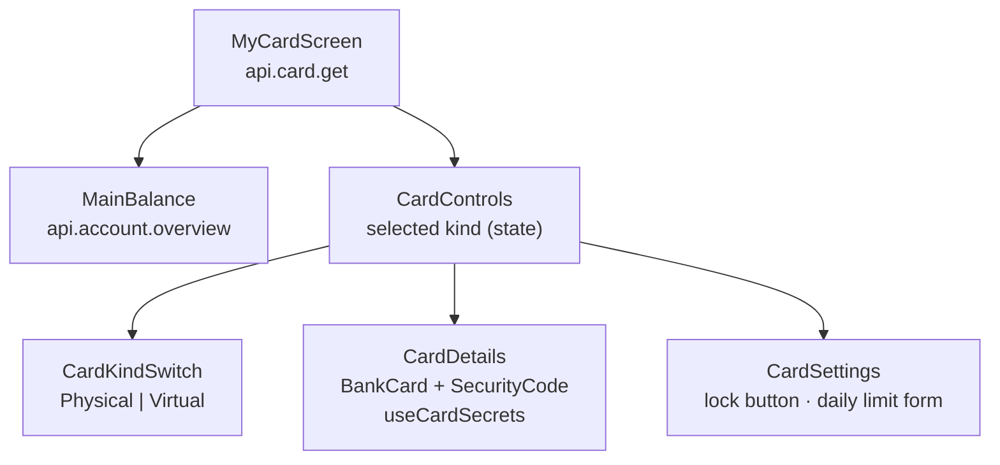

# Cards

**What you will learn:** how GoBank issues two cards per user (physical and virtual, on different networks), how a valid 16-digit card number is generated with the **Luhn** check digit, how CVVs are **encrypted with AES-256-GCM** and revealed only on demand, how each card is locked separately while the daily limit is shared, and how the My card screen protects card details on screen.

| Layer | Files |
| --- | --- |
| Rules and data | `src/features/card/card-brands.ts`, `card.rules.ts`, `card-label.ts` |
| Server-only crypto and generation | `card-generation.server.ts`, `card-cvv.server.ts`, `card-credentials.server.ts` |
| API and service | `card.router.ts`, `card.service.ts` |
| Key setup | `gobank/scripts/setup-card-key.ts` (`npm run card:setup-key`) |
| Screens | `components/my-card-screen.tsx` (+ `my-card-screen.module.css`), `card-details.tsx`, `card-settings.tsx`, `bank-card.tsx`, `card-brand-logo.tsx`, `card-picker.tsx`, `card-locked-notice.tsx` |
| Hook | `hooks/use-card-secrets.ts` |
| Page | `src/app/(app)/card/page.tsx` (`/card`) |
| Tests | `card-cvv.test.ts` (8 tests) |

---

## 1. The card model

| | Physical card | Virtual card |
| --- | --- | --- |
| Network | chosen at sign-up (Visa, Mastercard, JCB or Discover) | automatically a **different** network (Mastercard if the physical card is Visa, otherwise Visa) |
| Number, CVV, expiry | its own | its own; the CVV is guaranteed to differ from the physical card's |
| Lock | **separate** | **separate** |
| Daily spending limit | **shared**: one limit for both cards together (default ₱20,000, up to ₱100,000) | |
| Used for | choosing which card pays a transfer, bill, load or request; recorded on the receipt as "Paid with …" | |

> **Honesty point:** the cards are *simulated*. Numbers use the well-known test prefixes of each network and are not connected to any card network; they cannot be used in real shops. What *is* real is the logic: valid Luhn numbers, encrypted CVVs, locks and limits enforced in the ledger.

---

## 2. Networks: `card-brands.ts`

<!-- code: gobank/src/features/card/card-brands.ts -->
**`gobank/src/features/card/card-brands.ts`** · all 32 lines

```ts
 1 │ export const CARD_BRANDS = [
 2 │   {
 3 │     id: "visa",
 4 │     name: "Visa",
 5 │     numberPrefix: "4242",
 6 │   },
 7 │   {
 8 │     id: "mastercard",
 9 │     name: "Mastercard",
10 │     numberPrefix: "5555",
11 │   },
12 │   {
13 │     id: "jcb",
14 │     name: "JCB",
15 │     numberPrefix: "3566",
16 │   },
17 │   {
18 │     id: "discover",
19 │     name: "Discover",
20 │     numberPrefix: "6011",
21 │   },
22 │ ] as const;
23 │
24 │ type CardBrand = (typeof CARD_BRANDS)[number];
25 │ export type CardBrandId = CardBrand["id"];
26 │
27 │ export const isSupportedCardBrand = (id: unknown): id is CardBrandId =>
28 │   typeof id === "string" && CARD_BRANDS.some((brand) => brand.id === id);
29 │
30 │ export function getBrand(id: CardBrandId): CardBrand {
31 │   return CARD_BRANDS.find((brand) => brand.id === id) ?? CARD_BRANDS[3];
32 │ }
```
<!-- /code -->

Each network has an ID, a display name and a 4-digit number prefix: `4242` (Visa), `5555` (Mastercard), `3566` (JCB), `6011` (Discover). These are the prefixes commonly used for test cards. `isSupportedCardBrand` (line 27) validates untrusted input (the network chosen at sign-up). `getBrand` (line 30) falls back to Discover (`CARD_BRANDS[3]`) if given an unknown ID.

---

## 3. Generating a card number: `card-generation.server.ts`

<!-- code: gobank/src/features/card/card-generation.server.ts -->
**`gobank/src/features/card/card-generation.server.ts`** · all 37 lines

```ts
 1 │ import "server-only";
 2 │ import { randomInt } from "node:crypto";
 3 │ import { getBrand, type CardBrandId } from "./card-brands";
 4 │
 5 │ const CARD_LENGTH = 16;
 6 │ const CARD_VALID_YEARS = 5;
 7 │
 8 │ const randomDigits = (length: number) =>
 9 │   Array.from({ length }, () => randomInt(10)).join("");
10 │
11 │ function luhnCheckDigit(digitsWithoutCheck: string) {
12 │   const sum = [...digitsWithoutCheck].reduce((total, digit, index) => {
13 │     const doubled = Number(digit) * (index % 2 === 0 ? 2 : 1);
14 │     return total + (doubled > 9 ? doubled - 9 : doubled);
15 │   }, 0);
16 │
17 │   return (10 - (sum % 10)) % 10;
18 │ }
19 │
20 │ export function newCardNumber(brand: CardBrandId) {
21 │   const prefix = getBrand(brand).numberPrefix;
22 │   const body = prefix + randomDigits(CARD_LENGTH - 1 - prefix.length);
23 │
24 │   return `${body}${luhnCheckDigit(body)}`;
25 │ }
26 │
27 │ export const virtualCardBrand = (physical: CardBrandId): CardBrandId =>
28 │   physical === "visa" ? "mastercard" : "visa";
29 │
30 │ export const cardExpiry = (from = new Date()) =>
31 │   new Date(
32 │     Date.UTC(
33 │       from.getUTCFullYear() + CARD_VALID_YEARS,
34 │       from.getUTCMonth() + 1,
35 │       0,
36 │     ),
37 │   );
```
<!-- /code -->

### The number (lines 20–25)

`prefix (4 digits) + 11 random digits + 1 check digit = 16 digits`. The random digits come from `randomInt` in `node:crypto` (cryptographically secure).

### The Luhn check digit (lines 11–18)

> **Concept: the Luhn algorithm.** Card numbers end with a check digit that catches most typing mistakes (any single wrong digit and most swaps of neighboring digits). Starting from the digit next to the check digit and moving left, double every second digit; if doubling gives more than 9, subtract 9; add everything up. The check digit is whatever brings the total to a multiple of 10.

In the code, the 15 digits *before* the check digit are processed left to right, doubling those at even positions (0, 2, 4 … 14). For a 15-digit body these are exactly every second digit counting from the right, as Luhn requires.

**Worked example**, using a real number generated by this code (`6011 2307 3557 8954`). Body `601123073557895`:

| Position | 0 | 1 | 2 | 3 | 4 | 5 | 6 | 7 | 8 | 9 | 10 | 11 | 12 | 13 | 14 |
| --- | --- | --- | --- | --- | --- | --- | --- | --- | --- | --- | --- | --- | --- | --- | --- |
| Digit | 6 | 0 | 1 | 1 | 2 | 3 | 0 | 7 | 3 | 5 | 5 | 7 | 8 | 9 | 5 |
| Doubled? | ×2 | | ×2 | | ×2 | | ×2 | | ×2 | | ×2 | | ×2 | | ×2 |
| Value | 12→**3** | 0 | 2 | 1 | 4 | 3 | 0 | 7 | 6 | 5 | 10→**1** | 7 | 16→**7** | 9 | 10→**1** |

Sum = 56, so the check digit is `(10 − 56 mod 10) mod 10 = 4`, giving `6011230735578954`. (This calculation was re-run with the code's own formula while writing this page.)

### The virtual card's network (lines 27–28)

Visa → Mastercard; Mastercard, JCB or Discover → Visa. Always different from the physical card (tested).

### The expiry date (lines 30–37)

`Date.UTC(year + 5, month + 1, 0)`: "day 0" of the *next* month is the last day of the *current* month. So a card issued on 4 Nov 2026 expires on **30 Nov 2031**, and one issued on 10 Feb 2028 expires on **28 Feb 2033** (both checked by running the formula). The card shows it as `MM/YY`, for example `11/31`.

---

## 4. Encrypting the CVV: `card-cvv.server.ts`

Why encrypt instead of hash: users must be able to *see* their CVV, so it must be recoverable, but only by the server and only with the secret key. Concepts: [Security concepts §4](../01-foundations/05-security-concepts.md#4-encrypting-cvvs-with-aes-256-gcm).

<!-- code: gobank/src/features/card/card-cvv.server.ts -->
**`gobank/src/features/card/card-cvv.server.ts`** · all 100 lines

```ts
  1 │ import "server-only";
  2 │ import {
  3 │   createCipheriv,
  4 │   createDecipheriv,
  5 │   randomBytes,
  6 │   randomInt,
  7 │ } from "node:crypto";
  8 │ import { fail } from "~/server/errors";
  9 │
 10 │ const ALGORITHM = "aes-256-gcm";
 11 │ const FORMAT_VERSION = "v1";
 12 │ const ENCRYPTED_CVV = /^v1\.[a-f0-9]{24}\.[a-f0-9]{32}\.[a-f0-9]{6}$/i;
 13 │ const THREE_DIGITS = /^\d{3}$/;
 14 │ const HEX_KEY = /^[a-f0-9]{64}$/i;
 15 │
 16 │ const UNAVAILABLE = "Your card security details are temporarily unavailable.";
 17 │
 18 │ const additionalData = (cardNumber: string) =>
 19 │   Buffer.from(`GoBank card CVV:${cardNumber}`);
 20 │
 21 │ function encryptionKey(key: string | undefined) {
 22 │   if (!key || !HEX_KEY.test(key)) return fail("BAD_REQUEST", UNAVAILABLE);
 23 │
 24 │   return Buffer.from(key, "hex");
 25 │ }
 26 │
 27 │ function randomCvv(excludedCvv?: string) {
 28 │   let cvv: string;
 29 │   do {
 30 │     cvv = randomInt(1000).toString().padStart(3, "0");
 31 │   } while (cvv === excludedCvv);
 32 │
 33 │   return cvv;
 34 │ }
 35 │
 36 │ export function newCvvCredentials(
 37 │   cardNumber: string,
 38 │   key: string | undefined,
 39 │   excludedCvv?: string,
 40 │ ) {
 41 │   const cvv = randomCvv(excludedCvv);
 42 │
 43 │   return { cvv, cvvEncrypted: encryptCvv(cvv, cardNumber, key) };
 44 │ }
 45 │
 46 │ export function encryptCvv(
 47 │   cvv: string,
 48 │   cardNumber: string,
 49 │   key: string | undefined,
 50 │ ) {
 51 │   if (!THREE_DIGITS.test(cvv)) fail("BAD_REQUEST", UNAVAILABLE);
 52 │
 53 │   const nonce = randomBytes(12);
 54 │   const cipher = createCipheriv(ALGORITHM, encryptionKey(key), nonce);
 55 │   cipher.setAAD(additionalData(cardNumber));
 56 │
 57 │   const ciphertext = Buffer.concat([
 58 │     cipher.update(cvv, "utf8"),
 59 │     cipher.final(),
 60 │   ]);
 61 │   const tag = cipher.getAuthTag();
 62 │
 63 │   return [
 64 │     FORMAT_VERSION,
 65 │     nonce.toString("hex"),
 66 │     tag.toString("hex"),
 67 │     ciphertext.toString("hex"),
 68 │   ].join(".");
 69 │ }
 70 │
 71 │ export function decryptCvv(
 72 │   encrypted: string,
 73 │   cardNumber: string,
 74 │   key: string | undefined,
 75 │ ) {
 76 │   const secret = encryptionKey(key);
 77 │   if (!ENCRYPTED_CVV.test(encrypted)) fail("BAD_REQUEST", UNAVAILABLE);
 78 │
 79 │   const [, nonce = "", tag = "", ciphertext = ""] = encrypted.split(".");
 80 │
 81 │   try {
 82 │     const decipher = createDecipheriv(
 83 │       ALGORITHM,
 84 │       secret,
 85 │       Buffer.from(nonce, "hex"),
 86 │     );
 87 │     decipher.setAAD(additionalData(cardNumber));
 88 │     decipher.setAuthTag(Buffer.from(tag, "hex"));
 89 │
 90 │     const cvv = Buffer.concat([
 91 │       decipher.update(Buffer.from(ciphertext, "hex")),
 92 │       decipher.final(),
 93 │     ]).toString("utf8");
 94 │
 95 │     if (!THREE_DIGITS.test(cvv)) fail("BAD_REQUEST", UNAVAILABLE);
 96 │     return cvv;
 97 │   } catch {
 98 │     return fail("BAD_REQUEST", UNAVAILABLE);
 99 │   }
100 │ }
```
<!-- /code -->

| Lines | Meaning |
| --- | --- |
| 1 | `server-only`: this file can never be bundled into the browser |
| 10–14 | Algorithm `aes-256-gcm`; format version `v1`; the exact shape of a stored value (`v1.` + 24 hex nonce + 32 hex tag + 6 hex ciphertext); a CVV must be 3 digits; the key must be 64 hex characters |
| 16 | the only message users ever see for any CVV problem, so no detail about keys or tampering is revealed |
| 18–19 | **AAD = `GoBank card CVV:<card number>`**: the ciphertext is bound to its card |
| 21–25 | a missing or malformed key → the friendly error (never a crash) |
| 27–34 | a random 3-digit CVV (`000`–`999`, zero-padded); can be told to avoid one value, so the virtual card never repeats the physical card's CVV |
| 36–44 | `newCvvCredentials`: a new CVV and its encrypted form |
| 46–69 | **Encrypt:** check it is 3 digits; a fresh **12-byte random nonce**; set the AAD; encrypt; read the 16-byte **auth tag**; join `v1.nonce.tag.ciphertext` in hex |
| 71–100 | **Decrypt:** check the key and the format; split; decrypt with the same AAD and tag; `final()` throws if anything was changed (wrong key, other card's AAD, edited bytes); the result must still be 3 digits; every failure becomes the friendly error |

A real stored value: `v1.c7dea387078507a591f5862a.d617377b3ac65ffff0bb3d1279eb4512.5f5501`.

### Gluing it together: `card-credentials.server.ts`

<!-- code: gobank/src/features/card/card-credentials.server.ts -->
**`gobank/src/features/card/card-credentials.server.ts`** · all 19 lines

```ts
 1 │ import "server-only";
 2 │ import { env } from "~/env";
 3 │ import type { CardBrandId } from "./card-brands";
 4 │ import { newCvvCredentials } from "./card-cvv.server";
 5 │ import { cardExpiry, newCardNumber } from "./card-generation.server";
 6 │
 7 │ export function newCardCredentials(brand: CardBrandId, excludedCvv?: string) {
 8 │   const number = newCardNumber(brand);
 9 │   const { cvv, cvvEncrypted } = newCvvCredentials(
10 │     number,
11 │     env.CARD_ENCRYPTION_KEY,
12 │     excludedCvv,
13 │   );
14 │
15 │   return {
16 │     card: { brand, number, cvvEncrypted, expiresAt: cardExpiry() },
17 │     cvv,
18 │   };
19 │ }
```
<!-- /code -->

One call gives everything to store (`brand`, `number`, `cvvEncrypted`, `expiresAt`) plus the plain `cvv` to show once. Used by registration (card preview and virtual card) and by the seed.

### Creating the key: `scripts/setup-card-key.ts`

<!-- code: gobank/scripts/setup-card-key.ts -->
**`gobank/scripts/setup-card-key.ts`** · all 59 lines

```ts
 1 │ import { spawnSync } from "node:child_process";
 2 │ import { randomBytes } from "node:crypto";
 3 │ import { appendFile, readFile } from "node:fs/promises";
 4 │ import { fileURLToPath } from "node:url";
 5 │
 6 │ const appDirectory = fileURLToPath(new URL("../", import.meta.url));
 7 │ const environmentFile = new URL("../.env", import.meta.url);
 8 │
 9 │ const KEY_LINE = /^\s*(?:export\s+)?CARD_ENCRYPTION_KEY\s*=/m;
10 │
11 │ const isMissingFile = (error: unknown) =>
12 │   typeof error === "object" &&
13 │   error !== null &&
14 │   "code" in error &&
15 │   error.code === "ENOENT";
16 │
17 │ async function readEnvironmentFile() {
18 │   try {
19 │     return await readFile(environmentFile, "utf8");
20 │   } catch (error) {
21 │     if (isMissingFile(error)) return "";
22 │     throw error;
23 │   }
24 │ }
25 │
26 │ function envFileIsIgnoredByGit() {
27 │   const result = spawnSync("git", ["check-ignore", "--quiet", ".env"], {
28 │     cwd: appDirectory,
29 │   });
30 │
31 │   return result.status === 0;
32 │ }
33 │
34 │ const existing = await readEnvironmentFile();
35 │ const keyAlreadySet =
36 │   Boolean(process.env.CARD_ENCRYPTION_KEY) || KEY_LINE.test(existing);
37 │
38 │ if (keyAlreadySet) {
39 │   console.log("CARD_ENCRYPTION_KEY already exists; no changes made.");
40 │ } else {
41 │   if (!envFileIsIgnoredByGit()) {
42 │     throw new Error(
43 │       "Keep .env ignored by Git before configuring card encryption.",
44 │     );
45 │   }
46 │
47 │   const newKey = randomBytes(32).toString("hex");
48 │   const startsOnNewLine = existing.length > 0 && !existing.endsWith("\n");
49 │
50 │   await appendFile(
51 │     environmentFile,
52 │     `${startsOnNewLine ? "\n" : ""}CARD_ENCRYPTION_KEY="${newKey}"\n`,
53 │     { mode: 0o600 },
54 │   );
55 │
56 │   console.log(
57 │     "Card encryption configured locally. Reuse the same private key for every app sharing this database.",
58 │   );
59 │ }
```
<!-- /code -->

| Lines | Behavior |
| --- | --- |
| 34–39 | If a key already exists (in the environment or in `.env`), change nothing. Replacing the key would make every existing CVV unreadable |
| 41–45 | Refuse to continue unless `git check-ignore` confirms `.env` is ignored by git, so the secret key can never be committed by accident |
| 47 | 32 random bytes = a 256-bit key, written as 64 hex characters |
| 48–54 | Append it to `.env` on its own line; a new file is created readable only by its owner (`0o600`) |
| 56–58 | Reminder: **everyone using the same database must use the same key** |

---

## 5. The API and service

<!-- code: gobank/src/features/card/card.router.ts -->
**`gobank/src/features/card/card.router.ts`** · all 26 lines

```ts
 1 │ import { z } from "zod";
 2 │ import { cardKind } from "~/shared/lib/schemas";
 3 │ import { createTRPCRouter, protectedProcedure } from "~/server/trpc";
 4 │ import { getCard, revealCvv, updateCard } from "./card.service";
 5 │ import { MAX_DAILY_LIMIT_CENTAVOS } from "./card.rules";
 6 │
 7 │ export const cardRouter = createTRPCRouter({
 8 │   get: protectedProcedure.query(({ ctx }) => getCard(ctx.userId)),
 9 │   revealCvv: protectedProcedure
10 │     .input(z.object({ kind: cardKind }))
11 │     .query(({ ctx, input }) => revealCvv(ctx.userId, input.kind)),
12 │
13 │   update: protectedProcedure
14 │     .input(
15 │       z.object({
16 │         lock: z.object({ kind: cardKind, locked: z.boolean() }).optional(),
17 │         cardDailyLimit: z
18 │           .number()
19 │           .int()
20 │           .min(0)
21 │           .max(MAX_DAILY_LIMIT_CENTAVOS)
22 │           .optional(),
23 │       }),
24 │     )
25 │     .mutation(({ ctx, input }) => updateCard(ctx.userId, input)),
26 │ });
```
<!-- /code -->

<!-- code: gobank/src/features/card/card.rules.ts -->
**`gobank/src/features/card/card.rules.ts`** · all 1 lines

```ts
1 │ export const MAX_DAILY_LIMIT_CENTAVOS = 10_000_000;
```
<!-- /code -->

<!-- code: gobank/src/features/card/card.service.ts -->
**`gobank/src/features/card/card.service.ts`** · all 66 lines

```ts
 1 │ import type { CardKind } from "../../../generated/prisma";
 2 │ import { env } from "~/env";
 3 │ import { db } from "~/server/db";
 4 │ import { fail, MESSAGES } from "~/server/errors";
 5 │ import { decryptCvv } from "./card-cvv.server";
 6 │
 7 │ type CardSettings = {
 8 │   lock?: { kind: CardKind; locked: boolean };
 9 │   cardDailyLimit?: number;
10 │ };
11 │
12 │ const CARD_FIELDS = {
13 │   kind: true,
14 │   brand: true,
15 │   number: true,
16 │   expiresAt: true,
17 │   locked: true,
18 │   user: { select: { fullName: true } },
19 │ } as const;
20 │
21 │ export async function getCard(userId: string) {
22 │   const { cards, cardDailyLimit } = await db.user.findUniqueOrThrow({
23 │     where: { id: userId },
24 │     select: { cardDailyLimit: true, cards: { select: CARD_FIELDS } },
25 │   });
26 │
27 │   const physical = cards.find((card) => card.kind === "physical");
28 │   const virtual = cards.find((card) => card.kind === "virtual");
29 │   if (!physical || !virtual) return fail("NOT_FOUND", MESSAGES.cardNotFound);
30 │
31 │   return { physical, virtual, cardDailyLimit };
32 │ }
33 │
34 │ export async function updateCard(
35 │   userId: string,
36 │   { lock, cardDailyLimit }: CardSettings,
37 │ ) {
38 │   await db.$transaction(async (tx) => {
39 │     if (lock) {
40 │       await tx.card.update({
41 │         where: { userId_kind: { userId, kind: lock.kind } },
42 │         data: { locked: lock.locked },
43 │       });
44 │     }
45 │
46 │     if (cardDailyLimit !== undefined) {
47 │       await tx.user.update({
48 │         where: { id: userId },
49 │         data: { cardDailyLimit },
50 │       });
51 │     }
52 │   });
53 │
54 │   return getCard(userId);
55 │ }
56 │
57 │ export async function revealCvv(userId: string, kind: CardKind) {
58 │   const card = await db.card.findUniqueOrThrow({
59 │     where: { userId_kind: { userId, kind } },
60 │     select: { number: true, cvvEncrypted: true },
61 │   });
62 │
63 │   return {
64 │     cvv: decryptCvv(card.cvvEncrypted, card.number, env.CARD_ENCRYPTION_KEY),
65 │   };
66 │ }
```
<!-- /code -->

| Function | Behavior |
| --- | --- |
| `getCard` (21–32) | Both cards with `kind`, `brand`, `number`, `expiresAt`, `locked` and the holder's name, plus the shared limit. **`cvvEncrypted` is not selected** (lines 12–19), so it never leaves the server through this procedure (the integration test asserts this). Missing either card → "Your card details were not found." |
| `updateCard` (34–55) | In one transaction: lock/unlock **one** card, found by the compound key `userId_kind` (so you can only change your own cards), and/or save the daily limit. Returns the fresh card data |
| `revealCvv` (57–66) | Decrypt **one** card's CVV, only when asked. It is a protected query, so only the signed-in owner can call it |

Router rules: the lock input is `{ kind, locked }`; the daily limit is a whole number from 0 to `MAX_DAILY_LIMIT_CENTAVOS` = 10,000,000 (**₱100,000**). A limit of ₱0 blocks all card spending.

---

## 6. "Paid with …" on receipts: `card-label.ts`

<!-- code: gobank/src/features/card/card-label.ts -->
**`gobank/src/features/card/card-label.ts`** · all 18 lines

```ts
 1 │ import { CARD_BRANDS } from "./card-brands";
 2 │
 3 │ type CardUsed = { kind: string; network: string; last4: string };
 4 │
 5 │ export const networkName = (id: string) =>
 6 │   CARD_BRANDS.find((brand) => brand.id === id)?.name ??
 7 │   id.charAt(0).toUpperCase() + id.slice(1);
 8 │
 9 │ const cardLabel = ({ kind, network, last4 }: CardUsed) =>
10 │   `${kind === "virtual" ? "Virtual" : "Physical"} · ${networkName(network)} •••• ${last4}`;
11 │
12 │ export function paidWithDetail(details: unknown) {
13 │   if (typeof details !== "object" || details === null || !("card" in details))
14 │     return [];
15 │   const card = details.card as Partial<CardUsed> | null;
16 │   if (!card?.kind || !card.network || !card.last4) return [];
17 │   return [{ label: "Paid with", value: cardLabel(card as CardUsed) }];
18 │ }
```
<!-- /code -->

When a card pays, the ledger stores `details.card = { kind, network, last4 }` in the history row. `paidWithDetail` reads that JSON **defensively**: older rows (or deposits) have no card, so every field is checked before use, and it returns an empty list instead of crashing. Otherwise it returns one receipt row, label **Paid with**, value `Physical · Discover •••• 8954`.

---

## 7. The My card screen (`/card`)



### `my-card-screen.tsx`

Loads both cards (`card.get`), shows the main balance (with **Retry balance** if that fails), a Physical / Virtual switch, the selected card's details and its settings. `CardDetails` is keyed by `kind:number`, so switching cards resets everything secret (CVV hidden again) and replays the card-turn animation.

### Revealing secrets safely: `use-card-secrets.ts`

<!-- code: gobank/src/features/card/hooks/use-card-secrets.ts -->
**`gobank/src/features/card/hooks/use-card-secrets.ts`** · all 88 lines

```ts
 1 │ "use client";
 2 │
 3 │ import { useEffect, useRef, useState } from "react";
 4 │ import { api } from "~/trpc/react";
 5 │ import type { CardKind } from "../components/bank-card";
 6 │
 7 │ type CvvState =
 8 │   | { status: "hidden" | "pending" }
 9 │   | { status: "visible"; cvv: string }
10 │   | { status: "error"; message: string };
11 │
12 │ type CopyStatus = "idle" | "copied" | "error";
13 │
14 │ const COPY_FAILED = "Could not copy CVV. Try again.";
15 │
16 │ function errorText(cvv: CvvState, copyStatus: CopyStatus) {
17 │   if (cvv.status === "error") return cvv.message;
18 │   if (copyStatus === "error") return COPY_FAILED;
19 │   return null;
20 │ }
21 │
22 │ export function useCardSecrets(kind: CardKind, locked: boolean) {
23 │   const utils = api.useUtils();
24 │   const [numberShown, setNumberShown] = useState(false);
25 │   const [cvv, setCvv] = useState<CvvState>({ status: "hidden" });
26 │   const [copyStatus, setCopyStatus] = useState<CopyStatus>("idle");
27 │   const latestRequest = useRef(0);
28 │
29 │   useEffect(() => {
30 │     if (!locked) return;
31 │
32 │     latestRequest.current += 1;
33 │     setNumberShown(false);
34 │     setCvv({ status: "hidden" });
35 │     setCopyStatus("idle");
36 │   }, [locked]);
37 │
38 │   const toggleNumber = () => setNumberShown((shown) => !shown);
39 │
40 │   const toggleCvv = async () => {
41 │     if (locked) return;
42 │
43 │     const request = ++latestRequest.current;
44 │     const isLatest = () => request === latestRequest.current;
45 │     setCopyStatus("idle");
46 │
47 │     if (cvv.status === "visible") {
48 │       setCvv({ status: "hidden" });
49 │       return;
50 │     }
51 │
52 │     setCvv({ status: "pending" });
53 │
54 │     try {
55 │       const details = await utils.client.card.revealCvv.query({ kind });
56 │       if (isLatest()) setCvv({ status: "visible", cvv: details.cvv });
57 │     } catch (error) {
58 │       const message =
59 │         error instanceof Error ? error.message : "Could not load your CVV.";
60 │       if (isLatest()) setCvv({ status: "error", message });
61 │     }
62 │   };
63 │
64 │   const copyCvv = async () => {
65 │     if (locked || cvv.status !== "visible") return;
66 │
67 │     const request = latestRequest.current;
68 │     const isLatest = () => request === latestRequest.current;
69 │
70 │     try {
71 │       await navigator.clipboard.writeText(cvv.cvv);
72 │       if (isLatest()) setCopyStatus("copied");
73 │     } catch {
74 │       if (isLatest()) setCopyStatus("error");
75 │     }
76 │   };
77 │
78 │   return {
79 │     numberShown: numberShown && !locked,
80 │     cvvShown: !locked && cvv.status === "visible" ? cvv.cvv : null,
81 │     cvvLoading: cvv.status === "pending",
82 │     copied: !locked && copyStatus === "copied",
83 │     error: locked ? null : errorText(cvv, copyStatus),
84 │     toggleNumber,
85 │     toggleCvv,
86 │     copyCvv,
87 │   };
88 │ }
```
<!-- /code -->

| Lines | Behavior | Why |
| --- | --- | --- |
| 29–36 | When the card becomes locked: hide the number and CVV, clear "copied", and bump `latestRequest` | A locked card's details disappear immediately |
| 40–62 | Tap the eye: if the CVV is visible, hide it; otherwise fetch it with `utils.client.card.revealCvv.query`, a **direct call that bypasses the React Query cache** | The CVV is never kept in the shared data cache; it exists only in this component's state while shown |
| 43–44, 56, 60 | Each request gets a number; only the latest one may update the screen | A slow old answer cannot pop the CVV back up after the user hid it or locked the card |
| 64–76 | Copy to the clipboard only while visible and unlocked | |
| 78–87 | Everything returned is forced hidden when locked | |

### What a locked card looks like: `card-details.tsx` + CSS module

- The card face gets the `cardFaceLocked` style: `filter: blur(5px)`, 40% opacity, no pointer events (`my-card-screen.module.css`).
- It is also marked **`inert`** and `aria-hidden`, so its buttons cannot be focused with the keyboard or read by screen readers.
- A "Card locked" overlay with a lock icon is announced as a status.
- The CVV box (`SecurityCode`) shows `•••` with copy and show/hide buttons that are disabled while locked.

### The card itself: `bank-card.tsx` and `card-brand-logo.tsx`

`BankCard` draws a card in the real 1.586 : 1 card ratio (or 16:9 when compact, on the review screen): a chip and contactless symbol (physical) or a phone icon (virtual), "GoBank Express", the number in groups of four (or `•••• •••• •••• ••••` when hidden), copy and show/hide buttons, cardholder name ("YOUR NAME" if empty), expiry `MM/YY` (read in UTC to match how the expiry is stored) and the network logo. `card-brand-logo.tsx` contains hand-drawn SVG logos for the four networks; Visa and Discover have a light version for dark backgrounds (`onDark`).

### Lock and limit: `card-settings.tsx`

<!-- code: gobank/src/features/card/components/card-settings.tsx 31-56 -->
**`gobank/src/features/card/components/card-settings.tsx`** · lines 31–56

```tsx
31 │ function useCardUpdate() {
32 │   const utils = api.useUtils();
33 │   const [message, setMessage] = useState("");
34 │
35 │   const update = api.card.update.useMutation({
36 │     onMutate: () => utils.card.get.cancel(),
37 │     onSuccess: (updated, settings) => {
38 │       utils.card.get.setData(undefined, updated);
39 │
40 │       if (!settings.lock) {
41 │         setMessage("Daily limit saved.");
42 │         return;
43 │       }
44 │
45 │       const nowLocked = updated[settings.lock.kind].locked;
46 │       setMessage(
47 │         `${CARD_NAME[settings.lock.kind]} ${nowLocked ? "locked" : "unlocked"}.`,
48 │       );
49 │     },
50 │   });
51 │
52 │   const savingLock = update.isPending && update.variables.lock !== undefined;
53 │   const savingLimit = update.isPending && !savingLock;
54 │
55 │   return { update, message, setMessage, savingLock, savingLimit };
56 │ }
```
<!-- /code -->

- **Line 36:** before saving, cancel any card refresh already in flight, so it cannot overwrite the new result.
- **Line 38:** put the server's answer straight into the cache (`setData`), so the screen updates instantly.
- **Lines 40–48:** a confirmation: "Daily limit saved." or "Physical card locked." / "… unlocked."
- **Lines 52–53:** tell the two buttons apart, so only the one being saved says "Saving…".

The daily-limit field accepts peso amounts with at most two decimals, shows "Up to ₱100,000.00 a day. ₱0 blocks spending.", refuses values above the maximum, and only enables **Save** when the value actually changed. It is keyed by the saved limit, so it resets after a save.

### Choosing the card when paying: `card-picker.tsx` and `card-locked-notice.tsx`

Every payment's review step shows **Pay with**: two buttons with network and last 4 digits. A locked card is disabled and labelled "Locked". If **both** are locked, `CardLockedNotice` explains "Both of your cards are locked, so spending is paused. Unlock one in My card" with a link. `useSpendLimit` picks an unlocked card by default ([Shared helpers](../06-frontend/03-shared-lib-hooks-and-trpc-client.md)).

---

## 8. Tests: `card-cvv.test.ts`

<!-- code: gobank/src/features/card/card-cvv.test.ts -->
**`gobank/src/features/card/card-cvv.test.ts`** · all 107 lines

```ts
  1 │ import assert from "node:assert/strict";
  2 │ import { randomBytes } from "node:crypto";
  3 │ import test from "node:test";
  4 │ import { cardBrand } from "~/features/auth/auth.schemas";
  5 │ import { AppError } from "~/server/errors";
  6 │ import { CARD_BRANDS } from "./card-brands";
  7 │ import { decryptCvv, encryptCvv } from "./card-cvv.server";
  8 │ import { newCardNumber, virtualCardBrand } from "./card-generation.server";
  9 │
 10 │ const CARD_NUMBER = "4242000000000000";
 11 │ const OTHER_CARD_NUMBER = "5555000000000000";
 12 │
 13 │ const newKey = () => randomBytes(32).toString("hex");
 14 │
 15 │ const isUnavailableError = (error: unknown) =>
 16 │   error instanceof AppError &&
 17 │   error.code === "BAD_REQUEST" &&
 18 │   error.message === "Your card security details are temporarily unavailable.";
 19 │
 20 │ function passesLuhnCheck(cardNumber: string) {
 21 │   const digitsFromRight = [...cardNumber].reverse().map(Number);
 22 │
 23 │   const sum = digitsFromRight.reduce((total, digit, index) => {
 24 │     const value = index % 2 === 1 ? digit * 2 : digit;
 25 │     return total + (value > 9 ? value - 9 : value);
 26 │   }, 0);
 27 │
 28 │   return sum % 10 === 0;
 29 │ }
 30 │
 31 │ void test("only the four supported card networks are accepted", () => {
 32 │   const networks = CARD_BRANDS.map((brand) => brand.id);
 33 │
 34 │   assert.deepEqual(networks, ["visa", "mastercard", "jcb", "discover"]);
 35 │   assert.equal(cardBrand.safeParse("gobank").success, false);
 36 │ });
 37 │
 38 │ void test("new card numbers have 16 digits, the network prefix and a valid check digit", () => {
 39 │   for (const brand of CARD_BRANDS) {
 40 │     const number = newCardNumber(brand.id);
 41 │
 42 │     assert.match(number, /^\d{16}$/);
 43 │     assert.equal(number.slice(0, 4), brand.numberPrefix);
 44 │     assert.ok(passesLuhnCheck(number));
 45 │     assert.notEqual(number, newCardNumber(brand.id));
 46 │   }
 47 │ });
 48 │
 49 │ void test("the virtual card always uses a different network", () => {
 50 │   for (const brand of CARD_BRANDS) {
 51 │     assert.notEqual(virtualCardBrand(brand.id), brand.id);
 52 │   }
 53 │ });
 54 │
 55 │ void test("an encrypted CVV decrypts back with its leading zeros", () => {
 56 │   const key = newKey();
 57 │   const encrypted = encryptCvv("007", CARD_NUMBER, key);
 58 │
 59 │   assert.equal(decryptCvv(encrypted, CARD_NUMBER, key), "007");
 60 │ });
 61 │
 62 │ void test("encrypting the same CVV twice gives two different results", () => {
 63 │   const key = newKey();
 64 │
 65 │   const first = encryptCvv("007", CARD_NUMBER, key);
 66 │   const second = encryptCvv("007", CARD_NUMBER, key);
 67 │
 68 │   assert.notEqual(first, second);
 69 │ });
 70 │
 71 │ void test("a CVV cannot be read with the wrong card or the wrong key", () => {
 72 │   const key = newKey();
 73 │   const encrypted = encryptCvv("007", CARD_NUMBER, key);
 74 │
 75 │   assert.throws(
 76 │     () => decryptCvv(encrypted, OTHER_CARD_NUMBER, key),
 77 │     isUnavailableError,
 78 │   );
 79 │   assert.throws(
 80 │     () => decryptCvv(encrypted, CARD_NUMBER, newKey()),
 81 │     isUnavailableError,
 82 │   );
 83 │ });
 84 │
 85 │ void test("a CVV that was changed after encryption is rejected", () => {
 86 │   const key = newKey();
 87 │   const encrypted = encryptCvv("007", CARD_NUMBER, key);
 88 │
 89 │   const newLastCharacter = encrypted.endsWith("0") ? "1" : "0";
 90 │   const tampered = encrypted.slice(0, -1) + newLastCharacter;
 91 │
 92 │   assert.throws(
 93 │     () => decryptCvv(tampered, CARD_NUMBER, key),
 94 │     isUnavailableError,
 95 │   );
 96 │ });
 97 │
 98 │ void test("encryption needs a key and a 3-digit CVV", () => {
 99 │   assert.throws(
100 │     () => encryptCvv("007", CARD_NUMBER, undefined),
101 │     isUnavailableError,
102 │   );
103 │   assert.throws(
104 │     () => encryptCvv("12", CARD_NUMBER, newKey()),
105 │     isUnavailableError,
106 │   );
107 │ });
```
<!-- /code -->

| Test | Proves |
| --- | --- |
| only four networks | exactly visa, mastercard, jcb, discover; the retired `gobank` brand is rejected |
| number format | 16 digits, the right prefix, a **valid Luhn check** (the test has its own independent Luhn checker, lines 20–29), and random (two numbers differ) |
| virtual network | always different from the physical one |
| leading zeros | `007` decrypts back to `007`, not `7` |
| randomness | encrypting the same CVV twice gives different results (random nonce) |
| binding | decrypting with **another card number** (AAD) or **another key** fails |
| tampering | changing one character of the stored value is detected |
| bad input | a missing key or a 2-digit CVV is refused |

On a real database, `verify-core.ts` additionally checks: the revealed physical CVV equals the one shown during sign-up; the virtual CVV differs; `cvvEncrypted` is not in `card.get`'s output; a locked card's payment is refused **and changes nothing**; the virtual card can still pay and is recorded as the card used; and a ₱0 daily limit blocks spending.

---

## Defense questions

**Q: How do you protect the CVV?**
A: It is encrypted with AES-256-GCM using a 256-bit key kept in an environment variable, never in the code or database. Each encryption uses a random nonce, and the card number is bound in as additional authenticated data, so a ciphertext copied to another card or modified in any way fails to decrypt. The CVV is decrypted only when the owner taps "show", it is never stored in the browser's data cache, and it is hidden again when the card is locked.

**Q: Why not hash the CVV like the PIN?**
A: A hash cannot be reversed, but the user needs to see their CVV. Encryption is reversible with the key; hashing is not.

**Q: Are the card numbers real?**
A: They are valid-format test numbers: the network test prefixes plus random digits plus a correct Luhn check digit. They are not connected to a card network; the project simulates the bank side.

**Q: What does locking a card do?**
A: The ledger refuses any payment with that card ("This card is locked. Unlock it or pay with your other card."), and the screen blurs and disables the card details. The other card keeps working. The daily limit is shared by both cards.

**Q: What happens to existing CVVs if the encryption key is lost or changed?**
A: They can no longer be decrypted; users would see "Your card security details are temporarily unavailable." That is why the setup script refuses to overwrite an existing key, and why the key must be backed up securely and shared by every deployment that uses the same database. The `v1.` format version leaves room for a future key-rotation scheme.

---

## Check yourself

<details>
<summary>Why does <code>use-card-secrets</code> number its requests?</summary>

So a slow, older CVV response cannot overwrite a newer state, for example after the user hid the CVV again or locked the card while the request was still loading.
</details>

<details>
<summary>What is the AAD of an encrypted CVV and what does it prevent?</summary>

The text `GoBank card CVV:<card number>`. It binds the ciphertext to that card, so moving the encrypted CVV to another card makes decryption fail.
</details>

<details>
<summary>A user issued a card on 31 Jan 2027. What expiry date is stored?</summary>

31 Jan 2032: the last day of the issue month, five years later.
</details>
