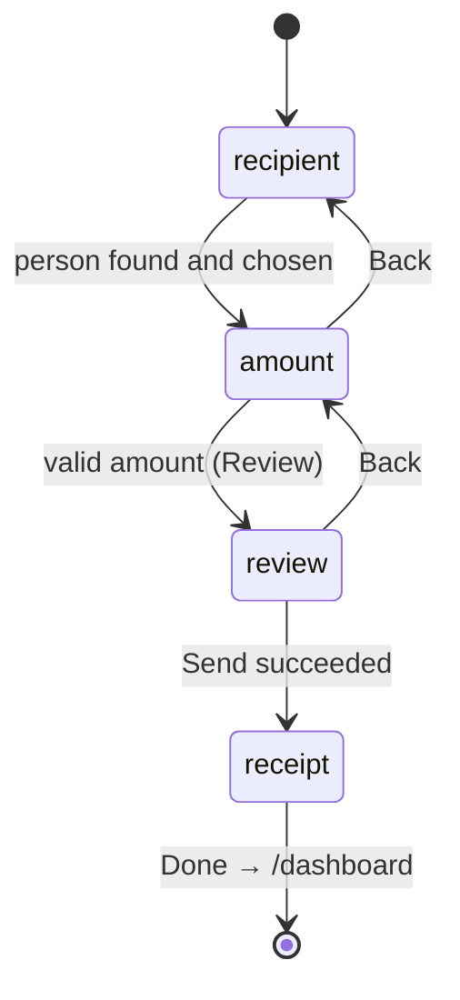

# Send money

**What you will learn:** how a person is found (by username, account number, mobile or linked Gmail), how "recent recipients" are computed, how the 3-step form (recipient → amount → review) works, including the debounced search and the spend-limit checks, and how it all ends in the ledger's `transfer()`. The server path was traced end to end in [Life of a request](../02-architecture/02-request-lifecycle.md); this page explains every part of the feature itself.

| Layer | Files |
| --- | --- |
| API and service | `src/features/transfers/transfers.router.ts`, `transfers.service.ts` |
| Money movement | `src/server/ledger.ts` → `transfer()` ([The ledger](../04-server-core/04-ledger.md#8-transfer-person-to-person-lines-171210)) |
| Screen | `src/features/transfers/components/transfer-form.tsx`, page `src/app/(app)/transfer/page.tsx` (`/transfer`) |
| Shared pieces | `src/shared/hooks/use-recipient-search.ts`, `src/shared/hooks/use-spend-limit.ts`, `src/shared/ui/money-form-ui.tsx`, `src/shared/lib/amount-input.ts` |
| Reused by | Request money (recipient search, money form), Pay bills and Buy load (spend limit), paying a request (spend limit) |

---

## 1. The API

<!-- code: gobank/src/features/transfers/transfers.router.ts -->
**`gobank/src/features/transfers/transfers.router.ts`** · all 31 lines

```ts
 1 │ import { z } from "zod";
 2 │ import { cardKind, centavos, optionalText } from "~/shared/lib/schemas";
 3 │ import { createTRPCRouter, protectedProcedure } from "~/server/trpc";
 4 │ import {
 5 │   findRecipient,
 6 │   getRecentRecipients,
 7 │   sendMoney,
 8 │ } from "./transfers.service";
 9 │
10 │ export const transfersRouter = createTRPCRouter({
11 │   recent: protectedProcedure.query(({ ctx }) =>
12 │     getRecentRecipients(ctx.userId),
13 │   ),
14 │
15 │   recipient: protectedProcedure
16 │     .input(z.object({ to: z.string().trim().min(1) }))
17 │     .query(({ ctx, input }) => findRecipient(input.to, ctx.userId)),
18 │
19 │   send: protectedProcedure
20 │     .input(
21 │       z.object({
22 │         to: z.string().trim().min(1),
23 │         amount: centavos,
24 │         note: optionalText(120),
25 │         card: cardKind,
26 │       }),
27 │     )
28 │     .mutation(({ ctx, input }) =>
29 │       sendMoney(ctx.userId, input.to, input.amount, input.note, input.card),
30 │     ),
31 │ });
```
<!-- /code -->

| Procedure | Type | Input | Returns |
| --- | --- | --- | --- |
| `recent` | query | none | up to 6 people you recently sent money to |
| `recipient` | query | `to`: non-empty text | the matching person's `id`, `username`, `fullName`, `profilePhoto` |
| `send` | mutation | `to`, `amount` (centavos), `note` (≤ 120 chars, optional), `card` | the sender's new transaction row (the receipt) |

---

## 2. The service

<!-- code: gobank/src/features/transfers/transfers.service.ts -->
**`gobank/src/features/transfers/transfers.service.ts`** · all 95 lines

```ts
 1 │ import { normalizeGmail, normalizeMobile } from "~/shared/lib/contact";
 2 │ import { db } from "~/server/db";
 3 │ import { fail, MESSAGES } from "~/server/errors";
 4 │ import { transfer } from "~/server/ledger";
 5 │ import type { CardKind } from "../../../generated/prisma";
 6 │
 7 │ export const PARTY = {
 8 │   id: true,
 9 │   username: true,
10 │   fullName: true,
11 │   profilePhoto: true,
12 │ } as const;
13 │
14 │ const LOOKS_LIKE_PHONE = /^[+()\d\s-]+$/;
15 │ const PH_MOBILE = /^09\d{9}$/;
16 │
17 │ function recipientSearch(handle: string) {
18 │   const input = handle.trim().toLowerCase();
19 │   const value = input.replace(/^@/, "");
20 │
21 │   if (input.startsWith("@")) return { username: value };
22 │
23 │   const gmail = normalizeGmail(value);
24 │   const mobile = LOOKS_LIKE_PHONE.test(value) ? normalizeMobile(value) : null;
25 │
26 │   const byGmail = gmail ? [{ gmail, googleId: { not: null } }] : [];
27 │   const byMobile = mobile && PH_MOBILE.test(mobile) ? [{ mobile }] : [];
28 │
29 │   return {
30 │     OR: [
31 │       { accountNumber: value.replace(/[\s-]/g, "") },
32 │       { username: value },
33 │       ...byGmail,
34 │       ...byMobile,
35 │     ],
36 │   };
37 │ }
38 │
39 │ export async function findRecipient(handle: string, self: string) {
40 │   const user = await db.user.findFirst({
41 │     where: recipientSearch(handle),
42 │     select: PARTY,
43 │   });
44 │
45 │   if (!user) return fail("NOT_FOUND", MESSAGES.recipientNotFound);
46 │   if (user.id === self) fail("BAD_REQUEST", MESSAGES.ownAccount);
47 │
48 │   return user;
49 │ }
50 │
51 │ export async function getRecentRecipients(userId: string) {
52 │   const transactions = await db.transaction.groupBy({
53 │     by: ["counterpartyId"],
54 │     where: {
55 │       userId,
56 │       kind: "transfer",
57 │       amount: { lt: 0 },
58 │       counterpartyId: { not: null },
59 │     },
60 │     orderBy: { _max: { createdAt: "desc" } },
61 │     take: 6,
62 │   });
63 │
64 │   const ids = transactions.flatMap((entry) =>
65 │     entry.counterpartyId ? [entry.counterpartyId] : [],
66 │   );
67 │   if (ids.length === 0) return [];
68 │   const recipients = await db.user.findMany({
69 │     where: { id: { in: ids } },
70 │     select: PARTY,
71 │   });
72 │   const ordered = ids.map((id) =>
73 │     recipients.find((recipient) => recipient.id === id),
74 │   );
75 │   return ordered.filter((recipient) => recipient !== undefined);
76 │ }
77 │
78 │ export async function sendMoney(
79 │   userId: string,
80 │   to: string,
81 │   amount: number,
82 │   note: string | null,
83 │   card: CardKind,
84 │ ) {
85 │   const receiver = await findRecipient(to, userId);
86 │
87 │   const sender = await db.user.findUniqueOrThrow({
88 │     where: { id: userId },
89 │     select: { id: true, username: true },
90 │   });
91 │
92 │   return db.$transaction((tx) =>
93 │     transfer(tx, sender, receiver, amount, card, note),
94 │   );
95 │ }
```
<!-- /code -->

### `PARTY` (lines 7–12): what we reveal about another person

Only `id`, `username`, `fullName` and `profilePhoto`. Never their balance, account number, mobile or Gmail, even though you can *search* by those. The same field list is reused by the money-request screens.

### `recipientSearch` (lines 17–37): one box, four ways to find someone

| The user types | Matches | Example |
| --- | --- | --- |
| starts with `@` | **only** the exact username | `@dante` |
| digits with optional spaces or dashes | the **account number** (spaces/dashes removed) | `2035 3020 719` |
| a word | the **username** | `dante` |
| a Gmail address | the **Gmail**, but only if that account has **linked Google** (`googleId: { not: null }`) | `dante.reyes@gmail.com` |
| something phone-like | the **mobile**, after normalizing (`+63…` → `09…`) and only if it is a valid `09XXXXXXXXX` | `+63 918 123 4567` |

Everything is lowercased and trimmed first. Gmail matching is restricted to *linked* Gmails because only those were verified through Google; an unverified address typed into a profile could otherwise be used to impersonate someone.

### `findRecipient` (lines 39–49)

`findFirst` with the conditions above. Not found → `NOT_FOUND` "No GoBank account matches that". Yourself → `BAD_REQUEST` "That is your own account". `requestMoney` reuses this function, so requests follow exactly the same rules.

### `getRecentRecipients` (lines 51–76)

1. **Lines 52–62:** group *your outgoing transfers* by the other person, order the groups by the **most recent** transfer to each person, keep 6. `groupBy` gives one entry per person, so someone you paid five times appears once.
2. **Lines 64–71:** load those people. `findMany` with `in` does **not** keep the order, so…
3. **Lines 72–75:** …put them back in the "most recent first" order, dropping anyone whose account no longer exists.

### `sendMoney` (lines 78–95)

Look the recipient up **again on the server** (never trusting the browser's copy), load the sender's username for the history titles, then run `transfer()` inside one database transaction.

---

## 3. The amount box: `amount-input.ts`

<!-- code: gobank/src/shared/lib/amount-input.ts -->
**`gobank/src/shared/lib/amount-input.ts`** · all 2 lines

```ts
1 │ export const isPesoInput = (value: string) =>
2 │   /^\d{0,7}(?:\.\d{0,2})?$/.test(value);
```
<!-- /code -->

Every amount field in GoBank only accepts what this allows: up to 7 digits, optionally a dot and **at most 2 decimals**. Half-typed values (`""`, `.`, `12.`) are allowed so typing feels natural; `-5`, `1.234`, `1e3` and `1,000` are rejected as you type (`amount-input.test.ts`). The text is then converted with `toCentavos(Number(amount))`, which uses `Math.round` because `12.34 * 100` is `1233.9999999999998` in floating point; rounding gives exactly `1234`.

---

## 4. Finding the person: `use-recipient-search.ts`

<!-- code: gobank/src/shared/hooks/use-recipient-search.ts -->
**`gobank/src/shared/hooks/use-recipient-search.ts`** · all 75 lines

```ts
 1 │ "use client";
 2 │
 3 │ import { useEffect, useRef, useState } from "react";
 4 │ import { errorMessage } from "~/trpc/error-message";
 5 │ import { api, type RouterOutputs } from "~/trpc/react";
 6 │
 7 │ export type Recipient = RouterOutputs["transfers"]["recipient"];
 8 │
 9 │ const TYPING_PAUSE_MS = 300;
10 │
11 │ export function useRecipientSearch(onFound: () => void) {
12 │   const [value, setValue] = useState("");
13 │   const [lookup, setLookup] = useState("");
14 │   const [recipient, setRecipient] = useState<Recipient | null>(null);
15 │   const latestValue = useRef("");
16 │
17 │   useEffect(() => {
18 │     const timer = setTimeout(() => setLookup(value.trim()), TYPING_PAUSE_MS);
19 │     return () => clearTimeout(timer);
20 │   }, [value]);
21 │
22 │   const result = api.transfers.recipient.useQuery(
23 │     { to: lookup },
24 │     { enabled: Boolean(lookup) && !recipient, retry: false },
25 │   );
26 │
27 │   const typed = value.trim();
28 │   const lookupMatchesTyping = typed !== "" && lookup === typed;
29 │   const waitingForResult = !lookupMatchesTyping || result.isFetching;
30 │
31 │   const loading = typed !== "" && !recipient && waitingForResult;
32 │
33 │   const foundNow =
34 │     lookupMatchesTyping && !result.isError ? (result.data ?? null) : null;
35 │   const match = recipient ?? foundNow;
36 │
37 │   const showError = lookupMatchesTyping && !loading && !recipient;
38 │   const error = showError ? errorMessage(result.error) : null;
39 │
40 │   const change = (next: string) => {
41 │     latestValue.current = next;
42 │     setValue(next);
43 │     setRecipient(null);
44 │   };
45 │
46 │   const select = (found: Recipient) => {
47 │     const handle = `@${found.username}`;
48 │
49 │     latestValue.current = handle;
50 │     setValue(handle);
51 │     setLookup(handle);
52 │     setRecipient(found);
53 │
54 │     onFound();
55 │   };
56 │
57 │   const find = () => {
58 │     const stillTheSameSearch = latestValue.current.trim() === lookup;
59 │     if (loading || !match || !stillTheSameSearch) return;
60 │
61 │     select(match);
62 │   };
63 │
64 │   return {
65 │     value,
66 │     recipient,
67 │     match,
68 │     error,
69 │     loading,
70 │     change,
71 │     find,
72 │     select,
73 │     retry: () => void result.refetch(),
74 │   };
75 │ }
```
<!-- /code -->

| Lines | Behavior | Why |
| --- | --- | --- |
| 12–15 | `value` = what is typed; `lookup` = what was last searched; `recipient` = who was chosen; `latestValue` = a ref with the very latest text | |
| 17–20 | 300 ms after typing stops, search for the trimmed text | **Debouncing**: no request per keystroke |
| 22–25 | ask the server only when there is something to look up and nobody is chosen yet; `retry: false` | a "not found" answer is final, not worth retrying 3 times |
| 27–31 | `loading` while the text and the last search differ or the request is running | the button says "Finding recipient…" |
| 33–35 | `match` = the chosen person, or the result of a search that matches the current text | never show a result for older text |
| 37–38 | show an error only for the current text, after loading | |
| 40–44 | typing clears any chosen person | |
| 46–55 | choosing someone sets the text to `@username`, records them, and calls `onFound` (the form moves to the amount step) | |
| 57–62 | **Continue / Enter:** proceed only if not loading, there is a match, and the **latest** typed text is the text that was searched | if you type and press Enter within 300 ms, the ref sees the new text and refuses the stale match |

---

## 5. Checking the amount: `use-spend-limit.ts`

<!-- code: gobank/src/shared/hooks/use-spend-limit.ts -->
**`gobank/src/shared/hooks/use-spend-limit.ts`** · all 51 lines

```ts
 1 │ "use client";
 2 │
 3 │ import { useState } from "react";
 4 │ import { peso } from "~/shared/lib/format";
 5 │ import { api } from "~/trpc/react";
 6 │ import type { CardKind } from "../../../generated/prisma";
 7 │
 8 │ export function useSpendLimit(maximum: number, minimum = 1) {
 9 │   const { data } = api.account.spending.useQuery();
10 │   const [chosen, setCard] = useState<CardKind | null>(null);
11 │
12 │   const cards = data?.cards ?? [];
13 │   const unlocked = cards.filter((item) => !item.locked);
14 │   const locked = cards.length > 0 && unlocked.length === 0;
15 │
16 │   const chosenIfUnlocked = unlocked.find((item) => item.kind === chosen);
17 │   const card = chosenIfUnlocked?.kind ?? unlocked[0]?.kind ?? "physical";
18 │
19 │   const check = (amount: number) => {
20 │     if (!Number.isFinite(amount) || amount <= 0) return null;
21 │     if (amount < minimum) return `Minimum ${peso(minimum)}`;
22 │     if (amount > maximum) return `Maximum ${peso(maximum)}`;
23 │
24 │     if (!data) return null;
25 │     if (locked) return "Both cards are locked. Unlock one to spend";
26 │
27 │     if (amount > data.balance) {
28 │       return `Insufficient balance. You have ${peso(data.balance)}`;
29 │     }
30 │
31 │     if (amount > data.dailyLeft) {
32 │       return `Over your daily limit. ${peso(data.dailyLeft)} left today`;
33 │     }
34 │
35 │     return null;
36 │   };
37 │
38 │   const hint = data
39 │     ? `Balance ${peso(data.balance)} · ${peso(data.dailyLeft)} left today`
40 │     : `Up to ${peso(maximum)}`;
41 │
42 │   return {
43 │     check,
44 │     hint,
45 │     cards,
46 │     card,
47 │     setCard,
48 │     locked,
49 │     valid: (amount: number) => amount >= minimum && check(amount) === null,
50 │   };
51 │ }
```
<!-- /code -->

| Lines | Behavior |
| --- | --- |
| 9 | load `account.spending`: balance, daily limit left, and both cards (last 4 digits only) |
| 10–17 | which card pays: the one the user chose if it is unlocked, otherwise the first unlocked card; `locked` is true only when **both** are locked |
| 19–36 | `check(amount)` returns the first problem, in this order: minimum, maximum, both cards locked, "Insufficient balance. You have ₱X", "Over your daily limit. ₱X left today". Nothing typed yet → no message |
| 38–40 | the hint under the field: "Balance ₱5,000.00 · ₱20,000.00 left today" |
| 49 | `valid(amount)` = at least the minimum and no problem |

Before the spending data has loaded, only the minimum and maximum can be checked (line 24). That is fine: the server checks everything again under a lock. These browser checks exist for a fast, friendly experience.

---

## 6. The form: `transfer-form.tsx`



### Step 1: recipient

<!-- code: gobank/src/features/transfers/components/transfer-form.tsx 30-92 -->
**`gobank/src/features/transfers/components/transfer-form.tsx`** · lines 30–92

```tsx
30 │ function RecentRecipients({
31 │   disabled,
32 │   onSelect,
33 │ }: {
34 │   disabled: boolean;
35 │   onSelect: (recipient: Recipient) => void;
36 │ }) {
37 │   const recent = api.transfers.recent.useQuery();
38 │
39 │   if (recent.isPending) {
40 │     return (
41 │       <p role="status" className="text-ink-muted text-[13px]">
42 │         Loading recent recipients…
43 │       </p>
44 │     );
45 │   }
46 │
47 │   if (recent.error) {
48 │     return (
49 │       <div className="text-[13px]">
50 │         <p role="alert" className="text-danger">
51 │           Could not load recent recipients.
52 │         </p>
53 │         <button
54 │           type="button"
55 │           disabled={recent.isFetching}
56 │           onClick={() => void recent.refetch()}
57 │           className="text-brand mt-2 font-medium disabled:opacity-60"
58 │         >
59 │           {recent.isFetching ? "Loading…" : "Try again"}
60 │         </button>
61 │       </div>
62 │     );
63 │   }
64 │
65 │   if (recent.data.length === 0) {
66 │     return (
67 │       <p className="text-ink-muted text-[13px]">No recent recipients yet.</p>
68 │     );
69 │   }
70 │
71 │   return (
72 │     <ul className="border-line divide-line divide-y rounded-2xl border">
73 │       {recent.data.map((recipient) => (
74 │         <li key={recipient.id}>
75 │           <button
76 │             type="button"
77 │             disabled={disabled}
78 │             onClick={() => onSelect(recipient)}
79 │             className="hover:bg-surface-sunken flex w-full items-center justify-between gap-3 rounded-xl p-3 text-left transition-colors disabled:opacity-60"
80 │           >
81 │             <RecipientIdentity recipient={recipient} />
82 │             <ChevronRight
83 │               size={18}
84 │               className="text-ink-muted shrink-0"
85 │               aria-hidden
86 │             />
87 │           </button>
88 │         </li>
89 │       ))}
90 │     </ul>
91 │   );
92 │ }
```
<!-- /code -->

`RecentRecipients` shows "Loading recent recipients…", an error with **Try again**, "No recent recipients yet.", or a list of people. Tapping one selects them directly (skipping the search).

### Steps 2 and 3, and the receipt

<!-- code: gobank/src/features/transfers/components/transfer-form.tsx 94-222 -->
**`gobank/src/features/transfers/components/transfer-form.tsx`** · lines 94–222

```tsx
 94 │ export function TransferForm() {
 95 │   const router = useRouter();
 96 │   const [step, setStep] = useState<MoneyStep>("recipient");
 97 │   const [amount, setAmount] = useState("");
 98 │   const [note, setNote] = useState("");
 99 │
100 │   const search = useRecipientSearch(() => setStep("amount"));
101 │   const limit = useSpendLimit(MAX_TRANSACTION_CENTAVOS);
102 │   const send = api.transfers.send.useMutation();
103 │
104 │   const amountCentavos = toCentavos(Number(amount));
105 │   const validAmount = limit.valid(amountCentavos);
106 │   const recipient = search.recipient;
107 │
108 │   const back = () => {
109 │     send.reset();
110 │     setStep(step === "review" ? "amount" : "recipient");
111 │   };
112 │
113 │   const finish = () => {
114 │     router.push("/dashboard");
115 │     router.refresh();
116 │   };
117 │
118 │   const sendMoney = () => {
119 │     if (!recipient || !validAmount || send.isPending) return;
120 │
121 │     send.mutate({
122 │       to: `@${recipient.username}`,
123 │       amount: amountCentavos,
124 │       note: note.trim(),
125 │       card: limit.card,
126 │     });
127 │   };
128 │
129 │   if (send.data && recipient) {
130 │     return (
131 │       <TransactionReceipt title="Transfer successful" onDone={finish}>
132 │         <MoneySummary
133 │           recipient={recipient}
134 │           amount={Math.abs(send.data.amount)}
135 │           note={note.trim()}
136 │           details={[
137 │             { label: "Reference", value: send.data.reference },
138 │             { label: "Date", value: dateTime(send.data.createdAt) },
139 │             { label: "Balance", value: peso(send.data.balanceAfter) },
140 │             ...paidWithDetail(send.data.details),
141 │           ]}
142 │         />
143 │       </TransactionReceipt>
144 │     );
145 │   }
146 │
147 │   return (
148 │     <div className="flex flex-1 flex-col">
149 │       <MoneyFormHeader
150 │         title="Send money"
151 │         step={step}
152 │         disabled={send.isPending}
153 │         onBack={back}
154 │       />
155 │
156 │       {limit.locked && !send.isPending ? <CardLockedNotice /> : null}
157 │
158 │       {step === "recipient" ? (
159 │         <RecipientPicker
160 │           value={search.value}
161 │           loading={search.loading}
162 │           recipient={search.match}
163 │           error={search.error}
164 │           onChange={search.change}
165 │           onContinue={search.find}
166 │           onRetry={search.retry}
167 │         >
168 │           <section className="mt-7">
169 │             <h2 className="text-ink-muted mb-3 text-[13px] font-medium">
170 │               Recent recipients
171 │             </h2>
172 │             <RecentRecipients
173 │               disabled={search.loading}
174 │               onSelect={search.select}
175 │             />
176 │           </section>
177 │         </RecipientPicker>
178 │       ) : null}
179 │
180 │       {step === "amount" && recipient ? (
181 │         <AmountFields
182 │           recipient={recipient}
183 │           amount={amount}
184 │           note={note}
185 │           hint={limit.hint}
186 │           error={limit.check(amountCentavos)}
187 │           canContinue={validAmount}
188 │           onAmountChange={setAmount}
189 │           onNoteChange={setNote}
190 │           onContinue={() => {
191 │             if (validAmount) setStep("review");
192 │           }}
193 │         />
194 │       ) : null}
195 │
196 │       {step === "review" && recipient ? (
197 │         <div className="flex flex-1 flex-col pt-7">
198 │           <MoneySummary
199 │             recipient={recipient}
200 │             amount={amountCentavos}
201 │             note={note.trim()}
202 │           />
203 │
204 │           <CardPicker
205 │             cards={limit.cards}
206 │             value={limit.card}
207 │             onChange={limit.setCard}
208 │             disabled={send.isPending}
209 │           />
210 │
211 │           <FormError error={errorMessage(send.error)} />
212 │
213 │           <div className="mt-auto pt-8">
214 │             <Button disabled={send.isPending} onClick={sendMoney}>
215 │               {send.isPending ? "Sending…" : `Send ${peso(amountCentavos)}`}
216 │             </Button>
217 │           </div>
218 │         </div>
219 │       ) : null}
220 │     </div>
221 │   );
222 │ }
```
<!-- /code -->

| Lines | Behavior |
| --- | --- |
| 100 | when a person is chosen, go to the amount step |
| 101 | spend limit with the maximum single transaction of ₱1,000,000 |
| 108–111 | Back clears any error; review → amount → recipient |
| 118–127 | send: guarded against missing data, invalid amounts and double taps; the recipient is sent as `@username`; the note is trimmed |
| 129–145 | after success: "Transfer successful" with amount, note, reference, date, new balance and "Paid with …" |
| 156 | if both cards are locked, show the notice (spending is impossible) |
| 158–178 | step 1: `RecipientPicker` + recent recipients |
| 180–194 | step 2: `AmountFields`; the error or hint comes from `useSpendLimit` |
| 196–219 | step 3: summary, **Pay with** card picker, error, and the "Send ₱X" button ("Sending…" while pending) |

### The shared form parts: `money-form-ui.tsx`

<!-- code: gobank/src/shared/ui/money-form-ui.tsx 142-213 -->
**`gobank/src/shared/ui/money-form-ui.tsx`** · lines 142–213

```tsx
142 │ export function RecipientPicker({
143 │   label = "Recipient",
144 │   value,
145 │   loading,
146 │   recipient,
147 │   error,
148 │   onChange,
149 │   onContinue,
150 │   onRetry,
151 │   children,
152 │ }: {
153 │   label?: string;
154 │   value: string;
155 │   loading: boolean;
156 │   recipient: Recipient | null;
157 │   error: string | null;
158 │   onChange: (value: string) => void;
159 │   onContinue: () => void;
160 │   onRetry: () => void;
161 │   children?: ReactNode;
162 │ }) {
163 │   return (
164 │     <form
165 │       className="flex flex-1 flex-col pt-8"
166 │       onSubmit={submitWith(onContinue)}
167 │     >
168 │       <label
169 │         htmlFor="recipient"
170 │         className="text-ink mb-2 text-[14px] font-medium"
171 │       >
172 │         {label}
173 │       </label>
174 │       <input
175 │         id="recipient"
176 │         value={value}
177 │         autoComplete="off"
178 │         autoCapitalize="none"
179 │         spellCheck={false}
180 │         aria-invalid={Boolean(error)}
181 │         aria-describedby="recipient-help"
182 │         onChange={(event) => onChange(event.target.value)}
183 │         className={cn(INPUT_CLASS, "h-13")}
184 │       />
185 │       <p
186 │         id="recipient-help"
187 │         className="text-ink-muted mt-2 text-[12px] leading-relaxed"
188 │       >
189 │         Username, linked Gmail, account number or mobile.
190 │       </p>
191 │
192 │       {error ? (
193 │         <RecipientError error={error} loading={loading} onRetry={onRetry} />
194 │       ) : null}
195 │
196 │       {!error && recipient ? (
197 │         <RecipientMatch
198 │           recipient={recipient}
199 │           loading={loading}
200 │           onContinue={onContinue}
201 │         />
202 │       ) : null}
203 │
204 │       {children}
205 │
206 │       <div className="mt-auto pt-8">
207 │         <Button type="submit" disabled={!recipient || loading}>
208 │           {loading ? "Finding recipient…" : "Continue"}
209 │         </Button>
210 │       </div>
211 │     </form>
212 │   );
213 │ }
```
<!-- /code -->

`RecipientPicker` is a real `<form>`, so pressing Enter works. The input turns off autocomplete, auto-capitalization and spell-check (usernames are lowercase). It is linked to its help text with `aria-describedby`, marks itself `aria-invalid` on errors, and the server's "No GoBank account matches that" is shown as the shorter "No matching account." with **Try again**.

<!-- code: gobank/src/shared/ui/money-form-ui.tsx 215-309 -->
**`gobank/src/shared/ui/money-form-ui.tsx`** · lines 215–309

```tsx
215 │ export function AmountFields({
216 │   recipient,
217 │   amount,
218 │   note,
219 │   hint,
220 │   error,
221 │   canContinue,
222 │   onAmountChange,
223 │   onNoteChange,
224 │   onContinue,
225 │ }: {
226 │   recipient: Recipient;
227 │   amount: string;
228 │   note: string;
229 │   hint: string;
230 │   error: string | null;
231 │   canContinue: boolean;
232 │   onAmountChange: (value: string) => void;
233 │   onNoteChange: (value: string) => void;
234 │   onContinue: () => void;
235 │ }) {
236 │   const acceptAmount = (value: string) => {
237 │     if (isPesoInput(value)) onAmountChange(value);
238 │   };
239 │
240 │   return (
241 │     <form
242 │       className="flex flex-1 flex-col gap-6 pt-7"
243 │       onSubmit={submitWith(onContinue)}
244 │     >
245 │       <div className="border-line rounded-2xl border p-4">
246 │         <RecipientIdentity recipient={recipient} />
247 │       </div>
248 │
249 │       <div>
250 │         <label
251 │           htmlFor="amount"
252 │           className="text-ink mb-2 block text-[14px] font-medium"
253 │         >
254 │           Amount
255 │         </label>
256 │         <div className="border-line-strong bg-surface-sunken focus-within:border-brand flex items-center rounded-xl border px-4">
257 │           <span aria-hidden className="text-ink-muted text-[24px]">
258 │             ₱
259 │           </span>
260 │           <input
261 │             id="amount"
262 │             inputMode="decimal"
263 │             autoComplete="off"
264 │             placeholder="0.00"
265 │             value={amount}
266 │             aria-invalid={Boolean(error)}
267 │             aria-describedby="amount-limit"
268 │             onChange={(event) => acceptAmount(event.target.value)}
269 │             className="text-ink placeholder:text-ink-faint h-20 min-w-0 flex-1 bg-transparent px-3 text-[28px] font-medium tabular-nums outline-none"
270 │           />
271 │         </div>
272 │         <p
273 │           id="amount-limit"
274 │           role={error ? "alert" : undefined}
275 │           className={cn(
276 │             "mt-2 text-[12px]",
277 │             error ? "text-danger" : "text-ink-muted",
278 │           )}
279 │         >
280 │           {error ?? hint}
281 │         </p>
282 │       </div>
283 │
284 │       <div>
285 │         <label
286 │           htmlFor="note"
287 │           className="text-ink mb-2 block text-[14px] font-medium"
288 │         >
289 │           Note <span className="text-ink-muted font-normal">(optional)</span>
290 │         </label>
291 │         <textarea
292 │           id="note"
293 │           autoComplete="off"
294 │           value={note}
295 │           maxLength={120}
296 │           rows={3}
297 │           onChange={(event) => onNoteChange(event.target.value)}
298 │           className={cn(INPUT_CLASS, "resize-none py-3")}
299 │         />
300 │       </div>
301 │
302 │       <div className="mt-auto pt-2">
303 │         <Button type="submit" disabled={!canContinue}>
304 │           Review
305 │         </Button>
306 │       </div>
307 │     </form>
308 │   );
309 │ }
```
<!-- /code -->

`AmountFields` shows the chosen person, a large `₱` amount input (numeric keyboard on phones via `inputMode="decimal"`) whose message area has the ID `amount-limit` (the Playwright test reads it), and an optional note limited to 120 characters. **Review** stays disabled until the amount is valid.

The rest of the file: `MoneyFormHeader` ("Step N of 3", Back goes to the dashboard on step 1), `FormError` (a red alert), `RecipientIdentity` (photo, name, `@username`) and `MoneySummary` (the review and receipt card).

---

## 7. What gets stored

One `transfer()` writes **two** `Transaction` rows with one reference: the sender's (negative amount, "Transfer to @dante", points earned at 1 per ₱50, `details.card` and `details.note`) and the receiver's (positive amount, "Transfer from @maricel", `details.note`). Full table in [Life of a request, step 8](../02-architecture/02-request-lifecycle.md#step-8-the-database-commits).

---

## 8. Tests that cover this feature

| Test | Checks |
| --- | --- |
| `amount-input.test.ts` | the amount box rules and the centavo conversion |
| `verify-core.ts` → `checkTransfersAndRequests` | a ₱123.45 transfer writes two rows that **sum to zero** and credits the receiver exactly |
| `verify-core.ts` → `checkCardLocks` | a locked card is refused and nothing changes; the virtual card works and is recorded |
| `e2e/smoke.spec.ts` → "send money blocks amounts above the balance" | in a real browser: type `@dante`, continue, enter `9999999`, see a limit message, and **Review** is disabled |
| experiment `concurrent-transfers.ts` | 20 simultaneous transfers never overdraw and never create or lose money |

---

## Defense questions

**Q: How does a user find who to send money to?**
A: One search box accepts a username (with or without `@`), an account number, a Philippine mobile number or a linked Gmail. The server searches all of them at once and returns only the person's name, username and photo. Gmail search only matches accounts that linked Google, because those addresses were verified.

**Q: What stops me from sending more than I have, or more than my daily limit?**
A: The form warns immediately using the balance and the remaining limit. But the real check is in the ledger, inside the database transaction: the account row is locked, today's card spending is summed, the card must be unlocked, and the balance is reduced only if it is enough.

**Q: Why search for the recipient again when sending, if the browser already found them?**
A: The browser can be manipulated. The server resolves the recipient itself, refuses sending to yourself, and only then moves money.

**Q: Why debounce the search?**
A: To avoid a server request on every keystroke. The search runs 300 ms after the user stops typing, and stale results for older text are never shown or used.

---

## Check yourself

<details>
<summary>What does typing <code>@2035302071</code> search for?</summary>

Only a username equal to `2035302071`, because text starting with `@` is treated strictly as a username. Without the `@`, it would also match an account number.
</details>

<details>
<summary>Why does <code>getRecentRecipients</code> re-order the users after loading them?</summary>

`findMany({ where: { id: { in: ids } } })` does not return rows in the order of `ids`; the code maps the IDs back to keep "most recent first".
</details>
