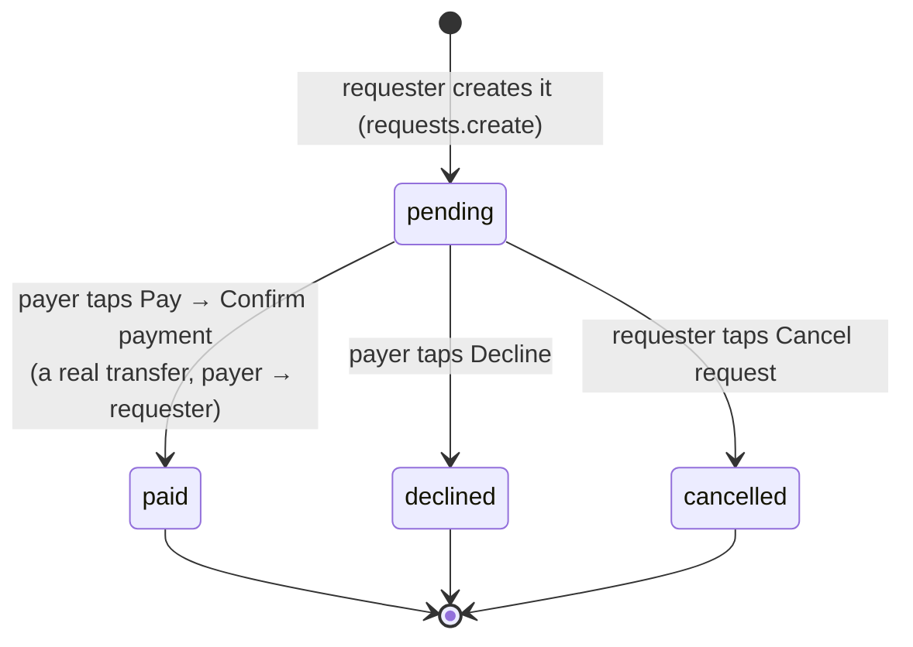

# Request money and notifications

**What you will learn:** how a user asks someone for money, how the other person pays or declines it (and why a request can never be paid twice), how the requester cancels it, and how the **Notifications** screen lists received and sent requests page by page.

| Layer | Files |
| --- | --- |
| Rules | `src/features/requests/requests.rules.ts` |
| API and service | `src/features/requests/requests.router.ts`, `requests.service.ts`, `src/features/notifications/notifications.router.ts`, `notifications.service.ts` |
| Screens | `src/features/requests/components/request-form.tsx` (`/request`), `src/features/notifications/components/notifications-screen.tsx` (`/notifications`) |
| Pages | `src/app/(app)/request/page.tsx`, `src/app/(app)/notifications/page.tsx` |

> In GoBank, **"Notifications" means the money-request inbox** (the bell icon on the dashboard). There are no push or email notifications ([Limitations](../09-defense/03-limitations-and-future-work.md)).

---

## 1. The life of a request



A request only *asks*; **no money moves until the payer accepts**. Then a normal transfer runs with every ledger rule (card lock, daily limit, balance).

---

## 2. Rules and API

<!-- code: gobank/src/features/requests/requests.rules.ts -->
**`gobank/src/features/requests/requests.rules.ts`** · all 1 lines

```ts
1 │ export const MAX_REQUEST_CENTAVOS = 2_000_000;
```
<!-- /code -->

A single request can be at most **₱20,000**.

<!-- code: gobank/src/features/requests/requests.router.ts -->
**`gobank/src/features/requests/requests.router.ts`** · all 39 lines

```ts
 1 │ import { z } from "zod";
 2 │ import { cardKind, centavos, optionalText } from "~/shared/lib/schemas";
 3 │ import { createTRPCRouter, protectedProcedure } from "~/server/trpc";
 4 │ import {
 5 │   cancelRequest,
 6 │   requestMoney,
 7 │   respondToRequest,
 8 │ } from "./requests.service";
 9 │ import { MAX_REQUEST_CENTAVOS } from "./requests.rules";
10 │
11 │ export const requestsRouter = createTRPCRouter({
12 │   create: protectedProcedure
13 │     .input(
14 │       z.object({
15 │         from: z.string().trim().min(1),
16 │         amount: centavos.max(MAX_REQUEST_CENTAVOS),
17 │         note: optionalText(120),
18 │       }),
19 │     )
20 │     .mutation(({ ctx, input }) =>
21 │       requestMoney(ctx.userId, input.from, input.amount, input.note),
22 │     ),
23 │
24 │   respond: protectedProcedure
25 │     .input(
26 │       z.object({
27 │         id: z.string().min(1),
28 │         accept: z.boolean(),
29 │         card: cardKind.default("physical"),
30 │       }),
31 │     )
32 │     .mutation(({ ctx, input }) =>
33 │       respondToRequest(ctx.userId, input.id, input.accept, input.card),
34 │     ),
35 │
36 │   cancel: protectedProcedure
37 │     .input(z.object({ id: z.string().min(1) }))
38 │     .mutation(({ ctx, input }) => cancelRequest(ctx.userId, input.id)),
39 │ });
```
<!-- /code -->

| Procedure | Input | Who may call it successfully |
| --- | --- | --- |
| `create` | `from` (who should pay), `amount` ≤ ₱20,000, optional note ≤ 120 chars | anyone signed in |
| `respond` | request `id`, `accept` true/false, `card` (defaults to physical) | only the **payer**, only while **pending** |
| `cancel` | request `id` | only the **requester**, only while **pending** |

---

## 3. The service

<!-- code: gobank/src/features/requests/requests.service.ts -->
**`gobank/src/features/requests/requests.service.ts`** · all 72 lines

```ts
 1 │ import { findRecipient } from "~/features/transfers/transfers.service";
 2 │ import { db } from "~/server/db";
 3 │ import { fail, MESSAGES } from "~/server/errors";
 4 │ import { transfer } from "~/server/ledger";
 5 │ import type { CardKind } from "../../../generated/prisma";
 6 │
 7 │ export async function requestMoney(
 8 │   userId: string,
 9 │   from: string,
10 │   amount: number,
11 │   note: string | null,
12 │ ) {
13 │   const payer = await findRecipient(from, userId);
14 │
15 │   return db.moneyRequest.create({
16 │     data: {
17 │       requesterId: userId,
18 │       payerId: payer.id,
19 │       amount,
20 │       note,
21 │     },
22 │   });
23 │ }
24 │
25 │ export const respondToRequest = (
26 │   userId: string,
27 │   id: string,
28 │   accept: boolean,
29 │   card: CardKind = "physical",
30 │ ) =>
31 │   db.$transaction(
32 │     async (tx) => {
33 │       const claimed = await tx.moneyRequest.updateMany({
34 │         where: { id, payerId: userId, status: "pending" },
35 │         data: { status: accept ? "paid" : "declined" },
36 │       });
37 │       if (claimed.count !== 1) fail("NOT_FOUND", MESSAGES.requestClosed);
38 │       if (!accept) return null;
39 │
40 │       const request = await tx.moneyRequest.findUniqueOrThrow({
41 │         where: { id },
42 │         include: {
43 │           requester: { select: { id: true, username: true } },
44 │           payer: { select: { id: true, username: true } },
45 │         },
46 │       });
47 │       const sent = await transfer(
48 │         tx,
49 │         request.payer,
50 │         request.requester,
51 │         request.amount,
52 │         card,
53 │         request.note,
54 │       );
55 │
56 │       await tx.moneyRequest.update({
57 │         where: { id },
58 │         data: { reference: sent.reference },
59 │       });
60 │
61 │       return sent;
62 │     },
63 │     { maxWait: 10_000, timeout: 15_000 },
64 │   );
65 │
66 │ export async function cancelRequest(userId: string, id: string) {
67 │   const cancelled = await db.moneyRequest.updateMany({
68 │     where: { id, requesterId: userId, status: "pending" },
69 │     data: { status: "cancelled" },
70 │   });
71 │   if (cancelled.count !== 1) fail("NOT_FOUND", MESSAGES.requestClosed);
72 │ }
```
<!-- /code -->

### `requestMoney` (lines 7–23)

Finds the payer with the same `findRecipient` as Send money (so you cannot request from yourself or from an unknown person), then creates a `pending` row. No balance is touched.

### `respondToRequest` (lines 25–64): the important one

| Lines | Step | Why |
| --- | --- | --- |
| 31 | everything runs in **one** transaction (10 s wait, 15 s timeout) | the status change and the payment succeed or fail together |
| 33–36 | **claim the request:** set the status to `paid` or `declined` **only where** the ID matches, **I am the payer** and the status is still **`pending`** | a single atomic "compare-and-set" |
| 37 | if that did not update exactly one row → "This request is no longer open" | covers: not my request, already paid, already declined, cancelled, or does not exist |
| 38 | declining stops here | |
| 40–46 | load who is paying whom | |
| 47–54 | run the normal **`transfer()`** from the payer to the requester with the chosen card and the request's note | card lock, daily limit, balance and points all apply |
| 56–59 | save the transfer's reference on the request, so the request can link to its receipt | |

> **Why can a request never be paid twice?** Two "Pay" taps (or two devices) both try the `updateMany … WHERE status = 'pending'`. PostgreSQL locks the row for the first update; the second waits, then re-checks the condition, finds `paid`, matches no row, and fails with "This request is no longer open". The integration test pays the same request twice **in a row** (the second is refused). The **simultaneous** case was also run for these docs: two payments of one request fired at the same moment → one paid, one refused, money moved once ([catalog page 16](../10-feature-catalog/16-request-inbox.md)).

> **What if the payer cannot afford it?** The status was set to `paid` *inside* the transaction, but `transfer()` then fails ("Insufficient balance"), so the whole transaction rolls back and the request is **still pending**. The payer can try again later or decline.

### `cancelRequest` (lines 66–72)

The same compare-and-set pattern, for the **requester**: `pending → cancelled`, otherwise "This request is no longer open".

---

## 4. Listing requests: `notifications.service.ts`

<!-- code: gobank/src/features/notifications/notifications.router.ts -->
**`gobank/src/features/notifications/notifications.router.ts`** · all 22 lines

```ts
 1 │ import { z } from "zod";
 2 │ import { createTRPCRouter, protectedProcedure } from "~/server/trpc";
 3 │ import { listNotifications } from "./notifications.service";
 4 │
 5 │ export const notificationsRouter = createTRPCRouter({
 6 │   list: protectedProcedure
 7 │     .input(
 8 │       z.object({
 9 │         requestDirection: z.enum(["received", "sent"]),
10 │         cursor: z.string().min(1).nullish(),
11 │         limit: z.number().int().min(1).max(50).default(20),
12 │       }),
13 │     )
14 │     .query(({ ctx, input }) =>
15 │       listNotifications(
16 │         ctx.userId,
17 │         input.requestDirection,
18 │         input.cursor,
19 │         input.limit,
20 │       ),
21 │     ),
22 │ });
```
<!-- /code -->

<!-- code: gobank/src/features/notifications/notifications.service.ts -->
**`gobank/src/features/notifications/notifications.service.ts`** · all 46 lines

```ts
 1 │ import { PARTY } from "~/features/transfers/transfers.service";
 2 │ import { db } from "~/server/db";
 3 │ import { toPage } from "~/server/pagination";
 4 │
 5 │ type Direction = "received" | "sent";
 6 │
 7 │ const partyFields = (includePhoto: boolean) => ({
 8 │   ...PARTY,
 9 │   profilePhoto: includePhoto,
10 │ });
11 │
12 │ const withPhotoOrNull = <Party extends { profilePhoto?: string | null }>(
13 │   party: Party,
14 │ ) => ({ ...party, profilePhoto: party.profilePhoto ?? null });
15 │
16 │ export async function listNotifications(
17 │   userId: string,
18 │   direction: Direction,
19 │   cursor?: string | null,
20 │   limit = 20,
21 │ ) {
22 │   const received = direction === "received";
23 │   const mine = received ? { payerId: userId } : { requesterId: userId };
24 │
25 │   const rows = await db.moneyRequest.findMany({
26 │     where: mine,
27 │     include: {
28 │       requester: { select: partyFields(received) },
29 │       payer: { select: partyFields(!received) },
30 │     },
31 │     orderBy: [{ createdAt: "desc" }, { id: "desc" }],
32 │     take: limit + 1,
33 │     ...(cursor ? { cursor: { id: cursor, ...mine }, skip: 1 } : {}),
34 │   });
35 │
36 │   const { items, next } = toPage(rows, limit);
37 │
38 │   return {
39 │     items: items.map((request) => ({
40 │       ...request,
41 │       requester: withPhotoOrNull(request.requester),
42 │       payer: withPhotoOrNull(request.payer),
43 │     })),
44 │     next,
45 │   };
46 │ }
```
<!-- /code -->

| Lines | Behavior |
| --- | --- |
| 22–23 | **received** = requests where I am the payer; **sent** = requests where I am the requester |
| 7–10, 28–29 | both people's `PARTY` fields are included, but the **photo only of the other person** (I do not need my own photo in my own inbox) |
| 31 | newest first, with `id` as a tie-breaker |
| 32–33 | cursor pagination; the cursor condition also includes "mine", so a cursor taken from someone else's list can never reveal their requests |
| 36 | `toPage` splits off the extra row ([pagination](../04-server-core/01-db-errors-identifiers-pagination.md#4-paginationts-loading-lists-page-by-page)) |
| 12–14, 38–44 | make `profilePhoto` always present (`null` when not loaded), so both people have the same shape for the screen |

---

## 5. The screens

### `/request`: `request-form.tsx`

<!-- code: gobank/src/features/requests/components/request-form.tsx 22-131 -->
**`gobank/src/features/requests/components/request-form.tsx`** · lines 22–131

```tsx
 22 │ export function RequestForm() {
 23 │   const router = useRouter();
 24 │   const [step, setStep] = useState<MoneyStep>("recipient");
 25 │   const [amount, setAmount] = useState("");
 26 │   const [note, setNote] = useState("");
 27 │
 28 │   const search = useRecipientSearch(() => setStep("amount"));
 29 │   const request = api.requests.create.useMutation();
 30 │
 31 │   const amountCentavos = toCentavos(Number(amount));
 32 │   const overLimit = amountCentavos > MAX_REQUEST_CENTAVOS;
 33 │   const validAmount = amountCentavos > 0 && !overLimit;
 34 │   const payer = search.recipient;
 35 │
 36 │   const back = () => {
 37 │     request.reset();
 38 │     setStep(step === "review" ? "amount" : "recipient");
 39 │   };
 40 │
 41 │   const sendRequest = () => {
 42 │     if (!payer || !validAmount || request.isPending) return;
 43 │
 44 │     request.mutate({
 45 │       from: `@${payer.username}`,
 46 │       amount: amountCentavos,
 47 │       note: note.trim(),
 48 │     });
 49 │   };
 50 │
 51 │   const finish = () => {
 52 │     router.push("/dashboard");
 53 │     router.refresh();
 54 │   };
 55 │
 56 │   if (request.data && payer) {
 57 │     return (
 58 │       <TransactionReceipt title="Request sent" onDone={finish}>
 59 │         <MoneySummary
 60 │           recipient={payer}
 61 │           amount={request.data.amount}
 62 │           note={note.trim()}
 63 │           details={[
 64 │             { label: "Status", value: "Pending" },
 65 │             { label: "Date", value: dateTime(request.data.createdAt) },
 66 │           ]}
 67 │         />
 68 │       </TransactionReceipt>
 69 │     );
 70 │   }
 71 │
 72 │   return (
 73 │     <div className="flex flex-1 flex-col">
 74 │       <MoneyFormHeader
 75 │         title="Request money"
 76 │         step={step}
 77 │         disabled={request.isPending}
 78 │         onBack={back}
 79 │       />
 80 │
 81 │       {step === "recipient" ? (
 82 │         <RecipientPicker
 83 │           label="Request from"
 84 │           value={search.value}
 85 │           loading={search.loading}
 86 │           recipient={search.match}
 87 │           error={search.error}
 88 │           onChange={search.change}
 89 │           onContinue={search.find}
 90 │           onRetry={search.retry}
 91 │         />
 92 │       ) : null}
 93 │
 94 │       {step === "amount" && payer ? (
 95 │         <AmountFields
 96 │           recipient={payer}
 97 │           amount={amount}
 98 │           note={note}
 99 │           hint={`Up to ${peso(MAX_REQUEST_CENTAVOS)}`}
100 │           error={overLimit ? `Maximum ${peso(MAX_REQUEST_CENTAVOS)}` : null}
101 │           canContinue={validAmount}
102 │           onAmountChange={setAmount}
103 │           onNoteChange={setNote}
104 │           onContinue={() => {
105 │             if (validAmount) setStep("review");
106 │           }}
107 │         />
108 │       ) : null}
109 │
110 │       {step === "review" && payer ? (
111 │         <div className="flex flex-1 flex-col pt-7">
112 │           <MoneySummary
113 │             recipient={payer}
114 │             amount={amountCentavos}
115 │             note={note.trim()}
116 │           />
117 │
118 │           <FormError error={errorMessage(request.error)} />
119 │
120 │           <div className="mt-auto pt-8">
121 │             <Button disabled={request.isPending} onClick={sendRequest}>
122 │               {request.isPending
123 │                 ? "Sending…"
124 │                 : `Request ${peso(amountCentavos)}`}
125 │             </Button>
126 │           </div>
127 │         </div>
128 │       ) : null}
129 │     </div>
130 │   );
131 │ }
```
<!-- /code -->

The same 3-step structure and building blocks as Send money ([Send money §6](05-send-money.md#6-the-form-transfer-formtsx)), with these differences:

- The label is "Request from" (line 83), and there is no recent-recipients list.
- No card and no balance check: asking for money costs nothing. The only limit is ₱20,000 (lines 31–33, 99–100).
- The final button says "Request ₱X" (lines 121–125), and the receipt is "Request sent" with status **Pending** and the date (lines 56–70).

### `/notifications`: `notifications-screen.tsx`

<!-- code: gobank/src/features/notifications/components/notifications-screen.tsx 63-213 -->
**`gobank/src/features/notifications/components/notifications-screen.tsx`** · lines 63–213

```tsx
 63 │ function SentRequestActions({ id }: { id: string }) {
 64 │   const cancel = api.requests.cancel.useMutation();
 65 │
 66 │   return (
 67 │     <div className="mt-4">
 68 │       <FormError error={errorMessage(cancel.error)} />
 69 │       <Button
 70 │         variant="outline"
 71 │         disabled={cancel.isPending}
 72 │         onClick={() => cancel.mutate({ id })}
 73 │       >
 74 │         {cancel.isPending ? "Cancelling…" : "Cancel request"}
 75 │       </Button>
 76 │     </div>
 77 │   );
 78 │ }
 79 │
 80 │ function ReceivedRequestActions({ id }: { id: string }) {
 81 │   const limit = useSpendLimit(MAX_TRANSACTION_CENTAVOS);
 82 │   const [reviewing, setReviewing] = useState(false);
 83 │
 84 │   const respond = api.requests.respond.useMutation({
 85 │     onSuccess: () => setReviewing(false),
 86 │   });
 87 │
 88 │   const startReview = () => {
 89 │     respond.reset();
 90 │     setReviewing(true);
 91 │   };
 92 │
 93 │   const leaveReview = () => {
 94 │     setReviewing(false);
 95 │     respond.reset();
 96 │   };
 97 │
 98 │   if (reviewing) {
 99 │     return (
100 │       <div className="border-line mt-4 border-t pt-4">
101 │         <p className="text-ink-soft mb-3 text-[13px]">
102 │           Pay from your main account?
103 │         </p>
104 │
105 │         <CardPicker
106 │           cards={limit.cards}
107 │           value={limit.card}
108 │           onChange={limit.setCard}
109 │           disabled={respond.isPending}
110 │         />
111 │
112 │         <FormError error={errorMessage(respond.error)} />
113 │
114 │         <Button
115 │           disabled={respond.isPending}
116 │           onClick={() => respond.mutate({ id, accept: true, card: limit.card })}
117 │         >
118 │           {respond.isPending ? "Paying…" : "Confirm payment"}
119 │         </Button>
120 │         <Button
121 │           variant="ghost"
122 │           disabled={respond.isPending}
123 │           onClick={leaveReview}
124 │         >
125 │           Back
126 │         </Button>
127 │       </div>
128 │     );
129 │   }
130 │
131 │   return (
132 │     <div className="mt-4">
133 │       <FormError error={errorMessage(respond.error)} />
134 │
135 │       <div className="grid grid-cols-2 gap-3">
136 │         <Button
137 │           variant="outline"
138 │           disabled={respond.isPending}
139 │           onClick={() => respond.mutate({ id, accept: false })}
140 │         >
141 │           {respond.isPending ? "Declining…" : "Decline"}
142 │         </Button>
143 │         <Button disabled={respond.isPending} onClick={startReview}>
144 │           Pay
145 │         </Button>
146 │       </div>
147 │     </div>
148 │   );
149 │ }
150 │
151 │ function RequestFooter({
152 │   request,
153 │   received,
154 │ }: {
155 │   request: MoneyRequest;
156 │   received: boolean;
157 │ }) {
158 │   if (request.status === "pending") {
159 │     return received ? (
160 │       <ReceivedRequestActions id={request.id} />
161 │     ) : (
162 │       <SentRequestActions id={request.id} />
163 │     );
164 │   }
165 │
166 │   if (!request.reference) return null;
167 │
168 │   return (
169 │     <Link
170 │       href={`/transactions/${request.reference}`}
171 │       className="text-brand mt-4 inline-block text-[13px] font-medium hover:underline"
172 │     >
173 │       View receipt
174 │     </Link>
175 │   );
176 │ }
177 │
178 │ function RequestCard({
179 │   request,
180 │   received,
181 │ }: {
182 │   request: MoneyRequest;
183 │   received: boolean;
184 │ }) {
185 │   return (
186 │     <article className="border-line rounded-2xl border p-4">
187 │       <RecipientIdentity
188 │         recipient={received ? request.requester : request.payer}
189 │       />
190 │
191 │       <div className="mt-5 flex flex-wrap items-center justify-between gap-2">
192 │         <p className="text-ink text-[26px] font-semibold tracking-tight tabular-nums">
193 │           {peso(request.amount)}
194 │         </p>
195 │         <span className="text-ink-muted text-[12px] capitalize">
196 │           {request.status}
197 │         </span>
198 │       </div>
199 │
200 │       {request.note ? (
201 │         <p className="text-ink-soft mt-3 text-[14px] break-words">
202 │           {request.note}
203 │         </p>
204 │       ) : null}
205 │
206 │       <p className="text-ink-muted mt-3 text-[12px]">
207 │         {dateTime(request.createdAt)}
208 │       </p>
209 │
210 │       <RequestFooter request={request} received={received} />
211 │     </article>
212 │   );
213 │ }
```
<!-- /code -->

| Part | Behavior |
| --- | --- |
| `SentRequestActions` (63–78) | for my pending requests: **Cancel request** ("Cancelling…") |
| `ReceivedRequestActions` (80–149) | for requests I must pay: **Decline** or **Pay**. Pay opens a review: "Pay from your main account?", the **Pay with** card picker (locked cards disabled), **Confirm payment** ("Paying…") and **Back**. Errors such as "Insufficient balance" or "This card is locked…" appear in red |
| `RequestFooter` (151–176) | pending → the actions above; paid → a **View receipt** link to `/transactions/<reference>` |
| `RequestCard` (178–213) | the other person's photo and name, the amount, the status (capitalized), the note and the date |

The screen itself (lines 215–288) has a **Received / Sent** switch, an infinite list (`useInfiniteQuery` with `page.next` as the next cursor), "Loading requests…", "No received requests" / "No sent requests", **Retry** on errors and **Load more**. After any action, the global cache invalidation reloads the list, so the status updates by itself.

---

## 6. Tests

`scripts/verify-core.ts` → `checkTransfersAndRequests`, on a real database:

1. The **requester** tries to pay their own request → "This request is no longer open" (they are not the payer).
2. The payer pays → their balance goes down by exactly the amount.
3. The payer tries to pay **again** → "This request is no longer open".
4. A second request is declined; a third is cancelled by the requester.
5. The requester's "sent" list shows exactly `cancelled`, `declined`, `paid`; their "received" list is empty.

---

## Defense questions

**Q: What happens when someone accepts a money request?**
A: In one database transaction, we atomically change the request from pending to paid (only if they are the payer and it is still pending), then run the normal transfer from the payer to the requester, with card, daily-limit and balance checks, and store the transfer's reference on the request. If any step fails, everything rolls back and the request stays pending.

**Q: Could a request be paid twice if the payer double-taps?**
A: No. The status change is a conditional update that only matches pending requests. The second attempt waits for the first, then finds the request already paid and fails.

**Q: Can I request money from anyone?**
A: From any existing GoBank user except yourself, up to ₱20,000 per request. No money moves until they accept.

---

## Check yourself

<details>
<summary>Why is the status set to <code>paid</code> <em>before</em> the transfer runs?</summary>

To claim the request atomically first, so a second attempt cannot also start paying it. Because both steps are in one transaction, a failed transfer rolls the status back to pending.
</details>

<details>
<summary>Which user can cancel a request, and when?</summary>

Only the requester, and only while the request is pending (`cancelRequest` matches `requesterId` and `status: "pending"`).
</details>
