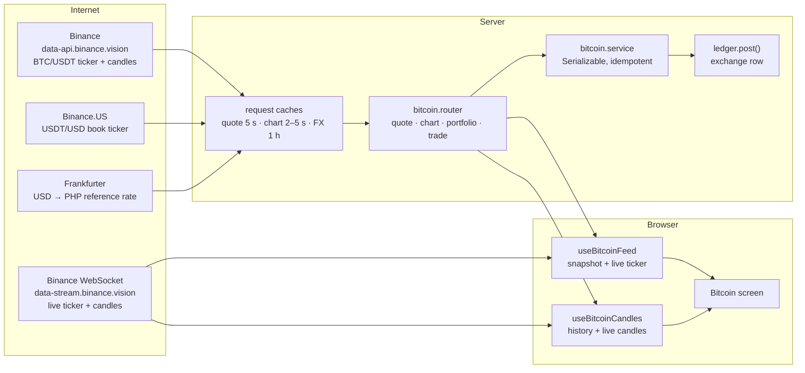

# Bitcoin

**What you will learn:** the most technical feature in GoBank. How a live **BTC/PHP price** is built from three market sources, cached and checked for freshness; how buying and selling is calculated **exactly** with `BigInt` satoshis, a ₱10 fee and fair rounding; why there is **no Bitcoin balance column** (holdings are computed from trade history); how a trade executes **idempotently** at the **Serializable** isolation level; how the browser streams live prices and candles over **WebSockets**; and how the SVG chart is drawn.

| Layer | Files |
| --- | --- |
| Types, units, formatting | `src/features/bitcoin/bitcoin.types.ts` |
| Trade math (pure) | `bitcoin.rules.ts`, `bitcoin-trade-input.ts` |
| Market data (server) | `bitcoin-market.server.ts`, `bitcoin-fx.server.ts`, `bitcoin-cache.ts` |
| API and service | `bitcoin.router.ts`, `bitcoin.service.ts` → `ledger.post()` |
| Live data (browser) | `live-socket.ts`, `bitcoin-candles.ts`, `hooks/use-bitcoin-feed.ts`, `hooks/use-bitcoin-candles.ts` |
| Chart math | `bitcoin-chart-geometry.ts` |
| Screens | `components/bitcoin-screen.tsx`, `bitcoin-market.tsx`, `bitcoin-chart.tsx`, `bitcoin-holdings.tsx`, `bitcoin-trade-form.tsx`, `bitcoin-trade-review.tsx`, `bitcoin-history.tsx`; page `src/app/(app)/bitcoin/page.tsx` (`/bitcoin`) |
| Tests | `bitcoin.test.ts` (8), `bitcoin-trade-input.test.ts` (9), `bitcoin-chart-geometry.test.ts` (5), `scripts/verify-bitcoin.ts` (live, real database) |

> **What is real and what is simulated:** prices and charts are **real, live market data**. Trades really debit and credit the GoBank main balance, and are recorded in the ledger and the trade history. But no Bitcoin is bought on an exchange and nothing can be withdrawn: the holding exists only inside GoBank. The screen says so: "Trades settle in your GoBank account. External exchange orders and withdrawals are unavailable."

---

## 1. The big picture



The browser's live stream is **only for display**. Every trade is priced on the **server** with the server's own fresh quote, so a user cannot pick their price by editing a request.

---

## 2. Units and helpers: `bitcoin.types.ts`

<!-- code: gobank/src/features/bitcoin/bitcoin.types.ts -->
**`gobank/src/features/bitcoin/bitcoin.types.ts`** · all 89 lines

```ts
 1 │ export const BITCOIN_RANGES = ["1MIN", "1H", "1W", "1M", "1Y"] as const;
 2 │
 3 │ export type BitcoinRange = (typeof BITCOIN_RANGES)[number];
 4 │
 5 │ export const BITCOIN_CANDLES: Record<
 6 │   BitcoinRange,
 7 │   { interval: string; limit: number; label: string }
 8 │ > = {
 9 │   "1MIN": {
10 │     interval: "1s",
11 │     limit: 60,
12 │     label: "1-second candles · last 60 seconds",
13 │   },
14 │   "1H": { interval: "1m", limit: 60, label: "1-minute candles" },
15 │   "1W": { interval: "1h", limit: 168, label: "1-hour candles" },
16 │   "1M": { interval: "4h", limit: 180, label: "4-hour candles" },
17 │   "1Y": { interval: "1d", limit: 365, label: "1-day candles" },
18 │ };
19 │
20 │ export type BitcoinQuote = {
21 │   unitPriceCentavos: number;
22 │   openCentavos: number;
23 │   highCentavos: number;
24 │   lowCentavos: number;
25 │   volume: number;
26 │   asOf: number;
27 │   phpPerQuote: number;
28 │   rateDate: string;
29 │ };
30 │
31 │ export type BitcoinCandle = {
32 │   time: number;
33 │   open: number;
34 │   high: number;
35 │   low: number;
36 │   close: number;
37 │   volume: number;
38 │ };
39 │
40 │ export const UNITS_PER_BITCOIN = 100_000_000n;
41 │ export const MAX_CENTAVOS = 2_000_000_000;
42 │ export const BITCOIN_FEE_CENTAVOS = 1_000;
43 │
44 │ const QUOTE_MAX_AGE_MS = 60_000;
45 │ const QUOTE_MAX_CLOCK_AHEAD_MS = 10_000;
46 │
47 │ export const quoteIsFresh = (asOf: number, now: number) => {
48 │   const age = now - asOf;
49 │
50 │   return (
51 │     Number.isFinite(asOf) &&
52 │     age < QUOTE_MAX_AGE_MS &&
53 │     -age < QUOTE_MAX_CLOCK_AHEAD_MS
54 │   );
55 │ };
56 │
57 │ const PHP_AMOUNT = new Intl.NumberFormat("en-PH", {
58 │   minimumFractionDigits: 2,
59 │   maximumFractionDigits: 2,
60 │ });
61 │
62 │ export const money = (centavos: number) => PHP_AMOUNT.format(centavos / 100);
63 │
64 │ export const btc = (bitcoinUnits: bigint) => {
65 │   const whole = bitcoinUnits / UNITS_PER_BITCOIN;
66 │   const fraction = (bitcoinUnits % UNITS_PER_BITCOIN)
67 │     .toString()
68 │     .padStart(8, "0");
69 │
70 │   return `${whole}.${fraction}`;
71 │ };
72 │
73 │ export const holdingValue = (bitcoinUnits: bigint, unitPriceCentavos: number) =>
74 │   Number((bitcoinUnits * BigInt(unitPriceCentavos)) / UNITS_PER_BITCOIN);
75 │
76 │ export function parseUnits(value: string, decimals: number): bigint | null {
77 │   if (value.length > 24) return null;
78 │
79 │   const match = /^(\d+)(?:\.(\d*))?$/.exec(value.trim());
80 │   if (!match) return null;
81 │
82 │   const [, whole = "0", fraction = ""] = match;
83 │   if (fraction.length > decimals) return null;
84 │
85 │   const scale = 10n ** BigInt(decimals);
86 │   const fractionUnits = BigInt(fraction.padEnd(decimals, "0") || "0");
87 │
88 │   return BigInt(whole) * scale + fractionUnits;
89 │ }
```
<!-- /code -->

| Lines | Item | Meaning |
| --- | --- | --- |
| 1–18 | `BITCOIN_RANGES`, `BITCOIN_CANDLES` | the five chart ranges and the candle size and count for each (below) |
| 20–29 | `BitcoinQuote` | price, open, high, low (centavos), 24 h volume, time, PHP-per-USDT rate and FX date |
| 40 | `UNITS_PER_BITCOIN = 100_000_000n` | **satoshis** per BTC, as a BigInt |
| 41 | `MAX_CENTAVOS = 2_000_000_000` | ₱20,000,000, the largest amount a Bitcoin calculation accepts |
| 42 | `BITCOIN_FEE_CENTAVOS = 1_000` | a fixed **₱10.00** fee per trade |
| 44–55 | `quoteIsFresh` | a price may be used only if it is **less than 60 seconds old** and **at most 10 seconds in the future** (protects against a wrong clock) |
| 62 | `money` | centavos → `"1,234.56"` |
| 64–71 | `btc` | satoshis → `"1.23456789"` (always 8 decimals, BigInt math, no rounding) |
| 73–74 | `holdingValue` | value of satoshis at a price, rounded down to whole centavos |
| 76–89 | `parseUnits` | text → BigInt units with a fixed number of decimals (`"0.00000001"` → `1n`); returns `null` for negatives, exponents, too many decimals or more than 24 characters |

| Range | Candles from Binance | Covers |
| --- | --- | --- |
| 1 min | 60 × 1-second (grouped into 3-second candles on screen) | last 60 seconds |
| 1 hr | 60 × 1-minute | 1 hour |
| 1 wk | 168 × 1-hour | 7 days |
| 1 mo | 180 × 4-hour | 30 days |
| 1 yr | 365 × 1-day | 1 year |

> **Concept: why BigInt?** A satoshi count times a price in centavos can exceed 2⁵³ (about 9 × 10¹⁵), the largest integer a normal JavaScript `number` stores exactly. For example, 1 BTC (10⁸ satoshis) × ₱6,500,000.00 (6.5 × 10⁸ centavos) = 6.5 × 10¹⁶. With BigInt, every multiplication and division is exact, and division always rounds toward zero, which the code relies on.

---

## 3. Where the PHP price comes from

### A small cache with request de-duplication: `bitcoin-cache.ts`

<!-- code: gobank/src/features/bitcoin/bitcoin-cache.ts -->
**`gobank/src/features/bitcoin/bitcoin-cache.ts`** · all 39 lines

```ts
 1 │ type CacheEntry<Value> = {
 2 │   expiresAt: number | null;
 3 │   promise: Promise<Value>;
 4 │ };
 5 │
 6 │ export function createRequestCache<Key, Value>(
 7 │   ttlMs: (key: Key) => number,
 8 │   now: () => number = Date.now,
 9 │ ) {
10 │   const entries = new Map<Key, CacheEntry<Value>>();
11 │
12 │   const stillLoading = (entry: CacheEntry<Value>) => entry.expiresAt === null;
13 │   const notExpired = (entry: CacheEntry<Value>) =>
14 │     entry.expiresAt !== null && entry.expiresAt > now();
15 │
16 │   return (key: Key, load: () => Promise<Value>): Promise<Value> => {
17 │     const existing = entries.get(key);
18 │     if (existing && (stillLoading(existing) || notExpired(existing))) {
19 │       return existing.promise;
20 │     }
21 │
22 │     const entry: CacheEntry<Value> = {
23 │       expiresAt: null,
24 │       promise: Promise.resolve()
25 │         .then(load)
26 │         .then((value) => {
27 │           entry.expiresAt = now() + ttlMs(key);
28 │           return value;
29 │         })
30 │         .catch((error: unknown) => {
31 │           entries.delete(key);
32 │           throw error;
33 │         }),
34 │     };
35 │
36 │     entries.set(key, entry);
37 │     return entry.promise;
38 │   };
39 │ }
```
<!-- /code -->

- **Lines 17–20:** if the same key is **still loading**, or loaded and **not expired**, return the same promise. Ten users opening the Bitcoin screen at once cause **one** request to Binance, not ten.
- **Lines 22–35:** otherwise start loading; mark it loading (`expiresAt: null`); when it succeeds, set the expiry.
- **Lines 30–33:** failures are **not cached**: the entry is removed, so the next call tries again.
- `Promise.resolve().then(load)` (lines 24–25) makes sure even an error thrown immediately inside `load` becomes a rejected promise that the `catch` handles.

### The USD → PHP rate: `bitcoin-fx.server.ts`

<!-- code: gobank/src/features/bitcoin/bitcoin-fx.server.ts -->
**`gobank/src/features/bitcoin/bitcoin-fx.server.ts`** · all 46 lines

```ts
 1 │ import "server-only";
 2 │ import { z } from "zod";
 3 │ import { fail } from "~/server/errors";
 4 │ import { createRequestCache } from "./bitcoin-cache";
 5 │
 6 │ const schema = z.object({
 7 │   date: z.string().regex(/^\d{4}-\d{2}-\d{2}$/),
 8 │   base: z.literal("USD"),
 9 │   quote: z.literal("PHP"),
10 │   rate: z.number().finite().positive().max(10_000),
11 │ });
12 │
13 │ type PhpRate = { rate: number; date: string };
14 │
15 │ const rateCache = createRequestCache<string, PhpRate>(() => 60 * 60_000);
16 │
17 │ const fresh = (date: string) => {
18 │   const age = Date.now() - Date.parse(`${date}T00:00:00Z`);
19 │   return Number.isFinite(age) && age > -86_400_000 && age < 7 * 86_400_000;
20 │ };
21 │
22 │ export async function getPhpRate(): Promise<PhpRate> {
23 │   const value = await rateCache("USD/PHP", async () => {
24 │     try {
25 │       const response = await fetch(
26 │         "https://api.frankfurter.dev/v2/rate/USD/PHP",
27 │         { cache: "no-store", signal: AbortSignal.timeout(8_000) },
28 │       );
29 │       if (!response.ok) throw new Error("Rate unavailable");
30 │       const rate = schema.parse(await response.json());
31 │       if (!fresh(rate.date)) throw new Error("Rate expired");
32 │       return { rate: rate.rate, date: rate.date };
33 │     } catch {
34 │       return fail(
35 │         "BAD_REQUEST",
36 │         "PHP market pricing is unavailable. Try again shortly.",
37 │       );
38 │     }
39 │   });
40 │
41 │   if (!fresh(value.date)) {
42 │     fail("BAD_REQUEST", "PHP market pricing has expired. Try again later.");
43 │   }
44 │
45 │   return value;
46 │ }
```
<!-- /code -->

The Frankfurter API publishes central-bank reference rates once per working day. The answer is validated with Zod (lines 6–11), cached for **1 hour** (line 15), and must be dated no more than 1 day ahead and **less than 7 days old** (lines 17–20; weekends and holidays have no new rate). Any problem → "PHP market pricing is unavailable. Try again shortly." Requests time out after 8 seconds (line 27).

### The quote and the chart: `bitcoin-market.server.ts`

<!-- code: gobank/src/features/bitcoin/bitcoin-market.server.ts -->
**`gobank/src/features/bitcoin/bitcoin-market.server.ts`** · all 126 lines

```ts
  1 │ import "server-only";
  2 │ import { z } from "zod";
  3 │ import { fail } from "~/server/errors";
  4 │ import { createRequestCache } from "./bitcoin-cache";
  5 │ import { getPhpRate } from "./bitcoin-fx.server";
  6 │ import {
  7 │   MAX_CENTAVOS,
  8 │   BITCOIN_CANDLES,
  9 │   quoteIsFresh,
 10 │   type BitcoinCandle,
 11 │   type BitcoinQuote,
 12 │   type BitcoinRange,
 13 │ } from "./bitcoin.types";
 14 │
 15 │ const numeric = z.coerce.number().finite().positive();
 16 │ const ticker = z.object({
 17 │   symbol: z.literal("BTCUSDT"),
 18 │   lastPrice: numeric,
 19 │   openPrice: numeric,
 20 │   highPrice: numeric,
 21 │   lowPrice: numeric,
 22 │   volume: z.coerce.number().finite().nonnegative(),
 23 │   closeTime: z.number().int().positive(),
 24 │ });
 25 │ const conversionQuote = z
 26 │   .object({
 27 │     symbol: z.literal("USDTUSD"),
 28 │     bidPrice: numeric,
 29 │     askPrice: numeric,
 30 │   })
 31 │   .refine((value) => value.askPrice >= value.bidPrice);
 32 │ const candle = z
 33 │   .tuple([
 34 │     z.number().int().positive(),
 35 │     numeric,
 36 │     numeric,
 37 │     numeric,
 38 │     numeric,
 39 │     z.coerce.number().finite().nonnegative(),
 40 │   ])
 41 │   .rest(z.unknown());
 42 │
 43 │ const FEED_ERROR =
 44 │   "Bitcoin market data is unavailable. Please try again shortly.";
 45 │
 46 │ const quoteCache = createRequestCache<string, BitcoinQuote>(() => 5_000);
 47 │ const chartCache = createRequestCache<BitcoinRange, BitcoinCandle[]>((range) =>
 48 │   range === "1MIN" ? 2_000 : 5_000,
 49 │ );
 50 │
 51 │ async function read<T>(
 52 │   path: string,
 53 │   schema: z.ZodType<T>,
 54 │   base = "https://data-api.binance.vision/api/v3",
 55 │ ): Promise<T> {
 56 │   try {
 57 │     const response = await fetch(`${base}/${path}`, {
 58 │       cache: "no-store",
 59 │       signal: AbortSignal.timeout(8_000),
 60 │       headers: { Accept: "application/json" },
 61 │     });
 62 │     if (!response.ok) throw new Error("Market feed request failed");
 63 │     return schema.parse(await response.json());
 64 │   } catch {
 65 │     return fail("BAD_REQUEST", FEED_ERROR);
 66 │   }
 67 │ }
 68 │
 69 │ export function getBitcoinQuote(): Promise<BitcoinQuote> {
 70 │   return quoteCache("BTCUSDT", () =>
 71 │     Promise.all([
 72 │       read("ticker/24hr?symbol=BTCUSDT", ticker),
 73 │       getPhpRate(),
 74 │       read(
 75 │         "ticker/bookTicker?symbol=USDTUSD",
 76 │         conversionQuote,
 77 │         "https://api.binance.us/api/v3",
 78 │       ),
 79 │     ]).then(([value, fx, peg]) => {
 80 │       const phpPerQuote = (fx.rate * (peg.bidPrice + peg.askPrice)) / 2;
 81 │       const toCentavos = (price: number) =>
 82 │         Math.round(price * phpPerQuote * 100);
 83 │
 84 │       const result = {
 85 │         unitPriceCentavos: toCentavos(value.lastPrice),
 86 │         openCentavos: toCentavos(value.openPrice),
 87 │         highCentavos: toCentavos(value.highPrice),
 88 │         lowCentavos: toCentavos(value.lowPrice),
 89 │         volume: value.volume,
 90 │         asOf: value.closeTime,
 91 │         phpPerQuote,
 92 │         rateDate: fx.date,
 93 │       };
 94 │
 95 │       const priceInRange =
 96 │         result.unitPriceCentavos > 0 &&
 97 │         result.unitPriceCentavos <= MAX_CENTAVOS;
 98 │       if (!priceInRange || !quoteIsFresh(result.asOf, Date.now())) {
 99 │         fail("BAD_REQUEST", FEED_ERROR);
100 │       }
101 │
102 │       return result;
103 │     }),
104 │   );
105 │ }
106 │
107 │ export function getBitcoinChart(range: BitcoinRange) {
108 │   const { interval, limit } = BITCOIN_CANDLES[range];
109 │   return chartCache(range, () =>
110 │     read(
111 │       `klines?symbol=BTCUSDT&interval=${interval}&limit=${limit}`,
112 │       z.array(candle).min(2),
113 │     ).then((rows) =>
114 │       rows
115 │         .map(([time, open, high, low, close, volume]) => ({
116 │           time,
117 │           open,
118 │           high,
119 │           low,
120 │           close,
121 │           volume,
122 │         }))
123 │         .sort((a, b) => a.time - b.time),
124 │     ),
125 │   );
126 │ }
```
<!-- /code -->

| Lines | Step |
| --- | --- |
| 15–41 | Zod schemas for Binance's 24-hour ticker, the USDT/USD book ticker (the ask must be ≥ the bid) and candle arrays |
| 46–49 | caches: the quote for **5 s**, charts for **2 s** (1-minute range) or **5 s** |
| 51–67 | `read()`: fetch with an 8-second timeout, validate, and turn **any** failure into "Bitcoin market data is unavailable. Please try again shortly." |
| 71–79 | three requests **in parallel**: BTC/USDT 24 h ticker (Binance), the USD→PHP rate (Frankfurter), the USDT/USD bid/ask (Binance.US) |
| 80 | **PHP per USDT = (USD→PHP rate) × (USDT→USD mid price)**, where mid = (bid + ask) / 2 |
| 81–93 | convert the last, open, high and low prices to centavos |
| 95–100 | refuse prices outside ₱0–₱20,000,000 or a stale timestamp |
| 107–125 | `getBitcoinChart`: candles for the range, mapped to objects and sorted by time |

So the price shown is: **BTC price in USDT × USDT→USD × USD→PHP**. Bitcoin trades against USDT (a dollar-pegged token) on Binance, hence the extra USDT→USD step.

---

## 4. The trade math: `bitcoin.rules.ts`

<!-- code: gobank/src/features/bitcoin/bitcoin.rules.ts -->
**`gobank/src/features/bitcoin/bitcoin.rules.ts`** · all 169 lines

```ts
  1 │ import {
  2 │   BITCOIN_FEE_CENTAVOS,
  3 │   MAX_CENTAVOS,
  4 │   UNITS_PER_BITCOIN,
  5 │ } from "./bitcoin.types";
  6 │
  7 │ export type TradingBalances = {
  8 │   cashCentavos: number;
  9 │   bitcoinUnits: bigint;
 10 │   costBasisCentavos: number;
 11 │   realizedCentavos: number;
 12 │ };
 13 │
 14 │ export type BitcoinTrade =
 15 │   | { action: "buy"; cashCentavos: number }
 16 │   | { action: "sell"; bitcoinUnits: bigint };
 17 │
 18 │ type Holdings = Omit<TradingBalances, "cashCentavos">;
 19 │
 20 │ type SettledTrade = {
 21 │   action: string;
 22 │   bitcoinUnits: bigint;
 23 │   amountCentavos: number;
 24 │ };
 25 │
 26 │ const MIN_BUY_CENTAVOS = 100;
 27 │
 28 │ const isPositiveAmount = (value: number) =>
 29 │   Number.isSafeInteger(value) && value > 0 && value <= MAX_CENTAVOS;
 30 │
 31 │ const withinAccountLimit = (value: number) =>
 32 │   Number.isSafeInteger(value) && Math.abs(value) <= MAX_CENTAVOS;
 33 │
 34 │ function applyTrade(holdings: Holdings, trade: SettledTrade): Holdings {
 35 │   if (trade.action !== "buy" && trade.action !== "sell") {
 36 │     throw new Error("Unknown Bitcoin trade type.");
 37 │   }
 38 │
 39 │   const validAmount =
 40 │     trade.bitcoinUnits > 0n &&
 41 │     Number.isSafeInteger(trade.amountCentavos) &&
 42 │     trade.amountCentavos > 0;
 43 │   if (!validAmount) throw new Error("Invalid Bitcoin trade amount.");
 44 │
 45 │   if (trade.action === "buy") {
 46 │     return {
 47 │       bitcoinUnits: holdings.bitcoinUnits + trade.bitcoinUnits,
 48 │       costBasisCentavos: holdings.costBasisCentavos + trade.amountCentavos,
 49 │       realizedCentavos: holdings.realizedCentavos,
 50 │     };
 51 │   }
 52 │
 53 │   if (trade.bitcoinUnits > holdings.bitcoinUnits) {
 54 │     throw new Error("Not enough Bitcoin to sell.");
 55 │   }
 56 │
 57 │   const soldCostBasis = Number(
 58 │     (BigInt(holdings.costBasisCentavos) * trade.bitcoinUnits) /
 59 │       holdings.bitcoinUnits,
 60 │   );
 61 │
 62 │   return {
 63 │     bitcoinUnits: holdings.bitcoinUnits - trade.bitcoinUnits,
 64 │     costBasisCentavos: holdings.costBasisCentavos - soldCostBasis,
 65 │     realizedCentavos:
 66 │       holdings.realizedCentavos + trade.amountCentavos - soldCostBasis,
 67 │   };
 68 │ }
 69 │
 70 │ export function summarizeTrades(trades: readonly SettledTrade[]): Holdings {
 71 │   return trades.reduce(applyTrade, {
 72 │     bitcoinUnits: 0n,
 73 │     costBasisCentavos: 0,
 74 │     realizedCentavos: 0,
 75 │   });
 76 │ }
 77 │
 78 │ function priceBuy(cashCentavos: number, price: bigint) {
 79 │   if (!isPositiveAmount(cashCentavos) || cashCentavos < MIN_BUY_CENTAVOS) {
 80 │     throw new Error("Enter at least ₱1.00.");
 81 │   }
 82 │
 83 │   const bitcoinUnits = (BigInt(cashCentavos) * UNITS_PER_BITCOIN) / price;
 84 │   if (bitcoinUnits === 0n) {
 85 │     throw new Error("This amount is too small to buy Bitcoin.");
 86 │   }
 87 │
 88 │   const costRoundedUp =
 89 │     (bitcoinUnits * price + UNITS_PER_BITCOIN - 1n) / UNITS_PER_BITCOIN;
 90 │
 91 │   return { bitcoinUnits, tradeCentavos: Number(costRoundedUp) };
 92 │ }
 93 │
 94 │ function priceSell(bitcoinUnits: bigint, owned: bigint, price: bigint) {
 95 │   if (bitcoinUnits <= 0n) {
 96 │     throw new Error("Enter a Bitcoin amount greater than zero.");
 97 │   }
 98 │
 99 │   if (bitcoinUnits > owned) throw new Error("Not enough Bitcoin to sell.");
100 │
101 │   const proceedsRoundedDown = (bitcoinUnits * price) / UNITS_PER_BITCOIN;
102 │   if (proceedsRoundedDown === 0n) {
103 │     throw new Error("This amount is worth less than ₱0.01.");
104 │   }
105 │
106 │   return { bitcoinUnits, tradeCentavos: Number(proceedsRoundedDown) };
107 │ }
108 │
109 │ export function calculateTrade(
110 │   account: TradingBalances,
111 │   trade: BitcoinTrade,
112 │   unitPriceCentavos: number,
113 │ ) {
114 │   if (!isPositiveAmount(unitPriceCentavos)) {
115 │     throw new Error("Price is unavailable. Try again.");
116 │   }
117 │
118 │   const price = BigInt(unitPriceCentavos);
119 │   const buying = trade.action === "buy";
120 │
121 │   const { bitcoinUnits, tradeCentavos } =
122 │     trade.action === "buy"
123 │       ? priceBuy(trade.cashCentavos, price)
124 │       : priceSell(trade.bitcoinUnits, account.bitcoinUnits, price);
125 │
126 │   const cashCentavos = buying
127 │     ? tradeCentavos + BITCOIN_FEE_CENTAVOS
128 │     : tradeCentavos - BITCOIN_FEE_CENTAVOS;
129 │
130 │   if (buying && cashCentavos > account.cashCentavos) {
131 │     throw new Error("Not enough PHP in your account.");
132 │   }
133 │
134 │   if (cashCentavos <= 0) {
135 │     throw new Error("Sale proceeds must exceed the ₱10.00 fee.");
136 │   }
137 │
138 │   const holdings = applyTrade(account, {
139 │     action: trade.action,
140 │     bitcoinUnits,
141 │     amountCentavos: cashCentavos,
142 │   });
143 │
144 │   const next = {
145 │     cashCentavos: buying
146 │       ? account.cashCentavos - cashCentavos
147 │       : account.cashCentavos + cashCentavos,
148 │     ...holdings,
149 │   };
150 │
151 │   const amounts = [
152 │     next.cashCentavos,
153 │     next.costBasisCentavos,
154 │     next.realizedCentavos,
155 │     cashCentavos,
156 │   ];
157 │   if (!amounts.every(withinAccountLimit)) {
158 │     throw new Error("This trade exceeds the account limit.");
159 │   }
160 │
161 │   return {
162 │     next,
163 │     bitcoinUnits,
164 │     tradeCentavos,
165 │     cashCentavos,
166 │     feeCentavos: BITCOIN_FEE_CENTAVOS,
167 │     realizedCentavos: holdings.realizedCentavos - account.realizedCentavos,
168 │   };
169 │ }
```
<!-- /code -->

### Buying (`priceBuy`, lines 78–92)

1. The amount must be at least **₱1.00** (`MIN_BUY_CENTAVOS = 100`).
2. **Satoshis = ⌊ amount × 10⁸ ÷ price ⌋**, rounded **down**: you never get more Bitcoin than you paid for.
3. **Cost = ⌈ satoshis × price ÷ 10⁸ ⌉**, rounded **up**: the bank never undercharges by a fraction of a centavo.
4. **Total charged = cost + ₱10 fee** (line 127).

### Selling (`priceSell`, lines 94–107)

1. Satoshis > 0 and ≤ what you own ("Not enough Bitcoin to sell.").
2. **Proceeds = ⌊ satoshis × price ÷ 10⁸ ⌋**, rounded **down**; must be at least ₱0.01.
3. **Credited = proceeds − ₱10 fee**, which must be above zero ("Sale proceeds must exceed the ₱10.00 fee.").

### Cost basis and profit (`applyTrade`, lines 34–68): the average-cost method

| Event | Holdings | Cost basis | Realized profit |
| --- | --- | --- | --- |
| buy | + satoshis | + total paid (**fee included**) | unchanged |
| sell | − satoshis | − its share: ⌊ basis × sold ÷ held ⌋ | + credited − that share |

### Checks in `calculateTrade` (lines 109–169)

The price must be valid; buying needs enough PHP ("Not enough PHP in your account."); every resulting amount must stay within ±₱20,000,000 ("This trade exceeds the account limit."). It returns the new state, the satoshis, the trade value, the cash moved, the fee and the realized profit of this trade.

### Worked examples (output of the real code)

**Buy ₱100.00 at ₱100,000.01 per BTC, with ₱10,000.00 in the account** (the unit test):

| Step | Value |
| --- | --- |
| satoshis | ⌊ 10,000 × 10⁸ ÷ 10,000,001 ⌋ = **99,999** (0.00099999 BTC) |
| cost | ⌈ 99,999 × 10,000,001 ÷ 10⁸ ⌉ = ⌈ 9,999.90 ⌉ = **₱100.00** |
| charged | ₱100.00 + ₱10.00 fee = **₱110.00** |
| new balance / cost basis | ₱9,890.00 / ₱110.00 |

**Then sell all 99,999 satoshis at the same price:**

| Step | Value |
| --- | --- |
| proceeds | ⌊ 9,999.90 ⌋ = ₱99.99 |
| credited | ₱99.99 − ₱10.00 = **₱89.99** |
| realized profit | ₱89.99 − ₱110.00 = **−₱20.01**: the two ₱10 fees plus one centavo of rounding |
| balance | ₱9,979.99 |

**A realistic purchase: ₱1,000 at ₱6,500,000.00 per BTC** gives 0.00015384 BTC worth ₱999.96, so the total charged is **₱1,009.96** (the fee is added on top of the purchase amount).

**Average cost:** buy 0.001 BTC for ₱70, buy 0.001 BTC for ₱90 (basis ₱160 for 0.002 BTC), then sell 0.0005 BTC for ₱50: the share sold carries ⌊ 16,000 × 50,000 ÷ 200,000 ⌋ = ₱40 of basis, so realized profit = **₱10**, and ₱120 of basis remains for 0.0015 BTC.

### Holdings are a replay, not a column (`summarizeTrades`, lines 70–76)

There is **no "Bitcoin balance" column** anywhere. Holdings, cost basis and realized profit are recomputed by replaying the user's trades from the first to the last. This is **event sourcing**: the trade list is the single source of truth, so the balance can never disagree with the history. The migration that introduced this design *proved*, in SQL, that the replay reproduced every existing wallet before dropping the old table ([Migration history §12](../03-database/02-migration-history.md#12-bitcoin_trade_history-from-wallets-to-event-sourcing)).

---

## 5. Executing a trade: `bitcoin.service.ts` and `bitcoin.router.ts`

<!-- code: gobank/src/features/bitcoin/bitcoin.router.ts -->
**`gobank/src/features/bitcoin/bitcoin.router.ts`** · all 37 lines

```ts
 1 │ import { z } from "zod";
 2 │ import { createTRPCRouter, protectedProcedure } from "~/server/trpc";
 3 │ import { getBitcoinChart, getBitcoinQuote } from "./bitcoin-market.server";
 4 │ import { getBitcoinPortfolio, tradeBitcoin } from "./bitcoin.service";
 5 │ import { BITCOIN_RANGES, MAX_CENTAVOS } from "./bitcoin.types";
 6 │
 7 │ const submissionId = z.string().uuid();
 8 │ const trade = z.discriminatedUnion("action", [
 9 │   z.object({
10 │     submissionId,
11 │     action: z.literal("buy"),
12 │     cashCentavos: z.number().int().min(100).max(MAX_CENTAVOS),
13 │   }),
14 │   z.object({
15 │     submissionId,
16 │     action: z.literal("sell"),
17 │     bitcoinUnits: z
18 │       .string()
19 │       .regex(/^[1-9]\d{0,17}$/)
20 │       .transform(BigInt),
21 │   }),
22 │ ]);
23 │
24 │ export const bitcoinRouter = createTRPCRouter({
25 │   quote: protectedProcedure.query(() => getBitcoinQuote()),
26 │   chart: protectedProcedure
27 │     .input(z.object({ range: z.enum(BITCOIN_RANGES) }))
28 │     .query(({ input }) => getBitcoinChart(input.range)),
29 │   portfolio: protectedProcedure.query(({ ctx }) =>
30 │     getBitcoinPortfolio(ctx.userId),
31 │   ),
32 │   trade: protectedProcedure
33 │     .input(trade)
34 │     .mutation(({ ctx, input }) =>
35 │       tradeBitcoin(ctx.userId, input.submissionId, input),
36 │     ),
37 │ });
```
<!-- /code -->

- **Lines 8–22:** a **discriminated union** on `action`. A buy sends `cashCentavos` (₱1.00 to ₱20,000,000); a sell sends `bitcoinUnits` as a **string** of 1–18 digits with no leading zero, turned into a `BigInt` on the server.
- **Line 7:** every trade carries a `submissionId`, which must be a UUID.
- All four procedures are **protected**, so GoBank's server is not an open relay to the market APIs.

<!-- code: gobank/src/features/bitcoin/bitcoin.service.ts -->
**`gobank/src/features/bitcoin/bitcoin.service.ts`** · all 147 lines

```ts
  1 │ import { db } from "~/server/db";
  2 │ import { newReference } from "~/server/identifiers";
  3 │ import { asDatabaseError, fail } from "~/server/errors";
  4 │ import { post } from "~/server/ledger";
  5 │ import type { Prisma } from "../../../generated/prisma";
  6 │ import { getBitcoinQuote } from "./bitcoin-market.server";
  7 │ import {
  8 │   calculateTrade,
  9 │   summarizeTrades,
 10 │   type BitcoinTrade,
 11 │ } from "./bitcoin.rules";
 12 │ import { quoteIsFresh } from "./bitcoin.types";
 13 │
 14 │ type Quote = Awaited<ReturnType<typeof getBitcoinQuote>>;
 15 │
 16 │ const MAX_ATTEMPTS = 4;
 17 │
 18 │ const tradeKey = (userId: string, submissionId: string) => ({
 19 │   userId_submissionId: { userId, submissionId },
 20 │ });
 21 │
 22 │ export async function getBitcoinPortfolio(userId: string) {
 23 │   return db.$transaction(
 24 │     async (tx) => {
 25 │       const user = await tx.user.findUniqueOrThrow({
 26 │         where: { id: userId },
 27 │         select: { balance: true },
 28 │       });
 29 │       const trades = await tx.bitcoinTrade.findMany({
 30 │         where: { userId },
 31 │         orderBy: [{ createdAt: "asc" }, { id: "asc" }],
 32 │       });
 33 │
 34 │       return {
 35 │         ...summarizeTrades(trades),
 36 │         cashCentavos: user.balance,
 37 │         trades: trades.slice(-20).reverse(),
 38 │       };
 39 │     },
 40 │     { isolationLevel: "RepeatableRead" },
 41 │   );
 42 │ }
 43 │
 44 │ function priceTrade(...input: Parameters<typeof calculateTrade>) {
 45 │   try {
 46 │     return calculateTrade(...input);
 47 │   } catch (error) {
 48 │     return fail(
 49 │       "BAD_REQUEST",
 50 │       error instanceof Error
 51 │         ? error.message
 52 │         : "This trade could not be completed.",
 53 │     );
 54 │   }
 55 │ }
 56 │
 57 │ async function recordTrade(
 58 │   tx: Prisma.TransactionClient,
 59 │   userId: string,
 60 │   submissionId: string,
 61 │   trade: BitcoinTrade,
 62 │   quote: Quote,
 63 │ ) {
 64 │   const repeated = await tx.bitcoinTrade.findUnique({
 65 │     where: tradeKey(userId, submissionId),
 66 │   });
 67 │   if (repeated) return repeated;
 68 │
 69 │   if (!quoteIsFresh(quote.asOf, Date.now())) {
 70 │     fail("BAD_REQUEST", "The quote expired. Refresh the price and try again.");
 71 │   }
 72 │
 73 │   const user = await tx.user.findUniqueOrThrow({
 74 │     where: { id: userId },
 75 │     select: { balance: true },
 76 │   });
 77 │   const history = await tx.bitcoinTrade.findMany({
 78 │     where: { userId },
 79 │     orderBy: [{ createdAt: "asc" }, { id: "asc" }],
 80 │   });
 81 │
 82 │   const result = priceTrade(
 83 │     { ...summarizeTrades(history), cashCentavos: user.balance },
 84 │     trade,
 85 │     quote.unitPriceCentavos,
 86 │   );
 87 │   const buying = trade.action === "buy";
 88 │   const reference = newReference();
 89 │
 90 │   await post(tx, {
 91 │     userId,
 92 │     kind: "exchange",
 93 │     title: buying ? "Bitcoin purchase" : "Bitcoin sale",
 94 │     amount: buying ? -result.cashCentavos : result.cashCentavos,
 95 │     reference,
 96 │     details: {
 97 │       satoshis: result.bitcoinUnits.toString(),
 98 │       priceCentavos: quote.unitPriceCentavos,
 99 │       feeCentavos: result.feeCentavos,
100 │     },
101 │   });
102 │
103 │   return tx.bitcoinTrade.create({
104 │     data: {
105 │       userId,
106 │       submissionId,
107 │       reference,
108 │       action: trade.action,
109 │       bitcoinUnits: result.bitcoinUnits,
110 │       amountCentavos: result.cashCentavos,
111 │       unitPriceCentavos: quote.unitPriceCentavos,
112 │     },
113 │   });
114 │ }
115 │
116 │ export async function tradeBitcoin(
117 │   userId: string,
118 │   submissionId: string,
119 │   trade: BitcoinTrade,
120 │ ) {
121 │   const key = tradeKey(userId, submissionId);
122 │
123 │   const duplicate = await db.bitcoinTrade.findUnique({ where: key });
124 │   if (duplicate) return duplicate;
125 │
126 │   const quote = await getBitcoinQuote();
127 │
128 │   for (let attempt = 0; attempt < MAX_ATTEMPTS; attempt++) {
129 │     try {
130 │       return await db.$transaction(
131 │         (tx) => recordTrade(tx, userId, submissionId, trade, quote),
132 │         { isolationLevel: "Serializable" },
133 │       );
134 │     } catch (error) {
135 │       const code = asDatabaseError(error)?.code;
136 │
137 │       if (code === "P2002") {
138 │         const repeated = await db.bitcoinTrade.findUnique({ where: key });
139 │         if (repeated) return repeated;
140 │       }
141 │
142 │       if (code !== "P2034") throw error;
143 │     }
144 │   }
145 │
146 │   return fail("CONFLICT", "Your account changed. Please try this trade again.");
147 │ }
```
<!-- /code -->

### `getBitcoinPortfolio` (lines 22–42)

Reads the main balance and **all** trades in one **Repeatable Read** transaction (a consistent snapshot), replays them, and returns the holdings, the balance (`cashCentavos` is the main balance), and the latest 20 trades, newest first.

### `tradeBitcoin` (lines 116–147) and `recordTrade` (lines 57–114)

| Step | Lines | Why |
| --- | --- | --- |
| Was this `submissionId` already executed? Return that trade | 123–124 | **idempotency**: a retried or double-sent request never trades twice |
| Get the server's quote (cached up to 5 s) | 126 | the client never chooses the price |
| Up to 4 attempts, each a **Serializable** transaction | 128–133 | see below |
| Inside: check the submission again, then **quote freshness** ("The quote expired. Refresh the price and try again.") | 64–71 | a quote older than 60 s is never used |
| Read the balance and the full trade history; compute the trade | 73–86 | `priceTrade` turns math errors into friendly `BAD_REQUEST` messages |
| `post()` an **`exchange`** ledger row: −total for a buy, +credit for a sell, with details (satoshis as a string, price, fee) | 90–101 | the main balance changes atomically with a history row ("Bitcoin purchase" / "Bitcoin sale") |
| Insert the `BitcoinTrade` with the same reference | 103–113 | the receipt and the trade are linked |
| `P2002` (duplicate `submissionId` inserted concurrently) → return the trade that won | 137–140 | idempotency under a race |
| `P2034` (serialization conflict) → retry; anything else → error | 142 | |
| after 4 conflicts: "Your account changed. Please try this trade again." | 146 | |

> **Why Serializable here, when transfers use row locks?** The cash side is protected by `post()`'s conditional update, but the **Bitcoin side has no balance column** to lock or check. Holdings come from reading the trade history. Two simultaneous "sell everything" requests could both read the same history, both see 1 BTC, and both sell it. At the Serializable level, PostgreSQL detects that the two transactions read and wrote the same data and cancels one; its retry replays the *new* history, sees 0 BTC, and fails with "Not enough Bitcoin to sell."

> **Note:** Bitcoin trades are `exchange` rows written with `post()`, not `spend()`: no card is involved and they do not count toward the daily card limit.

---

## 6. Live prices in the browser

### A reconnecting WebSocket: `live-socket.ts`

<!-- code: gobank/src/features/bitcoin/live-socket.ts -->
**`gobank/src/features/bitcoin/live-socket.ts`** · all 57 lines

```ts
 1 │ const FIRST_RETRY_MS = 1_000;
 2 │ const MAX_RETRY_MS = 30_000;
 3 │
 4 │ type LiveSocketHandlers = {
 5 │   onMessage: (message: unknown) => void;
 6 │   onDisconnect?: () => void;
 7 │ };
 8 │
 9 │ export function openLiveSocket(url: string, handlers: LiveSocketHandlers) {
10 │   let stopped = false;
11 │   let socket: WebSocket | undefined;
12 │   let retryTimer: ReturnType<typeof setTimeout> | undefined;
13 │   let retryDelay = FIRST_RETRY_MS;
14 │
15 │   const readMessage = (event: MessageEvent) => {
16 │     if (stopped) return;
17 │
18 │     try {
19 │       handlers.onMessage(JSON.parse(String(event.data)) as unknown);
20 │     } catch {
21 │       return;
22 │     }
23 │   };
24 │
25 │   const retryLater = () => {
26 │     if (stopped) return;
27 │
28 │     handlers.onDisconnect?.();
29 │     retryTimer = setTimeout(connect, retryDelay);
30 │     retryDelay = Math.min(retryDelay * 2, MAX_RETRY_MS);
31 │   };
32 │
33 │   function connect() {
34 │     if (stopped) return;
35 │
36 │     socket = new WebSocket(url);
37 │     socket.onopen = () => {
38 │       retryDelay = FIRST_RETRY_MS;
39 │     };
40 │     socket.onmessage = readMessage;
41 │     socket.onerror = () => socket?.close();
42 │     socket.onclose = retryLater;
43 │   }
44 │
45 │   connect();
46 │
47 │   return {
48 │     reconnect: () => {
49 │       if (socket && socket.readyState !== WebSocket.CLOSED) socket.close();
50 │     },
51 │     stop: () => {
52 │       stopped = true;
53 │       clearTimeout(retryTimer);
54 │       socket?.close();
55 │     },
56 │   };
57 │ }
```
<!-- /code -->

> **Concept: WebSocket.** A normal request is "ask, answer, done". A WebSocket stays open, so the server can **push** new data, here a new Bitcoin price several times a second.

- Messages are parsed as JSON; bad messages are ignored (lines 15–23).
- An error closes the socket (line 41). When it closes, the code reports the disconnect and **reconnects with exponential backoff**: after 1 s, then 2 s, 4 s… up to 30 s (lines 25–31); a successful connection resets the delay (lines 37–39).
- `reconnect()` closes the current socket to force a fresh one; `stop()` ends everything when leaving the screen.

### The price feed: `use-bitcoin-feed.ts`

<!-- code: gobank/src/features/bitcoin/hooks/use-bitcoin-feed.ts 36-124 -->
**`gobank/src/features/bitcoin/hooks/use-bitcoin-feed.ts`** · lines 36–124

```ts
 36 │ function quoteFromTicker(
 37 │   message: unknown,
 38 │   phpPerQuote: number,
 39 │   rateDate: string,
 40 │ ): BitcoinQuote | null {
 41 │   const parsed = binanceTicker.safeParse(message);
 42 │   if (!parsed.success || !quoteIsFresh(parsed.data.E, Date.now())) return null;
 43 │
 44 │   const ticker = parsed.data;
 45 │   const toCentavos = (usdtPrice: number) =>
 46 │     Math.round(usdtPrice * phpPerQuote * 100);
 47 │
 48 │   const unitPriceCentavos = toCentavos(ticker.c);
 49 │   if (unitPriceCentavos <= 0 || unitPriceCentavos > MAX_CENTAVOS) return null;
 50 │
 51 │   return {
 52 │     unitPriceCentavos,
 53 │     openCentavos: toCentavos(ticker.o),
 54 │     highCentavos: toCentavos(ticker.h),
 55 │     lowCentavos: toCentavos(ticker.l),
 56 │     volume: ticker.v,
 57 │     asOf: ticker.E,
 58 │     phpPerQuote,
 59 │     rateDate,
 60 │   };
 61 │ }
 62 │
 63 │ const newerQuote = (current: BitcoinQuote | null, next: BitcoinQuote) =>
 64 │   current && current.asOf > next.asOf ? current : next;
 65 │
 66 │ function feedStatus(fresh: boolean, live: boolean, loading: boolean) {
 67 │   if (fresh) return live ? "Live" : "15s refresh";
 68 │   return loading ? "Connecting" : "Feed offline";
 69 │ }
 70 │
 71 │ export function useBitcoinFeed() {
 72 │   const snapshot = api.bitcoin.quote.useQuery(undefined, SNAPSHOT_REFRESH);
 73 │   const [stream, setStream] = useState<BitcoinQuote | null>(null);
 74 │   const [connected, setConnected] = useState(false);
 75 │   const [now, setNow] = useState(() => Date.now());
 76 │
 77 │   const phpPerQuote = snapshot.data?.phpPerQuote;
 78 │   const rateDate = snapshot.data?.rateDate;
 79 │
 80 │   useEffect(() => {
 81 │     if (!phpPerQuote || !rateDate) return;
 82 │
 83 │     let lastMessageAt = Date.now();
 84 │
 85 │     const live = openLiveSocket(TICKER_URL, {
 86 │       onMessage: (message) => {
 87 │         const quote = quoteFromTicker(message, phpPerQuote, rateDate);
 88 │         if (!quote) return;
 89 │
 90 │         lastMessageAt = Date.now();
 91 │         setConnected(true);
 92 │         setStream((current) => newerQuote(current, quote));
 93 │       },
 94 │       onDisconnect: () => setConnected(false),
 95 │     });
 96 │
 97 │     const clock = setInterval(() => {
 98 │       setNow(Date.now());
 99 │       if (Date.now() - lastMessageAt > SILENCE_LIMIT_MS) live.reconnect();
100 │     }, CLOCK_TICK_MS);
101 │
102 │     return () => {
103 │       clearInterval(clock);
104 │       live.stop();
105 │     };
106 │   }, [phpPerQuote, rateDate]);
107 │
108 │   const streamIsNewer =
109 │     stream !== null &&
110 │     stream.phpPerQuote === snapshot.data?.phpPerQuote &&
111 │     stream.asOf > (snapshot.data?.asOf ?? 0);
112 │
113 │   const quote = streamIsNewer ? stream : snapshot.data;
114 │   const fresh = quote !== undefined && quoteIsFresh(quote.asOf, now);
115 │   const live = connected && stream !== null && quoteIsFresh(stream.asOf, now);
116 │
117 │   return {
118 │     quote,
119 │     fresh,
120 │     status: feedStatus(fresh, live, snapshot.isPending),
121 │     refresh: snapshot.refetch,
122 │     isRefreshing: snapshot.isFetching,
123 │   };
124 │ }
```
<!-- /code -->

| Lines | Behavior |
| --- | --- |
| 72 | a **snapshot** from the server every 15 seconds (`bitcoin.quote`) |
| 80–81 | the live stream starts only after the snapshot arrives, because the stream gives USDT prices and the snapshot provides the PHP conversion rate |
| 36–61 | each live message is validated with Zod, checked for freshness, converted to PHP centavos and range-checked |
| 63–64, 92 | keep whichever quote is **newer**; out-of-order messages cannot move the price backward |
| 97–100 | every 5 seconds, update the clock and, if no message arrived for **30 seconds**, force a reconnect |
| 108–113 | use the streamed quote only if it is newer than the snapshot **and** used the same conversion rate |
| 114–115, 66–69 | status: **Live** (fresh streamed price), **15s refresh** (fresh snapshot only), **Connecting**, or **Feed offline** |

### Live candles: `use-bitcoin-candles.ts` and `bitcoin-candles.ts`

<!-- code: gobank/src/features/bitcoin/hooks/use-bitcoin-candles.ts -->
**`gobank/src/features/bitcoin/hooks/use-bitcoin-candles.ts`** · all 76 lines

```ts
 1 │ "use client";
 2 │
 3 │ import { useEffect, useMemo, useState } from "react";
 4 │ import { api } from "~/trpc/react";
 5 │ import {
 6 │   mergeCandleHistory,
 7 │   mergeLiveCandle,
 8 │   parseCandleUpdate,
 9 │ } from "../bitcoin-candles";
10 │ import {
11 │   BITCOIN_CANDLES,
12 │   type BitcoinCandle,
13 │   type BitcoinRange,
14 │ } from "../bitcoin.types";
15 │ import { openLiveSocket } from "../live-socket";
16 │
17 │ type LiveUpdates = {
18 │   range: BitcoinRange;
19 │   points: BitcoinCandle[];
20 │   asOf: number;
21 │ };
22 │
23 │ const CHART_REFRESH = {
24 │   staleTime: 15_000,
25 │   refetchInterval: 15_000,
26 │   retry: 1,
27 │ };
28 │
29 │ const klineUrl = (interval: string) =>
30 │   `wss://data-stream.binance.vision/ws/btcusdt@kline_${interval}`;
31 │
32 │ export function useBitcoinCandles(range: BitcoinRange) {
33 │   const chart = api.bitcoin.chart.useQuery({ range }, CHART_REFRESH);
34 │   const [updates, setUpdates] = useState<LiveUpdates | null>(null);
35 │   const { interval, limit } = BITCOIN_CANDLES[range];
36 │
37 │   useEffect(() => {
38 │     let latestEvent = 0;
39 │
40 │     const live = openLiveSocket(klineUrl(interval), {
41 │       onMessage: (message) => {
42 │         const result = parseCandleUpdate(message, interval, Date.now());
43 │         if (!result || result.asOf <= latestEvent) return;
44 │
45 │         latestEvent = result.asOf;
46 │         setUpdates((previous) => {
47 │           const sameRange = previous?.range === range ? previous.points : [];
48 │
49 │           return {
50 │             range,
51 │             points: mergeLiveCandle(sameRange, result.candle, limit),
52 │             asOf: result.asOf,
53 │           };
54 │         });
55 │       },
56 │     });
57 │
58 │     return () => live.stop();
59 │   }, [range, interval, limit]);
60 │
61 │   const liveForThisRange = updates?.range === range ? updates : null;
62 │
63 │   const points = useMemo(
64 │     () =>
65 │       mergeCandleHistory(
66 │         chart.data ?? [],
67 │         liveForThisRange?.points ?? [],
68 │         limit,
69 │       ),
70 │     [chart.data, liveForThisRange, limit],
71 │   );
72 │
73 │   const updatedAt = Math.max(chart.dataUpdatedAt, liveForThisRange?.asOf ?? 0);
74 │
75 │   return { chart, points, updatedAt };
76 │ }
```
<!-- /code -->

<!-- code: gobank/src/features/bitcoin/bitcoin-candles.ts -->
**`gobank/src/features/bitcoin/bitcoin-candles.ts`** · all 113 lines

```ts
  1 │ import { z } from "zod";
  2 │ import { quoteIsFresh, type BitcoinCandle } from "./bitcoin.types";
  3 │
  4 │ const price = z.coerce.number().finite().positive();
  5 │
  6 │ const binanceKlineMessage = z.object({
  7 │   e: z.literal("kline"),
  8 │   E: z.number().int().positive(),
  9 │   s: z.literal("BTCUSDT"),
 10 │   k: z.object({
 11 │     t: z.number().int().positive(),
 12 │     s: z.literal("BTCUSDT"),
 13 │     i: z.string(),
 14 │     o: price,
 15 │     h: price,
 16 │     l: price,
 17 │     c: price,
 18 │     v: z.coerce.number().finite().nonnegative(),
 19 │   }),
 20 │ });
 21 │
 22 │ export function parseCandleUpdate(
 23 │   value: unknown,
 24 │   interval: string,
 25 │   now: number,
 26 │ ) {
 27 │   const parsed = binanceKlineMessage.safeParse(value);
 28 │   if (!parsed.success) return null;
 29 │
 30 │   const { E: sentAt, k: kline } = parsed.data;
 31 │   const candle: BitcoinCandle = {
 32 │     time: kline.t,
 33 │     open: kline.o,
 34 │     high: kline.h,
 35 │     low: kline.l,
 36 │     close: kline.c,
 37 │     volume: kline.v,
 38 │   };
 39 │
 40 │   const wrongInterval = kline.i !== interval;
 41 │   const stale = !quoteIsFresh(sentAt, now);
 42 │   const startsAfterItWasSent = candle.time > sentAt;
 43 │   const impossibleRange =
 44 │     candle.low > Math.min(candle.open, candle.close) ||
 45 │     candle.high < Math.max(candle.open, candle.close);
 46 │
 47 │   if (wrongInterval || stale || startsAfterItWasSent || impossibleRange) {
 48 │     return null;
 49 │   }
 50 │
 51 │   return { asOf: sentAt, candle };
 52 │ }
 53 │
 54 │ export function mergeLiveCandle(
 55 │   points: BitcoinCandle[],
 56 │   candle: BitcoinCandle,
 57 │   limit: number,
 58 │ ) {
 59 │   const last = points.at(-1);
 60 │   if (!last) return [candle];
 61 │
 62 │   if (candle.time < last.time) {
 63 │     return points.map((point) => (point.time === candle.time ? candle : point));
 64 │   }
 65 │
 66 │   const replacesLast = candle.time === last.time;
 67 │   const merged = replacesLast
 68 │     ? [...points.slice(0, -1), candle]
 69 │     : [...points, candle];
 70 │
 71 │   return merged.slice(-limit);
 72 │ }
 73 │
 74 │ export function mergeCandleHistory(
 75 │   history: BitcoinCandle[],
 76 │   updates: BitcoinCandle[],
 77 │   limit: number,
 78 │ ) {
 79 │   const byTime = new Map(history.map((point) => [point.time, point]));
 80 │
 81 │   for (const update of updates) {
 82 │     const existing = byTime.get(update.time);
 83 │     const isNewer = !existing || update.volume >= existing.volume;
 84 │
 85 │     if (isNewer) byTime.set(update.time, update);
 86 │   }
 87 │
 88 │   return [...byTime.values()].sort((a, b) => a.time - b.time).slice(-limit);
 89 │ }
 90 │
 91 │ export function groupCandles(points: BitcoinCandle[], intervalMs: number) {
 92 │   const groups = new Map<number, BitcoinCandle>();
 93 │
 94 │   for (const point of points) {
 95 │     const bucket = Math.floor(point.time / intervalMs) * intervalMs;
 96 │     const existing = groups.get(bucket);
 97 │
 98 │     if (!existing) {
 99 │       groups.set(bucket, { ...point });
100 │       continue;
101 │     }
102 │
103 │     groups.set(bucket, {
104 │       ...existing,
105 │       high: Math.max(existing.high, point.high),
106 │       low: Math.min(existing.low, point.low),
107 │       close: point.close,
108 │       volume: existing.volume + point.volume,
109 │     });
110 │   }
111 │
112 │   return [...groups.values()];
113 │ }
```
<!-- /code -->

| Function | Behavior |
| --- | --- |
| `parseCandleUpdate` (22–52) | accept a Binance candle message only if it is valid, of the expected interval, fresh, not starting after it was sent, and physically possible (low ≤ open/close ≤ high) |
| `mergeLiveCandle` (54–72) | replace an older candle with the same time, replace the last one, or append a new one; keep at most `limit` |
| `mergeCandleHistory` (74–89) | combine server history with live updates; for the same time, the version with **more volume** wins (a later snapshot of the same candle has more trades) |
| `groupCandles` (91–113) | merge candles into bigger buckets (1-second → 3-second for the 1-minute range): first open, highest high, lowest low, last close, summed volume |

The hook ignores messages older than the latest one seen (line 43) and discards live candles when the range changes (lines 47 and 61).

---

## 7. Drawing the chart: `bitcoin-chart-geometry.ts`

<!-- code: gobank/src/features/bitcoin/bitcoin-chart-geometry.ts -->
**`gobank/src/features/bitcoin/bitcoin-chart-geometry.ts`** · all 136 lines

```ts
  1 │ import type { BitcoinCandle } from "./bitcoin.types";
  2 │
  3 │ export type ChartMode = "line" | "candles";
  4 │
  5 │ export const CHART = {
  6 │   width: 360,
  7 │   height: 216,
  8 │   left: 12,
  9 │   right: 68,
 10 │   top: 16,
 11 │   bottom: 26,
 12 │ };
 13 │
 14 │ const PLOT_WIDTH = CHART.width - CHART.left - CHART.right;
 15 │ export const PLOT_BOTTOM = CHART.height - CHART.bottom;
 16 │
 17 │ const PLOT_HEIGHT = CHART.height - CHART.top - CHART.bottom;
 18 │ const PADDING_RATIO = 0.12;
 19 │ const FLAT_PIXELS = 1.5;
 20 │
 21 │ export const UP_COLOR = "#56e3b1";
 22 │ export const DOWN_COLOR = "#fb7185";
 23 │ export const FLAT_COLOR = "#87b9a5";
 24 │
 25 │ const clamp = (value: number, min: number, max: number) =>
 26 │   Math.min(max, Math.max(min, value));
 27 │
 28 │ export const toPhp = (candles: BitcoinCandle[], phpPerQuote: number) =>
 29 │   candles.map((candle) => ({
 30 │     ...candle,
 31 │     open: candle.open * phpPerQuote,
 32 │     high: candle.high * phpPerQuote,
 33 │     low: candle.low * phpPerQuote,
 34 │     close: candle.close * phpPerQuote,
 35 │   }));
 36 │
 37 │ export function createScale(points: BitcoinCandle[], mode: ChartMode) {
 38 │   const lows = points.map((point) =>
 39 │     mode === "candles" ? point.low : point.close,
 40 │   );
 41 │   const highs = points.map((point) =>
 42 │     mode === "candles" ? point.high : point.close,
 43 │   );
 44 │   const low = Math.min(...lows);
 45 │   const high = Math.max(...highs);
 46 │
 47 │   const spread = Math.max(high - low, high * 0.00001, 0.01);
 48 │   const minimum = low - spread * PADDING_RATIO;
 49 │   const maximum = high + spread * PADDING_RATIO;
 50 │
 51 │   const firstTime = points[0]?.time ?? 0;
 52 │   const lastTime = points.at(-1)?.time ?? 0;
 53 │   const timeSpan = Math.max(1, lastTime - firstTime);
 54 │
 55 │   const y = (price: number) =>
 56 │     CHART.top + ((maximum - price) / (maximum - minimum)) * PLOT_HEIGHT;
 57 │
 58 │   const x = (point: BitcoinCandle) =>
 59 │     CHART.left + ((point.time - firstTime) / timeSpan) * PLOT_WIDTH;
 60 │
 61 │   const slot = PLOT_WIDTH / Math.max(points.length - 1, 1);
 62 │   const candleWidth = Math.min(12, Math.max(1, slot * 0.72));
 63 │
 64 │   return { x, y, minimum, maximum, slot, candleWidth };
 65 │ }
 66 │
 67 │ export type ChartScale = ReturnType<typeof createScale>;
 68 │
 69 │ export const linePath = (points: BitcoinCandle[], scale: ChartScale) =>
 70 │   points
 71 │     .map((point, index) => {
 72 │       const command = index === 0 ? "M" : "L";
 73 │       return `${command}${scale.x(point).toFixed(2)},${scale.y(point.close).toFixed(2)}`;
 74 │     })
 75 │     .join(" ");
 76 │
 77 │ export function gapPath(points: BitcoinCandle[], scale: ChartScale) {
 78 │   return points
 79 │     .map((point, index) => {
 80 │       const previous = points[index - 1];
 81 │       if (!previous) return "";
 82 │
 83 │       const jump = Math.abs(scale.y(point.open) - scale.y(previous.close));
 84 │       if (jump >= FLAT_PIXELS) return "";
 85 │
 86 │       return `M${scale.x(previous)},${scale.y(previous.close)} L${scale.x(point)},${scale.y(point.open)}`;
 87 │     })
 88 │     .join(" ");
 89 │ }
 90 │
 91 │ export function candleShape(point: BitcoinCandle, scale: ChartScale) {
 92 │   const openY = scale.y(point.open);
 93 │   const closeY = scale.y(point.close);
 94 │
 95 │   const flat =
 96 │     Math.abs(openY - closeY) < FLAT_PIXELS &&
 97 │     Math.abs(scale.y(point.high) - scale.y(point.low)) < FLAT_PIXELS * 2;
 98 │
 99 │   const bodyWidth = flat ? Math.min(20, scale.slot + 0.5) : scale.candleWidth;
100 │   const bodyHeight = flat ? FLAT_PIXELS : Math.max(3, Math.abs(openY - closeY));
101 │
102 │   let color = point.close >= point.open ? UP_COLOR : DOWN_COLOR;
103 │   if (flat) color = FLAT_COLOR;
104 │
105 │   return {
106 │     color,
107 │     bodyWidth,
108 │     bodyHeight,
109 │     bodyTop: (openY + closeY - bodyHeight) / 2,
110 │   };
111 │ }
112 │
113 │ export function timeAtPointer(
114 │   clientX: number,
115 │   bounds: DOMRect,
116 │   firstTime: number,
117 │   lastTime: number,
118 │ ) {
119 │   const chartX = ((clientX - bounds.left) / bounds.width) * CHART.width;
120 │   const position = clamp((chartX - CHART.left) / PLOT_WIDTH, 0, 1);
121 │
122 │   return firstTime + position * (lastTime - firstTime);
123 │ }
124 │
125 │ export function nearestIndex(points: BitcoinCandle[], time: number) {
126 │   let nearest = 0;
127 │
128 │   points.forEach((point, index) => {
129 │     const best = points[nearest];
130 │     if (best && Math.abs(point.time - time) < Math.abs(best.time - time)) {
131 │       nearest = index;
132 │     }
133 │   });
134 │
135 │   return nearest;
136 │ }
```
<!-- /code -->

| Function | Math |
| --- | --- |
| `CHART` (5–12) | a 360 × 216 drawing with margins (68 px on the right for price labels) |
| `toPhp` (28–35) | USDT prices × PHP-per-USDT |
| `createScale` (37–65) | lowest and highest price (candle lows/highs, or closes in line mode), plus **12% padding**; `y(price)` maps the highest price to the top; `x(time)` spreads time across the width; each candle is 72% of its slot, between 1 and 12 px wide |
| `linePath` (69–75) | an SVG path `M x,y L x,y …` through the closing prices |
| `gapPath` (77–89) | thin connectors where a candle opens almost exactly at the previous close (under 1.5 px), so quiet periods read as a continuous line |
| `candleShape` (91–111) | green `#56e3b1` if close ≥ open, red `#fb7185` if lower, muted `#87b9a5` if flat; bodies at least 3 px tall |
| `timeAtPointer`, `nearestIndex` (113–136) | the pointer's position → a time → the nearest candle (for the tooltip) |

`bitcoin-chart.tsx` uses these to draw grid lines with compact price labels (`₱6.5M`), the line (with a fading gradient area) or candles (wicks and bodies), start and end time labels, a vertical crosshair and a tooltip with open, high, low and close ("No trades in this candle" when the volume is zero). It has range buttons (1 min, 1 hr, 1 wk, 1 mo, 1 yr; default **1 hr**), line or candle mode (default **candles**), the change over the period ("+1.23% past hour"), loading and "Chart unavailable" / **Retry chart** states, and an `aria-label` that summarizes the chart for screen readers.

---

## 8. The screens

### `bitcoin-screen.tsx`: the page layout

Header ("GoBank Invest · Bitcoin", "BTC / PHP"), market price, chart, 24 h stats, holdings, trade form, trade history, and the data-source note (Binance; Frankfurter rate date; "Charts use the current conversion rate."). The portfolio refreshes every 30 seconds. The trade form receives `fresh = feed is fresh AND the portfolio loaded`, so trading pauses whenever either is missing.

### `bitcoin-market.tsx`

`MarketPrice`: the price, the 24 h change versus the open (green up, red down), a status dot (green fresh, amber stale), the status text with a **refresh** button, and "Updated hh:mm:ss". When the price is stale: "Feed unavailable. Showing the last price; trading is paused until a fresh quote arrives." `MarketStats`: 24 h high, low and volume (compact, e.g. "12.3K").

### `bitcoin-holdings.tsx`

BTC held; its value now ("last value" if stale); unrealized profit or loss against the cost basis, with a percentage; the PHP balance; the fee; the total portfolio value (balance + Bitcoin value); and realized profit or loss (red when negative). If the portfolio fails to load: "Couldn’t load your portfolio." with **Try again**.

### `bitcoin-trade-form.tsx`

<!-- code: gobank/src/features/bitcoin/components/bitcoin-trade-form.tsx 115-197 -->
**`gobank/src/features/bitcoin/components/bitcoin-trade-form.tsx`** · lines 115–197

```tsx
115 │ export function BitcoinTradeForm({
116 │   portfolio,
117 │   quote,
118 │   fresh,
119 │ }: {
120 │   portfolio?: Portfolio;
121 │   quote?: BitcoinQuote;
122 │   fresh: boolean;
123 │ }) {
124 │   const router = useRouter();
125 │   const [action, setAction] = useState<TradeAction>("buy");
126 │   const [amount, setAmount] = useState("");
127 │   const [attempted, setAttempted] = useState(false);
128 │   const [reviewing, setReviewing] = useState(false);
129 │   const [lastOrder, setLastOrder] = useState<Order | null>(null);
130 │   const submissionId = useRef<string | null>(null);
131 │
132 │   const tradeMutation = api.bitcoin.trade.useMutation({
133 │     onSuccess: (order) => {
134 │       setLastOrder(order);
135 │       setReviewing(false);
136 │       setAmount("");
137 │       setAttempted(false);
138 │       submissionId.current = null;
139 │       router.refresh();
140 │     },
141 │   });
142 │
143 │   const input = parseTradeInput(amount, action);
144 │   const checked =
145 │     portfolio && quote && input.trade
146 │       ? previewTrade(portfolio, input.trade, quote.unitPriceCentavos)
147 │       : null;
148 │   const preview = checked?.preview ?? null;
149 │
150 │   const nothingToSell = action === "sell" && portfolio?.bitcoinUnits === 0n;
151 │   let problem = input.problem;
152 │   if (checked?.problem && attempted) problem = checked.problem;
153 │   if (nothingToSell)
154 │     problem = "Buy some Bitcoin before making your first sale.";
155 │
156 │   const busy = tradeMutation.isPending;
157 │   const canReview =
158 │     Boolean(input.trade && portfolio && quote && fresh) && !busy;
159 │
160 │   const changeAmount = (value: string) => {
161 │     setAmount(value);
162 │     setAttempted(false);
163 │     setLastOrder(null);
164 │     tradeMutation.reset();
165 │     submissionId.current = null;
166 │   };
167 │
168 │   const switchAction = (next: TradeAction) => {
169 │     setAction(next);
170 │     changeAmount("");
171 │   };
172 │
173 │   const openReview = () => {
174 │     setAttempted(true);
175 │     if (!preview || !fresh) return;
176 │
177 │     tradeMutation.reset();
178 │     setReviewing(true);
179 │   };
180 │
181 │   const confirm = () => {
182 │     const trade = input.trade;
183 │     if (!trade || !preview || !fresh || busy) return;
184 │
185 │     submissionId.current ??= crypto.randomUUID();
186 │     const id = submissionId.current;
187 │
188 │     tradeMutation.mutate(
189 │       trade.action === "buy"
190 │         ? { ...trade, submissionId: id }
191 │         : {
192 │             action: "sell",
193 │             bitcoinUnits: trade.bitcoinUnits.toString(),
194 │             submissionId: id,
195 │           },
196 │     );
197 │   };
```
<!-- /code -->

| Lines | Behavior |
| --- | --- |
| 130 | `submissionId`: a ref holding one UUID per trade attempt |
| 132–141 | on success: show it, reset the form, **forget the submission ID**, refresh |
| 143–148 | parse the input (2 decimals for PHP, 8 for BTC) and preview the trade with the current quote |
| 150–154 | problems to show; "Buy some Bitcoin before making your first sale." if there is nothing to sell |
| 157–158 | **Review** needs a valid trade, a loaded portfolio, a quote, a **fresh** price, and nothing pending; otherwise the button reads "Waiting for a fresh price" |
| 160–166 | changing the amount clears the old result and **forgets the submission ID** (a new trade gets a new ID) |
| 181–197 | confirm: create the UUID **only if none exists yet** (`??=`) and reuse it for retries of the same trade, which makes double clicks and network retries safe; a sell sends its satoshis as a string |

Preset buttons 25% / 50% / 75% / **Max** use `presetAmount`: for buying, a share of `balance − ₱10` (so Max leaves room for the fee); for selling, a share of the Bitcoin held.

### `bitcoin-trade-review.tsx`: the confirmation dialog

<!-- code: gobank/src/features/bitcoin/components/bitcoin-trade-review.tsx 8-32 -->
**`gobank/src/features/bitcoin/components/bitcoin-trade-review.tsx`** · lines 8–32

```tsx
 8 │ function keepFocusInside(event: KeyboardEvent<HTMLDivElement>) {
 9 │   const buttons = event.currentTarget.querySelectorAll<HTMLButtonElement>(
10 │     "button:not(:disabled)",
11 │   );
12 │   const first = buttons[0];
13 │   const last = buttons[buttons.length - 1];
14 │
15 │   if (!first || !last) {
16 │     event.preventDefault();
17 │     return;
18 │   }
19 │
20 │   const leavingStart = event.shiftKey && document.activeElement === first;
21 │   const leavingEnd = !event.shiftKey && document.activeElement === last;
22 │
23 │   if (leavingStart) {
24 │     event.preventDefault();
25 │     last.focus();
26 │   }
27 │
28 │   if (leavingEnd) {
29 │     event.preventDefault();
30 │     first.focus();
31 │   }
32 │ }
```
<!-- /code -->

A modal (`role="dialog"`, `aria-modal`, titled "Review buy" / "Review sell") listing the Bitcoin amount, its estimated value, the ₱10 fee and the **Total to pay** or **Net proceeds**, plus the note "Your final fill uses the latest PHP quote when confirmed." `keepFocusInside` (above) **traps the Tab key** inside the dialog by cycling between its first and last enabled buttons. **Escape** or tapping the backdrop closes it unless a trade is in progress, and the close button is focused when it opens. Stale price: "The price is stale. Wait for the feed to reconnect."

### `bitcoin-history.tsx`

The latest 20 trades: "Bitcoin purchase" (green, +BTC) or "Bitcoin sale" (red, −BTC), the time, and the PHP amount. Empty: "Your first trade starts here."

---

## 9. Tests

<!-- code: gobank/src/features/bitcoin/bitcoin.test.ts -->
**`gobank/src/features/bitcoin/bitcoin.test.ts`** · all 114 lines

```ts
  1 │ import assert from "node:assert/strict";
  2 │ import test from "node:test";
  3 │ import {
  4 │   calculateTrade,
  5 │   summarizeTrades,
  6 │   type TradingBalances,
  7 │ } from "./bitcoin.rules";
  8 │ import { btc, parseUnits, quoteIsFresh } from "./bitcoin.types";
  9 │
 10 │ const PRICE = 10_000_001;
 11 │ const ROUND_PRICE = 10_000_000;
 12 │
 13 │ const fundedAccount = (): TradingBalances => ({
 14 │   cashCentavos: 1_000_000,
 15 │   bitcoinUnits: 0n,
 16 │   costBasisCentavos: 0,
 17 │   realizedCentavos: 0,
 18 │ });
 19 │
 20 │ const buyFor = (cashCentavos: number) => ({
 21 │   action: "buy" as const,
 22 │   cashCentavos,
 23 │ });
 24 │
 25 │ const sellUnits = (bitcoinUnits: bigint) => ({
 26 │   action: "sell" as const,
 27 │   bitcoinUnits,
 28 │ });
 29 │
 30 │ void test("buying rounds the Bitcoin down and charges the ₱10 fee", () => {
 31 │   const bought = calculateTrade(fundedAccount(), buyFor(10_000), PRICE);
 32 │
 33 │   assert.equal(bought.bitcoinUnits, 99_999n);
 34 │   assert.equal(bought.feeCentavos, 1_000);
 35 │   assert.equal(bought.next.cashCentavos, 989_000);
 36 │   assert.equal(bought.next.costBasisCentavos, 11_000);
 37 │ });
 38 │
 39 │ void test("selling everything back records the loss from fees", () => {
 40 │   const bought = calculateTrade(fundedAccount(), buyFor(10_000), PRICE);
 41 │   const sold = calculateTrade(
 42 │     bought.next,
 43 │     sellUnits(bought.bitcoinUnits),
 44 │     PRICE,
 45 │   );
 46 │
 47 │   assert.deepEqual(sold.next, {
 48 │     cashCentavos: 997_999,
 49 │     bitcoinUnits: 0n,
 50 │     costBasisCentavos: 0,
 51 │     realizedCentavos: -2_001,
 52 │   });
 53 │ });
 54 │
 55 │ void test("replaying the saved trades gives the same result", () => {
 56 │   const bought = calculateTrade(fundedAccount(), buyFor(10_000), PRICE);
 57 │   const sold = calculateTrade(
 58 │     bought.next,
 59 │     sellUnits(bought.bitcoinUnits),
 60 │     PRICE,
 61 │   );
 62 │
 63 │   const history = summarizeTrades([
 64 │     {
 65 │       action: "buy",
 66 │       bitcoinUnits: bought.bitcoinUnits,
 67 │       amountCentavos: bought.cashCentavos,
 68 │     },
 69 │     {
 70 │       action: "sell",
 71 │       bitcoinUnits: sold.bitcoinUnits,
 72 │       amountCentavos: sold.cashCentavos,
 73 │     },
 74 │   ]);
 75 │
 76 │   assert.equal(history.realizedCentavos, -2_001);
 77 │ });
 78 │
 79 │ void test("a purchase larger than the cash balance is refused", () => {
 80 │   assert.throws(
 81 │     () => calculateTrade(fundedAccount(), buyFor(1_000_000), ROUND_PRICE),
 82 │     /Not enough PHP/,
 83 │   );
 84 │ });
 85 │
 86 │ void test("selling Bitcoin you do not own is refused", () => {
 87 │   assert.throws(
 88 │     () => calculateTrade(fundedAccount(), sellUnits(1n), ROUND_PRICE),
 89 │     /Not enough Bitcoin/,
 90 │   );
 91 │ });
 92 │
 93 │ void test("fractions of a centavo are refused", () => {
 94 │   assert.throws(
 95 │     () => calculateTrade(fundedAccount(), buyFor(100.5), ROUND_PRICE),
 96 │     /at least/,
 97 │   );
 98 │ });
 99 │
100 │ void test("Bitcoin amounts keep every decimal place", () => {
101 │   assert.equal(parseUnits("0.00000001", 8), 1n);
102 │   assert.equal(parseUnits("1.25", 2), 125n);
103 │   assert.equal(btc(123456789n), "1.23456789");
104 │
105 │   for (const value of ["-1", "1e8", "1.001"]) {
106 │     assert.equal(parseUnits(value, 2), null, value);
107 │   }
108 │ });
109 │
110 │ void test("a price quote is only used while it is fresh", () => {
111 │   assert.equal(quoteIsFresh(100_000, 105_000), true);
112 │   assert.equal(quoteIsFresh(100_000, 160_000), false);
113 │   assert.equal(quoteIsFresh(120_000, 100_000), false);
114 │ });
```
<!-- /code -->

| File | Tests | Proves |
| --- | --- | --- |
| `bitcoin.test.ts` | 8 | the buy and sell worked examples above; replaying saved trades gives the same profit; buying beyond the balance and selling unowned Bitcoin are refused; fractional centavos are refused; exact decimal parsing and formatting; quote freshness boundaries |
| `bitcoin-trade-input.test.ts` | 9 | empty input is not an error; peso → centavos and BTC → satoshis; too many decimals; zero amounts; the account limit; presets leave room for the fee; the preview explains refusals |
| `bitcoin-chart-geometry.test.ts` | 5 | first and last candles touch the plot edges; higher prices are drawn higher; the pointer picks the nearest candle and stays in range; up/down/flat colors |
| `scripts/verify-bitcoin.ts` | live | against the **real** market and a real database: a fresh quote and chart exist; buying twice with the same `submissionId` returns the **same** trade; the charged amount matches the formula; an unaffordable buy fails **and writes no ledger rows**; selling everything returns holdings to 0 with the expected cash |

---

## Defense questions

**Q: Where do the Bitcoin prices come from, and are they real?**
A: They are real, live prices. The server combines Binance's BTC/USDT price, Binance.US's USDT/USD price and the Frankfurter USD→PHP reference rate, validates every response, caches the quote for 5 seconds, and refuses to use a quote older than 60 seconds. The browser also streams live prices from Binance over a WebSocket for display.

**Q: Can I really buy Bitcoin with GoBank?**
A: It is a simulation at real prices. Buying debits your GoBank balance and records the position, and selling credits it back, but no order is placed on an exchange and no Bitcoin can be withdrawn.

**Q: How do you avoid rounding errors with Bitcoin amounts?**
A: All amounts are integers: satoshis as BigInt and pesos as centavos. When buying, the Bitcoin received is rounded down and the cost rounded up; when selling, the proceeds are rounded down. The bank never gives away a fraction of a centavo, and every value is exact.

**Q: What if the user double-clicks Confirm, or the network retries?**
A: Each confirmation carries a UUID `submissionId`, and the database has a unique constraint on (user, submissionId). A repeated submission returns the original trade instead of trading again; even two simultaneous inserts are resolved by the unique constraint.

**Q: Why is there no Bitcoin balance column?**
A: Holdings are computed by replaying the trade history (event sourcing), so they can never disagree with the records. Selling more than you own is prevented by running trades at the Serializable isolation level, with retries on conflicts.

**Q: What happens if Binance is down?**
A: The quote and chart requests fail with "Bitcoin market data is unavailable. Please try again shortly.", the status shows "Feed offline", and trading is paused because there is no fresh price. The rest of GoBank is unaffected.

---

## Check yourself

<details>
<summary>Why does the sell request send <code>bitcoinUnits</code> as a string?</summary>

BigInt is not part of JSON. The router accepts 1–18 digits as text, validates the format with a regular expression, and converts it with `BigInt` on the server. No precision is lost along the way.
</details>

<details>
<summary>The UI shows a preview using the live price. Is that the price used for the trade?</summary>

Not necessarily. The server prices the trade with its own quote (at most 5 seconds old, and refused if older than 60 seconds), which is why the dialog says "Your final fill uses the latest PHP quote when confirmed."
</details>

<details>
<summary>After buying ₱100 and immediately selling it all, why is the loss ₱20.01 and not ₱20.00?</summary>

₱20.00 is the two ₱10 fees. The extra ₱0.01 comes from rounding: the purchase cost was rounded up (₱99.999… → ₱100.00) and the sale proceeds rounded down (→ ₱99.99), always in the bank's favor.
</details>
