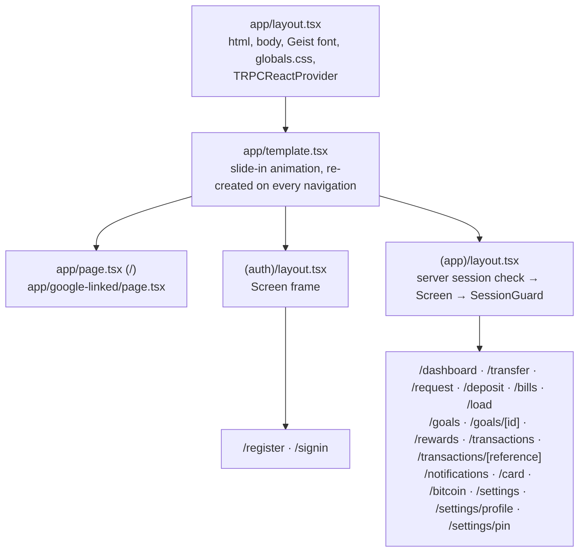

# Pages and routing

**What you will learn:** every URL in GoBank Express, the file behind it, whether it renders on the server or in the browser, what data it loads, and how layouts, the page-transition template and route groups wrap the pages. Background: [Next.js and React](../01-foundations/02-nextjs-and-react.md).

---

## 1. How the pieces nest



### The root layout and template

The root layout (`src/app/layout.tsx`) is explained in [Next.js and React §5](../01-foundations/02-nextjs-and-react.md#5-the-root-layout).

<!-- code: gobank/src/app/template.tsx -->
**`gobank/src/app/template.tsx`** · all 7 lines

```tsx
1 │ import type { ReactNode } from "react";
2 │
3 │ export default function Template({ children }: { children: ReactNode }) {
4 │   return (
5 │     <div className="animate-page-in flex min-h-dvh flex-col">{children}</div>
6 │   );
7 │ }
```
<!-- /code -->

A **template** is re-created on every navigation, so the `animate-page-in` animation (a 22 px slide from the right with a fade, 0.34 s) plays each time the page changes. `min-h-dvh` makes every page at least the height of the visible screen on phones (`dvh` accounts for mobile browser toolbars).

### The two route groups

<!-- code: gobank/src/app/(auth)/layout.tsx -->
**`gobank/src/app/(auth)/layout.tsx`** · all 6 lines

```tsx
1 │ import type { ReactNode } from "react";
2 │ import { Screen } from "~/shared/ui/screen";
3 │
4 │ export default function AuthLayout({ children }: { children: ReactNode }) {
5 │   return <Screen>{children}</Screen>;
6 │ }
```
<!-- /code -->

<!-- code: gobank/src/shared/ui/screen.tsx -->
**`gobank/src/shared/ui/screen.tsx`** · all 11 lines

```tsx
 1 │ import type { ReactNode } from "react";
 2 │
 3 │ export function Screen({ children }: { children: ReactNode }) {
 4 │   return (
 5 │     <div className="bg-surface-sunken flex min-h-dvh justify-center lg:bg-[radial-gradient(70%_55%_at_50%_0%,#05966924,transparent_70%)]">
 6 │       <div className="bg-surface border-line flex w-full max-w-[440px] flex-col px-6 pt-8 pb-10 sm:border-x">
 7 │         {children}
 8 │       </div>
 9 │     </div>
10 │   );
11 │ }
```
<!-- /code -->

`Screen` is the frame every page sits in: a centered column at most **440 px** wide (phone-sized even on desktop), with 24 px side padding. On large screens (`lg:`), the area around it gets a soft green radial glow, and from `sm:` up the column gets side borders.

The `(app)` layout adds the **server-side session check** and the `SessionGuard` (code in [Next.js and React §3](../01-foundations/02-nextjs-and-react.md#a-server-component-that-protects-every-signed-in-page); behavior in [Sessions](../04-server-core/03-sessions.md#5-the-keeper-sessionguard)). Folders in parentheses do not appear in URLs: `(app)/transfer/page.tsx` is `/transfer`.

---

## 2. Every page

**Server** pages run only on the server and can load data before sending HTML; **wrapper** pages are server files that only render a client component (all the interaction happens in that component).

| URL | File (`src/app/…`) | Kind | Renders | Data loaded on the server | Tab title |
| --- | --- | --- | --- | --- | --- |
| `/` | `page.tsx` | server | `WelcomeScreen` | Google enabled?, `?google=` notice | GoBank Express |
| `/register` | `(auth)/register/page.tsx` | server | `RegistrationFlow` | pending Google identity (`?google=new`) | Create your account |
| `/signin` | `(auth)/signin/page.tsx` | server | `SignInFlow` | pending Google account (`?google=pin`), may redirect | Log in |
| `/google-linked` | `google-linked/page.tsx` | server | `GoogleLinkResult` | validated `?google=` status | Link Google |
| `/dashboard` | `(app)/dashboard/page.tsx` | server | `DashboardScreen` | `account.overview` | Home |
| `/transfer` | `(app)/transfer/page.tsx` | wrapper | `TransferForm` | — | Send money |
| `/request` | `(app)/request/page.tsx` | wrapper | `RequestForm` | — | Request money |
| `/deposit` | `(app)/deposit/page.tsx` | wrapper | `DepositForm` | — | Deposit |
| `/bills` | `(app)/bills/page.tsx` | wrapper | `BillPayment` | — | Pay bills |
| `/load` | `(app)/load/page.tsx` | wrapper | `LoadForm` | — | Buy load |
| `/goals` | `(app)/goals/page.tsx` | wrapper | `GoalSaveScreen` | — | GoalSave |
| `/goals/<id>` | `(app)/goals/[id]/page.tsx` | server | `GoalDetail` | reads `id` from the URL | GoalSave |
| `/rewards` | `(app)/rewards/page.tsx` | wrapper | `RewardsScreen` | — | Rewards |
| `/transactions` | `(app)/transactions/page.tsx` | wrapper | `ActivityScreen` | — | Transactions |
| `/transactions/<reference>` | `(app)/transactions/[reference]/page.tsx` | server | `ReceiptScreen` | `activity.transaction` (404 if not yours) | Receipt |
| `/notifications` | `(app)/notifications/page.tsx` | wrapper | `NotificationsScreen` | — | Notifications |
| `/card` | `(app)/card/page.tsx` | wrapper | `MyCardScreen` | — | My card |
| `/bitcoin` | `(app)/bitcoin/page.tsx` | wrapper | `BitcoinScreen` | — | Bitcoin |
| `/settings` | `(app)/settings/page.tsx` | server | `ProfileScreen` | `account.profile` | Settings |
| `/settings/profile` | `(app)/settings/profile/page.tsx` | server | `EditProfileForm` | `account.profile` | Edit profile |
| `/settings/pin` | `(app)/settings/pin/page.tsx` | wrapper | `ChangePinFlow` | — | Change PIN |

Signed-in pages show "**Title** · GoBank Express" in the browser tab, through the root layout's title template.

### A typical wrapper page

<!-- code: gobank/src/app/(app)/bills/page.tsx -->
**`gobank/src/app/(app)/bills/page.tsx`** · all 10 lines

```tsx
 1 │ import type { Metadata } from "next";
 2 │ import { BillPayment } from "~/features/bills/components/bill-payment";
 3 │
 4 │ export const metadata: Metadata = {
 5 │   title: "Pay bills",
 6 │ };
 7 │
 8 │ export default function BillsPage() {
 9 │   return <BillPayment />;
10 │ }
```
<!-- /code -->

Every wrapper page has this shape: a `metadata` title and one component. The other wrappers differ only in the title and component name. (One small inconsistency: `transfer/page.tsx` imports its form with a relative path, `../../../features/transfers/components/transfer-form`, instead of the `~/` alias the others use. It works the same.)

### Pages that do work on the server

<!-- code: gobank/src/app/page.tsx -->
**`gobank/src/app/page.tsx`** · all 22 lines

```tsx
 1 │ import type { Metadata } from "next";
 2 │ import { WelcomeScreen } from "~/features/auth/components/welcome-screen";
 3 │ import { googleEnabled } from "~/features/auth/google/google.server";
 4 │ import { GOOGLE_NOTICES } from "~/features/auth/google/google.rules";
 5 │
 6 │ export const metadata: Metadata = {
 7 │   title: "GoBank Express",
 8 │ };
 9 │
10 │ export default async function WelcomePage({
11 │   searchParams,
12 │ }: {
13 │   searchParams: Promise<{ google?: string }>;
14 │ }) {
15 │   const { google } = await searchParams;
16 │
17 │   const notice =
18 │     google && Object.hasOwn(GOOGLE_NOTICES, google)
19 │       ? (GOOGLE_NOTICES[google] ?? null)
20 │       : null;
21 │   return <WelcomeScreen googleEnabled={googleEnabled()} notice={notice} />;
22 │ }
```
<!-- /code -->

`Object.hasOwn(GOOGLE_NOTICES, google)` accepts only the known codes, so a link like `/?google=anything` cannot inject text, and tricky keys such as `__proto__` are ignored.

<!-- code: gobank/src/app/(auth)/register/page.tsx -->
**`gobank/src/app/(auth)/register/page.tsx`** · all 24 lines

```tsx
 1 │ import type { Metadata } from "next";
 2 │ import { pendingGoogleIdentity } from "~/features/auth/google/google-identity.server";
 3 │ import { RegistrationFlow } from "~/features/auth/components/registration-flow";
 4 │
 5 │ export const metadata: Metadata = {
 6 │   title: "Create your account",
 7 │ };
 8 │
 9 │ export default async function RegisterPage({
10 │   searchParams,
11 │ }: {
12 │   searchParams: Promise<{ google?: string }>;
13 │ }) {
14 │   const { google } = await searchParams;
15 │
16 │   const pending = google === "new" ? await pendingGoogleIdentity() : null;
17 │   return (
18 │     <RegistrationFlow
19 │       initialFullName={pending?.name ?? ""}
20 │       gmail={pending?.gmail ?? null}
21 │       withGoogle={Boolean(pending)}
22 │     />
23 │   );
24 │ }
```
<!-- /code -->

<!-- code: gobank/src/app/(auth)/signin/page.tsx -->
**`gobank/src/app/(auth)/signin/page.tsx`** · all 38 lines

```tsx
 1 │ import type { Metadata } from "next";
 2 │ import { redirect } from "next/navigation";
 3 │ import { SignInFlow } from "~/features/auth/components/sign-in-flow";
 4 │ import { getPendingGoogleAccount } from "~/features/auth/google/google.service";
 5 │ import { googleEnabled } from "~/features/auth/google/google.server";
 6 │
 7 │ export const metadata: Metadata = {
 8 │   title: "Log in",
 9 │ };
10 │
11 │ async function pendingGoogleUsername() {
12 │   const pending = await getPendingGoogleAccount();
13 │
14 │   if (pending.status === "missing") redirect("/?google=failed");
15 │   if (pending.status === "register") redirect("/register?google=new");
16 │   if (pending.status === "email-in-use") redirect("/?google=email-in-use");
17 │
18 │   return pending.account.username;
19 │ }
20 │
21 │ export default async function SignInPage({
22 │   searchParams,
23 │ }: {
24 │   searchParams: Promise<{ google?: string }>;
25 │ }) {
26 │   const { google } = await searchParams;
27 │
28 │   const googleUsername =
29 │     google === "pin" ? await pendingGoogleUsername() : undefined;
30 │
31 │   return (
32 │     <SignInFlow
33 │       key={googleUsername ?? "manual"}
34 │       googleEnabled={googleEnabled()}
35 │       googleUsername={googleUsername}
36 │     />
37 │   );
38 │ }
```
<!-- /code -->

`redirect()` can send the user elsewhere before anything renders (lines 14–16). The `key` (line 33) forces React to create a fresh `SignInFlow` when switching between Google mode and normal mode.

<!-- code: gobank/src/app/(app)/goals/[id]/page.tsx -->
**`gobank/src/app/(app)/goals/[id]/page.tsx`** · all 16 lines

```tsx
 1 │ import type { Metadata } from "next";
 2 │ import { GoalDetail } from "~/features/goals/components/goal-detail";
 3 │
 4 │ export const metadata: Metadata = {
 5 │   title: "GoalSave",
 6 │ };
 7 │
 8 │ export default async function GoalDetailPage({
 9 │   params,
10 │ }: {
11 │   params: Promise<{ id: string }>;
12 │ }) {
13 │   const { id } = await params;
14 │
15 │   return <GoalDetail id={id} />;
16 │ }
```
<!-- /code -->

In Next.js 15, `params` is a Promise and must be awaited. The page passes only the ID; `GoalDetail` loads the goal in the browser, so it can refresh every 15 seconds.

<!-- code: gobank/src/app/(app)/settings/page.tsx -->
**`gobank/src/app/(app)/settings/page.tsx`** · all 11 lines

```tsx
 1 │ import type { Metadata } from "next";
 2 │ import { ProfileScreen } from "~/features/account/components/profile-screen";
 3 │ import { api } from "~/trpc/server";
 4 │
 5 │ export const metadata: Metadata = {
 6 │   title: "Settings",
 7 │ };
 8 │
 9 │ export default async function SettingsPage() {
10 │   return <ProfileScreen profile={await api.account.profile()} />;
11 │ }
```
<!-- /code -->

<!-- code: gobank/src/app/(app)/settings/profile/page.tsx -->
**`gobank/src/app/(app)/settings/profile/page.tsx`** · all 11 lines

```tsx
 1 │ import type { Metadata } from "next";
 2 │ import { EditProfileForm } from "~/features/account/components/edit-profile-form";
 3 │ import { api } from "~/trpc/server";
 4 │
 5 │ export const metadata: Metadata = {
 6 │   title: "Edit profile",
 7 │ };
 8 │
 9 │ export default async function EditProfilePage() {
10 │   return <EditProfileForm profile={await api.account.profile()} />;
11 │ }
```
<!-- /code -->

Both settings pages load the profile **on the server** with the direct tRPC caller and pass it in, so the forms render filled in immediately.

The remaining server pages (`/dashboard`, `/transactions/<reference>`, `/google-linked`) are explained in [Dashboard](../05-features/11-dashboard-and-navigation.md#1-loading-no-spinner-on-the-home-screen), [Transactions and receipts](../05-features/10-transactions-and-receipts.md#5-the-receipt-transactionsreference) and [Google sign-in](../05-features/02-google-sign-in.md#7-linking-google-from-edit-profile-popup).

---

## 3. API routes (not pages)

| Route | File | Methods | Explained in |
| --- | --- | --- | --- |
| `/api/trpc/<procedure>` | `app/api/trpc/[trpc]/route.ts` | GET (queries), POST (mutations) | [Life of a request, step 3](../02-architecture/02-request-lifecycle.md#step-3-nextjs-hands-the-request-to-trpc) |
| `/api/session` | `app/api/session/route.ts` | POST (`resume`, `close`, `end`) | [Sessions §5](../04-server-core/03-sessions.md#the-renewal-endpoint-srcappapisessionroutets) |
| `/api/auth/google` | `app/api/auth/google/route.ts` | GET (`?mode=link` optional) | [Google sign-in §2](../05-features/02-google-sign-in.md#2-step-one-send-the-user-to-google) |
| `/api/auth/google/callback` | `app/api/auth/google/callback/route.ts` | GET | [Google sign-in §3](../05-features/02-google-sign-in.md#3-step-two-google-sends-the-user-back) |

---

## 4. Routing behaviors worth knowing

| Situation | What happens | Where |
| --- | --- | --- |
| Signed out, opening any `(app)` page | redirected to `/signin` before anything renders | `(app)/layout.tsx` |
| Signed in, opening GoBank in a **new tab** | the new tab ends the session and both tabs go to `/signin` | `SessionGuard` |
| Opening another user's receipt | Next.js's built-in 404 page | `transactions/[reference]/page.tsx` → `notFound()` |
| After sign-in | `router.replace("/dashboard")`, so Back does not return to the PIN pad | `sign-in-flow.tsx` |
| After a payment | **Done** → `router.push("/dashboard")` + `router.refresh()` | every money form |
| Signed in and visiting `/` or `/signin` | no automatic redirect; signing in again simply replaces the old session | `startSession` deletes the previous one |

There is no `middleware.ts`: protection is done by the `(app)` layout for pages and by `protectedProcedure` for data, so both pages *and* API calls are covered.

---

## Check yourself

<details>
<summary>Which pages load their data on the server, and why those?</summary>

`/dashboard`, `/settings`, `/settings/profile` and `/transactions/<reference>` (plus `/`, `/register`, `/signin` and `/google-linked`, which read URL parameters or cookies). These show data that does not need live refreshing, so loading it on the server gives a complete page with no spinner. Screens that refresh or change constantly (GoalSave, Bitcoin, history lists) load in the browser with React Query.
</details>

<details>
<summary>Why is <code>/google-linked</code> not inside <code>(app)</code>?</summary>

It opens in a popup window. Inside `(app)`, its `SessionGuard` would treat the popup as a second tab and end the session.
</details>
