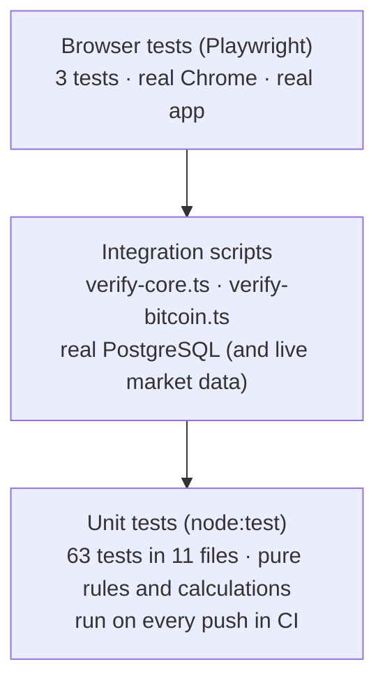

# Testing

**What you will learn:** the four kinds of tests that check GoBank Express (unit tests, two integration scripts, browser tests and a concurrency experiment), what each one proves, how to run them, and the results measured while writing these docs. Be honest in the defense about what is tested and what is not; the last section helps.

---

## 1. The test pyramid



| Level | Speed | Needs | Runs in CI | Command (in `gobank/`) |
| --- | --- | --- | --- | --- |
| Unit | under a second per file | nothing | **yes** | `npm test` |
| Core integration | seconds | a test database (`DATABASE_URL`) and the card key | no | `npm run test:integration` |
| Bitcoin integration | seconds | a test database **and internet** (Binance, Frankfurter) | no | `npm run test:bitcoin:integration` |
| Browser (end-to-end) | about a minute | the dev server, Google Chrome, a seeded database | no | `npm run test:e2e` |

> **Use a test database.** The integration scripts create and then delete their own users, cards and billers, but they still write to whatever database `DATABASE_URL` points to.

---

## 2. Results measured for these docs

On commit `7be1eb5`, in a separate copy of the project (the project itself was not modified):

| Check | Result |
| --- | --- |
| `npm test` (unit) | **63 / 63 passed** |
| `npm run typecheck` | passed (no type errors) |
| `npm run lint` | passed (zero warnings) |
| `prisma migrate deploy` on an empty PostgreSQL 16 | **all 19 migrations applied** |
| `npm run db:seed` | passed |
| `npm run test:integration` (`verify-core.ts`) | **passed**: "registration, cards, PINs, Google linking, profile, payments, transfers, requests, card locks, ownership, rollback and savings" |
| Concurrency experiment (20 simultaneous transfers) | **passed**: no overdraft, no money created or lost ([§6](#6-the-concurrency-experiment)) |
| `npm run test:bitcoin:integration` | **not run**: the environment used to write these docs blocks the Binance and Frankfurter APIs. The script stopped at the first quote with the app's own "Bitcoin market data is unavailable" error, the graceful failure the [Bitcoin page](../05-features/12-bitcoin.md) describes. Run it on a normal internet connection |
| `npm run test:e2e` | **3 / 3 passed** against the dev server and the local database. The project's config asks for Google Chrome (`channel: "chrome"`), which the writing environment does not have, so the run used a one-off copy of the config that only swaps in the pre-installed Chromium (same 3 tests, same Pixel 7 device). Run it once more with the real config before the defense |
| Extra browser checks (Playwright scripts, Chromium) | the balance card (hide, copy refused without clipboard permission), the GO menu (focus, Tab, Escape, scroll lock, reduced motion) and the session rules (reload, typed address, second tab, in-app link) behave as the catalog pages [06](../10-feature-catalog/06-sessions-and-sign-out.md), [11](../10-feature-catalog/11-dashboard.md) and [12](../10-feature-catalog/12-go-menu.md) describe |

---

## 3. Unit tests

Written with Node's **built-in test runner** (`node:test`) and strict assertions (`node:assert/strict`), executed through `tsx` so TypeScript runs directly. No test framework needs to be installed.

```ts
void test("a year of daily compounding at 4% earns the expected interest", () => { … });
```

- Each test name is a full sentence describing **one behavior** (commit `f15e749`, "one behavior per test"), so a failure tells you exactly what broke.
- `void` in front of `test(...)` tells the linter the returned promise is intentionally not awaited (the runner handles it).
- Tests that import server-only files run with `--conditions=react-server` ([TypeScript and tooling §4](../01-foundations/01-typescript-and-tooling.md#4-nodejs-npm-and-running-typescript)).

### All 63 tests

| File | Tests | What it proves | Explained in |
| --- | --- | --- | --- |
| `src/shared/lib/amount-input.test.ts` | 3 | half-typed amounts allowed; negatives, 3 decimals, `1e3`, `1,000` refused; ₱12.34 → 1234 centavos exactly | [Send money §3](../05-features/05-send-money.md#3-the-amount-box-amount-inputts) |
| `src/shared/lib/savings-interest.test.ts` | 4 | ₱1,000 → ₱1,040.80 in a year; input not modified; never paid twice; daily settling = yearly settling | [GoalSave §2](../05-features/08-goalsave.md#2-the-interest-math-savings-interestts) |
| `src/features/goals/goals.rules.test.ts` | 7 | amount messages for empty, zero, too large, more than the goal, more than the balance, valid; name length 1–40 | [GoalSave §3](../05-features/08-goalsave.md#3-rules-shared-by-the-screens-goalsrulests) |
| `src/features/rewards/rewards.rules.test.ts` | 4 | points to the next peso; whole hundreds only; conversion options; at most four options | [Rewards §4](../05-features/09-rewards.md#4-conversion-options-rewardsrulests) |
| `src/features/auth/auth.test.ts` | 7 | username cleaning and reserved names; PIN rules; new PIN must differ; 15-minute lock countdown; salted hashes differ; right/wrong PIN; broken hashes never match | [Registration §10](../05-features/01-registration-and-sign-in.md#10-tests-authtestts) |
| `src/features/auth/google/signed-token.test.ts` | 4 | valid until expiry; swapped payload, wrong secret and malformed tokens rejected | [Google sign-in §6](../05-features/02-google-sign-in.md#6-the-signed-identity-cookie) |
| `src/features/card/card-cvv.test.ts` | 8 | four networks only; 16 digits, right prefix, valid Luhn; virtual network differs; `007` round-trips; random nonce; wrong card or key fails; tampering detected; bad key or CVV refused | [Cards §8](../05-features/04-cards.md#8-tests-card-cvvtestts) |
| `src/features/account/profile-photo.test.ts` | 4 | becomes 256×256 WebP **without EXIF/ICC**; removal stores null; links, SVG and broken data refused; size limit | [Account §4](../05-features/03-account-and-profile.md#the-tests-profile-phototestts) |
| `src/features/bitcoin/bitcoin.test.ts` | 8 | buy rounding and fee; sell-all loss of ₱20.01; replay equals live state; insufficient PHP or Bitcoin; fractional centavos; exact decimal parsing; quote freshness | [Bitcoin §9](../05-features/12-bitcoin.md#9-tests) |
| `src/features/bitcoin/bitcoin-trade-input.test.ts` | 9 | input parsing for buy and sell, decimals, zero, limit; presets keep room for the fee; previews explain refusals | [Bitcoin §9](../05-features/12-bitcoin.md#9-tests) |
| `src/features/bitcoin/bitcoin-chart-geometry.test.ts` | 5 | plot edges; higher price drawn higher; nearest candle; pointer clamped; up/down/flat colors | [Bitcoin §9](../05-features/12-bitcoin.md#9-tests) |

`npm test` runs them in seven groups (`test:bitcoin`, `test:profile`, `test:savings`, `test:auth`, `test:card`, `test:amount-input`, `test:rewards`); any failure stops the chain and fails CI.

---

## 4. Integration test: `scripts/verify-core.ts`

This script runs the **real services** (the same functions the API calls) against a **real database**, checking the whole banking flow end to end, including rollbacks.

<!-- code: gobank/scripts/verify-core.ts -->
**`gobank/scripts/verify-core.ts`** · all 353 lines

```ts
  1 │ import "dotenv/config";
  2 │ import assert from "node:assert/strict";
  3 │ import { randomUUID } from "node:crypto";
  4 │ import sharp from "sharp";
  5 │ import { db } from "../src/server/db";
  6 │ import { AppError, MESSAGES, asDatabaseError } from "../src/server/errors";
  7 │ import {
  8 │   createRegisteredAccount,
  9 │   verifyAccountPin,
 10 │ } from "../src/features/auth/auth.service";
 11 │ import {
 12 │   cardDraftId,
 13 │   createCardPreview,
 14 │ } from "../src/features/auth/card-preview.service";
 15 │ import { verifyPin } from "../src/features/auth/pin";
 16 │ import { linkGoogle } from "../src/features/auth/google/google.service";
 17 │ import {
 18 │   getOverview,
 19 │   getProfile,
 20 │   updateProfile,
 21 │ } from "../src/features/account/account.service";
 22 │ import {
 23 │   getCard,
 24 │   revealCvv,
 25 │   updateCard,
 26 │ } from "../src/features/card/card.service";
 27 │ import { getTransaction } from "../src/features/activity/activity.service";
 28 │ import { deposit } from "../src/features/deposit/deposit.service";
 29 │ import { buyLoad } from "../src/features/load/load.service";
 30 │ import { payBill } from "../src/features/bills/bills.service";
 31 │ import { sendMoney } from "../src/features/transfers/transfers.service";
 32 │ import {
 33 │   cancelRequest,
 34 │   requestMoney,
 35 │   respondToRequest,
 36 │ } from "../src/features/requests/requests.service";
 37 │ import { listNotifications } from "../src/features/notifications/notifications.service";
 38 │ import {
 39 │   createGoal,
 40 │   getGoal,
 41 │   moveMoney,
 42 │   removeGoal,
 43 │ } from "../src/features/goals/goals.service";
 44 │
 45 │ type Account = { id: string; username: string };
 46 │
 47 │ const suffix = randomUUID().replaceAll("-", "").slice(0, 10);
 48 │ const PIN = "246802";
 49 │ const MOBILE = "09123456789";
 50 │ const ONE_YEAR = 365 * 86_400_000;
 51 │
 52 │ const created = {
 53 │   users: [] as string[],
 54 │   cardDrafts: [] as string[],
 55 │   billerId: undefined as string | undefined,
 56 │ };
 57 │
 58 │ const failsWith = (message: string) => (error: unknown) =>
 59 │   error instanceof AppError && error.message === message;
 60 │
 61 │ const isNotFound = (error: unknown) => asDatabaseError(error)?.code === "P2025";
 62 │
 63 │ async function balanceOf(userId: string) {
 64 │   const user = await db.user.findUniqueOrThrow({
 65 │     where: { id: userId },
 66 │     select: { balance: true },
 67 │   });
 68 │
 69 │   return user.balance;
 70 │ }
 71 │
 72 │ async function registerAccount(
 73 │   username: string,
 74 │   fullName: string,
 75 │   brand: "visa" | "mastercard",
 76 │ ) {
 77 │   const preview = await createCardPreview(brand);
 78 │   created.cardDrafts.push(cardDraftId(preview.token));
 79 │
 80 │   const registration = { username, fullName, mobile: null, pin: PIN, brand };
 81 │   const { id } = await createRegisteredAccount(registration, preview.token);
 82 │   created.users.push(id);
 83 │
 84 │   return { account: { id, username }, preview, registration };
 85 │ }
 86 │
 87 │ async function checkRegistrationAndPin() {
 88 │   const first = await registerAccount(
 89 │     `core_${suffix}_a`,
 90 │     "Core fixture",
 91 │     "visa",
 92 │   );
 93 │   const second = await registerAccount(
 94 │     `core_${suffix}_b`,
 95 │     "Other fixture",
 96 │     "mastercard",
 97 │   );
 98 │   const owner = first.account;
 99 │
100 │   const cards = await getCard(owner.id);
101 │   assert.equal(cards.physical.number, first.preview.preview.number);
102 │   assert.notEqual(cards.physical.number, cards.virtual.number);
103 │   assert.notEqual(cards.physical.brand, cards.virtual.brand);
104 │   assert.ok(!("cvvEncrypted" in cards.physical));
105 │
106 │   const physicalCvv = await revealCvv(owner.id, "physical");
107 │   const virtualCvv = await revealCvv(owner.id, "virtual");
108 │   assert.equal(physicalCvv.cvv, first.preview.preview.cvv);
109 │   assert.notEqual(virtualCvv.cvv, first.preview.preview.cvv);
110 │
111 │   const stored = await db.user.findUniqueOrThrow({ where: { id: owner.id } });
112 │   assert.ok(await verifyPin(PIN, stored.pinHash));
113 │
114 │   await assert.rejects(async () => {
115 │     const replay = await createRegisteredAccount(
116 │       { ...first.registration, username: `core_${suffix}_c` },
117 │       first.preview.token,
118 │     );
119 │     created.users.push(replay.id);
120 │   });
121 │
122 │   await assert.rejects(
123 │     verifyAccountPin(owner.id, "000000", MESSAGES.wrongPin),
124 │     failsWith(MESSAGES.wrongPin),
125 │   );
126 │   await verifyAccountPin(owner.id, PIN, MESSAGES.wrongPin);
127 │
128 │   return { owner, other: second.account };
129 │ }
130 │
131 │ async function checkGoogleLinking(owner: Account, other: Account) {
132 │   const google = {
133 │     sub: `google_${suffix}`,
134 │     email: `core.${suffix}@gmail.com`,
135 │     emailVerified: true,
136 │     name: "Core fixture",
137 │   };
138 │   const schoolAccount = { ...google, email: `core.${suffix}@school.edu` };
139 │   const sameGmailOtherGoogle = { ...google, sub: `google_${suffix}_b` };
140 │
141 │   assert.equal(await linkGoogle(owner.id, schoolAccount), "not-gmail");
142 │   assert.equal(await linkGoogle(owner.id, google), "linked");
143 │   assert.equal(await linkGoogle(owner.id, google), "already-linked");
144 │   assert.equal(
145 │     await linkGoogle(other.id, sameGmailOtherGoogle),
146 │     "email-in-use",
147 │   );
148 │
149 │   assert.equal((await getProfile(owner.id)).gmail, google.email);
150 │ }
151 │
152 │ async function checkProfile(owner: Account, other: Account) {
153 │   const png = await sharp({
154 │     create: { width: 8, height: 8, channels: 3, background: "#009b72" },
155 │   })
156 │     .png()
157 │     .toBuffer();
158 │
159 │   await updateProfile(owner.id, {
160 │     fullName: "Saved fixture",
161 │     mobile: null,
162 │     profilePhoto: `data:image/png;base64,${png.toString("base64")}`,
163 │   });
164 │
165 │   const profile = await getProfile(owner.id);
166 │   assert.equal(profile.fullName, "Saved fixture");
167 │   assert.match(profile.profilePhoto ?? "", /^data:image\/webp;base64,/);
168 │
169 │   await assert.rejects(
170 │     updateProfile(owner.id, {
171 │       fullName: "Must not save",
172 │       mobile: null,
173 │       profilePhoto: "data:image/png;base64,AAAA",
174 │     }),
175 │   );
176 │   assert.deepEqual(await getProfile(owner.id), profile);
177 │
178 │   assert.equal((await getProfile(other.id)).profilePhoto, null);
179 │ }
180 │
181 │ async function checkBillsAndLoad(owner: Account, other: Account) {
182 │   const biller = await db.biller.create({
183 │     data: {
184 │       code: `core-${suffix}`,
185 │       name: "Core biller",
186 │       category: "internet",
187 │       description: "Verification fixture",
188 │     },
189 │     select: { id: true },
190 │   });
191 │   created.billerId = biller.id;
192 │
193 │   await deposit(owner.id, 100_000);
194 │   const bill = await payBill(
195 │     owner.id,
196 │     biller.id,
197 │     "00112233",
198 │     5_000,
199 │     "physical",
200 │   );
201 │   await buyLoad(owner.id, MOBILE, 10_000, "virtual");
202 │
203 │   assert.equal(await balanceOf(owner.id), 85_000);
204 │   assert.equal((await getOverview(owner.id)).points, 1);
205 │
206 │   const receipt = await getTransaction(owner.id, bill.reference);
207 │   assert.equal(receipt.id, bill.id);
208 │   await assert.rejects(getTransaction(other.id, bill.reference), isNotFound);
209 │
210 │   const beforeFailedLoad = await getOverview(owner.id);
211 │   await assert.rejects(
212 │     buyLoad(owner.id, MOBILE, 100_000, "physical"),
213 │     failsWith(MESSAGES.insufficientBalance),
214 │   );
215 │   assert.deepEqual(await getOverview(owner.id), beforeFailedLoad);
216 │ }
217 │
218 │ async function checkTransfersAndRequests(owner: Account, other: Account) {
219 │   const sent = await sendMoney(
220 │     owner.id,
221 │     `@${other.username}`,
222 │     12_345,
223 │     null,
224 │     "physical",
225 │   );
226 │
227 │   const bothSides = await db.transaction.findMany({
228 │     where: { reference: sent.reference },
229 │   });
230 │   const netAmount = bothSides.reduce((total, entry) => total + entry.amount, 0);
231 │   assert.equal(bothSides.length, 2);
232 │   assert.equal(netAmount, 0);
233 │   assert.equal(await balanceOf(other.id), 12_345);
234 │
235 │   const paid = await requestMoney(owner.id, other.username, 1_000, null);
236 │   await assert.rejects(
237 │     respondToRequest(owner.id, paid.id, true),
238 │     failsWith(MESSAGES.requestClosed),
239 │   );
240 │   await respondToRequest(other.id, paid.id, true);
241 │   await assert.rejects(
242 │     respondToRequest(other.id, paid.id, true),
243 │     failsWith(MESSAGES.requestClosed),
244 │   );
245 │   assert.equal(await balanceOf(other.id), 11_345);
246 │
247 │   const declined = await requestMoney(owner.id, other.username, 100, null);
248 │   await respondToRequest(other.id, declined.id, false);
249 │
250 │   const cancelled = await requestMoney(owner.id, other.username, 100, null);
251 │   await cancelRequest(owner.id, cancelled.id);
252 │
253 │   const sentRequests = await listNotifications(owner.id, "sent");
254 │   const statuses = sentRequests.items.map((request) => request.status).sort();
255 │   assert.deepEqual(statuses, ["cancelled", "declined", "paid"]);
256 │
257 │   const receivedRequests = await listNotifications(owner.id, "received");
258 │   assert.equal(receivedRequests.items.length, 0);
259 │ }
260 │
261 │ async function checkCardLocks(owner: Account, other: Account) {
262 │   await updateCard(owner.id, { lock: { kind: "physical", locked: true } });
263 │
264 │   const beforeRefusal = await getOverview(owner.id);
265 │   await assert.rejects(
266 │     sendMoney(owner.id, other.username, 100, null, "physical"),
267 │     failsWith(MESSAGES.cardLocked),
268 │   );
269 │   assert.deepEqual(await getOverview(owner.id), beforeRefusal);
270 │
271 │   const paidByVirtual = await sendMoney(
272 │     owner.id,
273 │     other.username,
274 │     100,
275 │     null,
276 │     "virtual",
277 │   );
278 │   const cardUsed = (paidByVirtual.details as { card: { kind: string } }).card;
279 │   assert.equal(cardUsed.kind, "virtual");
280 │
281 │   await updateCard(owner.id, {
282 │     lock: { kind: "physical", locked: false },
283 │     cardDailyLimit: 0,
284 │   });
285 │   await assert.rejects(
286 │     buyLoad(owner.id, MOBILE, 1_000, "physical"),
287 │     failsWith(MESSAGES.overDailyLimit),
288 │   );
289 │ }
290 │
291 │ async function checkSavings(owner: Account, other: Account) {
292 │   const goal = await createGoal(owner.id, "Core savings", 100_000);
293 │   await moveMoney(owner.id, goal.id, 10_000, "in");
294 │   const mainBalance = await balanceOf(owner.id);
295 │
296 │   await db.savingsGoal.update({
297 │     where: { id: goal.id },
298 │     data: { interestCalculatedAt: new Date(Date.now() - ONE_YEAR) },
299 │   });
300 │
301 │   const afterOneYear = await getGoal(owner.id, goal.id);
302 │   assert.ok(afterOneYear.balance > 10_400 && afterOneYear.balance < 10_420);
303 │   assert.equal(
304 │     (await getGoal(owner.id, goal.id)).balance,
305 │     afterOneYear.balance,
306 │   );
307 │   assert.equal(await balanceOf(owner.id), mainBalance);
308 │
309 │   await assert.rejects(getGoal(other.id, goal.id));
310 │   await assert.rejects(removeGoal(other.id, goal.id));
311 │
312 │   const closed = await removeGoal(owner.id, goal.id);
313 │   assert.equal(closed.returned, afterOneYear.balance);
314 │   assert.equal(await balanceOf(owner.id), mainBalance + closed.returned);
315 │   assert.equal(
316 │     await db.savingsGoal.findUnique({ where: { id: goal.id } }),
317 │     null,
318 │   );
319 │ }
320 │
321 │ async function cleanUp() {
322 │   const steps = [
323 │     () => db.user.deleteMany({ where: { id: { in: created.users } } }),
324 │     () => db.biller.deleteMany({ where: { id: created.billerId ?? "" } }),
325 │     () =>
326 │       db.registrationCard.deleteMany({
327 │         where: { id: { in: created.cardDrafts } },
328 │       }),
329 │   ];
330 │
331 │   for (const step of steps) {
332 │     await step().catch((error: unknown) => console.error(error));
333 │   }
334 │
335 │   await db.$disconnect();
336 │ }
337 │
338 │ try {
339 │   const { owner, other } = await checkRegistrationAndPin();
340 │
341 │   await checkGoogleLinking(owner, other);
342 │   await checkProfile(owner, other);
343 │   await checkBillsAndLoad(owner, other);
344 │   await checkTransfersAndRequests(owner, other);
345 │   await checkCardLocks(owner, other);
346 │   await checkSavings(owner, other);
347 │
348 │   console.log(
349 │     "Passed: registration, cards, PINs, Google linking, profile, payments, transfers, requests, card locks, ownership, rollback and savings.",
350 │   );
351 │ } finally {
352 │   await cleanUp();
353 │ }
```
<!-- /code -->

| Lines | Part | Checks |
| --- | --- | --- |
| 47–56 | setup | a random suffix so test usernames never collide; lists of everything created, for cleanup |
| 58–61 | helpers | `failsWith(message)` matches our `AppError` messages exactly; `isNotFound` matches Prisma `P2025` |
| 72–85 | `registerAccount` | registers through the real card-preview + registration path |
| 87–129 | `checkRegistrationAndPin` | two accounts; the physical card equals the preview; physical and virtual differ in number and network; **`cvvEncrypted` is not exposed**; revealed CVVs are right and differ; the stored PIN verifies; **a used card preview cannot register again**; a wrong PIN is refused and the right one accepted |
| 131–150 | `checkGoogleLinking` | `not-gmail`, `linked`, `already-linked`, `email-in-use`; the profile shows the Gmail |
| 152–179 | `checkProfile` | a PNG photo is saved as WebP; a broken photo is refused **and nothing changes** (not even the name); the other user has no photo |
| 181–216 | `checkBillsAndLoad` | deposit ₱1,000, ₱50 bill, ₱100 load → balance **₱850.00** and **1 point**; the receipt opens for its owner and **not** for another user; an unaffordable load fails and the account is **identical** afterwards |
| 218–259 | `checkTransfersAndRequests` | a transfer's two rows **sum to zero**; the requester cannot pay their own request; paying works once and **only once**; decline and cancel; the statuses are exactly cancelled/declined/paid |
| 261–289 | `checkCardLocks` | a locked card is refused and **nothing changes**; the virtual card pays and is recorded as the card used; a ₱0 daily limit blocks spending |
| 291–319 | `checkSavings` | a year of interest on ₱100 lands between ₱104.00 and ₱104.20; reading again pays **nothing more**; the main balance is untouched by interest; another user cannot open or close the goal; closing returns everything |
| 321–336 | `cleanUp` | delete the test users (cascading to their cards, sessions, goals and history), the test biller and the card previews, even after a failure |
| 338–353 | main | run every check in order; print one "Passed" line; always clean up (`finally`) |

## 5. Integration test: `scripts/verify-bitcoin.ts`

<!-- code: gobank/scripts/verify-bitcoin.ts -->
**`gobank/scripts/verify-bitcoin.ts`** · all 110 lines

```ts
  1 │ import "dotenv/config";
  2 │ import assert from "node:assert/strict";
  3 │ import { randomUUID } from "node:crypto";
  4 │ import { db } from "../src/server/db";
  5 │ import { newAccountNumber } from "../src/server/identifiers";
  6 │ import { deposit } from "../src/features/deposit/deposit.service";
  7 │ import {
  8 │   getBitcoinPortfolio,
  9 │   tradeBitcoin,
 10 │ } from "../src/features/bitcoin/bitcoin.service";
 11 │ import {
 12 │   getBitcoinChart,
 13 │   getBitcoinQuote,
 14 │ } from "../src/features/bitcoin/bitcoin-market.server";
 15 │ import {
 16 │   BITCOIN_FEE_CENTAVOS,
 17 │   quoteIsFresh,
 18 │   UNITS_PER_BITCOIN,
 19 │ } from "../src/features/bitcoin/bitcoin.types";
 20 │
 21 │ const STARTING_CASH = 1_000_000;
 22 │
 23 │ type SavedTrade = { bitcoinUnits: bigint; unitPriceCentavos: number };
 24 │
 25 │ const tradeValue = ({ bitcoinUnits, unitPriceCentavos }: SavedTrade) =>
 26 │   bitcoinUnits * BigInt(unitPriceCentavos);
 27 │
 28 │ const expectedBuyCost = (trade: SavedTrade) =>
 29 │   Number((tradeValue(trade) + UNITS_PER_BITCOIN - 1n) / UNITS_PER_BITCOIN) +
 30 │   BITCOIN_FEE_CENTAVOS;
 31 │
 32 │ const expectedSaleProceeds = (trade: SavedTrade) =>
 33 │   Number(tradeValue(trade) / UNITS_PER_BITCOIN) - BITCOIN_FEE_CENTAVOS;
 34 │
 35 │ const transactionCount = (userId: string) =>
 36 │   db.transaction.count({ where: { userId } });
 37 │
 38 │ async function createFundedUser() {
 39 │   const user = await db.user.create({
 40 │     data: {
 41 │       username: `btc_${randomUUID().replaceAll("-", "").slice(0, 12)}`,
 42 │       fullName: "Bitcoin fixture",
 43 │       accountNumber: newAccountNumber(),
 44 │       pinHash: "fixture-only",
 45 │     },
 46 │     select: { id: true },
 47 │   });
 48 │
 49 │   await deposit(user.id, STARTING_CASH);
 50 │   return user.id;
 51 │ }
 52 │
 53 │ let userId: string | undefined;
 54 │
 55 │ try {
 56 │   const quote = await getBitcoinQuote();
 57 │   assert.ok(quote.unitPriceCentavos > 0 && quote.phpPerQuote > 1);
 58 │   assert.ok(quoteIsFresh(quote.asOf, Date.now()));
 59 │   assert.ok((await getBitcoinChart("1H")).length >= 2);
 60 │
 61 │   userId = await createFundedUser();
 62 │
 63 │   const submissionId = randomUUID();
 64 │   const order = { action: "buy" as const, cashCentavos: 10_000 };
 65 │   const buy = await tradeBitcoin(userId, submissionId, order);
 66 │   const repeated = await tradeBitcoin(userId, submissionId, order);
 67 │
 68 │   assert.equal(repeated.id, buy.id);
 69 │   assert.equal(buy.amountCentavos, expectedBuyCost(buy));
 70 │
 71 │   const afterBuy = await getBitcoinPortfolio(userId);
 72 │   assert.equal(afterBuy.trades.length, 1);
 73 │   assert.equal(afterBuy.cashCentavos, STARTING_CASH - buy.amountCentavos);
 74 │
 75 │   const entriesBefore = await transactionCount(userId);
 76 │   await assert.rejects(
 77 │     tradeBitcoin(userId, randomUUID(), {
 78 │       action: "buy",
 79 │       cashCentavos: afterBuy.cashCentavos + 100,
 80 │     }),
 81 │   );
 82 │   assert.equal(
 83 │     (await getBitcoinPortfolio(userId)).cashCentavos,
 84 │     afterBuy.cashCentavos,
 85 │   );
 86 │   assert.equal(await transactionCount(userId), entriesBefore);
 87 │
 88 │   const sale = await tradeBitcoin(userId, randomUUID(), {
 89 │     action: "sell",
 90 │     bitcoinUnits: buy.bitcoinUnits,
 91 │   });
 92 │   assert.equal(sale.amountCentavos, expectedSaleProceeds(sale));
 93 │
 94 │   const afterSale = await getBitcoinPortfolio(userId);
 95 │   assert.equal(afterSale.bitcoinUnits, 0n);
 96 │   assert.equal(
 97 │     afterSale.cashCentavos,
 98 │     afterBuy.cashCentavos + sale.amountCentavos,
 99 │   );
100 │
101 │   console.log(
102 │     "Passed: live Bitcoin quote, chart, fees, idempotency, settlement and rollback.",
103 │   );
104 │ } finally {
105 │   try {
106 │     if (userId) await db.user.deleteMany({ where: { id: userId } });
107 │   } finally {
108 │     await db.$disconnect();
109 │   }
110 │ }
```
<!-- /code -->

| Lines | Checks |
| --- | --- |
| 25–33 | the expected buy cost (cost rounded up + fee) and sale proceeds (rounded down − fee), computed independently from the saved trade |
| 56–59 | a **live** quote exists, is fresh and has a sensible PHP rate; the 1-hour chart has candles |
| 61–69 | a ₱100 buy with one `submissionId`, sent **twice**, returns the **same** trade (idempotency), charged exactly as expected |
| 71–73 | the portfolio has one trade and the balance dropped by the charge |
| 75–86 | buying more than the balance fails, the balance is unchanged and **no ledger row** was added |
| 88–99 | selling everything returns the holdings to 0 and credits exactly the expected proceeds |
| 104–109 | the fixture user is always deleted |

## 6. The concurrency experiment

Not part of the project, but included in this docs repository: [`experiments/concurrent-transfers.ts`](../experiments/concurrent-transfers.ts). It fires **20 transfers of ₱400 at the same moment** from an account holding ₱5,000 and checks that only the affordable ones succeed and that the total money in both accounts is unchanged. Result on PostgreSQL 16: **12 succeeded, 8 refused with "Insufficient balance", final balance ₱200, money before and after equal.** See [Prisma and PostgreSQL §5](../01-foundations/04-prisma-and-postgresql.md#5-proof-it-works) for the output and how to run it.

## 7. Browser tests: `e2e/smoke.spec.ts`

<!-- code: gobank/e2e/smoke.spec.ts -->
**`gobank/e2e/smoke.spec.ts`** · all 50 lines

```ts
 1 │ import { expect, test, type Page } from "@playwright/test";
 2 │
 3 │ const DEMO_USERNAME = "maricel";
 4 │ const DEMO_PIN = "135790";
 5 │
 6 │ async function signIn(page: Page) {
 7 │   await page.goto("/signin");
 8 │
 9 │   await page.getByLabel("Username").fill(DEMO_USERNAME);
10 │   await page.getByRole("button", { name: "Continue" }).click();
11 │   await page.keyboard.type(DEMO_PIN);
12 │
13 │   await expect(page.getByText("Available balance")).toBeVisible({
14 │     timeout: 60_000,
15 │   });
16 │ }
17 │
18 │ test("welcome screen offers sign-up and log in", async ({ page }) => {
19 │   await page.goto("/");
20 │
21 │   await expect(
22 │     page.getByRole("heading", { name: /Send, save and earn/ }),
23 │   ).toBeVisible();
24 │   await expect(
25 │     page.getByRole("link", { name: "Create account" }),
26 │   ).toBeVisible();
27 │   await expect(page.getByRole("link", { name: "Log in" })).toBeVisible();
28 │ });
29 │
30 │ test("demo user signs in to the dashboard", async ({ page }) => {
31 │   await signIn(page);
32 │
33 │   await expect(page.getByText("Recent transactions")).toBeVisible();
34 │ });
35 │
36 │ test("send money blocks amounts above the balance", async ({ page }) => {
37 │   await signIn(page);
38 │
39 │   await page.getByRole("link", { name: "Send money" }).click();
40 │   await page.getByLabel("Recipient").fill("@dante");
41 │   const continueButton = page.getByRole("button", { name: "Continue" });
42 │   await expect(continueButton).toBeEnabled({ timeout: 15_000 });
43 │   await continueButton.click();
44 │   await page.getByLabel("Amount").fill("9999999");
45 │
46 │   await expect(page.locator("#amount-limit")).toHaveText(
47 │     /Maximum|Insufficient balance|daily limit/,
48 │   );
49 │   await expect(page.getByRole("button", { name: "Review" })).toBeDisabled();
50 │ });
```
<!-- /code -->

| Test | Steps |
| --- | --- |
| welcome screen | the headline "Send, save and earn…", **Create account** and **Log in** are visible |
| demo sign-in | `signIn()` (lines 6–16): type `maricel`, Continue, type the PIN `135790` on the keyboard (the PIN pad listens to it), wait for "Available balance"; then "Recent transactions" is visible |
| amount limits | sign in, **Send money**, recipient `@dante`, wait for **Continue** to enable (the debounced search), enter `9999999`; the limit message (`#amount-limit`) shows Maximum / Insufficient / daily limit, and **Review** is disabled |

The tests find elements **by role and label** (`getByRole("button", { name: "Continue" })`, `getByLabel("Amount")`), the way a screen reader would. A missing label would make the test fail, so they double as an accessibility check. Commit `3548fbe` made the third test continue from the recipient search instead of clicking a name, which is more reliable.

Configuration (`playwright.config.ts`): a Pixel 7 phone, real Google Chrome (for this review the same tests ran in Chromium, see [§2](#2-results-measured-for-these-docs)), 90 s per test, and the dev server started automatically ([Configuration files §5](../02-architecture/03-configuration-files.md#5-test-runner-settings-gobankplaywrightconfigts)).

---

## 8. What is *not* tested (say this honestly)

| Gap | Mitigation | Future work |
| --- | --- | --- |
| No component tests for React screens | logic lives in pure, tested `*.rules.ts` files; e2e covers the main flows | React Testing Library tests for forms |
| Only 3 browser tests | the integration script covers every money flow on the server | e2e for registration, bills, GoalSave and Bitcoin |
| Integration tests are not in CI | run locally before releases | a PostgreSQL service container in GitHub Actions |
| No load or performance testing | indexes and pagination on every list | k6 or Artillery tests |
| No security scanning | code review, strict TypeScript, typed inputs | dependency scanning (Dependabot) and a penetration test |

---

## Defense questions

**Q: How did you test the system?**
A: At three levels. 63 unit tests check the pure rules and calculations (PIN rules, interest, rewards, card numbers and CVV encryption, Bitcoin math) and run automatically in GitHub Actions on every push. An integration script runs the real services against a real PostgreSQL database and checks every money flow, including rollbacks and access control. Playwright tests drive the real app in Chrome on a phone-sized screen. We also stress-tested concurrency by firing 20 simultaneous transfers.

**Q: How do you know a failed payment does not leave partial data?**
A: The integration test makes payments fail on purpose (insufficient balance, locked card) and then asserts that the account overview is exactly the same as before.

**Q: What is your test coverage?**
A: We did not measure a coverage percentage. Coverage is by design: every banking rule and calculation has a unit test, and every money-moving service is exercised end to end by the integration script.
