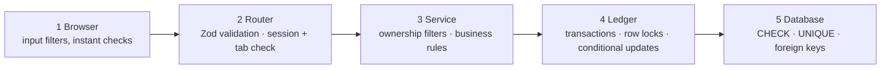

# Security model

**What you will learn:** every security threat that matters for a banking app, the exact defense GoBank uses, and where it is in the code, plus an honest list of what is *not* protected yet. Use this page to answer any "How do you protect…?" question. The concepts behind each defense are taught in [Security concepts](../01-foundations/05-security-concepts.md).

---

## 1. Defense in depth: five layers

Every important rule is enforced in more than one layer, so a single bug or a bypassed browser is not enough to break it. For example, the "balance never negative" rule is checked in the browser (`useSpendLimit`), in the ledger (`post()`'s conditional update) and in the database (`CHECK (balance >= 0)`).

---

## 2. Threats and defenses

### Authentication: proving who you are

| Threat | Defense | Where |
| --- | --- | --- |
| Stolen database reveals PINs | PINs stored only as **scrypt** hashes with a random 16-byte salt per user | `features/auth/pin.ts` |
| PIN guessing (online) | **5 wrong PINs → 15-minute lock**; the attempt counter is read with `SELECT … FOR UPDATE`, so parallel guesses are processed one at a time and all counted | `auth.service.ts` → `checkPinAndUpdateAttempts` |
| Easy PINs | `111111`-style repeats and `123456`-style sequences are refused for new PINs | `auth.rules.ts` → `validatePin` |
| Learning which usernames exist from sign-in | the same "Wrong username or PIN" for an unknown user and a wrong PIN | `auth.service.ts` → `signIn` |
| Timing attacks on hash comparison | `timingSafeEqual` | `pin.ts`, `signed-token.ts` |
| Old PIN still valid on other devices | changing the PIN **signs out every other session** | `auth.service.ts` → `changePin` → `endOtherSessions` |
| Taking over an account through Google | Google alone is never enough: the **PIN is always required**; matching is by Google's permanent ID; Gmail must be verified; an existing link is never replaced | `google.service.ts` ([Google sign-in §9](../05-features/02-google-sign-in.md#9-security-summary)) |
| OAuth code interception or login CSRF | **PKCE (S256)** + random **`state`** checked against an `httpOnly`, path-limited, single-use cookie | `google.server.ts`, `api/auth/google/*` |
| Forged "pending Google identity" | **HMAC-SHA256** signed cookie with a 15-minute expiry | `signed-token.ts`, `google-identity.server.ts` |

### Sessions: staying signed in

| Threat | Defense | Where |
| --- | --- | --- |
| Session token stolen by injected JavaScript (XSS) | the cookie is **`httpOnly`** (page scripts cannot read it) | `server/session.ts` → `startSession` |
| Token sent over plain HTTP | **`secure`** cookie in production | same |
| Stolen database rows reused as cookies | the database stores only **SHA-256(token)** | same |
| Guessing a token | 256 random bits from a CSPRNG | `randomBytes(32)` |
| Session fixation | a brand-new token at every sign-in; the old session is deleted | `startSession` |
| Forgotten open session | **30-minute** expiry, renewed only while the tab is visible; a closed tab's session ends after **15 s** | `session.ts`, `session-guard.tsx` |
| Session shared or hijacked across tabs | **one session per tab**: the `x-gb-session` header must match; a new tab ends the session | `trpc.ts` → `requireSession`, `SessionGuard` |
| Instant sign-out needed | sessions live in the database, so deleting a row ends them immediately (unlike JWTs) | `endSession`, `endOtherSessions` |

### Authorization: what you may access

| Threat | Defense | Where |
| --- | --- | --- |
| Calling the API without signing in | 33 of the 40 procedures are `protectedProcedure` | `server/trpc.ts` |
| Opening signed-in pages while signed out | the `(app)` layout checks the session **on the server** and redirects | `app/(app)/layout.tsx` |
| Acting as another user | the user ID always comes from the **server-side session** (`ctx.userId`), never from the request | every router |
| **IDOR**: reading or changing others' data by ID | every query filters by the owner: receipts by `(reference, userId)`, goals by `{ id, userId }`, cards by `userId_kind`, requests by `payerId`/`requesterId` | services |
| Paying someone else's request, or paying twice | the claim only matches **your** request **while pending** | `requests.service.ts` |
| Paging into another user's list | the notifications cursor also includes "mine" | `notifications.service.ts` |

### Money integrity

| Threat | Defense | Where |
| --- | --- | --- |
| Overdraft by double-click or parallel requests | conditional balance update + `SELECT … FOR UPDATE` on the account (tested: 20 simultaneous transfers) | `ledger.ts` → `post`, `spend` |
| Half-finished transfers after a crash | every movement is one **database transaction** | services → `db.$transaction` |
| Deadlocks between opposite transfers | both accounts are locked **in ID order** | `ledger.ts` → `transfer` |
| Daily limit bypassed by simultaneous payments | the row lock serializes the "spent today" check | `ledger.ts` → `spend` |
| Paying with a locked card | checked inside the transaction | `ledger.ts` → `spend` |
| Interest paid twice, goal limit exceeded | compare-and-set + **Serializable** isolation with retries | `goals.service.ts`, `ledger.ts` |
| Overselling Bitcoin / duplicate trades | Serializable isolation; unique `(userId, submissionId)` **idempotency key**; price from the server | `bitcoin.service.ts` |
| Rounding abuse | integer centavos and BigInt satoshis; rounding always favors the bank | `money.ts`, `bitcoin.rules.ts` |
| Any bug bypassing the code | `CHECK` constraints: no negative balance, points, goal balance or limit | migrations |

### Input handling and web attacks

| Threat | Defense | Where |
| --- | --- | --- |
| Malformed or malicious input | **Zod** schemas on every procedure and on `/api/session`; environment variables validated at startup | routers, `env.ts` |
| SQL injection | Prisma parameterizes every query; the only 3 raw queries are tagged templates with parameters (row locks) | `ledger.ts` (lines 132, 179), `auth.service.ts` (line 115) |
| Cross-site scripting (XSS) | React escapes all text; **no** `dangerouslySetInnerHTML` anywhere (checked with `grep`); cookies are `httpOnly` | whole app |
| Text injection through URLs | `?google=` codes are matched against fixed lists with `Object.hasOwn` | `app/page.tsx`, `google-linked/page.tsx` |
| CSRF | `SameSite=Lax` session cookie; protected calls need the custom `x-gb-session` header (other sites cannot send it); `/api/session` checks the `Origin` header; the card-preview cookie is `SameSite=Strict` | `session.ts`, `trpc.ts`, `api/session/route.ts` |
| Malicious image uploads | type allow-list (no SVG), size limits, **decompression-bomb pixel limit**, real-format check, full re-encode | `profile-photo.server.ts` |
| Reverse tabnabbing via external links | `target="_blank"` links use `rel="noreferrer"` | `bitcoin-screen.tsx` |
| Bad data from third-party APIs | every Binance and Frankfurter response is validated with Zod, range-checked and freshness-checked | `bitcoin-*.server.ts` |

### Protecting stored data

| Data | Protection |
| --- | --- |
| PIN | scrypt hash (one-way) |
| Session token, card-preview token | SHA-256 hash; the real token exists only in an `httpOnly` cookie |
| CVV | **AES-256-GCM** with a 256-bit key from the environment; random nonce; bound to the card number (AAD); decrypted only on request by the owner, and never cached in the browser |
| Card number | stored as plain text (the cards are simulated; see gaps) |
| Profile photo | re-encoded; **EXIF/GPS metadata removed** |
| What other users can see about you | only username, full name and photo (`PARTY`) |
| Error details | hidden in production ("Something went wrong. Please try again.") |
| Secrets | `.env` is git-ignored; the key-setup script refuses to run unless it is; `env.ts` validates formats |

---

## 3. Known gaps (be honest, and show you know the fix)

| Gap | Risk | How to fix |
| --- | --- | --- |
| A 6-digit PIN is a small space (1,000,000 options) | if the database leaked, PIN hashes could be brute-forced offline | add device binding, OTP or passkeys; keep the lockout |
| The lockout can be triggered by anyone who knows a username | an attacker can lock a victim out for 15 minutes | lock per device/IP, add CAPTCHA, notify the user |
| `usernameAvailable` (public) and sign-in timing reveal whether a username exists | username enumeration | rate-limit the check; run a dummy hash for unknown users |
| No general rate limiting | public endpoints (card preview, username check) can be spammed | a rate limiter (for example per IP), CAPTCHA on sign-up |
| No security headers (CSP, `X-Frame-Options`); `next.config.ts` sets none | clickjacking; weaker XSS protection | add `headers()` in `next.config.ts` with a CSP and `frame-ancestors 'none'` |
| Card numbers stored in plain text | acceptable for simulated cards; real cards must follow PCI DSS | tokenization or encryption, as for the CVV |
| No key rotation for `CARD_ENCRYPTION_KEY` | a leaked key exposes every CVV | the `v1.` prefix allows adding `v2` with a new key and re-encrypting |
| "Idle" means "tab hidden", not "no taps" | an unattended open tab stays signed in | add an inactivity timer to `SessionGuard` |
| No audit log of security events | sign-ins and failures are not recorded | a `SecurityEvent` table |
| Not a licensed bank: no KYC/AML or BSP compliance | out of scope for a capstone | required for production |

---

## Defense questions

**Q: What security measures did you implement?**
A: (Pick three or four, one line each.) PINs hashed with scrypt and locked after 5 attempts; database-stored sessions with httpOnly cookies, 30-minute expiry and one session per tab; CVVs encrypted with AES-256-GCM; every input validated with Zod; every query filtered by the signed-in user; and money moved only inside database transactions with row locks and conditional updates, backed by database CHECK constraints.

**Q: How do you prevent SQL injection?**
A: All queries go through Prisma, which sends values as parameters, never as part of the SQL text. Our three raw queries use Prisma's tagged templates, which are also parameterized.

**Q: How do you prevent XSS?**
A: React escapes everything it renders, we never inject raw HTML, and the session cookie is httpOnly, so even injected script could not read it.

**Q: What is the weakest point of your security?**
A: The 6-digit PIN without a second factor. We mitigate it with the lockout, PIN rules and scrypt, but a production bank would add device binding or one-time passwords. We would also add rate limiting and security headers.
