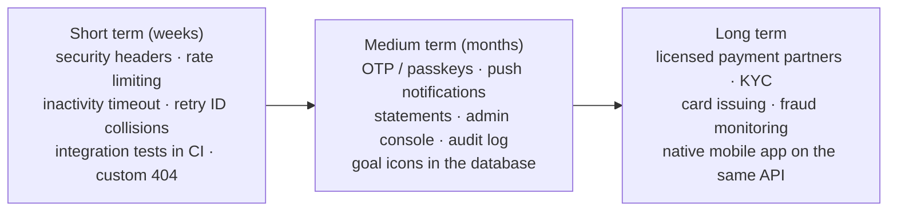

# Limitations and future work

**Why this page matters:** panels always ask "What are the limitations of your system?" A confident, specific answer (what the limit is, *why* it exists and *how* you would fix it) scores far better than "none" or a vague list. Every item below was confirmed in the code.

> **How to say it:** "Our scope was the bank side of a student digital bank: accounts, cards, transfers, savings, rewards and the ledger that keeps money correct. The main limitations are … and our next steps would be …"

---

## 1. Scope limitations (by design)

| Limitation | Why | Future work |
| --- | --- | --- |
| **Money movement is simulated.** Deposits have no payment gateway; bills and load are not sent to real billers or telcos | Real rails need contracts and BSP licensing | integrate a licensed payment provider for cash-in, a biller aggregator and a telco load API, calling the existing ledger functions |
| **Bitcoin is a simulation at real prices**: no exchange orders, custody or withdrawals | Crypto trading requires a registered virtual-asset provider | partner with a licensed exchange; the trade history design already supports it |
| **Cards are simulated** (network test prefixes, valid Luhn digits, no card network) | Issuing cards needs a card-network partnership | a card-issuing platform; keep the per-card lock and daily-limit rules |
| **No identity verification (KYC), AML monitoring or regulatory reporting** | Out of scope for a capstone | ID and selfie verification at sign-up; transaction monitoring |
| **One role only**: no admin or back-office; billers come from the seed script | Focus on the customer experience | an admin console for billers, users, disputes and fraud review |
| **"Notifications" are the money-request inbox only**: no push, email or SMS | Needs messaging infrastructure | web push and email for received money, requests and sign-ins |
| **English and PHP only**; Philippine mobile numbers; Gmail-only Google linking | Target users are Philippine students | Filipino translation; more providers |
| **No statements or exports** | | monthly PDF/CSV statements built from the `Transaction` table |

## 2. Security limitations

| Limitation | Risk | Fix |
| --- | --- | --- |
| A **6-digit PIN without a second factor** | a leaked database's PIN hashes could be brute-forced offline (1,000,000 options) | OTP on new devices, passkeys or biometrics, device binding |
| **Anyone can trigger a victim's lockout** with 5 wrong PINs | a 15-minute denial of service | per-device or per-IP lockout, CAPTCHA, alert the owner |
| **Username enumeration** (`usernameAvailable`, sign-in timing) | attackers can list valid usernames | rate-limit the check; equalize sign-in timing |
| **No general rate limiting** | spam on public endpoints (card previews, username checks) | a rate limiter at the edge or in a middleware |
| **No security headers** (Content-Security-Policy, `frame-ancestors`) | clickjacking; weaker XSS defense | `headers()` in `next.config.ts` |
| **Card numbers stored in plain text** | fine for simulated cards; not PCI DSS compliant | tokenize or encrypt like the CVV |
| **The decrypted CVV is sent without `Cache-Control: no-store`** | `card.revealCvv` is a GET query, and the response carries no `Cache-Control` header (checked in Chromium). A browser does not reuse such a response, but it is allowed to keep a copy in its disk cache | add `Cache-Control: no-store` for sensitive procedures (tRPC's `responseMeta`), or fetch the CVV with a mutation (POST) |
| **No encryption-key rotation** | a leaked key exposes all CVVs | `v2` ciphertexts with a new key; re-encrypt in the background |
| **"Idle" = tab hidden**, not "no interaction" | an unattended, visible tab stays signed in | an inactivity timer in `SessionGuard` |
| **No security event log** | sign-ins and failures are not auditable | a `SecurityEvent` table |

## 3. Product and UX limitations

| Limitation | Detail | Fix |
| --- | --- | --- |
| **One session per tab** | opening GoBank in a second tab signs you out (deliberate, but can surprise users) | allow multiple tabs that share one session via `BroadcastChannel` |
| **Goal icons saved per browser** | stored in `localStorage`, not the database, so they do not follow you to another device | an `icon` column on `SavingsGoal` |
| **Very small rewards** | 1 point per ₱50, 1 centavo per point = 0.02% cash back | tune the two constants in `money.ts`; add promotions |
| **Fixed 4% interest, 5 goals** | `annualInterestRate` exists per goal, but there is no UI to vary it | rate tiers or promotional rates |
| **Lifetime reward totals unused** | the API computes them but the screen does not show them | show them, or remove them from `getRewardsSummary` |
| **Balance-hide choice not remembered** | resets on reload | remember the preference per device |
| **Default 404 page** | no custom "not found" page | add `app/not-found.tsx` |
| **Closed goals hide their interest lines** | interest rows (`kind = interest`) appear only in a goal's Transactions tab; the main history leaves them out (`kind: { not: "interest" }`). Once a goal is closed, its interest lines are not visible anywhere in the app. The money is not lost: the closing withdrawal row includes it, but it is no longer itemized (tested: deposit ₱1,000, ₱40.80 interest, close → the history shows −₱1,000.00 and +₱1,040.80) | show interest rows of closed goals in the main history, or list them under the withdrawal |
| **Bitcoin receipts show only pesos** | the receipt of a Bitcoin trade shows the peso amount, reference and date, but not the satoshis or the fill price, although both are saved in the row's `details` | show `details.satoshis` and `details.priceCentavos` on `exchange` receipts |
| **Two different progress numbers** | the goal bubble rounds (`Math.round`) and the Overview tab rounds down (`Math.floor`): with ₱100 of a ₱20,000 target, the bubble said "1% of target" and the tab said "0%" (checked in Chromium) | use one helper for both |
| **Registration PIN errors are not announced** | in the sign-up PIN step, "Avoid sequences like 123456" and "Those did not match. Start again." are a plain `
`; sign-in and change PIN put the same kind of message in `role="status"`, so only those are read out by screen readers (checked: no `role` or `aria-live` on the element) | add `role="status"` to the paragraph in `step-identity.tsx` |
| **Labels on elements without a role** | 8 plain `div`/`span`/`p` elements carry an `aria-label` but no `role`, for example the load presets ("Load amounts"), the request and activity switches, the chart range buttons, and the card number `
` whose visible digits are `aria-hidden`. Chromium exposes the names (checked: `role=generic name="Load amounts"`, `role=paragraph name="Card number hidden"`), but ARIA 1.2 does not allow naming the `generic` and `paragraph` roles, so screen readers may skip them | `role="group"` on button groups, `role="img"` (or visually hidden text) for the card number, and a test with a real screen reader |

## 4. Technical limitations

| Limitation | Detail | Fix |
| --- | --- | --- |
| **Random identifiers are not retried on a collision** | account numbers (10⁹ options), card numbers and references; a repeat fails the insert (`P2002`) and rolls back, so nothing is corrupted, but the user sees an error | retry generation a few times on `P2002` |
| **Contention on very popular receivers** | transfers lock the receiver's row too, so many simultaneous payments *to one account* wait in line | for merchants, credit asynchronously or use a separate ledger entry queue |
| **Session cleanup is lazy** | expired sessions are removed when used or at the next sign-in; the close timer may not run on serverless | a scheduled cleanup job (correctness does not depend on it) |
| **Profile photos stored in the database** | at most ~200 KB per user; fine for a prototype | object storage (for example S3) with only a URL in the database |
| **Time zones** | the daily limit resets at Manila midnight on the server; history day labels use the device's time zone; but two screens format dates **on the server** (no `timeZone` option in `format.ts`): the dashboard's "Recent transactions" (on a UTC server, a transaction at 7:30 AM Manila time shows the previous day) and the history **receipt page** `/transactions/<reference>` (checked: a transfer made at 10:46 AM Manila showed "Nov 4, 2026, 10:46 AM" on the receipt right after paying, but "Nov 4, 2026, 2:46 AM" on its history receipt, 8 hours off) | pass `timeZone: "Asia/Manila"` to the date formatters; store the user's time zone if users travel |
| **Ambiguous recipient search** | usernames may be digits only, so a username can equal someone else's mobile or account number; a search without `@` then matches two accounts and `findFirst` (no `orderBy`) may return either. Tested: with a user named `09181234567`, typing `09181234567` found @dante. The match card shows the name and `@username` before Continue, so nothing is sent unseen | refuse all-digit usernames, or rank the alternatives (account number, then mobile, then username) |
| **Bitcoin holdings are replayed from every trade** | `getBitcoinPortfolio` and every trade transaction read **all** of the user's `BitcoinTrade` rows to rebuild the holdings (event sourcing). Fine for a personal account; for a very active trader each read grows with the number of trades | store a snapshot of the totals every N trades (or a running total updated in the same transaction) and replay only the trades after it |
| **Market-data caches are per server instance** | each instance fetches its own quotes (5-second cache) | a shared cache such as Redis if traffic grows |
| **Normal refusals are logged as errors** | `db.ts` turns on Prisma's `"error"` log in every environment. A refused payment (for example a deposit over the balance cap) makes the conditional `UPDATE` match no row (`P2025`); the app catches that and shows a friendly message, but Prisma has already printed a `prisma:error` block to the server log (seen while capturing the SQL for these docs) | log through Prisma events (`emit: "event"`) and skip `P2025`, so real errors stand out |

## 5. Testing limitations

| Limitation | Fix |
| --- | --- |
| No component tests for React screens | React Testing Library for the forms |
| Only 3 browser tests | Playwright flows for registration, bills, GoalSave, cards, Bitcoin |
| Integration tests not in CI (need a database) | a PostgreSQL service container in GitHub Actions |
| No load testing | k6 or Artillery against a staging database |
| No dependency or security scanning | Dependabot, `npm audit`, a penetration test |

---

## 6. Future-work roadmap

---

## Defense questions

**Q: What are the limitations of your system?**
A: The money rails are simulated: deposits, bills and load are recorded correctly but not connected to real providers, and Bitcoin uses real prices without real Bitcoin. Security-wise, sign-in is a 6-digit PIN without a second factor, and we have no general rate limiting or security headers yet. And the app has one role, with no admin back-office.

**Q: If you had six more months, what would you build?**
A: First, a second factor for new devices, rate limiting and security headers. Then real cash-in through a licensed payment provider using our existing ledger, push notifications and monthly statements, and an admin console with an audit log.

**Q: Why didn't you integrate a real payment gateway?**
A: Production payment APIs require a registered business and compliance approvals that a student project cannot obtain. Our ledger is designed so a real provider's confirmed payment would simply call the same `post()` the simulated deposit uses.
