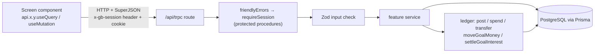

# 00 · Shared systems used by every feature

Every feature page in this catalog uses the same building blocks. This page summarizes each one, shows its most important code, and links to its full explanation, so feature pages can simply say "uses `post()`" or "a protected procedure".

---

## At a glance

| System | File(s) | One-line job | Full explanation |
| --- | --- | --- | --- |
| API transport | `gobank/src/app/api/trpc/[trpc]/route.ts`, `gobank/src/trpc/react.tsx` | carries every browser call to the server | [Life of a request](../02-architecture/02-request-lifecycle.md) |
| API definition | `gobank/src/server/trpc.ts`, `gobank/src/server/root.ts` | procedures, middleware, error translation, sign-in guard | [tRPC setup](../04-server-core/02-trpc-setup.md) |
| Sessions | `gobank/src/server/session.ts`, `session-guard.tsx`, `session.client.ts` | who is signed in, in which tab, until when | [Sessions](../04-server-core/03-sessions.md) |
| **Ledger** | `gobank/src/server/ledger.ts` | **the only code that changes balances** | [The ledger](../04-server-core/04-ledger.md) |
| Errors | `gobank/src/server/errors.ts` | `fail()`, `AppError`, every user message | [DB, errors, IDs, pagination](../04-server-core/01-db-errors-identifiers-pagination.md) |
| Validation | `gobank/src/shared/lib/schemas.ts` + each router | Zod checks every input | [tRPC, Zod and React Query](../01-foundations/03-trpc-zod-and-react-query.md) |
| Browser cache | `gobank/src/trpc/query-client.ts` | reload everything after any change | [tRPC, Zod and React Query §5](../01-foundations/03-trpc-zod-and-react-query.md) |
| Pagination | `gobank/src/server/pagination.ts` | long lists, 20 rows at a time | [DB, errors, IDs, pagination §4](../04-server-core/01-db-errors-identifiers-pagination.md) |
| IDs | `gobank/src/server/identifiers.ts` | account numbers, `GB…` references | [DB, errors, IDs, pagination §3](../04-server-core/01-db-errors-identifiers-pagination.md) |
| Money and formats | `gobank/src/shared/lib/money.ts`, `format.ts` | centavos, points, ₱ formatting | [Shared helpers](../06-frontend/03-shared-lib-hooks-and-trpc-client.md) |
| UI kit | `gobank/src/shared/ui/*` | buttons, fields, PIN pad, receipts | [Shared UI kit](../06-frontend/02-shared-ui-kit.md) |

---

## The path every feature uses



---

## The complicated parts, explained step by step

### 1. `post()`: how one balance change is made safe

<!-- code: gobank/src/server/ledger.ts 46-115 -->
**`gobank/src/server/ledger.ts`** · lines 46–115

```ts
 46 │ async function orFailWith<T>(
 47 │   conditionalUpdate: Promise<T>,
 48 │   explainFailure: string | (() => Promise<string>),
 49 │ ) {
 50 │   try {
 51 │     return await conditionalUpdate;
 52 │   } catch (error) {
 53 │     const noRowMatched = asDatabaseError(error)?.code === "P2025";
 54 │     if (!noRowMatched) throw error;
 55 │
 56 │     const message =
 57 │       typeof explainFailure === "string"
 58 │         ? explainFailure
 59 │         : await explainFailure();
 60 │     return fail("BAD_REQUEST", message);
 61 │   }
 62 │ }
 63 │
 64 │ async function whyPostFailed(
 65 │   tx: Tx,
 66 │   userId: string,
 67 │   amount: number,
 68 │   points: number,
 69 │ ) {
 70 │   const current = await tx.user.findUniqueOrThrow({
 71 │     where: { id: userId },
 72 │     select: { balance: true, points: true },
 73 │   });
 74 │
 75 │   if (current.balance + amount < 0) return MESSAGES.insufficientBalance;
 76 │   if (current.points + points < 0) return MESSAGES.notEnoughPoints;
 77 │   return MESSAGES.accountLimit;
 78 │ }
 79 │
 80 │ export async function post(
 81 │   tx: Tx,
 82 │   { userId, amount, points = 0, reference = newReference(), ...rest }: Entry,
 83 │ ) {
 84 │   const moneyOut = Math.max(0, -amount);
 85 │   const moneyIn = Math.max(0, amount);
 86 │   const pointsOut = Math.max(0, -points);
 87 │   const pointsIn = Math.max(0, points);
 88 │
 89 │   const user = await orFailWith(
 90 │     tx.user.update({
 91 │       where: {
 92 │         id: userId,
 93 │         balance: { gte: moneyOut, lte: MAX_BALANCE_CENTAVOS - moneyIn },
 94 │         points: { gte: pointsOut, lte: MAX_REWARD_POINTS - pointsIn },
 95 │       },
 96 │       data: {
 97 │         balance: { increment: amount },
 98 │         points: { increment: points },
 99 │       },
100 │       select: { balance: true },
101 │     }),
102 │     () => whyPostFailed(tx, userId, amount, points),
103 │   );
104 │
105 │   return tx.transaction.create({
106 │     data: {
107 │       ...rest,
108 │       userId,
109 │       amount,
110 │       points,
111 │       reference,
112 │       balanceAfter: user.balance,
113 │     },
114 │   });
115 │ }
```
<!-- /code -->

**Trace: Maricel (balance ₱500.00 = 50000, points 0) pays a ₱100 bill.** `spend()` calls `post()` with `amount = -10000` and `points = 2`.

| Line | What happens | Values |
| --- | --- | --- |
| 82 | defaults filled in | `points = 2`, `reference = "GB…"` (new) |
| 84 | money leaving | `moneyOut = max(0, 10000) = 10000` |
| 85 | money arriving | `moneyIn = max(0, -10000) = 0` |
| 86–87 | points leaving / arriving | `pointsOut = 0`, `pointsIn = 2` |
| 92–94 | the **condition** the row must meet | `10000 ≤ balance ≤ 2147483647 − 0` and `0 ≤ points ≤ 2147483647 − 2` |
| 96–99 | the **change**, in the same statement | `balance + (−10000)`, `points + 2` |
| 89–103 | PostgreSQL checks and updates in **one atomic step** | 50000 ≥ 10000 ✓ → balance becomes **40000** |
| 105–114 | the history row, with the new balance | `amount −10000`, `points 2`, `balanceAfter 40000` |

**Same trace with only ₱50.00 (5000) in the account:** the condition `5000 ≥ 10000` fails, so no row matches. Prisma throws `P2025`; `orFailWith` (lines 46–62) catches exactly that code and calls `whyPostFailed` (lines 64–78), which reads the balance and finds `5000 + (−10000) < 0` → **"Insufficient balance"**. `fail()` throws, and the whole database transaction rolls back.

**Why the check is inside the update:** a separate "read the balance, then update" would let two simultaneous payments both read ₱500 and both succeed. Inside one `UPDATE … WHERE`, PostgreSQL makes the second wait and then re-checks the condition against the new balance.

### 2. The sign-in guard every protected feature passes

<!-- code: gobank/src/server/trpc.ts 61-74 -->
**`gobank/src/server/trpc.ts`** · lines 61–74

```ts
61 │ const requireSession = t.middleware(async ({ ctx, next }) => {
62 │   const session = await currentSession();
63 │   const otherTab =
64 │     ctx.browserSession !== undefined && ctx.browserSession.id !== session?.id;
65 │
66 │   if (!session || otherTab) {
67 │     throw new TRPCError({
68 │       code: "UNAUTHORIZED",
69 │       message: MESSAGES.signInRequired,
70 │     });
71 │   }
72 │
73 │   return next({ ctx: { userId: session.userId } });
74 │ });
```
<!-- /code -->

| Step | Explanation |
| --- | --- |
| line 62 | find the session from the `gb_session` cookie (hashed, unexpired) |
| lines 63–64 | a browser call must also send the `x-gb-session` header equal to that session's ID; a different tab, or another website, cannot |
| lines 66–71 | otherwise: `UNAUTHORIZED` "Sign in to continue" |
| line 73 | every protected procedure now has `ctx.userId`, **taken from the server-side session, never from the request body** |

### 3. Turning errors into friendly messages

<!-- code: gobank/src/server/trpc.ts 27-59 -->
**`gobank/src/server/trpc.ts`** · lines 27–59

```ts
27 │ function toTRPCError(cause: unknown) {
28 │   if (cause instanceof AppError) {
29 │     return new TRPCError({ code: cause.code, message: cause.message });
30 │   }
31 │
32 │   const database = asDatabaseError(cause);
33 │
34 │   if (database?.code === "P2002") {
35 │     const target = database.meta?.target;
36 │     const field = Array.isArray(target) ? String(target.at(-1)) : "value";
37 │
38 │     return new TRPCError({
39 │       code: "CONFLICT",
40 │       message: `That ${field} is already taken`,
41 │     });
42 │   }
43 │
44 │   if (database?.code === "P2025") {
45 │     return new TRPCError({ code: "NOT_FOUND", message: MESSAGES.notFound });
46 │   }
47 │
48 │   return null;
49 │ }
50 │
51 │ const friendlyErrors = t.middleware(async ({ next }) => {
52 │   const result = await next();
53 │   if (result.ok) return result;
54 │
55 │   const error = toTRPCError(result.error.cause);
56 │   if (error) throw error;
57 │
58 │   return result;
59 │ });
```
<!-- /code -->

`fail("BAD_REQUEST", "Insufficient balance")` → `AppError` → `friendlyErrors` → `TRPCError(BAD_REQUEST, "Insufficient balance")` → HTTP 400 → `errorMessage()` in the browser shows the text. Database duplicates (`P2002`) become "That `<field>` is already taken" and missing rows (`P2025`) become "Not found". Anything unexpected is shown as "Something went wrong. Please try again." in production.

### 4. Reloading data after every change

<!-- code: gobank/src/trpc/query-client.ts -->
**`gobank/src/trpc/query-client.ts`** · all 19 lines

```ts
 1 │ import { MutationCache, QueryClient } from "@tanstack/react-query";
 2 │
 3 │ export const createQueryClient = () => {
 4 │   const queryClient: QueryClient = new QueryClient({
 5 │     defaultOptions: {
 6 │       queries: {
 7 │         staleTime: 30 * 1000,
 8 │       },
 9 │     },
10 │     mutationCache: new MutationCache({
11 │       onSettled: (_data, _error, _variables, _context, mutation) => {
12 │         const [path] = mutation.options.mutationKey ?? [];
13 │         if (Array.isArray(path) && path[0] === "auth") return;
14 │         void queryClient.invalidateQueries();
15 │       },
16 │     }),
17 │   });
18 │   return queryClient;
19 │ };
```
<!-- /code -->

After **any** mutation (except sign-in-related ones), every cached query is marked stale, so the balance, history, points and limits shown anywhere are reloaded the next time they are on screen.

---

## Rules shared by many features

| Rule | Value | Where |
| --- | --- | --- |
| Money unit | integer centavos | `money.ts` |
| Largest single amount | ₱1,000,000.00 | `centavos` schema in `schemas.ts` |
| Largest balance | ₱21,474,836.47 | `MAX_BALANCE_CENTAVOS` |
| Spending kinds (count toward the daily limit) | transfer, bill, load | `SPENDING_KINDS` in `ledger.ts` |
| Point-earning kinds | transfer, bill | `KINDS_THAT_EARN_POINTS` |
| Daily limit day | starts at midnight Manila time | `startOfManilaDay` |
| List page size | 20 (max 50) | routers |
