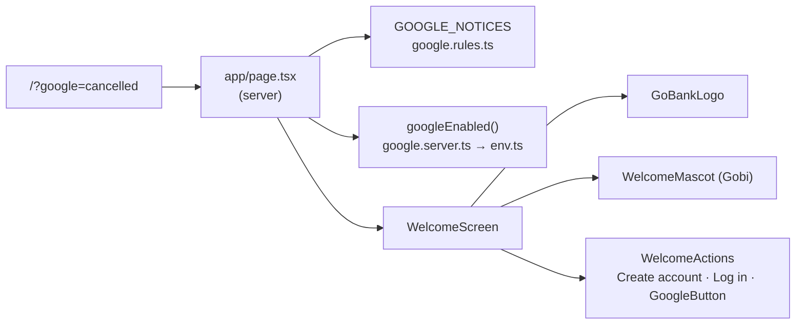

# 01 · Welcome screen

The first page anyone sees: the GoBank logo, **Gobi** the mascot, the tagline, and the three ways in: **Create account**, **Log in**, **Continue with Google**. It also displays messages sent back by the Google sign-in flow (for example "Google sign-in was cancelled.").

## At a glance

| | |
| --- | --- |
| **Route** | `/` |
| **Frontend** | page `gobank/src/app/page.tsx` (server); `welcome-screen.tsx`, `welcome-actions.tsx`, `welcome-mascot.tsx`, `google-button.tsx`, `google-mark.tsx`, `or-divider.tsx`, `gobank/src/shared/ui/gobank-logo.tsx` |
| **API** | none |
| **Backend** | `googleEnabled()` in `google.server.ts`; message list `GOOGLE_NOTICES` in `google.rules.ts` |
| **Database** | none |
| **Tests** | `e2e/smoke.spec.ts` → "welcome screen offers sign-up and log in" |
| **Deep dive** | [Registration and sign-in §9](../05-features/01-registration-and-sign-in.md) |

## What the user can do

- Read what GoBank offers ("Send, save and earn in one app.").
- Tap **Create account** (`/register`), **Log in** (`/signin`) or **Continue with Google** (`/api/auth/google`). The Google button appears only when Google is configured.
- See a red notice if a Google attempt just failed.

## How it works

1. The browser requests `/`. `page.tsx` runs **on the server**.
2. It reads `?google=…` from the URL and looks the code up in `GOOGLE_NOTICES`.
3. It checks whether Google sign-in is configured (`googleEnabled()`: client ID, secret and `AUTH_SECRET` all present).
4. It renders `WelcomeScreen` with `googleEnabled` and the `notice` (or `null`).

## Structure



## Files and locations

| Layer | File | Role |
| --- | --- | --- |
| Page (server) | `gobank/src/app/page.tsx` | reads the URL and the Google setting |
| Screen | `gobank/src/features/auth/components/welcome-screen.tsx` | layout, headline, notice |
| Screen | `gobank/src/features/auth/components/welcome-actions.tsx` | the three entry buttons |
| Screen | `gobank/src/features/auth/components/welcome-mascot.tsx` | Gobi (SVG) and floating chips |
| Screen | `gobank/src/features/auth/components/google-button.tsx` | link to `/api/auth/google` |
| Screen | `gobank/src/features/auth/components/google-mark.tsx` | Google "G" logo |
| Screen | `gobank/src/features/auth/components/or-divider.tsx` | the "or" line |
| Shared UI | `gobank/src/shared/ui/gobank-logo.tsx` | wordmark |
| Backend helper | `gobank/src/features/auth/google/google.rules.ts` | `GOOGLE_NOTICES` messages |
| Backend helper | `gobank/src/features/auth/google/google.server.ts` | `googleEnabled()` |

## Frontend

<!-- code: gobank/src/app/page.tsx -->
**`gobank/src/app/page.tsx`** · all 22 lines

```tsx
 1 │ import type { Metadata } from "next";
 2 │ import { WelcomeScreen } from "~/features/auth/components/welcome-screen";
 3 │ import { googleEnabled } from "~/features/auth/google/google.server";
 4 │ import { GOOGLE_NOTICES } from "~/features/auth/google/google.rules";
 5 │
 6 │ export const metadata: Metadata = {
 7 │   title: "GoBank Express",
 8 │ };
 9 │
10 │ export default async function WelcomePage({
11 │   searchParams,
12 │ }: {
13 │   searchParams: Promise<{ google?: string }>;
14 │ }) {
15 │   const { google } = await searchParams;
16 │
17 │   const notice =
18 │     google && Object.hasOwn(GOOGLE_NOTICES, google)
19 │       ? (GOOGLE_NOTICES[google] ?? null)
20 │       : null;
21 │   return <WelcomeScreen googleEnabled={googleEnabled()} notice={notice} />;
22 │ }
```
<!-- /code -->

<!-- code: gobank/src/features/auth/components/welcome-screen.tsx -->
**`gobank/src/features/auth/components/welcome-screen.tsx`** · all 50 lines

```tsx
 1 │ import { GoBankLogo } from "~/shared/ui/gobank-logo";
 2 │ import { WelcomeActions } from "./welcome-actions";
 3 │ import { WelcomeMascot } from "./welcome-mascot";
 4 │
 5 │ type WelcomeScreenProps = {
 6 │   googleEnabled: boolean;
 7 │   notice: string | null;
 8 │ };
 9 │
10 │ export function WelcomeScreen({ googleEnabled, notice }: WelcomeScreenProps) {
11 │   return (
12 │     <div className="bg-surface-sunken text-ink min-h-dvh lg:bg-[radial-gradient(70%_55%_at_50%_0%,#05966924,transparent_70%)]">
13 │       <main className="bg-surface border-line mx-auto flex min-h-dvh w-full max-w-[440px] flex-col px-6 pt-5 pb-6 sm:border-x">
14 │         <header>
15 │           <GoBankLogo className="text-ink h-9 w-auto" />
16 │         </header>
17 │
18 │         <WelcomeMascot />
19 │
20 │         <section className="animate-step-in text-center">
21 │           <p className="border-brand-line bg-brand-soft text-brand inline-flex rounded-full border px-3 py-1 text-[12px] font-medium">
22 │             Banking made for students
23 │           </p>
24 │           <h1 className="mt-4 text-[28px] leading-[1.15] font-semibold tracking-tight">
25 │             Send, save and earn
26 │             <br />
27 │             <span className="text-brand">in one app.</span>
28 │           </h1>
29 │           <p className="text-ink-muted mx-auto mt-3 max-w-[320px] text-[14px] leading-relaxed">
30 │             Instant transfers, goal savings and cash back on every ₱50 you
31 │             spend.
32 │           </p>
33 │         </section>
34 │
35 │         <div className="min-h-6 flex-1" />
36 │
37 │         {notice ? (
38 │           <p
39 │             role="alert"
40 │             className="border-danger/40 bg-danger-soft text-danger mb-4 rounded-xl border px-4 py-3 text-center text-[13px]"
41 │           >
42 │             {notice}
43 │           </p>
44 │         ) : null}
45 │
46 │         <WelcomeActions googleEnabled={googleEnabled} />
47 │       </main>
48 │     </div>
49 │   );
50 │ }
```
<!-- /code -->

- Lines 12–13: the page background and the centered 440 px column.
- Line 18: Gobi. Lines 20–33: badge "Banking made for students", headline, description (animated in with `animate-step-in`).
- Lines 37–44: the notice, shown with `role="alert"` so screen readers announce it.
- Line 46: the buttons.

<!-- code: gobank/src/features/auth/components/welcome-actions.tsx -->
**`gobank/src/features/auth/components/welcome-actions.tsx`** · all 24 lines

```tsx
 1 │ import Link from "next/link";
 2 │ import { buttonClass } from "~/shared/ui/button";
 3 │ import { GoogleButton } from "./google-button";
 4 │ import { OrDivider } from "./or-divider";
 5 │
 6 │ export function WelcomeActions({ googleEnabled }: { googleEnabled: boolean }) {
 7 │   return (
 8 │     <nav aria-label="Get started" className="flex shrink-0 flex-col gap-3">
 9 │       <Link href="/register" className={buttonClass("primary")}>
10 │         Create account
11 │       </Link>
12 │       <Link href="/signin" className={buttonClass("outline")}>
13 │         Log in
14 │       </Link>
15 │
16 │       {googleEnabled ? (
17 │         <>
18 │           <OrDivider className="text-ink-faint text-[12px]" />
19 │           <GoogleButton />
20 │         </>
21 │       ) : null}
22 │     </nav>
23 │   );
24 │ }
```
<!-- /code -->

The buttons are **links** styled as buttons (`buttonClass`), because they navigate. `<nav aria-label="Get started">` names the group for screen readers.

<!-- code: gobank/src/features/auth/components/google-button.tsx -->
**`gobank/src/features/auth/components/google-button.tsx`** · all 11 lines

```tsx
 1 │ import { buttonClass } from "~/shared/ui/button";
 2 │ import { GoogleMark } from "./google-mark";
 3 │
 4 │ export function GoogleButton() {
 5 │   return (
 6 │     <a href="/api/auth/google" className={buttonClass("outline")}>
 7 │       <GoogleMark size={18} />
 8 │       Continue with Google
 9 │     </a>
10 │   );
11 │ }
```
<!-- /code -->

A plain `<a>`, not Next's `Link`, because `/api/auth/google` is an API route that redirects to Google. It must be a full page navigation.

## Backend

<!-- code: gobank/src/features/auth/google/google.server.ts 25-26 -->
**`gobank/src/features/auth/google/google.server.ts`** · lines 25–26

```ts
25 │ export const googleEnabled = () =>
26 │   Boolean(env.GOOGLE_CLIENT_ID && env.GOOGLE_CLIENT_SECRET && env.AUTH_SECRET);
```
<!-- /code -->

<!-- code: gobank/src/features/auth/google/google.rules.ts 4-11 -->
**`gobank/src/features/auth/google/google.rules.ts`** · lines 4–11

```ts
 4 │ export const GOOGLE_NOTICES: Record<string, string> = {
 5 │   cancelled: "Google sign-in was cancelled.",
 6 │   failed: "Google sign-in did not work. Please try again.",
 7 │   unverified: "Your Google email is not verified.",
 8 │   unavailable: "Google sign-in is not set up yet.",
 9 │   "email-in-use":
10 │     "That Gmail already belongs to a GoBank account. Sign in with your username and PIN.",
11 │ };
```
<!-- /code -->

## Database

None. The welcome screen reads no tables.

## The complicated parts, explained step by step

### Why `Object.hasOwn` instead of `GOOGLE_NOTICES[google]`

`page.tsx` lines 17–20:

| Input URL | `google` | `Object.hasOwn(GOOGLE_NOTICES, google)` | `notice` |
| --- | --- | --- | --- |
| `/?google=cancelled` | `"cancelled"` | true | "Google sign-in was cancelled." |
| `/?google=hacked` | `"hacked"` | false | `null` (nothing shown) |
| `/?google=toString` | `"toString"` | **false** | `null` |
| `/` | `undefined` | not evaluated | `null` |

Plain `GOOGLE_NOTICES["toString"]` would return a *function* inherited from `Object.prototype`. It is "truthy", so the page would show an empty red alert box (React cannot render a function and only logs a warning). `Object.hasOwn` only accepts keys written in the object itself, so a crafted link can never show arbitrary or broken notices.

### The mascot's animation without hurting accessibility

<!-- code: gobank/src/features/auth/components/welcome-mascot.tsx 5-12 -->
**`gobank/src/features/auth/components/welcome-mascot.tsx`** · lines 5–12

```tsx
 5 │ export function WelcomeMascot() {
 6 │   return (
 7 │     <div className="relative mx-auto mt-4 mb-5 h-[248px] w-full max-w-[340px] shrink-0">
 8 │       <svg
 9 │         viewBox="0 0 320 250"
10 │         role="img"
11 │         aria-label="Gobi, the GoBank coin mascot, waving and holding a phone"
12 │         className="absolute inset-0 h-full w-full"
```
<!-- /code -->

The SVG is one image with a descriptive `aria-label` ("Gobi, the GoBank coin mascot, waving and holding a phone"). The floating chips ("₱500 sent", "+10 points", "GoalSave 4% p.a.") are `aria-hidden`, because they are decoration. The `float` and `wave` animations stop automatically for users who turned on "reduce motion" (global rule in `globals.css`).

## Messages

| Code in URL | Message (from `GOOGLE_NOTICES`) |
| --- | --- |
| `cancelled` | Google sign-in was cancelled. |
| `failed` | Google sign-in did not work. Please try again. |
| `unverified` | Your Google email is not verified. |
| `unavailable` | Google sign-in is not set up yet. |
| `email-in-use` | That Gmail already belongs to a GoBank account. Sign in with your username and PIN. |

## Tests

`e2e/smoke.spec.ts`, "welcome screen offers sign-up and log in": opens `/` and checks that the heading "Send, save and earn…", the **Create account** link and the **Log in** link are visible.
