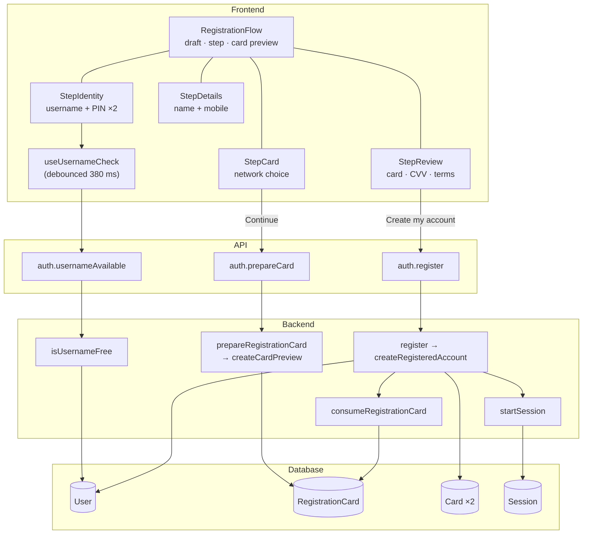

# 02 · Registration (sign-up)

A new user creates an account in **four steps**: (1) username and PIN, (2) card network, (3) personal details, (4) review and agree. The account is created with a **physical card** (the one previewed during sign-up) and a **virtual card** on a different network, and the user is signed in immediately.

## At a glance

| | |
| --- | --- |
| **Route** | `/register` (with Google: `/register?google=new`, see [04](04-google-sign-in.md)) |
| **Frontend** | page `gobank/src/app/(auth)/register/page.tsx`; `registration-flow.tsx`, `step-identity.tsx`, `step-card.tsx`, `step-details.tsx`, `step-review.tsx`, `auth-heading.tsx`, `profile-fields.tsx`, `gmail-link.tsx`, `bank-card.tsx`, `card-brand-logo.tsx`; hooks `use-username-check.ts`, `use-debounced-value.ts`; UI `pin-pad.tsx`, `text-field.tsx`, `step-bar.tsx`, `button.tsx` |
| **API** | `auth.usernameAvailable` (query), `auth.prepareCard` (mutation), `auth.register` (mutation) — all public |
| **Backend** | `auth.router.ts`, `auth.schemas.ts`, `auth.rules.ts`, `auth.service.ts` (`isUsernameFree`, `createRegisteredAccount`, `register`), `card-preview.service.ts`, `pin.ts`, `card-credentials.server.ts`, `card-generation.server.ts`, `card-cvv.server.ts`, `server/identifiers.ts`, `server/session.ts` |
| **Database** | reads `User`; writes `RegistrationCard` (create, delete), `User` (create), `Card` (×2), `Session` |
| **Cookies** | `gb_registration_card` (preview token, 30 min), then `gb_session` |
| **Tests** | `auth.test.ts`, `card-cvv.test.ts`, `scripts/verify-core.ts` (`checkRegistrationAndPin`) |
| **Deep dive** | [Registration and sign-in](../05-features/01-registration-and-sign-in.md) |

## What the user can do

| Step | Screen | The user… |
| --- | --- | --- |
| 1 Identity | `step-identity.tsx` | picks a username (checked live), creates a 6-digit PIN, confirms it |
| 2 Card | `step-card.tsx` | sees a live card preview and picks Visa, Mastercard, JCB or Discover |
| 3 Details | `step-details.tsx` | enters a full name (required) and a mobile number (optional) |
| 4 Review | `step-review.tsx` | checks the real card number, reveals the CVV and PIN if wanted, agrees to the terms, taps **Create my account** |

## How it works

1. **Typing a username**: the browser validates it instantly; after a 380 ms pause it asks `auth.usernameAvailable`, which checks the rules and whether a `User` already has that name.
2. **PIN**: validated in the browser (`validatePin`); entered twice.
3. **Card step → Continue**: `auth.prepareCard({ brand })` generates a card number, a CVV and its encryption, stores a `RegistrationCard` row under `SHA-256(token)`, and puts the token in an `httpOnly` cookie. The browser receives the number, CVV and expiry to display.
4. **Details**: name and mobile are validated in the browser.
5. **Create my account**: `auth.register(...)`. On the server: Zod checks every field again; the PIN is hashed with scrypt; then **one database transaction** consumes the preview (it becomes the physical card), creates a virtual card on another network with a different CVV, and creates the `User` with both cards. A session is started, the preview cookie is cleared, and the browser goes to `/dashboard`.

## Structure



## Files and locations

| Layer | File | Role |
| --- | --- | --- |
| Page (server) | `gobank/src/app/(auth)/register/page.tsx` | prefill name/Gmail when coming from Google |
| Layout | `gobank/src/app/(auth)/layout.tsx` | the `Screen` frame |
| Frontend | `gobank/src/features/auth/components/registration-flow.tsx` | the 4-step controller |
| Frontend | `gobank/src/features/auth/components/step-identity.tsx` | username, PIN, confirm |
| Frontend | `gobank/src/features/auth/hooks/use-username-check.ts` | live availability check |
| Frontend | `gobank/src/shared/hooks/use-debounced-value.ts` | waits for typing to pause |
| Frontend | `gobank/src/features/auth/components/step-card.tsx` | network choice + preview |
| Frontend | `gobank/src/features/auth/components/step-details.tsx` | name + mobile (+ Gmail if Google) |
| Frontend | `gobank/src/features/account/components/profile-fields.tsx` | the name and mobile fields |
| Frontend | `gobank/src/features/auth/components/step-review.tsx` | review, reveal, terms |
| Frontend | `gobank/src/features/card/components/bank-card.tsx`, `card-brand-logo.tsx` | the card drawing |
| Frontend | `gobank/src/shared/ui/pin-pad.tsx`, `text-field.tsx`, `step-bar.tsx` | UI kit |
| API | `gobank/src/features/auth/auth.router.ts` | `usernameAvailable`, `prepareCard`, `register` |
| Validation | `gobank/src/features/auth/auth.schemas.ts`, `gobank/src/shared/lib/schemas.ts` | `username`, `pin`, `cardBrand`, `profileFields` |
| Rules | `gobank/src/features/auth/auth.rules.ts` | username and PIN rules, `EMPTY_DRAFT` |
| Service | `gobank/src/features/auth/auth.service.ts` | `isUsernameFree`, `createRegisteredAccount`, `register` |
| Service | `gobank/src/features/auth/card-preview.service.ts` | the card preview |
| Crypto | `gobank/src/features/auth/pin.ts` | scrypt PIN hash |
| Cards | `gobank/src/features/card/card-credentials.server.ts`, `card-generation.server.ts`, `card-cvv.server.ts` | number, expiry, encrypted CVV |
| Server core | `gobank/src/server/identifiers.ts`, `gobank/src/server/session.ts` | account number, session |

## Frontend

### The controller: `registration-flow.tsx`

<!-- code: gobank/src/features/auth/components/registration-flow.tsx 86-235 -->
**`gobank/src/features/auth/components/registration-flow.tsx`** · lines 86–235

```tsx
 86 │ export function RegistrationFlow({
 87 │   initialFullName,
 88 │   gmail,
 89 │   withGoogle,
 90 │ }: RegistrationFlowProps) {
 91 │   const router = useRouter();
 92 │   const queryClient = useQueryClient();
 93 │
 94 │   const [draft, setDraft] = useState<RegistrationDraft>({
 95 │     ...EMPTY_DRAFT,
 96 │     fullName: initialFullName,
 97 │   });
 98 │   const [step, setStep] = useState<number>(STEP.identity);
 99 │   const [card, setCard] = useState<CardPreview | null>(null);
100 │   const preparingCard = useRef(false);
101 │
102 │   const prepare = api.auth.prepareCard.useMutation();
103 │   const register = api.auth.register.useMutation({
104 │     onSuccess: ({ sessionId }) => {
105 │       activateClientSession(sessionId);
106 │       queryClient.clear();
107 │       router.replace("/dashboard");
108 │       router.refresh();
109 │     },
110 │   });
111 │
112 │   const busy = () => preparingCard.current || register.isPending;
113 │
114 │   const patch = (next: Partial<RegistrationDraft>) => {
115 │     setDraft((current) => ({ ...current, ...next }));
116 │     register.reset();
117 │   };
118 │
119 │   const prepareCard = (goToDetails: boolean) => {
120 │     if (busy()) return;
121 │
122 │     if (goToDetails && stillValid(card, draft.brand)) {
123 │       prepare.reset();
124 │       setStep(STEP.details);
125 │       return;
126 │     }
127 │
128 │     preparingCard.current = true;
129 │     setCard(null);
130 │     register.reset();
131 │
132 │     prepare.mutate(
133 │       { brand: draft.brand },
134 │       {
135 │         onSuccess: (preview) => {
136 │           setCard(preview);
137 │           if (goToDetails) setStep(STEP.details);
138 │         },
139 │         onSettled: () => {
140 │           preparingCard.current = false;
141 │         },
142 │       },
143 │     );
144 │   };
145 │
146 │   const selectBrand = (brand: CardBrandId) => {
147 │     if (preparingCard.current || brand === draft.brand) return;
148 │
149 │     patch({ brand });
150 │     setCard(null);
151 │     prepare.reset();
152 │   };
153 │
154 │   const submit = () =>
155 │     register.mutate({
156 │       username: draft.username,
157 │       pin: draft.pin,
158 │       brand: draft.brand,
159 │       fullName: draft.fullName,
160 │       mobile: draft.mobile,
161 │       withGoogle,
162 │     });
163 │
164 │   return (
165 │     <div className="flex flex-1 flex-col">
166 │       <RegistrationHeader step={step} busy={busy} />
167 │
168 │       <div key={step} className="animate-step-in mt-10 flex flex-1 flex-col">
169 │         {step === STEP.identity ? (
170 │           <StepIdentity
171 │             username={draft.username}
172 │             onUsernameChange={(username) => patch({ username })}
173 │             onComplete={(pin) => {
174 │               patch({ pin });
175 │               setStep(STEP.card);
176 │             }}
177 │           />
178 │         ) : null}
179 │
180 │         {step === STEP.card ? (
181 │           <StepCard
182 │             brand={draft.brand}
183 │             fullName={draft.fullName.trim()}
184 │             preparing={prepare.isPending}
185 │             onBrandChange={selectBrand}
186 │             onNext={() => prepareCard(true)}
187 │             onBack={() => {
188 │               if (!preparingCard.current) setStep(STEP.identity);
189 │             }}
190 │           />
191 │         ) : null}
192 │
193 │         {step === STEP.details ? (
194 │           <StepDetails
195 │             fullName={draft.fullName}
196 │             mobile={draft.mobile}
197 │             gmail={gmail}
198 │             onChange={patch}
199 │             onNext={() => setStep(STEP.review)}
200 │             onBack={() => setStep(STEP.card)}
201 │           />
202 │         ) : null}
203 │
204 │         {step === STEP.review && card ? (
205 │           <StepReview
206 │             draft={draft}
207 │             card={card}
208 │             pending={register.isPending || register.isSuccess}
209 │             error={errorMessage(register.error)}
210 │             onBack={() => setStep(STEP.details)}
211 │             onRefreshCard={() => prepareCard(false)}
212 │             onSubmit={submit}
213 │           />
214 │         ) : null}
215 │
216 │         {step === STEP.review && !card && prepare.isPending ? (
217 │           <p
218 │             role="status"
219 │             className="text-ink-muted py-8 text-center text-[14px]"
220 │           >
221 │             Preparing your card details…
222 │           </p>
223 │         ) : null}
224 │
225 │         {prepare.isError && step > STEP.identity ? (
226 │           <PrepareError
227 │             message={errorMessage(prepare.error)}
228 │             retrying={prepare.isPending}
229 │             onRetry={() => prepareCard(step === STEP.card)}
230 │           />
231 │         ) : null}
232 │       </div>
233 │     </div>
234 │   );
235 │ }
```
<!-- /code -->

| Lines | What it does |
| --- | --- |
| 94–100 | state: the draft (username, PIN, network, name, mobile), the current step (1–4), the card preview, and a **ref** lock for "preparing a card" |
| 102–110 | the two mutations; after registering: claim the session for this tab, empty the cache, go to `/dashboard` |
| 119–144 | `prepareCard`: reuse a valid preview or request a new one |
| 146–152 | changing the network throws the old preview away |
| 154–162 | submit everything (and whether it started with Google) |
| 164–234 | show the step bar, then exactly one step component |

### Step 1: username and PIN (`step-identity.tsx` + `use-username-check.ts`)

<!-- code: gobank/src/features/auth/components/step-identity.tsx 117-205 -->
**`gobank/src/features/auth/components/step-identity.tsx`** · lines 117–205

```tsx
117 │ export function StepIdentity({
118 │   username,
119 │   onUsernameChange,
120 │   onComplete,
121 │ }: StepIdentityProps) {
122 │   const [phase, setPhase] = useState<Phase>("username");
123 │   const [pin, setPin] = useState("");
124 │   const [confirmation, setConfirmation] = useState("");
125 │   const [pinError, setPinError] = useState<string | null>(null);
126 │
127 │   const startOver = (error: string | null) => {
128 │     setPinError(error);
129 │     setPin("");
130 │     setConfirmation("");
131 │   };
132 │
133 │   const enterPin = (value: string) => {
134 │     setPinError(null);
135 │     setPin(value);
136 │     if (value.length < PIN_LENGTH) return;
137 │
138 │     const problem = validatePin(value);
139 │     if (problem) {
140 │       startOver(problem);
141 │       return;
142 │     }
143 │
144 │     setConfirmation("");
145 │     setPhase("confirm");
146 │   };
147 │
148 │   const confirmPin = (value: string) => {
149 │     setPinError(null);
150 │     setConfirmation(value);
151 │     if (value.length < PIN_LENGTH) return;
152 │
153 │     if (value !== pin) {
154 │       startOver("Those did not match. Start again.");
155 │       setPhase("pin");
156 │       return;
157 │     }
158 │
159 │     onComplete(pin);
160 │   };
161 │
162 │   const goBack = () => {
163 │     startOver(null);
164 │     setPhase(phase === "confirm" ? "pin" : "username");
165 │   };
166 │
167 │   if (phase === "username") {
168 │     return (
169 │       <UsernamePhase
170 │         username={username}
171 │         onUsernameChange={onUsernameChange}
172 │         onContinue={() => setPhase("pin")}
173 │       />
174 │     );
175 │   }
176 │
177 │   const confirming = phase === "confirm";
178 │
179 │   return (
180 │     <div key={phase} className="flex flex-1 flex-col">
181 │       <AuthHeading
182 │         title={confirming ? "Confirm your PIN" : "Create your PIN"}
183 │         subtitle={
184 │           confirming
185 │             ? "Enter the same six digits again."
186 │             : "Six digits. You will use this every time you sign in."
187 │         }
188 │       />
189 │
190 │       <div className="mt-12 flex flex-1 flex-col items-center justify-center">
191 │         <PinPad
192 │           value={confirming ? confirmation : pin}
193 │           onChange={confirming ? confirmPin : enterPin}
194 │           length={PIN_LENGTH}
195 │           invalid={Boolean(pinError)}
196 │         />
197 │         <p className="text-danger mt-7 h-5 text-[13px]">{pinError}</p>
198 │       </div>
199 │
200 │       <Button variant="ghost" onClick={goBack}>
201 │         Back
202 │       </Button>
203 │     </div>
204 │   );
205 │ }
```
<!-- /code -->

### Step 4: review (`step-review.tsx`)

<!-- code: gobank/src/features/auth/components/step-review.tsx 210-296 -->
**`gobank/src/features/auth/components/step-review.tsx`** · lines 210–296

```tsx
210 │ export function StepReview({
211 │   draft,
212 │   card,
213 │   pending,
214 │   error,
215 │   onSubmit,
216 │   onBack,
217 │   onRefreshCard,
218 │ }: StepReviewProps) {
219 │   const [accepted, setAccepted] = useState(false);
220 │   const [showNumber, setShowNumber] = useState(true);
221 │
222 │   const mobile = draft.mobile.trim() ? formatMobile(draft.mobile) : "";
223 │
224 │   return (
225 │     <div className="flex flex-1 flex-col">
226 │       <AuthHeading
227 │         title="Review your account"
228 │         subtitle="Check your details before confirming."
229 │       />
230 │
231 │       <div className="mt-7">
232 │         <BankCard
233 │           brand={card.brand}
234 │           fullName={draft.fullName.trim()}
235 │           number={card.number}
236 │           hideNumber={!showNumber}
237 │           onToggleNumber={() => setShowNumber((current) => !current)}
238 │           expiresAt={card.expiresAt}
239 │           kind="physical"
240 │           compact
241 │         />
242 │       </div>
243 │
244 │       <dl className="divide-line border-line mt-4 divide-y rounded-xl border">
245 │         <ReviewRow label="Username" value={`@${draft.username}`} />
246 │         <ReviewRow
247 │           label="PIN"
248 │           value={
249 │             <SecretValue label="PIN" value={draft.pin} disabled={pending} />
250 │           }
251 │         />
252 │         <ReviewRow label="Card" value={getBrand(card.brand).name} />
253 │         <ReviewRow
254 │           label="CVV"
255 │           value={
256 │             <SecretValue
257 │               label="CVV"
258 │               value={card.cvv}
259 │               disabled={pending}
260 │               copyable
261 │             />
262 │           }
263 │         />
264 │         <ReviewRow label="Full name" value={draft.fullName.trim()} />
265 │         <ReviewRow label="Mobile" value={mobile} />
266 │       </dl>
267 │
268 │       <TermsCheckbox
269 │         checked={accepted}
270 │         disabled={pending}
271 │         onChange={setAccepted}
272 │       />
273 │
274 │       <div className="flex-1" />
275 │
276 │       {error ? (
277 │         <CardError error={error} disabled={pending} onRefresh={onRefreshCard} />
278 │       ) : null}
279 │
280 │       <div className="mt-8 flex flex-col gap-1.5">
281 │         <Button disabled={!accepted || pending} onClick={onSubmit}>
282 │           {pending ? (
283 │             <span
284 │               aria-hidden
285 │               className="h-4 w-4 animate-spin rounded-full border-2 border-white/40 border-t-white"
286 │             />
287 │           ) : null}
288 │           {pending ? "Opening your account" : "Create my account"}
289 │         </Button>
290 │         <Button variant="ghost" disabled={pending} onClick={onBack}>
291 │           Back
292 │         </Button>
293 │       </div>
294 │     </div>
295 │   );
296 │ }
```
<!-- /code -->

The PIN and CVV start hidden (`•••`) and can be revealed with an eye button; the CVV can be copied once visible. **Create my account** is disabled until the terms box is ticked.

## Backend

### API

<!-- code: gobank/src/features/auth/auth.router.ts 21-45 -->
**`gobank/src/features/auth/auth.router.ts`** · lines 21–45

```ts
21 │ export const authRouter = createTRPCRouter({
22 │   prepareCard: publicProcedure
23 │     .input(z.object({ brand: cardBrand }))
24 │     .mutation(({ input }) => prepareRegistrationCard(input.brand)),
25 │
26 │   usernameAvailable: publicProcedure
27 │     .input(z.object({ username: z.string() }))
28 │     .query(({ input }) => {
29 │       const parsed = username.safeParse(input.username);
30 │       return parsed.success ? isUsernameFree(parsed.data) : false;
31 │     }),
32 │
33 │   register: publicProcedure
34 │     .input(
35 │       z.object({
36 │         username,
37 │         pin,
38 │         brand: cardBrand,
39 │         withGoogle: z.boolean().default(false),
40 │         ...profileFields,
41 │       }),
42 │     )
43 │     .mutation(({ input: { withGoogle, ...profile } }) =>
44 │       register(profile, withGoogle),
45 │     ),
```
<!-- /code -->

- `prepareCard` validates the network with `cardBrand`.
- `usernameAvailable` returns `false` for anything that fails the username rules **without** touching the database, and otherwise asks `isUsernameFree`.
- `register` validates username (rules + reserved names), PIN (rules), network, full name and mobile, plus `withGoogle`.

### Creating the account

<!-- code: gobank/src/features/auth/auth.service.ts 43-107 -->
**`gobank/src/features/auth/auth.service.ts`** · lines 43–107

```ts
 43 │ const SLOW_TRANSACTION = { maxWait: 30_000, timeout: 30_000 };
 44 │
 45 │ export async function isUsernameFree(username: string) {
 46 │   const taken = await db.user.findUnique({
 47 │     where: { username },
 48 │     select: { id: true },
 49 │   });
 50 │
 51 │   return !taken;
 52 │ }
 53 │
 54 │ export async function createRegisteredAccount(
 55 │   { pin, brand, ...profile }: Registration,
 56 │   token: string,
 57 │ ) {
 58 │   const pinHash = await hashPin(pin);
 59 │
 60 │   return db.$transaction(async (tx) => {
 61 │     const physical = await consumeRegistrationCard(tx, token, brand);
 62 │     const physicalCvv = decryptCvv(
 63 │       physical.cvvEncrypted,
 64 │       physical.number,
 65 │       env.CARD_ENCRYPTION_KEY,
 66 │     );
 67 │
 68 │     const virtual = newCardCredentials(virtualCardBrand(brand), physicalCvv);
 69 │
 70 │     return tx.user.create({
 71 │       data: {
 72 │         ...profile,
 73 │         pinHash,
 74 │         accountNumber: newAccountNumber(),
 75 │         cards: {
 76 │           create: [
 77 │             { ...physical, kind: "physical" },
 78 │             { ...virtual.card, kind: "virtual" },
 79 │           ],
 80 │         },
 81 │       },
 82 │       select: { id: true },
 83 │     });
 84 │   }, SLOW_TRANSACTION);
 85 │ }
 86 │
 87 │ export async function register(profile: Registration, withGoogle: boolean) {
 88 │   const google = withGoogle ? await pendingGoogleIdentity() : null;
 89 │   if (withGoogle && !google) {
 90 │     fail("UNAUTHORIZED", "Your Google sign-in expired. Choose Google again.");
 91 │   }
 92 │
 93 │   const registration = google
 94 │     ? { ...profile, googleId: google.sub, gmail: google.gmail }
 95 │     : profile;
 96 │
 97 │   const user = await createRegisteredAccount(
 98 │     registration,
 99 │     await registrationCardToken(),
100 │   );
101 │
102 │   const session = await startSession(user.id);
103 │   await clearRegistrationCard();
104 │   await forgetGoogleIdentity();
105 │
106 │   return { created: true, ...session };
107 │ }
```
<!-- /code -->

## Database

| Table | Columns | Read / write | When |
| --- | --- | --- | --- |
| `User` | `username` | read | availability check |
| `RegistrationCard` | `id` (hash of token), `brand`, `number`, `cvvEncrypted`, `expiresAt`, `validUntil` | **create**; delete expired; delete previous | **Continue** on the card step |
| `RegistrationCard` | same | **delete** (consume) | Create my account |
| `User` | `username`, `pinHash`, `fullName`, `mobile`, `accountNumber`, (`googleId`, `gmail` if Google); defaults `balance 0`, `points 0`, `cardDailyLimit 2000000` | **create** | Create my account |
| `Card` | `kind` physical (from the preview) and virtual (new): `brand`, `number`, `cvvEncrypted`, `expiresAt` | **create ×2** | same transaction |
| `Session` | `id` = SHA-256(token), `userId`, `expiresAt` | **create**; delete expired / previous | right after |

Example `User` row after registering (values from a test database): `username "maricel"`, `accountNumber "20042640684"`, `balance 0`, `points 0`, `cardDailyLimit 2000000`, `pinHash` = 161 characters. Database rules that apply: `username`, `mobile`, `accountNumber` and `Card.number` are **unique**; `@@unique([userId, kind])` allows exactly one physical and one virtual card.

## The complicated parts, explained step by step

### 1. The live username check: three layers of "wait"

<!-- code: gobank/src/features/auth/hooks/use-username-check.ts -->
**`gobank/src/features/auth/hooks/use-username-check.ts`** · all 44 lines

```ts
 1 │ import { useDebouncedValue } from "~/shared/hooks/use-debounced-value";
 2 │ import { api } from "~/trpc/react";
 3 │ import { validateUsername, type UsernameCheck } from "../auth.rules";
 4 │
 5 │ const TYPING_PAUSE_MS = 380;
 6 │
 7 │ type Lookup = {
 8 │   waiting: boolean;
 9 │   failed: boolean;
10 │   available: boolean | undefined;
11 │ };
12 │
13 │ function describeLookup({ waiting, failed, available }: Lookup): UsernameCheck {
14 │   if (waiting) return { state: "checking" };
15 │   if (failed) {
16 │     return { state: "error", message: "Could not check this username." };
17 │   }
18 │
19 │   return available
20 │     ? { state: "available" }
21 │     : { state: "taken", message: "Already taken" };
22 │ }
23 │
24 │ export function useUsernameCheck(username: string) {
25 │   const debounced = useDebouncedValue(username, TYPING_PAUSE_MS);
26 │   const local = validateUsername(username);
27 │   const doneTyping = debounced === username;
28 │
29 │   const lookup = api.auth.usernameAvailable.useQuery(
30 │     { username: debounced },
31 │     { enabled: local.state === "available" && doneTyping },
32 │   );
33 │
34 │   const check =
35 │     local.state === "available"
36 │       ? describeLookup({
37 │           waiting: !doneTyping || lookup.isPending,
38 │           failed: lookup.isError,
39 │           available: lookup.data,
40 │         })
41 │       : local;
42 │
43 │   return { check, retry: () => lookup.refetch() };
44 │ }
```
<!-- /code -->

**Trace:** the user types `m`, `ma`, `mar`, `mari` quickly, then stops.

| Time | Typed | `local.state` (line 26) | `debounced` (line 25) | Query enabled? (line 31) | Shown |
| --- | --- | --- | --- | --- | --- |
| 0 ms | `m` | invalid ("At least 3 characters") | `""` | no | "At least 3 characters" |
| 100 ms | `ma` | invalid | `""` | no | same |
| 200 ms | `mar` | available (locally) | `""` | no (`debounced ≠ username`) | spinner (`waiting`) |
| 300 ms | `mari` | available | `""` | no | spinner |
| 680 ms | `mari` | available | `mari` (380 ms pause) | **yes** → request | spinner while pending |
| ~800 ms | `mari` | available | `mari` | answer `true` | green check ✓ |

Only **one** request was sent, for the final text. If the user types again, `doneTyping` becomes false and the old answer is not trusted (it was for different text). If the request fails: "Could not check this username." with **Try again** (`retry`).

### 2. Preparing the card exactly once

<!-- code: gobank/src/features/auth/components/registration-flow.tsx 112-152 -->
**`gobank/src/features/auth/components/registration-flow.tsx`** · lines 112–152

```tsx
112 │   const busy = () => preparingCard.current || register.isPending;
113 │
114 │   const patch = (next: Partial<RegistrationDraft>) => {
115 │     setDraft((current) => ({ ...current, ...next }));
116 │     register.reset();
117 │   };
118 │
119 │   const prepareCard = (goToDetails: boolean) => {
120 │     if (busy()) return;
121 │
122 │     if (goToDetails && stillValid(card, draft.brand)) {
123 │       prepare.reset();
124 │       setStep(STEP.details);
125 │       return;
126 │     }
127 │
128 │     preparingCard.current = true;
129 │     setCard(null);
130 │     register.reset();
131 │
132 │     prepare.mutate(
133 │       { brand: draft.brand },
134 │       {
135 │         onSuccess: (preview) => {
136 │           setCard(preview);
137 │           if (goToDetails) setStep(STEP.details);
138 │         },
139 │         onSettled: () => {
140 │           preparingCard.current = false;
141 │         },
142 │       },
143 │     );
144 │   };
145 │
146 │   const selectBrand = (brand: CardBrandId) => {
147 │     if (preparingCard.current || brand === draft.brand) return;
148 │
149 │     patch({ brand });
150 │     setCard(null);
151 │     prepare.reset();
152 │   };
```
<!-- /code -->

- `preparingCard` is a **ref**, not state. A ref changes immediately, so a second tap within the same moment sees `true` (line 120) and is ignored. State would only change on the next render, too late.
- Line 122: if the user goes back and forward without changing the network, and the preview has not expired (`stillValid`, lines 29–30), **reuse it**. Then the card number on the review screen stays the same.
- Lines 146–152: a different network drops the preview, so the next Continue asks for a new card.

### 3. Consuming the preview: the "check, then delete with the same conditions" pattern

<!-- code: gobank/src/features/auth/card-preview.service.ts 70-96 -->
**`gobank/src/features/auth/card-preview.service.ts`** · lines 70–96

```ts
70 │ export async function consumeRegistrationCard(
71 │   tx: Prisma.TransactionClient,
72 │   token: string,
73 │   brand: CardBrandId,
74 │ ) {
75 │   const id = cardDraftId(token);
76 │   const card = await tx.registrationCard.findUnique({ where: { id } });
77 │
78 │   const usable = card?.brand === brand && card.validUntil > new Date();
79 │   if (!card || !usable) {
80 │     return fail("BAD_REQUEST", "Refresh your card details before confirming.");
81 │   }
82 │
83 │   const consumed = await tx.registrationCard.deleteMany({
84 │     where: { id, brand, validUntil: { gt: new Date() } },
85 │   });
86 │   if (consumed.count !== 1) {
87 │     return fail("CONFLICT", "This card preview has already been used.");
88 │   }
89 │
90 │   return {
91 │     brand: card.brand,
92 │     number: card.number,
93 │     cvvEncrypted: card.cvvEncrypted,
94 │     expiresAt: card.expiresAt,
95 │   };
96 │ }
```
<!-- /code -->

**Trace: two registrations race with the same preview token** (for example a double-submitted request):

| Step | Request A | Request B |
| --- | --- | --- |
| line 76 | finds the preview ✓ | finds the preview ✓ (A has not committed yet) |
| line 78 | brand matches, not expired ✓ | same ✓ |
| lines 83–85 | `deleteMany` → **1** row deleted | waits for A's row lock, then re-checks: the row is gone → **0** deleted |
| lines 86–88 | continues | **"This card preview has already been used."** → its transaction rolls back |

The first `findUnique` gives a precise message for the common cases (expired, wrong network); the conditional `deleteMany` is the real, race-proof guarantee that a preview becomes **one** card only.

### 4. Two cards, two networks, two CVVs

In `createRegisteredAccount` (auth.service.ts lines 54–85):

1. Line 58: hash the PIN **before** the transaction (scrypt is slow; keep the transaction short).
2. Line 61: the preview becomes the physical card.
3. Lines 62–66: decrypt the physical CVV, only to learn its value…
4. Line 68: …so `newCardCredentials(virtualCardBrand(brand), physicalCvv)` generates a virtual card whose CVV is **guaranteed different** (`randomCvv` loops while it equals the excluded value) on a **different network** (`virtualCardBrand`: Visa → Mastercard, others → Visa).
5. Lines 70–83: one nested `create` makes the user and both cards. If anything fails (for example the username was taken a second ago, so `P2002` → "That username is already taken"), everything rolls back, **including the preview consumption**, so the user can simply try again.

### 5. PIN entered twice

`step-identity.tsx` lines 133–160: on the 6th digit, `enterPin` validates the PIN (rules) and moves to "confirm"; `confirmPin` compares both entries and, on a mismatch, restarts PIN creation with "Those did not match. Start again." The PIN never leaves the browser until the final `register` call.

## Rules and limits

| Rule | Value | Where |
| --- | --- | --- |
| Username | 3–20 chars, `a–z 0–9 _`, lowercase, not reserved, unique | `auth.rules.ts`, `auth.schemas.ts`, DB unique |
| PIN | 6 digits, not all the same digit, not a run of `0123456789` / `9876543210` | `validatePin` |
| Full name | 2–80 characters | `validateFullName`, `profileFields` |
| Mobile | optional, `09XXXXXXXXX` (normalized from `+63…`), unique | `contact.ts`, `schemas.ts`, DB unique |
| Card preview | valid 30 minutes; one use | `card-preview.service.ts` |
| Starting balance | ₱0.00 | `User.balance` default |
| Daily limit | ₱20,000 | `User.cardDailyLimit` default |

## Messages

| Message | When | Source |
| --- | --- | --- |
| At least 3 characters / At most 20 characters / Letters, numbers and underscore only | username rules | `auth.rules.ts` |
| This name is reserved | reserved username | `auth.rules.ts` |
| Already taken / Could not check this username. | server answer / network error | `use-username-check.ts` |
| Avoid repeating the same digit / Avoid sequences like 123456 (also for `987654`) | PIN rules, shown under the pad (checked in Chromium) | `auth.rules.ts` |
| Those did not match. Start again. | PIN confirmation mismatch; PIN creation starts over (checked in Chromium) | `step-identity.tsx` |
| Use the format 09XXXXXXXXX | an invalid mobile, shown under the field | `contact.ts` |
| (no message) | a full name shorter than 2 characters: **Continue** just stays disabled (`profileIsValid`); the field cannot take more than 80 characters (`maxLength`) | `profile-fields.tsx` |

The PIN messages are a plain `<p>` without `role="status"`, so unlike the same messages in sign-in and change PIN, a screen reader does not announce them ([Limitations](../09-defense/03-limitations-and-future-work.md#3-product-and-ux-limitations)).
| Preparing card… / Preparing your card details… / Opening your account | progress | registration components |
| Refresh your card details before confirming. | preview expired or network mismatch | `card-preview.service.ts` |
| This card preview has already been used. | preview consumed twice | `card-preview.service.ts` |
| That username is already taken / That mobile is already taken | unique constraint at creation | `trpc.ts` (`P2002`) |
| Your Google sign-in expired. Choose Google again. | Google registration after 15 minutes | `auth.service.ts` |

## Tests

| Test | Proves |
| --- | --- |
| `auth.test.ts` | username cleaning and reserved names; PIN rules; salted scrypt hashes |
| `card-cvv.test.ts` | card numbers (prefix, 16 digits, Luhn), different virtual network, CVV encryption |
| `verify-core.ts` → `checkRegistrationAndPin` | real registration: physical card = preview, two different cards and CVVs, encrypted CVV never returned, PIN verifies, **a used preview cannot register again** |

**Checked in Chromium for this review** (a new account created on the local database through the real screens):

| Step | Seen |
| --- | --- |
| username `ab` / `admin` / `dante` | "At least 3 characters" / "This name is reserved" / "Already taken"; **Continue** disabled |
| typing `Dan Te!` | the field shows `dante` (capitals, spaces and symbols removed) |
| a free username | **Continue** enabled |
| PIN `123456`, `987654`, `111111` | "Avoid sequences like 123456" (both), "Avoid repeating the same digit"; still "Create your PIN" |
| PIN `246813`, then `246814` | "Confirm your PIN", then "Those did not match. Start again." and back to "Create your PIN" |
| card step | Visa, Mastercard, JCB, Discover; **Discover** pressed by default |
| details: name `R`, mobile `12345` | "Use the format 09XXXXXXXXX" under the mobile; no message for the name; **Continue** disabled |
| review | @username · PIN `••••••` · Card Visa · CVV `•••` · Full name · Mobile `0917 555 0123`; **Create my account** disabled until the terms box is ticked |
| result | the dashboard with ₱0.00; in the database: mobile `09175550123`, daily limit ₱20,000, a physical **Visa** (`4242…`) and a virtual **Mastercard** (`5555…`) |
