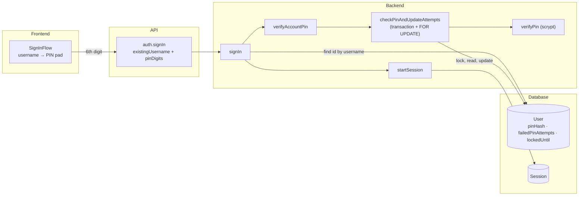

# 03 · Sign-in and PIN lockout

A user signs in with their **username** and **6-digit PIN**. The PIN pad submits automatically on the sixth digit. After **5 wrong PINs**, the account is **locked for 15 minutes**, and even the correct PIN is refused during the lock.

## At a glance

| | |
| --- | --- |
| **Route** | `/signin` |
| **Frontend** | page `gobank/src/app/(auth)/signin/page.tsx`; `sign-in-flow.tsx`, `auth-heading.tsx`, `google-button.tsx`, `or-divider.tsx`; UI `text-field.tsx`, `pin-pad.tsx`, `button.tsx`, `back-button.tsx`; `session.client.ts` |
| **API** | `auth.signIn` (public mutation) |
| **Backend** | `auth.router.ts`, `auth.schemas.ts` (`existingUsername`, `pinDigits`), `auth.service.ts` (`signIn`, `verifyAccountPin`, `checkPinAndUpdateAttempts`), `auth.rules.ts` (lock helpers), `pin.ts` (`verifyPin`), `server/session.ts` (`startSession`) |
| **Database** | reads `User`; locks and updates `User.failedPinAttempts`, `User.lockedUntil`; creates `Session` |
| **Cookie** | `gb_session` (httpOnly) |
| **Tests** | `auth.test.ts`, `verify-core.ts`, `e2e/smoke.spec.ts` ("demo user signs in to the dashboard") |
| **Deep dive** | [Registration and sign-in §7](../05-features/01-registration-and-sign-in.md) |

## What the user can do

1. Type a username (the `@` is shown for them; capitals and symbols are removed as they type) and tap **Continue** (enabled from 3 characters).
2. Type the PIN on the on-screen pad or a keyboard. At 6 digits it is checked automatically.
3. On success: "Opening your account", then the dashboard. On failure: the dots shake and the pad clears, with "Wrong username or PIN" or the lock message.
4. Go back with **Use a different username**.

## How it works

1. `signIn` mutation with `{ username, pin }`.
2. Zod: `existingUsername` trims, lowercases and removes a leading `@`, then requires 3–20 characters `[a-z0-9_]`; `pinDigits` requires exactly 6 digits.
3. `signIn()` looks up the user ID by username. If there is no such user: "Wrong username or PIN".
4. `verifyAccountPin()` → `checkPinAndUpdateAttempts()` runs **one transaction** that locks the user row, checks the lock, verifies the PIN with scrypt, and updates the counters.
5. Correct → `startSession()` creates the session row and cookie and returns `{ sessionId }`.
6. The browser stores the session ID for this tab, clears cached data, and replaces the URL with `/dashboard`.

## Structure



## Files and locations

| Layer | File | Role |
| --- | --- | --- |
| Page (server) | `gobank/src/app/(auth)/signin/page.tsx` | normal mode, or Google-PIN mode ([04](04-google-sign-in.md)) |
| Frontend | `gobank/src/features/auth/components/sign-in-flow.tsx` | the two phases and auto-submit |
| Frontend | `gobank/src/features/auth/session.client.ts` | `activateClientSession` after success |
| Frontend | `gobank/src/shared/ui/pin-pad.tsx` | PIN entry (also physical keyboard) |
| API | `gobank/src/features/auth/auth.router.ts` | `signIn` |
| Validation | `gobank/src/features/auth/auth.schemas.ts` | `existingUsername`, `pinDigits` |
| Service | `gobank/src/features/auth/auth.service.ts` | sign-in and lockout |
| Rules | `gobank/src/features/auth/auth.rules.ts` | 5 attempts, 15 minutes, countdown |
| Crypto | `gobank/src/features/auth/pin.ts` | `verifyPin` |
| Server core | `gobank/src/server/session.ts` | `startSession` |

## Frontend

<!-- code: gobank/src/features/auth/components/sign-in-flow.tsx 116-228 -->
**`gobank/src/features/auth/components/sign-in-flow.tsx`** · lines 116–228

```tsx
116 │ export function SignInFlow({ googleEnabled, googleUsername }: SignInFlowProps) {
117 │   const router = useRouter();
118 │   const queryClient = useQueryClient();
119 │   const viaGoogle = Boolean(googleUsername);
120 │
121 │   const [phase, setPhase] = useState<"username" | "pin">(
122 │     viaGoogle ? "pin" : "username",
123 │   );
124 │   const [username, setUsername] = useState(googleUsername ?? "");
125 │   const [pin, setPin] = useState("");
126 │
127 │   const finishSignIn = ({ sessionId }: { sessionId: string }) => {
128 │     activateClientSession(sessionId);
129 │     queryClient.clear();
130 │     router.replace("/dashboard");
131 │     router.refresh();
132 │   };
133 │
134 │   const clearPin = () => setPin("");
135 │
136 │   const manualSignIn = api.auth.signIn.useMutation({
137 │     onSuccess: finishSignIn,
138 │     onError: clearPin,
139 │   });
140 │   const googleSignIn = api.auth.signInWithGooglePin.useMutation({
141 │     onSuccess: finishSignIn,
142 │     onError: clearPin,
143 │   });
144 │   const signIn = viaGoogle ? googleSignIn : manualSignIn;
145 │
146 │   const busy = signIn.isPending || signIn.isSuccess;
147 │
148 │   const enterPin = (next: string) => {
149 │     if (busy) return;
150 │     if (signIn.isError) signIn.reset();
151 │
152 │     setPin(next);
153 │     if (next.length < PIN_LENGTH) return;
154 │
155 │     if (viaGoogle) {
156 │       googleSignIn.mutate({ pin: next });
157 │     } else {
158 │       manualSignIn.mutate({ username, pin: next });
159 │     }
160 │   };
161 │
162 │   const backToUsername = () => {
163 │     setPin("");
164 │     signIn.reset();
165 │
166 │     if (viaGoogle) {
167 │       router.replace("/signin");
168 │       return;
169 │     }
170 │
171 │     setPhase("username");
172 │   };
173 │
174 │   if (phase === "username") {
175 │     return (
176 │       <div className="flex flex-1 flex-col">
177 │         <header className="flex">
178 │           <BackButton href="/" />
179 │         </header>
180 │
181 │         <UsernameStep
182 │           username={username}
183 │           googleEnabled={googleEnabled}
184 │           onChange={setUsername}
185 │           onContinue={() => setPhase("pin")}
186 │         />
187 │       </div>
188 │     );
189 │   }
190 │
191 │   return (
192 │     <div className="flex flex-1 flex-col">
193 │       <header className="flex">
194 │         <BackButton onClick={backToUsername} disabled={busy} />
195 │       </header>
196 │
197 │       <div className="animate-step-in mt-10 flex flex-1 flex-col">
198 │         <AuthHeading
199 │           title="Enter your PIN"
200 │           subtitle={
201 │             <>
202 │               Signing in as{" "}
203 │               <span className="text-ink font-medium">@{username}</span>
204 │             </>
205 │           }
206 │         />
207 │
208 │         <div className="mt-12 flex flex-1 flex-col items-center justify-center">
209 │           <PinPad
210 │             value={pin}
211 │             onChange={enterPin}
212 │             length={PIN_LENGTH}
213 │             invalid={signIn.isError}
214 │           />
215 │           <PinStatus
216 │             busy={busy}
217 │             opening={signIn.isSuccess}
218 │             error={errorMessage(signIn.error)}
219 │           />
220 │         </div>
221 │
222 │         <Button variant="ghost" disabled={busy} onClick={backToUsername}>
223 │           {viaGoogle ? "Use username instead" : "Use a different username"}
224 │         </Button>
225 │       </div>
226 │     </div>
227 │   );
228 │ }
```
<!-- /code -->

| Lines | What it does |
| --- | --- |
| 121–125 | phase (`username` or `pin`), the username, the PIN typed so far |
| 127–132 | after success: claim the session for this tab, empty the cache, go to the dashboard |
| 136–143 | two mutations (normal and Google); both clear the PIN on error |
| 146 | busy while checking **or** after success (so nothing can be typed while the dashboard opens) |
| 148–160 | `enterPin`: ignore input while busy; clear an old error on the next digit; at the 6th digit, submit |
| 162–172 | going back resets the PIN and errors |

## Backend

<!-- code: gobank/src/features/auth/auth.router.ts 47-49 -->
**`gobank/src/features/auth/auth.router.ts`** · lines 47–49

```ts
47 │   signIn: publicProcedure
48 │     .input(z.object({ username: existingUsername, pin: pinDigits }))
49 │     .mutation(({ input }) => signIn(input.username, input.pin)),
```
<!-- /code -->

<!-- code: gobank/src/features/auth/auth.schemas.ts 19-21 -->
**`gobank/src/features/auth/auth.schemas.ts`** · lines 19–21

```ts
19 │ export const pinDigits = z
20 │   .string()
21 │   .regex(/^\d{6}$/, `Use ${PIN_LENGTH} digits`);
```
<!-- /code -->

<!-- code: gobank/src/features/auth/auth.schemas.ts 44-55 -->
**`gobank/src/features/auth/auth.schemas.ts`** · lines 44–55

```ts
44 │ export const existingUsername = z
45 │   .string()
46 │   .trim()
47 │   .toLowerCase()
48 │   .transform((value) => value.replace(/^@/, ""))
49 │   .pipe(
50 │     z
51 │       .string()
52 │       .min(USERNAME_MIN)
53 │       .max(USERNAME_MAX)
54 │       .regex(/^[a-z0-9_]+$/),
55 │   );
```
<!-- /code -->

<!-- code: gobank/src/features/auth/auth.service.ts 109-169 -->
**`gobank/src/features/auth/auth.service.ts`** · lines 109–169

```ts
109 │ async function checkPinAndUpdateAttempts(
110 │   userId: string,
111 │   pin: string,
112 │   newPinHash?: string,
113 │ ) {
114 │   return db.$transaction(async (tx) => {
115 │     const [user] = await tx.$queryRaw<PinAccount[]>`
116 │       SELECT "pinHash", "failedPinAttempts", "lockedUntil"
117 │       FROM "User" WHERE "id" = ${userId} FOR UPDATE
118 │     `;
119 │     if (!user) return fail("NOT_FOUND", MESSAGES.accountNotFound);
120 │
121 │     const now = new Date();
122 │     const minutesLeft = lockMinutesLeft(user.lockedUntil, now);
123 │     if (minutesLeft > 0) return { correct: false, minutesLeft };
124 │
125 │     const correct = await verifyPin(pin, user.pinHash);
126 │     const attempts = correct ? 0 : user.failedPinAttempts + 1;
127 │     const lockNow = attempts >= MAX_PIN_ATTEMPTS;
128 │
129 │     await tx.user.update({
130 │       where: { id: userId },
131 │       data: {
132 │         failedPinAttempts: lockNow ? 0 : attempts,
133 │         lockedUntil: lockNow ? lockExpiry(now) : null,
134 │         ...(correct && newPinHash ? { pinHash: newPinHash } : {}),
135 │       },
136 │       select: { id: true },
137 │     });
138 │
139 │     return { correct, minutesLeft: lockNow ? PIN_LOCK_MINUTES : 0 };
140 │   }, SLOW_TRANSACTION);
141 │ }
142 │
143 │ export async function verifyAccountPin(
144 │   userId: string,
145 │   pin: string,
146 │   wrongMessage: string,
147 │   newPinHash?: string,
148 │ ) {
149 │   const outcome = await checkPinAndUpdateAttempts(userId, pin, newPinHash);
150 │   if (outcome.correct) return;
151 │
152 │   if (outcome.minutesLeft > 0) {
153 │     fail("TOO_MANY_REQUESTS", MESSAGES.pinLocked(outcome.minutesLeft));
154 │   }
155 │
156 │   fail("UNAUTHORIZED", wrongMessage);
157 │ }
158 │
159 │ export async function signIn(username: string, pin: string) {
160 │   const user = await db.user.findUnique({
161 │     where: { username },
162 │     select: { id: true },
163 │   });
164 │   if (!user) return fail("UNAUTHORIZED", MESSAGES.wrongCredentials);
165 │
166 │   await verifyAccountPin(user.id, pin, MESSAGES.wrongCredentials);
167 │
168 │   return startSession(user.id);
169 │ }
```
<!-- /code -->

## Database

| Table | Columns | Read / write | When |
| --- | --- | --- | --- |
| `User` | `id` by `username` | read | step 3 |
| `User` | `pinHash`, `failedPinAttempts`, `lockedUntil` | **locked** (`FOR UPDATE`), read, **updated** | every PIN attempt |
| `Session` | `id`, `userId`, `expiresAt` | **create**; delete expired and the browser's previous session | after a correct PIN |

These columns came from migration `20260925000000_pin_lockout`.

## The complicated parts, explained step by step

### 1. The lockout transaction

`checkPinAndUpdateAttempts` (auth.service.ts lines 109–141), excerpted above.

**Trace: someone tries wrong PINs on an account with `failedPinAttempts = 0`.**

| Attempt | `minutesLeft` (line 122) | `correct` (line 125) | `attempts` (line 126) | `lockNow` (line 127) | Saved (lines 129–137) | User sees |
| --- | --- | --- | --- | --- | --- | --- |
| wrong #1 | 0 | false | 1 | false | attempts 1, lockedUntil null | Wrong username or PIN |
| wrong #2–#4 | 0 | false | 2–4 | false | attempts 2–4 | Wrong username or PIN |
| wrong #5 | 0 | false | 5 | **true** | **attempts 0**, **lockedUntil = now + 15 min** | Too many wrong PINs. Try again in 15 minutes. |
| correct, 3 min later | **12** | (not checked) | — | — | nothing changes (line 123 returns early) | …Try again in 12 minutes. |
| correct, after 15 min | 0 | true | 0 | false | attempts 0, lockedUntil null | signed in |

Two details to notice:

- At the lock, the counter is **reset to 0** (line 132), so after the 15 minutes the user gets 5 fresh attempts.
- During a lock, the PIN is **not even checked** (line 123), so a correct guess during the lock reveals nothing.

**Why `FOR UPDATE` (lines 115–118)?** Imagine an attacker sending 100 guesses *at the same moment*. Without a lock, all 100 transactions could read `failedPinAttempts = 0` and each write 1: the attacker gets 100 guesses. With the row locked, the guesses are processed **one after another**, and each sees the previous one's count, so the lock triggers after the 5th.

### 2. Countdown rounding

<!-- code: gobank/src/features/auth/auth.rules.ts 73-81 -->
**`gobank/src/features/auth/auth.rules.ts`** · lines 73–81

```ts
73 │ export const lockExpiry = (now: Date) =>
74 │   new Date(now.getTime() + PIN_LOCK_MINUTES * 60_000);
75 │
76 │ export function lockMinutesLeft(lockedUntil: Date | null, now: Date) {
77 │   if (!lockedUntil) return 0;
78 │
79 │   const millisecondsLeft = lockedUntil.getTime() - now.getTime();
80 │   return Math.max(0, Math.ceil(millisecondsLeft / 60_000));
81 │ }
```
<!-- /code -->

`Math.ceil` rounds **up**: with 14 minutes 1 second left, the user is told "15 minutes"; with 1 millisecond left, "1 minute"; at expiry, 0, which means unlocked. `MESSAGES.pinLocked(1)` says "1 minute" (singular) and anything else "minutes".

### 3. Verifying the PIN safely

<!-- code: gobank/src/features/auth/pin.ts 20-27 -->
**`gobank/src/features/auth/pin.ts`** · lines 20–27

```ts
20 │ export async function verifyPin(pin: string, stored: string) {
21 │   if (!STORED_HASH.test(stored)) return false;
22 │
23 │   const [salt = "", hash = ""] = stored.split(":");
24 │   const key = await deriveKey(pin, salt, KEY_LENGTH);
25 │
26 │   return timingSafeEqual(key, Buffer.from(hash, "hex"));
27 │ }
```
<!-- /code -->

| Line | Why |
| --- | --- |
| 21 | a stored value that is not exactly `32 hex : 128 hex` can never match (protects against corrupted data) |
| 23 | split into salt and key; the `= ""` defaults satisfy strict TypeScript |
| 24 | re-derive the key from the typed PIN and the stored salt (slow on purpose) |
| 26 | compare in **constant time**, so response timing reveals nothing about how close a guess was |

### 4. Same message for "no such user" and "wrong PIN"

`signIn` (lines 159–169) returns "Wrong username or PIN" in **both** cases, so the login form cannot be used to discover which usernames exist.

## Rules and limits

| Rule | Value | Where |
| --- | --- | --- |
| Wrong PINs before lock | 5 | `MAX_PIN_ATTEMPTS` |
| Lock length | 15 minutes | `PIN_LOCK_MINUTES` |
| Username for sign-in | 3–20 chars `[a-z0-9_]`, leading `@` allowed | `existingUsername` |
| PIN for sign-in | exactly 6 digits (no "weak PIN" rules, so old PINs still work) | `pinDigits` |

## Messages

| Message | When |
| --- | --- |
| Wrong username or PIN | unknown username, or wrong PIN |
| Too many wrong PINs. Try again in N minutes. | the 5th wrong PIN, and any attempt during the lock (HTTP 429) |
| This account no longer exists. | the user was deleted between lookup and check |
| Checking / Opening your account | while verifying / after success |

## Tests

| Test | Proves |
| --- | --- |
| `auth.test.ts` | lock lasts exactly 15 minutes and counts down; right PIN matches, wrong does not; broken hashes never match |
| `verify-core.ts` | a wrong PIN is refused with the right message; the correct one passes |
| `e2e/smoke.spec.ts` | the demo user signs in through the real UI and reaches the dashboard |
