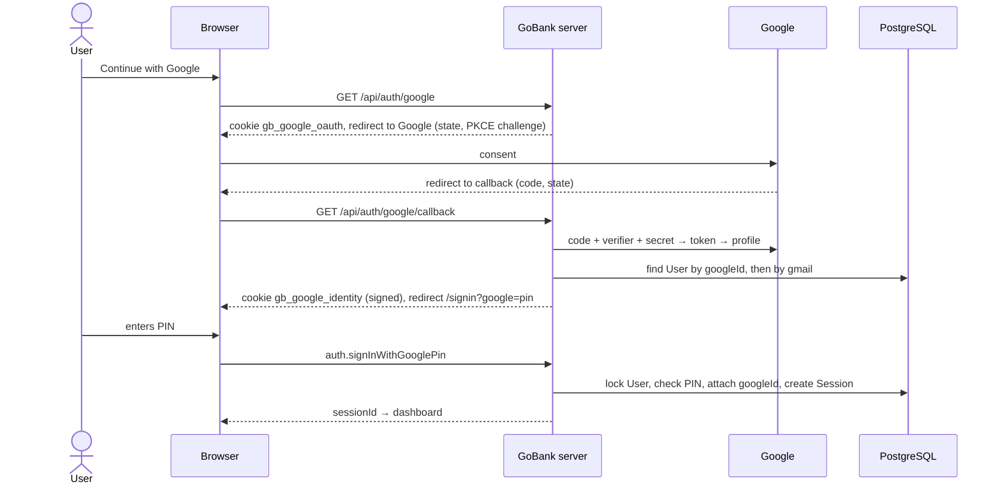

# 04 · Google sign-in and Google registration

**Continue with Google** lets a user prove who they are with their Google account. Then:

- an **existing** linked account → the user enters their **PIN** to finish signing in;
- a **new** person → the registration flow opens with their name and Gmail prefilled;
- a Gmail already linked to a **different** Google account → refused.

Google alone never opens an account: a PIN is always required.

## At a glance

| | |
| --- | --- |
| **Routes** | `/api/auth/google` (start), `/api/auth/google/callback` (return), then `/signin?google=pin` or `/register?google=new` or `/?google=<code>` |
| **Frontend** | `google-button.tsx`, `google-mark.tsx`; Google mode of `sign-in-flow.tsx` and `registration-flow.tsx`; pages `(auth)/signin/page.tsx`, `(auth)/register/page.tsx`, `app/page.tsx` (messages); `step-details.tsx` + `gmail-link.tsx` (shows the Gmail) |
| **API** | `auth.signInWithGooglePin` (public mutation), `auth.register` with `withGoogle: true` |
| **Backend** | `app/api/auth/google/route.ts`, `app/api/auth/google/callback/route.ts`, `google.server.ts`, `google.service.ts`, `google-identity.server.ts`, `signed-token.ts`, `google.rules.ts`, `auth.service.ts` (`verifyAccountPin`, `register`), `server/session.ts` |
| **Database** | reads `User` (by `googleId` or `gmail`); updates `User.googleId`; creates `User` + `Card`s (registration); creates `Session` |
| **Cookies** | `gb_google_oauth` (state, verifier, mode; 10 min; only sent to `/api/auth/google…`), `gb_google_identity` (HMAC-signed; 15 min), `gb_session` |
| **Settings needed** | `GOOGLE_CLIENT_ID`, `GOOGLE_CLIENT_SECRET`, `AUTH_SECRET` (otherwise the button is hidden) |
| **Tests** | `signed-token.test.ts` (4 tests); `verify-core.ts` (`checkGoogleLinking`) |
| **Deep dive** | [Google sign-in](../05-features/02-google-sign-in.md) |

## How it works

1. The user taps **Continue with Google** → `GET /api/auth/google`.
2. The server makes a random `state` and `verifier`, stores them in the `gb_google_oauth` cookie, and redirects to Google with the `state` and `challenge = SHA-256(verifier)` (**PKCE**).
3. The user picks an account; Google redirects to `/api/auth/google/callback?code=…&state=…`.
4. The callback deletes the cookie, checks that the `state` matches, exchanges `code + verifier + client secret` for an access token, and reads the user's Google profile. The email must be verified.
5. `signInWithGoogle` finds the GoBank account by Google ID, otherwise by Gmail, and decides:
   - **pin** → remember the identity (signed cookie) → `/signin?google=pin` → PIN pad → `auth.signInWithGooglePin` → verify PIN (with lockout) → attach `googleId` if needed → session.
   - **register** → remember the identity → `/register?google=new` → registration with `withGoogle: true` → the new account gets `googleId` and `gmail`.
   - **email-in-use** → forget the identity → `/?google=email-in-use`.

## Structure



## Files and locations

| Layer | File | Role |
| --- | --- | --- |
| API route | `gobank/src/app/api/auth/google/route.ts` | start: cookie + redirect |
| API route | `gobank/src/app/api/auth/google/callback/route.ts` | finish: checks, profile, decision |
| Backend | `gobank/src/features/auth/google/google.server.ts` | Google URLs, PKCE, token exchange, profile |
| Backend | `gobank/src/features/auth/google/google.service.ts` | find account, decide, link, PIN step |
| Backend | `gobank/src/features/auth/google/google-identity.server.ts` | remember / read / forget the identity |
| Backend | `gobank/src/features/auth/google/signed-token.ts` | HMAC signing |
| Backend | `gobank/src/features/auth/google/google.rules.ts` | cookie names, messages |
| Pages | `gobank/src/app/(auth)/signin/page.tsx`, `gobank/src/app/(auth)/register/page.tsx`, `gobank/src/app/page.tsx` | Google modes and messages |
| Frontend | `gobank/src/features/auth/components/google-button.tsx`, `google-mark.tsx` | the button |
| Frontend | `gobank/src/features/auth/components/sign-in-flow.tsx` | PIN pad in Google mode |
| Frontend | `gobank/src/features/auth/components/registration-flow.tsx`, `step-details.tsx` | Google registration |

## Frontend

<!-- code: gobank/src/app/(auth)/signin/page.tsx -->
**`gobank/src/app/(auth)/signin/page.tsx`** · all 38 lines

```tsx
 1 │ import type { Metadata } from "next";
 2 │ import { redirect } from "next/navigation";
 3 │ import { SignInFlow } from "~/features/auth/components/sign-in-flow";
 4 │ import { getPendingGoogleAccount } from "~/features/auth/google/google.service";
 5 │ import { googleEnabled } from "~/features/auth/google/google.server";
 6 │
 7 │ export const metadata: Metadata = {
 8 │   title: "Log in",
 9 │ };
10 │
11 │ async function pendingGoogleUsername() {
12 │   const pending = await getPendingGoogleAccount();
13 │
14 │   if (pending.status === "missing") redirect("/?google=failed");
15 │   if (pending.status === "register") redirect("/register?google=new");
16 │   if (pending.status === "email-in-use") redirect("/?google=email-in-use");
17 │
18 │   return pending.account.username;
19 │ }
20 │
21 │ export default async function SignInPage({
22 │   searchParams,
23 │ }: {
24 │   searchParams: Promise<{ google?: string }>;
25 │ }) {
26 │   const { google } = await searchParams;
27 │
28 │   const googleUsername =
29 │     google === "pin" ? await pendingGoogleUsername() : undefined;
30 │
31 │   return (
32 │     <SignInFlow
33 │       key={googleUsername ?? "manual"}
34 │       googleEnabled={googleEnabled()}
35 │       googleUsername={googleUsername}
36 │     />
37 │   );
38 │ }
```
<!-- /code -->

In Google mode the page looks up the pending account **on the server** and either redirects or passes the username to `SignInFlow`, which starts directly at the PIN pad and calls `auth.signInWithGooglePin({ pin })` (see [03](03-sign-in-and-lockout.md) for the pad).

<!-- code: gobank/src/app/(auth)/register/page.tsx -->
**`gobank/src/app/(auth)/register/page.tsx`** · all 24 lines

```tsx
 1 │ import type { Metadata } from "next";
 2 │ import { pendingGoogleIdentity } from "~/features/auth/google/google-identity.server";
 3 │ import { RegistrationFlow } from "~/features/auth/components/registration-flow";
 4 │
 5 │ export const metadata: Metadata = {
 6 │   title: "Create your account",
 7 │ };
 8 │
 9 │ export default async function RegisterPage({
10 │   searchParams,
11 │ }: {
12 │   searchParams: Promise<{ google?: string }>;
13 │ }) {
14 │   const { google } = await searchParams;
15 │
16 │   const pending = google === "new" ? await pendingGoogleIdentity() : null;
17 │   return (
18 │     <RegistrationFlow
19 │       initialFullName={pending?.name ?? ""}
20 │       gmail={pending?.gmail ?? null}
21 │       withGoogle={Boolean(pending)}
22 │     />
23 │   );
24 │ }
```
<!-- /code -->

The Google name is prefilled, the Gmail is shown in step 3, and `withGoogle` makes `auth.register` attach the Google account.

## Backend

### Start: build the Google URL

<!-- code: gobank/src/app/api/auth/google/route.ts 15-35 -->
**`gobank/src/app/api/auth/google/route.ts`** · lines 15–35

```ts
15 │ export async function GET(request: NextRequest) {
16 │   const { origin, searchParams } = request.nextUrl;
17 │   const mode = searchParams.get("mode") === "link" ? "link" : "signin";
18 │
19 │   if (!googleEnabled()) {
20 │     const page = mode === "link" ? "/google-linked" : "/";
21 │     return NextResponse.redirect(new URL(`${page}?google=unavailable`, origin));
22 │   }
23 │
24 │   const { url, state, verifier } = startGoogleSignIn(origin);
25 │
26 │   (await cookies()).set(GOOGLE_COOKIE, `${state}.${verifier}.${mode}`, {
27 │     httpOnly: true,
28 │     sameSite: "lax",
29 │     secure: env.NODE_ENV === "production",
30 │     path: GOOGLE_COOKIE_PATH,
31 │     maxAge: 10 * 60,
32 │   });
33 │
34 │   return NextResponse.redirect(url);
35 │ }
```
<!-- /code -->

<!-- code: gobank/src/features/auth/google/google.server.ts 28-52 -->
**`gobank/src/features/auth/google/google.server.ts`** · lines 28–52

```ts
28 │ const redirectUri = (origin: string) => `${origin}/api/auth/google/callback`;
29 │
30 │ const randomToken = () => randomBytes(32).toString("base64url");
31 │
32 │ const codeChallengeFor = (verifier: string) =>
33 │   createHash("sha256").update(verifier).digest("base64url");
34 │
35 │ export function startGoogleSignIn(origin: string) {
36 │   const state = randomToken();
37 │   const verifier = randomToken();
38 │
39 │   const url = new URL(AUTH_URL);
40 │   url.search = new URLSearchParams({
41 │     client_id: env.GOOGLE_CLIENT_ID ?? "",
42 │     redirect_uri: redirectUri(origin),
43 │     response_type: "code",
44 │     scope: "openid email profile",
45 │     state,
46 │     code_challenge: codeChallengeFor(verifier),
47 │     code_challenge_method: "S256",
48 │     prompt: "select_account",
49 │   }).toString();
50 │
51 │   return { url: url.toString(), state, verifier };
52 │ }
```
<!-- /code -->

### Return: the callback

<!-- code: gobank/src/app/api/auth/google/callback/route.ts 19-64 -->
**`gobank/src/app/api/auth/google/callback/route.ts`** · lines 19–64

```ts
19 │ export async function GET(request: NextRequest) {
20 │   const { origin, searchParams } = request.nextUrl;
21 │   const go = (path: string) => NextResponse.redirect(new URL(path, origin));
22 │
23 │   const store = await cookies();
24 │   const saved = store.get(GOOGLE_COOKIE)?.value;
25 │   store.delete({ name: GOOGLE_COOKIE, path: GOOGLE_COOKIE_PATH });
26 │
27 │   const [state, verifier, mode] = saved?.split(".") ?? [];
28 │   const done = mode === "link" ? "/google-linked?google=" : "/?google=";
29 │   const code = searchParams.get("code");
30 │
31 │   if (searchParams.get("error")) return go(`${done}cancelled`);
32 │
33 │   if (
34 │     !googleEnabled() ||
35 │     !state ||
36 │     !verifier ||
37 │     !code ||
38 │     searchParams.get("state") !== state
39 │   ) {
40 │     return go(`${done}failed`);
41 │   }
42 │
43 │   let profile;
44 │   try {
45 │     profile = await fetchGoogleProfile(code, verifier, origin);
46 │   } catch {
47 │     return go(`${done}failed`);
48 │   }
49 │
50 │   if (!profile.emailVerified) return go(`${done}unverified`);
51 │
52 │   if (mode === "link") {
53 │     const session = await currentSession();
54 │     if (!session) return go(`${done}signed-out`);
55 │
56 │     return go(`${done}${await linkGoogle(session.userId, profile)}`);
57 │   }
58 │
59 │   const result = await signInWithGoogle(profile);
60 │   if (result.status === "pin") return go("/signin?google=pin");
61 │   if (result.status === "register") return go("/register?google=new");
62 │
63 │   return go("/?google=email-in-use");
64 │ }
```
<!-- /code -->

### Exchange the code and read the profile

<!-- code: gobank/src/features/auth/google/google.server.ts 54-99 -->
**`gobank/src/features/auth/google/google.server.ts`** · lines 54–99

```ts
54 │ async function exchangeCodeForAccessToken(
55 │   code: string,
56 │   verifier: string,
57 │   origin: string,
58 │ ) {
59 │   const reply = await fetch(TOKEN_URL, {
60 │     method: "POST",
61 │     headers: { "content-type": "application/x-www-form-urlencoded" },
62 │     body: new URLSearchParams({
63 │       code,
64 │       code_verifier: verifier,
65 │       client_id: env.GOOGLE_CLIENT_ID ?? "",
66 │       client_secret: env.GOOGLE_CLIENT_SECRET ?? "",
67 │       redirect_uri: redirectUri(origin),
68 │       grant_type: "authorization_code",
69 │     }),
70 │     cache: "no-store",
71 │   });
72 │   if (!reply.ok) throw new Error("Google rejected the sign-in code");
73 │
74 │   const { access_token } = tokenResponse.parse(await reply.json());
75 │   return access_token;
76 │ }
77 │
78 │ export async function fetchGoogleProfile(
79 │   code: string,
80 │   verifier: string,
81 │   origin: string,
82 │ ): Promise<GoogleProfile> {
83 │   const accessToken = await exchangeCodeForAccessToken(code, verifier, origin);
84 │
85 │   const reply = await fetch(USERINFO_URL, {
86 │     headers: { authorization: `Bearer ${accessToken}` },
87 │     cache: "no-store",
88 │   });
89 │   if (!reply.ok) throw new Error("Google did not return a profile");
90 │
91 │   const profile = profileResponse.parse(await reply.json());
92 │
93 │   return {
94 │     sub: profile.sub,
95 │     email: profile.email ?? null,
96 │     emailVerified: profile.email_verified === true,
97 │     name: profile.name?.trim() ?? "",
98 │   };
99 │ }
```
<!-- /code -->

### Decide and finish

<!-- code: gobank/src/features/auth/google/google.service.ts 24-77 -->
**`gobank/src/features/auth/google/google.service.ts`** · lines 24–77

```ts
24 │ const isDuplicateValue = (error: unknown) =>
25 │   asDatabaseError(error)?.code === "P2002";
26 │
27 │ const gmailOf = (profile: GoogleProfile) =>
28 │   profile.email ? normalizeGmail(profile.email) : null;
29 │
30 │ async function findAccountByGoogle(identity: GoogleIdentity) {
31 │   const byGoogleId = await db.user.findUnique({
32 │     where: { googleId: identity.sub },
33 │     select: ACCOUNT_FIELDS,
34 │   });
35 │   if (byGoogleId || !identity.gmail) return byGoogleId;
36 │
37 │   return db.user.findUnique({
38 │     where: { gmail: identity.gmail },
39 │     select: ACCOUNT_FIELDS,
40 │   });
41 │ }
42 │
43 │ async function findGoogleAccount(identity: GoogleIdentity) {
44 │   const account = await findAccountByGoogle(identity);
45 │   if (!account) return { status: "register" as const };
46 │
47 │   const linkedToAnotherGoogle =
48 │     account.googleId !== null && account.googleId !== identity.sub;
49 │   if (linkedToAnotherGoogle) return { status: "email-in-use" as const };
50 │
51 │   return { status: "pin" as const, identity, account };
52 │ }
53 │
54 │ export async function getPendingGoogleAccount() {
55 │   const identity = await pendingGoogleIdentity();
56 │   if (!identity) return { status: "missing" as const };
57 │
58 │   return findGoogleAccount(identity);
59 │ }
60 │
61 │ export async function signInWithGoogle(profile: GoogleProfile) {
62 │   const identity = {
63 │     sub: profile.sub,
64 │     gmail: gmailOf(profile),
65 │     name: profile.name,
66 │   };
67 │
68 │   const result = await findGoogleAccount(identity);
69 │
70 │   if (result.status === "email-in-use") {
71 │     await forgetGoogleIdentity();
72 │   } else {
73 │     await rememberGoogleIdentity(identity);
74 │   }
75 │
76 │   return result;
77 │ }
```
<!-- /code -->

<!-- code: gobank/src/features/auth/google/google.service.ts 96-132 -->
**`gobank/src/features/auth/google/google.service.ts`** · lines 96–132

```ts
 96 │ async function attachGoogleId(accountId: string, identity: GoogleIdentity) {
 97 │   const sameGoogle = { googleId: identity.sub };
 98 │   const unlinkedSameGmail = identity.gmail
 99 │     ? [{ googleId: null, gmail: identity.gmail }]
100 │     : [];
101 │
102 │   try {
103 │     const linked = await db.user.updateMany({
104 │       where: { id: accountId, OR: [sameGoogle, ...unlinkedSameGmail] },
105 │       data: { googleId: identity.sub },
106 │     });
107 │
108 │     if (!linked.count) fail("CONFLICT", EMAIL_IN_USE);
109 │   } catch (error) {
110 │     if (isDuplicateValue(error)) fail("CONFLICT", EMAIL_IN_USE);
111 │     throw error;
112 │   }
113 │ }
114 │
115 │ export async function signInWithGooglePin(pin: string) {
116 │   const pending = await getPendingGoogleAccount();
117 │
118 │   if (pending.status === "email-in-use") fail("CONFLICT", EMAIL_IN_USE);
119 │   if (pending.status !== "pin") {
120 │     fail("UNAUTHORIZED", "Choose Google again to continue.");
121 │   }
122 │
123 │   const { account, identity } = pending;
124 │
125 │   await verifyAccountPin(account.id, pin, MESSAGES.wrongPin);
126 │   await attachGoogleId(account.id, identity);
127 │
128 │   const session = await startSession(account.id);
129 │   await forgetGoogleIdentity();
130 │
131 │   return session;
132 │ }
```
<!-- /code -->

## Database

| Table | Columns | Read / write | When |
| --- | --- | --- | --- |
| `User` | `googleId` (unique) | read | callback: find by Google ID |
| `User` | `gmail` (unique) | read | callback: find by Gmail, if no Google ID match |
| `User` | `pinHash`, `failedPinAttempts`, `lockedUntil` | locked, read, updated | PIN step (same lockout as [03](03-sign-in-and-lockout.md)) |
| `User` | `googleId` | **updated** (only if same Google ID, or same Gmail and no link yet) | after a correct PIN |
| `User` + `Card` ×2 | everything from [02](02-registration.md), plus `googleId`, `gmail` | **created** | Google registration |
| `Session` | | **created** | after success |

## The complicated parts, explained step by step

### 1. PKCE and `state` in four lines

`google.server.ts` lines 30–33 and 36–37:

| Value | How it is made | Who sees it |
| --- | --- | --- |
| `state` | 32 random bytes, base64url | Google (in the URL) and our cookie |
| `verifier` | 32 random bytes, base64url | **only** our server and the httpOnly cookie |
| `code_challenge` | base64url(SHA-256(verifier)) | Google |

At the callback, we send Google the **verifier**. Google hashes it and compares it with the challenge it received earlier. Someone who stole the `code` from the redirect URL does not have the verifier, so the code is useless to them. The `state` check (callback line 38) ensures the response belongs to a sign-in **this browser** started, which stops "login CSRF".

### 2. The cookie is single-use

Callback lines 23–25: the cookie is read **and deleted** before any check. Even if the same callback URL is replayed, the second time there is no cookie, so `state`/`verifier` are missing → `failed`.

The cookie value is `state.verifier.mode`. Splitting on `.` (line 27) is safe because base64url never contains a dot.

### 3. Which account? The decision table

`findAccountByGoogle` + `findGoogleAccount` (google.service.ts lines 30–52):

| Found by Google ID? | Found by Gmail? | That account's `googleId` | Result |
| --- | --- | --- | --- |
| yes | — | equals this Google ID | **pin** |
| no | yes | `null` (Gmail stored, not linked) | **pin**, and the Google ID is attached after the PIN |
| no | yes | a **different** Google ID | **email-in-use** |
| no | no | — | **register** |
| (Google email not a Gmail address) | not searched | — | **register** (if no Google ID match) |

### 4. Attaching the Google ID only when it is safe

`attachGoogleId` (lines 96–113) updates the user **only if** `googleId` already equals this Google ID, **or** `googleId` is null and the Gmail matches. Otherwise 0 rows change → "That Gmail already belongs to a GoBank account…". A unique-constraint error (another account has this Google ID) gives the same message. An account linked to Google A can never be silently switched to Google B.

### 5. Remembering the identity between pages

The callback and the PIN page are different requests. The verified identity `{ sub, gmail, name }` is stored in `gb_google_identity`, **signed with HMAC-SHA256** and `AUTH_SECRET`, and valid for 15 minutes. It cannot be read or edited by page JavaScript (httpOnly), and editing it breaks the signature. Code and tests: [Google sign-in §6](../05-features/02-google-sign-in.md#6-the-signed-identity-cookie).

## Rules and limits

| Rule | Value |
| --- | --- |
| Google email must be verified | `email_verified === true` |
| OAuth cookie life | 10 minutes |
| Pending identity life | 15 minutes |
| After Google | PIN required (5 wrong → 15-minute lock) |
| Scopes | `openid email profile`; `prompt=select_account` |

## Messages

| Code | Message (welcome page) |
| --- | --- |
| `cancelled` | Google sign-in was cancelled. |
| `failed` | Google sign-in did not work. Please try again. |
| `unverified` | Your Google email is not verified. |
| `unavailable` | Google sign-in is not set up yet. |
| `email-in-use` | That Gmail already belongs to a GoBank account. Sign in with your username and PIN. |
| (API) | Choose Google again to continue. — the 15-minute identity expired before the PIN |
| (API) | Your Google sign-in expired. Choose Google again. — same, during registration |

## Tests

| Test | Proves |
| --- | --- |
| `signed-token.test.ts` | the identity cookie's signature and expiry cannot be bypassed |
| `verify-core.ts` → `checkGoogleLinking` | linking outcomes on a real database (see [05](05-link-google.md)) |
