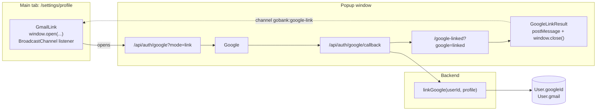

# 05 · Link Google from Edit profile

A signed-in user who registered with a username and PIN can **link a Gmail account** from **Settings → Edit profile → Link Google**. After linking:

- they can use **Continue with Google** (plus their PIN) to sign in, and
- friends can send them money by typing that Gmail address.

## At a glance

| | |
| --- | --- |
| **Route** | `/settings/profile` → popup `/api/auth/google?mode=link` → Google → `/api/auth/google/callback` → `/google-linked?google=<status>` |
| **Frontend** | `gmail-link.tsx` (on Edit profile and registration step 3), `google-link-result.tsx`, page `gobank/src/app/google-linked/page.tsx`, `google-mark.tsx` |
| **API** | none through tRPC: the two Google routes do the work |
| **Backend** | `app/api/auth/google/route.ts` (mode `link`), `callback/route.ts` (link branch), `google.service.ts` → `linkGoogle`, `google.server.ts`, `google.rules.ts` (`GOOGLE_LINK_NOTICES`, `GOOGLE_LINK_CHANNEL`), `server/session.ts` (`currentSession`) |
| **Database** | updates `User.googleId` and `User.gmail` (only if not linked yet) |
| **Tests** | `verify-core.ts` → `checkGoogleLinking` (all four outcomes) |
| **Deep dive** | [Google sign-in §7](../05-features/02-google-sign-in.md#7-linking-google-from-edit-profile-popup) |

## How it works

1. The Gmail row shows "Not linked" and a **Link Google** button.
2. Tapping it opens a **popup window** at `/api/auth/google?mode=link`. If the browser blocks popups: "Allow pop-ups for GoBank to link Google."
3. The popup goes through Google exactly like sign-in ([04](04-google-sign-in.md)), but the cookie remembers `mode = link`.
4. The callback requires that the user is **already signed in** to GoBank (the session cookie is shared by all windows of the browser), then calls `linkGoogle(userId, profile)`.
5. The popup is redirected to `/google-linked?google=<status>`. That page broadcasts the status to the original tab and closes itself.
6. The Edit profile tab receives the message. On "linked" it refreshes from the server and shows the Gmail; otherwise it shows the reason.

## Structure



## Files and locations

| Layer | File | Role |
| --- | --- | --- |
| Frontend | `gobank/src/features/account/components/gmail-link.tsx` | the Gmail row, popup, listener |
| Frontend | `gobank/src/features/account/components/google-link-result.tsx` | broadcasts the result, closes the popup |
| Page (server) | `gobank/src/app/google-linked/page.tsx` | validates the status code |
| Page | `gobank/src/app/(app)/settings/profile/page.tsx` | hosts the Edit profile form ([09](09-edit-profile.md)) |
| API route | `gobank/src/app/api/auth/google/route.ts`, `gobank/src/app/api/auth/google/callback/route.ts` | OAuth start and finish |
| Backend | `gobank/src/features/auth/google/google.service.ts` | `linkGoogle` |
| Backend | `gobank/src/features/auth/google/google.rules.ts` | `GOOGLE_LINK_CHANNEL`, `GOOGLE_LINK_NOTICES` |

## Frontend

<!-- code: gobank/src/features/account/components/gmail-link.tsx -->
**`gobank/src/features/account/components/gmail-link.tsx`** · all 74 lines

```tsx
 1 │ "use client";
 2 │
 3 │ import { useRouter } from "next/navigation";
 4 │ import { useEffect, useState } from "react";
 5 │ import { GoogleMark } from "~/features/auth/components/google-mark";
 6 │ import {
 7 │   GOOGLE_LINK_CHANNEL,
 8 │   GOOGLE_LINK_NOTICES,
 9 │ } from "~/features/auth/google/google.rules";
10 │
11 │ const LINK_URL = "/api/auth/google?mode=link";
12 │ const POPUP_FEATURES = "popup,width=480,height=640";
13 │
14 │ export function GmailLink({ gmail }: { gmail?: string | null }) {
15 │   const router = useRouter();
16 │   const [notice, setNotice] = useState<string | null>(null);
17 │
18 │   useEffect(() => {
19 │     const channel = new BroadcastChannel(GOOGLE_LINK_CHANNEL);
20 │
21 │     channel.onmessage = ({ data }: MessageEvent<unknown>) => {
22 │       if (typeof data !== "string") return;
23 │       if (data === "linked") router.refresh();
24 │       setNotice(data === "linked" ? null : (GOOGLE_LINK_NOTICES[data] ?? null));
25 │     };
26 │
27 │     return () => channel.close();
28 │   }, [router]);
29 │
30 │   const linkGoogle = () => {
31 │     setNotice(null);
32 │     const popup = window.open(LINK_URL, "gobank-google-link", POPUP_FEATURES);
33 │     if (!popup) setNotice("Allow pop-ups for GoBank to link Google.");
34 │   };
35 │
36 │   return (
37 │     <div className="flex flex-col gap-1.5">
38 │       <span className="text-ink-soft text-[13px] font-medium">Gmail</span>
39 │
40 │       <div
41 │         className={
42 │           gmail
43 │             ? "border-brand-line bg-brand-soft text-ink flex items-center gap-2.5 rounded-xl border px-3.5 py-4 text-[14px]"
44 │             : "border-line text-ink-muted flex items-center gap-2.5 rounded-xl border py-2.5 pr-2.5 pl-3.5 text-[14px]"
45 │         }
46 │       >
47 │         <GoogleMark />
48 │         <span className="flex-1 truncate">{gmail ?? "Not linked"}</span>
49 │
50 │         {gmail ? null : (
51 │           <button
52 │             type="button"
53 │             onClick={linkGoogle}
54 │             className="border-line-strong text-ink hover:bg-surface-raised focus-visible:ring-brand/40 h-9 shrink-0 rounded-lg border px-3.5 text-[13px] font-medium outline-none focus-visible:ring-2"
55 │           >
56 │             Link Google
57 │           </button>
58 │         )}
59 │       </div>
60 │
61 │       <p
62 │         role={notice ? "alert" : undefined}
63 │         className={
64 │           notice ? "text-danger text-[12.5px]" : "text-ink-muted text-[12.5px]"
65 │         }
66 │       >
67 │         {notice ??
68 │           (gmail
69 │             ? "Friends can send money to this linked Gmail address."
70 │             : "Link a Gmail to sign in with Google and get paid by email.")}
71 │       </p>
72 │     </div>
73 │   );
74 │ }
```
<!-- /code -->

<!-- code: gobank/src/app/google-linked/page.tsx -->
**`gobank/src/app/google-linked/page.tsx`** · all 18 lines

```tsx
 1 │ import type { Metadata } from "next";
 2 │ import { GoogleLinkResult } from "~/features/account/components/google-link-result";
 3 │ import { GOOGLE_LINK_NOTICES } from "~/features/auth/google/google.rules";
 4 │
 5 │ export const metadata: Metadata = {
 6 │   title: "Link Google",
 7 │ };
 8 │
 9 │ export default async function GoogleLinkedPage({
10 │   searchParams,
11 │ }: {
12 │   searchParams: Promise<{ google?: string }>;
13 │ }) {
14 │   const { google = "" } = await searchParams;
15 │   const status = Object.hasOwn(GOOGLE_LINK_NOTICES, google) ? google : "failed";
16 │
17 │   return <GoogleLinkResult status={status} />;
18 │ }
```
<!-- /code -->

<!-- code: gobank/src/features/account/components/google-link-result.tsx -->
**`gobank/src/features/account/components/google-link-result.tsx`** · all 26 lines

```tsx
 1 │ "use client";
 2 │
 3 │ import { useEffect } from "react";
 4 │ import {
 5 │   GOOGLE_LINK_CHANNEL,
 6 │   GOOGLE_LINK_NOTICES,
 7 │ } from "~/features/auth/google/google.rules";
 8 │
 9 │ export function GoogleLinkResult({ status }: { status: string }) {
10 │   useEffect(() => {
11 │     const channel = new BroadcastChannel(GOOGLE_LINK_CHANNEL);
12 │     channel.postMessage(status);
13 │     channel.close();
14 │
15 │     window.close();
16 │   }, [status]);
17 │
18 │   return (
19 │     <main className="flex flex-1 flex-col items-center justify-center gap-2 px-6 text-center">
20 │       <p className="text-ink text-[15px] font-medium">
21 │         {GOOGLE_LINK_NOTICES[status]}
22 │       </p>
23 │       <p className="text-ink-muted text-[13px]">You can close this window.</p>
24 │     </main>
25 │   );
26 │ }
```
<!-- /code -->

## Backend

The link branch of the callback (`/api/auth/google/callback`, lines 52–57):

<!-- code: gobank/src/app/api/auth/google/callback/route.ts 52-57 -->
**`gobank/src/app/api/auth/google/callback/route.ts`** · lines 52–57

```ts
52 │   if (mode === "link") {
53 │     const session = await currentSession();
54 │     if (!session) return go(`${done}signed-out`);
55 │
56 │     return go(`${done}${await linkGoogle(session.userId, profile)}`);
57 │   }
```
<!-- /code -->

<!-- code: gobank/src/features/auth/google/google.service.ts 79-94 -->
**`gobank/src/features/auth/google/google.service.ts`** · lines 79–94

```ts
79 │ export async function linkGoogle(userId: string, profile: GoogleProfile) {
80 │   const gmail = gmailOf(profile);
81 │   if (!gmail) return "not-gmail";
82 │
83 │   try {
84 │     const linked = await db.user.updateMany({
85 │       where: { id: userId, googleId: null },
86 │       data: { googleId: profile.sub, gmail },
87 │     });
88 │
89 │     return linked.count ? "linked" : "already-linked";
90 │   } catch (error) {
91 │     if (isDuplicateValue(error)) return "email-in-use";
92 │     throw error;
93 │   }
94 │ }
```
<!-- /code -->

## Database

| Table | Columns | Read / write | Condition |
| --- | --- | --- | --- |
| `User` | `googleId`, `gmail` | **updated together** | only the signed-in user, only if `googleId` is still `null` |

Both columns are **unique**, so one Gmail and one Google account can belong to only one GoBank user. After linking, `account.profile` returns the Gmail (it hides the Gmail when `googleId` is empty), and Send money can find the user by that Gmail.

## The complicated parts, explained step by step

### 1. Two windows talking: `BroadcastChannel`

`gmail-link.tsx` lines 18–28 and `google-link-result.tsx` lines 10–16:

| Step | Main tab (Edit profile) | Popup |
| --- | --- | --- |
| 1 | `new BroadcastChannel("gobank:google-link")`, listens | |
| 2 | `window.open(LINK_URL, …)` | loads `/api/auth/google?mode=link` |
| 3 | | Google, then callback, then `/google-linked?google=linked` |
| 4 | | `GoogleLinkResult` opens the same channel, `postMessage("linked")`, closes the channel, `window.close()` |
| 5 | `onmessage` receives `"linked"` → `router.refresh()` and clear the notice | |

A `BroadcastChannel` delivers messages between pages of the **same site** in the same browser. It is used instead of `window.opener`, so the result page needs no reference to the main tab. Messages that are not strings are ignored (line 22).

### 2. Why the result page is outside the signed-in area

Signed-in pages live in the `(app)` route group, whose `SessionGuard` **ends the session when a page that does not own it opens** (one session per tab, see [06](06-sessions-and-sign-out.md)). The popup is a new window. If `/google-linked` were inside `(app)`, opening it would sign the user out. Placing it at `app/google-linked/` means it never runs `SessionGuard`; it only broadcasts and closes.

### 3. Linking only once, safely

`linkGoogle` (lines 79–94):

| Situation | What happens | Returned status |
| --- | --- | --- |
| Google email is not `@gmail.com` / `@googlemail.com` | nothing is written | `not-gmail` |
| user has no Google link | 1 row updated (`googleId`, `gmail`) | `linked` |
| user already linked | `googleId: null` does not match → 0 rows | `already-linked` |
| another user already has this Gmail or Google ID | the unique constraint throws `P2002` | `email-in-use` |

### 4. Status codes cannot inject text

`google-linked/page.tsx` accepts the status only if it is a key of `GOOGLE_LINK_NOTICES` (`Object.hasOwn`); anything else becomes `failed`.

## Messages

| Status | Message |
| --- | --- |
| `linked` | Google account linked. |
| `cancelled` | Linking Google was cancelled. |
| `failed` | Linking Google did not work. Please try again. |
| `unverified` | Your Google email is not verified. |
| `unavailable` | Google sign-in is not set up yet. |
| `not-gmail` | Choose a Gmail account to link. |
| `email-in-use` | That Gmail already belongs to another GoBank account. |
| `already-linked` | This account already has a Google account linked. |
| `signed-out` | Sign in to GoBank first, then link Google. |
| (popup blocked) | Allow pop-ups for GoBank to link Google. |

## Tests

`verify-core.ts` → `checkGoogleLinking`: a school address gives `not-gmail`; the first link gives `linked`; linking again gives `already-linked`; the same Gmail for another user gives `email-in-use`; the profile then shows the linked Gmail.
