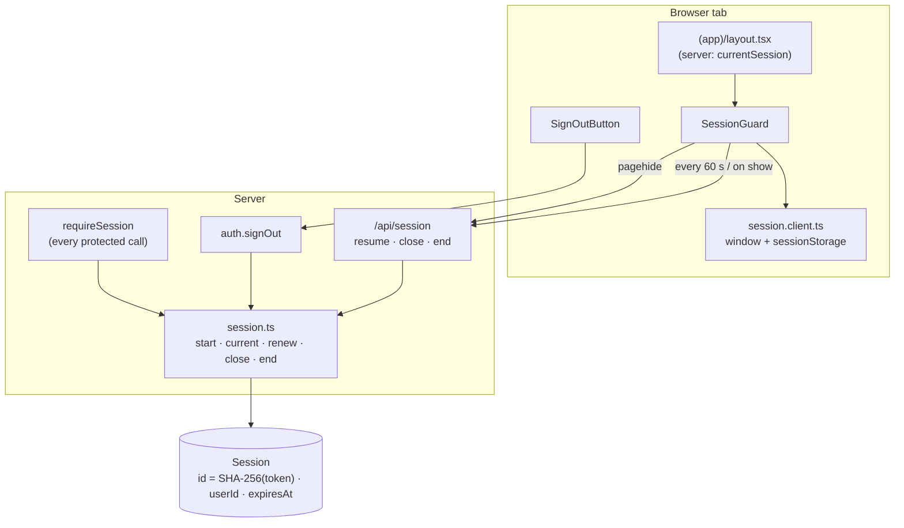

# 06 · Sessions and sign-out

Once signed in, GoBank keeps the user signed in **while the tab is in use**, signs them out **30 minutes** after the tab stops being visible or **15 seconds** after the tab is closed, allows **one session per browser tab**, and lets them **sign out** at any time.

## At a glance

| | |
| --- | --- |
| **Where** | every signed-in page (the `(app)` layout), `POST /api/session`, the **Sign out** button on `/settings` |
| **Frontend** | `session-guard.tsx`, `session.client.ts`, `sign-out-button.tsx`; layout `gobank/src/app/(app)/layout.tsx` |
| **API** | `POST /api/session` (`resume`, `close`, `end`); `auth.signOut` (public mutation); the `x-gb-session` header on every tRPC call |
| **Backend** | `gobank/src/server/session.ts`, `gobank/src/app/api/session/route.ts`, `requireSession` in `gobank/src/server/trpc.ts`, `session.rules.ts` |
| **Database** | `Session` (create, read, update `expiresAt`, delete) |
| **Cookie / storage** | `gb_session` (httpOnly token); `sessionStorage["gobank:active-session"]` and `window.gobankSessionId` (the tab's session ID) |
| **Deep dive** | [Sessions](../04-server-core/03-sessions.md) |

## What the user experiences

| Action | Result |
| --- | --- |
| Uses the app normally | stays signed in |
| Reloads a page | stays signed in |
| Hides the tab (switches app) for more than 30 minutes | signed out when coming back |
| Closes the tab | the session ends about 15 seconds later |
| Opens GoBank in a **second tab** | that tab ends the session; both tabs go to sign-in |
| Taps **Sign out** | signed out immediately |
| Changes the PIN | every **other** session is ended ([07](07-change-pin.md)) |

## How it works

1. Sign-in creates a random token (cookie) and a `Session` row whose ID is `SHA-256(token)`, expiring in 30 minutes. The browser receives the ID and stores it for **this tab**.
2. Every signed-in page is rendered inside `(app)/layout.tsx`, which checks the session **on the server** and wraps the page in `SessionGuard`.
3. `SessionGuard` makes sure this tab owns the session, then **renews** it every 60 seconds while the tab is visible (`POST /api/session { action: "resume" }` → expiry = now + 30 min).
4. When the page is hidden for good (`pagehide`: closing, reloading, navigating away), it sends `close`, which shortens the expiry to at most 15 seconds from now.
5. A reload renews it again within those 15 seconds; a closed tab never does, so it expires.
6. Every tRPC call carries the `x-gb-session` header; `requireSession` refuses calls whose header does not match the cookie's session.
7. **Sign out** → `auth.signOut` → the session row and the cookie are deleted.

## Structure



## Files and locations

| Layer | File | Role |
| --- | --- | --- |
| Rules | `gobank/src/features/auth/session.rules.ts` | 30 min, 15 s, header and storage names |
| Server | `gobank/src/server/session.ts` | create, find, renew, close, end |
| Server | `gobank/src/server/trpc.ts` | `requireSession` |
| API route | `gobank/src/app/api/session/route.ts` | `resume` / `close` / `end` |
| API | `gobank/src/features/auth/auth.router.ts` | `signOut` |
| Layout | `gobank/src/app/(app)/layout.tsx` | server-side check + `SessionGuard` |
| Frontend | `gobank/src/features/auth/components/session-guard.tsx` | keep alive, one tab |
| Frontend | `gobank/src/features/auth/session.client.ts` | the tab's session ID |
| Frontend | `gobank/src/features/auth/components/sign-out-button.tsx` | Sign out |
| Frontend | `gobank/src/trpc/react.tsx` | adds the `x-gb-session` header |

## Frontend

<!-- code: gobank/src/app/(app)/layout.tsx -->
**`gobank/src/app/(app)/layout.tsx`** · all 15 lines

```tsx
 1 │ import { redirect } from "next/navigation";
 2 │ import type { ReactNode } from "react";
 3 │ import { Screen } from "~/shared/ui/screen";
 4 │ import { currentSession } from "~/server/session";
 5 │ import { SessionGuard } from "~/features/auth/components/session-guard";
 6 │
 7 │ export default async function AppLayout({ children }: { children: ReactNode }) {
 8 │   const session = await currentSession();
 9 │   if (!session) redirect("/signin");
10 │   return (
11 │     <Screen>
12 │       <SessionGuard sessionId={session.id}>{children}</SessionGuard>
13 │     </Screen>
14 │   );
15 │ }
```
<!-- /code -->

<!-- code: gobank/src/features/auth/components/sign-out-button.tsx -->
**`gobank/src/features/auth/components/sign-out-button.tsx`** · all 32 lines

```tsx
 1 │ "use client";
 2 │
 3 │ import { LogOut } from "lucide-react";
 4 │ import { useQueryClient } from "@tanstack/react-query";
 5 │ import { useRouter } from "next/navigation";
 6 │ import { Button } from "~/shared/ui/button";
 7 │ import { api } from "~/trpc/react";
 8 │ import { clearClientSession } from "../session.client";
 9 │
10 │ export function SignOutButton() {
11 │   const router = useRouter();
12 │   const queryClient = useQueryClient();
13 │   const signOut = api.auth.signOut.useMutation({
14 │     onSuccess: () => {
15 │       clearClientSession();
16 │       queryClient.clear();
17 │       router.replace("/signin");
18 │       router.refresh();
19 │     },
20 │   });
21 │
22 │   return (
23 │     <Button
24 │       disabled={signOut.isPending || signOut.isSuccess}
25 │       onClick={() => signOut.mutate()}
26 │       className="bg-danger-strong! focus-visible:ring-danger-strong/40! enabled:hover:bg-danger-strong-hover! enabled:active:bg-danger-strong-hover! disabled:bg-danger-strong! text-white! disabled:text-white!"
27 │     >
28 │       <LogOut size={17} strokeWidth={1.9} aria-hidden />
29 │       {signOut.isPending || signOut.isSuccess ? "Signing out" : "Sign out"}
30 │     </Button>
31 │   );
32 │ }
```
<!-- /code -->

## Backend

<!-- code: gobank/src/features/auth/session.rules.ts -->
**`gobank/src/features/auth/session.rules.ts`** · all 4 lines

```ts
1 │ export const SESSION_TTL_MS = 30 * 60_000;
2 │ export const SESSION_CLOSE_GRACE_MS = 15_000;
3 │ export const SESSION_HEADER = "x-gb-session";
4 │ export const SESSION_STORAGE_KEY = "gobank:active-session";
```
<!-- /code -->

<!-- code: gobank/src/server/session.ts 25-80 -->
**`gobank/src/server/session.ts`** · lines 25–80

```ts
25 │ export async function startSession(userId: string) {
26 │   const secret = randomBytes(32).toString("base64url");
27 │   const token = developmentId ? `${developmentId}.${secret}` : secret;
28 │   const now = new Date();
29 │
30 │   const store = await cookies();
31 │   const previous = store.get(COOKIE)?.value;
32 │
33 │   await Promise.all([
34 │     db.session.deleteMany({
35 │       where: {
36 │         OR: [
37 │           { expiresAt: { lt: now } },
38 │           ...(previous ? [{ id: hash(previous) }] : []),
39 │         ],
40 │       },
41 │     }),
42 │     db.session.create({
43 │       data: {
44 │         id: hash(token),
45 │         userId,
46 │         expiresAt: new Date(now.getTime() + SESSION_TTL_MS),
47 │       },
48 │     }),
49 │   ]);
50 │
51 │   store.set(COOKIE, token, {
52 │     httpOnly: true,
53 │     sameSite: "lax",
54 │     secure: env.NODE_ENV === "production",
55 │     path: "/",
56 │   });
57 │
58 │   return { sessionId: hash(token) };
59 │ }
60 │
61 │ export const currentSession = cache(async () => {
62 │   const token = (await cookies()).get(COOKIE)?.value;
63 │   if (!token) return null;
64 │   if (developmentId && !token.startsWith(`${developmentId}.`)) return null;
65 │
66 │   const session = await db.session.findUnique({
67 │     where: { id: hash(token) },
68 │     select: { id: true, userId: true, expiresAt: true },
69 │   });
70 │   if (!session) return null;
71 │
72 │   if (session.expiresAt <= new Date()) {
73 │     await db.session.deleteMany({
74 │       where: { id: session.id, expiresAt: session.expiresAt },
75 │     });
76 │     return null;
77 │   }
78 │
79 │   return session;
80 │ });
```
<!-- /code -->

<!-- code: gobank/src/app/api/session/route.ts -->
**`gobank/src/app/api/session/route.ts`** · all 44 lines

```ts
 1 │ import { NextResponse } from "next/server";
 2 │ import { z } from "zod";
 3 │ import { closeSession, endSession, renewSession } from "~/server/session";
 4 │
 5 │ const sessionRequest = z
 6 │   .object({
 7 │     action: z.enum(["resume", "close", "end"]),
 8 │     sessionId: z.string().regex(/^[a-f0-9]{64}$/),
 9 │     expiresAt: z.string().datetime().optional(),
10 │   })
11 │   .refine((input) => input.action !== "close" || !!input.expiresAt);
12 │
13 │ const NO_STORE = { "Cache-Control": "no-store" };
14 │
15 │ const reply = (body: unknown, status: number) =>
16 │   NextResponse.json(body, { status, headers: NO_STORE });
17 │
18 │ const isSameOrigin = (request: Request) =>
19 │   request.headers.get("origin") === new URL(request.url).origin;
20 │
21 │ export async function POST(request: Request) {
22 │   if (!isSameOrigin(request)) return reply({ error: "Forbidden" }, 403);
23 │
24 │   const body: unknown = await request.json().catch(() => null);
25 │   const input = sessionRequest.safeParse(body);
26 │   if (!input.success) return reply({ error: "Invalid session request" }, 400);
27 │
28 │   const { action, sessionId, expiresAt } = input.data;
29 │
30 │   if (action === "resume") {
31 │     const session = await renewSession(sessionId);
32 │     return session
33 │       ? reply(session, 200)
34 │       : reply({ error: "Sign in to continue" }, 401);
35 │   }
36 │
37 │   if (action === "close" && expiresAt) {
38 │     await closeSession(sessionId, new Date(expiresAt));
39 │   }
40 │
41 │   if (action === "end") await endSession(sessionId);
42 │
43 │   return new NextResponse(null, { status: 204, headers: NO_STORE });
44 │ }
```
<!-- /code -->

<!-- code: gobank/src/features/auth/auth.router.ts 55-57 -->
**`gobank/src/features/auth/auth.router.ts`** · lines 55–57

```ts
55 │   signOut: publicProcedure.mutation(({ ctx }) =>
56 │     endSession(ctx.browserSession?.id),
57 │   ),
```
<!-- /code -->

## Database

| Column | Meaning |
| --- | --- |
| `Session.id` | SHA-256 of the cookie token (the token itself is never stored) |
| `Session.userId` | the signed-in user (cascade-deleted with the user) |
| `Session.expiresAt` | now + 30 minutes at sign-in and at every renewal; ≤ now + 15 s after "close" |
| indexes | `userId` (end other sessions), `expiresAt` (delete expired) |

Writes: **create** at sign-in or registration; **update** `expiresAt` on resume and close; **delete** expired rows at every sign-in, the previous session of the same browser, on sign-out, on "end", and other sessions after a PIN change.

## The complicated parts, explained step by step

### 1. `SessionGuard`: the one-tab rule and the keep-alive loop

<!-- code: gobank/src/features/auth/components/session-guard.tsx 25-125 -->
**`gobank/src/features/auth/components/session-guard.tsx`** · lines 25–125

```tsx
 25 │ export function SessionGuard({
 26 │   sessionId,
 27 │   children,
 28 │ }: {
 29 │   sessionId: string;
 30 │   children: ReactNode;
 31 │ }) {
 32 │   const queryClient = useQueryClient();
 33 │   const [ready, setReady] = useState(false);
 34 │
 35 │   useEffect(() => {
 36 │     let active = true;
 37 │     let renewing = false;
 38 │     let expiresAt: string | null = null;
 39 │
 40 │     const signOutHere = () => {
 41 │       if (!active) return;
 42 │
 43 │       active = false;
 44 │       clearClientSession();
 45 │       queryClient.clear();
 46 │       setReady(false);
 47 │       window.location.replace("/signin");
 48 │     };
 49 │
 50 │     const openedInAnotherTab = clientSessionId() !== sessionId;
 51 │     if (openedInAnotherTab) {
 52 │       void postSession({ action: "end", sessionId }).then(
 53 │         signOutHere,
 54 │         signOutHere,
 55 │       );
 56 │       return () => {
 57 │         active = false;
 58 │       };
 59 │     }
 60 │
 61 │     activateClientSession(sessionId);
 62 │     setReady(true);
 63 │
 64 │     const renew = async () => {
 65 │       if (!active || renewing) return;
 66 │       renewing = true;
 67 │
 68 │       try {
 69 │         const response = await postSession({ action: "resume", sessionId });
 70 │         if (!active) return;
 71 │
 72 │         if (isSignedOut(response)) {
 73 │           signOutHere();
 74 │           return;
 75 │         }
 76 │
 77 │         if (!response.ok) throw new Error("Session check failed");
 78 │
 79 │         const result = (await response.json()) as { expiresAt: string };
 80 │         expiresAt = result.expiresAt;
 81 │       } catch {
 82 │         const expired =
 83 │           expiresAt !== null && Date.parse(expiresAt) <= Date.now();
 84 │         if (expired) signOutHere();
 85 │       } finally {
 86 │         renewing = false;
 87 │       }
 88 │     };
 89 │
 90 │     const shortenOnLeave = () => {
 91 │       if (!expiresAt) return;
 92 │
 93 │       void postSession({ action: "close", sessionId, expiresAt }, true).catch(
 94 │         () => undefined,
 95 │       );
 96 │     };
 97 │
 98 │     const renewIfVisible = () => {
 99 │       if (document.visibilityState === "visible") void renew();
100 │     };
101 │
102 │     void renew();
103 │     const timer = window.setInterval(renewIfVisible, CHECK_EVERY_MS);
104 │     window.addEventListener("pagehide", shortenOnLeave);
105 │     window.addEventListener("pageshow", renewIfVisible);
106 │     document.addEventListener("visibilitychange", renewIfVisible);
107 │
108 │     return () => {
109 │       shortenOnLeave();
110 │       active = false;
111 │       window.clearInterval(timer);
112 │       window.removeEventListener("pagehide", shortenOnLeave);
113 │       window.removeEventListener("pageshow", renewIfVisible);
114 │       document.removeEventListener("visibilitychange", renewIfVisible);
115 │     };
116 │   }, [sessionId, queryClient]);
117 │
118 │   if (ready) return children;
119 │
120 │   return (
121 │     <p role="status" className="text-ink-muted py-8 text-center text-sm">
122 │       Checking your session…
123 │     </p>
124 │   );
125 │ }
```
<!-- /code -->

**Trace A: the user signs in, then reloads the page.**

| Moment | What runs | Result |
| --- | --- | --- |
| sign-in succeeds | `activateClientSession(id)`: stored on `window` and in `sessionStorage` | the tab owns the session |
| page shows | guard: `clientSessionId()` equals the server's ID (line 50) → `activateClientSession`, `setReady(true)` (lines 61–62), `renew()` (line 102) | expires in 30 min |
| every 60 s while visible | `renewIfVisible` → `resume` | stays at 30 min |
| user presses reload | `pagehide` → `shortenOnLeave` → `close` with the last expiry (lines 90–96) | expiry ≤ 15 s |
| new page loads | `window.gobankSessionId` is gone, but this **was a reload**, so `clientSessionId()` reads `sessionStorage` → it matches | owns the session again |
| guard runs `renew()` | `resume` → expiry = now + 30 min | still signed in |

**Trace B: the user opens GoBank in a second tab.**

| Moment | What runs | Result |
| --- | --- | --- |
| new tab shows `/dashboard` | the server finds the session (the cookie is shared), so the layout renders `SessionGuard` | |
| guard: `clientSessionId()` | the new tab has no `window` value, empty `sessionStorage`, and was not a reload → `null` ≠ the server's ID (line 50) | "opened in another tab" |
| lines 52–55 | `POST /api/session { action: "end" }` → row and cookie deleted → `signOutHere()` | new tab → `/signin` |
| first tab, next renewal | `resume` → **401** → `signOutHere()` (lines 72–75) | first tab → `/signin` |

### 2. Why "close" cannot cut a fresh session short

<!-- code: gobank/src/server/session.ts 97-124 -->
**`gobank/src/server/session.ts`** · lines 97–124

```ts
 97 │ export async function closeSession(sessionId: string, expectedExpiry: Date) {
 98 │   const session = await currentSession();
 99 │   if (session?.id !== sessionId) return;
100 │
101 │   const now = new Date();
102 │   const expiresAt = new Date(
103 │     Math.min(
104 │       session.expiresAt.getTime(),
105 │       now.getTime() + SESSION_CLOSE_GRACE_MS,
106 │     ),
107 │   );
108 │
109 │   const closed = await db.session.updateMany({
110 │     where: { id: session.id, expiresAt: expectedExpiry },
111 │     data: { expiresAt },
112 │   });
113 │   if (!closed.count) return;
114 │
115 │   const cleanup = setTimeout(
116 │     () => {
117 │       void db.session
118 │         .deleteMany({ where: { id: session.id, expiresAt } })
119 │         .catch(() => undefined);
120 │     },
121 │     Math.max(0, expiresAt.getTime() - now.getTime()),
122 │   );
123 │   cleanup.unref();
124 │ }
```
<!-- /code -->

The browser sends the expiry it last received. The update only applies `where expiresAt = expectedExpiry` (line 110). If a renewal has already moved the expiry (for example the reloaded page renewed first), the condition fails and the "close" does nothing. The delayed delete (lines 115–123) also only deletes if the expiry is still the shortened value, so a renewed session survives.

### 3. Recognizing a reload

<!-- code: gobank/src/features/auth/session.client.ts 9-14 -->
**`gobank/src/features/auth/session.client.ts`** · lines 9–14

```ts
 9 │ function wasReloaded() {
10 │   const [navigation] = performance.getEntriesByType("navigation") as
11 │     PerformanceNavigationTiming[] | [];
12 │
13 │   return navigation?.type === "reload";
14 │ }
```
<!-- /code -->

`performance.getEntriesByType("navigation")[0].type` is `"reload"` only when the user reloaded the page. `sessionStorage` survives a reload in the same tab, but some browsers copy it into tabs opened from this one. Accepting it **only after a reload** means a copied value in a new tab is never trusted.

### 4. Development-only twist

`session.ts` lines 13–20: during `npm run dev`, every token starts with a random ID created when the dev server starts. Restarting the dev server makes all old tokens invalid (line 64), so you always start signed out after a restart. In production this prefix does not exist.

## Rules and limits

| Rule | Value |
| --- | --- |
| Idle expiry | 30 minutes without a renewal |
| Renewal | every 60 s while the tab is visible, and when it becomes visible again |
| After closing a tab | ≤ 15 seconds |
| Tabs | one session per tab |
| Token | 32 random bytes; DB stores SHA-256 only |
| Cookie | httpOnly, SameSite=Lax, Secure in production, no max-age |

## Messages

| Message | When |
| --- | --- |
| Checking your session… | the guard is starting (`role="status"`) |
| Sign in to continue | a protected call without a valid session or from the wrong tab |
| Signing out | while signing out |

## Tests

No automated test targets sessions directly: the session functions read and set cookies through Next.js, so they only run inside the app. Sessions are exercised by the signed-in Playwright tests (`e2e/smoke.spec.ts` signs in through the real UI before each check). The project README's troubleshooting note documents the new-tab behavior ("Signed out after opening a new tab: expected"). Adding Playwright tests for reload, a second tab and sign-out would be a good next step ([Testing §8](../07-testing/01-testing.md)).

**Checked in a real browser for this review** (Chromium driven by a Playwright script, the app running on a local database):

| Action | Result |
| --- | --- |
| sign in, then **reload** | still on `/dashboard` (Trace A) |
| type `/transactions` in the **address bar** (a new page load that is not a reload) | sent to `/signin`: the tab does not own the session, so the guard ends it |
| open `/dashboard` in a **second tab** | the second tab goes to `/signin`, and the first tab is signed out at its next check (Trace B) |
| follow an **in-app link** ("See all") | still signed in, on `/transactions` (client-side navigation keeps the same page and `window` value) |
