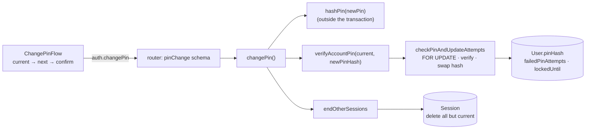

# 07 · Change PIN

A signed-in user changes their PIN in three PIN-pad steps: **current PIN → new PIN → confirm new PIN**. The new PIN must follow the PIN rules and differ from the current one. When it succeeds, **every other device is signed out**.

## At a glance

| | |
| --- | --- |
| **Route** | `/settings/pin` (from Settings → Change PIN) |
| **Frontend** | page `gobank/src/app/(app)/settings/pin/page.tsx`; `change-pin-flow.tsx`; UI `page-header.tsx`, `pin-pad.tsx`, `button.tsx` (`buttonClass`) |
| **API** | `auth.changePin` (protected mutation) |
| **Backend** | `auth.schemas.ts` (`pinChange`), `auth.rules.ts` (`validatePin`), `auth.service.ts` (`changePin`, `verifyAccountPin`, `checkPinAndUpdateAttempts`), `pin.ts` (`hashPin`, `verifyPin`), `server/session.ts` (`endOtherSessions`) |
| **Database** | `User.pinHash`, `failedPinAttempts`, `lockedUntil` (locked + updated); `Session` (delete all others) |
| **Tests** | `auth.test.ts` ("changing a PIN requires a different new PIN", PIN rules, hashing) |
| **Deep dive** | [Registration and sign-in §7, §9](../05-features/01-registration-and-sign-in.md) |

## How it works

1. **Current PIN**: 6 digits, then the screen moves on (it is checked later, on the server).
2. **New PIN**: checked in the browser: PIN rules, and not the same as the current PIN.
3. **Confirm**: must equal the new PIN; otherwise "Those did not match. Start again." and back to step 2.
4. `auth.changePin({ currentPin, newPin })`. Zod checks both are 6 digits, the new one passes the rules and differs.
5. The server hashes the **new** PIN, then runs the same locked check as sign-in on the **current** PIN. If it is correct, the new hash is saved **in the same update**.
6. `endOtherSessions` deletes every session of this user except the current one.
7. Success screen: "PIN changed. Use your new PIN next time you sign in. Any other devices have been signed out."

A wrong current PIN counts toward the lockout like a wrong sign-in (5 → 15 minutes).

## Structure



## Files and locations

| Layer | File | Role |
| --- | --- | --- |
| Page | `gobank/src/app/(app)/settings/pin/page.tsx` | renders the flow |
| Frontend | `gobank/src/features/auth/components/change-pin-flow.tsx` | three steps, local checks, success screen |
| API | `gobank/src/features/auth/auth.router.ts` | `changePin` (protected) |
| Validation | `gobank/src/features/auth/auth.schemas.ts` | `pinChange` |
| Rules | `gobank/src/features/auth/auth.rules.ts` | `validatePin`, `PIN_LENGTH` |
| Service | `gobank/src/features/auth/auth.service.ts` | `changePin` and the lockout transaction |
| Crypto | `gobank/src/features/auth/pin.ts` | hash and verify |
| Server core | `gobank/src/server/session.ts` | `endOtherSessions` |

## Frontend

<!-- code: gobank/src/app/(app)/settings/pin/page.tsx -->
**`gobank/src/app/(app)/settings/pin/page.tsx`** · all 10 lines

```tsx
 1 │ import type { Metadata } from "next";
 2 │ import { ChangePinFlow } from "~/features/auth/components/change-pin-flow";
 3 │
 4 │ export const metadata: Metadata = {
 5 │   title: "Change PIN",
 6 │ };
 7 │
 8 │ export default function ChangePinPage() {
 9 │   return <ChangePinFlow />;
10 │ }
```
<!-- /code -->

<!-- code: gobank/src/features/auth/components/change-pin-flow.tsx -->
**`gobank/src/features/auth/components/change-pin-flow.tsx`** · all 138 lines

```tsx
  1 │ "use client";
  2 │
  3 │ import { Check } from "lucide-react";
  4 │ import Link from "next/link";
  5 │ import { useState } from "react";
  6 │ import { cn } from "~/shared/lib/cn";
  7 │ import { buttonClass } from "~/shared/ui/button";
  8 │ import { PageHeader } from "~/shared/ui/page-header";
  9 │ import { PinPad } from "~/shared/ui/pin-pad";
 10 │ import { errorMessage } from "~/trpc/error-message";
 11 │ import { api } from "~/trpc/react";
 12 │ import { PIN_LENGTH, validatePin } from "../auth.rules";
 13 │
 14 │ type Step = "current" | "next" | "confirm";
 15 │
 16 │ const COPY: Record<Step, { title: string; subtitle: string }> = {
 17 │   current: {
 18 │     title: "Enter your current PIN",
 19 │     subtitle: "The PIN you use to sign in.",
 20 │   },
 21 │   next: {
 22 │     title: "Choose a new PIN",
 23 │     subtitle: "Six digits, different from your current PIN.",
 24 │   },
 25 │   confirm: {
 26 │     title: "Confirm your new PIN",
 27 │     subtitle: "Enter the same six digits again.",
 28 │   },
 29 │ };
 30 │
 31 │ const EMPTY = { current: "", next: "", confirm: "" };
 32 │
 33 │ function checkNewPin(newPin: string, currentPin: string) {
 34 │   const problem = validatePin(newPin);
 35 │   if (problem) return problem;
 36 │
 37 │   return newPin === currentPin ? "Choose a different PIN" : null;
 38 │ }
 39 │
 40 │ export function ChangePinFlow() {
 41 │   const [step, setStep] = useState<Step>("current");
 42 │   const [pins, setPins] = useState(EMPTY);
 43 │   const [problem, setProblem] = useState<string | null>(null);
 44 │
 45 │   const restart = (message: string | null, from: Step) => {
 46 │     setProblem(message);
 47 │     setPins((kept) =>
 48 │       from === "current" ? EMPTY : { ...kept, next: "", confirm: "" },
 49 │     );
 50 │     setStep(from);
 51 │   };
 52 │
 53 │   const change = api.auth.changePin.useMutation({
 54 │     onError: (error) => restart(errorMessage(error), "current"),
 55 │   });
 56 │
 57 │   const enter = (value: string) => {
 58 │     if (change.isPending) return;
 59 │     if (change.isError) change.reset();
 60 │
 61 │     const entered = { ...pins, [step]: value };
 62 │     setProblem(null);
 63 │     setPins(entered);
 64 │     if (value.length < PIN_LENGTH) return;
 65 │
 66 │     if (step === "current") {
 67 │       setStep("next");
 68 │       return;
 69 │     }
 70 │
 71 │     if (step === "next") {
 72 │       const problem = checkNewPin(value, entered.current);
 73 │       if (problem) restart(problem, "next");
 74 │       else setStep("confirm");
 75 │       return;
 76 │     }
 77 │
 78 │     if (value !== entered.next) {
 79 │       restart("Those did not match. Start again.", "next");
 80 │       return;
 81 │     }
 82 │
 83 │     change.mutate({ currentPin: entered.current, newPin: value });
 84 │   };
 85 │
 86 │   if (change.isSuccess) return <PinChanged />;
 87 │
 88 │   return (
 89 │     <div className="flex flex-1 flex-col">
 90 │       <PageHeader title="Change PIN" back="/settings" />
 91 │
 92 │       <div key={step} className="animate-step-in mt-8 flex flex-1 flex-col">
 93 │         <h2 className="text-ink text-[22px] leading-tight font-semibold tracking-tight">
 94 │           {COPY[step].title}
 95 │         </h2>
 96 │         <p className="text-ink-soft mt-2 text-[14.5px]">
 97 │           {COPY[step].subtitle}
 98 │         </p>
 99 │
100 │         <div className="mt-12 flex flex-1 flex-col items-center justify-center">
101 │           <PinPad
102 │             value={pins[step]}
103 │             onChange={enter}
104 │             length={PIN_LENGTH}
105 │             invalid={Boolean(problem)}
106 │           />
107 │           <p role="status" className="text-danger mt-7 h-5 text-[13px]">
108 │             {change.isPending ? (
109 │               <span className="text-ink-muted">Saving your new PIN</span>
110 │             ) : (
111 │               problem
112 │             )}
113 │           </p>
114 │         </div>
115 │       </div>
116 │     </div>
117 │   );
118 │ }
119 │
120 │ function PinChanged() {
121 │   return (
122 │     <div className="animate-step-in flex flex-1 flex-col items-center justify-center text-center">
123 │       <span className="bg-brand grid h-14 w-14 place-items-center rounded-full text-white">
124 │         <Check size={26} strokeWidth={2.6} aria-hidden />
125 │       </span>
126 │       <h1 className="text-ink mt-6 text-[22px] font-semibold tracking-tight">
127 │         PIN changed
128 │       </h1>
129 │       <p className="text-ink-soft mt-2 max-w-[300px] text-[14.5px] leading-relaxed">
130 │         Use your new PIN next time you sign in. Any other devices have been
131 │         signed out.
132 │       </p>
133 │       <Link href="/settings" className={cn(buttonClass(), "mt-8")}>
134 │         Back to settings
135 │       </Link>
136 │     </div>
137 │   );
138 │ }
```
<!-- /code -->

## Backend

<!-- code: gobank/src/features/auth/auth.router.ts 59-63 -->
**`gobank/src/features/auth/auth.router.ts`** · lines 59–63

```ts
59 │   changePin: protectedProcedure
60 │     .input(pinChange)
61 │     .mutation(({ ctx, input }) =>
62 │       changePin(ctx.userId, input.currentPin, input.newPin),
63 │     ),
```
<!-- /code -->

<!-- code: gobank/src/features/auth/auth.schemas.ts 28-33 -->
**`gobank/src/features/auth/auth.schemas.ts`** · lines 28–33

```ts
28 │ export const pinChange = z
29 │   .object({ currentPin: pinDigits, newPin: pin })
30 │   .refine((input) => input.currentPin !== input.newPin, {
31 │     message: "Choose a different PIN",
32 │     path: ["newPin"],
33 │   });
```
<!-- /code -->

<!-- code: gobank/src/features/auth/auth.service.ts 171-180 -->
**`gobank/src/features/auth/auth.service.ts`** · lines 171–180

```ts
171 │ export async function changePin(
172 │   userId: string,
173 │   currentPin: string,
174 │   newPin: string,
175 │ ) {
176 │   const newPinHash = await hashPin(newPin);
177 │
178 │   await verifyAccountPin(userId, currentPin, MESSAGES.wrongPin, newPinHash);
179 │   await endOtherSessions(userId);
180 │ }
```
<!-- /code -->

<!-- code: gobank/src/server/session.ts 126-130 -->
**`gobank/src/server/session.ts`** · lines 126–130

```ts
126 │ export async function endOtherSessions(userId: string) {
127 │   const token = (await cookies()).get(COOKIE)?.value ?? "";
128 │
129 │   await db.session.deleteMany({ where: { userId, id: { not: hash(token) } } });
130 │ }
```
<!-- /code -->

## Database

| Table | Columns | Write | Condition |
| --- | --- | --- | --- |
| `User` | `pinHash` | replaced by the new scrypt hash | only if the current PIN was correct and the account is not locked |
| `User` | `failedPinAttempts`, `lockedUntil` | reset to 0 / null on success; incremented or locked on a wrong current PIN | always (same rules as sign-in) |
| `Session` | all rows of this user except the current one | **deleted** | after success |

## The complicated parts, explained step by step

### 1. Swapping the hash inside the lockout transaction

`checkPinAndUpdateAttempts(userId, pin, newPinHash)` (auth.service.ts lines 109–141) was shown in [03](03-sign-in-and-lockout.md). The interesting line for this feature is 134:

```ts
...(correct && newPinHash ? { pinHash: newPinHash } : {}),
```

**Trace: changing `135790` to `246802`.**

| Step | Value |
| --- | --- |
| `changePin` line 176 | `newPinHash = hashPin("246802")`, computed **before** the transaction (slow on purpose, kept outside the lock) |
| inside the transaction | lock the row, verify `135790` against the stored hash → `correct = true` |
| the update | `failedPinAttempts 0`, `lockedUntil null`, **`pinHash = newPinHash`**, one statement |
| line 179 | `endOtherSessions(userId)` |

Because verification and replacement happen in **one locked transaction**, there is no moment when the old PIN was checked but a different request changes the hash. With a **wrong** current PIN, `correct = false`, the spread adds nothing, and only the attempt counter changes.

### 2. Signing out other devices

`endOtherSessions` (session.ts lines 126–130) deletes `where userId = me AND id ≠ SHA-256(my cookie token)`. The current tab keeps its session; a phone or laptop that was signed in with the old PIN is signed out at its next request.

### 3. The browser flow restarts at the right step

`change-pin-flow.tsx` line 45, `restart(message, from)`:

| Problem | Restart from | Kept |
| --- | --- | --- |
| new PIN breaks a rule, or equals the current PIN | `next` | the current PIN |
| confirmation does not match | `next` | the current PIN |
| server error (wrong current PIN, locked) | `current` | nothing |

Line 58 ignores taps while saving; line 59 clears an old error when the user starts typing again.

## Rules and limits

| Rule | Value |
| --- | --- |
| New PIN | 6 digits; not one repeated digit; not a run of `0123456789` / `9876543210`; different from the current PIN |
| Wrong current PIN | counts toward the 5-attempt, 15-minute lockout |
| After success | all other sessions ended |

## Messages

| Message | When |
| --- | --- |
| Enter your current PIN / Choose a new PIN / Confirm your new PIN | the three step titles |
| Use 6 digits / Avoid repeating the same digit / Avoid sequences like 123456 | new PIN breaks a rule |
| Choose a different PIN | new PIN = current PIN (browser and server) |
| Those did not match. Start again. | confirmation mismatch |
| That PIN is not right | wrong current PIN |
| Too many wrong PINs. Try again in N minutes. | lockout |
| Saving your new PIN | while the request runs |
| PIN changed … Any other devices have been signed out. | success |

## Tests

`auth.test.ts`: a new PIN must be different from the current one (`pinChange`); PIN rules; hashing the same PIN twice gives different hashes; only the right PIN verifies.
