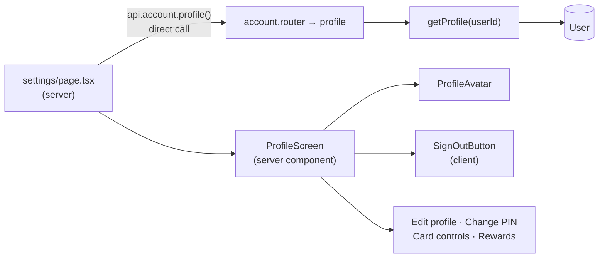

# 08 · Profile and settings screen

The **Settings** page shows the user's photo, name, `@username`, account number, mobile, linked Gmail and "Member since", plus shortcuts to **Edit profile**, **Change PIN**, **Card controls** and **Rewards**, and the red **Sign out** button.

## At a glance

| | |
| --- | --- |
| **Route** | `/settings` (from the profile picture on the dashboard, or **Profile** in the GO menu) |
| **Frontend** | page `gobank/src/app/(app)/settings/page.tsx` (server); `profile-screen.tsx` (server component), `profile-avatar.tsx`, `sign-out-button.tsx`; UI `page-header.tsx` |
| **API** | `account.profile` (protected query), called **directly on the server** |
| **Backend** | `account.router.ts`, `account.service.ts` (`getProfile`), `account.rules.ts` (`displayName`); helpers `format.ts` (`formatAccount`), `contact.ts` (`formatMobile`) |
| **Database** | reads `User` (`username`, `fullName`, `profilePhoto`, `mobile`, `gmail`, `googleId`, `accountNumber`, `createdAt`) |
| **Tests** | `verify-core.ts` (`getProfile` after profile and Google changes) |
| **Deep dive** | [Account and profile §5](../05-features/03-account-and-profile.md) |

## How it works

1. `/settings` is a server page: it runs `await api.account.profile()` with the server-side tRPC caller (no HTTP request from the browser).
2. `getProfile` reads the user's row and hides internal data (`googleId`).
3. `ProfileScreen` renders the details and shortcuts. Only the Sign out button runs in the browser (a client component).

## Structure



## Files and locations

| Layer | File | Role |
| --- | --- | --- |
| Page (server) | `gobank/src/app/(app)/settings/page.tsx` | loads the profile on the server |
| Frontend | `gobank/src/features/account/components/profile-screen.tsx` | details and shortcuts |
| Frontend | `gobank/src/features/account/components/profile-avatar.tsx` | photo or default icon |
| Frontend | `gobank/src/features/auth/components/sign-out-button.tsx` | Sign out ([06](06-sessions-and-sign-out.md)) |
| API | `gobank/src/features/account/account.router.ts` | `profile` |
| Service | `gobank/src/features/account/account.service.ts` | `getProfile` |
| Rules | `gobank/src/features/account/account.rules.ts` | `displayName` |
| Helpers | `gobank/src/shared/lib/format.ts`, `gobank/src/shared/lib/contact.ts` | account-number and mobile formatting |
| Server caller | `gobank/src/trpc/server.ts` | direct procedure calls from server code |

## Frontend

<!-- code: gobank/src/app/(app)/settings/page.tsx -->
**`gobank/src/app/(app)/settings/page.tsx`** · all 11 lines

```tsx
 1 │ import type { Metadata } from "next";
 2 │ import { ProfileScreen } from "~/features/account/components/profile-screen";
 3 │ import { api } from "~/trpc/server";
 4 │
 5 │ export const metadata: Metadata = {
 6 │   title: "Settings",
 7 │ };
 8 │
 9 │ export default async function SettingsPage() {
10 │   return <ProfileScreen profile={await api.account.profile()} />;
11 │ }
```
<!-- /code -->

<!-- code: gobank/src/features/account/components/profile-screen.tsx -->
**`gobank/src/features/account/components/profile-screen.tsx`** · all 131 lines

```tsx
  1 │ import {
  2 │   Camera,
  3 │   ChevronRight,
  4 │   CreditCard,
  5 │   KeyRound,
  6 │   Sparkles,
  7 │   UserPen,
  8 │   type LucideIcon,
  9 │ } from "lucide-react";
 10 │ import Link from "next/link";
 11 │ import { SignOutButton } from "~/features/auth/components/sign-out-button";
 12 │ import { formatMobile } from "~/shared/lib/contact";
 13 │ import { formatAccount } from "~/shared/lib/format";
 14 │ import { PageHeader } from "~/shared/ui/page-header";
 15 │ import type { RouterOutputs } from "~/trpc/react";
 16 │ import { displayName } from "../account.rules";
 17 │ import { ProfileAvatar } from "./profile-avatar";
 18 │
 19 │ type Profile = RouterOutputs["account"]["profile"];
 20 │
 21 │ const SINCE = new Intl.DateTimeFormat("en-PH", {
 22 │   month: "long",
 23 │   year: "numeric",
 24 │ });
 25 │
 26 │ export function ProfileScreen({ profile }: { profile: Profile }) {
 27 │   const details = [
 28 │     { label: "Account number", value: formatAccount(profile.accountNumber) },
 29 │     {
 30 │       label: "Mobile",
 31 │       value: profile.mobile ? formatMobile(profile.mobile) : null,
 32 │     },
 33 │     { label: "Gmail", value: profile.gmail },
 34 │     { label: "Member since", value: SINCE.format(profile.createdAt) },
 35 │   ];
 36 │
 37 │   return (
 38 │     <div className="flex flex-1 flex-col">
 39 │       <PageHeader title="Profile" back="/dashboard" />
 40 │
 41 │       <section className="mt-9 flex flex-col items-center text-center">
 42 │         <Link
 43 │           href="/settings/profile"
 44 │           aria-label="Change profile photo"
 45 │           className="focus-visible:outline-sky relative rounded-full focus-visible:outline-2 focus-visible:outline-offset-4"
 46 │         >
 47 │           <ProfileAvatar photo={profile.profilePhoto} />
 48 │           <span className="border-surface text-sky absolute right-0 bottom-0 grid h-6 w-6 place-items-center rounded-full border-2 bg-[#2b373d]">
 49 │             <Camera size={12} aria-hidden />
 50 │           </span>
 51 │         </Link>
 52 │         <p className="text-ink mt-4 text-[19px] font-semibold tracking-tight">
 53 │           {displayName(profile)}
 54 │         </p>
 55 │         {profile.fullName ? (
 56 │           <p className="text-ink-muted mt-0.5 text-[13.5px]">
 57 │             @{profile.username}
 58 │           </p>
 59 │         ) : null}
 60 │       </section>
 61 │
 62 │       <dl className="divide-line border-line mt-8 divide-y rounded-2xl border">
 63 │         {details.map((row) => (
 64 │           <DetailRow key={row.label} label={row.label} value={row.value} />
 65 │         ))}
 66 │       </dl>
 67 │
 68 │       <nav className="mt-4 flex flex-col gap-2.5">
 69 │         <ShortcutRow
 70 │           href="/settings/profile"
 71 │           label="Edit profile"
 72 │           icon={UserPen}
 73 │         />
 74 │         <ShortcutRow href="/settings/pin" label="Change PIN" icon={KeyRound} />
 75 │         <ShortcutRow href="/card" label="Card controls" icon={CreditCard} />
 76 │         <ShortcutRow href="/rewards" label="Rewards" icon={Sparkles} />
 77 │       </nav>
 78 │
 79 │       <div className="flex-1" />
 80 │
 81 │       <div className="mt-10">
 82 │         <SignOutButton />
 83 │       </div>
 84 │     </div>
 85 │   );
 86 │ }
 87 │
 88 │ function DetailRow({ label, value }: { label: string; value: string | null }) {
 89 │   return (
 90 │     <div className="flex items-baseline justify-between gap-4 px-4 py-3.5">
 91 │       <dt className="text-ink-muted shrink-0 text-[13px]">{label}</dt>
 92 │       <dd
 93 │         className={
 94 │           value
 95 │             ? "text-ink min-w-0 truncate text-[14px] font-medium tabular-nums"
 96 │             : "text-ink-faint text-[14px]"
 97 │         }
 98 │       >
 99 │         {value ?? "Not set"}
100 │       </dd>
101 │     </div>
102 │   );
103 │ }
104 │
105 │ function ShortcutRow({
106 │   href,
107 │   label,
108 │   icon: Icon,
109 │ }: {
110 │   href: string;
111 │   label: string;
112 │   icon: LucideIcon;
113 │ }) {
114 │   return (
115 │     <Link
116 │       href={href}
117 │       className="group bg-surface-sunken hover:bg-surface-raised flex items-center gap-3.5 rounded-2xl px-4 py-3.5 transition-colors duration-150"
118 │     >
119 │       <span className="bg-surface text-ink-soft grid h-9 w-9 place-items-center rounded-full">
120 │         <Icon size={16} strokeWidth={1.9} aria-hidden />
121 │       </span>
122 │       <span className="text-ink flex-1 text-[14px] font-medium">{label}</span>
123 │       <ChevronRight
124 │         size={16}
125 │         strokeWidth={1.9}
126 │         className="text-ink-faint group-hover:text-ink-soft transition-colors"
127 │         aria-hidden
128 │       />
129 │     </Link>
130 │   );
131 │ }
```
<!-- /code -->

<!-- code: gobank/src/features/account/components/profile-avatar.tsx -->
**`gobank/src/features/account/components/profile-avatar.tsx`** · all 43 lines

```tsx
 1 │ import { UserRound } from "lucide-react";
 2 │ import Image from "next/image";
 3 │ import { cn } from "~/shared/lib/cn";
 4 │
 5 │ export function ProfileAvatar({
 6 │   photo,
 7 │   size = 80,
 8 │   className,
 9 │ }: {
10 │   photo?: string | null;
11 │   size?: number;
12 │   className?: string;
13 │ }) {
14 │   return (
15 │     <span
16 │       className={cn(
17 │         "text-ink-soft bg-tile relative grid shrink-0 overflow-hidden rounded-full border border-white/10",
18 │         className,
19 │       )}
20 │       style={{ width: size, height: size }}
21 │       role={photo ? undefined : "img"}
22 │       aria-label={photo ? undefined : "Default profile icon"}
23 │     >
24 │       {photo ? (
25 │         <Image
26 │           src={photo}
27 │           alt="Profile photo"
28 │           fill
29 │           sizes={`${size}px`}
30 │           unoptimized
31 │           className="object-cover"
32 │         />
33 │       ) : (
34 │         <UserRound
35 │           size={size * 0.45}
36 │           strokeWidth={1.6}
37 │           className="m-auto"
38 │           aria-hidden
39 │         />
40 │       )}
41 │     </span>
42 │   );
43 │ }
```
<!-- /code -->

## Backend

<!-- code: gobank/src/features/account/account.router.ts 17-17 -->
**`gobank/src/features/account/account.router.ts`** · line 17

```ts
17 │   profile: protectedProcedure.query(({ ctx }) => getProfile(ctx.userId)),
```
<!-- /code -->

<!-- code: gobank/src/features/account/account.service.ts 57-73 -->
**`gobank/src/features/account/account.service.ts`** · lines 57–73

```ts
57 │ export const getProfile = async (userId: string) => {
58 │   const profile = await db.user.findUniqueOrThrow({
59 │     where: { id: userId },
60 │     select: {
61 │       username: true,
62 │       fullName: true,
63 │       profilePhoto: true,
64 │       mobile: true,
65 │       gmail: true,
66 │       googleId: true,
67 │       accountNumber: true,
68 │       createdAt: true,
69 │     },
70 │   });
71 │   const { googleId, ...details } = profile;
72 │   return { ...details, gmail: googleId ? details.gmail : null };
73 │ };
```
<!-- /code -->

<!-- code: gobank/src/features/account/account.rules.ts -->
**`gobank/src/features/account/account.rules.ts`** · all 4 lines

```ts
1 │ type Named = { fullName: string | null; username: string };
2 │
3 │ export const displayName = ({ fullName, username }: Named) =>
4 │   fullName ?? `@${username}`;
```
<!-- /code -->

## Database

| Table | Columns read |
| --- | --- |
| `User` | `username`, `fullName`, `profilePhoto`, `mobile`, `gmail`, `googleId`, `accountNumber`, `createdAt` |

Nothing is written by this feature.

## The complicated parts, explained step by step

### 1. Hiding internal fields with destructuring

`getProfile`, lines 71–72:

```ts
const { googleId, ...details } = profile;
return { ...details, gmail: googleId ? details.gmail : null };
```

| Stored row | Returned |
| --- | --- |
| `googleId: "1084…"`, `gmail: "juan@gmail.com"` | `gmail: "juan@gmail.com"` (linked), no `googleId` |
| `googleId: null`, `gmail: "old@gmail.com"` (older data) | `gmail: null`, shown as "Not set" |
| `googleId: null`, `gmail: null` | `gmail: null` |

`googleId` is pulled out of the object and **not** returned, so Google's internal user ID never reaches the browser. The Gmail is only shown when it is really linked through Google (verified).

### 2. A server component calling a protected procedure

`settings/page.tsx` calls `api.account.profile()` from `src/trpc/server.ts`, the direct caller with an empty context. `requireSession` still checks the session **cookie**; it skips only the browser-tab header check, because there is no browser tab on the server ([tRPC setup §3](../04-server-core/02-trpc-setup.md)). The page arrives fully rendered, with no loading spinner.

### 3. The detail rows are data, not markup

`profile-screen.tsx` lines 27–35 build an array of `{ label, value }`, and lines 62–66 render one `DetailRow` per entry. A missing value (`null`) is shown as "Not set" in a fainter color (line 99). Adding a new detail is one more object in the array.

| Detail | Formatting | Example |
| --- | --- | --- |
| Account number | `formatAccount`: a space every 4 digits | `2004 2640 684` |
| Mobile | `formatMobile` | `0917 123 4567` |
| Gmail | as stored | `juan@gmail.com` |
| Member since | `Intl.DateTimeFormat("en-PH", { month: "long", year: "numeric" })` | `November 2026` |

## Messages

| Text | When |
| --- | --- |
| Not set | a missing mobile or Gmail |
| Sign out / Signing out | the button |

## Tests

`verify-core.ts` reads `getProfile` after saving a profile (name and WebP photo) and after linking Google (the Gmail appears), and checks that another user's profile is unaffected.

**Checked in Chromium for this review** (a newly registered account): name and `@username`, Account number `2071 5305 146` (grouped by 4), Mobile `0917 555 0123`, Gmail **Not set**, Member since **November 2026**, the four shortcuts and **Sign out**, and the default icon announced as "Default profile icon" (`role="img"`). After a photo was saved ([10](10-profile-photo.md)), the photo replaced the icon.
