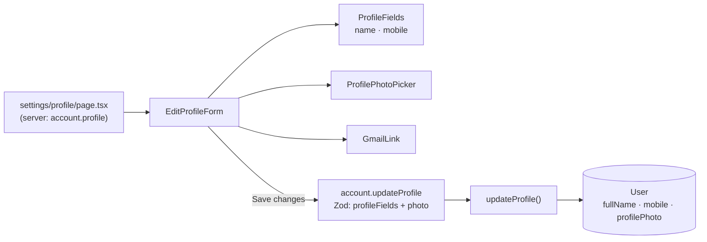

# 09 · Edit profile (name and mobile)

On **Settings → Edit profile** the user changes their **full name** (printed on their card) and **mobile number** (lets friends pay them by number), changes or removes their **photo** ([10](10-profile-photo.md)), and can **link Google** ([05](05-link-google.md)). Everything is saved with one **Save changes** tap.

## At a glance

| | |
| --- | --- |
| **Route** | `/settings/profile` |
| **Frontend** | page `gobank/src/app/(app)/settings/profile/page.tsx` (server); `edit-profile-form.tsx`, `profile-fields.tsx`, `profile-photo-picker.tsx`, `gmail-link.tsx`; UI `text-field.tsx`, `page-header.tsx`, `button.tsx` |
| **API** | `account.profile` (server-side load), `account.updateProfile` (protected mutation) |
| **Backend** | `account.router.ts`, `account.service.ts` (`updateProfile`), `shared/lib/schemas.ts` (`profileFields`, `mobile`), `shared/lib/contact.ts`, `profile-photo.server.ts` |
| **Database** | updates `User.fullName`, `User.mobile` (unique), `User.profilePhoto` |
| **Tests** | `verify-core.ts` (`checkProfile`) |
| **Deep dive** | [Account and profile](../05-features/03-account-and-profile.md) |

## How it works

1. The server page loads the profile and passes it to `EditProfileForm`, which starts with the saved values.
2. As the user types, `profileIsValid` checks the name (2–80 characters) and the mobile (empty, or `09XXXXXXXXX`); **Save changes** is disabled while anything is invalid.
3. **Save changes** sends `{ fullName, mobile, profilePhoto }` in one `account.updateProfile` call.
4. The router's Zod schema trims and validates the name, and normalizes the mobile (for example `+63 917…` → `0917…`, empty → `null`).
5. `updateProfile` cleans the photo if one was sent, then updates the row.
6. On success the browser returns to `/settings` and refreshes it from the server.

## Structure



## Files and locations

| Layer | File | Role |
| --- | --- | --- |
| Page (server) | `gobank/src/app/(app)/settings/profile/page.tsx` | loads the profile |
| Frontend | `gobank/src/features/account/components/edit-profile-form.tsx` | form state, save |
| Frontend | `gobank/src/features/account/components/profile-fields.tsx` | name and mobile inputs, `profileIsValid` |
| Frontend | `gobank/src/features/account/components/profile-photo-picker.tsx` | photo ([10](10-profile-photo.md)) |
| Frontend | `gobank/src/features/account/components/gmail-link.tsx` | Link Google ([05](05-link-google.md)) |
| Helpers | `gobank/src/shared/lib/contact.ts` | name and mobile rules |
| Validation | `gobank/src/shared/lib/schemas.ts` | `profileFields`, `mobile` |
| API | `gobank/src/features/account/account.router.ts` | `updateProfile` |
| Service | `gobank/src/features/account/account.service.ts` | `updateProfile` |

## Frontend

<!-- code: gobank/src/app/(app)/settings/profile/page.tsx -->
**`gobank/src/app/(app)/settings/profile/page.tsx`** · all 11 lines

```tsx
 1 │ import type { Metadata } from "next";
 2 │ import { EditProfileForm } from "~/features/account/components/edit-profile-form";
 3 │ import { api } from "~/trpc/server";
 4 │
 5 │ export const metadata: Metadata = {
 6 │   title: "Edit profile",
 7 │ };
 8 │
 9 │ export default async function EditProfilePage() {
10 │   return <EditProfileForm profile={await api.account.profile()} />;
11 │ }
```
<!-- /code -->

<!-- code: gobank/src/features/account/components/edit-profile-form.tsx -->
**`gobank/src/features/account/components/edit-profile-form.tsx`** · all 111 lines

```tsx
  1 │ "use client";
  2 │
  3 │ import { useRouter } from "next/navigation";
  4 │ import { useState } from "react";
  5 │ import { Button } from "~/shared/ui/button";
  6 │ import { PageHeader } from "~/shared/ui/page-header";
  7 │ import { errorMessage } from "~/trpc/error-message";
  8 │ import { api, type RouterOutputs } from "~/trpc/react";
  9 │ import { prepareProfilePhoto } from "../profile-photo.client";
 10 │ import { ProfilePhotoPicker } from "./profile-photo-picker";
 11 │ import { GmailLink } from "./gmail-link";
 12 │ import {
 13 │   ProfileFields,
 14 │   profileIsValid,
 15 │   type ProfileValues,
 16 │ } from "./profile-fields";
 17 │
 18 │ type Profile = RouterOutputs["account"]["profile"];
 19 │
 20 │ export function EditProfileForm({ profile }: { profile: Profile }) {
 21 │   const router = useRouter();
 22 │   const [photo, setPhoto] = useState(profile.profilePhoto);
 23 │   const [preparingPhoto, setPreparingPhoto] = useState(false);
 24 │   const [photoError, setPhotoError] = useState<string | null>(null);
 25 │   const [value, setValue] = useState<ProfileValues>({
 26 │     fullName: profile.fullName ?? "",
 27 │     mobile: profile.mobile ?? "",
 28 │   });
 29 │
 30 │   const save = api.account.updateProfile.useMutation({
 31 │     onSuccess: () => {
 32 │       router.push("/settings");
 33 │       router.refresh();
 34 │     },
 35 │   });
 36 │
 37 │   const busy = preparingPhoto || save.isPending || save.isSuccess;
 38 │
 39 │   const submit = () => {
 40 │     if (preparingPhoto || save.isPending) return;
 41 │     save.mutate({ ...value, profilePhoto: photo });
 42 │   };
 43 │
 44 │   const removePhoto = () => {
 45 │     setPhoto(null);
 46 │     setPhotoError(null);
 47 │   };
 48 │
 49 │   const selectPhoto = async (file: File) => {
 50 │     setPreparingPhoto(true);
 51 │     setPhotoError(null);
 52 │
 53 │     try {
 54 │       setPhoto(await prepareProfilePhoto(file));
 55 │     } catch (error) {
 56 │       setPhotoError(
 57 │         error instanceof Error ? error.message : "Couldn’t read that photo.",
 58 │       );
 59 │     } finally {
 60 │       setPreparingPhoto(false);
 61 │     }
 62 │   };
 63 │
 64 │   return (
 65 │     <form
 66 │       onSubmit={(event) => {
 67 │         event.preventDefault();
 68 │         submit();
 69 │       }}
 70 │       className="flex flex-1 flex-col"
 71 │     >
 72 │       <PageHeader title="Edit profile" back="/settings" />
 73 │
 74 │       <div className="mt-8 flex flex-col gap-5">
 75 │         <ProfilePhotoPicker
 76 │           photo={photo}
 77 │           busy={busy}
 78 │           error={photoError}
 79 │           onSelect={(file) => void selectPhoto(file)}
 80 │           onRemove={removePhoto}
 81 │         />
 82 │         <ProfileFields
 83 │           value={value}
 84 │           onChange={(patch) =>
 85 │             setValue((current) => ({ ...current, ...patch }))
 86 │           }
 87 │         />
 88 │         <GmailLink gmail={profile.gmail} />
 89 │       </div>
 90 │
 91 │       {save.error ? (
 92 │         <p
 93 │           role="alert"
 94 │           className="bg-danger-soft text-danger mt-6 rounded-xl px-4 py-3 text-[13px]"
 95 │         >
 96 │           {errorMessage(save.error)}
 97 │         </p>
 98 │       ) : null}
 99 │
100 │       <div className="flex-1" />
101 │
102 │       <Button
103 │         type="submit"
104 │         className="mt-8"
105 │         disabled={busy || !profileIsValid(value)}
106 │       >
107 │         {save.isPending || save.isSuccess ? "Saving" : "Save changes"}
108 │       </Button>
109 │     </form>
110 │   );
111 │ }
```
<!-- /code -->

<!-- code: gobank/src/features/account/components/profile-fields.tsx -->
**`gobank/src/features/account/components/profile-fields.tsx`** · all 38 lines

```tsx
 1 │ import { validateFullName, validateMobile } from "~/shared/lib/contact";
 2 │ import { TextField } from "~/shared/ui/text-field";
 3 │
 4 │ export type ProfileValues = { fullName: string; mobile: string };
 5 │
 6 │ export const profileIsValid = ({ fullName, mobile }: ProfileValues) =>
 7 │   !validateFullName(fullName) && !validateMobile(mobile);
 8 │
 9 │ type ProfileFieldsProps = {
10 │   value: ProfileValues;
11 │   onChange: (patch: Partial<ProfileValues>) => void;
12 │ };
13 │
14 │ export function ProfileFields({ value, onChange }: ProfileFieldsProps) {
15 │   return (
16 │     <>
17 │       <TextField
18 │         label="Full name"
19 │         required
20 │         minLength={2}
21 │         maxLength={80}
22 │         value={value.fullName}
23 │         onChange={(event) => onChange({ fullName: event.target.value })}
24 │         hint="Printed on your card."
25 │       />
26 │       <TextField
27 │         label="Mobile number"
28 │         optional
29 │         type="tel"
30 │         inputMode="numeric"
31 │         value={value.mobile}
32 │         onChange={(event) => onChange({ mobile: event.target.value })}
33 │         error={validateMobile(value.mobile)}
34 │         hint="Lets friends pay you by number."
35 │       />
36 │     </>
37 │   );
38 │ }
```
<!-- /code -->

## Backend

<!-- code: gobank/src/features/account/account.router.ts 19-21 -->
**`gobank/src/features/account/account.router.ts`** · lines 19–21

```ts
19 │   updateProfile: protectedProcedure
20 │     .input(z.object({ ...profileFields, profilePhoto: profilePhotoInput }))
21 │     .mutation(({ ctx, input }) => updateProfile(ctx.userId, input)),
```
<!-- /code -->

<!-- code: gobank/src/shared/lib/schemas.ts -->
**`gobank/src/shared/lib/schemas.ts`** · all 27 lines

```ts
 1 │ import { z } from "zod";
 2 │ import { normalizeMobile, validateMobile } from "./contact";
 3 │ import { MAX_TRANSACTION_CENTAVOS } from "./money";
 4 │
 5 │ const blankToNull = (value: string) => value || null;
 6 │
 7 │ export const centavos = z
 8 │   .number()
 9 │   .int()
10 │   .positive()
11 │   .max(MAX_TRANSACTION_CENTAVOS);
12 │
13 │ export const mobile = z
14 │   .string()
15 │   .trim()
16 │   .refine((value) => !validateMobile(value), "Use the format 09XXXXXXXXX")
17 │   .transform((value) => blankToNull(normalizeMobile(value)));
18 │
19 │ export const cardKind = z.enum(["physical", "virtual"]);
20 │
21 │ export const optionalText = (max: number) =>
22 │   z.string().trim().max(max).transform(blankToNull);
23 │
24 │ export const profileFields = {
25 │   fullName: z.string().trim().min(2, "Enter your full name").max(80),
26 │   mobile,
27 │ };
```
<!-- /code -->

<!-- code: gobank/src/features/account/account.service.ts 75-93 -->
**`gobank/src/features/account/account.service.ts`** · lines 75–93

```ts
75 │ type ProfileUpdate = {
76 │   fullName: string;
77 │   mobile: string | null;
78 │   profilePhoto?: string | null;
79 │ };
80 │
81 │ export const updateProfile = async (userId: string, profile: ProfileUpdate) => {
82 │   const { profilePhoto, ...fields } = profile;
83 │   return db.user.update({
84 │     where: { id: userId },
85 │     data: {
86 │       ...fields,
87 │       ...(profilePhoto !== undefined
88 │         ? { profilePhoto: await normalizeProfilePhoto(profilePhoto) }
89 │         : {}),
90 │     },
91 │     select: { id: true },
92 │   });
93 │ };
```
<!-- /code -->

## Database

| Table | Column | Write | Rule |
| --- | --- | --- | --- |
| `User` | `fullName` | updated | required, 2–80 characters |
| `User` | `mobile` | updated (or set to `NULL`) | **unique**: two users cannot share a number |
| `User` | `profilePhoto` | updated only if the photo changed | see [10](10-profile-photo.md) |
| `User` | `updatedAt` | set automatically | |

## The complicated parts, explained step by step

### 1. The `mobile` schema: four steps in one chain

<!-- code: gobank/src/shared/lib/schemas.ts 13-17 -->
**`gobank/src/shared/lib/schemas.ts`** · lines 13–17

```ts
13 │ export const mobile = z
14 │   .string()
15 │   .trim()
16 │   .refine((value) => !validateMobile(value), "Use the format 09XXXXXXXXX")
17 │   .transform((value) => blankToNull(normalizeMobile(value)));
```
<!-- /code -->

The chain runs in order: **trim** → **refine** (is it valid?) → **transform** (normalize; empty becomes `null`).

| Input | after `trim` | `validateMobile` | `normalizeMobile` | Saved |
| --- | --- | --- | --- | --- |
| `""` | `""` | OK (optional) | `""` | **`null`** (`blankToNull`) |
| `"0917 123 4567"` | same | OK | `"09171234567"` | `09171234567` |
| `"+63 917 123 4567"` | same | OK (`63` → `0`) | `"09171234567"` | `09171234567` |
| `"12345"` | same | **"Use the format 09XXXXXXXXX"** | — | rejected with `BAD_REQUEST` |

The browser runs the same `validateMobile`, so the field shows the error before sending.

### 2. "Photo not touched" vs "photo removed"

`updateProfile`, line 87: `profilePhoto !== undefined`.

| `profilePhoto` in the request | Meaning | Database |
| --- | --- | --- |
| not sent (`undefined`) | the client did not include it | column unchanged |
| `null` | the user tapped **Remove** | set to `NULL` |
| `"data:image/…"` | a new photo | cleaned by sharp, then saved |

The Edit profile form always sends the current photo state (`photo`, line 41), which is the saved photo if untouched, so in practice it re-saves the same image. The `undefined` case keeps the service safe for other callers.

### 3. Duplicate mobile numbers

If another user already has the number, the update fails on the unique constraint (`P2002`, target `mobile`) and `friendlyErrors` turns it into **"That mobile is already taken"**, shown in the red box (form lines 91–98). Nothing is saved, because the whole update is one statement.

## Rules and limits

| Field | Rule |
| --- | --- |
| Full name | 2–80 characters after trimming |
| Mobile | optional; `09` + 9 digits; `+63`/`63` converted to `0`; unique |

## Messages

| Message | When |
| --- | --- |
| Enter your full name / Use at most 80 characters | name too short / long |
| Use the format 09XXXXXXXXX | invalid mobile |
| That mobile is already taken | another account has it |
| Saving / Save changes | button |

## Tests

`verify-core.ts` → `checkProfile`: a valid update saves the name and a WebP photo; an update with a broken photo is rejected and **nothing changes, not even the name sent in the same request**; another user's profile is unaffected.
