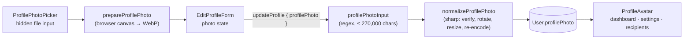

# 10 · Profile photo

The user picks a **PNG, JPG or WebP** photo (up to 5 MB). It is shown as a round avatar on the dashboard, the Settings page, and next to their name when others send them money or receive their requests. The photo is cropped and compressed **in the browser**, then **verified and re-encoded on the server**, which also removes hidden metadata such as GPS location.

## At a glance

| | |
| --- | --- |
| **Route** | `/settings/profile` (the photo section of Edit profile) |
| **Frontend** | `profile-photo-picker.tsx`, `edit-profile-form.tsx`, `profile-avatar.tsx`, `profile-photo.client.ts`; shown in `dashboard-screen.tsx`, `profile-screen.tsx`, `money-form-ui.tsx` (`RecipientIdentity`) |
| **API** | `account.updateProfile` (the `profilePhoto` field) |
| **Backend** | `profile-photo.schema.ts`, `profile-photo.server.ts` (sharp), `account.service.ts` |
| **Database** | `User.profilePhoto` (a `data:image/webp;base64,…` text value, ≤ 200 KB decoded) |
| **Tests** | `profile-photo.test.ts` (4 tests), `verify-core.ts` (`checkProfile`) |
| **Deep dive** | [Account and profile §4](../05-features/03-account-and-profile.md) |

## How it works

1. **Change photo** opens the file picker (a hidden `<input type="file">`).
2. The browser checks the type and the 5 MB limit, decodes the image, **cover-crops** it to 256×256 on a canvas, and exports WebP at 82% quality as a `data:` URL.
3. The new photo shows immediately in the form (not yet saved).
4. **Save changes** sends it in `account.updateProfile`.
5. The server checks the data-URL format, the size (≤ 200 KB decoded), the **real** image format, a pixel limit, then re-encodes it with **sharp** to a clean 256×256 WebP and saves it.
6. **Remove** sets the photo to `null` on save; the avatar shows a default person icon.

## Structure



## Files and locations

| Layer | File | Role |
| --- | --- | --- |
| Frontend | `gobank/src/features/account/components/profile-photo-picker.tsx` | choose / remove UI |
| Frontend | `gobank/src/features/account/profile-photo.client.ts` | crop and compress in the browser |
| Frontend | `gobank/src/features/account/components/edit-profile-form.tsx` | holds the photo until save |
| Frontend | `gobank/src/features/account/components/profile-avatar.tsx` | displays a photo |
| Shared | `gobank/src/features/account/profile-photo.schema.ts` | types, sizes, pattern |
| Backend | `gobank/src/features/account/profile-photo.server.ts` | verify and re-encode |
| Backend | `gobank/src/features/account/account.service.ts` | saves it |
| Tests | `gobank/src/features/account/profile-photo.test.ts` | 4 tests |

## Frontend

<!-- code: gobank/src/features/account/components/profile-photo-picker.tsx -->
**`gobank/src/features/account/components/profile-photo-picker.tsx`** · all 80 lines

```tsx
 1 │ "use client";
 2 │
 3 │ import { Camera } from "lucide-react";
 4 │ import { useRef, type ChangeEvent } from "react";
 5 │ import { PHOTO_TYPES } from "../profile-photo.schema";
 6 │ import { ProfileAvatar } from "./profile-avatar";
 7 │
 8 │ function pickerLabel(busy: boolean, hasPhoto: boolean) {
 9 │   if (busy) return "Preparing photo…";
10 │   return hasPhoto ? "Change photo" : "Add photo";
11 │ }
12 │
13 │ export function ProfilePhotoPicker({
14 │   photo,
15 │   busy,
16 │   error,
17 │   onSelect,
18 │   onRemove,
19 │ }: {
20 │   photo: string | null;
21 │   busy: boolean;
22 │   error: string | null;
23 │   onSelect: (file: File) => void;
24 │   onRemove: () => void;
25 │ }) {
26 │   const input = useRef<HTMLInputElement>(null);
27 │
28 │   const chooseFile = (event: ChangeEvent<HTMLInputElement>) => {
29 │     const file = event.currentTarget.files?.[0];
30 │     event.currentTarget.value = "";
31 │     if (file) onSelect(file);
32 │   };
33 │
34 │   return (
35 │     <section
36 │       className="bg-card flex flex-col items-center gap-3 rounded-2xl border border-white/[.07] px-4 py-5"
37 │       aria-label="Profile photo"
38 │     >
39 │       <ProfileAvatar photo={photo} />
40 │       <input
41 │         ref={input}
42 │         type="file"
43 │         accept={PHOTO_TYPES.join(",")}
44 │         aria-label="Choose profile photo"
45 │         hidden
46 │         disabled={busy}
47 │         onChange={chooseFile}
48 │       />
49 │       <div className="flex w-36 flex-col gap-1">
50 │         <button
51 │           type="button"
52 │           disabled={busy}
53 │           onClick={() => input.current?.click()}
54 │           className="text-sky inline-flex min-h-10 items-center justify-center gap-2 rounded-xl border border-white/10 bg-white/5 px-4 text-[12px] font-medium focus-visible:outline-2 focus-visible:outline-offset-2 disabled:opacity-50"
55 │         >
56 │           <Camera size={15} aria-hidden />
57 │           {pickerLabel(busy, Boolean(photo))}
58 │         </button>
59 │         {photo ? (
60 │           <button
61 │             type="button"
62 │             disabled={busy}
63 │             onClick={onRemove}
64 │             className="text-danger min-h-10 px-2 text-[12px] hover:underline focus-visible:outline-2 focus-visible:outline-offset-2 disabled:opacity-50"
65 │           >
66 │             Remove
67 │           </button>
68 │         ) : null}
69 │       </div>
70 │       <p className="text-ink-faint text-[10px]">
71 │         PNG, JPG or WebP · up to 5 MB
72 │       </p>
73 │       {error ? (
74 │         <p role="alert" className="text-danger text-[12px]">
75 │           {error}
76 │         </p>
77 │       ) : null}
78 │     </section>
79 │   );
80 │ }
```
<!-- /code -->

<!-- code: gobank/src/features/account/profile-photo.client.ts -->
**`gobank/src/features/account/profile-photo.client.ts`** · all 51 lines

```ts
 1 │ "use client";
 2 │
 3 │ import { MAX_PHOTO_BYTES, PHOTO_TYPES } from "./profile-photo.schema";
 4 │
 5 │ const AVATAR_SIZE = 256;
 6 │ const WEBP_QUALITY = 0.82;
 7 │ const MAX_UPLOAD_BYTES = 5 * 1024 * 1024;
 8 │ const MAX_DATA_URL_LENGTH = Math.ceil((MAX_PHOTO_BYTES * 4) / 3) + 30;
 9 │
10 │ function drawCovering(context: CanvasRenderingContext2D, image: ImageBitmap) {
11 │   const scale = Math.max(AVATAR_SIZE / image.width, AVATAR_SIZE / image.height);
12 │   const width = image.width * scale;
13 │   const height = image.height * scale;
14 │
15 │   const left = (AVATAR_SIZE - width) / 2;
16 │   const top = (AVATAR_SIZE - height) / 2;
17 │
18 │   context.drawImage(image, left, top, width, height);
19 │ }
20 │
21 │ export async function prepareProfilePhoto(file: File) {
22 │   if (!PHOTO_TYPES.includes(file.type)) {
23 │     throw new Error("Choose a PNG, JPG or WebP photo.");
24 │   }
25 │
26 │   if (file.size > MAX_UPLOAD_BYTES) {
27 │     throw new Error("Choose a photo smaller than 5 MB.");
28 │   }
29 │
30 │   const image = await createImageBitmap(file);
31 │
32 │   try {
33 │     const canvas = document.createElement("canvas");
34 │     canvas.width = AVATAR_SIZE;
35 │     canvas.height = AVATAR_SIZE;
36 │
37 │     const context = canvas.getContext("2d");
38 │     if (!context) throw new Error("Couldn’t prepare this photo.");
39 │
40 │     drawCovering(context, image);
41 │
42 │     const photo = canvas.toDataURL("image/webp", WEBP_QUALITY);
43 │     if (photo.length > MAX_DATA_URL_LENGTH) {
44 │       throw new Error("Try a smaller photo.");
45 │     }
46 │
47 │     return photo;
48 │   } finally {
49 │     image.close();
50 │   }
51 │ }
```
<!-- /code -->

## Backend

<!-- code: gobank/src/features/account/profile-photo.schema.ts -->
**`gobank/src/features/account/profile-photo.schema.ts`** · all 12 lines

```ts
 1 │ import { z } from "zod";
 2 │
 3 │ export const PHOTO_TYPES = ["image/jpeg", "image/png", "image/webp"];
 4 │ export const MAX_PHOTO_BYTES = 200_000;
 5 │ export const PHOTO_PATTERN =
 6 │   /^data:image\/(jpeg|png|webp);base64,([A-Za-z0-9+/]+={0,2})$/;
 7 │ export const profilePhotoInput = z
 8 │   .string()
 9 │   .max(270_000)
10 │   .regex(PHOTO_PATTERN, "Choose a PNG, JPG or WebP photo.")
11 │   .nullable()
12 │   .optional();
```
<!-- /code -->

<!-- code: gobank/src/features/account/profile-photo.server.ts -->
**`gobank/src/features/account/profile-photo.server.ts`** · all 43 lines

```ts
 1 │ import "server-only";
 2 │ import sharp from "sharp";
 3 │ import { fail } from "~/server/errors";
 4 │ import {
 5 │   MAX_PHOTO_BYTES,
 6 │   PHOTO_PATTERN,
 7 │   profilePhotoInput,
 8 │ } from "./profile-photo.schema";
 9 │
10 │ export async function normalizeProfilePhoto(value: string | null) {
11 │   if (value === null) return null;
12 │
13 │   const match = PHOTO_PATTERN.exec(value);
14 │   if (!match || !profilePhotoInput.safeParse(value).success) {
15 │     return fail("BAD_REQUEST", "Choose a valid PNG, JPG or WebP photo.");
16 │   }
17 │
18 │   const [, format, base64 = ""] = match;
19 │   const bytes = Buffer.from(base64, "base64");
20 │   if (bytes.length > MAX_PHOTO_BYTES) {
21 │     fail("BAD_REQUEST", "Photo is too large. Choose a smaller image.");
22 │   }
23 │
24 │   try {
25 │     const image = sharp(bytes, { limitInputPixels: 16_777_216 });
26 │     const metadata = await image.metadata();
27 │     if (metadata.format !== format || (metadata.pages ?? 1) > 1) {
28 │       throw new Error("Unsupported photo");
29 │     }
30 │
31 │     const result = await image
32 │       .rotate()
33 │       .resize(256, 256, { fit: "cover" })
34 │       .webp({ quality: 82 })
35 │       .toBuffer();
36 │     return `data:image/webp;base64,${result.toString("base64")}`;
37 │   } catch {
38 │     return fail(
39 │       "BAD_REQUEST",
40 │       "Couldn’t read that photo. Choose a PNG, JPG or WebP.",
41 │     );
42 │   }
43 │ }
```
<!-- /code -->

## Database

| Table | Column | Content |
| --- | --- | --- |
| `User` | `profilePhoto` (`TEXT`, nullable) | `data:image/webp;base64,…`, a 256×256 WebP of at most ~200 KB; `NULL` = no photo |

Added by migration `20261005040000_profile_photo`.

## The complicated parts, explained step by step

### 1. Cover-cropping on a canvas

`drawCovering` (profile-photo.client.ts lines 10–19). **Trace with a 400 × 300 photo:**

| Line | Calculation | Value |
| --- | --- | --- |
| 11 | `scale = max(256 / 400, 256 / 300)` = max(0.64, 0.853) | **0.853** |
| 12–13 | drawn size = 400 × 0.853 by 300 × 0.853 | 341.3 × **256** |
| 15–16 | `left = (256 − 341.3) / 2`, `top = (256 − 256) / 2` | **−42.7**, 0 |
| 18 | draw at (−42.7, 0) | the 256×256 square shows the **center**; 42.7 px are cut from each side |

Using the **larger** scale guarantees the image covers the whole square (no empty bars), like `object-fit: cover`.

### 2. The size checks fit together

| Check | Value | Why that number |
| --- | --- | --- |
| upload limit (browser) | 5 MB | reject huge files before decoding them |
| stored image (server) | 200,000 bytes decoded | small enough to keep in a database row |
| data-URL length (browser, line 8) | `ceil(200000 × 4 / 3) + 30` = **266,697** characters | base64 uses 4 characters per 3 bytes, plus the `data:image/webp;base64,` prefix |
| data-URL length (Zod) | 270,000 characters | the same limit with a little margin |

### 3. Never trust the browser's file: the sharp pipeline

`normalizeProfilePhoto` (server):

| Lines | Step | Attack it stops |
| --- | --- | --- |
| 13–16 | must match `data:image/(jpeg\|png\|webp);base64,…` and the schema | URLs to other sites, SVG (which can contain scripts), random text |
| 18–22 | decoded bytes ≤ 200,000 | oversized uploads |
| 25 | `limitInputPixels: 16,777,216` (4096 × 4096) | **decompression bombs**: a tiny file that decodes into billions of pixels and exhausts memory |
| 26–29 | the format sharp detects must equal the declared one, and only one frame | a file lying about its type; animated images |
| 31 | `rotate()` | applies the camera's orientation tag, so photos are upright |
| 32–34 | resize 256×256 (cover), encode WebP at quality 82 | a **brand-new** file: no leftover data from the original |
| 37–42 | any failure → one friendly message | corrupt files never crash the server |

Re-encoding drops the original **metadata**: EXIF (which can include the GPS location, the phone model and the time) and color profiles. The first unit test proves it.

### 4. Showing a `data:` URL with Next.js `Image`

`profile-avatar.tsx` uses `<Image src={photo} unoptimized fill …>`. Next's image optimizer works on files, not `data:` URLs, so `unoptimized` skips it. With no photo, a person icon is drawn with `role="img"` and "Default profile icon" for screen readers.

## Rules and limits

| Rule | Value |
| --- | --- |
| Accepted types | PNG, JPG, WebP |
| Upload size (browser) | ≤ 5 MB |
| Stored size | ≤ 200,000 bytes, 256 × 256, WebP |
| Max decoded pixels | 16,777,216 |

## Messages

| Message | Where |
| --- | --- |
| Choose a PNG, JPG or WebP photo. | browser type check / schema |
| Choose a photo smaller than 5 MB. | browser size check |
| Try a smaller photo. / Couldn’t prepare this photo. | browser canvas step |
| Choose a valid PNG, JPG or WebP photo. | server pattern check |
| Photo is too large. Choose a smaller image. | server size check |
| Couldn’t read that photo. Choose a PNG, JPG or WebP. | sharp failed |
| Preparing photo… / Change photo / Add photo / Remove | picker states |

## Tests

<!-- code: gobank/src/features/account/profile-photo.test.ts -->
**`gobank/src/features/account/profile-photo.test.ts`** · all 52 lines

```ts
 1 │ import assert from "node:assert/strict";
 2 │ import test from "node:test";
 3 │ import sharp from "sharp";
 4 │ import { normalizeProfilePhoto } from "./profile-photo.server";
 5 │ import { MAX_PHOTO_BYTES } from "./profile-photo.schema";
 6 │
 7 │ const toDataUrl = (bytes: Buffer, type = "png") =>
 8 │   `data:image/${type};base64,${bytes.toString("base64")}`;
 9 │
10 │ const fromDataUrl = (photo: string) =>
11 │   Buffer.from(photo.split(",")[1] ?? "", "base64");
12 │
13 │ void test("a photo becomes a 256 by 256 WebP without hidden metadata", async () => {
14 │   const original = await sharp({
15 │     create: { width: 400, height: 300, channels: 3, background: "#71d5f3" },
16 │   })
17 │     .png()
18 │     .withMetadata({ exif: { IFD0: { Artist: "test" } } })
19 │     .toBuffer();
20 │
21 │   const photo = await normalizeProfilePhoto(toDataUrl(original));
22 │   assert.ok(photo);
23 │   assert.ok(photo.startsWith("data:image/webp;base64,"));
24 │
25 │   const metadata = await sharp(fromDataUrl(photo)).metadata();
26 │   assert.equal(metadata.format, "webp");
27 │   assert.deepEqual([metadata.width, metadata.height], [256, 256]);
28 │   assert.equal(metadata.exif, undefined);
29 │   assert.equal(metadata.icc, undefined);
30 │ });
31 │
32 │ void test("removing the photo saves nothing", async () => {
33 │   assert.equal(await normalizeProfilePhoto(null), null);
34 │ });
35 │
36 │ void test("links, SVGs and broken images are rejected", async () => {
37 │   const invalidPhotos = [
38 │     "https://example.com/photo.png",
39 │     "data:image/svg+xml;base64,PHN2Zz48L3N2Zz4=",
40 │     "data:image/png;base64,AAAA",
41 │   ];
42 │
43 │   for (const value of invalidPhotos) {
44 │     await assert.rejects(normalizeProfilePhoto(value));
45 │   }
46 │ });
47 │
48 │ void test("a photo over the size limit is rejected", async () => {
49 │   const tooLarge = Buffer.alloc(MAX_PHOTO_BYTES + 1);
50 │
51 │   await assert.rejects(normalizeProfilePhoto(toDataUrl(tooLarge)), /too large/);
52 │ });
```
<!-- /code -->

Plus `verify-core.ts`: a real PNG is saved as WebP; a broken photo is refused and **nothing else in the request is saved**.
