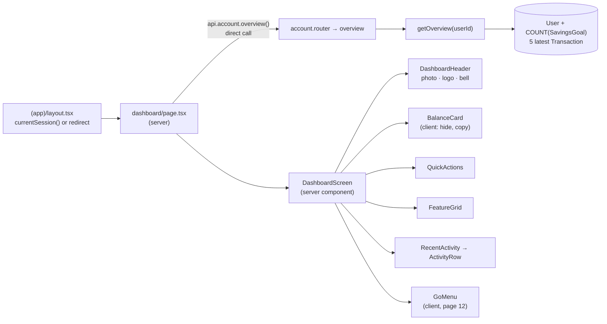

# 11 · Dashboard (home screen)

After signing in, the user lands on **`/dashboard`**. At the top are their photo, the GoBank logo and a bell. Below that come the **balance card** (show or hide the balance, copy the account number, see points), three **quick actions**, the **feature cards** (GoRewards, GoalSave, Bitcoin, Buy load, Pay bills, My card) and the **5 latest transactions**. The floating **GO** button sits at the bottom ([12](12-go-menu.md)).

## At a glance

| | |
| --- | --- |
| **Route** | `/dashboard` (after sign-in and registration; most **Back** buttons and every "Done" after a payment return here) |
| **Frontend** | page `gobank/src/app/(app)/dashboard/page.tsx` (server); `dashboard-screen.tsx` (server component), `balance-card.tsx` (**client**), `quick-actions.tsx`, `feature-grid.tsx`; `recent-activity.tsx`, `activity-row.tsx`, `activity-icon.tsx`; UI `gobank-logo.tsx`, `pocket-art.tsx`, `section-header.tsx`, `screen.tsx`, `go-menu.tsx` |
| **API** | `account.overview` (protected query), called **directly on the server** (also used by My card in the browser, [19](19-my-card.md)) |
| **Backend** | `account.router.ts` (line 13), `account.service.ts` (`getOverview`, lines 9–27), `activity.fields.ts` (`activityFields`, `MAIN_ACCOUNT_KINDS`) |
| **Database** | reads `User`, **counts** `SavingsGoal`, reads the 5 latest `Transaction` rows that are not `interest` |
| **Tests** | `verify-core.ts` (uses `getOverview` as a before/after snapshot), `e2e/smoke.spec.ts` ("demo user signs in to the dashboard") |
| **Deep dive** | [Dashboard and navigation](../05-features/11-dashboard-and-navigation.md) |

## What the user can do

| Part | What it shows or does | Goes to |
| --- | --- | --- |
| Profile picture (top left) | the saved photo, or a person icon | `/settings` ([08](08-profile-screen.md)) |
| Logo (center) | the page's `<h1>`, read as "GoBank Express" | |
| Bell (top right) | | `/notifications` ([16](16-request-inbox.md)) |
| Balance card | the balance, the **eye** button to hide it, the account number with a **copy** button, the points | |
| Quick actions | **Send money** · **Deposit** · **Request** | `/transfer` ([14](14-send-money.md)), `/deposit` ([13](13-deposit.md)), `/request` ([15](15-request-money.md)) |
| GoRewards card | the points | `/rewards` ([31](31-rewards-and-convert.md)) |
| GoalSave card | "Savings goals · 4% p.a." and "N of 5 goals" | `/goals` ([24](24-goalsave-overview.md)) |
| Bitcoin card | "Live price and trades" | `/bitcoin` ([35](35-bitcoin-price.md)) |
| Buy load / Pay bills tiles | | `/load` ([18](18-buy-load.md)), `/bills` ([17](17-pay-bills.md)) |
| My card row | | `/card` ([19](19-my-card.md)) |
| Recent transactions | the 5 latest; each row opens its receipt; **See all** opens the history | `/transactions/<reference>` ([34](34-receipts.md)), `/transactions` ([33](33-transaction-history.md)) |
| **GO** button | eight shortcuts in a full-screen panel | [12](12-go-menu.md) |

## How it works

1. The browser asks for `/dashboard` and sends the `gb_session` cookie.
2. The shared layout `(app)/layout.tsx` runs `currentSession()`. With no valid session it redirects to `/signin`, so this page never renders for a stranger.
3. The page runs `await api.account.overview()`. This is the **server-side tRPC caller**: no HTTP request. `requireSession` checks the cookie again and gives the procedure `ctx.userId`. React's `cache()` (session.ts line 25) lets the layout and the procedure share **one** session lookup per request.
4. `getOverview` is **one Prisma call** that PostgreSQL receives as **two SQL statements**: the user row with the goal count, then the 5 latest non-interest transactions.
5. `DashboardScreen` renders on the server into HTML that already contains the numbers, so there is **no loading spinner**. Only `BalanceCard` (hide/copy) and `GoMenu` (dialog) are client components that ship JavaScript and react to taps.
6. After a payment, the form's "Done" button runs `router.push("/dashboard")` and then `router.refresh()`. The server renders the page again, so the balance and the list are fresh.

## Structure



## Files and locations

| Layer | File | Role |
| --- | --- | --- |
| Layout (server) | `gobank/src/app/(app)/layout.tsx` | session check for every signed-in page |
| Page (server) | `gobank/src/app/(app)/dashboard/page.tsx` | loads the overview, sets the tab title "Home" |
| Frontend | `gobank/src/features/dashboard/components/dashboard-screen.tsx` | header, layout, profile picture |
| Frontend (client) | `gobank/src/features/dashboard/components/balance-card.tsx` | balance, hide/show, copy, points |
| Frontend | `gobank/src/features/dashboard/components/quick-actions.tsx` | three round shortcuts |
| Frontend | `gobank/src/features/dashboard/components/feature-grid.tsx` | feature cards, tiles, My card |
| Frontend | `gobank/src/features/activity/components/recent-activity.tsx` | the list and its empty state |
| Frontend | `gobank/src/features/activity/components/activity-row.tsx` | one transaction row (shared with the history page) |
| Frontend | `gobank/src/features/activity/components/activity-icon.tsx` | icon for each transaction kind |
| UI | `gobank/src/shared/ui/screen.tsx` | the 440 px phone-width frame |
| UI | `gobank/src/shared/ui/section-header.tsx` | "Recent transactions · See all" |
| UI | `gobank/src/shared/ui/gobank-logo.tsx` | the SVG wordmark |
| UI | `gobank/src/shared/ui/pocket-art.tsx` | 11 line icons |
| UI (client) | `gobank/src/shared/ui/go-menu.tsx` | the GO button ([12](12-go-menu.md)) |
| Helpers | `gobank/src/shared/lib/format.ts` | `peso`, `formatAccount`, `shortDate` |
| Helpers | `gobank/src/shared/lib/money.ts` | `MAX_GOALS`, `toPesos` |
| API | `gobank/src/features/account/account.router.ts` | `overview` |
| Service | `gobank/src/features/account/account.service.ts` | `getOverview` |
| Query shape | `gobank/src/features/activity/activity.fields.ts` | which transaction columns, which kinds |

## Frontend

<!-- code: gobank/src/app/(app)/dashboard/page.tsx -->
**`gobank/src/app/(app)/dashboard/page.tsx`** · all 11 lines

```tsx
 1 │ import type { Metadata } from "next";
 2 │ import { DashboardScreen } from "~/features/dashboard/components/dashboard-screen";
 3 │ import { api } from "~/trpc/server";
 4 │
 5 │ export const metadata: Metadata = {
 6 │   title: "Home",
 7 │ };
 8 │
 9 │ export default async function DashboardPage() {
10 │   return <DashboardScreen account={await api.account.overview()} />;
11 │ }
```
<!-- /code -->

<!-- code: gobank/src/features/dashboard/components/dashboard-screen.tsx -->
**`gobank/src/features/dashboard/components/dashboard-screen.tsx`** · all 96 lines

```tsx
 1 │ import { Bell } from "lucide-react";
 2 │ import Image from "next/image";
 3 │ import Link from "next/link";
 4 │ import { MAX_GOALS } from "~/shared/lib/money";
 5 │ import { GoBankLogo } from "~/shared/ui/gobank-logo";
 6 │ import { GoMenu } from "~/shared/ui/go-menu";
 7 │ import { PocketIcon } from "~/shared/ui/pocket-art";
 8 │ import type { RouterOutputs } from "~/trpc/react";
 9 │ import { RecentActivity } from "~/features/activity/components/recent-activity";
10 │ import { BalanceCard } from "./balance-card";
11 │ import { FeatureGrid } from "./feature-grid";
12 │ import { QuickActions } from "./quick-actions";
13 │
14 │ type Overview = RouterOutputs["account"]["overview"];
15 │
16 │ const HEADER_LINK =
17 │   "text-ink grid h-11 w-11 place-items-center transition-opacity hover:opacity-75 focus-visible:outline-2 focus-visible:outline-offset-4";
18 │
19 │ function ProfilePicture({ photo }: { photo: string | null }) {
20 │   if (!photo) {
21 │     return (
22 │       <PocketIcon
23 │         name="profile"
24 │         width={24}
25 │         height={24}
26 │         fill="currentColor"
27 │         stroke="none"
28 │       />
29 │     );
30 │   }
31 │
32 │   return (
33 │     <Image
34 │       src={photo}
35 │       alt="Your profile photo"
36 │       width={36}
37 │       height={36}
38 │       unoptimized
39 │       className="h-9 w-9 rounded-full object-cover"
40 │     />
41 │   );
42 │ }
43 │
44 │ function DashboardHeader({ photo }: { photo: string | null }) {
45 │   return (
46 │     <header className="grid grid-cols-[44px_minmax(0,1fr)_44px] items-center gap-3">
47 │       <Link
48 │         href="/settings"
49 │         aria-label="Profile and settings"
50 │         className={HEADER_LINK}
51 │       >
52 │         <ProfilePicture photo={photo} />
53 │       </Link>
54 │
55 │       <h1 className="text-ink min-w-0">
56 │         <GoBankLogo className="mx-auto h-[46px] w-[126px] max-w-full" />
57 │       </h1>
58 │
59 │       <Link
60 │         href="/notifications"
61 │         aria-label="Notifications"
62 │         className={HEADER_LINK}
63 │       >
64 │         <Bell size={24} fill="currentColor" strokeWidth={1.8} aria-hidden />
65 │       </Link>
66 │     </header>
67 │   );
68 │ }
69 │
70 │ export function DashboardScreen({ account }: { account: Overview }) {
71 │   return (
72 │     <div className="bg-surface-sunken -mx-6 -mt-8 -mb-10 flex flex-1 flex-col gap-6 px-5 pt-7 pb-28">
73 │       <DashboardHeader photo={account.profilePhoto} />
74 │
75 │       <BalanceCard
76 │         balance={account.balance}
77 │         accountNumber={account.accountNumber}
78 │         points={account.points}
79 │       />
80 │
81 │       <QuickActions />
82 │
83 │       <FeatureGrid
84 │         points={account.points}
85 │         goalCount={account._count.savingsGoals}
86 │         goalLimit={MAX_GOALS}
87 │       />
88 │
89 │       <div className="border-line bg-surface rounded-[24px] border p-4 shadow-[0_6px_20px_-10px_#00000080]">
90 │         <RecentActivity entries={account.transactions} />
91 │       </div>
92 │
93 │       <GoMenu />
94 │     </div>
95 │   );
96 │ }
```
<!-- /code -->

<!-- code: gobank/src/features/dashboard/components/balance-card.tsx -->
**`gobank/src/features/dashboard/components/balance-card.tsx`** · all 126 lines

```tsx
  1 │ "use client";
  2 │
  3 │ import { Check, Copy, Eye, EyeOff } from "lucide-react";
  4 │ import { useEffect, useState } from "react";
  5 │ import { formatAccount, peso } from "~/shared/lib/format";
  6 │
  7 │ type CopyStatus = "idle" | "copied" | "error";
  8 │
  9 │ const COPIED_RESET_MS = 2000;
 10 │
 11 │ const COPY_MESSAGE: Record<CopyStatus, string> = {
 12 │   idle: "",
 13 │   copied: "Account number copied.",
 14 │   error: "Couldn't copy. Select the account number to copy it.",
 15 │ };
 16 │
 17 │ function HiddenBalance() {
 18 │   return (
 19 │     <span
 20 │       role="img"
 21 │       aria-label="Balance hidden"
 22 │       className="inline-flex items-center gap-2 leading-none"
 23 │     >
 24 │       <span className="block" aria-hidden>
 25 │         ₱
 26 │       </span>
 27 │       <span className="flex items-center gap-2" aria-hidden>
 28 │         {Array.from({ length: 6 }, (_, index) => (
 29 │           <span
 30 │             key={index}
 31 │             className="h-[7px] w-[7px] shrink-0 rounded-full bg-current"
 32 │           />
 33 │         ))}
 34 │       </span>
 35 │     </span>
 36 │   );
 37 │ }
 38 │
 39 │ export function BalanceCard({
 40 │   balance,
 41 │   accountNumber,
 42 │   points,
 43 │ }: {
 44 │   balance: number;
 45 │   accountNumber: string;
 46 │   points: number;
 47 │ }) {
 48 │   const [visible, setVisible] = useState(true);
 49 │   const [copyStatus, setCopyStatus] = useState<CopyStatus>("idle");
 50 │
 51 │   useEffect(() => {
 52 │     if (copyStatus !== "copied") return;
 53 │
 54 │     const timer = setTimeout(() => setCopyStatus("idle"), COPIED_RESET_MS);
 55 │     return () => clearTimeout(timer);
 56 │   }, [copyStatus]);
 57 │
 58 │   const copyAccountNumber = async () => {
 59 │     try {
 60 │       await navigator.clipboard.writeText(accountNumber);
 61 │       setCopyStatus("copied");
 62 │     } catch {
 63 │       setCopyStatus("error");
 64 │     }
 65 │   };
 66 │
 67 │   return (
 68 │     <section className="bg-surface-raised text-ink relative isolate overflow-hidden rounded-[28px] px-6 py-6 shadow-[0_10px_26px_-12px_#00000080]">
 69 │       <p className="text-ink-muted text-[13px]">Available balance</p>
 70 │
 71 │       <div className="mt-2 flex min-h-12 items-center gap-2">
 72 │         <p className="flex min-w-0 items-center text-[clamp(1.6rem,8vw,2.35rem)] leading-tight font-semibold tracking-tight break-all tabular-nums">
 73 │           {visible ? peso(balance) : <HiddenBalance />}
 74 │         </p>
 75 │
 76 │         <button
 77 │           type="button"
 78 │           onClick={() => setVisible((shown) => !shown)}
 79 │           aria-label={visible ? "Hide balance" : "Show balance"}
 80 │           aria-pressed={!visible}
 81 │           className="text-ink-muted hover:text-ink grid h-11 w-11 shrink-0 place-items-center rounded-full transition-colors hover:bg-white/5 focus-visible:outline-2 focus-visible:outline-offset-2"
 82 │         >
 83 │           {visible ? (
 84 │             <Eye size={17} strokeWidth={2} aria-hidden />
 85 │           ) : (
 86 │             <EyeOff size={17} strokeWidth={2} aria-hidden />
 87 │           )}
 88 │         </button>
 89 │       </div>
 90 │
 91 │       <div className="border-line text-ink-muted mt-6 flex items-center justify-between border-t pt-4 text-[11px]">
 92 │         <div className="flex min-w-0 items-center gap-1">
 93 │           <span className="tabular-nums select-text">
 94 │             {formatAccount(accountNumber)}
 95 │           </span>
 96 │           <button
 97 │             type="button"
 98 │             onClick={() => void copyAccountNumber()}
 99 │             aria-label="Copy account number"
100 │             title={copyStatus === "copied" ? "Copied" : "Copy account number"}
101 │             className="text-ink-muted hover:bg-line hover:text-ink grid h-9 w-9 shrink-0 place-items-center rounded-full transition-colors focus-visible:outline-2 focus-visible:outline-offset-2"
102 │           >
103 │             {copyStatus === "copied" ? (
104 │               <Check size={15} aria-hidden />
105 │             ) : (
106 │               <Copy size={15} aria-hidden />
107 │             )}
108 │           </button>
109 │         </div>
110 │
111 │         <span className="shrink-0 tabular-nums">
112 │           {points.toLocaleString("en-PH")} points
113 │         </span>
114 │       </div>
115 │
116 │       <p
117 │         role="status"
118 │         className={
119 │           copyStatus === "error" ? "text-danger mt-2 text-[11px]" : "sr-only"
120 │         }
121 │       >
122 │         {COPY_MESSAGE[copyStatus]}
123 │       </p>
124 │     </section>
125 │   );
126 │ }
```
<!-- /code -->

<!-- code: gobank/src/features/dashboard/components/quick-actions.tsx -->
**`gobank/src/features/dashboard/components/quick-actions.tsx`** · all 55 lines

```tsx
 1 │ import { Download, HandCoins, Send, type LucideIcon } from "lucide-react";
 2 │ import Link from "next/link";
 3 │ import { cn } from "~/shared/lib/cn";
 4 │
 5 │ type QuickAction = {
 6 │   href: string;
 7 │   label: string;
 8 │   icon: LucideIcon;
 9 │   tone: string;
10 │ };
11 │
12 │ const ACTIONS: QuickAction[] = [
13 │   {
14 │     href: "/transfer",
15 │     label: "Send money",
16 │     icon: Send,
17 │     tone: "border-mint/20 from-[#222e29] to-[#151b18] text-mint group-hover:border-mint/40 group-hover:shadow-[0_8px_24px_-8px_#56e3b135]",
18 │   },
19 │   {
20 │     href: "/deposit",
21 │     label: "Deposit",
22 │     icon: Download,
23 │     tone: "border-sky/20 from-[#222c31] to-[#151a1e] text-sky group-hover:border-sky/40 group-hover:shadow-[0_8px_24px_-8px_#71d5f335]",
24 │   },
25 │   {
26 │     href: "/request",
27 │     label: "Request",
28 │     icon: HandCoins,
29 │     tone: "border-violet/20 from-[#2a2533] to-[#1a171f] text-violet group-hover:border-violet/40 group-hover:shadow-[0_8px_24px_-8px_#bda0fa35]",
30 │   },
31 │ ];
32 │
33 │ export function QuickActions() {
34 │   return (
35 │     <div className="grid grid-cols-3 gap-3">
36 │       {ACTIONS.map(({ href, label, icon: Icon, tone }) => (
37 │         <Link
38 │           key={href}
39 │           href={href}
40 │           className="text-ink focus-visible:outline-mint group flex flex-col items-center gap-2.5 rounded-2xl py-2 focus-visible:outline-2 focus-visible:outline-offset-2"
41 │         >
42 │           <span
43 │             className={cn(
44 │               "grid h-[60px] w-[60px] place-items-center rounded-[20px] border bg-linear-to-br shadow-[0_6px_16px_-8px_#000000,inset_0_1px_0_#ffffff08] transition-all duration-200 group-hover:-translate-y-0.5 group-active:scale-95",
45 │               tone,
46 │             )}
47 │           >
48 │             <Icon size={25} strokeWidth={1.8} aria-hidden />
49 │           </span>
50 │           <span className="text-[11px] font-semibold">{label}</span>
51 │         </Link>
52 │       ))}
53 │     </div>
54 │   );
55 │ }
```
<!-- /code -->

<!-- code: gobank/src/features/dashboard/components/feature-grid.tsx -->
**`gobank/src/features/dashboard/components/feature-grid.tsx`** · all 142 lines

```tsx
  1 │ import { ArrowRight, Gem } from "lucide-react";
  2 │ import Link from "next/link";
  3 │ import type { ReactNode } from "react";
  4 │ import { PocketIcon } from "~/shared/ui/pocket-art";
  5 │
  6 │ type Feature = {
  7 │   href: string;
  8 │   title: string;
  9 │   description: string;
 10 │   meta?: string;
 11 │   icon: ReactNode;
 12 │ };
 13 │
 14 │ const SHORTCUTS = [
 15 │   { href: "/load", label: "Buy load", icon: "phone" },
 16 │   { href: "/bills", label: "Pay bills", icon: "bill" },
 17 │ ] as const;
 18 │
 19 │ const FOCUS_RING =
 20 │   "focus-visible:outline-brand focus-visible:outline-2 focus-visible:outline-offset-2";
 21 │
 22 │ function FeatureRow({ feature }: { feature: Feature }) {
 23 │   return (
 24 │     <Link
 25 │       href={feature.href}
 26 │       className={`border-line bg-surface hover:bg-surface-raised flex min-h-[116px] items-center gap-3 rounded-[28px] border p-5 shadow-[0_5px_18px_-10px_#00000080] transition-colors ${FOCUS_RING}`}
 27 │     >
 28 │       <span className="grid h-12 w-12 shrink-0 place-items-center">
 29 │         {feature.icon}
 30 │       </span>
 31 │
 32 │       <span className="min-w-0 flex-1">
 33 │         <span className="text-ink block text-[19px] leading-6 font-bold tracking-tight">
 34 │           {feature.title}
 35 │         </span>
 36 │         <span className="text-ink-muted mt-1 block text-[12px] leading-5">
 37 │           {feature.description}
 38 │         </span>
 39 │         {feature.meta ? (
 40 │           <span className="text-ink-soft mt-2 block text-[10px] leading-4 font-semibold">
 41 │             {feature.meta}
 42 │           </span>
 43 │         ) : null}
 44 │       </span>
 45 │
 46 │       <ArrowRight size={18} className="text-ink-muted shrink-0" aria-hidden />
 47 │     </Link>
 48 │   );
 49 │ }
 50 │
 51 │ export function FeatureGrid({
 52 │   points,
 53 │   goalCount,
 54 │   goalLimit,
 55 │ }: {
 56 │   points: number;
 57 │   goalCount: number;
 58 │   goalLimit: number;
 59 │ }) {
 60 │   const features: Feature[] = [
 61 │     {
 62 │       href: "/rewards",
 63 │       title: "GoRewards",
 64 │       description: `${points.toLocaleString("en-PH")} points`,
 65 │       icon: (
 66 │         <Gem
 67 │           size={26}
 68 │           strokeWidth={1.7}
 69 │           className="text-ink-soft"
 70 │           aria-hidden
 71 │         />
 72 │       ),
 73 │     },
 74 │     {
 75 │       href: "/goals",
 76 │       title: "GoalSave",
 77 │       description: "Savings goals · 4% p.a.",
 78 │       meta: `${goalCount} of ${goalLimit} goals`,
 79 │       icon: (
 80 │         <PocketIcon
 81 │           name="goal"
 82 │           width={32}
 83 │           height={32}
 84 │           className="text-ink-soft"
 85 │         />
 86 │       ),
 87 │     },
 88 │     {
 89 │       href: "/bitcoin",
 90 │       title: "Bitcoin",
 91 │       description: "Live price and trades",
 92 │       icon: (
 93 │         <PocketIcon
 94 │           name="chart"
 95 │           width={32}
 96 │           height={32}
 97 │           className="text-ink-soft"
 98 │         />
 99 │       ),
100 │     },
101 │   ];
102 │
103 │   return (
104 │     <section className="flex flex-col gap-3">
105 │       {features.map((feature) => (
106 │         <FeatureRow key={feature.href} feature={feature} />
107 │       ))}
108 │
109 │       <div className="grid grid-cols-2 gap-3">
110 │         {SHORTCUTS.map(({ href, label, icon }) => (
111 │           <Link
112 │             key={href}
113 │             href={href}
114 │             className={`border-line bg-surface text-ink hover:bg-surface-raised flex min-h-20 items-center justify-center gap-3 rounded-[24px] border px-3 py-4 text-[14px] font-medium transition-colors ${FOCUS_RING}`}
115 │           >
116 │             <PocketIcon
117 │               name={icon}
118 │               width={25}
119 │               height={25}
120 │               className="shrink-0"
121 │             />
122 │             {label}
123 │           </Link>
124 │         ))}
125 │       </div>
126 │
127 │       <Link
128 │         href="/card"
129 │         className={`text-ink grid min-h-16 grid-cols-[48px_minmax(0,1fr)_18px] items-center gap-3 px-5 py-3 text-[16px] font-medium transition-opacity hover:opacity-80 ${FOCUS_RING}`}
130 │       >
131 │         <PocketIcon
132 │           name="card"
133 │           width={26}
134 │           height={26}
135 │           className="justify-self-center"
136 │         />
137 │         <span>My card</span>
138 │         <ArrowRight size={18} className="text-ink-muted shrink-0" aria-hidden />
139 │       </Link>
140 │     </section>
141 │   );
142 │ }
```
<!-- /code -->

<!-- code: gobank/src/features/activity/components/recent-activity.tsx -->
**`gobank/src/features/activity/components/recent-activity.tsx`** · all 39 lines

```tsx
 1 │ import Link from "next/link";
 2 │ import { shortDate } from "~/shared/lib/format";
 3 │ import { SectionHeader } from "~/shared/ui/section-header";
 4 │ import type { ActivityEntry } from "../activity.fields";
 5 │ import { ActivityRow } from "./activity-row";
 6 │
 7 │ function NoTransactions() {
 8 │   return (
 9 │     <div className="bg-surface-sunken flex flex-col items-center gap-1 rounded-2xl px-6 py-8 text-center">
10 │       <p className="text-ink text-[14px] font-medium">No transactions yet</p>
11 │       <Link
12 │         href="/deposit"
13 │         className="text-brand hover:text-brand-hover mt-2 text-[13px] font-medium transition-colors"
14 │       >
15 │         Make a deposit
16 │       </Link>
17 │     </div>
18 │   );
19 │ }
20 │
21 │ export function RecentActivity({ entries }: { entries: ActivityEntry[] }) {
22 │   return (
23 │     <section>
24 │       <SectionHeader title="Recent transactions" href="/transactions" />
25 │
26 │       {entries.length === 0 ? (
27 │         <NoTransactions />
28 │       ) : (
29 │         <ul className="flex flex-col gap-4">
30 │           {entries.map((entry) => (
31 │             <li key={entry.reference}>
32 │               <ActivityRow entry={entry} detail={shortDate(entry.createdAt)} />
33 │             </li>
34 │           ))}
35 │         </ul>
36 │       )}
37 │     </section>
38 │   );
39 │ }
```
<!-- /code -->

<!-- code: gobank/src/features/activity/components/activity-row.tsx -->
**`gobank/src/features/activity/components/activity-row.tsx`** · all 44 lines

```tsx
 1 │ import Link from "next/link";
 2 │ import { cn } from "~/shared/lib/cn";
 3 │ import { peso } from "~/shared/lib/format";
 4 │ import type { ActivityEntry } from "../activity.fields";
 5 │ import { activityIcon } from "./activity-icon";
 6 │
 7 │ export function ActivityRow({
 8 │   entry,
 9 │   detail,
10 │ }: {
11 │   entry: ActivityEntry;
12 │   detail: string;
13 │ }) {
14 │   const incoming = entry.amount > 0;
15 │   const Icon = activityIcon(entry);
16 │
17 │   return (
18 │     <Link
19 │       href={`/transactions/${entry.reference}`}
20 │       className="group flex items-center gap-3.5"
21 │     >
22 │       <span className="bg-surface-sunken text-ink-soft grid h-10 w-10 shrink-0 place-items-center rounded-full">
23 │         <Icon size={16} strokeWidth={1.9} aria-hidden />
24 │       </span>
25 │
26 │       <span className="min-w-0 flex-1">
27 │         <span className="text-ink group-hover:text-brand block truncate text-[14px] font-medium transition-colors">
28 │           {entry.title}
29 │         </span>
30 │         <span className="text-ink-muted block text-[12px]">{detail}</span>
31 │       </span>
32 │
33 │       <span
34 │         className={cn(
35 │           "shrink-0 text-[14px] font-semibold tabular-nums",
36 │           incoming ? "text-brand" : "text-danger",
37 │         )}
38 │       >
39 │         {incoming ? "+" : "−"}
40 │         {peso(Math.abs(entry.amount))}
41 │       </span>
42 │     </Link>
43 │   );
44 │ }
```
<!-- /code -->

<!-- code: gobank/src/features/activity/components/activity-icon.tsx -->
**`gobank/src/features/activity/components/activity-icon.tsx`** · all 32 lines

```tsx
 1 │ import type { LucideIcon } from "lucide-react";
 2 │ import {
 3 │   ArrowDownLeft,
 4 │   ArrowDownToLine,
 5 │   ArrowLeftRight,
 6 │   ArrowUpRight,
 7 │   PiggyBank,
 8 │   Receipt,
 9 │   Smartphone,
10 │   Sparkles,
11 │   TrendingUp,
12 │ } from "lucide-react";
13 │ import type { ActivityEntry } from "../activity.fields";
14 │
15 │ const ICONS: Record<ActivityEntry["kind"], LucideIcon> = {
16 │   deposit: ArrowDownToLine,
17 │   transfer: ArrowUpRight,
18 │   bill: Receipt,
19 │   load: Smartphone,
20 │   stash: PiggyBank,
21 │   reward: Sparkles,
22 │   interest: TrendingUp,
23 │   exchange: ArrowLeftRight,
24 │ };
25 │
26 │ export function activityIcon(
27 │   entry: Pick<ActivityEntry, "kind" | "amount">,
28 │ ): LucideIcon {
29 │   const receivedTransfer = entry.kind === "transfer" && entry.amount > 0;
30 │
31 │   return receivedTransfer ? ArrowDownLeft : ICONS[entry.kind];
32 │ }
```
<!-- /code -->

<!-- code: gobank/src/shared/ui/section-header.tsx -->
**`gobank/src/shared/ui/section-header.tsx`** · all 23 lines

```tsx
 1 │ import Link from "next/link";
 2 │
 3 │ export function SectionHeader({
 4 │   title,
 5 │   href,
 6 │ }: {
 7 │   title: string;
 8 │   href: string;
 9 │ }) {
10 │   return (
11 │     <header className="mb-4 flex items-baseline justify-between">
12 │       <h2 className="text-ink text-[15px] font-semibold tracking-tight">
13 │         {title}
14 │       </h2>
15 │       <Link
16 │         href={href}
17 │         className="text-ink-muted hover:text-brand text-[12.5px] font-medium transition-colors"
18 │       >
19 │         See all
20 │       </Link>
21 │     </header>
22 │   );
23 │ }
```
<!-- /code -->

<!-- code: gobank/src/shared/ui/gobank-logo.tsx -->
**`gobank/src/shared/ui/gobank-logo.tsx`** · all 42 lines

```tsx
 1 │ import type { SVGProps } from "react";
 2 │
 3 │ export function GoBankLogo(props: SVGProps<SVGSVGElement>) {
 4 │   return (
 5 │     <svg
 6 │       viewBox="0 0 126 50"
 7 │       role="img"
 8 │       aria-label="GoBank Express"
 9 │       fill="currentColor"
10 │       {...props}
11 │     >
12 │       <g fontFamily="var(--font-geist-sans), sans-serif">
13 │         <text x="0" y="31" fontSize="34" fontWeight="750" letterSpacing="-2">
14 │           G
15 │         </text>
16 │         <circle
17 │           cx="40"
18 │           cy="19"
19 │           r="10.5"
20 │           fill="none"
21 │           stroke="currentColor"
22 │           strokeWidth="5.5"
23 │           strokeDasharray="1.15 0.5"
24 │           transform="rotate(-90 40 19)"
25 │         />
26 │         <text x="55" y="31" fontSize="29" fontWeight="500" letterSpacing="-1.4">
27 │           Bank
28 │         </text>
29 │         <text
30 │           x="122"
31 │           y="46"
32 │           textAnchor="end"
33 │           fontSize="10.5"
34 │           fontWeight="400"
35 │           letterSpacing="0.8"
36 │         >
37 │           express
38 │         </text>
39 │       </g>
40 │     </svg>
41 │   );
42 │ }
```
<!-- /code -->

<!-- code: gobank/src/shared/ui/pocket-art.tsx -->
**`gobank/src/shared/ui/pocket-art.tsx`** · all 50 lines

```tsx
 1 │ import type { SVGProps } from "react";
 2 │
 3 │ type PocketIconName =
 4 │   | "home"
 5 │   | "send"
 6 │   | "deposit"
 7 │   | "request"
 8 │   | "goal"
 9 │   | "card"
10 │   | "profile"
11 │   | "spark"
12 │   | "chart"
13 │   | "bill"
14 │   | "phone";
15 │
16 │ const paths: Record<PocketIconName, string> = {
17 │   home: "M4 11 12 4l8 7v9h-6v-6h-4v6H4z",
18 │   send: "m3 10 18-7-7 18-3-8-8-3Zm8 3 5-5",
19 │   deposit: "M12 3v12m-5-5 5 5 5-5M4 15v5h16v-5",
20 │   request: "M4 17h4l4 3 8-6M8 17v-5h5a2 2 0 0 1 0 4h-2M16 3v6m-3-3h6",
21 │   goal: "M4 3h16v16H4zM6 19v2m12-2v2M15 11a4 4 0 1 1-8 0 4 4 0 0 1 8 0Zm-4-4v8m-4-4h8m3-3v6",
22 │   card: "M3 6h18v13H3zM3 10h18M6 15h4",
23 │   profile: "M16 7a4 4 0 1 1-8 0 4 4 0 0 1 8 0ZM4 21v-2a8 8 0 0 1 16 0v2",
24 │   spark: "m12 2 3 7 7 3-7 3-3 7-3-7-7-3 7-3 3-7Z",
25 │   chart: "M4 4v16h17M7 14l5-5 4 3 5-8m-5 0h5v5",
26 │   bill: "M5 3h14v18l-3-2-4 2-4-2-3 2V3Zm4 5h6m-6 4h6",
27 │   phone: "M7 2h10v20H7zM10 5h4m-3 14h2",
28 │ };
29 │
30 │ export function PocketIcon({
31 │   name,
32 │   ...props
33 │ }: SVGProps<SVGSVGElement> & { name: PocketIconName }) {
34 │   return (
35 │     <svg
36 │       width="24"
37 │       height="24"
38 │       viewBox="0 0 24 24"
39 │       fill="none"
40 │       stroke="currentColor"
41 │       strokeWidth="2.2"
42 │       strokeLinecap="round"
43 │       strokeLinejoin="round"
44 │       aria-hidden="true"
45 │       {...props}
46 │     >
47 │       <path d={paths[name]} />
48 │     </svg>
49 │   );
50 │ }
```
<!-- /code -->

## Backend

<!-- code: gobank/src/features/account/account.router.ts 13-13 -->
**`gobank/src/features/account/account.router.ts`** · line 13

```ts
13 │   overview: protectedProcedure.query(({ ctx }) => getOverview(ctx.userId)),
```
<!-- /code -->

<!-- code: gobank/src/features/account/account.service.ts 9-27 -->
**`gobank/src/features/account/account.service.ts`** · lines 9–27

```ts
 9 │ export const getOverview = (userId: string) =>
10 │   db.user.findUniqueOrThrow({
11 │     where: { id: userId },
12 │     select: {
13 │       username: true,
14 │       fullName: true,
15 │       profilePhoto: true,
16 │       accountNumber: true,
17 │       balance: true,
18 │       points: true,
19 │       _count: { select: { savingsGoals: true } },
20 │       transactions: {
21 │         where: { kind: MAIN_ACCOUNT_KINDS },
22 │         select: activityFields,
23 │         orderBy: [{ createdAt: "desc" }, { id: "desc" }],
24 │         take: 5,
25 │       },
26 │     },
27 │   });
```
<!-- /code -->

<!-- code: gobank/src/features/activity/activity.fields.ts -->
**`gobank/src/features/activity/activity.fields.ts`** · all 17 lines

```ts
 1 │ import type { Prisma } from "../../../generated/prisma";
 2 │
 3 │ export const activityFields = {
 4 │   id: true,
 5 │   reference: true,
 6 │   kind: true,
 7 │   title: true,
 8 │   amount: true,
 9 │   points: true,
10 │   createdAt: true,
11 │ } as const;
12 │
13 │ export const MAIN_ACCOUNT_KINDS = { not: "interest" } as const;
14 │
15 │ export type ActivityEntry = Prisma.TransactionGetPayload<{
16 │   select: typeof activityFields;
17 │ }>;
```
<!-- /code -->

## Database

| Table | Columns read | Rule |
| --- | --- | --- |
| `User` | `username`, `fullName`, `profilePhoto`, `accountNumber`, `balance`, `points` | the signed-in user only (`where: { id: userId }`) |
| `SavingsGoal` | none, only `COUNT(*)` | for "N of 5 goals" |
| `Transaction` | `id`, `reference`, `kind`, `title`, `amount`, `points`, `createdAt` | `kind` is not `interest`; newest first; at most 5 |

Nothing is written by this feature.

## The complicated parts, explained step by step

### 1. One Prisma call, two SQL statements

<!-- code: gobank/src/features/account/account.service.ts 19-25 -->
**`gobank/src/features/account/account.service.ts`** · lines 19–25

```ts
19 │       _count: { select: { savingsGoals: true } },
20 │       transactions: {
21 │         where: { kind: MAIN_ACCOUNT_KINDS },
22 │         select: activityFields,
23 │         orderBy: [{ createdAt: "desc" }, { id: "desc" }],
24 │         take: 5,
25 │       },
```
<!-- /code -->

This is the SQL PostgreSQL actually received, **captured from its statement log** while calling `getOverview` for the seeded user `@dante` (columns shortened):

```sql
-- statement 1: the user row + the goal count
SELECT "User"."id", "User"."username", "User"."fullName", "User"."profilePhoto",
       "User"."accountNumber", "User"."balance", "User"."points",
       COALESCE("aggr_selection_0_SavingsGoal"."_aggr_count_savingsGoals", 0)
FROM "User"
LEFT JOIN (SELECT "SavingsGoal"."userId", COUNT(*) AS "_aggr_count_savingsGoals"
           FROM "SavingsGoal" WHERE 1=1 GROUP BY "SavingsGoal"."userId")
       AS "aggr_selection_0_SavingsGoal" ON ("User"."id" = "aggr_selection_0_SavingsGoal"."userId")
WHERE ("User"."id" = $1 AND 1=1) LIMIT $2 OFFSET $3

-- statement 2: the 5 latest main-account transactions
SELECT "Transaction"."id", "Transaction"."reference", "Transaction"."kind"::text,
       "Transaction"."title", "Transaction"."amount", "Transaction"."points",
       "Transaction"."createdAt", "Transaction"."userId"
FROM "Transaction"
WHERE ("Transaction"."kind" <> CAST($1::text AS "TransactionKind")
       AND "Transaction"."userId" IN ($2))
ORDER BY "Transaction"."createdAt" DESC, "Transaction"."id" DESC
LIMIT $3 OFFSET $4
```

| Prisma code (line) | Became in SQL | Why |
| --- | --- | --- |
| `_count: { select: { savingsGoals: true } }` (19) | `LEFT JOIN (… COUNT(*) … GROUP BY "userId")` + `COALESCE(…, 0)` | counts goals **in the database**; the rows themselves are never sent. `LEFT JOIN` + `COALESCE` turns "no goals" into `0` instead of no row |
| `where: { kind: MAIN_ACCOUNT_KINDS }` (21) | `"kind" <> 'interest'` | interest is paid **into goals**, not the main balance (the ledger saves interest with `balanceAfter` = the unchanged main balance), so it does not belong in the main account's list |
| `select: activityFields` (22) | only 7 columns (+ `userId` for matching) | `balanceAfter` and `details` are not needed on the dashboard |
| `orderBy: [{ createdAt: "desc" }, { id: "desc" }]` (23) | `ORDER BY "createdAt" DESC, "id" DESC` | the `id` is a **tie-breaker**: two rows written in the same millisecond still come back in a fixed order on every load |
| `take: 5` (24) | `LIMIT 5` | the dashboard shows 5; "See all" pages through the rest |

The result for `@dante` (real output, shortened):

| Field | Value |
| --- | --- |
| `balance` | `992345` (centavos) → shown as **₱9,923.45** |
| `points` | `0` |
| `_count.savingsGoals` | `0` → "0 of 5 goals" |
| `transactions[0]` | `GBT6KKM8GU`, `deposit`, "Cash deposit", `12345` |
| `transactions[1]` | `GBKG469ZHU`, `transfer`, "Transfer from @maricel", `40000` |

The dashboard does not need a hand-written `JOIN`, and it also does not load all goals just to count them.

### 2. The copy button is a small state machine

<!-- code: gobank/src/features/dashboard/components/balance-card.tsx 49-65 -->
**`gobank/src/features/dashboard/components/balance-card.tsx`** · lines 49–65

```tsx
49 │   const [copyStatus, setCopyStatus] = useState<CopyStatus>("idle");
50 │
51 │   useEffect(() => {
52 │     if (copyStatus !== "copied") return;
53 │
54 │     const timer = setTimeout(() => setCopyStatus("idle"), COPIED_RESET_MS);
55 │     return () => clearTimeout(timer);
56 │   }, [copyStatus]);
57 │
58 │   const copyAccountNumber = async () => {
59 │     try {
60 │       await navigator.clipboard.writeText(accountNumber);
61 │       setCopyStatus("copied");
62 │     } catch {
63 │       setCopyStatus("error");
64 │     }
65 │   };
```
<!-- /code -->

`copyStatus` has three values: `"idle" | "copied" | "error"`.

| Event | `copyStatus` | Icon | Message (`role="status"`, lines 116–123) |
| --- | --- | --- | --- |
| page loads | `idle` | copy icon | empty |
| tap, the browser allows the clipboard | `copied` | **check mark** | "Account number copied." **only for screen readers** (`sr-only`) |
| 2 seconds later (the effect's timer, line 54) | `idle` | copy icon | empty |
| tap, the browser refuses (no permission, not HTTPS) | `error` | copy icon | "Couldn't copy. Select the account number to copy it." **in red** |
| tap again after an error | `copied` or `error` | | |

Two details in the effect:

| Detail | Line | What it prevents |
| --- | --- | --- |
| `if (copyStatus !== "copied") return;` | 52 | an error message does not disappear by itself; the user has time to read it |
| `return () => clearTimeout(timer);` | 55 | if the status changes, or the user leaves the page within 2 s, the old timer is cancelled and cannot change the state later |

A second tap while the check mark is showing sets `"copied"` again. The value is the **same**, so the effect's dependency `[copyStatus]` does not change, the timer is **not** restarted, and the check mark disappears 2 s after the **first** tap.

### 3. Hiding the balance: privacy screen, not security

<!-- code: gobank/src/features/dashboard/components/balance-card.tsx 72-88 -->
**`gobank/src/features/dashboard/components/balance-card.tsx`** · lines 72–88

```tsx
72 │         <p className="flex min-w-0 items-center text-[clamp(1.6rem,8vw,2.35rem)] leading-tight font-semibold tracking-tight break-all tabular-nums">
73 │           {visible ? peso(balance) : <HiddenBalance />}
74 │         </p>
75 │
76 │         <button
77 │           type="button"
78 │           onClick={() => setVisible((shown) => !shown)}
79 │           aria-label={visible ? "Hide balance" : "Show balance"}
80 │           aria-pressed={!visible}
81 │           className="text-ink-muted hover:text-ink grid h-11 w-11 shrink-0 place-items-center rounded-full transition-colors hover:bg-white/5 focus-visible:outline-2 focus-visible:outline-offset-2"
82 │         >
83 │           {visible ? (
84 │             <Eye size={17} strokeWidth={2} aria-hidden />
85 │           ) : (
86 │             <EyeOff size={17} strokeWidth={2} aria-hidden />
87 │           )}
88 │         </button>
```
<!-- /code -->

| `visible` | Shown | Button label | `aria-pressed` |
| --- | --- | --- | --- |
| `true` (start) | `₱9,923.45` | "Hide balance" (eye) | `false` |
| `false` | `₱ ● ● ● ● ● ●` read as "Balance hidden" | "Show balance" (eye with a slash) | `true` |

- When hidden, the amount is **removed from the page** (`visible ? peso(balance) : <HiddenBalance />`). It is not just made invisible, so a screen reader or text selection cannot reveal it.
- `HiddenBalance` (lines 17–37) is one `role="img"` with `aria-label="Balance hidden"`; its "₱" and dots are `aria-hidden`, so a screen reader does not read "peso" followed by six empty items.
- The choice lives in React state and is **not saved**: it is visible again after a reload.
- **Be honest in the defense:** the balance is still in the page data sent by the server (the `balance` prop of this client component). Hiding is meant to stop someone **looking over your shoulder**. It does not keep the number from the device.

### 4. Account number grouping with a lookahead

<!-- code: gobank/src/shared/lib/format.ts 25-26 -->
**`gobank/src/shared/lib/format.ts`** · lines 25–26

```ts
25 │ export const formatAccount = (accountNumber: string) =>
26 │   accountNumber.replace(/(\d{4})(?=\d)/g, "$1 ");
```
<!-- /code -->

`/(\d{4})(?=\d)/g` means "four digits **followed by another digit**". `(?=\d)` checks the next character without consuming it.

| Input | Output | Why |
| --- | --- | --- |
| `20353020719` (11 digits) | `2035 3020 719` | spaces after the 1st and 2nd group of four |
| `12345678` (8 digits) | `1234 5678` | after the second group nothing follows, so **no trailing space** |
| `1234` | `1234` | no digit after the group, no space |

Without the lookahead (`/(\d{4})/g` → `"$1 "`), `12345678` would become `"1234 5678 "` with a stray space at the end. The number is also `select-text`, so it can be copied by hand if the clipboard is refused.

### 5. Signs, colors and icons in a transaction row

<!-- code: gobank/src/features/activity/components/activity-row.tsx 14-15 -->
**`gobank/src/features/activity/components/activity-row.tsx`** · lines 14–15

```tsx
14 │   const incoming = entry.amount > 0;
15 │   const Icon = activityIcon(entry);
```
<!-- /code -->

<!-- code: gobank/src/features/activity/components/activity-row.tsx 33-41 -->
**`gobank/src/features/activity/components/activity-row.tsx`** · lines 33–41

```tsx
33 │       <span
34 │         className={cn(
35 │           "shrink-0 text-[14px] font-semibold tabular-nums",
36 │           incoming ? "text-brand" : "text-danger",
37 │         )}
38 │       >
39 │         {incoming ? "+" : "−"}
40 │         {peso(Math.abs(entry.amount))}
41 │       </span>
```
<!-- /code -->

| `kind`, `amount` | `incoming` | Shown | Color | Icon (`activityIcon`) |
| --- | --- | --- | --- | --- |
| `deposit`, `12345` | `true` | **+₱123.45** | green (`text-brand`) | `ArrowDownToLine` |
| `transfer`, `40000` (received) | `true` | **+₱400.00** | green | `ArrowDownLeft` (received) |
| `transfer`, `-15000` (sent) | `false` | **−₱150.00** | red (`text-danger`) | `ArrowUpRight` |
| `bill`, `-50000` | `false` | **−₱500.00** | red | `Receipt` |

- The code prints its **own** sign and formats `Math.abs(amount)`. `peso(-1500)` alone would give `-₱15.00`, with a short hyphen in front of the peso sign. The `−` used here is the real minus sign (U+2212), the same width as `+`, so the amounts line up.
- Sent and received transfers share the kind `transfer`. Only the **sign** tells them apart, which is why `activityIcon` (lines 26–31) checks `entry.amount > 0`.
- `ICONS` is typed `Record<ActivityEntry["kind"], LucideIcon>`: if a new kind is added to the database enum, TypeScript refuses to compile until it gets an icon.

### 6. The negative margins

<!-- code: gobank/src/shared/ui/screen.tsx 6-6 -->
**`gobank/src/shared/ui/screen.tsx`** · line 6

```tsx
6 │       <div className="bg-surface border-line flex w-full max-w-[440px] flex-col px-6 pt-8 pb-10 sm:border-x">
```
<!-- /code -->

<!-- code: gobank/src/features/dashboard/components/dashboard-screen.tsx 72-72 -->
**`gobank/src/features/dashboard/components/dashboard-screen.tsx`** · line 72

```tsx
72 │     <div className="bg-surface-sunken -mx-6 -mt-8 -mb-10 flex flex-1 flex-col gap-6 px-5 pt-7 pb-28">
```
<!-- /code -->

| Side | `Screen` adds | Dashboard removes | Dashboard adds | Result |
| --- | --- | --- | --- | --- |
| left/right | `px-6` (24 px) | `-mx-6` (−24 px) | `px-5` (20 px) | darker background edge to edge, 20 px gutters |
| top | `pt-8` (32 px) | `-mt-8` | `pt-7` (28 px) | the header sits a little higher |
| bottom | `pb-10` (40 px) | `-mb-10` | `pb-28` (**112 px**) | room for the floating GO button (80 px button + 24 px gap = 104 px), so the last card is never hidden behind it |

Every other screen keeps the standard padding. The dashboard cancels it **exactly** and uses its own spacing and its darker `bg-surface-sunken`, without changing the shared `Screen` component.

### 7. One constant for the goal limit

`FeatureGrid` shows `` `${goalCount} of ${goalLimit} goals` `` with `goalLimit={MAX_GOALS}` (dashboard-screen line 86). The server uses the **same** constant to refuse a sixth goal (`goals.service.ts` line 72, [25](25-create-goal.md)):

<!-- code: gobank/src/shared/lib/money.ts 1-1 -->
**`gobank/src/shared/lib/money.ts`** · line 1

```ts
1 │ export const MAX_GOALS = 5;
```
<!-- /code -->

If the limit changes, the dashboard text and the server rule change together.

### 8. The logo's ridged "o"

<!-- code: gobank/src/shared/ui/gobank-logo.tsx 16-25 -->
**`gobank/src/shared/ui/gobank-logo.tsx`** · lines 16–25

```tsx
16 │         <circle
17 │           cx="40"
18 │           cy="19"
19 │           r="10.5"
20 │           fill="none"
21 │           stroke="currentColor"
22 │           strokeWidth="5.5"
23 │           strokeDasharray="1.15 0.5"
24 │           transform="rotate(-90 40 19)"
25 │         />
```
<!-- /code -->

| Attribute | Value | Effect |
| --- | --- | --- |
| `r` | 10.5 | circumference = 2 × π × 10.5 ≈ **65.97** units |
| `strokeDasharray` | `1.15 0.5` | dash 1.15, gap 0.5 → one pattern is 1.65 units → 65.97 ÷ 1.65 ≈ **40 ridges** around the ring |
| `strokeWidth` | 5.5 | each dash is a thick radial bar, so the ring looks like the ridged edge of a coin |
| `transform` | `rotate(-90 40 19)` | a circle's stroke starts at 3 o'clock; turning it −90° around its center starts it at 12 o'clock, where the tiny leftover gap (40 × 1.65 = 66.0, about 0.03 more than the circumference) is hardest to notice |

`fill="currentColor"` makes the whole logo take the text color, and `role="img"` + `aria-label="GoBank Express"` make it one readable heading.

### 9. Dates on this list are formatted on the server

`RecentActivity` has no `"use client"`, so `shortDate(entry.createdAt)` runs **on the server**, in the server's time zone (`SHORT_DATE` in format.ts has no `timeZone` option). Verified with Node:

| `createdAt` (UTC) | Formatted with `TZ=UTC` | Formatted with `TZ=Asia/Manila` |
| --- | --- | --- |
| `2026-11-03T23:35:56Z` (7:35 AM on Nov 4 in Manila) | **Nov 3** | **Nov 4** |

On a UTC server, an early-morning Manila transaction shows the **previous day** on the dashboard, while the history page (formatted in the browser) shows the correct day. The fix is one option: `timeZone: "Asia/Manila"`. This is listed in [Limitations](../09-defense/03-limitations-and-future-work.md).

## Rules and limits

| Rule | Value |
| --- | --- |
| Transactions shown | 5 latest, `interest` excluded |
| Goal counter | "N of 5 goals" (`MAX_GOALS`) |
| Copy feedback | check mark for 2 s (`COPIED_RESET_MS`) |
| Balance hidden | per visit; not saved |

## Messages

| Text | When |
| --- | --- |
| Available balance | balance card label |
| Hide balance / Show balance | eye button (screen-reader label) |
| Balance hidden | the dots, for screen readers |
| Account number copied. | after copying (screen readers only) |
| Couldn't copy. Select the account number to copy it. | the clipboard was refused |
| N points | balance card and GoRewards card (`toLocaleString("en-PH")`, e.g. `1,234,567 points`) |
| Recent transactions · See all | list header |
| No transactions yet · Make a deposit | empty list |
| Profile and settings / Notifications | header link labels |

## Tests

- `verify-core.ts` uses `getOverview` as a **snapshot** of the whole account: it saves `getOverview(owner.id)`, tries a payment that must fail (too little balance; a locked card), and then checks `assert.deepEqual(await getOverview(owner.id), before)`. Balance, points, goal count and the latest transactions must be **exactly** unchanged. It also checks the points through `getOverview`: after a ₱50 bill (1 point) and a ₱100 load (loads earn no points, `KINDS_THAT_EARN_POINTS` is only `transfer` and `bill`), `points` must be exactly `1`.
- `e2e/smoke.spec.ts` signs in as `@maricel` and expects to see "Available balance" and "Recent transactions". It **passed** when run in Chromium for this review ([Testing §2](../07-testing/01-testing.md#2-results-measured-for-these-docs)).
- **Checked in a real browser** (Chromium, the app on a local database, browser time zone Asia/Manila):
  - **Hide balance** sets `aria-pressed="true"`, shows the "Balance hidden" image, and no peso amount is left in the card's text.
  - **Copy** without clipboard permission shows "Couldn't copy. Select the account number to copy it."
  - On the UTC dev server, the list showed **Nov 3** for transfers made at 7:35 AM on **Nov 4** Manila time ([§9](#9-dates-on-this-list-are-formatted-on-the-server)).
