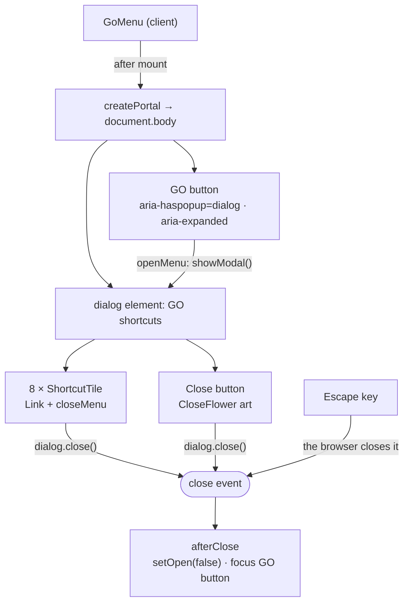

# 12 · GO menu (floating shortcuts)

A round **GO** button floats at the bottom of the **dashboard** and the **GoalSave** screen. Tapping it opens a full-screen **Quick actions** panel with eight shortcuts. The panel grows out of the button as a circle, and the button turns into a spinning "flower" with an **×** that closes it.

## At a glance

| | |
| --- | --- |
| **Route** | none of its own; shown on `/dashboard` ([11](11-dashboard.md)) and `/goals` ([24](24-goalsave-overview.md)) |
| **Frontend** | `gobank/src/shared/ui/go-menu.tsx` (client component), `gobank/src/shared/ui/go-menu.module.css` (all its animations); the global reduced-motion rule in `gobank/src/styles/globals.css` |
| **API** | none (the menu only links to other pages) |
| **Backend** | none |
| **Database** | none |
| **Tests** | no automated test; checked in Chromium for this review ([Tests](#tests)) |
| **Deep dive** | [Dashboard and navigation §5](../05-features/11-dashboard-and-navigation.md#5-the-go-menu-go-menutsx) |

## What the user can do

| Action | Result |
| --- | --- |
| Tap **GO** | the panel opens; the page behind cannot be scrolled, clicked or reached with Tab |
| Tap a shortcut | the panel closes and the app goes there |
| Tap **×**, or press **Escape** | the panel closes; keyboard focus returns to the GO button |

The eight shortcuts (`SHORTCUTS`, lines 27–41):

| # | Label | Goes to | Icon color |
| --- | --- | --- | --- |
| 0 | Send money | `/transfer` ([14](14-send-money.md)) | mint |
| 1 | Deposit | `/deposit` ([13](13-deposit.md)) | sky |
| 2 | Request | `/request` ([15](15-request-money.md)) | violet |
| 3 | GoalSave | `/goals` ([24](24-goalsave-overview.md)) | gold |
| 4 | Pay bills | `/bills` ([17](17-pay-bills.md)) | sky |
| 5 | Buy load | `/load` ([18](18-buy-load.md)) | violet |
| 6 | Bitcoin | `/bitcoin` ([35](35-bitcoin-price.md)) | gold |
| 7 | Profile | `/settings` ([08](08-profile-screen.md)) | soft gray (`text-ink-soft`) |

## How it works

1. On the server, and during the browser's first render, `GoMenu` renders **nothing** (`mounted` is `false`).
2. After it mounts, it renders through `createPortal` into `document.body`: a fixed bottom bar holding the GO button, and a closed `<dialog>`.
3. A tap runs `dialog.showModal()` and `setOpen(true)`. The browser moves focus to the first shortcut, makes the page behind **inert** and draws the `::backdrop`. `useBodyScrollLock(true)` sets `body.style.overflow = "hidden"`.
4. The CSS animations start because the dialog now has the `open` attribute (every rule is written as `.panel[open] …`): the circle unfolds, the heading and tiles arrive one after another, and the GO orb dissolves into the close flower.
5. Every way of closing (×, Escape, a shortcut) ends with the dialog's **`close` event** → `afterClose` → `setOpen(false)` (scroll unlocked) and focus back on the GO button.

## Structure



## Files and locations

| Layer | File | Role |
| --- | --- | --- |
| Frontend (client) | `gobank/src/shared/ui/go-menu.tsx` | button, dialog, tiles and the SVG art (`GoOrb`, `CloseFlower`, `Petals`) |
| Styles | `gobank/src/shared/ui/go-menu.module.css` | the 9 keyframe animations and the reduced-motion rule |
| Styles | `gobank/src/styles/globals.css` | color tokens (`--color-cyan`, `--color-mint`, …) and the app-wide reduced-motion rule |
| Helper | `gobank/src/shared/lib/cn.ts` | joins class names, skipping `false`/`null`/`undefined` |
| Used by | `gobank/src/features/dashboard/components/dashboard-screen.tsx` (line 93) | the dashboard |
| Used by | `gobank/src/features/goals/components/goalsave-screen.tsx` (line 217) | the GoalSave list |
| Page wrapper | `gobank/src/app/template.tsx` | the slide-in animation that the portal escapes ([§1](#1-rendering-only-in-the-browser-into-body)) |

## Frontend

<!-- code: gobank/src/shared/ui/go-menu.tsx -->
**`gobank/src/shared/ui/go-menu.tsx`** · all 302 lines

```tsx
  1 │ "use client";
  2 │
  3 │ import {
  4 │   Bitcoin,
  5 │   Download,
  6 │   HandCoins,
  7 │   PiggyBank,
  8 │   ReceiptText,
  9 │   Send,
 10 │   Smartphone,
 11 │   UserRound,
 12 │   type LucideIcon,
 13 │ } from "lucide-react";
 14 │ import Link from "next/link";
 15 │ import { useEffect, useRef, useState } from "react";
 16 │ import { createPortal } from "react-dom";
 17 │ import { cn } from "~/shared/lib/cn";
 18 │ import styles from "./go-menu.module.css";
 19 │
 20 │ type Shortcut = {
 21 │   href: string;
 22 │   label: string;
 23 │   icon: LucideIcon;
 24 │   tone: string;
 25 │ };
 26 │
 27 │ const SHORTCUTS: Shortcut[] = [
 28 │   { href: "/transfer", label: "Send money", icon: Send, tone: "text-mint" },
 29 │   { href: "/deposit", label: "Deposit", icon: Download, tone: "text-sky" },
 30 │   { href: "/request", label: "Request", icon: HandCoins, tone: "text-violet" },
 31 │   { href: "/goals", label: "GoalSave", icon: PiggyBank, tone: "text-gold" },
 32 │   { href: "/bills", label: "Pay bills", icon: ReceiptText, tone: "text-sky" },
 33 │   { href: "/load", label: "Buy load", icon: Smartphone, tone: "text-violet" },
 34 │   { href: "/bitcoin", label: "Bitcoin", icon: Bitcoin, tone: "text-gold" },
 35 │   {
 36 │     href: "/settings",
 37 │     label: "Profile",
 38 │     icon: UserRound,
 39 │     tone: "text-ink-soft",
 40 │   },
 41 │ ];
 42 │
 43 │ const ROUND_CONTROL =
 44 │   "grid h-20 w-20 place-items-center rounded-full transition-transform duration-200 hover:scale-105 focus-visible:outline-2 focus-visible:outline-offset-4 focus-visible:outline-cyan active:scale-95";
 45 │
 46 │ const PETAL_ANGLES = [0, 60, 120, 180, 240, 300];
 47 │
 48 │ function useBodyScrollLock(locked: boolean) {
 49 │   useEffect(() => {
 50 │     if (!locked) return;
 51 │
 52 │     const previous = document.body.style.overflow;
 53 │     document.body.style.overflow = "hidden";
 54 │
 55 │     return () => {
 56 │       document.body.style.overflow = previous;
 57 │     };
 58 │   }, [locked]);
 59 │ }
 60 │
 61 │ function GoOrb() {
 62 │   return (
 63 │     <svg
 64 │       className={styles.goOrb}
 65 │       width="80"
 66 │       height="80"
 67 │       viewBox="0 0 80 80"
 68 │       aria-hidden="true"
 69 │     >
 70 │       <circle
 71 │         cx="40"
 72 │         cy="40"
 73 │         r="30"
 74 │         fill="#1a2029"
 75 │         stroke="#48e4e9"
 76 │         strokeOpacity=".65"
 77 │         strokeWidth="1.4"
 78 │       />
 79 │       <circle
 80 │         cx="40"
 81 │         cy="40"
 82 │         r="25"
 83 │         fill="none"
 84 │         stroke="#ffffff"
 85 │         strokeOpacity=".04"
 86 │       />
 87 │       <g
 88 │         className={styles.goHalo}
 89 │         fill="none"
 90 │         strokeWidth="1.7"
 91 │         strokeLinecap="round"
 92 │       >
 93 │         <path d="M16 15a35 35 0 0 1 38-7" stroke="#48e4e9" />
 94 │         <path d="M64 65a35 35 0 0 1-38 7" stroke="#9b83ee" />
 95 │       </g>
 96 │     </svg>
 97 │   );
 98 │ }
 99 │
100 │ function Petals({ y, rx, ry }: { y: number; rx: number; ry: number }) {
101 │   return PETAL_ANGLES.map((angle) => (
102 │     <ellipse
103 │       key={angle}
104 │       cx="40"
105 │       cy={y}
106 │       rx={rx}
107 │       ry={ry}
108 │       transform={`rotate(${angle} 40 40)`}
109 │     />
110 │   ));
111 │ }
112 │
113 │ function CloseFlower() {
114 │   return (
115 │     <svg
116 │       className={styles.flower}
117 │       width="80"
118 │       height="80"
119 │       viewBox="0 0 80 80"
120 │       aria-hidden="true"
121 │     >
122 │       <g className={styles.petalsReveal}>
123 │         <g className={styles.petalsOuterLaunch}>
124 │           <g className={styles.petalsOuter}>
125 │             <Petals y={23} rx={10} ry={17} />
126 │           </g>
127 │         </g>
128 │         <g className={styles.petalsInnerLaunch}>
129 │           <g className={styles.petalsInner}>
130 │             <Petals y={26} rx={8} ry={15} />
131 │           </g>
132 │         </g>
133 │       </g>
134 │
135 │       <g className={styles.closeCore}>
136 │         <circle
137 │           cx="40"
138 │           cy="40"
139 │           r="14"
140 │           fill="#181821"
141 │           stroke="#9b83ee"
142 │           strokeOpacity=".45"
143 │         />
144 │         <path
145 │           d="m35.5 35.5 9 9m0-9-9 9"
146 │           stroke="#f4f4f5"
147 │           strokeWidth="2.4"
148 │           strokeLinecap="round"
149 │         />
150 │       </g>
151 │
152 │       <g className={styles.morphOrb}>
153 │         <circle
154 │           cx="40"
155 │           cy="40"
156 │           r="30"
157 │           fill="#1a2029"
158 │           stroke="#48e4e9"
159 │           strokeOpacity=".65"
160 │           strokeWidth="1.4"
161 │         />
162 │         <text
163 │           x="40"
164 │           y="46"
165 │           textAnchor="middle"
166 │           fill="#70e7ef"
167 │           fontSize="18"
168 │           fontWeight="700"
169 │         >
170 │           GO
171 │         </text>
172 │       </g>
173 │     </svg>
174 │   );
175 │ }
176 │
177 │ function ShortcutTile({
178 │   shortcut: { href, label, icon: Icon, tone },
179 │   position,
180 │   onOpen,
181 │ }: {
182 │   shortcut: Shortcut;
183 │   position: number;
184 │   onOpen: () => void;
185 │ }) {
186 │   return (
187 │     <Link
188 │       href={href}
189 │       onClick={onOpen}
190 │       style={{ animationDelay: `${110 + position * 30}ms` }}
191 │       className={cn(
192 │         styles.tile,
193 │         "group focus-visible:outline-cyan flex min-h-[88px] items-center gap-3 rounded-[20px] border border-white/[.07] bg-linear-to-br from-[#232327] to-[#17171a] px-3 py-4 shadow-[inset_0_1px_0_#ffffff04] transition-colors hover:border-white/20 hover:from-[#29292f] focus-visible:outline-2 focus-visible:outline-offset-2",
194 │       )}
195 │     >
196 │       <span
197 │         className={cn(
198 │           "grid h-10 w-10 shrink-0 place-items-center rounded-xl bg-white/[.035]",
199 │           tone,
200 │         )}
201 │       >
202 │         <Icon size={23} strokeWidth={1.8} aria-hidden />
203 │       </span>
204 │       <span className="text-ink-bright text-[12px] font-semibold">{label}</span>
205 │     </Link>
206 │   );
207 │ }
208 │
209 │ export function GoMenu() {
210 │   const dialog = useRef<HTMLDialogElement>(null);
211 │   const trigger = useRef<HTMLButtonElement>(null);
212 │   const [mounted, setMounted] = useState(false);
213 │   const [open, setOpen] = useState(false);
214 │
215 │   useEffect(() => setMounted(true), []);
216 │   useBodyScrollLock(open);
217 │
218 │   const openMenu = () => {
219 │     dialog.current?.showModal();
220 │     setOpen(true);
221 │   };
222 │
223 │   const closeMenu = () => dialog.current?.close();
224 │
225 │   const afterClose = () => {
226 │     setOpen(false);
227 │     trigger.current?.focus();
228 │   };
229 │
230 │   if (!mounted) return null;
231 │
232 │   return createPortal(
233 │     <>
234 │       <div className="pointer-events-none fixed inset-x-0 bottom-0 z-40 mx-auto flex max-w-[440px] justify-center pb-[max(24px,env(safe-area-inset-bottom))]">
235 │         <button
236 │           ref={trigger}
237 │           type="button"
238 │           aria-label="Open GO shortcuts"
239 │           aria-haspopup="dialog"
240 │           aria-expanded={open}
241 │           onClick={openMenu}
242 │           className={cn(
243 │             styles.goControl,
244 │             ROUND_CONTROL,
245 │             "pointer-events-auto relative",
246 │           )}
247 │         >
248 │           <GoOrb />
249 │           <span
250 │             className="absolute text-[18px] font-bold tracking-tight text-[#70e7ef]"
251 │             aria-hidden
252 │           >
253 │             GO
254 │           </span>
255 │         </button>
256 │       </div>
257 │
258 │       <dialog
259 │         ref={dialog}
260 │         aria-label="GO shortcuts"
261 │         onClose={afterClose}
262 │         className={cn(
263 │           styles.panel,
264 │           "bg-surface-sunken text-ink fixed inset-0 m-auto h-dvh max-h-dvh w-full max-w-[440px] overflow-y-auto border-0 p-0 outline-none",
265 │         )}
266 │       >
267 │         <div className="relative isolate flex min-h-full flex-col justify-center px-6 pt-8 pb-28">
268 │           <header className={cn(styles.heading, "mb-6 text-center")}>
269 │             <h2 className="text-[24px] font-semibold tracking-tight">
270 │               Quick actions
271 │             </h2>
272 │           </header>
273 │
274 │           <div className="grid grid-cols-2 gap-3">
275 │             {SHORTCUTS.map((shortcut, position) => (
276 │               <ShortcutTile
277 │                 key={shortcut.href}
278 │                 shortcut={shortcut}
279 │                 position={position}
280 │                 onOpen={closeMenu}
281 │               />
282 │             ))}
283 │           </div>
284 │
285 │           <button
286 │             type="button"
287 │             aria-label="Close GO shortcuts"
288 │             onClick={closeMenu}
289 │             className={cn(
290 │               styles.closeControl,
291 │               ROUND_CONTROL,
292 │               "absolute bottom-6 left-1/2 -translate-x-1/2",
293 │             )}
294 │           >
295 │             <CloseFlower />
296 │           </button>
297 │         </div>
298 │       </dialog>
299 │     </>,
300 │     document.body,
301 │   );
302 │ }
```
<!-- /code -->

<!-- code: gobank/src/shared/ui/go-menu.module.css -->
**`gobank/src/shared/ui/go-menu.module.css`** · all 179 lines

```css
  1 │ .panel::backdrop {
  2 │   background: var(--color-surface-sunken);
  3 │ }
  4 │ .panel[open] {
  5 │   animation: unfold 620ms cubic-bezier(0.22, 1, 0.36, 1) both;
  6 │ }
  7 │ .panel[open] .heading {
  8 │   animation: arrive 320ms 140ms cubic-bezier(0.22, 1, 0.36, 1) both;
  9 │ }
 10 │ .panel[open] .tile {
 11 │   animation: arrive 320ms cubic-bezier(0.22, 1, 0.36, 1) both;
 12 │ }
 13 │ .flower {
 14 │   overflow: visible;
 15 │   filter: drop-shadow(0 0 6px rgb(0 220 229 / 14%));
 16 │   transition: filter 220ms ease;
 17 │ }
 18 │ .goOrb {
 19 │   overflow: visible;
 20 │   filter: drop-shadow(0 3px 10px rgb(72 228 233 / 16%));
 21 │   transition: filter 220ms ease;
 22 │ }
 23 │ .goControl:hover .goOrb,
 24 │ .goControl:focus-visible .goOrb {
 25 │   filter: drop-shadow(0 0 12px rgb(72 228 233 / 30%));
 26 │ }
 27 │ .goHalo {
 28 │   transform-box: view-box;
 29 │   transform-origin: 40px 40px;
 30 │   animation: orbit 20s linear infinite;
 31 │ }
 32 │ .closeControl:hover .flower,
 33 │ .closeControl:focus-visible .flower {
 34 │   filter: drop-shadow(0 0 10px rgb(72 228 233 / 28%));
 35 │ }
 36 │ .petalsOuter,
 37 │ .petalsInner,
 38 │ .petalsOuterLaunch,
 39 │ .petalsInnerLaunch,
 40 │ .petalsReveal,
 41 │ .closeCore,
 42 │ .morphOrb {
 43 │   transform-box: view-box;
 44 │   transform-origin: 40px 40px;
 45 │ }
 46 │ .petalsOuter {
 47 │   fill: rgb(0 220 229 / 10%);
 48 │   stroke: #48e4e9;
 49 │   stroke-width: 1.4;
 50 │ }
 51 │ .petalsInner {
 52 │   fill: rgb(155 131 238 / 16%);
 53 │   stroke: #9b83ee;
 54 │   stroke-width: 1.3;
 55 │   transform: rotate(30deg);
 56 │ }
 57 │ .panel[open] .petalsReveal {
 58 │   animation: energize 580ms cubic-bezier(0.22, 1, 0.36, 1) both;
 59 │ }
 60 │ .panel[open] .petalsOuter {
 61 │   animation: orbit 12s linear infinite;
 62 │ }
 63 │ .panel[open] .petalsInner {
 64 │   animation: reverseOrbit 12s linear infinite;
 65 │ }
 66 │ .panel[open] .petalsOuterLaunch {
 67 │   animation: launchOrbit 1.2s ease-out both;
 68 │ }
 69 │ .panel[open] .petalsInnerLaunch {
 70 │   animation: launchReverseOrbit 1.2s ease-out both;
 71 │ }
 72 │ .panel[open] .closeCore {
 73 │   animation: coreReveal 320ms 160ms cubic-bezier(0.22, 1, 0.36, 1) both;
 74 │ }
 75 │ .morphOrb {
 76 │   opacity: 0;
 77 │ }
 78 │ .panel[open] .morphOrb {
 79 │   animation: dissolve 240ms ease-out both;
 80 │ }
 81 │ @keyframes unfold {
 82 │   from {
 83 │     clip-path: circle(40px at 50% calc(100% - 64px));
 84 │   }
 85 │   to {
 86 │     clip-path: circle(150vmax at 50% calc(100% - 64px));
 87 │   }
 88 │ }
 89 │ @keyframes arrive {
 90 │   from {
 91 │     opacity: 0;
 92 │     transform: translateY(36px) scale(0.94);
 93 │   }
 94 │   to {
 95 │     opacity: 1;
 96 │     transform: none;
 97 │   }
 98 │ }
 99 │ @keyframes energize {
100 │   from {
101 │     opacity: 0;
102 │     transform: scale(0.35);
103 │   }
104 │   65% {
105 │     opacity: 1;
106 │     transform: scale(1.08);
107 │   }
108 │   to {
109 │     opacity: 1;
110 │     transform: scale(1);
111 │   }
112 │ }
113 │ @keyframes coreReveal {
114 │   from {
115 │     opacity: 0;
116 │     transform: scale(0.65);
117 │   }
118 │   to {
119 │     opacity: 1;
120 │     transform: scale(1);
121 │   }
122 │ }
123 │ @keyframes orbit {
124 │   from {
125 │     transform: rotate(0deg);
126 │   }
127 │   to {
128 │     transform: rotate(360deg);
129 │   }
130 │ }
131 │ @keyframes launchOrbit {
132 │   from {
133 │     transform: rotate(0deg);
134 │   }
135 │   to {
136 │     transform: rotate(360deg);
137 │   }
138 │ }
139 │ @keyframes launchReverseOrbit {
140 │   from {
141 │     transform: rotate(0deg);
142 │   }
143 │   to {
144 │     transform: rotate(-360deg);
145 │   }
146 │ }
147 │ @keyframes dissolve {
148 │   from {
149 │     opacity: 1;
150 │     transform: scale(1);
151 │   }
152 │   to {
153 │     opacity: 0;
154 │     transform: scale(0.75);
155 │   }
156 │ }
157 │ @keyframes reverseOrbit {
158 │   from {
159 │     transform: rotate(30deg);
160 │   }
161 │   to {
162 │     transform: rotate(-330deg);
163 │   }
164 │ }
165 │ @media (prefers-reduced-motion: reduce) {
166 │   .panel[open],
167 │   .panel[open] .heading,
168 │   .panel[open] .tile,
169 │   .goHalo,
170 │   .panel[open] .petalsReveal,
171 │   .panel[open] .petalsOuter,
172 │   .panel[open] .petalsInner,
173 │   .panel[open] .petalsOuterLaunch,
174 │   .panel[open] .petalsInnerLaunch,
175 │   .panel[open] .closeCore,
176 │   .panel[open] .morphOrb {
177 │     animation: none;
178 │   }
179 │ }
```
<!-- /code -->

<!-- code: gobank/src/shared/lib/cn.ts -->
**`gobank/src/shared/lib/cn.ts`** · all 3 lines

```ts
1 │ export function cn(...parts: Array<string | false | null | undefined>) {
2 │   return parts.filter(Boolean).join(" ");
3 │ }
```
<!-- /code -->

## Backend

None. Each shortcut is a plain `Link`; the page it opens loads its own data.

## Database

None.

## The complicated parts, explained step by step

### 1. Rendering only in the browser, into `<body>`

<!-- code: gobank/src/shared/ui/go-menu.tsx 212-215 -->
**`gobank/src/shared/ui/go-menu.tsx`** · lines 212–215

```tsx
212 │   const [mounted, setMounted] = useState(false);
213 │   const [open, setOpen] = useState(false);
214 │
215 │   useEffect(() => setMounted(true), []);
```
<!-- /code -->

<!-- code: gobank/src/shared/ui/go-menu.tsx 230-233 -->
**`gobank/src/shared/ui/go-menu.tsx`** · lines 230–233

```tsx
230 │   if (!mounted) return null;
231 │
232 │   return createPortal(
233 │     <>
```
<!-- /code -->

| Moment | `mounted` | What `GoMenu` renders |
| --- | --- | --- |
| server render | `false` | nothing (`null`) |
| first render in the browser (hydration) | `false` | nothing, exactly like the server, so React finds no difference |
| after the effect on line 215 runs | `true` | the GO bar and the dialog, **inside `document.body`** |

| Part | What would go wrong without it |
| --- | --- |
| the `mounted` guard | `createPortal(…, document.body)` would crash on the server, where `document` does not exist |
| rendering `null` first in the browser too | the first browser render must match the server HTML, or React reports a hydration mismatch |
| `createPortal` into `body` | every page is wrapped by `src/app/template.tsx` in a `div` that slides in with `transform: translateX(22px)` → `none`. An element with a transform becomes the reference for its `position: fixed` children, so while the page slides in, the GO bar would slide with it and be placed relative to that `div` instead of the screen |

<!-- code: gobank/src/app/template.tsx 5-5 -->
**`gobank/src/app/template.tsx`** · line 5

```tsx
5 │     <div className="animate-page-in flex min-h-dvh flex-col">{children}</div>
```
<!-- /code -->

Checked in Chromium: the GO bar's parent element **is `document.body`**.

### 2. A native `<dialog>` does the hard accessibility work

<!-- code: gobank/src/shared/ui/go-menu.tsx 218-228 -->
**`gobank/src/shared/ui/go-menu.tsx`** · lines 218–228

```tsx
218 │   const openMenu = () => {
219 │     dialog.current?.showModal();
220 │     setOpen(true);
221 │   };
222 │
223 │   const closeMenu = () => dialog.current?.close();
224 │
225 │   const afterClose = () => {
226 │     setOpen(false);
227 │     trigger.current?.focus();
228 │   };
```
<!-- /code -->

| Feature | Done by | Seen in Chromium |
| --- | --- | --- |
| focus moves into the panel | the browser (`showModal()`) | focus landed on **Send money**, the first link |
| the page behind is **inert** | the browser | 12 presses of Tab visited only the 8 tiles and the × (plus one stop where focus leaves the page for the browser's own controls), never the page behind |
| **Escape** closes it | the browser, which then fires `close` | closed; `aria-expanded` back to `"false"` |
| drawn above everything (the "top layer"), no `z-index` needed | the browser | |
| a `::backdrop` behind it | the browser; its color comes from CSS lines 1–3 | |
| page scroll locked | **the code** (`useBodyScrollLock`, §4) | `body.style.overflow` was `"hidden"` while open and `""` after |
| focus back on the GO button | **the code** (`afterClose`, line 227) | focus was on "Open GO shortcuts" after Escape and after × |

The Tab order seen: Deposit → Request → GoalSave → Pay bills → Buy load → Bitcoin → Profile → Close → (out of the page) → Send money → Deposit → …

### 3. Every way of closing goes through one place

| How the user closes it | What runs | Then |
| --- | --- | --- |
| × button | `closeMenu()` → `dialog.close()` (line 223) | `close` event → `afterClose` |
| Escape | the browser closes the modal **without calling any of our code** | `close` event → `afterClose` |
| a shortcut | `onClick={onOpen}`, which is `closeMenu` (lines 189 and 280); then the `Link` navigates | `close` event → `afterClose` |

`onClose={afterClose}` (line 260) is the **only** place that sets `open` back to `false`. If `setOpen(false)` were inside `closeMenu`, pressing Escape would leave `aria-expanded="true"` and the page scroll locked, because Escape never calls `closeMenu`. Listening for the event covers all three cases.

The tile's prop is called `onOpen` because it runs when a shortcut is **opened**. What it does is close the menu.

### 4. The scroll lock saves and restores

<!-- code: gobank/src/shared/ui/go-menu.tsx 48-59 -->
**`gobank/src/shared/ui/go-menu.tsx`** · lines 48–59

```tsx
48 │ function useBodyScrollLock(locked: boolean) {
49 │   useEffect(() => {
50 │     if (!locked) return;
51 │
52 │     const previous = document.body.style.overflow;
53 │     document.body.style.overflow = "hidden";
54 │
55 │     return () => {
56 │       document.body.style.overflow = previous;
57 │     };
58 │   }, [locked]);
59 │ }
```
<!-- /code -->

| `open` | Effect | `body.style.overflow` |
| --- | --- | --- |
| `false` (start) | returns early (line 50) | `""` |
| becomes `true` | saves `previous = ""`, sets `"hidden"` (lines 52–53) | `"hidden"` |
| becomes `false` | the cleanup restores `previous` (lines 55–57) | `""` |
| the page changes while open (the component unmounts) | the cleanup runs too | `""` |

Saving `previous` instead of writing `""` means the menu never removes a lock that something else had set. After tapping **Deposit**, Chromium was on `/deposit` with `overflow` back to `""`.

### 5. The unfold: a circle that starts as the GO button

<!-- code: gobank/src/shared/ui/go-menu.module.css 81-88 -->
**`gobank/src/shared/ui/go-menu.module.css`** · lines 81–88

```css
81 │ @keyframes unfold {
82 │   from {
83 │     clip-path: circle(40px at 50% calc(100% - 64px));
84 │   }
85 │   to {
86 │     clip-path: circle(150vmax at 50% calc(100% - 64px));
87 │   }
88 │ }
```
<!-- /code -->

| Value | Where it comes from |
| --- | --- |
| `40px` start radius | the GO button is `h-20 w-20` = 80 × 80 px, so its radius is 40 px |
| `50%` | the button is centered horizontally |
| `calc(100% - 64px)` | the button's bottom is 24 px above the screen edge (`pb-[max(24px,…)]`, line 234) + half its height (40 px) = **64 px** |
| `150vmax` end radius | `vmax` is the longer side of the screen. From the circle's center, the farthest corner is at most √(0.5² + 1²) ≈ 1.12 × vmax away, so 1.5 × vmax always covers everything |

**Trace on a 390 × 844 phone:** the circle's center is (195, 780). The farthest corner, (0, 0), is √(195² + 780²) ≈ **804 px** away. The end radius is 1.5 × 844 = **1,266 px**, more than enough.

Measured in Chromium: the GO button's center was **exactly 64 px** above the bottom, and so was the × button. The circle starts exactly on the button, and the × appears where GO was. The curve `cubic-bezier(0.22, 1, 0.36, 1)` makes most of the movement early: right after the tap, the radius was already about 756 px.

### 6. The tiles arrive one after another

<!-- code: gobank/src/shared/ui/go-menu.tsx 190-190 -->
**`gobank/src/shared/ui/go-menu.tsx`** · line 190

```tsx
190 │       style={{ animationDelay: `${110 + position * 30}ms` }}
```
<!-- /code -->

| Position | Tile | Delay (`110 + position × 30`, read from the page) |
| --- | --- | --- |
| 0 | Send money | 110 ms |
| 1 | Deposit | 140 ms |
| 2 | Request | 170 ms |
| 3 | GoalSave | 200 ms |
| 4 | Pay bills | 230 ms |
| 5 | Buy load | 260 ms |
| 6 | Bitcoin | 290 ms |
| 7 | Profile | 320 ms |

The heading uses a 140 ms delay (CSS line 8). Each tile runs `arrive` for 320 ms, from `opacity: 0; transform: translateY(36px) scale(0.94)` to its normal place. In a 2-column grid, this reads left to right, top to bottom.

The `both` at the end of CSS line 11 matters: **during its delay**, a tile already uses the `from` frame (invisible), so it does not flash on screen before its turn.

### 7. GO turns into a flower: groups inside groups

The × button's SVG (`CloseFlower`, lines 113–175) is built in layers:

| Layer (class) | Animation | Effect |
| --- | --- | --- |
| `petalsReveal` | `energize` 580 ms | the petals grow from 35% to 108%, then settle at 100% |
| `petalsOuterLaunch` | `launchOrbit` 1.2 s, once | one fast turn as the menu opens |
| `petalsOuter` | `orbit` 12 s, forever | a slow clockwise turn |
| `petalsInnerLaunch` | `launchReverseOrbit` 1.2 s, once | one fast turn the other way |
| `petalsInner` | `reverseOrbit` 12 s, forever | a slow counter-clockwise turn |
| `closeCore` | `coreReveal` 320 ms, after 160 ms | the dark circle with the × appears |
| `morphOrb` | `dissolve` 240 ms | a **copy of the GO orb** (same circle, same "GO") fades and shrinks to 75%, so the GO button seems to turn into the flower |

**Why groups inside groups?** An element has only one `transform`. If two animations on the same element both animate `transform`, the later one replaces the earlier one. Giving each motion its own `<g>` makes the rotations **add up**: the launch spin on the outer group plus the endless orbit on the inner one.

**Why `transform-box: view-box` and `transform-origin: 40px 40px`** (CSS lines 36–45)? In SVG, transforms turn around the point (0, 0), the top-left corner, by default. The petals would swing around the corner. These two lines make every layer turn around the center of the 80 × 80 drawing.

### 8. Six petals from one ellipse

<!-- code: gobank/src/shared/ui/go-menu.tsx 100-111 -->
**`gobank/src/shared/ui/go-menu.tsx`** · lines 100–111

```tsx
100 │ function Petals({ y, rx, ry }: { y: number; rx: number; ry: number }) {
101 │   return PETAL_ANGLES.map((angle) => (
102 │     <ellipse
103 │       key={angle}
104 │       cx="40"
105 │       cy={y}
106 │       rx={rx}
107 │       ry={ry}
108 │       transform={`rotate(${angle} 40 40)`}
109 │     />
110 │   ));
111 │ }
```
<!-- /code -->

| Layer | `cy` | `ry` | The ellipse spans (y) | Meaning |
| --- | --- | --- | --- | --- |
| outer | 23 | 17 | 6 → 40 | the petal's tip touches the center (40) |
| inner | 26 | 15 | 11 → 41 | a little shorter |

Each ellipse is drawn 6 times, turned by 0°, 60°, …, 300° around (40, 40) (`rotate(${angle} 40 40)`), which makes a six-petal flower. The inner layer starts at `rotate(30deg)` (CSS line 55), so its petals sit **between** the outer ones. `reverseOrbit` runs from 30° to −330° (one full turn), keeping that 30° offset while spinning.

### 9. The GO orb's halo

<!-- code: gobank/src/shared/ui/go-menu.tsx 87-95 -->
**`gobank/src/shared/ui/go-menu.tsx`** · lines 87–95

```tsx
87 │       <g
88 │         className={styles.goHalo}
89 │         fill="none"
90 │         strokeWidth="1.7"
91 │         strokeLinecap="round"
92 │       >
93 │         <path d="M16 15a35 35 0 0 1 38-7" stroke="#48e4e9" />
94 │         <path d="M64 65a35 35 0 0 1-38 7" stroke="#9b83ee" />
95 │       </g>
```
<!-- /code -->

| Arc | From → to | Distance of both ends from the center (40, 40) |
| --- | --- | --- |
| cyan | (16, 15) → (16 + 38, 15 − 7) = (54, 8) | √(24² + 25²) ≈ 34.7 and √(14² + 32²) ≈ 34.9 |
| violet | (64, 65) → (64 − 38, 65 + 7) = (26, 72) | the same, turned 180° |

Both arcs lie on a circle of radius ≈ 35, just outside the orb (radius 30). `orbit 20s linear infinite` (CSS lines 27–31) turns them slowly around it.

### 10. The bar does not block the page

<!-- code: gobank/src/shared/ui/go-menu.tsx 234-247 -->
**`gobank/src/shared/ui/go-menu.tsx`** · lines 234–247

```tsx
234 │       <div className="pointer-events-none fixed inset-x-0 bottom-0 z-40 mx-auto flex max-w-[440px] justify-center pb-[max(24px,env(safe-area-inset-bottom))]">
235 │         <button
236 │           ref={trigger}
237 │           type="button"
238 │           aria-label="Open GO shortcuts"
239 │           aria-haspopup="dialog"
240 │           aria-expanded={open}
241 │           onClick={openMenu}
242 │           className={cn(
243 │             styles.goControl,
244 │             ROUND_CONTROL,
245 │             "pointer-events-auto relative",
246 │           )}
247 │         >
```
<!-- /code -->

The fixed bar spans the full width (`inset-x-0`), but it is `pointer-events-none`. Only the button inside it is `pointer-events-auto`. Taps beside the button reach the cards underneath. `mx-auto max-w-[440px]` keeps the bar as wide as the app frame on a desktop screen, and `max(24px, env(safe-area-inset-bottom))` keeps the button above a phone's home bar.

### 11. Reduced motion, in two layers

<!-- code: gobank/src/shared/ui/go-menu.module.css 165-179 -->
**`gobank/src/shared/ui/go-menu.module.css`** · lines 165–179

```css
165 │ @media (prefers-reduced-motion: reduce) {
166 │   .panel[open],
167 │   .panel[open] .heading,
168 │   .panel[open] .tile,
169 │   .goHalo,
170 │   .panel[open] .petalsReveal,
171 │   .panel[open] .petalsOuter,
172 │   .panel[open] .petalsInner,
173 │   .panel[open] .petalsOuterLaunch,
174 │   .panel[open] .petalsInnerLaunch,
175 │   .panel[open] .closeCore,
176 │   .panel[open] .morphOrb {
177 │     animation: none;
178 │   }
179 │ }
```
<!-- /code -->

<!-- code: gobank/src/styles/globals.css 114-122 -->
**`gobank/src/styles/globals.css`** · lines 114–122

```css
114 │ @media (prefers-reduced-motion: reduce) {
115 │   *,
116 │   *::before,
117 │   *::after {
118 │     animation-duration: 0.01ms !important;
119 │     animation-iteration-count: 1 !important;
120 │     transition-duration: 0.01ms !important;
121 │   }
122 │ }
```
<!-- /code -->

| Layer | What it does |
| --- | --- |
| app-wide (`globals.css` lines 114–122) | every animation and transition in the app finishes in 0.01 ms and runs once |
| GO menu (`go-menu.module.css` lines 165–179) | switches the GO animations **off** (`animation: none`), so every layer simply shows its resting style |

Checked in Chromium with `reducedMotion: "reduce"`:

- the dialog's `animation-name` was `none` and its `clip-path` was `none` (no circle, it just appears);
- the tiles and the halo had no animation;
- the GO copy inside the flower stayed invisible (`opacity: 0`, its resting style, CSS lines 75–77).

### 12. Accessible names

| Element | Name | Extra |
| --- | --- | --- |
| GO button | "Open GO shortcuts" (`aria-label`) | `aria-haspopup="dialog"`, `aria-expanded` `"false"`/`"true"`; the visible "GO" and the SVG are `aria-hidden` |
| dialog | "GO shortcuts" (`aria-label`) | visible heading "Quick actions" |
| × button | "Close GO shortcuts" | the flower SVG is `aria-hidden` |
| tiles | their text ("Send money", …) | icons are `aria-hidden` |

## Rules and limits

| Item | Value |
| --- | --- |
| Shortcuts | 8, in 2 columns |
| Panel size | full height (`h-dvh`), at most 440 px wide (the app frame) |
| Opening | unfold 620 ms; tiles start 110–320 ms after the tap and take 320 ms each |
| Endless motion | halo: one turn per 20 s; petals: one turn per 12 s |
| Bottom gap | `max(24px, env(safe-area-inset-bottom))` |

## Messages

| Text | Where |
| --- | --- |
| Quick actions | panel heading |
| Open GO shortcuts / Close GO shortcuts | button names (screen readers) |
| GO shortcuts | dialog name |

## Tests

No automated test covers the GO menu. It was **checked in Chromium for this review** with a Playwright script (390 × 844 screen, the app running on a local database, signed in as `@maricel`):

| Check | Result |
| --- | --- |
| GO button | `aria-expanded="false"`, `aria-haspopup="dialog"`, 80 × 80 px, center 64 px above the bottom, parent is `document.body` |
| after the tap | dialog open, `aria-expanded="true"`, `body.style.overflow = "hidden"`, focus on **Send money** |
| tile delays | 110, 140, …, 320 ms, read from each tile's `style` |
| Tab ×12 | stays in the dialog (8 tiles, ×, and one stop outside the page) |
| Escape | closed, `aria-expanded="false"`, `overflow` `""`, focus on the GO button |
| × button | closed, focus on the GO button |
| tap **Deposit** | on `/deposit`, `overflow` `""` |
| reduced motion | no animations, no clip circle, GO copy invisible |
