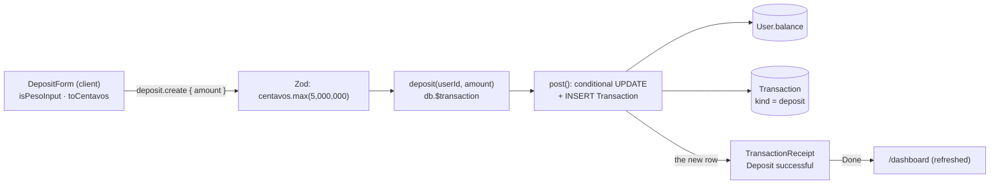

# 13 · Deposit (cash in)

The user types an amount (up to **₱50,000.00** per deposit) and taps **Deposit**. The money is added to the main balance at once, and a receipt shows the amount, a `GB…` reference, the date and the new balance. In this prototype a deposit stands for cash handed over at a counter: no card or bank is charged.

## At a glance

| | |
| --- | --- |
| **Route** | `/deposit` (Deposit quick action on the dashboard, the GO menu, "Make a deposit" in an empty transaction list) |
| **Frontend** | page `gobank/src/app/(app)/deposit/page.tsx`; `deposit-form.tsx` (**client**); UI `text-field.tsx`, `button.tsx`, `page-header.tsx`, `transaction-receipt.tsx`, `transaction-summary.tsx`, `money-form-ui.tsx` (`FormError`) |
| **API** | `deposit.create` (protected mutation) |
| **Backend** | `deposit.router.ts`, `deposit.service.ts`, `deposit.rules.ts` (`MAX_DEPOSIT_CENTAVOS`), the ledger's `post()` (`server/ledger.ts` lines 80–115) |
| **Database** | updates `User.balance`; inserts one `Transaction` (`kind = deposit`) |
| **Tests** | `verify-core.ts` (deposits ₱1,000 before the bill and load checks); checked in a browser for this review |
| **Deep dive** | [Deposit, bills and load §1](../05-features/07-deposit-bills-and-load.md#1-deposit) |

## How it works

1. The user types into **Amount (PHP)**. A keystroke that would make the text an invalid amount is **ignored** (`isPesoInput`): letters, a third decimal, an eighth digit.
2. The text becomes centavos: `toCentavos(Number(amount))`. The button is enabled only for **more than ₱0** and **at most ₱50,000**; above that the hint changes from "Up to ₱50,000.00" to "Maximum ₱50,000.00".
3. **Deposit** (or Enter) calls `deposit.create({ amount })` with an integer number of centavos.
4. The router's Zod schema checks it again: a whole number, positive, at most ₱50,000.00.
5. `deposit()` opens a database transaction and calls `post()` with `kind: "deposit"`, `title: "Cash deposit"`.
6. `post()` adds the amount in **one conditional `UPDATE`** (only if the new balance stays under the account cap), then inserts the history row with `balanceAfter`.
7. The form shows the receipt **Deposit successful**. **Done** goes to `/dashboard` and refreshes it from the server.

## Structure



## Files and locations

| Layer | File | Role |
| --- | --- | --- |
| Page | `gobank/src/app/(app)/deposit/page.tsx` | renders the form, tab title "Deposit" |
| Frontend (client) | `gobank/src/features/deposit/components/deposit-form.tsx` | amount, checks, submit, receipt |
| Shared rule | `gobank/src/features/deposit/deposit.rules.ts` | `MAX_DEPOSIT_CENTAVOS` (used by the form **and** the router) |
| API | `gobank/src/features/deposit/deposit.router.ts` | `create` and its Zod input |
| Service | `gobank/src/features/deposit/deposit.service.ts` | one transaction around `post()` |
| Ledger | `gobank/src/server/ledger.ts` | `post()`, `orFailWith`, `whyPostFailed` |
| Helpers | `gobank/src/shared/lib/amount-input.ts` | `isPesoInput` |
| Helpers | `gobank/src/shared/lib/money.ts` | `toCentavos`, `MAX_TRANSACTION_CENTAVOS`, `MAX_BALANCE_CENTAVOS` |
| Validation | `gobank/src/shared/lib/schemas.ts` | `centavos` |
| Errors | `gobank/src/trpc/error-message.ts` | turns a server error into one line of text |
| UI | `gobank/src/shared/ui/text-field.tsx`, `transaction-receipt.tsx`, `transaction-summary.tsx`, `money-form-ui.tsx` | field, receipt, error box |
| IDs | `gobank/src/server/identifiers.ts` | the `GB…` reference |

## Frontend

<!-- code: gobank/src/app/(app)/deposit/page.tsx -->
**`gobank/src/app/(app)/deposit/page.tsx`** · all 10 lines

```tsx
 1 │ import type { Metadata } from "next";
 2 │ import { DepositForm } from "~/features/deposit/components/deposit-form";
 3 │
 4 │ export const metadata: Metadata = {
 5 │   title: "Deposit",
 6 │ };
 7 │
 8 │ export default function DepositPage() {
 9 │   return <DepositForm />;
10 │ }
```
<!-- /code -->

<!-- code: gobank/src/features/deposit/components/deposit-form.tsx -->
**`gobank/src/features/deposit/components/deposit-form.tsx`** · all 84 lines

```tsx
 1 │ "use client";
 2 │
 3 │ import { useRouter } from "next/navigation";
 4 │ import { useState } from "react";
 5 │ import { isPesoInput } from "~/shared/lib/amount-input";
 6 │ import { dateTime, peso } from "~/shared/lib/format";
 7 │ import { toCentavos } from "~/shared/lib/money";
 8 │ import { Button } from "~/shared/ui/button";
 9 │ import { FormError } from "~/shared/ui/money-form-ui";
10 │ import { PageHeader } from "~/shared/ui/page-header";
11 │ import { TextField } from "~/shared/ui/text-field";
12 │ import { TransactionReceipt } from "~/shared/ui/transaction-receipt";
13 │ import { TransactionSummary } from "~/shared/ui/transaction-summary";
14 │ import { errorMessage } from "~/trpc/error-message";
15 │ import { api } from "~/trpc/react";
16 │ import { MAX_DEPOSIT_CENTAVOS } from "../deposit.rules";
17 │
18 │ export function DepositForm() {
19 │   const router = useRouter();
20 │   const [amount, setAmount] = useState("");
21 │   const deposit = api.deposit.create.useMutation();
22 │
23 │   const amountCentavos = toCentavos(Number(amount));
24 │   const overLimit = amountCentavos > MAX_DEPOSIT_CENTAVOS;
25 │   const validAmount = amountCentavos > 0 && !overLimit;
26 │
27 │   const submit = () => {
28 │     if (validAmount && !deposit.isPending) {
29 │       deposit.mutate({ amount: amountCentavos });
30 │     }
31 │   };
32 │
33 │   const finish = () => {
34 │     router.push("/dashboard");
35 │     router.refresh();
36 │   };
37 │
38 │   if (deposit.data) {
39 │     return (
40 │       <TransactionReceipt title="Deposit successful" onDone={finish}>
41 │         <TransactionSummary
42 │           amount={deposit.data.amount}
43 │           details={[
44 │             { label: "Reference", value: deposit.data.reference },
45 │             { label: "Date", value: dateTime(deposit.data.createdAt) },
46 │             { label: "Balance after", value: peso(deposit.data.balanceAfter) },
47 │           ]}
48 │         />
49 │       </TransactionReceipt>
50 │     );
51 │   }
52 │
53 │   return (
54 │     <form
55 │       className="flex flex-1 flex-col gap-7"
56 │       onSubmit={(event) => {
57 │         event.preventDefault();
58 │         submit();
59 │       }}
60 │     >
61 │       <PageHeader title="Deposit" back="/dashboard" />
62 │
63 │       <TextField
64 │         label="Amount (PHP)"
65 │         inputMode="decimal"
66 │         value={amount}
67 │         disabled={deposit.isPending}
68 │         aria-invalid={overLimit}
69 │         hint={`${overLimit ? "Maximum" : "Up to"} ${peso(MAX_DEPOSIT_CENTAVOS)}`}
70 │         onChange={(event) => {
71 │           if (isPesoInput(event.target.value)) setAmount(event.target.value);
72 │         }}
73 │       />
74 │
75 │       <FormError error={errorMessage(deposit.error)} />
76 │
77 │       <div className="mt-auto pt-4">
78 │         <Button type="submit" disabled={!validAmount || deposit.isPending}>
79 │           {deposit.isPending ? "Depositing…" : "Deposit"}
80 │         </Button>
81 │       </div>
82 │     </form>
83 │   );
84 │ }
```
<!-- /code -->

<!-- code: gobank/src/shared/lib/amount-input.ts -->
**`gobank/src/shared/lib/amount-input.ts`** · all 2 lines

```ts
1 │ export const isPesoInput = (value: string) =>
2 │   /^\d{0,7}(?:\.\d{0,2})?$/.test(value);
```
<!-- /code -->

<!-- code: gobank/src/shared/ui/transaction-receipt.tsx -->
**`gobank/src/shared/ui/transaction-receipt.tsx`** · all 30 lines

```tsx
 1 │ "use client";
 2 │
 3 │ import { CheckCircle2 } from "lucide-react";
 4 │ import type { ReactNode } from "react";
 5 │ import { Button } from "./button";
 6 │
 7 │ export function TransactionReceipt({
 8 │   title,
 9 │   children,
10 │   onDone,
11 │ }: {
12 │   title: string;
13 │   children: ReactNode;
14 │   onDone: () => void;
15 │ }) {
16 │   return (
17 │     <div className="flex flex-1 flex-col gap-6 pt-5">
18 │       <header className="flex items-center gap-3">
19 │         <CheckCircle2 className="text-brand shrink-0" size={28} aria-hidden />
20 │         <h1 className="text-ink text-[20px] font-semibold">{title}</h1>
21 │       </header>
22 │
23 │       {children}
24 │
25 │       <div className="mt-auto pt-4">
26 │         <Button onClick={onDone}>Done</Button>
27 │       </div>
28 │     </div>
29 │   );
30 │ }
```
<!-- /code -->

<!-- code: gobank/src/shared/ui/transaction-summary.tsx -->
**`gobank/src/shared/ui/transaction-summary.tsx`** · all 48 lines

```tsx
 1 │ import type { ReactNode } from "react";
 2 │ import { cn } from "~/shared/lib/cn";
 3 │ import { peso } from "~/shared/lib/format";
 4 │
 5 │ type Detail = { label: string; value: string };
 6 │
 7 │ export function TransactionSummary({
 8 │   amount,
 9 │   amountClassName,
10 │   children,
11 │   details = [],
12 │ }: {
13 │   amount: number;
14 │   amountClassName?: string;
15 │   children?: ReactNode;
16 │   details?: Detail[];
17 │ }) {
18 │   return (
19 │     <section className="border-line bg-surface-sunken rounded-2xl border p-5">
20 │       <p
21 │         className={cn(
22 │           "text-[30px] font-semibold tracking-tight tabular-nums",
23 │           amountClassName ?? "text-ink",
24 │         )}
25 │       >
26 │         {peso(amount)}
27 │       </p>
28 │
29 │       {children ? <div className="mt-5">{children}</div> : null}
30 │
31 │       {details.length > 0 ? (
32 │         <dl className="border-line mt-5 space-y-3 border-t pt-4">
33 │           {details.map(({ label, value }) => (
34 │             <div
35 │               key={label}
36 │               className="grid grid-cols-[minmax(0,1fr)_minmax(0,1.8fr)] gap-3 text-[12px]"
37 │             >
38 │               <dt className="text-ink-muted">{label}</dt>
39 │               <dd className="text-ink min-w-0 text-right break-words">
40 │                 {value}
41 │               </dd>
42 │             </div>
43 │           ))}
44 │         </dl>
45 │       ) : null}
46 │     </section>
47 │   );
48 │ }
```
<!-- /code -->

<!-- code: gobank/src/shared/ui/money-form-ui.tsx 62-70 -->
**`gobank/src/shared/ui/money-form-ui.tsx`** · lines 62–70

```tsx
62 │ export function FormError({ error }: { error?: string | null }) {
63 │   if (!error) return null;
64 │
65 │   return (
66 │     <p role="alert" className="text-danger mt-3 text-[13px] leading-relaxed">
67 │       {error}
68 │     </p>
69 │   );
70 │ }
```
<!-- /code -->

<!-- code: gobank/src/trpc/error-message.ts -->
**`gobank/src/trpc/error-message.ts`** · all 11 lines

```ts
 1 │ import type { TRPCClientErrorLike } from "@trpc/client";
 2 │ import type { AppRouter } from "~/server/root";
 3 │
 4 │ export function errorMessage(error: TRPCClientErrorLike<AppRouter> | null) {
 5 │   if (!error) return null;
 6 │
 7 │   const fieldErrors = error.data?.zodError?.fieldErrors ?? {};
 8 │   const firstFieldError = Object.values(fieldErrors).flat()[0];
 9 │
10 │   return firstFieldError ?? error.message;
11 │ }
```
<!-- /code -->

## Backend

<!-- code: gobank/src/features/deposit/deposit.rules.ts -->
**`gobank/src/features/deposit/deposit.rules.ts`** · all 1 lines

```ts
1 │ export const MAX_DEPOSIT_CENTAVOS = 5_000_000;
```
<!-- /code -->

<!-- code: gobank/src/features/deposit/deposit.router.ts -->
**`gobank/src/features/deposit/deposit.router.ts`** · all 11 lines

```ts
 1 │ import { z } from "zod";
 2 │ import { centavos } from "~/shared/lib/schemas";
 3 │ import { createTRPCRouter, protectedProcedure } from "~/server/trpc";
 4 │ import { MAX_DEPOSIT_CENTAVOS } from "./deposit.rules";
 5 │ import { deposit } from "./deposit.service";
 6 │
 7 │ export const depositRouter = createTRPCRouter({
 8 │   create: protectedProcedure
 9 │     .input(z.object({ amount: centavos.max(MAX_DEPOSIT_CENTAVOS) }))
10 │     .mutation(({ ctx, input }) => deposit(ctx.userId, input.amount)),
11 │ });
```
<!-- /code -->

<!-- code: gobank/src/shared/lib/schemas.ts 7-11 -->
**`gobank/src/shared/lib/schemas.ts`** · lines 7–11

```ts
 7 │ export const centavos = z
 8 │   .number()
 9 │   .int()
10 │   .positive()
11 │   .max(MAX_TRANSACTION_CENTAVOS);
```
<!-- /code -->

<!-- code: gobank/src/features/deposit/deposit.service.ts -->
**`gobank/src/features/deposit/deposit.service.ts`** · all 7 lines

```ts
1 │ import { db } from "~/server/db";
2 │ import { post } from "~/server/ledger";
3 │
4 │ export const deposit = (userId: string, amount: number) =>
5 │   db.$transaction((tx) =>
6 │     post(tx, { userId, kind: "deposit", title: "Cash deposit", amount }),
7 │   );
```
<!-- /code -->

<!-- code: gobank/src/server/ledger.ts 80-115 -->
**`gobank/src/server/ledger.ts`** · lines 80–115

```ts
 80 │ export async function post(
 81 │   tx: Tx,
 82 │   { userId, amount, points = 0, reference = newReference(), ...rest }: Entry,
 83 │ ) {
 84 │   const moneyOut = Math.max(0, -amount);
 85 │   const moneyIn = Math.max(0, amount);
 86 │   const pointsOut = Math.max(0, -points);
 87 │   const pointsIn = Math.max(0, points);
 88 │
 89 │   const user = await orFailWith(
 90 │     tx.user.update({
 91 │       where: {
 92 │         id: userId,
 93 │         balance: { gte: moneyOut, lte: MAX_BALANCE_CENTAVOS - moneyIn },
 94 │         points: { gte: pointsOut, lte: MAX_REWARD_POINTS - pointsIn },
 95 │       },
 96 │       data: {
 97 │         balance: { increment: amount },
 98 │         points: { increment: points },
 99 │       },
100 │       select: { balance: true },
101 │     }),
102 │     () => whyPostFailed(tx, userId, amount, points),
103 │   );
104 │
105 │   return tx.transaction.create({
106 │     data: {
107 │       ...rest,
108 │       userId,
109 │       amount,
110 │       points,
111 │       reference,
112 │       balanceAfter: user.balance,
113 │     },
114 │   });
115 │ }
```
<!-- /code -->

## Database

| Table | Column | Write |
| --- | --- | --- |
| `User` | `balance` | `+ amount`, only if the result stays ≤ 2,147,483,647 centavos |
| `User` | `points` | `+ 0` (deposits earn no points) |
| `User` | `updatedAt` | now |
| `Transaction` | new row | `kind = deposit`, `title = "Cash deposit"`, `amount` (positive), `balanceAfter`, `points = 0`, `reference = GB…`, `userId` |

Rules in the database itself: `User_balance_check CHECK ("balance" >= 0)` and `User_points_check CHECK ("points" >= 0)` (first migration, lines 153 and 155), and the `INT` column type, whose largest value is 2,147,483,647.

## The complicated parts, explained step by step

### 1. Keystrokes that would break the amount are ignored

<!-- code: gobank/src/shared/lib/amount-input.ts -->
**`gobank/src/shared/lib/amount-input.ts`** · all 2 lines

```ts
1 │ export const isPesoInput = (value: string) =>
2 │   /^\d{0,7}(?:\.\d{0,2})?$/.test(value);
```
<!-- /code -->

`/^\d{0,7}(?:\.\d{0,2})?$/` means: **0 to 7 digits**, then optionally a dot and **0 to 2 digits**, and nothing else. The form only calls `setAmount` when the new text passes (form line 71). Otherwise React keeps the old value and the keystroke has no effect.

Typed in Chromium for this review:

| User types | Field shows | Hint | `aria-invalid` | Deposit button |
| --- | --- | --- | --- | --- |
| (nothing) | `` (placeholder `0.00`) | Up to ₱50,000.00 | `false` | disabled |
| `abc` | `` | Up to ₱50,000.00 | `false` | disabled |
| `12.345` | `12.34` (the 5 is ignored) | Up to ₱50,000.00 | `false` | enabled |
| `123456789` | `1234567` (digits 8–9 ignored) | **Maximum** ₱50,000.00 | **`true`** | disabled |
| `50000` | `50000` | Up to ₱50,000.00 | `false` | enabled |
| then `.01` | `50000.01` | **Maximum** ₱50,000.00 | **`true`** | disabled |
| `.` | `.` (allowed by the pattern) | Up to ₱50,000.00 | `false` | disabled (`Number(".")` is `NaN`) |
| `0.29` | `0.29` | Up to ₱50,000.00 | `false` | enabled |

`inputMode="decimal"` opens the number keyboard with a dot on phones. The browser does not block anything here, because it is a normal text input. The pattern does all the work, so `-5`, `1e5` and ` 5` are all refused as well.

The form passes `aria-invalid={overLimit}`, and because `TextField` spreads `{...props}` **after** its own `aria-invalid={Boolean(error)}` (text-field.tsx lines 66 and 73), the form's value wins. A screen reader hears "invalid" plus the hint (linked by `aria-describedby`). The border does not turn red, because that needs the `error` prop, which this form does not use.

### 2. Why `toCentavos` rounds

<!-- code: gobank/src/shared/lib/money.ts 10-10 -->
**`gobank/src/shared/lib/money.ts`** · line 10

```ts
10 │ export const toCentavos = (pesos: number) => Math.round(pesos * 100);
```
<!-- /code -->

Decimal fractions such as 0.29 cannot be stored exactly in binary floating point, so `× 100` is often a hair off. Computed with Node:

| Text | `Number(text) × 100` | `Math.round` | Without rounding (`Math.trunc`) |
| --- | --- | --- | --- |
| `"0.29"` | 28.999999999999996 | **29** | 28 (₱0.28, one centavo lost) |
| `"1.15"` | 114.99999999999999 | **115** | 114 |
| `"19.99"` | 1998.9999999999998 | **1999** | 1998 |
| `"0.07"` | 7.000000000000001 | **7** | 7 |
| `"50000.01"` | 5000001 | 5000001 | over the limit |
| `"."` | NaN | NaN | the button stays disabled |

The browser test deposited `0.29`: the receipt showed **₱0.29**, so the rounding worked end to end. After this one conversion, **everything is an integer**: the API, the ledger and the database never see a fraction of a centavo.

### 3. The limit is checked twice, with one constant

| Where | Code | Why |
| --- | --- | --- |
| browser | `overLimit = amountCentavos > MAX_DEPOSIT_CENTAVOS` (form line 24) | instant feedback, disabled button |
| server | `centavos.max(MAX_DEPOSIT_CENTAVOS)` (router line 9) | anyone can call the API without the form, so the server never trusts the browser |

Both import `MAX_DEPOSIT_CENTAVOS` from `deposit.rules.ts`, so they cannot disagree. `centavos` itself (schemas.ts lines 7–11) adds `int()`, `positive()` and the general ₱1,000,000 cap. What the server answers for bad input (Zod 3 messages, checked by running the schema):

| `amount` sent | Server's answer (`fieldErrors.amount`) |
| --- | --- |
| `0` or `-100` | "Number must be greater than 0" |
| `12.5` | "Expected integer, received float" |
| `5000001` | "Number must be less than or equal to 5000000" |
| `5000000` | accepted |

`errorMessage()` (error-message.ts lines 7–10) shows the **first** field error if there is one, otherwise the server's own message, in the red `FormError` box (`role="alert"`).

### 4. One `UPDATE` that checks and adds at the same time

<!-- code: gobank/src/server/ledger.ts 84-103 -->
**`gobank/src/server/ledger.ts`** · lines 84–103

```ts
 84 │   const moneyOut = Math.max(0, -amount);
 85 │   const moneyIn = Math.max(0, amount);
 86 │   const pointsOut = Math.max(0, -points);
 87 │   const pointsIn = Math.max(0, points);
 88 │
 89 │   const user = await orFailWith(
 90 │     tx.user.update({
 91 │       where: {
 92 │         id: userId,
 93 │         balance: { gte: moneyOut, lte: MAX_BALANCE_CENTAVOS - moneyIn },
 94 │         points: { gte: pointsOut, lte: MAX_REWARD_POINTS - pointsIn },
 95 │       },
 96 │       data: {
 97 │         balance: { increment: amount },
 98 │         points: { increment: points },
 99 │       },
100 │       select: { balance: true },
101 │     }),
102 │     () => whyPostFailed(tx, userId, amount, points),
103 │   );
```
<!-- /code -->

The SQL PostgreSQL received for a **₱123.45** deposit to `@dante`, **with the real parameter values**, captured from its log:

```sql
BEGIN;
UPDATE "User" SET "balance" = ("balance" + $1), "points" = ("points" + $2), "updatedAt" = $3
WHERE ("id" = $4 AND ("balance" >= $5 AND "balance" <= $6 AND "points" >= $7 AND "points" <= $8))
RETURNING "id", "balance";
--  $1 = 12345, $2 = 0, $4 = <dante's id>, $5 = 0, $6 = 2147471302, $7 = 0, $8 = 2147483647
INSERT INTO "Transaction" ("id","reference","kind","title","amount","balanceAfter","points","userId","createdAt")
VALUES (…, 'GB9NSJRLWE', 'deposit', 'Cash deposit', 12345, 1004690, 0, <dante's id>, …);
COMMIT;
```

| Parameter | Code (line) | Value | Meaning |
| --- | --- | --- | --- |
| `$1` | `amount` (97) | 12345 | add ₱123.45 |
| `$5` | `moneyOut` (84) = max(0, −12345) | 0 | a deposit takes nothing out, so any balance ≥ 0 is fine |
| `$6` | `MAX_BALANCE_CENTAVOS − moneyIn` (93) = 2,147,483,647 − 12,345 | **2147471302** | the balance **before** must be at most this, so the balance **after** is at most the cap |
| `$7`, `$8` | `pointsOut`, `MAX_REWARD_POINTS − pointsIn` (94) | 0, 2147483647 | points unchanged |
| `RETURNING balance` | `select: { balance: true }` (100) | 1004690 | becomes `balanceAfter` (992,345 + 12,345) |

**Trace: a deposit that would pass the cap** (run on the test database with the balance set to 2,147,483,000 for the test, then put back):

| Step | What happened |
| --- | --- |
| `UPDATE … WHERE balance <= $6` with `$6 = 2147482647` (cap − ₱10.00) | 2,147,483,000 > 2,147,482,647 → **no row matches** |
| Prisma | raises `P2025` ("No record was found for an update") |
| `orFailWith` (lines 46–62) | sees `P2025`, calls `whyPostFailed` |
| `whyPostFailed` (lines 64–78) | balance + amount is not negative, points fine → `MESSAGES.accountLimit` |
| `fail("BAD_REQUEST", …)` | the error leaves `db.$transaction` → PostgreSQL logged **`ROLLBACK`** |
| user sees | "This transaction would exceed the account limit" |
| history rows for the refused deposit | **0** (counted afterwards) |

Because the check and the change are **one statement**, two deposits at the same moment cannot both pass a check on the same old balance: PostgreSQL makes the second `UPDATE` wait for the first, then re-checks its `WHERE` against the new balance.

### 5. Why the service wraps a single call in a transaction

<!-- code: gobank/src/features/deposit/deposit.service.ts -->
**`gobank/src/features/deposit/deposit.service.ts`** · all 7 lines

```ts
1 │ import { db } from "~/server/db";
2 │ import { post } from "~/server/ledger";
3 │
4 │ export const deposit = (userId: string, amount: number) =>
5 │   db.$transaction((tx) =>
6 │     post(tx, { userId, kind: "deposit", title: "Cash deposit", amount }),
7 │   );
```
<!-- /code -->

`post()` runs **two** statements: the balance `UPDATE` and the history `INSERT`. `db.$transaction` makes them all-or-nothing. If the `INSERT` failed (for example a random reference this user already has: references are unique **per user**, `@@unique([reference, userId])`, because a transfer's two rows share one), the balance change would be undone too, so a balance can never change **without** its history row. `post()` receives `tx`, the transaction's own client, instead of importing `db`, so both of its statements run inside **the caller's** transaction. (TypeScript would still accept the plain `db` client there, so this is a convention that every service follows, not a compiler guarantee.)

### 6. The reference

<!-- code: gobank/src/server/identifiers.ts 3-11 -->
**`gobank/src/server/identifiers.ts`** · lines 3–11

```ts
 3 │ const REFERENCE_CHARACTERS = "ABCDEFGHJKLMNPQRSTUVWXYZ23456789";
 4 │ const DIGITS = "0123456789";
 5 │
 6 │ const randomString = (characters: string, length: number) =>
 7 │   Array.from({ length }, () => characters[randomInt(characters.length)]).join(
 8 │     "",
 9 │   );
10 │
11 │ export const newReference = () => `GB${randomString(REFERENCE_CHARACTERS, 8)}`;
```
<!-- /code -->

`GB` + 8 characters from a 32-character alphabet with **no `I`, `O`, `0` or `1`** (easy to confuse when read aloud or typed). There are 32⁸ ≈ 1.1 trillion possible references. `randomInt` comes from `node:crypto`, so references cannot be predicted. Example from the browser test: `GBWULPQXKV`.

### 7. The receipt is the server's row, not the form's numbers

<!-- code: gobank/src/features/deposit/components/deposit-form.tsx 38-51 -->
**`gobank/src/features/deposit/components/deposit-form.tsx`** · lines 38–51

```tsx
38 │   if (deposit.data) {
39 │     return (
40 │       <TransactionReceipt title="Deposit successful" onDone={finish}>
41 │         <TransactionSummary
42 │           amount={deposit.data.amount}
43 │           details={[
44 │             { label: "Reference", value: deposit.data.reference },
45 │             { label: "Date", value: dateTime(deposit.data.createdAt) },
46 │             { label: "Balance after", value: peso(deposit.data.balanceAfter) },
47 │           ]}
48 │         />
49 │       </TransactionReceipt>
50 │     );
51 │   }
```
<!-- /code -->

`deposit.data` is the `Transaction` row returned by `post()`. The amount, the reference and especially **Balance after** come from the database, not from the form's own arithmetic. If another payment changed the balance at the same moment, the receipt still shows the true result. `dateTime()` runs in the browser (a client component), so the date uses the device's time zone. The browser test showed "Nov 4, 2026, 10:39 AM" with the browser set to Manila.

## Rules and limits

| Rule | Value | Where |
| --- | --- | --- |
| Smallest deposit | ₱0.01 | `positive()` + `amountCentavos > 0` |
| Largest deposit | ₱50,000.00 | `MAX_DEPOSIT_CENTAVOS` (form and router) |
| Largest balance | ₱21,474,836.47 (2,147,483,647 centavos) | `post()` + the `INT` column |
| Decimals | at most 2 | `isPesoInput`, `int()` on centavos |
| Points | none for deposits | `points` defaults to 0 in `post()` |
| Card daily limit | does not apply (no card is used) | deposits do not call `spend()` |

## Messages

| Message | When |
| --- | --- |
| Up to ₱50,000.00 / Maximum ₱50,000.00 | hint under the field |
| Deposit / Depositing… | button |
| Deposit successful | receipt title |
| Reference · Date · Balance after | receipt rows |
| This transaction would exceed the account limit | the balance would pass the cap |
| Number must be greater than 0 / … less than or equal to 5000000 / Expected integer, received float | only if the API is called without the form |

## Tests

- `verify-core.ts` (`checkBillsAndLoad`) calls `deposit(owner.id, 100_000)` (₱1,000) and then checks the balance after a bill and a load: exactly `85_000` centavos.
- **Checked in a browser for this review** (Chromium, signed in as `@dante`): all the input cases in [§1](#1-keystrokes-that-would-break-the-amount-are-ignored), then a ₱0.29 deposit. The receipt showed ₱0.29, a `GB…` reference, the date and "Balance after ₱10,047.19", and the dashboard's first row became "Cash deposit · Nov 4 · +₱0.29".
- **Run on the test database for this review:** the SQL and parameters in [§4](#4-one-update-that-checks-and-adds-at-the-same-time), the refused over-cap deposit (rolled back, no history row), and the Zod messages in [§3](#3-the-limit-is-checked-twice-with-one-constant).
