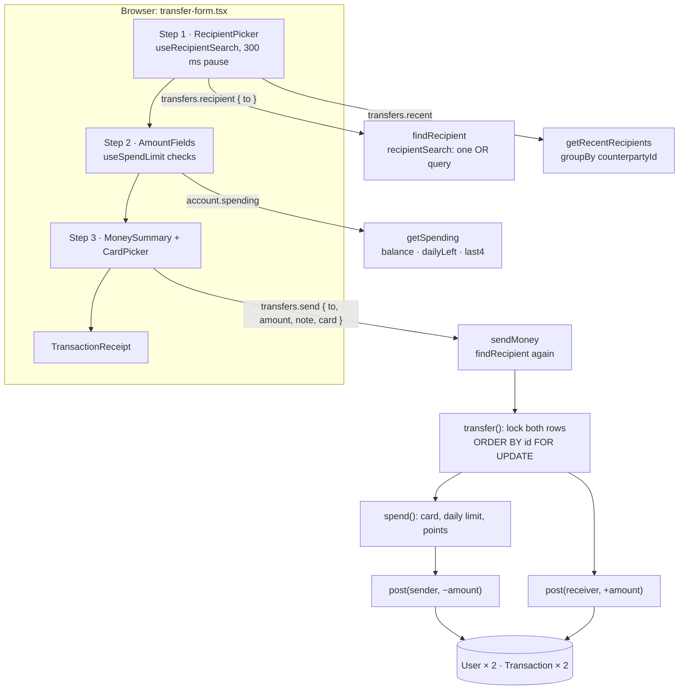

# 14 · Send money

In three steps the user picks a **recipient** (by `@username`, username, account number, linked Gmail or mobile number), types an **amount** with an optional **note**, chooses which **card** pays, and confirms. The money moves from their balance to the recipient's in **one database transaction**. Both people get a history row with the **same reference**, and the sender earns **1 point per ₱50**.

## At a glance

| | |
| --- | --- |
| **Route** | `/transfer` (Send money quick action, the GO menu) |
| **Frontend** | page `gobank/src/app/(app)/transfer/page.tsx`; `transfer-form.tsx` (**client**); hooks `use-recipient-search.ts`, `use-spend-limit.ts`; UI `money-form-ui.tsx`, `card-picker.tsx`, `card-locked-notice.tsx`, `transaction-receipt.tsx`, `profile-avatar.tsx` |
| **API** | `transfers.recipient` (query), `transfers.recent` (query), `account.spending` (query), `transfers.send` (mutation), all protected |
| **Backend** | `transfers.router.ts`, `transfers.service.ts` (`recipientSearch`, `findRecipient`, `getRecentRecipients`, `sendMoney`), ledger `transfer()` → `spend()` → `post()` twice, `spentToday()`; `account.service.ts` (`getSpending`); `contact.ts`; `card-label.ts` |
| **Database** | locks 2 `User` rows; reads `Card` and today's `Transaction` rows; updates 2 balances (and the sender's points); inserts 2 `Transaction` rows |
| **Tests** | `verify-core.ts` (`checkTransfersAndRequests`, `checkCardLocks`), `e2e/smoke.spec.ts` ("send money blocks amounts above the balance"), experiments [`concurrent-transfers.ts`](../experiments/concurrent-transfers.ts) and [`opposite-transfers.ts`](../experiments/opposite-transfers.ts) |
| **Deep dive** | [Send money](../05-features/05-send-money.md) |

## What the user can do

| Step | Header | What happens |
| --- | --- | --- |
| 1 | Send money · Step 1 of 3 | type who to pay (the search runs after a 300 ms pause), or tap one of up to 6 **recent recipients**; **Continue** |
| 2 | Step 2 of 3 | type the amount (checked live against the balance and today's card limit) and an optional note (up to 120 characters); **Review** |
| 3 | Step 3 of 3 | check the summary, choose **Physical** or **Virtual** card under "Pay with", tap **Send ₱150.00** |
| receipt | Transfer successful | amount, recipient, note, Reference, Date, Balance, Paid with; **Done** |

The back arrow goes to the dashboard on step 1 and to the previous step on steps 2 and 3.

## How it works

1. **Step 1.** `useRecipientSearch` waits until typing pauses for 300 ms, then calls `transfers.recipient({ to })`. The server's `findRecipient` builds one `OR` search, refuses your own account, and returns only `id`, `username`, `fullName` and `profilePhoto` (`PARTY`). At the same time `transfers.recent` lists up to 6 people you paid most recently.
2. **Step 2.** `useSpendLimit` loads `account.spending`: the balance, how much of the daily card limit is left today, and both cards with only their last 4 digits. Every keystroke is checked against these numbers.
3. **Step 3.** The card defaults to the first unlocked card. **Send** calls `transfers.send({ to: "@username", amount, note, card })`.
4. **Server.** Zod validates the input. `sendMoney` looks the recipient up **again**, loads the sender's username, and runs `transfer()` inside `db.$transaction`.
5. `transfer()` locks **both** users' rows in ID order. `spend()` checks the card (exists, not locked) and the daily limit, works out the points, and `post()`s **−amount** for the sender. Then `post()` adds **+amount** for the receiver with the same reference.
6. The sender's new history row comes back and becomes the receipt. **Done** goes to `/dashboard` and refreshes it.

## Structure



## Files and locations

| Layer | File | Role |
| --- | --- | --- |
| Page | `gobank/src/app/(app)/transfer/page.tsx` | renders the form, tab title "Send money" |
| Frontend (client) | `gobank/src/features/transfers/components/transfer-form.tsx` | the 3 steps, recent recipients, receipt |
| Hook | `gobank/src/shared/hooks/use-recipient-search.ts` | debounced search, match, errors |
| Hook | `gobank/src/shared/hooks/use-spend-limit.ts` | amount checks, card choice (shared with bills, load, requests) |
| UI | `gobank/src/shared/ui/money-form-ui.tsx` | header, recipient picker, amount fields, summary |
| UI | `gobank/src/features/card/components/card-picker.tsx` | "Pay with" buttons |
| UI | `gobank/src/features/card/components/card-locked-notice.tsx` | shown when both cards are locked |
| Label | `gobank/src/features/card/card-label.ts` | "Physical · Discover •••• 8954" |
| API | `gobank/src/features/transfers/transfers.router.ts` | `recent`, `recipient`, `send` |
| Service | `gobank/src/features/transfers/transfers.service.ts` | search, recent, send |
| Service | `gobank/src/features/account/account.service.ts` | `getSpending` |
| Ledger | `gobank/src/server/ledger.ts` | `transfer`, `spend`, `spentToday`, `post` |
| Helpers | `gobank/src/shared/lib/contact.ts` | `normalizeMobile`, `normalizeGmail` |
| Helpers | `gobank/src/shared/lib/money.ts` | `pointsEarned`, `MAX_TRANSACTION_CENTAVOS` |
| Validation | `gobank/src/shared/lib/schemas.ts` | `centavos`, `optionalText`, `cardKind` |
| Errors | `gobank/src/server/errors.ts` | every message on this page |

## Frontend

<!-- code: gobank/src/app/(app)/transfer/page.tsx -->
**`gobank/src/app/(app)/transfer/page.tsx`** · all 10 lines

```tsx
 1 │ import type { Metadata } from "next";
 2 │ import { TransferForm } from "../../../features/transfers/components/transfer-form";
 3 │
 4 │ export const metadata: Metadata = {
 5 │   title: "Send money",
 6 │ };
 7 │
 8 │ export default function TransferPage() {
 9 │   return <TransferForm />;
10 │ }
```
<!-- /code -->

<!-- code: gobank/src/features/transfers/components/transfer-form.tsx -->
**`gobank/src/features/transfers/components/transfer-form.tsx`** · all 222 lines

```tsx
  1 │ "use client";
  2 │
  3 │ import { ChevronRight } from "lucide-react";
  4 │ import { useRouter } from "next/navigation";
  5 │ import { useState } from "react";
  6 │ import { dateTime, peso } from "~/shared/lib/format";
  7 │ import { MAX_TRANSACTION_CENTAVOS, toCentavos } from "~/shared/lib/money";
  8 │ import { Button } from "~/shared/ui/button";
  9 │ import { TransactionReceipt } from "~/shared/ui/transaction-receipt";
 10 │ import { errorMessage } from "~/trpc/error-message";
 11 │ import { api } from "~/trpc/react";
 12 │ import {
 13 │   AmountFields,
 14 │   FormError,
 15 │   MoneyFormHeader,
 16 │   MoneySummary,
 17 │   RecipientIdentity,
 18 │   RecipientPicker,
 19 │   type MoneyStep,
 20 │ } from "~/shared/ui/money-form-ui";
 21 │ import {
 22 │   useRecipientSearch,
 23 │   type Recipient,
 24 │ } from "~/shared/hooks/use-recipient-search";
 25 │ import { useSpendLimit } from "~/shared/hooks/use-spend-limit";
 26 │ import { CardLockedNotice } from "~/features/card/components/card-locked-notice";
 27 │ import { CardPicker } from "~/features/card/components/card-picker";
 28 │ import { paidWithDetail } from "~/features/card/card-label";
 29 │
 30 │ function RecentRecipients({
 31 │   disabled,
 32 │   onSelect,
 33 │ }: {
 34 │   disabled: boolean;
 35 │   onSelect: (recipient: Recipient) => void;
 36 │ }) {
 37 │   const recent = api.transfers.recent.useQuery();
 38 │
 39 │   if (recent.isPending) {
 40 │     return (
 41 │       <p role="status" className="text-ink-muted text-[13px]">
 42 │         Loading recent recipients…
 43 │       </p>
 44 │     );
 45 │   }
 46 │
 47 │   if (recent.error) {
 48 │     return (
 49 │       <div className="text-[13px]">
 50 │         <p role="alert" className="text-danger">
 51 │           Could not load recent recipients.
 52 │         </p>
 53 │         <button
 54 │           type="button"
 55 │           disabled={recent.isFetching}
 56 │           onClick={() => void recent.refetch()}
 57 │           className="text-brand mt-2 font-medium disabled:opacity-60"
 58 │         >
 59 │           {recent.isFetching ? "Loading…" : "Try again"}
 60 │         </button>
 61 │       </div>
 62 │     );
 63 │   }
 64 │
 65 │   if (recent.data.length === 0) {
 66 │     return (
 67 │       <p className="text-ink-muted text-[13px]">No recent recipients yet.</p>
 68 │     );
 69 │   }
 70 │
 71 │   return (
 72 │     <ul className="border-line divide-line divide-y rounded-2xl border">
 73 │       {recent.data.map((recipient) => (
 74 │         <li key={recipient.id}>
 75 │           <button
 76 │             type="button"
 77 │             disabled={disabled}
 78 │             onClick={() => onSelect(recipient)}
 79 │             className="hover:bg-surface-sunken flex w-full items-center justify-between gap-3 rounded-xl p-3 text-left transition-colors disabled:opacity-60"
 80 │           >
 81 │             <RecipientIdentity recipient={recipient} />
 82 │             <ChevronRight
 83 │               size={18}
 84 │               className="text-ink-muted shrink-0"
 85 │               aria-hidden
 86 │             />
 87 │           </button>
 88 │         </li>
 89 │       ))}
 90 │     </ul>
 91 │   );
 92 │ }
 93 │
 94 │ export function TransferForm() {
 95 │   const router = useRouter();
 96 │   const [step, setStep] = useState<MoneyStep>("recipient");
 97 │   const [amount, setAmount] = useState("");
 98 │   const [note, setNote] = useState("");
 99 │
100 │   const search = useRecipientSearch(() => setStep("amount"));
101 │   const limit = useSpendLimit(MAX_TRANSACTION_CENTAVOS);
102 │   const send = api.transfers.send.useMutation();
103 │
104 │   const amountCentavos = toCentavos(Number(amount));
105 │   const validAmount = limit.valid(amountCentavos);
106 │   const recipient = search.recipient;
107 │
108 │   const back = () => {
109 │     send.reset();
110 │     setStep(step === "review" ? "amount" : "recipient");
111 │   };
112 │
113 │   const finish = () => {
114 │     router.push("/dashboard");
115 │     router.refresh();
116 │   };
117 │
118 │   const sendMoney = () => {
119 │     if (!recipient || !validAmount || send.isPending) return;
120 │
121 │     send.mutate({
122 │       to: `@${recipient.username}`,
123 │       amount: amountCentavos,
124 │       note: note.trim(),
125 │       card: limit.card,
126 │     });
127 │   };
128 │
129 │   if (send.data && recipient) {
130 │     return (
131 │       <TransactionReceipt title="Transfer successful" onDone={finish}>
132 │         <MoneySummary
133 │           recipient={recipient}
134 │           amount={Math.abs(send.data.amount)}
135 │           note={note.trim()}
136 │           details={[
137 │             { label: "Reference", value: send.data.reference },
138 │             { label: "Date", value: dateTime(send.data.createdAt) },
139 │             { label: "Balance", value: peso(send.data.balanceAfter) },
140 │             ...paidWithDetail(send.data.details),
141 │           ]}
142 │         />
143 │       </TransactionReceipt>
144 │     );
145 │   }
146 │
147 │   return (
148 │     <div className="flex flex-1 flex-col">
149 │       <MoneyFormHeader
150 │         title="Send money"
151 │         step={step}
152 │         disabled={send.isPending}
153 │         onBack={back}
154 │       />
155 │
156 │       {limit.locked && !send.isPending ? <CardLockedNotice /> : null}
157 │
158 │       {step === "recipient" ? (
159 │         <RecipientPicker
160 │           value={search.value}
161 │           loading={search.loading}
162 │           recipient={search.match}
163 │           error={search.error}
164 │           onChange={search.change}
165 │           onContinue={search.find}
166 │           onRetry={search.retry}
167 │         >
168 │           <section className="mt-7">
169 │             <h2 className="text-ink-muted mb-3 text-[13px] font-medium">
170 │               Recent recipients
171 │             </h2>
172 │             <RecentRecipients
173 │               disabled={search.loading}
174 │               onSelect={search.select}
175 │             />
176 │           </section>
177 │         </RecipientPicker>
178 │       ) : null}
179 │
180 │       {step === "amount" && recipient ? (
181 │         <AmountFields
182 │           recipient={recipient}
183 │           amount={amount}
184 │           note={note}
185 │           hint={limit.hint}
186 │           error={limit.check(amountCentavos)}
187 │           canContinue={validAmount}
188 │           onAmountChange={setAmount}
189 │           onNoteChange={setNote}
190 │           onContinue={() => {
191 │             if (validAmount) setStep("review");
192 │           }}
193 │         />
194 │       ) : null}
195 │
196 │       {step === "review" && recipient ? (
197 │         <div className="flex flex-1 flex-col pt-7">
198 │           <MoneySummary
199 │             recipient={recipient}
200 │             amount={amountCentavos}
201 │             note={note.trim()}
202 │           />
203 │
204 │           <CardPicker
205 │             cards={limit.cards}
206 │             value={limit.card}
207 │             onChange={limit.setCard}
208 │             disabled={send.isPending}
209 │           />
210 │
211 │           <FormError error={errorMessage(send.error)} />
212 │
213 │           <div className="mt-auto pt-8">
214 │             <Button disabled={send.isPending} onClick={sendMoney}>
215 │               {send.isPending ? "Sending…" : `Send ${peso(amountCentavos)}`}
216 │             </Button>
217 │           </div>
218 │         </div>
219 │       ) : null}
220 │     </div>
221 │   );
222 │ }
```
<!-- /code -->

<!-- code: gobank/src/shared/hooks/use-recipient-search.ts -->
**`gobank/src/shared/hooks/use-recipient-search.ts`** · all 75 lines

```ts
 1 │ "use client";
 2 │
 3 │ import { useEffect, useRef, useState } from "react";
 4 │ import { errorMessage } from "~/trpc/error-message";
 5 │ import { api, type RouterOutputs } from "~/trpc/react";
 6 │
 7 │ export type Recipient = RouterOutputs["transfers"]["recipient"];
 8 │
 9 │ const TYPING_PAUSE_MS = 300;
10 │
11 │ export function useRecipientSearch(onFound: () => void) {
12 │   const [value, setValue] = useState("");
13 │   const [lookup, setLookup] = useState("");
14 │   const [recipient, setRecipient] = useState<Recipient | null>(null);
15 │   const latestValue = useRef("");
16 │
17 │   useEffect(() => {
18 │     const timer = setTimeout(() => setLookup(value.trim()), TYPING_PAUSE_MS);
19 │     return () => clearTimeout(timer);
20 │   }, [value]);
21 │
22 │   const result = api.transfers.recipient.useQuery(
23 │     { to: lookup },
24 │     { enabled: Boolean(lookup) && !recipient, retry: false },
25 │   );
26 │
27 │   const typed = value.trim();
28 │   const lookupMatchesTyping = typed !== "" && lookup === typed;
29 │   const waitingForResult = !lookupMatchesTyping || result.isFetching;
30 │
31 │   const loading = typed !== "" && !recipient && waitingForResult;
32 │
33 │   const foundNow =
34 │     lookupMatchesTyping && !result.isError ? (result.data ?? null) : null;
35 │   const match = recipient ?? foundNow;
36 │
37 │   const showError = lookupMatchesTyping && !loading && !recipient;
38 │   const error = showError ? errorMessage(result.error) : null;
39 │
40 │   const change = (next: string) => {
41 │     latestValue.current = next;
42 │     setValue(next);
43 │     setRecipient(null);
44 │   };
45 │
46 │   const select = (found: Recipient) => {
47 │     const handle = `@${found.username}`;
48 │
49 │     latestValue.current = handle;
50 │     setValue(handle);
51 │     setLookup(handle);
52 │     setRecipient(found);
53 │
54 │     onFound();
55 │   };
56 │
57 │   const find = () => {
58 │     const stillTheSameSearch = latestValue.current.trim() === lookup;
59 │     if (loading || !match || !stillTheSameSearch) return;
60 │
61 │     select(match);
62 │   };
63 │
64 │   return {
65 │     value,
66 │     recipient,
67 │     match,
68 │     error,
69 │     loading,
70 │     change,
71 │     find,
72 │     select,
73 │     retry: () => void result.refetch(),
74 │   };
75 │ }
```
<!-- /code -->

<!-- code: gobank/src/shared/hooks/use-spend-limit.ts -->
**`gobank/src/shared/hooks/use-spend-limit.ts`** · all 51 lines

```ts
 1 │ "use client";
 2 │
 3 │ import { useState } from "react";
 4 │ import { peso } from "~/shared/lib/format";
 5 │ import { api } from "~/trpc/react";
 6 │ import type { CardKind } from "../../../generated/prisma";
 7 │
 8 │ export function useSpendLimit(maximum: number, minimum = 1) {
 9 │   const { data } = api.account.spending.useQuery();
10 │   const [chosen, setCard] = useState<CardKind | null>(null);
11 │
12 │   const cards = data?.cards ?? [];
13 │   const unlocked = cards.filter((item) => !item.locked);
14 │   const locked = cards.length > 0 && unlocked.length === 0;
15 │
16 │   const chosenIfUnlocked = unlocked.find((item) => item.kind === chosen);
17 │   const card = chosenIfUnlocked?.kind ?? unlocked[0]?.kind ?? "physical";
18 │
19 │   const check = (amount: number) => {
20 │     if (!Number.isFinite(amount) || amount <= 0) return null;
21 │     if (amount < minimum) return `Minimum ${peso(minimum)}`;
22 │     if (amount > maximum) return `Maximum ${peso(maximum)}`;
23 │
24 │     if (!data) return null;
25 │     if (locked) return "Both cards are locked. Unlock one to spend";
26 │
27 │     if (amount > data.balance) {
28 │       return `Insufficient balance. You have ${peso(data.balance)}`;
29 │     }
30 │
31 │     if (amount > data.dailyLeft) {
32 │       return `Over your daily limit. ${peso(data.dailyLeft)} left today`;
33 │     }
34 │
35 │     return null;
36 │   };
37 │
38 │   const hint = data
39 │     ? `Balance ${peso(data.balance)} · ${peso(data.dailyLeft)} left today`
40 │     : `Up to ${peso(maximum)}`;
41 │
42 │   return {
43 │     check,
44 │     hint,
45 │     cards,
46 │     card,
47 │     setCard,
48 │     locked,
49 │     valid: (amount: number) => amount >= minimum && check(amount) === null,
50 │   };
51 │ }
```
<!-- /code -->

<!-- code: gobank/src/shared/ui/money-form-ui.tsx -->
**`gobank/src/shared/ui/money-form-ui.tsx`** · all 331 lines

```tsx
  1 │ import { ChevronRight } from "lucide-react";
  2 │ import type { FormEvent, ReactNode } from "react";
  3 │ import { ProfileAvatar } from "~/features/account/components/profile-avatar";
  4 │ import { isPesoInput } from "~/shared/lib/amount-input";
  5 │ import { cn } from "~/shared/lib/cn";
  6 │ import { BackButton } from "~/shared/ui/back-button";
  7 │ import { Button } from "~/shared/ui/button";
  8 │ import { TransactionSummary } from "~/shared/ui/transaction-summary";
  9 │ import type { Recipient } from "~/shared/hooks/use-recipient-search";
 10 │
 11 │ export type MoneyStep = "recipient" | "amount" | "review";
 12 │
 13 │ const STEP_NUMBER: Record<MoneyStep, number> = {
 14 │   recipient: 1,
 15 │   amount: 2,
 16 │   review: 3,
 17 │ };
 18 │
 19 │ const NO_MATCH_FROM_SERVER = "No GoBank account matches that";
 20 │
 21 │ const INPUT_CLASS =
 22 │   "border-line-strong bg-surface-sunken text-ink focus:border-brand w-full rounded-xl border px-4 text-[16px] outline-none";
 23 │
 24 │ const submitWith = (action: () => void) => (event: FormEvent) => {
 25 │   event.preventDefault();
 26 │   action();
 27 │ };
 28 │
 29 │ export function MoneyFormHeader({
 30 │   title,
 31 │   step,
 32 │   disabled,
 33 │   onBack,
 34 │ }: {
 35 │   title: string;
 36 │   step: MoneyStep;
 37 │   disabled?: boolean;
 38 │   onBack: () => void;
 39 │ }) {
 40 │   return (
 41 │     <header className="relative flex h-14 shrink-0 items-center justify-center">
 42 │       {step === "recipient" ? (
 43 │         <BackButton href="/dashboard" className="absolute left-0" />
 44 │       ) : (
 45 │         <BackButton
 46 │           onClick={onBack}
 47 │           disabled={disabled}
 48 │           className="absolute left-0"
 49 │         />
 50 │       )}
 51 │
 52 │       <div className="text-center">
 53 │         <h1 className="text-ink text-[16px] font-semibold">{title}</h1>
 54 │         <p className="text-ink-muted mt-1 text-[12px]">
 55 │           Step {STEP_NUMBER[step]} of 3
 56 │         </p>
 57 │       </div>
 58 │     </header>
 59 │   );
 60 │ }
 61 │
 62 │ export function FormError({ error }: { error?: string | null }) {
 63 │   if (!error) return null;
 64 │
 65 │   return (
 66 │     <p role="alert" className="text-danger mt-3 text-[13px] leading-relaxed">
 67 │       {error}
 68 │     </p>
 69 │   );
 70 │ }
 71 │
 72 │ export function RecipientIdentity({ recipient }: { recipient: Recipient }) {
 73 │   return (
 74 │     <div className="flex min-w-0 items-center gap-3">
 75 │       <ProfileAvatar
 76 │         photo={recipient.profilePhoto}
 77 │         size={44}
 78 │         className="shrink-0"
 79 │       />
 80 │
 81 │       <div className="min-w-0">
 82 │         <p className="text-ink truncate text-[14px] font-medium">
 83 │           {recipient.fullName || recipient.username}
 84 │         </p>
 85 │         <p className="text-ink-muted truncate text-[12px]">
 86 │           @{recipient.username}
 87 │         </p>
 88 │       </div>
 89 │     </div>
 90 │   );
 91 │ }
 92 │
 93 │ function RecipientError({
 94 │   error,
 95 │   loading,
 96 │   onRetry,
 97 │ }: {
 98 │   error: string;
 99 │   loading: boolean;
100 │   onRetry: () => void;
101 │ }) {
102 │   const message =
103 │     error === NO_MATCH_FROM_SERVER ? "No matching account." : error;
104 │
105 │   return (
106 │     <p role="alert" className="text-danger mt-3 text-[13px] leading-relaxed">
107 │       {message}{" "}
108 │       <button
109 │         type="button"
110 │         onClick={onRetry}
111 │         disabled={loading}
112 │         className="text-danger focus-visible:outline-danger rounded-sm font-medium underline underline-offset-2 focus-visible:outline-2 focus-visible:outline-offset-2"
113 │       >
114 │         Try again
115 │       </button>
116 │     </p>
117 │   );
118 │ }
119 │
120 │ function RecipientMatch({
121 │   recipient,
122 │   loading,
123 │   onContinue,
124 │ }: {
125 │   recipient: Recipient;
126 │   loading: boolean;
127 │   onContinue: () => void;
128 │ }) {
129 │   return (
130 │     <button
131 │       type="button"
132 │       onClick={onContinue}
133 │       disabled={loading}
134 │       className="border-line hover:bg-surface-sunken mt-5 flex w-full items-center justify-between gap-3 rounded-2xl border p-4 text-left transition-colors disabled:opacity-60"
135 │     >
136 │       <RecipientIdentity recipient={recipient} />
137 │       <ChevronRight size={18} className="text-ink-muted shrink-0" aria-hidden />
138 │     </button>
139 │   );
140 │ }
141 │
142 │ export function RecipientPicker({
143 │   label = "Recipient",
144 │   value,
145 │   loading,
146 │   recipient,
147 │   error,
148 │   onChange,
149 │   onContinue,
150 │   onRetry,
151 │   children,
152 │ }: {
153 │   label?: string;
154 │   value: string;
155 │   loading: boolean;
156 │   recipient: Recipient | null;
157 │   error: string | null;
158 │   onChange: (value: string) => void;
159 │   onContinue: () => void;
160 │   onRetry: () => void;
161 │   children?: ReactNode;
162 │ }) {
163 │   return (
164 │     <form
165 │       className="flex flex-1 flex-col pt-8"
166 │       onSubmit={submitWith(onContinue)}
167 │     >
168 │       <label
169 │         htmlFor="recipient"
170 │         className="text-ink mb-2 text-[14px] font-medium"
171 │       >
172 │         {label}
173 │       </label>
174 │       <input
175 │         id="recipient"
176 │         value={value}
177 │         autoComplete="off"
178 │         autoCapitalize="none"
179 │         spellCheck={false}
180 │         aria-invalid={Boolean(error)}
181 │         aria-describedby="recipient-help"
182 │         onChange={(event) => onChange(event.target.value)}
183 │         className={cn(INPUT_CLASS, "h-13")}
184 │       />
185 │       <p
186 │         id="recipient-help"
187 │         className="text-ink-muted mt-2 text-[12px] leading-relaxed"
188 │       >
189 │         Username, linked Gmail, account number or mobile.
190 │       </p>
191 │
192 │       {error ? (
193 │         <RecipientError error={error} loading={loading} onRetry={onRetry} />
194 │       ) : null}
195 │
196 │       {!error && recipient ? (
197 │         <RecipientMatch
198 │           recipient={recipient}
199 │           loading={loading}
200 │           onContinue={onContinue}
201 │         />
202 │       ) : null}
203 │
204 │       {children}
205 │
206 │       <div className="mt-auto pt-8">
207 │         <Button type="submit" disabled={!recipient || loading}>
208 │           {loading ? "Finding recipient…" : "Continue"}
209 │         </Button>
210 │       </div>
211 │     </form>
212 │   );
213 │ }
214 │
215 │ export function AmountFields({
216 │   recipient,
217 │   amount,
218 │   note,
219 │   hint,
220 │   error,
221 │   canContinue,
222 │   onAmountChange,
223 │   onNoteChange,
224 │   onContinue,
225 │ }: {
226 │   recipient: Recipient;
227 │   amount: string;
228 │   note: string;
229 │   hint: string;
230 │   error: string | null;
231 │   canContinue: boolean;
232 │   onAmountChange: (value: string) => void;
233 │   onNoteChange: (value: string) => void;
234 │   onContinue: () => void;
235 │ }) {
236 │   const acceptAmount = (value: string) => {
237 │     if (isPesoInput(value)) onAmountChange(value);
238 │   };
239 │
240 │   return (
241 │     <form
242 │       className="flex flex-1 flex-col gap-6 pt-7"
243 │       onSubmit={submitWith(onContinue)}
244 │     >
245 │       <div className="border-line rounded-2xl border p-4">
246 │         <RecipientIdentity recipient={recipient} />
247 │       </div>
248 │
249 │       <div>
250 │         <label
251 │           htmlFor="amount"
252 │           className="text-ink mb-2 block text-[14px] font-medium"
253 │         >
254 │           Amount
255 │         </label>
256 │         <div className="border-line-strong bg-surface-sunken focus-within:border-brand flex items-center rounded-xl border px-4">
257 │           <span aria-hidden className="text-ink-muted text-[24px]">
258 │             ₱
259 │           </span>
260 │           <input
261 │             id="amount"
262 │             inputMode="decimal"
263 │             autoComplete="off"
264 │             placeholder="0.00"
265 │             value={amount}
266 │             aria-invalid={Boolean(error)}
267 │             aria-describedby="amount-limit"
268 │             onChange={(event) => acceptAmount(event.target.value)}
269 │             className="text-ink placeholder:text-ink-faint h-20 min-w-0 flex-1 bg-transparent px-3 text-[28px] font-medium tabular-nums outline-none"
270 │           />
271 │         </div>
272 │         <p
273 │           id="amount-limit"
274 │           role={error ? "alert" : undefined}
275 │           className={cn(
276 │             "mt-2 text-[12px]",
277 │             error ? "text-danger" : "text-ink-muted",
278 │           )}
279 │         >
280 │           {error ?? hint}
281 │         </p>
282 │       </div>
283 │
284 │       <div>
285 │         <label
286 │           htmlFor="note"
287 │           className="text-ink mb-2 block text-[14px] font-medium"
288 │         >
289 │           Note <span className="text-ink-muted font-normal">(optional)</span>
290 │         </label>
291 │         <textarea
292 │           id="note"
293 │           autoComplete="off"
294 │           value={note}
295 │           maxLength={120}
296 │           rows={3}
297 │           onChange={(event) => onNoteChange(event.target.value)}
298 │           className={cn(INPUT_CLASS, "resize-none py-3")}
299 │         />
300 │       </div>
301 │
302 │       <div className="mt-auto pt-2">
303 │         <Button type="submit" disabled={!canContinue}>
304 │           Review
305 │         </Button>
306 │       </div>
307 │     </form>
308 │   );
309 │ }
310 │
311 │ export function MoneySummary({
312 │   recipient,
313 │   amount,
314 │   note,
315 │   details = [],
316 │ }: {
317 │   recipient: Recipient;
318 │   amount: number;
319 │   note?: string;
320 │   details?: { label: string; value: string }[];
321 │ }) {
322 │   return (
323 │     <TransactionSummary amount={amount} details={details}>
324 │       <RecipientIdentity recipient={recipient} />
325 │
326 │       {note ? (
327 │         <p className="text-ink-soft mt-4 text-[14px] break-words">{note}</p>
328 │       ) : null}
329 │     </TransactionSummary>
330 │   );
331 │ }
```
<!-- /code -->

<!-- code: gobank/src/features/card/components/card-picker.tsx -->
**`gobank/src/features/card/components/card-picker.tsx`** · all 66 lines

```tsx
 1 │ import { CreditCard, Lock, Smartphone } from "lucide-react";
 2 │ import { cn } from "~/shared/lib/cn";
 3 │ import type { CardKind } from "../../../../generated/prisma";
 4 │ import { networkName } from "../card-label";
 5 │
 6 │ type PickerCard = {
 7 │   kind: CardKind;
 8 │   brand: string;
 9 │   last4: string;
10 │   locked: boolean;
11 │ };
12 │
13 │ export function CardPicker({
14 │   cards,
15 │   value,
16 │   onChange,
17 │   disabled,
18 │ }: {
19 │   cards: PickerCard[];
20 │   value: CardKind;
21 │   onChange: (kind: CardKind) => void;
22 │   disabled?: boolean;
23 │ }) {
24 │   if (!cards.length) return null;
25 │   return (
26 │     <fieldset className="mt-5" disabled={disabled}>
27 │       <legend className="text-ink mb-2 text-[14px] font-medium">
28 │         Pay with
29 │       </legend>
30 │       <div className="grid grid-cols-2 gap-2">
31 │         {cards.map((card) => {
32 │           const Icon = card.kind === "virtual" ? Smartphone : CreditCard;
33 │           const selected = card.kind === value && !card.locked;
34 │           return (
35 │             <button
36 │               key={card.kind}
37 │               type="button"
38 │               aria-pressed={selected}
39 │               disabled={card.locked}
40 │               onClick={() => onChange(card.kind)}
41 │               className={cn(
42 │                 "flex flex-col items-start gap-1 rounded-xl border p-3 text-left transition-colors disabled:cursor-not-allowed disabled:opacity-50",
43 │                 selected
44 │                   ? "border-brand bg-brand-soft"
45 │                   : "border-line enabled:hover:bg-surface-raised",
46 │               )}
47 │             >
48 │               <span className="text-ink flex items-center gap-1.5 text-[13px] font-medium">
49 │                 <Icon size={15} aria-hidden />
50 │                 {card.kind === "virtual" ? "Virtual" : "Physical"}
51 │                 {card.locked ? (
52 │                   <Lock size={12} className="text-ink-muted" aria-hidden />
53 │                 ) : null}
54 │               </span>
55 │               <span className="text-ink-muted text-[12px] tabular-nums">
56 │                 {card.locked
57 │                   ? "Locked"
58 │                   : `${networkName(card.brand)} •••• ${card.last4}`}
59 │               </span>
60 │             </button>
61 │           );
62 │         })}
63 │       </div>
64 │     </fieldset>
65 │   );
66 │ }
```
<!-- /code -->

<!-- code: gobank/src/features/card/components/card-locked-notice.tsx -->
**`gobank/src/features/card/components/card-locked-notice.tsx`** · all 19 lines

```tsx
 1 │ import { Lock } from "lucide-react";
 2 │ import Link from "next/link";
 3 │
 4 │ export function CardLockedNotice() {
 5 │   return (
 6 │     <div
 7 │       role="alert"
 8 │       className="border-line bg-surface-raised mt-5 flex items-start gap-3 rounded-2xl border p-4"
 9 │     >
10 │       <Lock size={18} className="text-ink-muted mt-0.5 shrink-0" aria-hidden />
11 │       <p className="text-ink-soft text-[13px] leading-relaxed">
12 │         Both of your cards are locked, so spending is paused.{" "}
13 │         <Link href="/card" className="text-brand font-medium hover:underline">
14 │           Unlock one in My card
15 │         </Link>
16 │       </p>
17 │     </div>
18 │   );
19 │ }
```
<!-- /code -->

<!-- code: gobank/src/features/card/card-label.ts -->
**`gobank/src/features/card/card-label.ts`** · all 18 lines

```ts
 1 │ import { CARD_BRANDS } from "./card-brands";
 2 │
 3 │ type CardUsed = { kind: string; network: string; last4: string };
 4 │
 5 │ export const networkName = (id: string) =>
 6 │   CARD_BRANDS.find((brand) => brand.id === id)?.name ??
 7 │   id.charAt(0).toUpperCase() + id.slice(1);
 8 │
 9 │ const cardLabel = ({ kind, network, last4 }: CardUsed) =>
10 │   `${kind === "virtual" ? "Virtual" : "Physical"} · ${networkName(network)} •••• ${last4}`;
11 │
12 │ export function paidWithDetail(details: unknown) {
13 │   if (typeof details !== "object" || details === null || !("card" in details))
14 │     return [];
15 │   const card = details.card as Partial<CardUsed> | null;
16 │   if (!card?.kind || !card.network || !card.last4) return [];
17 │   return [{ label: "Paid with", value: cardLabel(card as CardUsed) }];
18 │ }
```
<!-- /code -->

## Backend

<!-- code: gobank/src/features/transfers/transfers.router.ts -->
**`gobank/src/features/transfers/transfers.router.ts`** · all 31 lines

```ts
 1 │ import { z } from "zod";
 2 │ import { cardKind, centavos, optionalText } from "~/shared/lib/schemas";
 3 │ import { createTRPCRouter, protectedProcedure } from "~/server/trpc";
 4 │ import {
 5 │   findRecipient,
 6 │   getRecentRecipients,
 7 │   sendMoney,
 8 │ } from "./transfers.service";
 9 │
10 │ export const transfersRouter = createTRPCRouter({
11 │   recent: protectedProcedure.query(({ ctx }) =>
12 │     getRecentRecipients(ctx.userId),
13 │   ),
14 │
15 │   recipient: protectedProcedure
16 │     .input(z.object({ to: z.string().trim().min(1) }))
17 │     .query(({ ctx, input }) => findRecipient(input.to, ctx.userId)),
18 │
19 │   send: protectedProcedure
20 │     .input(
21 │       z.object({
22 │         to: z.string().trim().min(1),
23 │         amount: centavos,
24 │         note: optionalText(120),
25 │         card: cardKind,
26 │       }),
27 │     )
28 │     .mutation(({ ctx, input }) =>
29 │       sendMoney(ctx.userId, input.to, input.amount, input.note, input.card),
30 │     ),
31 │ });
```
<!-- /code -->

<!-- code: gobank/src/features/transfers/transfers.service.ts -->
**`gobank/src/features/transfers/transfers.service.ts`** · all 95 lines

```ts
 1 │ import { normalizeGmail, normalizeMobile } from "~/shared/lib/contact";
 2 │ import { db } from "~/server/db";
 3 │ import { fail, MESSAGES } from "~/server/errors";
 4 │ import { transfer } from "~/server/ledger";
 5 │ import type { CardKind } from "../../../generated/prisma";
 6 │
 7 │ export const PARTY = {
 8 │   id: true,
 9 │   username: true,
10 │   fullName: true,
11 │   profilePhoto: true,
12 │ } as const;
13 │
14 │ const LOOKS_LIKE_PHONE = /^[+()\d\s-]+$/;
15 │ const PH_MOBILE = /^09\d{9}$/;
16 │
17 │ function recipientSearch(handle: string) {
18 │   const input = handle.trim().toLowerCase();
19 │   const value = input.replace(/^@/, "");
20 │
21 │   if (input.startsWith("@")) return { username: value };
22 │
23 │   const gmail = normalizeGmail(value);
24 │   const mobile = LOOKS_LIKE_PHONE.test(value) ? normalizeMobile(value) : null;
25 │
26 │   const byGmail = gmail ? [{ gmail, googleId: { not: null } }] : [];
27 │   const byMobile = mobile && PH_MOBILE.test(mobile) ? [{ mobile }] : [];
28 │
29 │   return {
30 │     OR: [
31 │       { accountNumber: value.replace(/[\s-]/g, "") },
32 │       { username: value },
33 │       ...byGmail,
34 │       ...byMobile,
35 │     ],
36 │   };
37 │ }
38 │
39 │ export async function findRecipient(handle: string, self: string) {
40 │   const user = await db.user.findFirst({
41 │     where: recipientSearch(handle),
42 │     select: PARTY,
43 │   });
44 │
45 │   if (!user) return fail("NOT_FOUND", MESSAGES.recipientNotFound);
46 │   if (user.id === self) fail("BAD_REQUEST", MESSAGES.ownAccount);
47 │
48 │   return user;
49 │ }
50 │
51 │ export async function getRecentRecipients(userId: string) {
52 │   const transactions = await db.transaction.groupBy({
53 │     by: ["counterpartyId"],
54 │     where: {
55 │       userId,
56 │       kind: "transfer",
57 │       amount: { lt: 0 },
58 │       counterpartyId: { not: null },
59 │     },
60 │     orderBy: { _max: { createdAt: "desc" } },
61 │     take: 6,
62 │   });
63 │
64 │   const ids = transactions.flatMap((entry) =>
65 │     entry.counterpartyId ? [entry.counterpartyId] : [],
66 │   );
67 │   if (ids.length === 0) return [];
68 │   const recipients = await db.user.findMany({
69 │     where: { id: { in: ids } },
70 │     select: PARTY,
71 │   });
72 │   const ordered = ids.map((id) =>
73 │     recipients.find((recipient) => recipient.id === id),
74 │   );
75 │   return ordered.filter((recipient) => recipient !== undefined);
76 │ }
77 │
78 │ export async function sendMoney(
79 │   userId: string,
80 │   to: string,
81 │   amount: number,
82 │   note: string | null,
83 │   card: CardKind,
84 │ ) {
85 │   const receiver = await findRecipient(to, userId);
86 │
87 │   const sender = await db.user.findUniqueOrThrow({
88 │     where: { id: userId },
89 │     select: { id: true, username: true },
90 │   });
91 │
92 │   return db.$transaction((tx) =>
93 │     transfer(tx, sender, receiver, amount, card, note),
94 │   );
95 │ }
```
<!-- /code -->

<!-- code: gobank/src/shared/lib/schemas.ts 19-22 -->
**`gobank/src/shared/lib/schemas.ts`** · lines 19–22

```ts
19 │ export const cardKind = z.enum(["physical", "virtual"]);
20 │
21 │ export const optionalText = (max: number) =>
22 │   z.string().trim().max(max).transform(blankToNull);
```
<!-- /code -->

<!-- code: gobank/src/shared/lib/contact.ts 1-8 -->
**`gobank/src/shared/lib/contact.ts`** · lines 1–8

```ts
1 │ const PH_MOBILE = /^09\d{9}$/;
2 │ const GMAIL_ADDRESS = /^[a-z0-9][a-z0-9._+-]*@(gmail|googlemail)\.com$/;
3 │
4 │ export function normalizeMobile(raw: string) {
5 │   const digits = raw.replace(/\D/g, "");
6 │
7 │   return digits.startsWith("63") ? `0${digits.slice(2)}` : digits;
8 │ }
```
<!-- /code -->

<!-- code: gobank/src/shared/lib/contact.ts 26-30 -->
**`gobank/src/shared/lib/contact.ts`** · lines 26–30

```ts
26 │ export function normalizeGmail(raw: string): string | null {
27 │   const value = raw.trim().toLowerCase();
28 │
29 │   return GMAIL_ADDRESS.test(value) ? value : null;
30 │ }
```
<!-- /code -->

<!-- code: gobank/src/features/account/account.service.ts 29-55 -->
**`gobank/src/features/account/account.service.ts`** · lines 29–55

```ts
29 │ export const getSpending = async (userId: string) => {
30 │   const [account, spent] = await Promise.all([
31 │     db.user.findUniqueOrThrow({
32 │       where: { id: userId },
33 │       select: {
34 │         balance: true,
35 │         cardDailyLimit: true,
36 │         cards: {
37 │           select: { kind: true, brand: true, number: true, locked: true },
38 │           orderBy: { kind: "asc" },
39 │         },
40 │       },
41 │     }),
42 │     spentToday(db, userId),
43 │   ]);
44 │
45 │   const { cards, ...limits } = account;
46 │
47 │   return {
48 │     ...limits,
49 │     dailyLeft: Math.max(0, account.cardDailyLimit - spent),
50 │     cards: cards.map(({ number, ...card }) => ({
51 │       ...card,
52 │       last4: number.slice(-4),
53 │     })),
54 │   };
55 │ };
```
<!-- /code -->

<!-- code: gobank/src/server/ledger.ts 35-44 -->
**`gobank/src/server/ledger.ts`** · lines 35–44

```ts
35 │ const SPENDING_KINDS: TransactionKind[] = ["transfer", "bill", "load"];
36 │ const KINDS_THAT_EARN_POINTS: TransactionKind[] = ["transfer", "bill"];
37 │
38 │ const startOfManilaDay = (now: Date) => {
39 │   const manilaDate = now.toLocaleDateString("en-CA", {
40 │     timeZone: "Asia/Manila",
41 │   });
42 │
43 │   return new Date(`${manilaDate}T00:00:00+08:00`);
44 │ };
```
<!-- /code -->

<!-- code: gobank/src/server/ledger.ts 117-210 -->
**`gobank/src/server/ledger.ts`** · lines 117–210

```ts
117 │ export async function spentToday(tx: Tx, userId: string) {
118 │   const today = await tx.transaction.aggregate({
119 │     where: {
120 │       userId,
121 │       kind: { in: SPENDING_KINDS },
122 │       amount: { lt: 0 },
123 │       createdAt: { gte: startOfManilaDay(new Date()) },
124 │     },
125 │     _sum: { amount: true },
126 │   });
127 │
128 │   return -(today._sum.amount ?? 0);
129 │ }
130 │
131 │ export async function spend(tx: Tx, { card, ...entry }: Spending) {
132 │   await tx.$queryRaw`SELECT "id" FROM "User" WHERE "id" = ${entry.userId} FOR UPDATE`;
133 │
134 │   const user = await tx.user.findUniqueOrThrow({
135 │     where: { id: entry.userId },
136 │     select: {
137 │       cardDailyLimit: true,
138 │       cards: {
139 │         where: { kind: card },
140 │         select: { brand: true, number: true, locked: true },
141 │       },
142 │     },
143 │   });
144 │
145 │   const usedCard = user.cards[0];
146 │   if (!usedCard) return fail("NOT_FOUND", MESSAGES.cardNotFound);
147 │   if (usedCard.locked) fail("BAD_REQUEST", MESSAGES.cardLocked);
148 │
149 │   const spent = await spentToday(tx, entry.userId);
150 │   if (spent + entry.amount > user.cardDailyLimit) {
151 │     fail("BAD_REQUEST", MESSAGES.overDailyLimit);
152 │   }
153 │
154 │   const earnsPoints = KINDS_THAT_EARN_POINTS.includes(entry.kind);
155 │
156 │   return post(tx, {
157 │     ...entry,
158 │     amount: -entry.amount,
159 │     points: earnsPoints ? pointsEarned(entry.amount) : 0,
160 │     details: {
161 │       ...entry.details,
162 │       card: {
163 │         kind: card,
164 │         network: usedCard.brand,
165 │         last4: usedCard.number.slice(-4),
166 │       },
167 │     },
168 │   });
169 │ }
170 │
171 │ export async function transfer(
172 │   tx: Tx,
173 │   from: Party,
174 │   to: Party,
175 │   amount: number,
176 │   card: CardKind,
177 │   note?: string | null,
178 │ ) {
179 │   await tx.$queryRaw`
180 │     SELECT "id" FROM "User"
181 │     WHERE "id" IN (${from.id}, ${to.id})
182 │     ORDER BY "id" FOR UPDATE
183 │   `;
184 │
185 │   const reference = newReference();
186 │   const details = note ? { note } : undefined;
187 │
188 │   const sent = await spend(tx, {
189 │     userId: from.id,
190 │     kind: "transfer",
191 │     title: `Transfer to @${to.username}`,
192 │     amount,
193 │     reference,
194 │     counterpartyId: to.id,
195 │     details,
196 │     card,
197 │   });
198 │
199 │   await post(tx, {
200 │     userId: to.id,
201 │     kind: "transfer",
202 │     title: `Transfer from @${from.username}`,
203 │     amount,
204 │     reference,
205 │     counterpartyId: from.id,
206 │     details,
207 │   });
208 │
209 │   return sent;
210 │ }
```
<!-- /code -->

<!-- code: gobank/src/shared/lib/money.ts 7-15 -->
**`gobank/src/shared/lib/money.ts`** · lines 7–15

```ts
 7 │ const CENTAVOS_PER_POINT_EARNED = 5000;
 8 │ const CENTAVOS_PER_POINT_REDEEMED = 1;
 9 │
10 │ export const toCentavos = (pesos: number) => Math.round(pesos * 100);
11 │
12 │ export const toPesos = (centavos: number) => centavos / 100;
13 │
14 │ export const pointsEarned = (spent: number) =>
15 │   Math.floor(spent / CENTAVOS_PER_POINT_EARNED);
```
<!-- /code -->

## Database

| Table | Columns | Read or write | When |
| --- | --- | --- | --- |
| `User` | `id` | `SELECT … FOR UPDATE` on **both** rows | first statement of the transaction |
| `User` | `cardDailyLimit` | read | `spend()` |
| `Card` | `brand`, `number`, `locked` | read (the chosen kind) | `spend()` |
| `Transaction` | `amount` where `kind` is transfer/bill/load, negative, since Manila midnight | `SUM` | `spentToday()` |
| `User` | `balance`, `points`, `updatedAt` | sender: `balance − amount`, `points + amount ÷ 5000`; receiver: `balance + amount` | `post()` × 2 |
| `Transaction` | new rows × 2 | insert | same `reference`, opposite `amount`, `counterpartyId` pointing at each other |
| `User` | `username`, `accountNumber`, `mobile`, `gmail` + `googleId` | read | the recipient search |
| `Transaction` | `counterpartyId`, `createdAt` | `GROUP BY` | recent recipients |

`@@unique([reference, userId])` on `Transaction` allows the **same** reference once per user, which is exactly what a transfer needs: one row for each side.

## The complicated parts, explained step by step

### 1. One search box, many ways to find someone

<!-- code: gobank/src/features/transfers/transfers.service.ts 14-37 -->
**`gobank/src/features/transfers/transfers.service.ts`** · lines 14–37

```ts
14 │ const LOOKS_LIKE_PHONE = /^[+()\d\s-]+$/;
15 │ const PH_MOBILE = /^09\d{9}$/;
16 │
17 │ function recipientSearch(handle: string) {
18 │   const input = handle.trim().toLowerCase();
19 │   const value = input.replace(/^@/, "");
20 │
21 │   if (input.startsWith("@")) return { username: value };
22 │
23 │   const gmail = normalizeGmail(value);
24 │   const mobile = LOOKS_LIKE_PHONE.test(value) ? normalizeMobile(value) : null;
25 │
26 │   const byGmail = gmail ? [{ gmail, googleId: { not: null } }] : [];
27 │   const byMobile = mobile && PH_MOBILE.test(mobile) ? [{ mobile }] : [];
28 │
29 │   return {
30 │     OR: [
31 │       { accountNumber: value.replace(/[\s-]/g, "") },
32 │       { username: value },
33 │       ...byGmail,
34 │       ...byMobile,
35 │     ],
36 │   };
37 │ }
```
<!-- /code -->

| Input (after `trim().toLowerCase()`) | Conditions built | Why |
| --- | --- | --- |
| starts with `@` | **only** `{ username }` (line 21) | `@` means "this exact username"; no other guessing |
| anything else | `OR`: `accountNumber` (spaces and dashes removed), `username`, plus the next two rows when they apply | one box for every kind of handle |
| a valid Gmail | adds `{ gmail, googleId: { not: null } }` (line 26) | only a Gmail **verified by linking Google** can be used; an unverified address could be used to impersonate someone |
| digits, spaces, `+`, `(`, `)`, `-` only (`LOOKS_LIKE_PHONE`) | adds `{ mobile }` after `normalizeMobile`, only if it becomes `09` + 9 digits (line 27) | `+63 918…` and `0918 …` find the same person |

**Run on the test database** (searching as `@maricel`; Dante's account number is `20353020719`, his mobile `09181234567`, and he has **not** linked Google):

| Typed | Found |
| --- | --- |
| `@dante`, `dante`, `DANTE`, `@Dante ` | **@dante** (lowercased and trimmed) |
| `dan` | "No GoBank account matches that" (only **exact** matches, no prefix search) |
| `2035 3020 719`, `2035-3020719` | **@dante** (account number) |
| `09181234567`, `0918 123 4567`, `+63 918 123 4567`, `639181234567` | **@dante** (mobile) |
| `dante@gmail.com` | not found: Dante has no linked Google account |
| `@maricel` | "That is your own account" (line 46) |

The SQL for `639181234567` (captured): one statement with three alternatives.

```sql
SELECT "id", "username", "fullName", "profilePhoto" FROM "User"
WHERE ("accountNumber" = $1 OR "username" = $2 OR "mobile" = $3) LIMIT 1
-- $1 = '639181234567', $2 = '639181234567', $3 = '09181234567'
```

**A real edge case found while testing.** Usernames may be **digits only** (`^[a-z0-9_]+$`, 3–20 characters), so someone can register the username `09181234567`, which is Dante's mobile number. We created such a user on the test database (then deleted it):

| Typed | Result |
| --- | --- |
| `09181234567` | **@dante**: two rows match the `OR`, `findFirst` has no `orderBy`, and PostgreSQL returned Dante's (older) row. The order is **not guaranteed** |
| `@09181234567` | the digit-name user (exact username) |

Money cannot go to the wrong person **unnoticed**, because the match card shows the name and `@username` before **Continue**. The send step also uses that exact `@username` (§8). A fix would be to refuse all-digit usernames, or to rank the alternatives (account number, then mobile, then username). The issue is listed in [Limitations](../09-defense/03-limitations-and-future-work.md).

### 2. The debounced search: what the box is doing while you type

<!-- code: gobank/src/shared/hooks/use-recipient-search.ts 17-38 -->
**`gobank/src/shared/hooks/use-recipient-search.ts`** · lines 17–38

```ts
17 │   useEffect(() => {
18 │     const timer = setTimeout(() => setLookup(value.trim()), TYPING_PAUSE_MS);
19 │     return () => clearTimeout(timer);
20 │   }, [value]);
21 │
22 │   const result = api.transfers.recipient.useQuery(
23 │     { to: lookup },
24 │     { enabled: Boolean(lookup) && !recipient, retry: false },
25 │   );
26 │
27 │   const typed = value.trim();
28 │   const lookupMatchesTyping = typed !== "" && lookup === typed;
29 │   const waitingForResult = !lookupMatchesTyping || result.isFetching;
30 │
31 │   const loading = typed !== "" && !recipient && waitingForResult;
32 │
33 │   const foundNow =
34 │     lookupMatchesTyping && !result.isError ? (result.data ?? null) : null;
35 │   const match = recipient ?? foundNow;
36 │
37 │   const showError = lookupMatchesTyping && !loading && !recipient;
38 │   const error = showError ? errorMessage(result.error) : null;
```
<!-- /code -->

| State | Meaning |
| --- | --- |
| `value` | what is in the box right now |
| `lookup` | the text that was last **searched**; it follows `value` 300 ms after typing stops (lines 17–20) |
| `recipient` | the person chosen with **Continue** or a recent-recipient tap |
| `latestValue` (a ref) | the very latest text, readable even before React re-renders (used by `find`, lines 57–62) |

**Measured in Chromium** (signed in as `@maricel`, timing every API request):

| What the user did | Requests to `transfers.recipient` | Continue enabled |
| --- | --- | --- |
| typed `@dante`: 6 keys in 539 ms | **one**, at 763 ms, for `@dante` | at 830 ms |
| typed `+63 918 123 4567`: 16 keys in 756 ms | **one**, at 1,018 ms | at 1,079 ms |
| typed `2035 3020 719`: 13 keys in 611 ms | **one**, at 874 ms | at 945 ms |
| typed `@dante` again | **none**: the answer was still cached (`staleTime: 30 * 1000` in `trpc/query-client.ts`) | at 572 ms (after the pause) |
| typed `@dant` and stopped | one, at 709 ms | stays disabled; the box shows "No matching account. Try again" and `aria-invalid="true"` |
| then added `e` | | at once the button says "Finding recipient…" and the old error disappears (`showError` needs `lookup === typed`, line 37) |

Details that prevent wrong results:

| Code | Prevents |
| --- | --- |
| `enabled: Boolean(lookup) && !recipient` (line 24) | searching an empty box, or searching again after a person is chosen |
| `retry: false` (line 24) | React Query's default of 3 retries with back-off: "not found" is a real answer, and retrying would delay the message by seconds |
| `foundNow` only when `lookup === typed` (lines 27–34) | showing the result for older text, for example Dante while the box already says `@danter` |
| `stillTheSameSearch` in `find` (line 58) | pressing Enter within 300 ms of a new keystroke and continuing with the **previous** match |
| `"No GoBank account matches that"` → "No matching account." (money-form-ui.tsx lines 19 and 102–103) | the long server message is shortened on this screen; other errors are shown as they are |

### 3. Live amount checks

<!-- code: gobank/src/shared/hooks/use-spend-limit.ts 19-36 -->
**`gobank/src/shared/hooks/use-spend-limit.ts`** · lines 19–36

```ts
19 │   const check = (amount: number) => {
20 │     if (!Number.isFinite(amount) || amount <= 0) return null;
21 │     if (amount < minimum) return `Minimum ${peso(minimum)}`;
22 │     if (amount > maximum) return `Maximum ${peso(maximum)}`;
23 │
24 │     if (!data) return null;
25 │     if (locked) return "Both cards are locked. Unlock one to spend";
26 │
27 │     if (amount > data.balance) {
28 │       return `Insufficient balance. You have ${peso(data.balance)}`;
29 │     }
30 │
31 │     if (amount > data.dailyLeft) {
32 │       return `Over your daily limit. ${peso(data.dailyLeft)} left today`;
33 │     }
34 │
35 │     return null;
36 │   };
```
<!-- /code -->

The checks run **in this order**, and the first one that fails wins. Real values from the browser test (`@maricel`: balance ₱1,050.00, ₱15,040.00 of the daily card limit left today):

| Typed | Shown under the field | Review |
| --- | --- | --- |
| `0` | Balance ₱1,050.00 · ₱15,040.00 left today (no error, but `valid` needs ≥ 1 centavo) | disabled |
| `9999999` | **Maximum ₱1,000,000.00** | disabled |
| `2000` | **Insufficient balance. You have ₱1,050.00** | disabled |
| `150` | Balance ₱1,050.00 · ₱15,040.00 left today | enabled |
| (both cards locked) | **Both cards are locked. Unlock one to spend**, plus the `CardLockedNotice` box | disabled |
| (more than the limit left today) | **Over your daily limit. ₱… left today** | disabled |

`dailyLeft` comes from the server (`getSpending`, account.service.ts line 49): `max(0, cardDailyLimit − spentToday)`. The default limit is ₱20,000 (`@default(2000000)`). `getSpending` also cuts card numbers down to `last4` (lines 50–53), so full card numbers never reach the browser.

These checks are **for the screen only**. The server repeats every one of them under a row lock (§4–5), because the numbers on the screen may already be old.

**Which card is chosen** (lines 10–17):

| Cards | User's choice | `card` used |
| --- | --- | --- |
| both unlocked | none yet | **physical** (cards are ordered by kind, physical first) |
| both unlocked | tapped Virtual | **virtual** |
| physical locked | none | **virtual** (the first unlocked) |
| user chose physical, then it was locked in another tab | physical | **virtual**: `chosenIfUnlocked` ignores a locked choice |
| both locked | any | `"physical"` is the fallback value, but `locked` is true, so the form refuses to continue |

### 4. Locking both accounts in ID order (no deadlocks)

<!-- code: gobank/src/server/ledger.ts 179-183 -->
**`gobank/src/server/ledger.ts`** · lines 179–183

```ts
179 │   await tx.$queryRaw`
180 │     SELECT "id" FROM "User"
181 │     WHERE "id" IN (${from.id}, ${to.id})
182 │     ORDER BY "id" FOR UPDATE
183 │   `;
```
<!-- /code -->

A transfer changes **two** rows. Each row must be locked before it is read and changed. What would happen if each transfer locked the **sender first**?

| Time | Transfer 1: Maricel → Dante | Transfer 2: Dante → Maricel |
| --- | --- | --- |
| t1 | locks Maricel | locks Dante |
| t2 | waits for Dante… | waits for Maricel… |
| t3 | **deadlock**: each waits for the other forever; PostgreSQL kills one with "deadlock detected" | |

With `ORDER BY "id" FOR UPDATE`, **both** transfers lock the row with the smaller ID first. Maricel's ID `cmw1bseyn…` sorts before Dante's `cmw1bseyu…`:

| Time | Transfer 1 | Transfer 2 |
| --- | --- | --- |
| t1 | locks Maricel | tries to lock Maricel → **waits** |
| t2 | locks Dante, moves the money, `COMMIT` (locks released) | |
| t3 | | locks Maricel, then Dante, moves the money, `COMMIT` |

PostgreSQL applies `ORDER BY` **before** it locks the rows, so the lock order really is the sort order.

**Experiment run for this review** ([`opposite-transfers.ts`](../experiments/opposite-transfers.ts)): 10 transfers Maricel → Dante and 10 Dante → Maricel, all fired at the same moment:

```text
Fired at once:          10 each way (20 transfers of 100)
Succeeded:              20
Failed:                 0 (deadlocks: 0)
@maricel before/after:  105000 / 105000
@dante before/after:    1019719 / 1019719
Money before / after:   1124719 / 1124719
Took:                   297 ms
PASS: no deadlock; equal amounts both ways left both balances unchanged.
```

PostgreSQL's log contains no "deadlock detected" line. The older experiment ([`concurrent-transfers.ts`](../experiments/concurrent-transfers.ts)) fired 20 × ₱400 from ₱5,000 in **one** direction: exactly 12 succeeded and 8 got "Insufficient balance", with no money created or lost.

### 5. `spend()`: card, daily limit and points, all under the lock

<!-- code: gobank/src/server/ledger.ts 131-169 -->
**`gobank/src/server/ledger.ts`** · lines 131–169

```ts
131 │ export async function spend(tx: Tx, { card, ...entry }: Spending) {
132 │   await tx.$queryRaw`SELECT "id" FROM "User" WHERE "id" = ${entry.userId} FOR UPDATE`;
133 │
134 │   const user = await tx.user.findUniqueOrThrow({
135 │     where: { id: entry.userId },
136 │     select: {
137 │       cardDailyLimit: true,
138 │       cards: {
139 │         where: { kind: card },
140 │         select: { brand: true, number: true, locked: true },
141 │       },
142 │     },
143 │   });
144 │
145 │   const usedCard = user.cards[0];
146 │   if (!usedCard) return fail("NOT_FOUND", MESSAGES.cardNotFound);
147 │   if (usedCard.locked) fail("BAD_REQUEST", MESSAGES.cardLocked);
148 │
149 │   const spent = await spentToday(tx, entry.userId);
150 │   if (spent + entry.amount > user.cardDailyLimit) {
151 │     fail("BAD_REQUEST", MESSAGES.overDailyLimit);
152 │   }
153 │
154 │   const earnsPoints = KINDS_THAT_EARN_POINTS.includes(entry.kind);
155 │
156 │   return post(tx, {
157 │     ...entry,
158 │     amount: -entry.amount,
159 │     points: earnsPoints ? pointsEarned(entry.amount) : 0,
160 │     details: {
161 │       ...entry.details,
162 │       card: {
163 │         kind: card,
164 │         network: usedCard.brand,
165 │         last4: usedCard.number.slice(-4),
166 │       },
167 │     },
168 │   });
169 │ }
```
<!-- /code -->

| Lines | Check | Message if it fails |
| --- | --- | --- |
| 132 | lock the sender's row (already locked by `transfer()`, so this returns at once; it matters when `spend()` is called alone, for bills and load) | |
| 145–146 | the chosen card exists | "Your card details were not found." |
| 147 | the card is not locked | "This card is locked. Unlock it or pay with your other card." |
| 149–152 | `spentToday + amount ≤ cardDailyLimit` | "This goes over your daily limit" |
| 154–159 | transfers and bills earn `floor(amount ÷ 5000)` points (1 point per ₱50); load earns none | |
| 156 → `post()` | balance ≥ amount (the conditional `UPDATE`) | "Insufficient balance" |

**When does "today" start?**

<!-- code: gobank/src/server/ledger.ts 38-44 -->
**`gobank/src/server/ledger.ts`** · lines 38–44

```ts
38 │ const startOfManilaDay = (now: Date) => {
39 │   const manilaDate = now.toLocaleDateString("en-CA", {
40 │     timeZone: "Asia/Manila",
41 │   });
42 │
43 │   return new Date(`${manilaDate}T00:00:00+08:00`);
44 │ };
```
<!-- /code -->

| Step | Value in the real transfer (run at 02:44 UTC on Nov 4) |
| --- | --- |
| `now.toLocaleDateString("en-CA", { timeZone: "Asia/Manila" })` | `"2026-11-04"` (`en-CA` formats dates as `YYYY-MM-DD`) |
| `new Date("2026-11-04T00:00:00+08:00")` | Manila midnight = **2026-11-03 16:00 UTC** |
| captured `spentToday` parameter | `$6 = '2026-11-03 16:00:00'` |

So the limit resets at **midnight Philippine time**, whatever time zone the server runs in. One consequence was visible in the test data: the experiment transfers made at 23:35 UTC on **Nov 3** counted toward Maricel's **Nov 4** limit, because in Manila it was already 7:35 AM on Nov 4. That is why her "left today" was ₱15,200.00 before this test and not ₱20,000.00.

**Points:** ₱150.00 = 15,000 centavos → `floor(15000 / 5000)` = **3 points**.

### 6. The whole transfer as PostgreSQL saw it

A real ₱150.00 transfer from `@maricel` to `@dante` with the note "Lunch", paid with the physical card, captured from PostgreSQL's log:

| # | Statement (shortened) | Real parameters | From |
| --- | --- | --- | --- |
| – | `SELECT … FROM "User" WHERE "username" = $1 LIMIT 1` | `'dante'` | `findRecipient("@dante")`, **before** the transaction |
| – | `SELECT "id", "username" FROM "User" WHERE "id" = $1` | Maricel | the sender's username |
| 1 | `BEGIN` | | `db.$transaction` |
| 2 | `SELECT "id" FROM "User" WHERE "id" IN ($1, $2) ORDER BY "id" FOR UPDATE` | Maricel, Dante | `transfer()` lines 179–183 |
| 3 | `SELECT "id" FROM "User" WHERE "id" = $1 FOR UPDATE` | Maricel | `spend()` line 132 |
| 4 | `SELECT "cardDailyLimit" …` + `SELECT … FROM "Card" WHERE "kind" = $1 AND "userId" IN ($2)` | `'physical'` | `spend()` lines 134–143 |
| 5 | `SELECT SUM("amount") … WHERE "kind" IN ('transfer','bill','load') AND "amount" < 0 AND "createdAt" >= $6` | `'2026-11-03 16:00:00'` | `spentToday()` |
| 6 | `UPDATE "User" SET "balance" = "balance" + $1, "points" = "points" + $2 … WHERE "balance" >= $5 AND "balance" <= $6 AND "points" >= $7 AND "points" <= $8` | `$1 = -15000`, `$2 = 3`, `$5 = 15000`, `$6 = 2147483647`, `$8 = 2147483644` | `post()` for the sender |
| 7 | `INSERT INTO "Transaction" …` | `'Transfer to @dante'`, `-15000`, balanceAfter `105000`, points `3`, details `{"card": {"kind": "physical", "last4": "8954", "network": "discover"}, "note": "Lunch"}` | |
| 8 | `UPDATE "User" …` | `$1 = 15000`, `$2 = 0`, `$5 = 0`, `$6 = 2147468647` | `post()` for the receiver |
| 9 | `INSERT INTO "Transaction" …` | `'Transfer from @maricel'`, `15000`, balanceAfter `1019719`, details `{"note": "Lunch"}` | |
| 10 | `COMMIT` | | |

Reading the parameters of statement 6: `$5 = 15000` means "the balance must be at least ₱150.00" (`moneyOut`), and `$8 = 2147483644` means "points must leave room for 3 more" (`MAX_REWARD_POINTS − pointsIn`).

### 7. Two rows, one reference

The two rows written by statements 7 and 9:

| Field | Sender's row (`@maricel`) | Receiver's row (`@dante`) |
| --- | --- | --- |
| `reference` | `GBFGYQERKR` | `GBFGYQERKR` (the same) |
| `title` | Transfer to @dante | Transfer from @maricel |
| `amount` | **−15000** | **+15000** |
| `points` | 3 | 0 |
| `balanceAfter` | 105000 (each side's **own** balance) | 1019719 |
| `counterpartyId` | Dante | Maricel |
| `details` | card used + note | note only: the receiver never learns which card the sender used |

The two amounts add up to **zero**, so money is only moved, never created. `verify-core.ts` checks exactly this: it loads both rows by reference and asserts `netAmount === 0`.

### 8. Why the form sends `@username` and the server searches again

<!-- code: gobank/src/features/transfers/components/transfer-form.tsx 118-127 -->
**`gobank/src/features/transfers/components/transfer-form.tsx`** · lines 118–127

```tsx
118 │   const sendMoney = () => {
119 │     if (!recipient || !validAmount || send.isPending) return;
120 │
121 │     send.mutate({
122 │       to: `@${recipient.username}`,
123 │       amount: amountCentavos,
124 │       note: note.trim(),
125 │       card: limit.card,
126 │     });
127 │   };
```
<!-- /code -->

The form does **not** send the text the user typed, such as `0918 123 4567`. It sends `@` + the username of the person shown on screen. On the server, `sendMoney` (lines 85–90) calls `findRecipient` **again**:

| Reason | Without it |
| --- | --- |
| the browser's copy of the recipient could be edited by anyone with developer tools | a forged `id` could point the money somewhere else |
| `@username` is an exact match (§1) | re-running an `OR` search could pick another account (the digit-username case) |
| the server re-checks "not yourself" | someone could pay themselves to earn points |

### 9. Recent recipients: group, then put back in order

<!-- code: gobank/src/features/transfers/transfers.service.ts 51-76 -->
**`gobank/src/features/transfers/transfers.service.ts`** · lines 51–76

```ts
51 │ export async function getRecentRecipients(userId: string) {
52 │   const transactions = await db.transaction.groupBy({
53 │     by: ["counterpartyId"],
54 │     where: {
55 │       userId,
56 │       kind: "transfer",
57 │       amount: { lt: 0 },
58 │       counterpartyId: { not: null },
59 │     },
60 │     orderBy: { _max: { createdAt: "desc" } },
61 │     take: 6,
62 │   });
63 │
64 │   const ids = transactions.flatMap((entry) =>
65 │     entry.counterpartyId ? [entry.counterpartyId] : [],
66 │   );
67 │   if (ids.length === 0) return [];
68 │   const recipients = await db.user.findMany({
69 │     where: { id: { in: ids } },
70 │     select: PARTY,
71 │   });
72 │   const ordered = ids.map((id) =>
73 │     recipients.find((recipient) => recipient.id === id),
74 │   );
75 │   return ordered.filter((recipient) => recipient !== undefined);
76 │ }
```
<!-- /code -->

| Step | Code | Captured SQL / result |
| --- | --- | --- |
| 1 | `groupBy counterpartyId` over **your outgoing** transfers, ordered by the latest `createdAt` in each group, 6 groups | `SELECT "counterpartyId" … GROUP BY "counterpartyId" ORDER BY MAX("createdAt") DESC LIMIT 6` |
| 2 | load those users | `SELECT … FROM "User" WHERE "id" IN (…)`: **no ORDER BY**, so the rows come back in any order |
| 3 | `ids.map(id => recipients.find(…))` | restores the "most recent first" order of step 1 |
| 4 | `.filter(recipient => recipient !== undefined)` | drops a person whose account was deleted |

Someone you paid five times appears **once**, at the position of your latest payment to them.

### 10. The "Paid with" line

<!-- code: gobank/src/features/card/card-label.ts 9-18 -->
**`gobank/src/features/card/card-label.ts`** · lines 9–18

```ts
 9 │ const cardLabel = ({ kind, network, last4 }: CardUsed) =>
10 │   `${kind === "virtual" ? "Virtual" : "Physical"} · ${networkName(network)} •••• ${last4}`;
11 │
12 │ export function paidWithDetail(details: unknown) {
13 │   if (typeof details !== "object" || details === null || !("card" in details))
14 │     return [];
15 │   const card = details.card as Partial<CardUsed> | null;
16 │   if (!card?.kind || !card.network || !card.last4) return [];
17 │   return [{ label: "Paid with", value: cardLabel(card as CardUsed) }];
18 │ }
```
<!-- /code -->

`paidWithDetail` reads `details.card` from the history row, which `spend()` saved at payment time:

| `details.card` | Shown |
| --- | --- |
| `{ kind: "physical", network: "discover", last4: "8954" }` | **Paid with: Physical · Discover •••• 8954** |
| missing (a receiver's row, a deposit) | no "Paid with" line |

`details` is typed `unknown` here because it is JSON from the database, so the function checks every field before using it.

## Rules and limits

| Rule | Value |
| --- | --- |
| Amount | ₱0.01 to ₱1,000,000.00 per transfer (`MAX_TRANSACTION_CENTAVOS`), at most the balance |
| Daily card limit | ₱20,000.00 by default, shared by transfers, bills and load, resets at Manila midnight ([22](22-daily-limit.md)) |
| Points | 1 per ₱50 sent (`floor(amount ÷ 5000)`) |
| Note | optional, up to 120 characters (textarea `maxLength` + `optionalText(120)`), blank → `null` |
| Search pause | 300 ms (`TYPING_PAUSE_MS`) |
| Recent recipients | up to 6 |
| Own account | refused |

## Messages

| Message | When |
| --- | --- |
| Username, linked Gmail, account number or mobile. | help under the recipient box |
| Finding recipient… / Continue | step 1 button |
| No matching account. Try again | nobody found (server: "No GoBank account matches that") |
| That is your own account | you searched for yourself |
| Loading recent recipients… / Could not load recent recipients. Try again / No recent recipients yet. | the recent list |
| Step 1 of 3 / 2 of 3 / 3 of 3 | header |
| Balance ₱… · ₱… left today | amount hint |
| Maximum ₱1,000,000.00 / Insufficient balance. You have ₱… / Over your daily limit. ₱… left today / Both cards are locked. Unlock one to spend | amount checks |
| Both of your cards are locked, so spending is paused. Unlock one in My card | `CardLockedNotice` |
| Pay with · Physical / Virtual · Locked | card picker |
| Send ₱150.00 / Sending… | step 3 button |
| This card is locked. Unlock it or pay with your other card. / This goes over your daily limit / Insufficient balance | server refusals |
| Transfer successful | receipt |

## Tests

- `verify-core.ts` → `checkTransfersAndRequests`: sends ₱123.45, loads **both** rows by reference and checks there are 2 and that they add up to 0, and that the receiver's balance is exactly 12,345.
- `verify-core.ts` → `checkCardLocks`: with the physical card locked, a physical-card transfer is refused ("This card is locked…") and `getOverview` is **unchanged**; the same transfer with the virtual card succeeds and its row records `details.card.kind === "virtual"`.
- `e2e/smoke.spec.ts` → "send money blocks amounts above the balance": types `9999999` and expects the limit message and a disabled **Review**. **Passed** in Chromium for this review.
- **Checked in Chromium for this review:** the whole flow as `@maricel` (recent list, search timings in §2, the amount messages in §3, the default physical card with `aria-pressed="true"`, "Send ₱150.00"). The receipt showed ₱150.00, Dante Reyes @dante, "Lunch", a `GB…` reference, the date, "Balance ₱900.00" and "Paid with Physical · Discover •••• 8954".
- **Run on the test database:** the search table in §1 (including the digit-username case), the SQL in §6, and both concurrency experiments.
