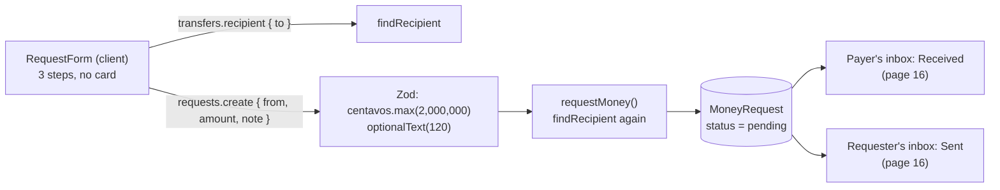
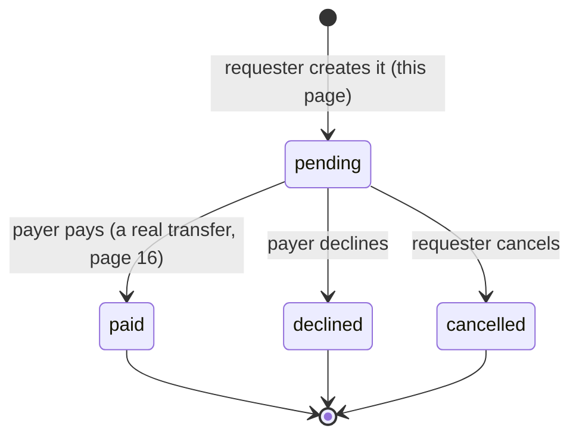

# 15 · Request money

The user asks another GoBank user to pay them: who, how much (up to **₱20,000.00**) and an optional note. **No money moves yet.** A `MoneyRequest` row is saved as **pending** and appears in the other person's inbox. There they can pay it (a real transfer) or decline it, and the requester can cancel it ([16](16-request-inbox.md)).

## At a glance

| | |
| --- | --- |
| **Route** | `/request` (Request quick action, the GO menu) |
| **Frontend** | page `gobank/src/app/(app)/request/page.tsx`; `request-form.tsx` (**client**); shared with Send money: `use-recipient-search.ts`, `money-form-ui.tsx` (`RecipientPicker`, `AmountFields`, `MoneySummary`, `MoneyFormHeader`, `FormError`), `transaction-receipt.tsx` |
| **API** | `transfers.recipient` (the search, [14](14-send-money.md)), `requests.create` (protected mutation) |
| **Backend** | `requests.router.ts`, `requests.service.ts` (`requestMoney`), `requests.rules.ts` (`MAX_REQUEST_CENTAVOS`), `findRecipient` from `transfers.service.ts` |
| **Database** | inserts one `MoneyRequest` (`status = pending`); nothing else |
| **Tests** | `verify-core.ts` (`checkTransfersAndRequests`); checked in a browser and on the test database for this review |
| **Deep dive** | [Request money and notifications](../05-features/06-request-money-and-notifications.md) |

## What the user can do

| Step | Header | What happens |
| --- | --- | --- |
| 1 | Request money · Step 1 of 3 | **Request from**: the same search box as Send money (username, account number, linked Gmail, mobile); **Continue** |
| 2 | Step 2 of 3 | amount (hint "Up to ₱20,000.00"), optional note (≤ 120 characters); **Review** |
| 3 | Step 3 of 3 | summary; **Request ₱25.00**. There is no card picker, because nothing is paid now |
| receipt | Request sent | amount, the person, note, **Status: Pending**, Date; **Done** |

## How it works

1. Step 1 reuses `useRecipientSearch` and `RecipientPicker` with the label "Request from" ([Send money §2](14-send-money.md#2-the-debounced-search-what-the-box-is-doing-while-you-type)).
2. Step 2 reuses `AmountFields`, but with this feature's own rule: more than ₱0 and at most ₱20,000.00. The user's **balance and daily limit are not checked**, because asking for money costs nothing.
3. **Request** sends `requests.create({ from: "@username", amount, note })`.
4. Zod checks the amount (`centavos.max(MAX_REQUEST_CENTAVOS)`) and the note (`optionalText(120)`).
5. `requestMoney` runs `findRecipient` (the same search rules, so you cannot ask **yourself**), then creates the `MoneyRequest` row.
6. The receipt shows **Pending**. The request now waits in the payer's **Received** list and in the requester's **Sent** list ([16](16-request-inbox.md)).

## Structure



**The life of a request** (who can move it where):



## Files and locations

| Layer | File | Role |
| --- | --- | --- |
| Page | `gobank/src/app/(app)/request/page.tsx` | renders the form, tab title "Request money" |
| Frontend (client) | `gobank/src/features/requests/components/request-form.tsx` | 3 steps and the "Request sent" receipt |
| Shared rule | `gobank/src/features/requests/requests.rules.ts` | `MAX_REQUEST_CENTAVOS` = ₱20,000.00 (form **and** router) |
| API | `gobank/src/features/requests/requests.router.ts` | `create` (also `respond` and `cancel`, page 16) |
| Service | `gobank/src/features/requests/requests.service.ts` | `requestMoney` (also `respondToRequest`, `cancelRequest`) |
| Search | `gobank/src/features/transfers/transfers.service.ts` | `findRecipient` |
| Hook and UI | `gobank/src/shared/hooks/use-recipient-search.ts`, `gobank/src/shared/ui/money-form-ui.tsx` | shared with Send money |
| Database | `gobank/prisma/schema.prisma` | `MoneyRequest`, `RequestStatus` |

## Frontend

<!-- code: gobank/src/app/(app)/request/page.tsx -->
**`gobank/src/app/(app)/request/page.tsx`** · all 10 lines

```tsx
 1 │ import type { Metadata } from "next";
 2 │ import { RequestForm } from "~/features/requests/components/request-form";
 3 │
 4 │ export const metadata: Metadata = {
 5 │   title: "Request money",
 6 │ };
 7 │
 8 │ export default function RequestPage() {
 9 │   return <RequestForm />;
10 │ }
```
<!-- /code -->

<!-- code: gobank/src/features/requests/components/request-form.tsx -->
**`gobank/src/features/requests/components/request-form.tsx`** · all 131 lines

```tsx
  1 │ "use client";
  2 │
  3 │ import { useRouter } from "next/navigation";
  4 │ import { useState } from "react";
  5 │ import {
  6 │   AmountFields,
  7 │   FormError,
  8 │   MoneyFormHeader,
  9 │   MoneySummary,
 10 │   RecipientPicker,
 11 │   type MoneyStep,
 12 │ } from "~/shared/ui/money-form-ui";
 13 │ import { useRecipientSearch } from "~/shared/hooks/use-recipient-search";
 14 │ import { dateTime, peso } from "~/shared/lib/format";
 15 │ import { toCentavos } from "~/shared/lib/money";
 16 │ import { Button } from "~/shared/ui/button";
 17 │ import { TransactionReceipt } from "~/shared/ui/transaction-receipt";
 18 │ import { errorMessage } from "~/trpc/error-message";
 19 │ import { api } from "~/trpc/react";
 20 │ import { MAX_REQUEST_CENTAVOS } from "../requests.rules";
 21 │
 22 │ export function RequestForm() {
 23 │   const router = useRouter();
 24 │   const [step, setStep] = useState<MoneyStep>("recipient");
 25 │   const [amount, setAmount] = useState("");
 26 │   const [note, setNote] = useState("");
 27 │
 28 │   const search = useRecipientSearch(() => setStep("amount"));
 29 │   const request = api.requests.create.useMutation();
 30 │
 31 │   const amountCentavos = toCentavos(Number(amount));
 32 │   const overLimit = amountCentavos > MAX_REQUEST_CENTAVOS;
 33 │   const validAmount = amountCentavos > 0 && !overLimit;
 34 │   const payer = search.recipient;
 35 │
 36 │   const back = () => {
 37 │     request.reset();
 38 │     setStep(step === "review" ? "amount" : "recipient");
 39 │   };
 40 │
 41 │   const sendRequest = () => {
 42 │     if (!payer || !validAmount || request.isPending) return;
 43 │
 44 │     request.mutate({
 45 │       from: `@${payer.username}`,
 46 │       amount: amountCentavos,
 47 │       note: note.trim(),
 48 │     });
 49 │   };
 50 │
 51 │   const finish = () => {
 52 │     router.push("/dashboard");
 53 │     router.refresh();
 54 │   };
 55 │
 56 │   if (request.data && payer) {
 57 │     return (
 58 │       <TransactionReceipt title="Request sent" onDone={finish}>
 59 │         <MoneySummary
 60 │           recipient={payer}
 61 │           amount={request.data.amount}
 62 │           note={note.trim()}
 63 │           details={[
 64 │             { label: "Status", value: "Pending" },
 65 │             { label: "Date", value: dateTime(request.data.createdAt) },
 66 │           ]}
 67 │         />
 68 │       </TransactionReceipt>
 69 │     );
 70 │   }
 71 │
 72 │   return (
 73 │     <div className="flex flex-1 flex-col">
 74 │       <MoneyFormHeader
 75 │         title="Request money"
 76 │         step={step}
 77 │         disabled={request.isPending}
 78 │         onBack={back}
 79 │       />
 80 │
 81 │       {step === "recipient" ? (
 82 │         <RecipientPicker
 83 │           label="Request from"
 84 │           value={search.value}
 85 │           loading={search.loading}
 86 │           recipient={search.match}
 87 │           error={search.error}
 88 │           onChange={search.change}
 89 │           onContinue={search.find}
 90 │           onRetry={search.retry}
 91 │         />
 92 │       ) : null}
 93 │
 94 │       {step === "amount" && payer ? (
 95 │         <AmountFields
 96 │           recipient={payer}
 97 │           amount={amount}
 98 │           note={note}
 99 │           hint={`Up to ${peso(MAX_REQUEST_CENTAVOS)}`}
100 │           error={overLimit ? `Maximum ${peso(MAX_REQUEST_CENTAVOS)}` : null}
101 │           canContinue={validAmount}
102 │           onAmountChange={setAmount}
103 │           onNoteChange={setNote}
104 │           onContinue={() => {
105 │             if (validAmount) setStep("review");
106 │           }}
107 │         />
108 │       ) : null}
109 │
110 │       {step === "review" && payer ? (
111 │         <div className="flex flex-1 flex-col pt-7">
112 │           <MoneySummary
113 │             recipient={payer}
114 │             amount={amountCentavos}
115 │             note={note.trim()}
116 │           />
117 │
118 │           <FormError error={errorMessage(request.error)} />
119 │
120 │           <div className="mt-auto pt-8">
121 │             <Button disabled={request.isPending} onClick={sendRequest}>
122 │               {request.isPending
123 │                 ? "Sending…"
124 │                 : `Request ${peso(amountCentavos)}`}
125 │             </Button>
126 │           </div>
127 │         </div>
128 │       ) : null}
129 │     </div>
130 │   );
131 │ }
```
<!-- /code -->

The search hook and the shared form parts are shown on [Send money](14-send-money.md#frontend).

## Backend

<!-- code: gobank/src/features/requests/requests.rules.ts -->
**`gobank/src/features/requests/requests.rules.ts`** · all 1 lines

```ts
1 │ export const MAX_REQUEST_CENTAVOS = 2_000_000;
```
<!-- /code -->

<!-- code: gobank/src/features/requests/requests.router.ts 11-22 -->
**`gobank/src/features/requests/requests.router.ts`** · lines 11–22

```ts
11 │ export const requestsRouter = createTRPCRouter({
12 │   create: protectedProcedure
13 │     .input(
14 │       z.object({
15 │         from: z.string().trim().min(1),
16 │         amount: centavos.max(MAX_REQUEST_CENTAVOS),
17 │         note: optionalText(120),
18 │       }),
19 │     )
20 │     .mutation(({ ctx, input }) =>
21 │       requestMoney(ctx.userId, input.from, input.amount, input.note),
22 │     ),
```
<!-- /code -->

<!-- code: gobank/src/features/requests/requests.service.ts 1-23 -->
**`gobank/src/features/requests/requests.service.ts`** · lines 1–23

```ts
 1 │ import { findRecipient } from "~/features/transfers/transfers.service";
 2 │ import { db } from "~/server/db";
 3 │ import { fail, MESSAGES } from "~/server/errors";
 4 │ import { transfer } from "~/server/ledger";
 5 │ import type { CardKind } from "../../../generated/prisma";
 6 │
 7 │ export async function requestMoney(
 8 │   userId: string,
 9 │   from: string,
10 │   amount: number,
11 │   note: string | null,
12 │ ) {
13 │   const payer = await findRecipient(from, userId);
14 │
15 │   return db.moneyRequest.create({
16 │     data: {
17 │       requesterId: userId,
18 │       payerId: payer.id,
19 │       amount,
20 │       note,
21 │     },
22 │   });
23 │ }
```
<!-- /code -->

## Database

<!-- code: gobank/prisma/schema.prisma 42-47 -->
**`gobank/prisma/schema.prisma`** · lines 42–47

```prisma
42 │ enum RequestStatus {
43 │   pending
44 │   paid
45 │   declined
46 │   cancelled
47 │ }
```
<!-- /code -->

<!-- code: gobank/prisma/schema.prisma 189-205 -->
**`gobank/prisma/schema.prisma`** · lines 189–205

```prisma
189 │ model MoneyRequest {
190 │   id          String        @id @default(cuid())
191 │   requesterId String
192 │   payerId     String
193 │   amount      Int
194 │   note        String?
195 │   status      RequestStatus @default(pending)
196 │   reference   String?
197 │   createdAt   DateTime      @default(now())
198 │   updatedAt   DateTime      @updatedAt
199 │
200 │   requester User @relation("Requester", fields: [requesterId], references: [id], onDelete: Cascade)
201 │   payer     User @relation("Payer", fields: [payerId], references: [id], onDelete: Cascade)
202 │
203 │   @@index([payerId, status])
204 │   @@index([requesterId])
205 │ }
```
<!-- /code -->

| Column | Value when created | Later |
| --- | --- | --- |
| `id` | a new `cuid()` | |
| `requesterId` | the signed-in user (from the session, never from the browser) | |
| `payerId` | the person found by `findRecipient` | |
| `amount` | centavos, 1 to 2,000,000 | never changes |
| `note` | trimmed text or `NULL` | never changes; copied into the transfer when paid |
| `status` | `pending` (the default) | `paid`, `declined` or `cancelled` ([16](16-request-inbox.md)) |
| `reference` | `NULL` | the transfer's `GB…` reference once paid |
| `createdAt`, `updatedAt` | now | `updatedAt` changes with the status |

Indexes: `@@index([payerId, status])` for "requests I have to answer" and `@@index([requesterId])` for "requests I sent". Deleting a user deletes their requests (`onDelete: Cascade`).

## The complicated parts, explained step by step

### 1. One form, two features: what is shared and what is not

| Part | Send money ([14](14-send-money.md)) | Request money (this page) |
| --- | --- | --- |
| search (`useRecipientSearch`) | same | same; label "Request from" |
| amount box (`AmountFields`, `isPesoInput`) | same | same |
| maximum | ₱1,000,000.00 (`MAX_TRANSACTION_CENTAVOS`) | **₱20,000.00** (`MAX_REQUEST_CENTAVOS`) |
| balance and daily-limit checks | yes (`useSpendLimit`) | **no**: nothing is paid now |
| card picker | yes | **no** |
| server call | `transfers.send` | `requests.create` |
| result | money moved, 2 `Transaction` rows | **1 `MoneyRequest` row, no money moved** |
| receipt | "Transfer successful" + reference | "Request sent" + **Status: Pending** |

The amount check is a few lines in the form itself:

<!-- code: gobank/src/features/requests/components/request-form.tsx 31-33 -->
**`gobank/src/features/requests/components/request-form.tsx`** · lines 31–33

```tsx
31 │   const amountCentavos = toCentavos(Number(amount));
32 │   const overLimit = amountCentavos > MAX_REQUEST_CENTAVOS;
33 │   const validAmount = amountCentavos > 0 && !overLimit;
```
<!-- /code -->

Typed in Chromium for this review:

| Typed | Shown | Review |
| --- | --- | --- |
| (nothing) | Up to ₱20,000.00 | disabled |
| `20000.01` | **Maximum ₱20,000.00** (in red, `role="alert"`) | disabled |
| `25` | Up to ₱20,000.00 | enabled |

### 2. The server never trusts who "I" am from the browser

<!-- code: gobank/src/features/requests/requests.service.ts 7-23 -->
**`gobank/src/features/requests/requests.service.ts`** · lines 7–23

```ts
 7 │ export async function requestMoney(
 8 │   userId: string,
 9 │   from: string,
10 │   amount: number,
11 │   note: string | null,
12 │ ) {
13 │   const payer = await findRecipient(from, userId);
14 │
15 │   return db.moneyRequest.create({
16 │     data: {
17 │       requesterId: userId,
18 │       payerId: payer.id,
19 │       amount,
20 │       note,
21 │     },
22 │   });
23 │ }
```
<!-- /code -->

| Field | Comes from | Why |
| --- | --- | --- |
| `requesterId` | `ctx.userId`, set by `requireSession` from the session cookie | a browser cannot make a request "from" someone else |
| `payerId` | `findRecipient(from, userId)` on the server | the same rules as Send money: exact matches only, **not yourself** ("That is your own account") |
| `amount` | Zod: an integer from 1 to 2,000,000 | |
| `note` | Zod: trimmed, ≤ 120 characters, blank → `null` | |

### 3. A request reserves nothing

Creating a request does **not** check or hold the payer's money. The payer's balance, card lock and daily limit are checked only when they **pay**, inside the transfer ([16 §2](16-request-inbox.md#2-paying-claim-first-then-transfer-in-one-transaction)). That is why the request form has no balance hint and no card picker.

| Situation | What happens |
| --- | --- |
| Dante has ₱5 and Maricel asks for ₱25 | the request is created; Dante's payment would be refused later |
| Maricel asks Dante twice for the same thing | two separate pending requests (nothing prevents duplicates) |
| Maricel asks herself | refused: "That is your own account" (tested) |

### 4. What was saved, as seen on the test database

Created for this review with `requestMoney(maricel, "@dante", 2500, "Movie")`:

```json
{ "status": "pending", "amount": 2500, "note": "Movie", "reference": null }
```

The `INSERT` parameters, captured from PostgreSQL's log, were: a new id, Maricel's id as `requesterId`, Dante's id as `payerId`, `2500`, `'Movie'`, `'pending'` and the two timestamps. No `Transaction` row and no balance change.

## Rules and limits

| Rule | Value | Where |
| --- | --- | --- |
| Amount | ₱0.01 to ₱20,000.00 | `MAX_REQUEST_CENTAVOS` (form and router) |
| Note | optional, ≤ 120 characters | `optionalText(120)`, textarea `maxLength` |
| From whom | any other GoBank user the search finds | `findRecipient` |
| Yourself | refused | `findRecipient` line 46 |
| Duplicates | allowed | no unique rule on `MoneyRequest` |
| Expiry | none: a request stays pending until paid, declined or cancelled | |

## Messages

| Message | When |
| --- | --- |
| Request from | step 1 label |
| Up to ₱20,000.00 / Maximum ₱20,000.00 | amount hint and error |
| Request ₱25.00 / Sending… | step 3 button |
| Request sent | receipt title |
| Status · Pending, Date | receipt rows |
| No matching account. / That is your own account | search errors ([14](14-send-money.md)) |

## Tests

- `verify-core.ts` → `checkTransfersAndRequests` creates three requests from `owner` to `other`: one is **paid**, one **declined** and one **cancelled**. Then `listNotifications(owner, "sent")` must return exactly the statuses `["cancelled", "declined", "paid"]`, and `listNotifications(owner, "received")` must be empty.
- **Checked in Chromium for this review:** as `@maricel`, a ₱25.00 request to `@dante` with the note "Movie": the hint, the over-limit message, **no** card picker, "Request ₱25.00", and the receipt "Request sent · Status Pending · Nov 4, 2026, 10:51 AM". Paying it is on [page 16](16-request-inbox.md#tests).
- **Run on the test database:** asking yourself is refused with "That is your own account".
