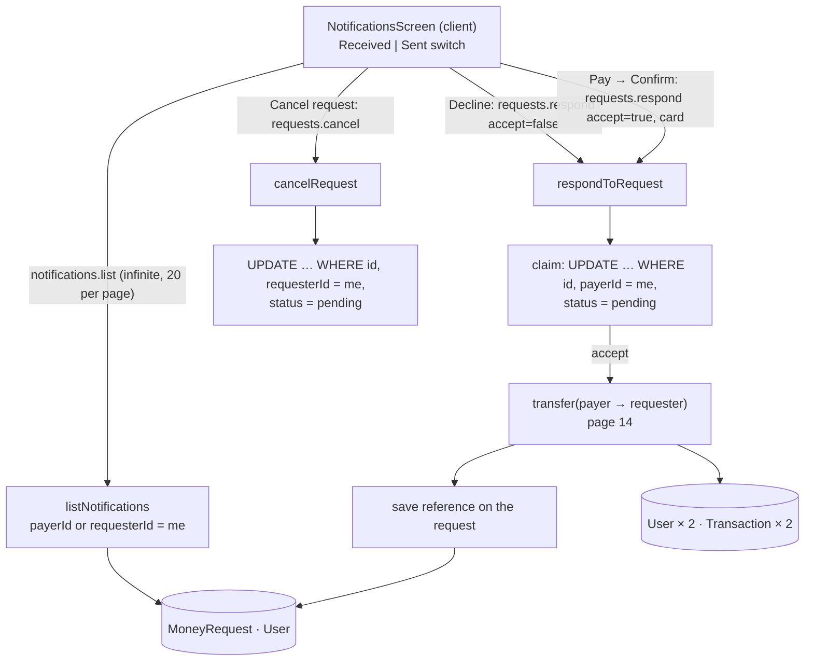

# 16 · Money-request inbox: pay, decline, cancel

The bell on the dashboard opens **Notifications**, the inbox for money requests. **Received** lists requests other people sent you: **Pay** (choose a card, **Confirm payment**) or **Decline**. **Sent** lists your own requests: **Cancel request** while they are still pending. A paid request gets a **View receipt** link. Lists load 20 at a time with **Load more**.

## At a glance

| | |
| --- | --- |
| **Route** | `/notifications` (the bell on the dashboard) |
| **Frontend** | page `gobank/src/app/(app)/notifications/page.tsx`; `notifications-screen.tsx` (**client**); `use-spend-limit.ts`, `card-picker.tsx`; UI `money-form-ui.tsx` (`RecipientIdentity`, `FormError`), `button.tsx`, `page-header.tsx` |
| **API** | `notifications.list` (protected query, infinite), `requests.respond` and `requests.cancel` (protected mutations), `account.spending` (cards for the picker) |
| **Backend** | `notifications.router.ts`, `notifications.service.ts` (`listNotifications`), `requests.router.ts`, `requests.service.ts` (`respondToRequest`, `cancelRequest`), ledger `transfer()`, `server/pagination.ts` (`toPage`) |
| **Database** | reads `MoneyRequest` + both users; **pay**: claims the request, runs a full transfer (2 `User` + 2 `Transaction` rows), saves the reference; **decline / cancel**: changes the status only |
| **Tests** | `verify-core.ts` (`checkTransfersAndRequests`); a simultaneous double payment, a failed payment and the permission rules were run on the test database; the screen was checked in Chromium |
| **Deep dive** | [Request money and notifications §3–5](../05-features/06-request-money-and-notifications.md#3-the-service) |

## What the user can do

| Tab | Request status | Buttons | Result |
| --- | --- | --- | --- |
| **Received** | pending | **Decline** | status → declined |
| **Received** | pending | **Pay** → card picker → **Confirm payment** (or **Back**) | a real transfer to the requester; status → paid |
| **Sent** | pending | **Cancel request** | status → cancelled |
| either | paid | **View receipt** → `/transactions/<reference>` ([34](34-receipts.md)) | |
| either | declined / cancelled | none | |

Each card shows the **other** person (photo, name, `@username`), the amount, the status, the note and the date.

## How it works

1. `NotificationsScreen` starts on **Received** and calls `notifications.list.useInfiniteQuery({ requestDirection, limit: 20 })`.
2. `listNotifications` filters by `payerId = me` (received) or `requesterId = me` (sent), newest first, and returns 20 items plus a `next` cursor if there are more.
3. **Decline** calls `requests.respond({ id, accept: false })`. **Pay** first opens a review with the card picker (`useSpendLimit`), then **Confirm payment** calls `requests.respond({ id, accept: true, card })`.
4. `respondToRequest` runs in **one** transaction: it **claims** the request (`pending → paid/declined`, only if I am the payer and it is still pending), and for a payment runs the normal `transfer()` from the payer to the requester, then saves the transfer's reference on the request.
5. **Cancel request** calls `requests.cancel({ id })`: the same claim pattern, for the requester (`pending → cancelled`).
6. After any of these, the query client **invalidates every query**, so the list and the balances reload.

## Structure



## Files and locations

| Layer | File | Role |
| --- | --- | --- |
| Page | `gobank/src/app/(app)/notifications/page.tsx` | renders the screen, tab title "Notifications" |
| Frontend (client) | `gobank/src/features/notifications/components/notifications-screen.tsx` | switch, list, cards, pay/decline/cancel, Load more |
| Hook | `gobank/src/shared/hooks/use-spend-limit.ts` | the cards for the picker |
| UI | `gobank/src/features/card/components/card-picker.tsx` | "Pay with" |
| API | `gobank/src/features/notifications/notifications.router.ts` | `list` |
| Service | `gobank/src/features/notifications/notifications.service.ts` | `listNotifications` |
| API | `gobank/src/features/requests/requests.router.ts` | `respond`, `cancel` |
| Service | `gobank/src/features/requests/requests.service.ts` | `respondToRequest`, `cancelRequest` |
| Ledger | `gobank/src/server/ledger.ts` | `transfer()` ([14](14-send-money.md)) |
| Pagination | `gobank/src/server/pagination.ts` | `toPage` |
| Fields | `gobank/src/features/transfers/transfers.service.ts` | `PARTY` (what is shown about a person) |
| Cache | `gobank/src/trpc/query-client.ts` | reload everything after a mutation |

## Frontend

<!-- code: gobank/src/app/(app)/notifications/page.tsx -->
**`gobank/src/app/(app)/notifications/page.tsx`** · all 8 lines

```tsx
1 │ import type { Metadata } from "next";
2 │ import { NotificationsScreen } from "~/features/notifications/components/notifications-screen";
3 │
4 │ export const metadata: Metadata = { title: "Notifications" };
5 │
6 │ export default function NotificationsPage() {
7 │   return <NotificationsScreen />;
8 │ }
```
<!-- /code -->

<!-- code: gobank/src/features/notifications/components/notifications-screen.tsx -->
**`gobank/src/features/notifications/components/notifications-screen.tsx`** · all 288 lines

```tsx
  1 │ "use client";
  2 │
  3 │ import { Bell } from "lucide-react";
  4 │ import Link from "next/link";
  5 │ import { useState } from "react";
  6 │ import { cn } from "~/shared/lib/cn";
  7 │ import { dateTime, peso } from "~/shared/lib/format";
  8 │ import { MAX_TRANSACTION_CENTAVOS } from "~/shared/lib/money";
  9 │ import { Button } from "~/shared/ui/button";
 10 │ import { FormError, RecipientIdentity } from "~/shared/ui/money-form-ui";
 11 │ import { PageHeader } from "~/shared/ui/page-header";
 12 │ import { useSpendLimit } from "~/shared/hooks/use-spend-limit";
 13 │ import { CardPicker } from "~/features/card/components/card-picker";
 14 │ import { errorMessage } from "~/trpc/error-message";
 15 │ import { api, type RouterOutputs } from "~/trpc/react";
 16 │
 17 │ type MoneyRequest = RouterOutputs["notifications"]["list"]["items"][number];
 18 │ type Direction = "received" | "sent";
 19 │
 20 │ const DIRECTIONS: Direction[] = ["received", "sent"];
 21 │
 22 │ function DirectionSwitch({
 23 │   selected,
 24 │   onSelect,
 25 │ }: {
 26 │   selected: Direction;
 27 │   onSelect: (direction: Direction) => void;
 28 │ }) {
 29 │   return (
 30 │     <div
 31 │       className="border-line bg-surface-sunken mb-5 grid grid-cols-2 gap-1 rounded-2xl border p-1"
 32 │       aria-label="Request direction"
 33 │     >
 34 │       {DIRECTIONS.map((direction) => (
 35 │         <button
 36 │           key={direction}
 37 │           type="button"
 38 │           aria-pressed={selected === direction}
 39 │           onClick={() => onSelect(direction)}
 40 │           className={cn(
 41 │             "h-11 rounded-xl text-[14px] font-medium capitalize transition-colors",
 42 │             selected === direction
 43 │               ? "bg-surface-raised text-ink"
 44 │               : "text-ink-muted hover:text-ink",
 45 │           )}
 46 │         >
 47 │           {direction}
 48 │         </button>
 49 │       ))}
 50 │     </div>
 51 │   );
 52 │ }
 53 │
 54 │ function EmptyRequests({ direction }: { direction: Direction }) {
 55 │   return (
 56 │     <div className="border-line flex flex-col items-center gap-4 rounded-2xl border px-5 py-10">
 57 │       <Bell size={28} className="text-ink-muted" aria-hidden />
 58 │       <p className="text-ink-muted text-[14px]">No {direction} requests</p>
 59 │     </div>
 60 │   );
 61 │ }
 62 │
 63 │ function SentRequestActions({ id }: { id: string }) {
 64 │   const cancel = api.requests.cancel.useMutation();
 65 │
 66 │   return (
 67 │     <div className="mt-4">
 68 │       <FormError error={errorMessage(cancel.error)} />
 69 │       <Button
 70 │         variant="outline"
 71 │         disabled={cancel.isPending}
 72 │         onClick={() => cancel.mutate({ id })}
 73 │       >
 74 │         {cancel.isPending ? "Cancelling…" : "Cancel request"}
 75 │       </Button>
 76 │     </div>
 77 │   );
 78 │ }
 79 │
 80 │ function ReceivedRequestActions({ id }: { id: string }) {
 81 │   const limit = useSpendLimit(MAX_TRANSACTION_CENTAVOS);
 82 │   const [reviewing, setReviewing] = useState(false);
 83 │
 84 │   const respond = api.requests.respond.useMutation({
 85 │     onSuccess: () => setReviewing(false),
 86 │   });
 87 │
 88 │   const startReview = () => {
 89 │     respond.reset();
 90 │     setReviewing(true);
 91 │   };
 92 │
 93 │   const leaveReview = () => {
 94 │     setReviewing(false);
 95 │     respond.reset();
 96 │   };
 97 │
 98 │   if (reviewing) {
 99 │     return (
100 │       <div className="border-line mt-4 border-t pt-4">
101 │         <p className="text-ink-soft mb-3 text-[13px]">
102 │           Pay from your main account?
103 │         </p>
104 │
105 │         <CardPicker
106 │           cards={limit.cards}
107 │           value={limit.card}
108 │           onChange={limit.setCard}
109 │           disabled={respond.isPending}
110 │         />
111 │
112 │         <FormError error={errorMessage(respond.error)} />
113 │
114 │         <Button
115 │           disabled={respond.isPending}
116 │           onClick={() => respond.mutate({ id, accept: true, card: limit.card })}
117 │         >
118 │           {respond.isPending ? "Paying…" : "Confirm payment"}
119 │         </Button>
120 │         <Button
121 │           variant="ghost"
122 │           disabled={respond.isPending}
123 │           onClick={leaveReview}
124 │         >
125 │           Back
126 │         </Button>
127 │       </div>
128 │     );
129 │   }
130 │
131 │   return (
132 │     <div className="mt-4">
133 │       <FormError error={errorMessage(respond.error)} />
134 │
135 │       <div className="grid grid-cols-2 gap-3">
136 │         <Button
137 │           variant="outline"
138 │           disabled={respond.isPending}
139 │           onClick={() => respond.mutate({ id, accept: false })}
140 │         >
141 │           {respond.isPending ? "Declining…" : "Decline"}
142 │         </Button>
143 │         <Button disabled={respond.isPending} onClick={startReview}>
144 │           Pay
145 │         </Button>
146 │       </div>
147 │     </div>
148 │   );
149 │ }
150 │
151 │ function RequestFooter({
152 │   request,
153 │   received,
154 │ }: {
155 │   request: MoneyRequest;
156 │   received: boolean;
157 │ }) {
158 │   if (request.status === "pending") {
159 │     return received ? (
160 │       <ReceivedRequestActions id={request.id} />
161 │     ) : (
162 │       <SentRequestActions id={request.id} />
163 │     );
164 │   }
165 │
166 │   if (!request.reference) return null;
167 │
168 │   return (
169 │     <Link
170 │       href={`/transactions/${request.reference}`}
171 │       className="text-brand mt-4 inline-block text-[13px] font-medium hover:underline"
172 │     >
173 │       View receipt
174 │     </Link>
175 │   );
176 │ }
177 │
178 │ function RequestCard({
179 │   request,
180 │   received,
181 │ }: {
182 │   request: MoneyRequest;
183 │   received: boolean;
184 │ }) {
185 │   return (
186 │     <article className="border-line rounded-2xl border p-4">
187 │       <RecipientIdentity
188 │         recipient={received ? request.requester : request.payer}
189 │       />
190 │
191 │       <div className="mt-5 flex flex-wrap items-center justify-between gap-2">
192 │         <p className="text-ink text-[26px] font-semibold tracking-tight tabular-nums">
193 │           {peso(request.amount)}
194 │         </p>
195 │         <span className="text-ink-muted text-[12px] capitalize">
196 │           {request.status}
197 │         </span>
198 │       </div>
199 │
200 │       {request.note ? (
201 │         <p className="text-ink-soft mt-3 text-[14px] break-words">
202 │           {request.note}
203 │         </p>
204 │       ) : null}
205 │
206 │       <p className="text-ink-muted mt-3 text-[12px]">
207 │         {dateTime(request.createdAt)}
208 │       </p>
209 │
210 │       <RequestFooter request={request} received={received} />
211 │     </article>
212 │   );
213 │ }
214 │
215 │ export function NotificationsScreen() {
216 │   const [direction, setDirection] = useState<Direction>("received");
217 │
218 │   const requests = api.notifications.list.useInfiniteQuery(
219 │     { requestDirection: direction, limit: 20 },
220 │     { getNextPageParam: (page) => page.next ?? undefined },
221 │   );
222 │
223 │   const items = requests.data?.pages.flatMap((page) => page.items) ?? [];
224 │   const isEmpty = !requests.isLoading && !requests.error && items.length === 0;
225 │
226 │   const retry = () => {
227 │     if (requests.isFetchNextPageError) void requests.fetchNextPage();
228 │     else void requests.refetch();
229 │   };
230 │
231 │   return (
232 │     <div className="flex flex-1 flex-col">
233 │       <PageHeader title="Notifications" back="/dashboard" />
234 │
235 │       <div className="pt-7">
236 │         <DirectionSwitch selected={direction} onSelect={setDirection} />
237 │
238 │         {requests.isLoading ? (
239 │           <p
240 │             role="status"
241 │             className="text-ink-muted py-8 text-center text-[14px]"
242 │           >
243 │             Loading requests…
244 │           </p>
245 │         ) : null}
246 │
247 │         {isEmpty ? <EmptyRequests direction={direction} /> : null}
248 │
249 │         {items.length > 0 ? (
250 │           <ul className="space-y-4">
251 │             {items.map((request) => (
252 │               <li key={request.id}>
253 │                 <RequestCard
254 │                   request={request}
255 │                   received={direction === "received"}
256 │                 />
257 │               </li>
258 │             ))}
259 │           </ul>
260 │         ) : null}
261 │
262 │         {requests.error ? (
263 │           <div className="mt-5">
264 │             <FormError error={errorMessage(requests.error)} />
265 │             <Button
266 │               variant="ghost"
267 │               disabled={requests.isFetching}
268 │               onClick={retry}
269 │             >
270 │               {requests.isFetching ? "Retrying…" : "Retry"}
271 │             </Button>
272 │           </div>
273 │         ) : null}
274 │
275 │         {!requests.error && requests.hasNextPage ? (
276 │           <Button
277 │             variant="outline"
278 │             className="mt-5"
279 │             disabled={requests.isFetching}
280 │             onClick={() => void requests.fetchNextPage()}
281 │           >
282 │             {requests.isFetchingNextPage ? "Loading…" : "Load more"}
283 │           </Button>
284 │         ) : null}
285 │       </div>
286 │     </div>
287 │   );
288 │ }
```
<!-- /code -->

## Backend

<!-- code: gobank/src/features/notifications/notifications.router.ts -->
**`gobank/src/features/notifications/notifications.router.ts`** · all 22 lines

```ts
 1 │ import { z } from "zod";
 2 │ import { createTRPCRouter, protectedProcedure } from "~/server/trpc";
 3 │ import { listNotifications } from "./notifications.service";
 4 │
 5 │ export const notificationsRouter = createTRPCRouter({
 6 │   list: protectedProcedure
 7 │     .input(
 8 │       z.object({
 9 │         requestDirection: z.enum(["received", "sent"]),
10 │         cursor: z.string().min(1).nullish(),
11 │         limit: z.number().int().min(1).max(50).default(20),
12 │       }),
13 │     )
14 │     .query(({ ctx, input }) =>
15 │       listNotifications(
16 │         ctx.userId,
17 │         input.requestDirection,
18 │         input.cursor,
19 │         input.limit,
20 │       ),
21 │     ),
22 │ });
```
<!-- /code -->

<!-- code: gobank/src/features/notifications/notifications.service.ts -->
**`gobank/src/features/notifications/notifications.service.ts`** · all 46 lines

```ts
 1 │ import { PARTY } from "~/features/transfers/transfers.service";
 2 │ import { db } from "~/server/db";
 3 │ import { toPage } from "~/server/pagination";
 4 │
 5 │ type Direction = "received" | "sent";
 6 │
 7 │ const partyFields = (includePhoto: boolean) => ({
 8 │   ...PARTY,
 9 │   profilePhoto: includePhoto,
10 │ });
11 │
12 │ const withPhotoOrNull = <Party extends { profilePhoto?: string | null }>(
13 │   party: Party,
14 │ ) => ({ ...party, profilePhoto: party.profilePhoto ?? null });
15 │
16 │ export async function listNotifications(
17 │   userId: string,
18 │   direction: Direction,
19 │   cursor?: string | null,
20 │   limit = 20,
21 │ ) {
22 │   const received = direction === "received";
23 │   const mine = received ? { payerId: userId } : { requesterId: userId };
24 │
25 │   const rows = await db.moneyRequest.findMany({
26 │     where: mine,
27 │     include: {
28 │       requester: { select: partyFields(received) },
29 │       payer: { select: partyFields(!received) },
30 │     },
31 │     orderBy: [{ createdAt: "desc" }, { id: "desc" }],
32 │     take: limit + 1,
33 │     ...(cursor ? { cursor: { id: cursor, ...mine }, skip: 1 } : {}),
34 │   });
35 │
36 │   const { items, next } = toPage(rows, limit);
37 │
38 │   return {
39 │     items: items.map((request) => ({
40 │       ...request,
41 │       requester: withPhotoOrNull(request.requester),
42 │       payer: withPhotoOrNull(request.payer),
43 │     })),
44 │     next,
45 │   };
46 │ }
```
<!-- /code -->

<!-- code: gobank/src/server/pagination.ts -->
**`gobank/src/server/pagination.ts`** · all 11 lines

```ts
 1 │ export const pageArgs = (cursor: string | null | undefined, limit: number) => ({
 2 │   take: limit + 1,
 3 │   ...(cursor ? { cursor: { id: cursor }, skip: 1 } : {}),
 4 │ });
 5 │
 6 │ export function toPage<T extends { id: string }>(rows: T[], limit: number) {
 7 │   const items = rows.slice(0, limit);
 8 │   const next = rows.length > limit ? (items.at(-1)?.id ?? null) : null;
 9 │
10 │   return { items, next };
11 │ }
```
<!-- /code -->

<!-- code: gobank/src/features/requests/requests.router.ts 24-38 -->
**`gobank/src/features/requests/requests.router.ts`** · lines 24–38

```ts
24 │   respond: protectedProcedure
25 │     .input(
26 │       z.object({
27 │         id: z.string().min(1),
28 │         accept: z.boolean(),
29 │         card: cardKind.default("physical"),
30 │       }),
31 │     )
32 │     .mutation(({ ctx, input }) =>
33 │       respondToRequest(ctx.userId, input.id, input.accept, input.card),
34 │     ),
35 │
36 │   cancel: protectedProcedure
37 │     .input(z.object({ id: z.string().min(1) }))
38 │     .mutation(({ ctx, input }) => cancelRequest(ctx.userId, input.id)),
```
<!-- /code -->

<!-- code: gobank/src/features/requests/requests.service.ts 25-72 -->
**`gobank/src/features/requests/requests.service.ts`** · lines 25–72

```ts
25 │ export const respondToRequest = (
26 │   userId: string,
27 │   id: string,
28 │   accept: boolean,
29 │   card: CardKind = "physical",
30 │ ) =>
31 │   db.$transaction(
32 │     async (tx) => {
33 │       const claimed = await tx.moneyRequest.updateMany({
34 │         where: { id, payerId: userId, status: "pending" },
35 │         data: { status: accept ? "paid" : "declined" },
36 │       });
37 │       if (claimed.count !== 1) fail("NOT_FOUND", MESSAGES.requestClosed);
38 │       if (!accept) return null;
39 │
40 │       const request = await tx.moneyRequest.findUniqueOrThrow({
41 │         where: { id },
42 │         include: {
43 │           requester: { select: { id: true, username: true } },
44 │           payer: { select: { id: true, username: true } },
45 │         },
46 │       });
47 │       const sent = await transfer(
48 │         tx,
49 │         request.payer,
50 │         request.requester,
51 │         request.amount,
52 │         card,
53 │         request.note,
54 │       );
55 │
56 │       await tx.moneyRequest.update({
57 │         where: { id },
58 │         data: { reference: sent.reference },
59 │       });
60 │
61 │       return sent;
62 │     },
63 │     { maxWait: 10_000, timeout: 15_000 },
64 │   );
65 │
66 │ export async function cancelRequest(userId: string, id: string) {
67 │   const cancelled = await db.moneyRequest.updateMany({
68 │     where: { id, requesterId: userId, status: "pending" },
69 │     data: { status: "cancelled" },
70 │   });
71 │   if (cancelled.count !== 1) fail("NOT_FOUND", MESSAGES.requestClosed);
72 │ }
```
<!-- /code -->

## Database

| Action | `MoneyRequest` | Money |
| --- | --- | --- |
| list | read (`payerId` or `requesterId` = me), with the other user's `PARTY` fields | none |
| **Decline** | `status: pending → declined` | none |
| **Cancel request** | `status: pending → cancelled` | none |
| **Pay** | `status: pending → paid`, then `reference = GB…` | `transfer()`: 2 `User` rows locked and updated, 2 `Transaction` rows (same reference) |

## The complicated parts, explained step by step

### 1. Claiming a request with one conditional `UPDATE`

<!-- code: gobank/src/features/requests/requests.service.ts 33-37 -->
**`gobank/src/features/requests/requests.service.ts`** · lines 33–37

```ts
33 │       const claimed = await tx.moneyRequest.updateMany({
34 │         where: { id, payerId: userId, status: "pending" },
35 │         data: { status: accept ? "paid" : "declined" },
36 │       });
37 │       if (claimed.count !== 1) fail("NOT_FOUND", MESSAGES.requestClosed);
```
<!-- /code -->

The SQL PostgreSQL received (captured):

```sql
UPDATE "MoneyRequest" SET "status" = 'paid', "updatedAt" = $2
WHERE "id" = $3 AND "payerId" = $4 AND "status" = 'pending'
-- $3 = the request's id, $4 = the signed-in user (the payer)
```

`updateMany` returns `{ count }`, the number of rows changed. **Only exactly 1** means "I claimed it". Every other case gets the **same** message, "This request is no longer open". Each case below was run on the test database:

| Who / when | Rows matched | Result |
| --- | --- | --- |
| the payer, request pending | 1 | claimed |
| the payer, a second time | 0 (status is no longer `pending`) | "This request is no longer open" |
| the **requester** tries to pay their own request | 0 (`payerId` ≠ me) | "This request is no longer open" |
| the **payer** tries to cancel | 0 (`requesterId` ≠ me, in `cancelRequest`) | "This request is no longer open" |
| decline after the requester cancelled | 0 | "This request is no longer open" |

The single message is deliberate: a stranger probing request IDs cannot tell "does not exist" from "not yours" from "already closed".

### 2. Paying: claim first, then transfer, in one transaction

<!-- code: gobank/src/features/requests/requests.service.ts 31-64 -->
**`gobank/src/features/requests/requests.service.ts`** · lines 31–64

```ts
31 │   db.$transaction(
32 │     async (tx) => {
33 │       const claimed = await tx.moneyRequest.updateMany({
34 │         where: { id, payerId: userId, status: "pending" },
35 │         data: { status: accept ? "paid" : "declined" },
36 │       });
37 │       if (claimed.count !== 1) fail("NOT_FOUND", MESSAGES.requestClosed);
38 │       if (!accept) return null;
39 │
40 │       const request = await tx.moneyRequest.findUniqueOrThrow({
41 │         where: { id },
42 │         include: {
43 │           requester: { select: { id: true, username: true } },
44 │           payer: { select: { id: true, username: true } },
45 │         },
46 │       });
47 │       const sent = await transfer(
48 │         tx,
49 │         request.payer,
50 │         request.requester,
51 │         request.amount,
52 │         card,
53 │         request.note,
54 │       );
55 │
56 │       await tx.moneyRequest.update({
57 │         where: { id },
58 │         data: { reference: sent.reference },
59 │       });
60 │
61 │       return sent;
62 │     },
63 │     { maxWait: 10_000, timeout: 15_000 },
64 │   );
```
<!-- /code -->

| Lines | Step |
| --- | --- |
| 31, 63 | everything inside `db.$transaction`, waiting up to 10 s to start (`maxWait`) and 15 s to finish (`timeout`) |
| 33–37 | claim: `pending → paid` (or `declined`) |
| 38 | decline stops here (returns `null`) |
| 40–46 | load the payer and the requester (`id`, `username`) |
| 47–54 | `transfer(tx, payer, requester, amount, card, note)`: **every** Send-money rule applies (row locks, card lock, daily limit, balance, points) |
| 56–59 | store the transfer's reference on the request, which gives the **View receipt** link |

**Trace: two payments of the same request at the same moment** (run on the test database: `respondToRequest` twice in parallel, once with each card):

| Time | Payment A | Payment B |
| --- | --- | --- |
| t1 | `BEGIN`; claim: the row matches (`pending`), PostgreSQL **locks** it | `BEGIN`; claim: the row is locked → **waits** |
| t2 | `transfer()`: ₱25.00 Dante → Maricel; save the reference; `COMMIT` | |
| t3 | | the lock is released; PostgreSQL **re-checks** `status = 'pending'` on the new row: it is `paid` → 0 rows |
| t4 | | `fail(…)` → `ROLLBACK` → "This request is no longer open" |

Measured result: one `paid GB7SWT3Q8K`, one refused, and **the money moved exactly once** (Maricel +₱25.00, Dante −₱25.00).

**Trace: the payment fails after the claim** (run with Dante's spending room too small for the request):

| Step | Result |
| --- | --- |
| claim | `status = 'paid'` **inside** the transaction (not yet visible to anyone else) |
| `transfer()` → `spend()` | refused: "This goes over your daily limit" |
| the error leaves `db.$transaction` | `ROLLBACK`: the status change is undone too |
| status read afterwards | **`pending`**: the payer can try again later, or decline |

Claiming **first** is what stops a double payment. Doing both in **one** transaction is what keeps a failed payment from leaving a request marked "paid" with no money moved.

### 3. What a paid request leaves behind

From the double-payment test (the request had the note "Movie"):

| Row | `title` | `amount` | `details` |
| --- | --- | --- | --- |
| Dante's (payer) | Transfer to @maricel | −2500 | `{"card": {"kind": "physical", "last4": "1818", "network": "discover"}, "note": "Movie"}` |
| Maricel's (requester) | Transfer from @dante | +2500 | `{"note": "Movie"}` |
| the `MoneyRequest` | | | `status = paid`, `reference = GB7SWT3Q8K` |

A paid request is a normal transfer in both histories, with the request's note. The transfer's reference is shared by both rows and the request, so **View receipt** opens the right receipt for whoever taps it.

### 4. Showing only the other person, with only the photo that is needed

<!-- code: gobank/src/features/notifications/notifications.service.ts 7-34 -->
**`gobank/src/features/notifications/notifications.service.ts`** · lines 7–34

```ts
 7 │ const partyFields = (includePhoto: boolean) => ({
 8 │   ...PARTY,
 9 │   profilePhoto: includePhoto,
10 │ });
11 │
12 │ const withPhotoOrNull = <Party extends { profilePhoto?: string | null }>(
13 │   party: Party,
14 │ ) => ({ ...party, profilePhoto: party.profilePhoto ?? null });
15 │
16 │ export async function listNotifications(
17 │   userId: string,
18 │   direction: Direction,
19 │   cursor?: string | null,
20 │   limit = 20,
21 │ ) {
22 │   const received = direction === "received";
23 │   const mine = received ? { payerId: userId } : { requesterId: userId };
24 │
25 │   const rows = await db.moneyRequest.findMany({
26 │     where: mine,
27 │     include: {
28 │       requester: { select: partyFields(received) },
29 │       payer: { select: partyFields(!received) },
30 │     },
31 │     orderBy: [{ createdAt: "desc" }, { id: "desc" }],
32 │     take: limit + 1,
33 │     ...(cursor ? { cursor: { id: cursor, ...mine }, skip: 1 } : {}),
34 │   });
```
<!-- /code -->

| Direction | `where` | Shown on the card | Photo loaded for |
| --- | --- | --- | --- |
| received | `payerId = me` | the **requester** | the requester only (`partyFields(received)` → `profilePhoto: true`) |
| sent | `requesterId = me` | the **payer** | the payer only (`partyFields(!received)`) |

Your **own** photo, which can be up to ~270 KB of text, is never sent back to you in every list item. `withPhotoOrNull` (lines 12–14) turns the missing field into `null`, so both directions have the same shape for the screen. `PARTY` limits each person to `id`, `username`, `fullName` and `profilePhoto`: never a balance, account number, mobile or Gmail.

### 5. Cursor pagination: 20 at a time without skipping or repeating

<!-- code: gobank/src/server/pagination.ts 6-11 -->
**`gobank/src/server/pagination.ts`** · lines 6–11

```ts
 6 │ export function toPage<T extends { id: string }>(rows: T[], limit: number) {
 7 │   const items = rows.slice(0, limit);
 8 │   const next = rows.length > limit ? (items.at(-1)?.id ?? null) : null;
 9 │
10 │   return { items, next };
11 │ }
```
<!-- /code -->

| Page | Query | Rows returned | `items` | `next` |
| --- | --- | --- | --- | --- |
| 1 | `take: 21`, no cursor | 21 | the first 20 | the 20th item's `id` |
| 2 | `take: 21`, `cursor: { id: <20th id>, payerId: me }`, `skip: 1` | up to 21, starting **after** the 20th | the next 20 | … |
| last | | ≤ 20 | all of them | `null` → no **Load more** button |

- Asking for **one extra row** (`limit + 1`) is how the server knows whether another page exists, without a separate `COUNT`.
- `skip: 1` skips the cursor row itself, which was the last item of the previous page.
- The cursor includes `...mine` (line 33), so the cursor must be one of **your** requests in this list. The `where: mine` filter already keeps other people's requests out of the results. With the cursor also checked, a foreign ID is not used as a starting position: tested, a cursor taken from Maricel's **sent** list returned **0** items in her **received** list.

How Prisma turns the cursor into SQL (captured, shortened):

```sql
SELECT … FROM "MoneyRequest"
WHERE "payerId" = $1
  AND ( ("createdAt" = (SELECT "createdAt" FROM "MoneyRequest" WHERE ("id","payerId") = ($2,$3))
         AND "id" <= (SELECT "id" FROM "MoneyRequest" WHERE ("id","payerId") = ($4,$5)))
     OR "createdAt" < (SELECT "createdAt" FROM "MoneyRequest" WHERE ("id","payerId") = (…)) )
ORDER BY "createdAt" DESC, "id" DESC LIMIT 21 OFFSET 1
```

In words: "rows older than the cursor, or with the same time and an ID not after it", which is exactly the continuation of `ORDER BY createdAt DESC, id DESC`. `OFFSET 1` is the `skip: 1`.
- The order `createdAt desc, id desc` is stable even when two requests share a timestamp, so no row is shown twice or skipped.
- On the screen, `useInfiniteQuery` keeps the pages and `getNextPageParam: (page) => page.next ?? undefined` tells it when to stop. If loading the next page fails, **Retry** fetches that page again instead of reloading everything (lines 226–229).

### 6. Pay is two steps, Decline is one

<!-- code: gobank/src/features/notifications/components/notifications-screen.tsx 80-149 -->
**`gobank/src/features/notifications/components/notifications-screen.tsx`** · lines 80–149

```tsx
 80 │ function ReceivedRequestActions({ id }: { id: string }) {
 81 │   const limit = useSpendLimit(MAX_TRANSACTION_CENTAVOS);
 82 │   const [reviewing, setReviewing] = useState(false);
 83 │
 84 │   const respond = api.requests.respond.useMutation({
 85 │     onSuccess: () => setReviewing(false),
 86 │   });
 87 │
 88 │   const startReview = () => {
 89 │     respond.reset();
 90 │     setReviewing(true);
 91 │   };
 92 │
 93 │   const leaveReview = () => {
 94 │     setReviewing(false);
 95 │     respond.reset();
 96 │   };
 97 │
 98 │   if (reviewing) {
 99 │     return (
100 │       <div className="border-line mt-4 border-t pt-4">
101 │         <p className="text-ink-soft mb-3 text-[13px]">
102 │           Pay from your main account?
103 │         </p>
104 │
105 │         <CardPicker
106 │           cards={limit.cards}
107 │           value={limit.card}
108 │           onChange={limit.setCard}
109 │           disabled={respond.isPending}
110 │         />
111 │
112 │         <FormError error={errorMessage(respond.error)} />
113 │
114 │         <Button
115 │           disabled={respond.isPending}
116 │           onClick={() => respond.mutate({ id, accept: true, card: limit.card })}
117 │         >
118 │           {respond.isPending ? "Paying…" : "Confirm payment"}
119 │         </Button>
120 │         <Button
121 │           variant="ghost"
122 │           disabled={respond.isPending}
123 │           onClick={leaveReview}
124 │         >
125 │           Back
126 │         </Button>
127 │       </div>
128 │     );
129 │   }
130 │
131 │   return (
132 │     <div className="mt-4">
133 │       <FormError error={errorMessage(respond.error)} />
134 │
135 │       <div className="grid grid-cols-2 gap-3">
136 │         <Button
137 │           variant="outline"
138 │           disabled={respond.isPending}
139 │           onClick={() => respond.mutate({ id, accept: false })}
140 │         >
141 │           {respond.isPending ? "Declining…" : "Decline"}
142 │         </Button>
143 │         <Button disabled={respond.isPending} onClick={startReview}>
144 │           Pay
145 │         </Button>
146 │       </div>
147 │     </div>
148 │   );
149 │ }
```
<!-- /code -->

| State | Shown |
| --- | --- |
| `reviewing = false` | **Decline** · **Pay** |
| after **Pay** (`startReview`) | "Pay from your main account?", the card picker, **Confirm payment**, **Back** |
| during the payment | "Paying…", every button disabled |
| success (`onSuccess`) | the review closes; after the refresh the card shows **Paid** and **View receipt** |
| an error (for example "This goes over your daily limit") | shown in the review; the user can pick the other card or go **Back** |

Paying moves money, so it gets a confirmation step with a card choice. Declining moves nothing, so it happens immediately. `respond.reset()` clears an old error whenever the review opens or closes.

### 7. The list refreshes itself after every action

<!-- code: gobank/src/trpc/query-client.ts 10-16 -->
**`gobank/src/trpc/query-client.ts`** · lines 10–16

```ts
10 │     mutationCache: new MutationCache({
11 │       onSettled: (_data, _error, _variables, _context, mutation) => {
12 │         const [path] = mutation.options.mutationKey ?? [];
13 │         if (Array.isArray(path) && path[0] === "auth") return;
14 │         void queryClient.invalidateQueries();
15 │       },
16 │     }),
```
<!-- /code -->

After **any** mutation except sign-in ones, `invalidateQueries()` marks every cached query as stale, and the ones on screen reload. After **Confirm payment**, the request list (now "Paid") and the balances refresh without code in this screen. The cost is some extra requests. The benefit is that no screen can show a stale balance after a payment.

## Rules and limits

| Rule | Value |
| --- | --- |
| Page size | 20 (`limit` 1–50 allowed by the router) |
| Who can pay or decline | only the payer, only while pending |
| Who can cancel | only the requester, only while pending |
| Paying | all Send-money rules: card not locked, daily limit, balance; earns points like a transfer |
| Transaction time limits | wait ≤ 10 s to start, ≤ 15 s to finish |

## Messages

| Message | When |
| --- | --- |
| Received / Sent | the switch (`aria-pressed`) |
| Loading requests… / No received requests / No sent requests | list states |
| Decline / Declining… · Pay | received, pending |
| Pay from your main account? · Pay with · Confirm payment / Paying… · Back | the payment review |
| Cancel request / Cancelling… | sent, pending |
| View receipt | paid |
| Load more / Loading… · Retry / Retrying… | pagination and errors |
| This request is no longer open | already answered, cancelled, or not yours |
| This card is locked… / This goes over your daily limit / Insufficient balance | the payment was refused ([14](14-send-money.md)) |

## Tests

- `verify-core.ts` → `checkTransfersAndRequests`: the requester cannot pay their own request; the payer pays it; paying it a **second time** is refused; the requester's balance changes by exactly the amount. One request is declined and one cancelled, and the "sent" list shows `cancelled`, `declined`, `paid`.
- **Run on the test database for this review:** two **simultaneous** payments of one request (one paid, one refused, money moved once); a payment refused after the claim (status still `pending`); and every permission case in [§1](#1-claiming-a-request-with-one-conditional-update).
- **Checked in Chromium for this review:** after `@maricel` requested ₱25.00 ([15](15-request-money.md)), `@dante` saw it under **Received** (switch `aria-pressed`: Received `true`, Sent `false`) with **Decline** and **Pay**. **Pay** showed "Pay from your main account?" with both cards, and **Confirm payment** changed it to **Paid** with a "View receipt" link to `/transactions/GBA9BSUYHB`. Maricel's **Sent** tab then showed the same request as **Paid** with **View receipt**.
