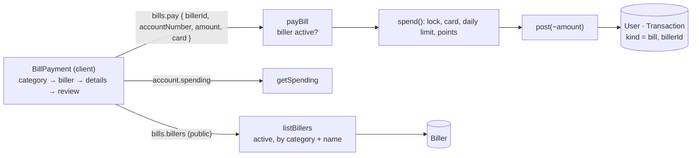

# 17 · Pay bills

The user picks a **category** (Electric, Water, Internet, Credit Card), a **biller** (for example Meralco), types the **account number printed on the bill** and the **amount**, reviews, chooses a card and pays. The money leaves the main balance like a card payment: the card must be unlocked, the daily limit applies, and the payment **earns points** (1 per ₱50).

## At a glance

| | |
| --- | --- |
| **Route** | `/bills` (Pay bills tile on the dashboard, the GO menu) |
| **Frontend** | page `gobank/src/app/(app)/bills/page.tsx`; `bill-payment.tsx` (**client**), `category-card.tsx`, `biller-card.tsx`, `bill-categories.ts`; `use-spend-limit.ts`, `card-picker.tsx`, `card-locked-notice.tsx`; UI `text-field.tsx`, `transaction-summary.tsx`, `transaction-receipt.tsx` |
| **API** | `bills.billers` (**public** query), `bills.pay` (protected mutation), `account.spending` |
| **Backend** | `bills.router.ts`, `bills.service.ts` (`listBillers`, `payBill`), ledger `spend()` → `post()` |
| **Database** | reads `Biller`; `spend()` locks and updates `User`, reads `Card` and today's `Transaction`s, inserts one `Transaction` (`kind = bill`, `billerId`) |
| **Seed data** | 8 billers (`prisma/seed.ts` lines 12–21) |
| **Tests** | `verify-core.ts` (`checkBillsAndLoad`); checked in Chromium for this review |
| **Deep dive** | [Deposit, bills and load §2](../05-features/07-deposit-bills-and-load.md#2-pay-bills) |

## What the user can do

| Step | Screen | Can do |
| --- | --- | --- |
| 1 | Pay bills | tap a **Category**; its **Billers** appear |
| 2 | | tap a **Biller**; the account-number and amount fields appear |
| 3 | | type the **Biller account number** (digits only, 4–20) and the **Amount**; **Review** |
| 4 | Review bill | the amount, biller and account; **Pay with** a card; **Pay ₱1,500.00** |
| receipt | Payment successful | biller, amount, **Account ******3344** (masked), Reference, Date, **Points earned +30**, Balance, Paid with |

The 8 billers from the seed (`prisma/seed.ts`):

| Category | Billers (sorted by name on screen) | Description |
| --- | --- | --- |
| Electric | AboitizPower, Meralco | Power Utility Partner |
| Water | Manila Water, Maynilad | Water Utility Partner |
| Internet | Converge, PLDT | Internet Service Provider |
| Credit Card | BDO Credit Card, BPI Credit Card | Credit Card Payment |

## How it works

1. On load, `bills.billers` returns **all active billers** once, sorted by category, then name. The screen filters them by the chosen category in the browser.
2. `useSpendLimit` loads the balance, the daily limit left and the cards ([14 §3](14-send-money.md#3-live-amount-checks)).
3. The account-number field keeps **digits only** (`digitsOnly(value, 20)`); the amount uses the same `isPesoInput` rule as every money field.
4. **Review** is enabled only with a biller, a 4–20-digit account number and an amount that passes `limit.valid`.
5. **Pay** sends `bills.pay({ billerId, accountNumber, amount, card })`. Zod re-checks the account number (`^\d{4,20}$`) and the amount.
6. `payBill` makes sure the biller exists **and is active**, then runs `spend()` in a transaction: lock the user, check the card and the daily limit, `post()` −amount with points, title "Bill payment · Meralco", `billerId`, and `details: { accountNumber }`.
7. The receipt masks the account number. **Done** goes to `/dashboard` and refreshes it.

## Structure



## Files and locations

| Layer | File | Role |
| --- | --- | --- |
| Page | `gobank/src/app/(app)/bills/page.tsx` | renders the screen, tab title "Pay bills" |
| Frontend (client) | `gobank/src/features/bills/components/bill-payment.tsx` | the whole flow, review and receipt |
| Frontend | `gobank/src/features/bills/components/category-card.tsx` | one category button |
| Frontend | `gobank/src/features/bills/components/biller-card.tsx` | one biller button |
| Shared | `gobank/src/features/bills/bill-categories.ts` | the 4 categories, labels and icons; the `Biller` type |
| API | `gobank/src/features/bills/bills.router.ts` | `billers`, `pay` |
| Service | `gobank/src/features/bills/bills.service.ts` | `listBillers`, `payBill` |
| Ledger | `gobank/src/server/ledger.ts` | `spend()`, `post()` |
| Helpers | `gobank/src/shared/lib/format.ts` | `digitsOnly`, `maskDigits` |
| Seed | `gobank/prisma/seed.ts` | the 8 billers |
| Schema | `gobank/prisma/schema.prisma` | `Biller`, `BillerCategory` |

## Frontend

<!-- code: gobank/src/app/(app)/bills/page.tsx -->
**`gobank/src/app/(app)/bills/page.tsx`** · all 10 lines

```tsx
 1 │ import type { Metadata } from "next";
 2 │ import { BillPayment } from "~/features/bills/components/bill-payment";
 3 │
 4 │ export const metadata: Metadata = {
 5 │   title: "Pay bills",
 6 │ };
 7 │
 8 │ export default function BillsPage() {
 9 │   return <BillPayment />;
10 │ }
```
<!-- /code -->

<!-- code: gobank/src/features/bills/components/bill-payment.tsx -->
**`gobank/src/features/bills/components/bill-payment.tsx`** · all 294 lines

```tsx
  1 │ "use client";
  2 │
  3 │ import { useRouter } from "next/navigation";
  4 │ import { useState } from "react";
  5 │ import { isPesoInput } from "~/shared/lib/amount-input";
  6 │ import { dateTime, digitsOnly, maskDigits, peso } from "~/shared/lib/format";
  7 │ import { MAX_TRANSACTION_CENTAVOS, toCentavos } from "~/shared/lib/money";
  8 │ import { BackButton } from "~/shared/ui/back-button";
  9 │ import { Button } from "~/shared/ui/button";
 10 │ import { FormError } from "~/shared/ui/money-form-ui";
 11 │ import { TextField } from "~/shared/ui/text-field";
 12 │ import { TransactionReceipt } from "~/shared/ui/transaction-receipt";
 13 │ import { TransactionSummary } from "~/shared/ui/transaction-summary";
 14 │ import { errorMessage } from "~/trpc/error-message";
 15 │ import { api } from "~/trpc/react";
 16 │ import { useSpendLimit } from "~/shared/hooks/use-spend-limit";
 17 │ import { CardLockedNotice } from "~/features/card/components/card-locked-notice";
 18 │ import { CardPicker } from "~/features/card/components/card-picker";
 19 │ import { paidWithDetail } from "~/features/card/card-label";
 20 │ import type { LucideIcon } from "lucide-react";
 21 │ import {
 22 │   CATEGORIES,
 23 │   findCategory,
 24 │   type Biller,
 25 │   type Category,
 26 │ } from "../bill-categories";
 27 │ import { BillerCard } from "./biller-card";
 28 │ import { CategoryCard } from "./category-card";
 29 │
 30 │ const ACCOUNT_NUMBER = /^\d{4,20}$/;
 31 │ const ACCOUNT_NUMBER_MAX = 20;
 32 │
 33 │ function BillerList({
 34 │   billers,
 35 │   loading,
 36 │   error,
 37 │   selectedId,
 38 │   icon,
 39 │   onRetry,
 40 │   onSelect,
 41 │ }: {
 42 │   billers: Biller[];
 43 │   loading: boolean;
 44 │   error: string | null;
 45 │   selectedId: string | null;
 46 │   icon: LucideIcon;
 47 │   onRetry: () => void;
 48 │   onSelect: (id: string) => void;
 49 │ }) {
 50 │   if (loading) {
 51 │     return (
 52 │       <p role="status" className="text-ink-muted text-[13px]">
 53 │         Loading billers…
 54 │       </p>
 55 │     );
 56 │   }
 57 │
 58 │   if (error) {
 59 │     return (
 60 │       <div>
 61 │         <FormError error={error} />
 62 │         <Button type="button" variant="ghost" onClick={onRetry}>
 63 │           Retry
 64 │         </Button>
 65 │       </div>
 66 │     );
 67 │   }
 68 │
 69 │   if (billers.length === 0) {
 70 │     return (
 71 │       <p className="text-ink-muted text-[13px]">No billers in this category.</p>
 72 │     );
 73 │   }
 74 │
 75 │   return (
 76 │     <div className="space-y-2">
 77 │       {billers.map((biller) => (
 78 │         <BillerCard
 79 │           key={biller.id}
 80 │           biller={biller}
 81 │           icon={icon}
 82 │           selected={selectedId === biller.id}
 83 │           onClick={() => onSelect(biller.id)}
 84 │         />
 85 │       ))}
 86 │     </div>
 87 │   );
 88 │ }
 89 │
 90 │ export function BillPayment() {
 91 │   const router = useRouter();
 92 │   const [categoryId, setCategoryId] = useState<Category | null>(null);
 93 │   const [billerId, setBillerId] = useState<string | null>(null);
 94 │   const [accountNumber, setAccountNumber] = useState("");
 95 │   const [amount, setAmount] = useState("");
 96 │   const [reviewing, setReviewing] = useState(false);
 97 │
 98 │   const catalogue = api.bills.billers.useQuery();
 99 │   const pay = api.bills.pay.useMutation();
100 │   const limit = useSpendLimit(MAX_TRANSACTION_CENTAVOS);
101 │
102 │   const category = findCategory(categoryId);
103 │   const billers =
104 │     catalogue.data?.filter((item) => item.category === categoryId) ?? [];
105 │   const biller = billers.find((item) => item.id === billerId);
106 │
107 │   const amountCentavos = toCentavos(Number(amount));
108 │   const validDetails =
109 │     Boolean(biller) &&
110 │     ACCOUNT_NUMBER.test(accountNumber) &&
111 │     limit.valid(amountCentavos);
112 │
113 │   const clearPaymentDetails = () => {
114 │     setAccountNumber("");
115 │     setAmount("");
116 │   };
117 │
118 │   const chooseCategory = (id: Category) => {
119 │     if (categoryId === id) return;
120 │
121 │     setCategoryId(id);
122 │     setBillerId(null);
123 │     clearPaymentDetails();
124 │   };
125 │
126 │   const chooseBiller = (id: string) => {
127 │     if (billerId === id) return;
128 │
129 │     setBillerId(id);
130 │     clearPaymentDetails();
131 │   };
132 │
133 │   const leaveReview = () => {
134 │     pay.reset();
135 │     setReviewing(false);
136 │   };
137 │
138 │   const payBill = () => {
139 │     if (!biller || !validDetails || pay.isPending) return;
140 │
141 │     pay.mutate({
142 │       billerId: biller.id,
143 │       accountNumber,
144 │       amount: amountCentavos,
145 │       card: limit.card,
146 │     });
147 │   };
148 │
149 │   const finish = () => {
150 │     router.push("/dashboard");
151 │     router.refresh();
152 │   };
153 │
154 │   if (pay.data) {
155 │     return (
156 │       <TransactionReceipt title="Payment successful" onDone={finish}>
157 │         <TransactionSummary
158 │           amount={Math.abs(pay.data.amount)}
159 │           details={[
160 │             { label: "Account", value: maskDigits(accountNumber) },
161 │             { label: "Reference", value: pay.data.reference },
162 │             { label: "Date", value: dateTime(pay.data.createdAt) },
163 │             { label: "Points earned", value: `+${pay.data.points}` },
164 │             { label: "Balance", value: peso(pay.data.balanceAfter) },
165 │             ...paidWithDetail(pay.data.details),
166 │           ]}
167 │         >
168 │           <p className="text-ink text-[14px] font-medium">{biller?.name}</p>
169 │         </TransactionSummary>
170 │       </TransactionReceipt>
171 │     );
172 │   }
173 │
174 │   return (
175 │     <div className="flex flex-1 flex-col">
176 │       <header className="relative flex h-14 shrink-0 items-center justify-center">
177 │         {reviewing ? (
178 │           <BackButton
179 │             onClick={leaveReview}
180 │             disabled={pay.isPending}
181 │             className="absolute left-0"
182 │           />
183 │         ) : (
184 │           <BackButton href="/dashboard" className="absolute left-0" />
185 │         )}
186 │         <h1 className="text-ink text-[16px] font-semibold">
187 │           {reviewing ? "Review bill" : "Pay bills"}
188 │         </h1>
189 │       </header>
190 │
191 │       {limit.locked && !pay.isPending ? <CardLockedNotice /> : null}
192 │
193 │       {reviewing && biller ? (
194 │         <div className="flex flex-1 flex-col pt-7">
195 │           <TransactionSummary
196 │             amount={amountCentavos}
197 │             details={[{ label: "Account", value: accountNumber }]}
198 │           >
199 │             <p className="text-ink text-[14px] font-medium">{biller.name}</p>
200 │           </TransactionSummary>
201 │
202 │           <CardPicker
203 │             cards={limit.cards}
204 │             value={limit.card}
205 │             onChange={limit.setCard}
206 │             disabled={pay.isPending}
207 │           />
208 │
209 │           <FormError error={errorMessage(pay.error)} />
210 │
211 │           <div className="mt-auto pt-8">
212 │             <Button disabled={pay.isPending} onClick={payBill}>
213 │               {pay.isPending ? "Paying…" : `Pay ${peso(amountCentavos)}`}
214 │             </Button>
215 │           </div>
216 │         </div>
217 │       ) : (
218 │         <form
219 │           className="flex flex-1 flex-col gap-6 pt-7"
220 │           onSubmit={(event) => {
221 │             event.preventDefault();
222 │             if (validDetails) setReviewing(true);
223 │           }}
224 │         >
225 │           <section>
226 │             <h2 className="text-ink mb-3 text-[14px] font-medium">Category</h2>
227 │             <div className="grid grid-cols-2 gap-2">
228 │               {CATEGORIES.map((item) => (
229 │                 <CategoryCard
230 │                   key={item.id}
231 │                   label={item.label}
232 │                   icon={item.icon}
233 │                   selected={categoryId === item.id}
234 │                   onClick={() => chooseCategory(item.id)}
235 │                 />
236 │               ))}
237 │             </div>
238 │           </section>
239 │
240 │           {category ? (
241 │             <section>
242 │               <h2 className="text-ink mb-3 text-[14px] font-medium">Biller</h2>
243 │               <BillerList
244 │                 billers={billers}
245 │                 loading={catalogue.isLoading}
246 │                 error={errorMessage(catalogue.error)}
247 │                 selectedId={billerId}
248 │                 icon={category.icon}
249 │                 onRetry={() => void catalogue.refetch()}
250 │                 onSelect={chooseBiller}
251 │               />
252 │             </section>
253 │           ) : null}
254 │
255 │           {biller ? (
256 │             <div className="space-y-5">
257 │               <TextField
258 │                 label="Biller account number"
259 │                 value={accountNumber}
260 │                 inputMode="numeric"
261 │                 maxLength={ACCOUNT_NUMBER_MAX}
262 │                 hint="4 to 20 digits, as printed on your bill."
263 │                 onChange={(event) =>
264 │                   setAccountNumber(
265 │                     digitsOnly(event.target.value, ACCOUNT_NUMBER_MAX),
266 │                   )
267 │                 }
268 │               />
269 │               <TextField
270 │                 label="Amount"
271 │                 value={amount}
272 │                 inputMode="decimal"
273 │                 prefix="₱"
274 │                 hint={limit.hint}
275 │                 error={limit.check(amountCentavos)}
276 │                 onChange={(event) => {
277 │                   if (isPesoInput(event.target.value)) {
278 │                     setAmount(event.target.value);
279 │                   }
280 │                 }}
281 │               />
282 │             </div>
283 │           ) : null}
284 │
285 │           <div className="mt-auto pt-2">
286 │             <Button type="submit" disabled={!validDetails}>
287 │               Review
288 │             </Button>
289 │           </div>
290 │         </form>
291 │       )}
292 │     </div>
293 │   );
294 │ }
```
<!-- /code -->

<!-- code: gobank/src/features/bills/components/category-card.tsx -->
**`gobank/src/features/bills/components/category-card.tsx`** · all 31 lines

```tsx
 1 │ import type { LucideIcon } from "lucide-react";
 2 │ import { cn } from "~/shared/lib/cn";
 3 │
 4 │ export function CategoryCard({
 5 │   label,
 6 │   icon: Icon,
 7 │   selected,
 8 │   onClick,
 9 │ }: {
10 │   label: string;
11 │   icon: LucideIcon;
12 │   selected: boolean;
13 │   onClick: () => void;
14 │ }) {
15 │   return (
16 │     <button
17 │       type="button"
18 │       onClick={onClick}
19 │       aria-pressed={selected}
20 │       className={cn(
21 │         "flex min-h-13 items-center gap-2 rounded-xl border px-3 py-3 text-left text-[13px] font-medium transition-colors",
22 │         selected
23 │           ? "border-brand bg-brand-soft text-brand"
24 │           : "border-line text-ink hover:bg-surface-sunken",
25 │       )}
26 │     >
27 │       <Icon size={18} className="shrink-0" aria-hidden />
28 │       <span>{label}</span>
29 │     </button>
30 │   );
31 │ }
```
<!-- /code -->

<!-- code: gobank/src/features/bills/components/biller-card.tsx -->
**`gobank/src/features/bills/components/biller-card.tsx`** · all 44 lines

```tsx
 1 │ import { Check, type LucideIcon } from "lucide-react";
 2 │ import { cn } from "~/shared/lib/cn";
 3 │ import type { Biller } from "../bill-categories";
 4 │
 5 │ export function BillerCard({
 6 │   biller,
 7 │   icon: Icon,
 8 │   selected,
 9 │   onClick,
10 │ }: {
11 │   biller: Biller;
12 │   icon: LucideIcon;
13 │   selected: boolean;
14 │   onClick: () => void;
15 │ }) {
16 │   return (
17 │     <button
18 │       type="button"
19 │       onClick={onClick}
20 │       aria-pressed={selected}
21 │       className={cn(
22 │         "flex w-full items-center gap-3 rounded-xl border p-3 text-left transition-colors",
23 │         selected
24 │           ? "border-brand bg-brand-soft"
25 │           : "border-line hover:bg-surface-sunken",
26 │       )}
27 │     >
28 │       <Icon size={20} className="text-ink-muted shrink-0" aria-hidden />
29 │       <span className="min-w-0 flex-1">
30 │         <span className="text-ink block text-[14px] font-medium break-words">
31 │           {biller.name}
32 │         </span>
33 │         {biller.description ? (
34 │           <span className="text-ink-muted mt-1 block text-[12px] break-words">
35 │             {biller.description}
36 │           </span>
37 │         ) : null}
38 │       </span>
39 │       {selected ? (
40 │         <Check size={18} className="text-brand shrink-0" aria-hidden />
41 │       ) : null}
42 │     </button>
43 │   );
44 │ }
```
<!-- /code -->

<!-- code: gobank/src/features/bills/bill-categories.ts -->
**`gobank/src/features/bills/bill-categories.ts`** · all 16 lines

```ts
 1 │ import { CreditCard, Droplets, Wifi, Zap, type LucideIcon } from "lucide-react";
 2 │ import type { RouterOutputs } from "~/trpc/react";
 3 │
 4 │ export type Biller = RouterOutputs["bills"]["billers"][number];
 5 │
 6 │ export type Category = Biller["category"];
 7 │
 8 │ export const CATEGORIES: { id: Category; label: string; icon: LucideIcon }[] = [
 9 │   { id: "electric", label: "Electric", icon: Zap },
10 │   { id: "water", label: "Water", icon: Droplets },
11 │   { id: "internet", label: "Internet", icon: Wifi },
12 │   { id: "credit_card", label: "Credit Card", icon: CreditCard },
13 │ ];
14 │
15 │ export const findCategory = (id: Category | null) =>
16 │   CATEGORIES.find((category) => category.id === id);
```
<!-- /code -->

## Backend

<!-- code: gobank/src/features/bills/bills.router.ts -->
**`gobank/src/features/bills/bills.router.ts`** · all 34 lines

```ts
 1 │ import { z } from "zod";
 2 │ import { cardKind, centavos } from "~/shared/lib/schemas";
 3 │ import {
 4 │   createTRPCRouter,
 5 │   protectedProcedure,
 6 │   publicProcedure,
 7 │ } from "~/server/trpc";
 8 │ import { listBillers, payBill } from "./bills.service";
 9 │
10 │ export const billsRouter = createTRPCRouter({
11 │   billers: publicProcedure.query(() => listBillers()),
12 │
13 │   pay: protectedProcedure
14 │     .input(
15 │       z.object({
16 │         billerId: z.string().min(1),
17 │         accountNumber: z
18 │           .string()
19 │           .trim()
20 │           .regex(/^\d{4,20}$/, "Check the account number"),
21 │         amount: centavos,
22 │         card: cardKind,
23 │       }),
24 │     )
25 │     .mutation(({ ctx, input }) =>
26 │       payBill(
27 │         ctx.userId,
28 │         input.billerId,
29 │         input.accountNumber,
30 │         input.amount,
31 │         input.card,
32 │       ),
33 │     ),
34 │ });
```
<!-- /code -->

<!-- code: gobank/src/features/bills/bills.service.ts -->
**`gobank/src/features/bills/bills.service.ts`** · all 35 lines

```ts
 1 │ import { db } from "~/server/db";
 2 │ import { fail } from "~/server/errors";
 3 │ import { spend } from "~/server/ledger";
 4 │ import type { CardKind } from "../../../generated/prisma";
 5 │
 6 │ export const listBillers = () =>
 7 │   db.biller.findMany({
 8 │     where: { active: true },
 9 │     orderBy: [{ category: "asc" }, { name: "asc" }],
10 │   });
11 │
12 │ export async function payBill(
13 │   userId: string,
14 │   billerId: string,
15 │   accountNumber: string,
16 │   amount: number,
17 │   card: CardKind,
18 │ ) {
19 │   const biller = await db.biller.findFirst({
20 │     where: { id: billerId, active: true },
21 │   });
22 │   if (!biller) return fail("NOT_FOUND", "This biller is not available.");
23 │
24 │   return db.$transaction((tx) =>
25 │     spend(tx, {
26 │       userId,
27 │       kind: "bill",
28 │       title: `Bill payment · ${biller.name}`,
29 │       amount,
30 │       billerId: biller.id,
31 │       details: { accountNumber },
32 │       card,
33 │     }),
34 │   );
35 │ }
```
<!-- /code -->

<!-- code: gobank/src/shared/lib/format.ts 28-36 -->
**`gobank/src/shared/lib/format.ts`** · lines 28–36

```ts
28 │ export const maskDigits = (value: string) =>
29 │   value.length <= 4
30 │     ? value
31 │     : `${"*".repeat(value.length - 4)}${value.slice(-4)}`;
32 │
33 │ export const digitsOnly = (value: string, maxLength?: number) => {
34 │   const digits = value.replace(/\D/g, "");
35 │   return maxLength === undefined ? digits : digits.slice(0, maxLength);
36 │ };
```
<!-- /code -->

## Database

<!-- code: gobank/prisma/schema.prisma 24-29 -->
**`gobank/prisma/schema.prisma`** · lines 24–29

```prisma
24 │ enum BillerCategory {
25 │   electric
26 │   water
27 │   internet
28 │   credit_card
29 │ }
```
<!-- /code -->

<!-- code: gobank/prisma/schema.prisma 152-163 -->
**`gobank/prisma/schema.prisma`** · lines 152–163

```prisma
152 │ model Biller {
153 │   id          String         @id @default(cuid())
154 │   code        String         @unique
155 │   name        String
156 │   category    BillerCategory
157 │   description String
158 │   active      Boolean        @default(true)
159 │
160 │   transactions Transaction[]
161 │
162 │   @@index([category])
163 │ }
```
<!-- /code -->

<!-- code: gobank/prisma/seed.ts 12-21 -->
**`gobank/prisma/seed.ts`** · lines 12–21

```ts
12 │ const BILLERS: [string, string, BillerCategory, string][] = [
13 │   ["meralco", "Meralco", "electric", "Power Utility Partner"],
14 │   ["aboitiz-power", "AboitizPower", "electric", "Power Utility Partner"],
15 │   ["manila-water", "Manila Water", "water", "Water Utility Partner"],
16 │   ["maynilad", "Maynilad", "water", "Water Utility Partner"],
17 │   ["pldt", "PLDT", "internet", "Internet Service Provider"],
18 │   ["converge", "Converge", "internet", "Internet Service Provider"],
19 │   ["bdo-credit-card", "BDO Credit Card", "credit_card", "Credit Card Payment"],
20 │   ["bpi-credit-card", "BPI Credit Card", "credit_card", "Credit Card Payment"],
21 │ ];
```
<!-- /code -->

<!-- code: gobank/prisma/seed.ts 30-38 -->
**`gobank/prisma/seed.ts`** · lines 30–38

```ts
30 │ async function seedBillers() {
31 │   for (const [code, name, category, description] of BILLERS) {
32 │     await db.biller.upsert({
33 │       where: { code },
34 │       update: { name, category, description },
35 │       create: { code, name, category, description },
36 │     });
37 │   }
38 │ }
```
<!-- /code -->

| Table | Columns | Read or write |
| --- | --- | --- |
| `Biller` | `id`, `code` (unique), `name`, `category`, `description`, `active` | read; only `active = true` is listed and payable |
| `User` | `balance`, `points` | locked and updated by `spend()` / `post()` |
| `Card`, `Transaction` | | read by `spend()` (card lock, today's spending) |
| `Transaction` | new row | `kind = bill`, `title = "Bill payment · Meralco"`, negative `amount`, `points`, `billerId`, `details = { accountNumber, card: { kind, network, last4 } }` |

## The complicated parts, explained step by step

### 1. Account number: cleaned while typing, checked twice

<!-- code: gobank/src/shared/lib/format.ts 33-36 -->
**`gobank/src/shared/lib/format.ts`** · lines 33–36

```ts
33 │ export const digitsOnly = (value: string, maxLength?: number) => {
34 │   const digits = value.replace(/\D/g, "");
35 │   return maxLength === undefined ? digits : digits.slice(0, maxLength);
36 │ };
```
<!-- /code -->

| Typed | Field shows | `^\d{4,20}$` | Review |
| --- | --- | --- | --- |
| `0011-2233-44` | `0011223344` (dashes removed as you type) | yes | enabled (with a valid amount) |
| `123` | `123` | no (fewer than 4 digits) | **disabled** |
| 25 digits | the first 20 (`digitsOnly(value, 20)` + `maxLength={20}`) | yes | enabled |

The first two rows were typed in Chromium for this review. The server checks the same pattern again (router lines 17–20, message "Check the account number"), because the API can be called without the form. The value stays a **string**, never a number, so leading zeros like `0011…` are kept.

### 2. Choosing again does not clear what you typed; choosing something else does

<!-- code: gobank/src/features/bills/components/bill-payment.tsx 113-131 -->
**`gobank/src/features/bills/components/bill-payment.tsx`** · lines 113–131

```tsx
113 │   const clearPaymentDetails = () => {
114 │     setAccountNumber("");
115 │     setAmount("");
116 │   };
117 │
118 │   const chooseCategory = (id: Category) => {
119 │     if (categoryId === id) return;
120 │
121 │     setCategoryId(id);
122 │     setBillerId(null);
123 │     clearPaymentDetails();
124 │   };
125 │
126 │   const chooseBiller = (id: string) => {
127 │     if (billerId === id) return;
128 │
129 │     setBillerId(id);
130 │     clearPaymentDetails();
131 │   };
```
<!-- /code -->

| Action | Account number | Amount |
| --- | --- | --- |
| type `0011223344` and `1500` for Meralco | `0011223344` | `1500` |
| tap **Meralco** again | **kept** (`if (billerId === id) return;`) | **kept** |
| tap **AboitizPower** | **cleared** | **cleared** |
| tap another **category** | cleared, and the biller is unselected | cleared |

All four rows were checked in Chromium. Clearing on a real change prevents paying a **Maynilad** account number to **Meralco** by mistake. The early `return` means an accidental double tap does not wipe what was typed.

### 3. One catalogue request, filtered in the browser

<!-- code: gobank/src/features/bills/bills.service.ts 6-10 -->
**`gobank/src/features/bills/bills.service.ts`** · lines 6–10

```ts
 6 │ export const listBillers = () =>
 7 │   db.biller.findMany({
 8 │     where: { active: true },
 9 │     orderBy: [{ category: "asc" }, { name: "asc" }],
10 │   });
```
<!-- /code -->

<!-- code: gobank/src/features/bills/components/bill-payment.tsx 98-105 -->
**`gobank/src/features/bills/components/bill-payment.tsx`** · lines 98–105

```tsx
 98 │   const catalogue = api.bills.billers.useQuery();
 99 │   const pay = api.bills.pay.useMutation();
100 │   const limit = useSpendLimit(MAX_TRANSACTION_CENTAVOS);
101 │
102 │   const category = findCategory(categoryId);
103 │   const billers =
104 │     catalogue.data?.filter((item) => item.category === categoryId) ?? [];
105 │   const biller = billers.find((item) => item.id === billerId);
```
<!-- /code -->

There are only 8 billers, so the screen loads them **once** and filters by category with `.filter(item => item.category === categoryId)`. Switching categories is instant and makes no new request. `billers` is a **public** procedure: the list of companies is not secret, and it needs no session.

### 4. The server checks that the biller is still payable

<!-- code: gobank/src/features/bills/bills.service.ts 19-22 -->
**`gobank/src/features/bills/bills.service.ts`** · lines 19–22

```ts
19 │   const biller = await db.biller.findFirst({
20 │     where: { id: billerId, active: true },
21 │   });
22 │   if (!biller) return fail("NOT_FOUND", "This biller is not available.");
```
<!-- /code -->

| Biller | Result |
| --- | --- |
| exists, `active = true` | payment continues |
| exists, `active = false` (switched off in the database; the app has no admin screen for this) | "This biller is not available." |
| a made-up `billerId` | "This biller is not available." |

`listBillers` hides inactive billers, and `payBill` refuses them, so a biller switched off **while the screen is open** cannot be paid. (This check runs just before the transaction, not inside it. A biller switched off in the same millisecond would still be paid once, which is harmless here.)

### 5. A bill is a `spend()`, so every card rule applies

<!-- code: gobank/src/features/bills/bills.service.ts 24-34 -->
**`gobank/src/features/bills/bills.service.ts`** · lines 24–34

```ts
24 │   return db.$transaction((tx) =>
25 │     spend(tx, {
26 │       userId,
27 │       kind: "bill",
28 │       title: `Bill payment · ${biller.name}`,
29 │       amount,
30 │       billerId: biller.id,
31 │       details: { accountNumber },
32 │       card,
33 │     }),
34 │   );
```
<!-- /code -->

`spend()` ([14 §5](14-send-money.md#5-spend-card-daily-limit-and-points-all-under-the-lock)) does the rest:

| Check or effect | Value in the browser test (₱1,500.00 to Meralco) |
| --- | --- |
| card exists and is not locked | Physical · Discover •••• 1818 |
| today's spending + 150000 ≤ daily limit | ₱19,940.00 was left before paying |
| points = `floor(150000 / 5000)` | **+30** |
| `post(−150000)`: balance ≥ amount | ₱10,297.19 → **₱8,797.19** |
| `details` saved | `{ accountNumber: "0011223344", card: { kind: "physical", network: "discover", last4: "1818" } }` |

### 6. The receipt masks the account number

<!-- code: gobank/src/shared/lib/format.ts 28-31 -->
**`gobank/src/shared/lib/format.ts`** · lines 28–31

```ts
28 │ export const maskDigits = (value: string) =>
29 │   value.length <= 4
30 │     ? value
31 │     : `${"*".repeat(value.length - 4)}${value.slice(-4)}`;
```
<!-- /code -->

| Where | Shows |
| --- | --- |
| review (before paying) | `0011223344`, in full, so the user can check it |
| receipt (after paying) | `maskDigits("0011223344")` = **`******3344`** |
| database (`details.accountNumber`) | the full number, needed if the payment is ever disputed |
| the history receipt page ([34](34-receipts.md)) | the biller's name only, no account number |

Masking leaves only the last 4 digits, enough to recognize the account, on the screen people tend to screenshot and share.

## Rules and limits

| Rule | Value |
| --- | --- |
| Account number | 4–20 digits |
| Amount | ₱0.01 to ₱1,000,000.00, at most the balance and today's limit left |
| Daily card limit | shared with transfers and load ([22](22-daily-limit.md)) |
| Points | 1 per ₱50 (`floor(amount ÷ 5000)`) |
| Card | must not be locked ([21](21-card-lock.md)) |
| Biller | must be active |

## Messages

| Message | When |
| --- | --- |
| Category · Biller | section titles |
| Loading billers… / No billers in this category. / Retry | catalogue states |
| Biller account number · 4 to 20 digits, as printed on your bill. | field and hint |
| Balance ₱… · ₱… left today | amount hint |
| Review bill · Pay ₱1,500.00 / Paying… | review |
| Payment successful · Account · Reference · Date · Points earned · Balance · Paid with | receipt |
| Check the account number | server: bad account number |
| This biller is not available. | server: unknown or inactive biller |
| Insufficient balance / This goes over your daily limit / This card is locked… | `spend()` refusals |

## Tests

- `verify-core.ts` → `checkBillsAndLoad`: creates a test biller, deposits ₱1,000, pays a ₱50 bill (account `00112233`, physical card) and a ₱100 load. Then the balance is exactly ₱850.00 and the points exactly **1** (the bill earns 1 point; load earns none). Another user cannot open the bill's receipt ([34](34-receipts.md)), and a load larger than the balance is refused without changing anything.
- **Checked in Chromium for this review:** the four categories, the two electric billers in name order, `aria-pressed` on the chosen biller, dash removal, the 3-digit refusal, keep/clear when choosing billers, the review, and the receipt (`******3344`, **+30** points, balance ₱8,797.19, "Paid with Physical · Discover •••• 1818").
