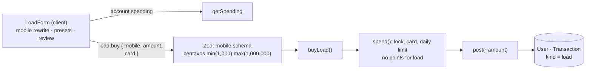

# 18 · Buy load (mobile prepaid credit)

The user types a Philippine **mobile number** (any number, not only GoBank users), picks or types an **amount from ₱10 to ₱10,000**, reviews, chooses a card and buys. Like a bill, it is a card payment: the card must be unlocked and the daily limit applies. Unlike a bill, load **earns no points**.

## At a glance

| | |
| --- | --- |
| **Route** | `/load` (Buy load tile on the dashboard, the GO menu) |
| **Frontend** | page `gobank/src/app/(app)/load/page.tsx`; `load-form.tsx` (**client**); `use-spend-limit.ts`, `card-picker.tsx`, `card-locked-notice.tsx`; UI `text-field.tsx`, `transaction-summary.tsx`, `transaction-receipt.tsx` |
| **API** | `load.buy` (protected mutation), `account.spending` |
| **Backend** | `load.router.ts`, `load.service.ts` (`buyLoad`), `load.rules.ts`, `shared/lib/schemas.ts` (`mobile`), `shared/lib/contact.ts`, ledger `spend()` → `post()` |
| **Database** | `spend()` locks and updates `User`, reads `Card` and today's `Transaction`s, inserts one `Transaction` (`kind = load`, `details.mobile`) |
| **Tests** | `verify-core.ts` (`checkBillsAndLoad`, `checkCardLocks`); checked in Chromium and with the router's Zod schema for this review |
| **Deep dive** | [Deposit, bills and load §3](../05-features/07-deposit-bills-and-load.md#3-buy-load) |

## What the user can do

| Step | Screen | Can do |
| --- | --- | --- |
| 1 | Buy load | type the **Mobile number** (`+63 …` turns into `0…` as you type) |
| 2 | | type an **Amount** or tap a preset: **₱10 ₱15 ₱20 ₱50 ₱100 ₱300 ₱500 ₱1,000** |
| 3 | | **Review** |
| 4 | Review load | amount and mobile; **Pay with** a card; **Buy ₱100.00** |
| receipt | Load successful | amount, Mobile `0917 123 4567`, Reference, Date, Balance, Paid with |

## How it works

1. Every keystroke in the mobile field is rewritten: `digitsOnly(normalizeMobile(value), 11)`. A leading `63` becomes `0`, anything that is not a digit disappears, and the value stops at 11 digits.
2. Once there are 11 digits, `validateMobile` checks the `09XXXXXXXXX` format and shows "Use the format 09XXXXXXXXX" if needed.
3. The amount goes through `isPesoInput` and `useSpendLimit(MAX_LOAD_CENTAVOS, MIN_LOAD_CENTAVOS)`: at least ₱10, at most ₱10,000, at most the balance and today's limit left.
4. A preset button is highlighted (`aria-pressed`) whenever the amount **equals** it, whether it was tapped or typed.
5. **Buy** sends `load.buy({ mobile, amount, card })`. Zod normalizes and checks the mobile again and checks the amount range.
6. `buyLoad` runs `spend()` in a transaction with `kind: "load"`, the title `Mobile load · 0917 123 4567` and `details: { mobile }`. Load is **not** in `KINDS_THAT_EARN_POINTS`, so points stay 0.

## Structure



## Files and locations

| Layer | File | Role |
| --- | --- | --- |
| Page | `gobank/src/app/(app)/load/page.tsx` | renders the form, tab title "Buy load" |
| Frontend (client) | `gobank/src/features/load/components/load-form.tsx` | mobile, amount, presets, review, receipt |
| Shared rule | `gobank/src/features/load/load.rules.ts` | ₱10 minimum, ₱10,000 maximum (form **and** router) |
| API | `gobank/src/features/load/load.router.ts` | `buy` |
| Service | `gobank/src/features/load/load.service.ts` | `buyLoad` |
| Validation | `gobank/src/shared/lib/schemas.ts` | `mobile`, `centavos`, `cardKind` |
| Helpers | `gobank/src/shared/lib/contact.ts` | `normalizeMobile`, `validateMobile`, `formatMobile` |
| Helpers | `gobank/src/shared/lib/format.ts` | `digitsOnly` |
| Ledger | `gobank/src/server/ledger.ts` | `spend()`, `post()` |

## Frontend

<!-- code: gobank/src/app/(app)/load/page.tsx -->
**`gobank/src/app/(app)/load/page.tsx`** · all 10 lines

```tsx
 1 │ import type { Metadata } from "next";
 2 │ import { LoadForm } from "~/features/load/components/load-form";
 3 │
 4 │ export const metadata: Metadata = {
 5 │   title: "Buy load",
 6 │ };
 7 │
 8 │ export default function LoadPage() {
 9 │   return <LoadForm />;
10 │ }
```
<!-- /code -->

<!-- code: gobank/src/features/load/components/load-form.tsx -->
**`gobank/src/features/load/components/load-form.tsx`** · all 204 lines

```tsx
  1 │ "use client";
  2 │
  3 │ import { useRouter } from "next/navigation";
  4 │ import { useState } from "react";
  5 │ import { isPesoInput } from "~/shared/lib/amount-input";
  6 │ import { cn } from "~/shared/lib/cn";
  7 │ import {
  8 │   formatMobile,
  9 │   normalizeMobile,
 10 │   validateMobile,
 11 │ } from "~/shared/lib/contact";
 12 │ import { dateTime, digitsOnly, peso } from "~/shared/lib/format";
 13 │ import { toCentavos } from "~/shared/lib/money";
 14 │ import { BackButton } from "~/shared/ui/back-button";
 15 │ import { Button } from "~/shared/ui/button";
 16 │ import { FormError } from "~/shared/ui/money-form-ui";
 17 │ import { TextField } from "~/shared/ui/text-field";
 18 │ import { TransactionReceipt } from "~/shared/ui/transaction-receipt";
 19 │ import { TransactionSummary } from "~/shared/ui/transaction-summary";
 20 │ import { errorMessage } from "~/trpc/error-message";
 21 │ import { api } from "~/trpc/react";
 22 │ import { useSpendLimit } from "~/shared/hooks/use-spend-limit";
 23 │ import { CardLockedNotice } from "~/features/card/components/card-locked-notice";
 24 │ import { CardPicker } from "~/features/card/components/card-picker";
 25 │ import { paidWithDetail } from "~/features/card/card-label";
 26 │ import { MAX_LOAD_CENTAVOS, MIN_LOAD_CENTAVOS } from "../load.rules";
 27 │
 28 │ const LOAD_PRESETS = [10, 15, 20, 50, 100, 300, 500, 1000];
 29 │ const MOBILE_LENGTH = 11;
 30 │
 31 │ function LoadPresets({
 32 │   selectedCentavos,
 33 │   onPick,
 34 │ }: {
 35 │   selectedCentavos: number;
 36 │   onPick: (pesos: number) => void;
 37 │ }) {
 38 │   return (
 39 │     <div className="mt-4 grid grid-cols-4 gap-2" aria-label="Load amounts">
 40 │       {LOAD_PRESETS.map((pesos) => {
 41 │         const selected = selectedCentavos === toCentavos(pesos);
 42 │
 43 │         return (
 44 │           <button
 45 │             key={pesos}
 46 │             type="button"
 47 │             aria-pressed={selected}
 48 │             onClick={() => onPick(pesos)}
 49 │             className={cn(
 50 │               "h-12 rounded-xl border px-2 text-[13px] font-medium transition-colors",
 51 │               selected
 52 │                 ? "border-brand bg-brand-soft text-brand"
 53 │                 : "border-line bg-surface-sunken text-ink hover:bg-surface-raised",
 54 │             )}
 55 │           >
 56 │             ₱{pesos.toLocaleString("en-PH")}
 57 │           </button>
 58 │         );
 59 │       })}
 60 │     </div>
 61 │   );
 62 │ }
 63 │
 64 │ export function LoadForm() {
 65 │   const router = useRouter();
 66 │   const [mobile, setMobile] = useState("");
 67 │   const [amount, setAmount] = useState("");
 68 │   const [reviewing, setReviewing] = useState(false);
 69 │
 70 │   const load = api.load.buy.useMutation();
 71 │   const limit = useSpendLimit(MAX_LOAD_CENTAVOS, MIN_LOAD_CENTAVOS);
 72 │
 73 │   const amountCentavos = toCentavos(Number(amount));
 74 │   const mobileComplete = mobile.length === MOBILE_LENGTH;
 75 │   const mobileError = mobileComplete ? validateMobile(mobile) : null;
 76 │   const validDetails =
 77 │     mobileComplete && !mobileError && limit.valid(amountCentavos);
 78 │
 79 │   const leaveReview = () => {
 80 │     load.reset();
 81 │     setReviewing(false);
 82 │   };
 83 │
 84 │   const buyLoad = () => {
 85 │     if (!validDetails || load.isPending) return;
 86 │
 87 │     load.mutate({ mobile, amount: amountCentavos, card: limit.card });
 88 │   };
 89 │
 90 │   const finish = () => {
 91 │     router.push("/dashboard");
 92 │     router.refresh();
 93 │   };
 94 │
 95 │   if (load.data) {
 96 │     return (
 97 │       <TransactionReceipt title="Load successful" onDone={finish}>
 98 │         <TransactionSummary
 99 │           amount={Math.abs(load.data.amount)}
100 │           details={[
101 │             { label: "Mobile", value: formatMobile(mobile) },
102 │             { label: "Reference", value: load.data.reference },
103 │             { label: "Date", value: dateTime(load.data.createdAt) },
104 │             { label: "Balance", value: peso(load.data.balanceAfter) },
105 │             ...paidWithDetail(load.data.details),
106 │           ]}
107 │         />
108 │       </TransactionReceipt>
109 │     );
110 │   }
111 │
112 │   return (
113 │     <div className="flex flex-1 flex-col">
114 │       <header className="relative flex h-14 shrink-0 items-center justify-center">
115 │         {reviewing ? (
116 │           <BackButton
117 │             onClick={leaveReview}
118 │             disabled={load.isPending}
119 │             className="absolute left-0"
120 │           />
121 │         ) : (
122 │           <BackButton href="/dashboard" className="absolute left-0" />
123 │         )}
124 │         <h1 className="text-ink text-[16px] font-semibold">
125 │           {reviewing ? "Review load" : "Buy load"}
126 │         </h1>
127 │       </header>
128 │
129 │       {limit.locked && !load.isPending ? <CardLockedNotice /> : null}
130 │
131 │       {reviewing ? (
132 │         <div className="flex flex-1 flex-col pt-7">
133 │           <TransactionSummary
134 │             amount={amountCentavos}
135 │             details={[{ label: "Mobile", value: formatMobile(mobile) }]}
136 │           />
137 │
138 │           <CardPicker
139 │             cards={limit.cards}
140 │             value={limit.card}
141 │             onChange={limit.setCard}
142 │             disabled={load.isPending}
143 │           />
144 │
145 │           <FormError error={errorMessage(load.error)} />
146 │
147 │           <div className="mt-auto pt-8">
148 │             <Button disabled={load.isPending} onClick={buyLoad}>
149 │               {load.isPending ? "Buying…" : `Buy ${peso(amountCentavos)}`}
150 │             </Button>
151 │           </div>
152 │         </div>
153 │       ) : (
154 │         <form
155 │           className="flex flex-1 flex-col gap-6 pt-7"
156 │           onSubmit={(event) => {
157 │             event.preventDefault();
158 │             if (validDetails) setReviewing(true);
159 │           }}
160 │         >
161 │           <TextField
162 │             label="Mobile number"
163 │             type="tel"
164 │             inputMode="tel"
165 │             value={mobile}
166 │             hint="11 digits, like 09171234567"
167 │             error={mobileError}
168 │             onChange={(event) =>
169 │               setMobile(
170 │                 digitsOnly(normalizeMobile(event.target.value), MOBILE_LENGTH),
171 │               )
172 │             }
173 │           />
174 │
175 │           <section>
176 │             <TextField
177 │               label="Amount"
178 │               inputMode="decimal"
179 │               value={amount}
180 │               prefix="₱"
181 │               hint={limit.hint}
182 │               error={limit.check(amountCentavos)}
183 │               onChange={(event) => {
184 │                 if (isPesoInput(event.target.value)) {
185 │                   setAmount(event.target.value);
186 │                 }
187 │               }}
188 │             />
189 │             <LoadPresets
190 │               selectedCentavos={amountCentavos}
191 │               onPick={(pesos) => setAmount(String(pesos))}
192 │             />
193 │           </section>
194 │
195 │           <div className="mt-auto pt-2">
196 │             <Button type="submit" disabled={!validDetails}>
197 │               Review
198 │             </Button>
199 │           </div>
200 │         </form>
201 │       )}
202 │     </div>
203 │   );
204 │ }
```
<!-- /code -->

## Backend

<!-- code: gobank/src/features/load/load.rules.ts -->
**`gobank/src/features/load/load.rules.ts`** · all 2 lines

```ts
1 │ export const MIN_LOAD_CENTAVOS = 1_000;
2 │ export const MAX_LOAD_CENTAVOS = 1_000_000;
```
<!-- /code -->

<!-- code: gobank/src/features/load/load.router.ts -->
**`gobank/src/features/load/load.router.ts`** · all 19 lines

```ts
 1 │ import { z } from "zod";
 2 │ import { cardKind, mobile, centavos } from "~/shared/lib/schemas";
 3 │ import { createTRPCRouter, protectedProcedure } from "~/server/trpc";
 4 │ import { MAX_LOAD_CENTAVOS, MIN_LOAD_CENTAVOS } from "./load.rules";
 5 │ import { buyLoad } from "./load.service";
 6 │
 7 │ export const loadRouter = createTRPCRouter({
 8 │   buy: protectedProcedure
 9 │     .input(
10 │       z.object({
11 │         mobile: mobile.pipe(z.string({ message: "Enter a mobile number" })),
12 │         amount: centavos.min(MIN_LOAD_CENTAVOS).max(MAX_LOAD_CENTAVOS),
13 │         card: cardKind,
14 │       }),
15 │     )
16 │     .mutation(({ ctx, input }) =>
17 │       buyLoad(ctx.userId, input.mobile, input.amount, input.card),
18 │     ),
19 │ });
```
<!-- /code -->

<!-- code: gobank/src/features/load/load.service.ts -->
**`gobank/src/features/load/load.service.ts`** · all 21 lines

```ts
 1 │ import { formatMobile } from "~/shared/lib/contact";
 2 │ import { db } from "~/server/db";
 3 │ import { spend } from "~/server/ledger";
 4 │ import type { CardKind } from "../../../generated/prisma";
 5 │
 6 │ export const buyLoad = (
 7 │   userId: string,
 8 │   mobile: string,
 9 │   amount: number,
10 │   card: CardKind,
11 │ ) =>
12 │   db.$transaction((tx) =>
13 │     spend(tx, {
14 │       userId,
15 │       kind: "load",
16 │       title: `Mobile load · ${formatMobile(mobile)}`,
17 │       amount,
18 │       details: { mobile },
19 │       card,
20 │     }),
21 │   );
```
<!-- /code -->

<!-- code: gobank/src/shared/lib/schemas.ts 5-17 -->
**`gobank/src/shared/lib/schemas.ts`** · lines 5–17

```ts
 5 │ const blankToNull = (value: string) => value || null;
 6 │
 7 │ export const centavos = z
 8 │   .number()
 9 │   .int()
10 │   .positive()
11 │   .max(MAX_TRANSACTION_CENTAVOS);
12 │
13 │ export const mobile = z
14 │   .string()
15 │   .trim()
16 │   .refine((value) => !validateMobile(value), "Use the format 09XXXXXXXXX")
17 │   .transform((value) => blankToNull(normalizeMobile(value)));
```
<!-- /code -->

<!-- code: gobank/src/shared/lib/contact.ts -->
**`gobank/src/shared/lib/contact.ts`** · all 37 lines

```ts
 1 │ const PH_MOBILE = /^09\d{9}$/;
 2 │ const GMAIL_ADDRESS = /^[a-z0-9][a-z0-9._+-]*@(gmail|googlemail)\.com$/;
 3 │
 4 │ export function normalizeMobile(raw: string) {
 5 │   const digits = raw.replace(/\D/g, "");
 6 │
 7 │   return digits.startsWith("63") ? `0${digits.slice(2)}` : digits;
 8 │ }
 9 │
10 │ export function validateMobile(raw: string): string | null {
11 │   if (raw.trim().length === 0) return null;
12 │
13 │   return PH_MOBILE.test(normalizeMobile(raw))
14 │     ? null
15 │     : "Use the format 09XXXXXXXXX";
16 │ }
17 │
18 │ export function validateFullName(raw: string): string | null {
19 │   const length = raw.trim().length;
20 │
21 │   if (length < 2) return "Enter your full name";
22 │   if (length > 80) return "Use at most 80 characters";
23 │   return null;
24 │ }
25 │
26 │ export function normalizeGmail(raw: string): string | null {
27 │   const value = raw.trim().toLowerCase();
28 │
29 │   return GMAIL_ADDRESS.test(value) ? value : null;
30 │ }
31 │
32 │ export function formatMobile(raw: string) {
33 │   const value = normalizeMobile(raw);
34 │   if (value.length !== 11) return raw;
35 │
36 │   return `${value.slice(0, 4)} ${value.slice(4, 7)} ${value.slice(7)}`;
37 │ }
```
<!-- /code -->

## Database

| Table | Write |
| --- | --- |
| `User` | locked; `balance − amount` (points unchanged) |
| `Transaction` | `kind = load`, `title = "Mobile load · 0917 123 4567"`, negative `amount`, `points = 0`, `details = { mobile: "09171234567", card: { kind, network, last4 } }` |

No other table is involved: the mobile number does **not** have to belong to a GoBank user, and nothing is sent to a real telco.

## The complicated parts, explained step by step

### 1. The mobile field rewrites itself on every keystroke

<!-- code: gobank/src/features/load/components/load-form.tsx 168-172 -->
**`gobank/src/features/load/components/load-form.tsx`** · lines 168–172

```tsx
168 │             onChange={(event) =>
169 │               setMobile(
170 │                 digitsOnly(normalizeMobile(event.target.value), MOBILE_LENGTH),
171 │               )
172 │             }
```
<!-- /code -->

<!-- code: gobank/src/shared/lib/contact.ts 4-8 -->
**`gobank/src/shared/lib/contact.ts`** · lines 4–8

```ts
4 │ export function normalizeMobile(raw: string) {
5 │   const digits = raw.replace(/\D/g, "");
6 │
7 │   return digits.startsWith("63") ? `0${digits.slice(2)}` : digits;
8 │ }
```
<!-- /code -->

Typed one key at a time in Chromium for this review (`∅` = empty):

| Key | `+` | `6` | `3` | `␣` | `9` | `1` | `7` | `␣` | `1` | `2` | `3` | `␣` | `4` | `5` | `6` | `7` |
| --- | --- | --- | --- | --- | --- | --- | --- | --- | --- | --- | --- | --- | --- | --- | --- | --- |
| Field shows | ∅ | `6` | **`0`** | `0` | `09` | `091` | `0917` | `0917` | `09171` | `091712` | `0917123` | `0917123` | `09171234` | `091712345` | `0917123456` | `09171234567` |

What happens at each kind of key:

| Key | Text before the rewrite | `normalizeMobile` | `digitsOnly(…, 11)` |
| --- | --- | --- | --- |
| `+` | `+` | no digits → `""` | `""` |
| `3` after `6` | `63` | starts with `63` → `"0" + ""` = **`0`** | `0` |
| a space | `0917 ` | digits `0917` | `0917` (the space never appears) |
| the 12th digit | 12 digits | | cut at 11 |

So a user who types the international form `+63 917 123 4567` ends up with exactly `09171234567`, the form the server stores.

### 2. When the mobile number shows an error

<!-- code: gobank/src/features/load/components/load-form.tsx 73-77 -->
**`gobank/src/features/load/components/load-form.tsx`** · lines 73–77

```tsx
73 │   const amountCentavos = toCentavos(Number(amount));
74 │   const mobileComplete = mobile.length === MOBILE_LENGTH;
75 │   const mobileError = mobileComplete ? validateMobile(mobile) : null;
76 │   const validDetails =
77 │     mobileComplete && !mobileError && limit.valid(amountCentavos);
```
<!-- /code -->

| Field | `mobileComplete` (11 digits) | Message under the field | Review |
| --- | --- | --- | --- |
| `0917123456` (10 digits) | no | the hint "11 digits, like 09171234567" | disabled |
| `12345678901` | yes | **"Use the format 09XXXXXXXXX"** (red) | disabled |
| `09171234567` | yes | the hint | enabled (with a valid amount) |

The error waits until the number is **complete**. Showing "wrong format" after the first digit would be noise. All three rows were checked in Chromium.

### 3. The server's `mobile` schema: `refine`, `transform`, then `pipe`

<!-- code: gobank/src/features/load/load.router.ts 11-12 -->
**`gobank/src/features/load/load.router.ts`** · lines 11–12

```ts
11 │         mobile: mobile.pipe(z.string({ message: "Enter a mobile number" })),
12 │         amount: centavos.min(MIN_LOAD_CENTAVOS).max(MAX_LOAD_CENTAVOS),
```
<!-- /code -->

<!-- code: gobank/src/shared/lib/schemas.ts 13-17 -->
**`gobank/src/shared/lib/schemas.ts`** · lines 13–17

```ts
13 │ export const mobile = z
14 │   .string()
15 │   .trim()
16 │   .refine((value) => !validateMobile(value), "Use the format 09XXXXXXXXX")
17 │   .transform((value) => blankToNull(normalizeMobile(value)));
```
<!-- /code -->

`mobile` is shared with Edit profile, where an **empty** mobile is allowed (it becomes `null`). Load needs a number, so the router adds `.pipe(z.string({ message: "Enter a mobile number" }))`. The output of `mobile` must then also be a string, and `null` is rejected. Results from running the router's schema for this review:

| Sent | `trim` → `refine` (`validateMobile`) | `transform` (`normalizeMobile`, blank → `null`) | `pipe(z.string())` | Result |
| --- | --- | --- | --- | --- |
| `""` or `"   "` | OK (empty is allowed) | `null` | **fails** | "Enter a mobile number" |
| `"12345"` | **fails** | | | "Use the format 09XXXXXXXXX" |
| `"0917 123 4567"` | OK | `"09171234567"` | OK | `09171234567` |
| `"+63 917 123 4567"` | OK | `"09171234567"` | OK | `09171234567` |
| `"639171234567"` | OK | `"09171234567"` | OK | `09171234567` |

And the amount (`centavos.min(1000).max(1000000)`): `999` → "Number must be greater than or equal to 1000"; `1000` and `1000000` → OK; `1000001` → "Number must be less than or equal to 1000000".

### 4. Presets and typed amounts share one state

<!-- code: gobank/src/features/load/components/load-form.tsx 28-62 -->
**`gobank/src/features/load/components/load-form.tsx`** · lines 28–62

```tsx
28 │ const LOAD_PRESETS = [10, 15, 20, 50, 100, 300, 500, 1000];
29 │ const MOBILE_LENGTH = 11;
30 │
31 │ function LoadPresets({
32 │   selectedCentavos,
33 │   onPick,
34 │ }: {
35 │   selectedCentavos: number;
36 │   onPick: (pesos: number) => void;
37 │ }) {
38 │   return (
39 │     <div className="mt-4 grid grid-cols-4 gap-2" aria-label="Load amounts">
40 │       {LOAD_PRESETS.map((pesos) => {
41 │         const selected = selectedCentavos === toCentavos(pesos);
42 │
43 │         return (
44 │           <button
45 │             key={pesos}
46 │             type="button"
47 │             aria-pressed={selected}
48 │             onClick={() => onPick(pesos)}
49 │             className={cn(
50 │               "h-12 rounded-xl border px-2 text-[13px] font-medium transition-colors",
51 │               selected
52 │                 ? "border-brand bg-brand-soft text-brand"
53 │                 : "border-line bg-surface-sunken text-ink hover:bg-surface-raised",
54 │             )}
55 │           >
56 │             ₱{pesos.toLocaleString("en-PH")}
57 │           </button>
58 │         );
59 │       })}
60 │     </div>
61 │   );
62 │ }
```
<!-- /code -->

| Action | `amount` (text) | `amountCentavos` | Preset highlighted |
| --- | --- | --- | --- |
| type `50.00` | `"50.00"` | 5000 | **₱50** (5000 = `toCentavos(50)`) |
| tap **₱100** | `"100"` (`String(pesos)`) | 10000 | **₱100** |
| type `75` | `"75"` | 7500 | none |

There is no separate "selected preset" state. A preset is highlighted when the amount **equals** it, so typing and tapping can never disagree. Checked in Chromium: after typing `50.00`, exactly **₱50** had `aria-pressed="true"`.

### 5. A minimum only load has

<!-- code: gobank/src/shared/hooks/use-spend-limit.ts 19-23 -->
**`gobank/src/shared/hooks/use-spend-limit.ts`** · lines 19–23

```ts
19 │   const check = (amount: number) => {
20 │     if (!Number.isFinite(amount) || amount <= 0) return null;
21 │     if (amount < minimum) return `Minimum ${peso(minimum)}`;
22 │     if (amount > maximum) return `Maximum ${peso(maximum)}`;
23 │
```
<!-- /code -->

`useSpendLimit(MAX_LOAD_CENTAVOS, MIN_LOAD_CENTAVOS)` is the only caller that passes a minimum. Transfers, bills and requests use the default minimum of 1 centavo.

| Typed | Message (checked in Chromium) |
| --- | --- |
| `5` | **Minimum ₱10.00** |
| `10001` | **Maximum ₱10,000.00** |
| `100` | Balance ₱… · ₱… left today |

### 6. Same `spend()`, but no points

<!-- code: gobank/src/server/ledger.ts 35-36 -->
**`gobank/src/server/ledger.ts`** · lines 35–36

```ts
35 │ const SPENDING_KINDS: TransactionKind[] = ["transfer", "bill", "load"];
36 │ const KINDS_THAT_EARN_POINTS: TransactionKind[] = ["transfer", "bill"];
```
<!-- /code -->

| Kind | Counts toward the daily limit (`SPENDING_KINDS`) | Earns points (`KINDS_THAT_EARN_POINTS`) |
| --- | --- | --- |
| transfer | yes | yes |
| bill | yes | yes |
| **load** | **yes** | **no** |

That is why the load receipt has no "Points earned" row while the bill receipt does. `verify-core.ts` confirms it: after a ₱50 bill and a ₱100 load, the user has exactly **1** point.

## Rules and limits

| Rule | Value | Where |
| --- | --- | --- |
| Mobile | `09` + 9 digits; `+63`/`63` converted; any number | `mobile` schema, `normalizeMobile` |
| Amount | ₱10.00 to ₱10,000.00 | `load.rules.ts` (form and router) |
| Presets | ₱10, 15, 20, 50, 100, 300, 500, 1,000 | `LOAD_PRESETS` |
| Balance, daily limit, card lock | as for every card payment | `spend()` |
| Points | none | `KINDS_THAT_EARN_POINTS` |

## Messages

| Message | When |
| --- | --- |
| Mobile number · 11 digits, like 09171234567 | field and hint |
| Use the format 09XXXXXXXXX | an 11-digit number that is not `09…` |
| Minimum ₱10.00 / Maximum ₱10,000.00 / Insufficient balance. You have ₱… / Over your daily limit. ₱… left today | amount |
| Review load · Buy ₱100.00 / Buying… | review |
| Load successful · Mobile · Reference · Date · Balance · Paid with | receipt |
| Enter a mobile number | server: no mobile sent |
| This card is locked… / This goes over your daily limit / Insufficient balance | `spend()` refusals |

## Tests

- `verify-core.ts` → `checkBillsAndLoad`: a ₱100 load with the virtual card; the points stay at exactly 1 (from the bill). A ₱1,000 load with only ₱850 left is refused with "Insufficient balance", and `getOverview` is unchanged.
- `verify-core.ts` → `checkCardLocks`: with the daily limit set to ₱0, a ₱10 load is refused with "This goes over your daily limit".
- **Checked in Chromium for this review:** the keystroke table in §1, the three mobile cases in §2, the minimum and maximum, the presets, and a ₱100.00 load to `0917 123 4567`. The receipt and the dashboard row ("Mobile load · 0917 123 4567 · Nov 4 · −₱100.00") matched.
- **Run with the router's schema:** every row of §3.
