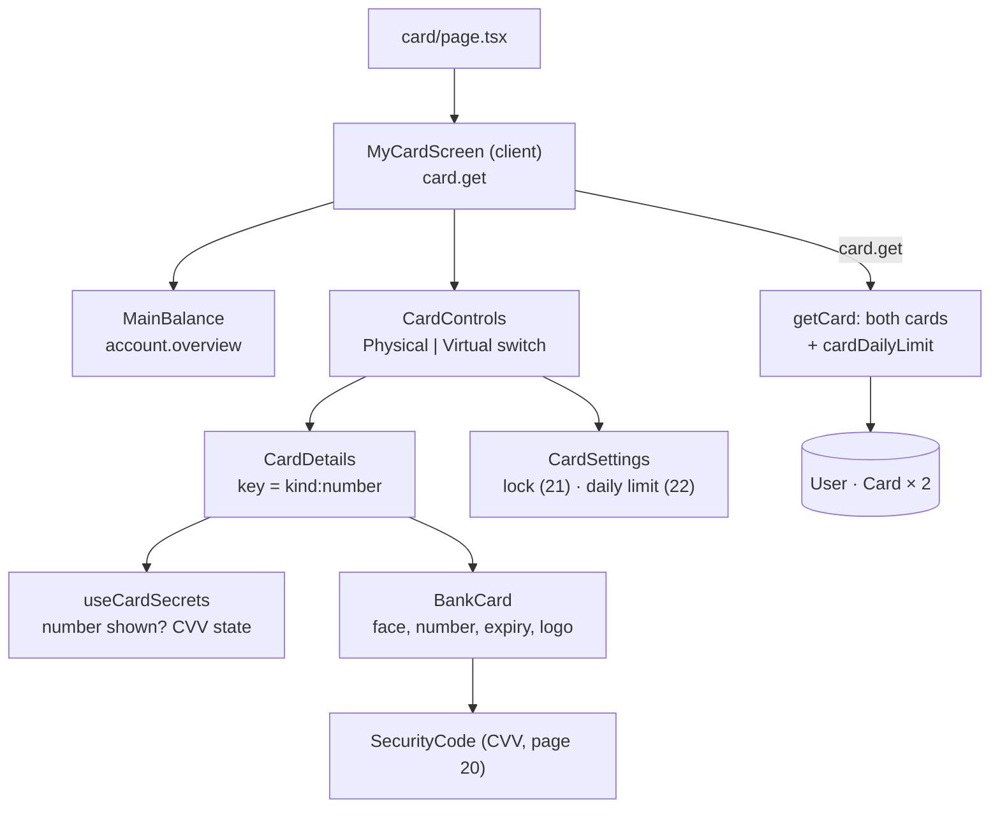

# 19 · My card: view both cards

Every account has **two cards**: a **physical** card and a **virtual** card, on two different networks (for example Discover and Visa). **My card** shows the main balance, a **Physical | Virtual** switch, the selected card's face, and its settings. The number starts hidden (`•••• •••• •••• ••••`); the eye shows it and the copy button copies it. The CVV ([20](20-show-cvv.md)), the lock ([21](21-card-lock.md)) and the daily limit ([22](22-daily-limit.md)) have their own pages.

## At a glance

| | |
| --- | --- |
| **Route** | `/card` (the "My card" row on the dashboard) |
| **Frontend** | page `gobank/src/app/(app)/card/page.tsx`; `my-card-screen.tsx` (**client**), `card-details.tsx`, `bank-card.tsx`, `card-brand-logo.tsx`, `card-settings.tsx`, `my-card-screen.module.css`; hook `use-card-secrets.ts` |
| **API** | `card.get` (protected query), `account.overview` (for "Main balance") |
| **Backend** | `card.router.ts`, `card.service.ts` (`getCard`); cards are **created** at registration by `card-generation.server.ts` and `card-credentials.server.ts` ([02](02-registration.md)) |
| **Database** | reads `User.cardDailyLimit`, `User.fullName` and both `Card` rows (`kind`, `brand`, `number`, `expiresAt`, `locked`); **never** `cvvEncrypted` |
| **Tests** | `card-cvv.test.ts` (16 digits, network prefix, Luhn, different virtual network); checked in Chromium for this review |
| **Deep dive** | [Cards](../05-features/04-cards.md) |

## What the user can do

| Part | What it does |
| --- | --- |
| Main balance | the account balance (`account.overview`), with **Retry balance** if it fails |
| **Physical \| Virtual** | switches the card shown (`aria-pressed`) |
| card face | network logo, "GoBank Express", chip and contactless mark (physical) or phone icon (virtual), the number, **Cardholder**, **Expires** (`MM/YY`), CVV |
| eye next to the number | **Show card number** / **Hide card number** (no server call) |
| copy next to the number | **Copy card number** (only while it is shown) |
| CVV | [20](20-show-cvv.md) |
| Lock / Unlock | [21](21-card-lock.md) |
| Daily spending limit (both cards) | [22](22-daily-limit.md) |

## How it works

1. `MyCardScreen` calls `card.get`. `getCard` loads the user's daily limit and **both** cards. If either card is missing it fails with "Your card details were not found."
2. `CardControls` keeps the selected kind (`physical` first) and renders `CardDetails` for that card with `key={`${kind}:${number}`}`, so switching cards **resets** everything the previous card was showing.
3. `BankCard` draws the card: the number grouped in fours (`formatAccount`) or 16 dots, the cardholder's name in capitals, and the expiry as `MM/YY` read in **UTC**.
4. The full number is part of the `card.get` response, so showing it is instant. The CVV is **not**: it is fetched and decrypted only when asked ([20](20-show-cvv.md)).

## Structure



## Files and locations

| Layer | File | Role |
| --- | --- | --- |
| Page | `gobank/src/app/(app)/card/page.tsx` | renders the screen, tab title "My card" |
| Frontend (client) | `gobank/src/features/card/components/my-card-screen.tsx` | load, balance, switch, error state |
| Frontend | `gobank/src/features/card/components/card-details.tsx` | the selected card, CVV box, lock overlay |
| Frontend | `gobank/src/features/card/components/bank-card.tsx` | the card face (also used by registration: `step-card.tsx`, `step-review.tsx`) |
| Frontend | `gobank/src/features/card/components/card-brand-logo.tsx` | Visa, Mastercard, JCB, Discover logos as SVG |
| Styles | `gobank/src/features/card/components/my-card-screen.module.css` | switch animation, locked blur, overlay |
| Hook | `gobank/src/features/card/hooks/use-card-secrets.ts` | number shown, CVV state ([20](20-show-cvv.md)) |
| Networks | `gobank/src/features/card/card-brands.ts` | the 4 networks and their test prefixes |
| API | `gobank/src/features/card/card.router.ts` | `get`, `revealCvv`, `update` |
| Service | `gobank/src/features/card/card.service.ts` | `getCard`, `updateCard`, `revealCvv` |
| Creation | `gobank/src/features/card/card-generation.server.ts` | number (Luhn), virtual network, expiry |
| Creation | `gobank/src/features/card/card-credentials.server.ts` | number + encrypted CVV + expiry together |

## Frontend

<!-- code: gobank/src/app/(app)/card/page.tsx -->
**`gobank/src/app/(app)/card/page.tsx`** · all 10 lines

```tsx
 1 │ import type { Metadata } from "next";
 2 │ import { MyCardScreen } from "~/features/card/components/my-card-screen";
 3 │
 4 │ export const metadata: Metadata = {
 5 │   title: "My card",
 6 │ };
 7 │
 8 │ export default function CardPage() {
 9 │   return <MyCardScreen />;
10 │ }
```
<!-- /code -->

<!-- code: gobank/src/features/card/components/my-card-screen.tsx -->
**`gobank/src/features/card/components/my-card-screen.tsx`** · all 159 lines

```tsx
  1 │ "use client";
  2 │
  3 │ import { CreditCard, Smartphone } from "lucide-react";
  4 │ import { useState } from "react";
  5 │ import { cn } from "~/shared/lib/cn";
  6 │ import { peso } from "~/shared/lib/format";
  7 │ import { Button } from "~/shared/ui/button";
  8 │ import { PageHeader } from "~/shared/ui/page-header";
  9 │ import { errorMessage } from "~/trpc/error-message";
 10 │ import { api, type RouterOutputs } from "~/trpc/react";
 11 │ import type { CardKind } from "./bank-card";
 12 │ import { CardDetails } from "./card-details";
 13 │ import { CardSettings } from "./card-settings";
 14 │
 15 │ type CardOverview = RouterOutputs["card"]["get"];
 16 │
 17 │ const CARD_KINDS = [
 18 │   { kind: "physical", label: "Physical", icon: CreditCard },
 19 │   { kind: "virtual", label: "Virtual", icon: Smartphone },
 20 │ ] as const;
 21 │
 22 │ const TEXT_ACTION =
 23 │   "text-ink-muted enabled:hover:text-ink focus-visible:outline-brand inline-flex min-h-10 items-center justify-center gap-1.5 rounded-lg px-1 text-[12.5px] focus-visible:outline-2 focus-visible:outline-offset-2 disabled:opacity-45";
 24 │
 25 │ function MainBalance() {
 26 │   const account = api.account.overview.useQuery();
 27 │
 28 │   return (
 29 │     <div className="mb-5 flex items-baseline justify-between gap-3">
 30 │       <p className="text-ink-muted text-[13px]">Main balance</p>
 31 │
 32 │       {account.isError ? (
 33 │         <button
 34 │           type="button"
 35 │           onClick={() => void account.refetch()}
 36 │           disabled={account.isFetching}
 37 │           className={TEXT_ACTION}
 38 │         >
 39 │           {account.isFetching ? "Loading…" : "Retry balance"}
 40 │         </button>
 41 │       ) : (
 42 │         <p
 43 │           className="text-ink text-xl font-semibold tabular-nums"
 44 │           aria-live="polite"
 45 │         >
 46 │           {account.data ? peso(account.data.balance) : "…"}
 47 │         </p>
 48 │       )}
 49 │     </div>
 50 │   );
 51 │ }
 52 │
 53 │ function CardKindSwitch({
 54 │   selected,
 55 │   onSelect,
 56 │ }: {
 57 │   selected: CardKind;
 58 │   onSelect: (kind: CardKind) => void;
 59 │ }) {
 60 │   return (
 61 │     <div
 62 │       className="border-line bg-surface-sunken grid grid-cols-2 gap-1 rounded-xl border p-1"
 63 │       role="group"
 64 │       aria-label="Card kind"
 65 │     >
 66 │       {CARD_KINDS.map(({ kind, label, icon: Icon }) => (
 67 │         <button
 68 │           key={kind}
 69 │           type="button"
 70 │           aria-pressed={selected === kind}
 71 │           onClick={() => onSelect(kind)}
 72 │           className={cn(
 73 │             "focus-visible:outline-brand flex min-h-11 items-center justify-center gap-2 rounded-lg text-[13px] font-medium transition-colors focus-visible:outline-2",
 74 │             selected === kind
 75 │               ? "bg-surface-raised text-ink"
 76 │               : "text-ink-muted hover:text-ink",
 77 │           )}
 78 │         >
 79 │           <Icon size={16} aria-hidden />
 80 │           {label}
 81 │         </button>
 82 │       ))}
 83 │     </div>
 84 │   );
 85 │ }
 86 │
 87 │ function CardControls({ cards }: { cards: CardOverview }) {
 88 │   const [selectedKind, setSelectedKind] = useState<CardKind>("physical");
 89 │   const selectedCard = cards[selectedKind];
 90 │
 91 │   return (
 92 │     <>
 93 │       <CardKindSwitch selected={selectedKind} onSelect={setSelectedKind} />
 94 │
 95 │       <CardDetails
 96 │         key={`${selectedKind}:${selectedCard.number}`}
 97 │         card={selectedCard}
 98 │       />
 99 │
100 │       <CardSettings
101 │         kind={selectedKind}
102 │         locked={selectedCard.locked}
103 │         cardDailyLimit={cards.cardDailyLimit}
104 │       />
105 │     </>
106 │   );
107 │ }
108 │
109 │ function LoadError({
110 │   message,
111 │   retrying,
112 │   onRetry,
113 │ }: {
114 │   message: string;
115 │   retrying: boolean;
116 │   onRetry: () => void;
117 │ }) {
118 │   return (
119 │     <div className="mt-8 space-y-4">
120 │       <p role="alert" className="text-danger text-sm">
121 │         {message}
122 │       </p>
123 │       <Button variant="outline" disabled={retrying} onClick={onRetry}>
124 │         Try again
125 │       </Button>
126 │     </div>
127 │   );
128 │ }
129 │
130 │ export function MyCardScreen() {
131 │   const cards = api.card.get.useQuery();
132 │
133 │   return (
134 │     <div className="flex flex-1 flex-col">
135 │       <PageHeader title="My card" back="/dashboard" />
136 │
137 │       {cards.isPending ? (
138 │         <p role="status" className="text-ink-muted mt-10 text-center text-sm">
139 │           Loading your cards…
140 │         </p>
141 │       ) : null}
142 │
143 │       {cards.data ? (
144 │         <div className="mt-7">
145 │           <MainBalance />
146 │           <CardControls cards={cards.data} />
147 │         </div>
148 │       ) : null}
149 │
150 │       {cards.isError ? (
151 │         <LoadError
152 │           message={errorMessage(cards.error) ?? "Could not load your cards."}
153 │           retrying={cards.isFetching}
154 │           onRetry={() => void cards.refetch()}
155 │         />
156 │       ) : null}
157 │     </div>
158 │   );
159 │ }
```
<!-- /code -->

<!-- code: gobank/src/features/card/components/card-details.tsx -->
**`gobank/src/features/card/components/card-details.tsx`** · all 142 lines

```tsx
  1 │ "use client";
  2 │
  3 │ import { Check, Copy, Eye, EyeOff, Lock } from "lucide-react";
  4 │ import { cn } from "~/shared/lib/cn";
  5 │ import type { RouterOutputs } from "~/trpc/react";
  6 │ import { useCardSecrets } from "../hooks/use-card-secrets";
  7 │ import { BankCard } from "./bank-card";
  8 │ import styles from "./my-card-screen.module.css";
  9 │
 10 │ type Card = RouterOutputs["card"]["get"]["physical"];
 11 │
 12 │ const ICON_ACTION =
 13 │   "inline-flex h-7 w-7 shrink-0 items-center justify-center rounded-md text-white/60 enabled:hover:text-white focus-visible:outline-2 focus-visible:outline-offset-2 focus-visible:outline-white/60 disabled:opacity-30";
 14 │
 15 │ function CvvIcon({ loading, shown }: { loading: boolean; shown: boolean }) {
 16 │   if (loading) {
 17 │     return (
 18 │       <span
 19 │         className="h-3.5 w-3.5 animate-spin rounded-full border-2 border-current border-t-transparent"
 20 │         aria-hidden
 21 │       />
 22 │     );
 23 │   }
 24 │
 25 │   return shown ? (
 26 │     <EyeOff size={15} aria-hidden />
 27 │   ) : (
 28 │     <Eye size={15} aria-hidden />
 29 │   );
 30 │ }
 31 │
 32 │ function SecurityCode({
 33 │   cvv,
 34 │   loading,
 35 │   copied,
 36 │   locked,
 37 │   onToggle,
 38 │   onCopy,
 39 │ }: {
 40 │   cvv: string | null;
 41 │   loading: boolean;
 42 │   copied: boolean;
 43 │   locked: boolean;
 44 │   onToggle: () => void;
 45 │   onCopy: () => void;
 46 │ }) {
 47 │   const shown = cvv !== null;
 48 │
 49 │   return (
 50 │     <div aria-label="Card security code" className="flex shrink-0 flex-col">
 51 │       <span className="text-[9px] tracking-[0.18em] text-white/55">CVV</span>
 52 │
 53 │       <div className="flex h-7 items-center gap-0.5">
 54 │         <span className="min-w-6 text-[13px] font-medium text-white tabular-nums">
 55 │           {cvv ?? "•••"}
 56 │         </span>
 57 │
 58 │         <button
 59 │           type="button"
 60 │           aria-label={copied ? "CVV copied" : "Copy CVV"}
 61 │           disabled={locked || !shown}
 62 │           onClick={onCopy}
 63 │           className={ICON_ACTION}
 64 │         >
 65 │           {copied ? (
 66 │             <Check size={14} aria-hidden />
 67 │           ) : (
 68 │             <Copy size={14} aria-hidden />
 69 │           )}
 70 │         </button>
 71 │
 72 │         <button
 73 │           type="button"
 74 │           aria-label={shown ? "Hide CVV" : "Show CVV"}
 75 │           aria-pressed={shown}
 76 │           disabled={locked || loading}
 77 │           onClick={onToggle}
 78 │           className={ICON_ACTION}
 79 │         >
 80 │           <CvvIcon loading={loading} shown={shown} />
 81 │         </button>
 82 │       </div>
 83 │     </div>
 84 │   );
 85 │ }
 86 │
 87 │ export function CardDetails({ card }: { card: Card }) {
 88 │   const locked = card.locked;
 89 │   const secrets = useCardSecrets(card.kind, locked);
 90 │
 91 │   return (
 92 │     <section aria-label="Card details" className="mt-4">
 93 │       <div className={styles.cardStage}>
 94 │         <div className={styles.switchCard}>
 95 │           <div
 96 │             className={cn(styles.cardFace, locked && styles.cardFaceLocked)}
 97 │             inert={locked}
 98 │             aria-hidden={locked}
 99 │           >
100 │             <BankCard
101 │               key={locked ? "locked" : "unlocked"}
102 │               brand={card.brand}
103 │               fullName={card.user.fullName}
104 │               number={card.number}
105 │               hideNumber={!secrets.numberShown}
106 │               onToggleNumber={locked ? undefined : secrets.toggleNumber}
107 │               expiresAt={card.expiresAt}
108 │               kind={card.kind}
109 │               securityDetails={
110 │                 <SecurityCode
111 │                   cvv={secrets.cvvShown}
112 │                   loading={secrets.cvvLoading}
113 │                   copied={secrets.copied}
114 │                   locked={locked}
115 │                   onToggle={() => void secrets.toggleCvv()}
116 │                   onCopy={() => void secrets.copyCvv()}
117 │                 />
118 │               }
119 │             />
120 │           </div>
121 │         </div>
122 │
123 │         {locked ? (
124 │           <div role="status" className={styles.cardLockOverlay}>
125 │             <Lock size={30} strokeWidth={1.6} aria-hidden />
126 │             <p className="text-[14px] font-medium">Card locked</p>
127 │           </div>
128 │         ) : null}
129 │       </div>
130 │
131 │       <span role="status" className="sr-only">
132 │         {secrets.copied ? "CVV copied." : ""}
133 │       </span>
134 │
135 │       {secrets.error ? (
136 │         <p role="alert" className="text-danger mt-1 text-[13px]">
137 │           {secrets.error}
138 │         </p>
139 │       ) : null}
140 │     </section>
141 │   );
142 │ }
```
<!-- /code -->

<!-- code: gobank/src/features/card/components/bank-card.tsx -->
**`gobank/src/features/card/components/bank-card.tsx`** · all 284 lines

```tsx
  1 │ "use client";
  2 │
  3 │ import {
  4 │   Check,
  5 │   CircleAlert,
  6 │   Copy,
  7 │   Eye,
  8 │   EyeOff,
  9 │   Smartphone,
 10 │ } from "lucide-react";
 11 │ import { useState, type ReactNode } from "react";
 12 │ import type { CardKind } from "../../../../generated/prisma";
 13 │ import type { CardBrandId } from "../card-brands";
 14 │ import { cn } from "~/shared/lib/cn";
 15 │ import { formatAccount } from "~/shared/lib/format";
 16 │ import { CardBrandLogo } from "./card-brand-logo";
 17 │
 18 │ export type { CardKind } from "../../../../generated/prisma";
 19 │
 20 │ type CopyStatus = "idle" | "copied" | "error";
 21 │
 22 │ type BankCardProps = {
 23 │   brand: CardBrandId;
 24 │   fullName: string;
 25 │   number?: string;
 26 │   expiresAt?: Date | string;
 27 │   kind?: CardKind;
 28 │   hideNumber?: boolean;
 29 │   onToggleNumber?: () => void;
 30 │   compact?: boolean;
 31 │   securityDetails?: ReactNode;
 32 │ };
 33 │
 34 │ const HIDDEN_NUMBER = "•••• •••• •••• ••••";
 35 │
 36 │ const COPY_LABEL: Record<CopyStatus, string> = {
 37 │   idle: "Copy card number",
 38 │   copied: "Card number copied",
 39 │   error: "Copy failed. Try again.",
 40 │ };
 41 │
 42 │ const CARD_ICON_BUTTON =
 43 │   "flex h-8 w-8 shrink-0 items-center justify-center rounded-lg text-white/60 hover:text-white focus-visible:outline-2 focus-visible:outline-offset-2 focus-visible:outline-white/60";
 44 │
 45 │ function expiryLabel(expiresAt?: Date | string) {
 46 │   const expiry = expiresAt ? new Date(expiresAt) : null;
 47 │   if (!expiry || !Number.isFinite(expiry.getTime())) return "••/••";
 48 │
 49 │   const month = String(expiry.getUTCMonth() + 1).padStart(2, "0");
 50 │   const year = String(expiry.getUTCFullYear()).slice(-2);
 51 │
 52 │   return `${month}/${year}`;
 53 │ }
 54 │
 55 │ function numberDescription(number: string | undefined, hidden: boolean) {
 56 │   if (!number) return "Card number not issued";
 57 │   return hidden ? "Card number hidden" : `Card number ${number}`;
 58 │ }
 59 │
 60 │ function CopyIcon({ status }: { status: CopyStatus }) {
 61 │   if (status === "copied") return <Check size={14} aria-hidden />;
 62 │   if (status === "error") {
 63 │     return <CircleAlert size={14} className="text-danger" aria-hidden />;
 64 │   }
 65 │
 66 │   return <Copy size={14} aria-hidden />;
 67 │ }
 68 │
 69 │ function CardField({
 70 │   label,
 71 │   value,
 72 │   compact,
 73 │   align = "left",
 74 │ }: {
 75 │   label: string;
 76 │   value: string;
 77 │   compact: boolean;
 78 │   align?: "left" | "right";
 79 │ }) {
 80 │   return (
 81 │     <div
 82 │       className={cn(
 83 │         align === "right" ? "shrink-0 text-right" : "min-w-0 flex-1",
 84 │       )}
 85 │     >
 86 │       <p className="text-[9px] tracking-[0.18em] text-white/55 uppercase">
 87 │         {label}
 88 │       </p>
 89 │       <p
 90 │         className={cn(
 91 │           "truncate font-medium text-white uppercase tabular-nums",
 92 │           compact ? "text-[11px]" : "h-7 text-[13px] leading-7",
 93 │         )}
 94 │       >
 95 │         {value}
 96 │       </p>
 97 │     </div>
 98 │   );
 99 │ }
100 │
101 │ function KindMark({ kind, compact }: { kind: CardKind; compact: boolean }) {
102 │   if (kind === "virtual") {
103 │     return (
104 │       <Smartphone
105 │         size={25}
106 │         strokeWidth={1.5}
107 │         className="text-white/60"
108 │         aria-hidden
109 │       />
110 │     );
111 │   }
112 │
113 │   return (
114 │     <div className="flex items-center gap-2.5">
115 │       <Chip className={compact ? "h-6 w-8" : "h-8 w-10"} />
116 │       <Contactless className="h-5 w-5 text-white/60" />
117 │     </div>
118 │   );
119 │ }
120 │
121 │ export function BankCard({
122 │   brand,
123 │   fullName,
124 │   number,
125 │   expiresAt,
126 │   kind = "virtual",
127 │   hideNumber = false,
128 │   onToggleNumber,
129 │   compact = false,
130 │   securityDetails,
131 │ }: BankCardProps) {
132 │   const [copyStatus, setCopyStatus] = useState<CopyStatus>("idle");
133 │
134 │   const canCopy = !hideNumber && Boolean(number);
135 │   const shownNumber = canCopy && number ? formatAccount(number) : HIDDEN_NUMBER;
136 │
137 │   const copyNumber = async () => {
138 │     if (!canCopy || !number) return;
139 │
140 │     try {
141 │       await navigator.clipboard.writeText(number);
142 │       setCopyStatus("copied");
143 │     } catch {
144 │       setCopyStatus("error");
145 │     }
146 │   };
147 │
148 │   const toggleNumber = () => {
149 │     setCopyStatus("idle");
150 │     onToggleNumber?.();
151 │   };
152 │
153 │   return (
154 │     <div
155 │       aria-label={`${kind === "physical" ? "Physical" : "Virtual"} card`}
156 │       className={cn(
157 │         "relative w-full overflow-hidden rounded-2xl bg-[#111113] p-5 ring-1 ring-white/10 ring-inset",
158 │         "shadow-[0_1px_2px_rgba(13,18,32,0.16),0_12px_28px_-12px_rgba(13,18,32,0.45)]",
159 │         compact ? "aspect-[16/9]" : "aspect-[1.586/1]",
160 │       )}
161 │     >
162 │       <div className="relative flex h-full flex-col justify-between">
163 │         <div className="flex items-start justify-between gap-3">
164 │           <KindMark kind={kind} compact={compact} />
165 │
166 │           <div className="flex flex-col items-end gap-0.5">
167 │             <span className="text-[11px] font-medium tracking-wide text-white/60">
168 │               GoBank Express
169 │             </span>
170 │             {securityDetails ? (
171 │               <CardBrandLogo id={brand} onDark className="h-6 w-16 shrink-0" />
172 │             ) : null}
173 │           </div>
174 │         </div>
175 │
176 │         <div className="flex flex-col gap-3">
177 │           <div className="flex items-center gap-1">
178 │             <p
179 │               aria-label={numberDescription(number, hideNumber)}
180 │               className={cn(
181 │                 "min-w-0 font-medium tracking-[0.12em] whitespace-nowrap text-white/90 tabular-nums",
182 │                 compact ? "text-[12px]" : "text-[clamp(12px,3.4vw,16px)]",
183 │               )}
184 │             >
185 │               <span aria-hidden>{shownNumber}</span>
186 │             </p>
187 │
188 │             <button
189 │               type="button"
190 │               disabled={!canCopy}
191 │               onClick={() => void copyNumber()}
192 │               aria-label={COPY_LABEL[copyStatus]}
193 │               className={cn(CARD_ICON_BUTTON, "disabled:opacity-30")}
194 │             >
195 │               <CopyIcon status={copyStatus} />
196 │             </button>
197 │
198 │             {onToggleNumber && number ? (
199 │               <button
200 │                 type="button"
201 │                 onClick={toggleNumber}
202 │                 aria-label={
203 │                   hideNumber ? "Show card number" : "Hide card number"
204 │                 }
205 │                 aria-pressed={!hideNumber}
206 │                 className={CARD_ICON_BUTTON}
207 │               >
208 │                 {hideNumber ? (
209 │                   <Eye size={15} aria-hidden />
210 │                 ) : (
211 │                   <EyeOff size={15} aria-hidden />
212 │                 )}
213 │               </button>
214 │             ) : null}
215 │           </div>
216 │
217 │           {copyStatus === "error" && !hideNumber ? (
218 │             <p role="alert" className="text-danger -mt-2 text-[11px]">
219 │               Could not copy card number. Try again.
220 │             </p>
221 │           ) : (
222 │             <span role="status" className="sr-only">
223 │               {copyStatus === "copied" && !hideNumber
224 │                 ? "Card number copied."
225 │                 : ""}
226 │             </span>
227 │           )}
228 │
229 │           <div className="flex items-end justify-between gap-4">
230 │             <CardField
231 │               label="Cardholder"
232 │               value={fullName || "YOUR NAME"}
233 │               compact={compact}
234 │             />
235 │             <CardField
236 │               label="Expires"
237 │               value={expiryLabel(expiresAt)}
238 │               compact={compact}
239 │               align="right"
240 │             />
241 │
242 │             {securityDetails ?? (
243 │               <CardBrandLogo
244 │                 id={brand}
245 │                 onDark
246 │                 className={cn("shrink-0", compact ? "h-6 w-10" : "h-8 w-13")}
247 │               />
248 │             )}
249 │           </div>
250 │         </div>
251 │       </div>
252 │     </div>
253 │   );
254 │ }
255 │
256 │ function Chip({ className }: { className: string }) {
257 │   return (
258 │     <svg viewBox="0 0 40 31" className={className} aria-hidden>
259 │       <rect width="40" height="31" rx="5" fill="#d8b46a" />
260 │       <g stroke="#9c7c34" strokeWidth="1.1" fill="none">
261 │         <path d="M14 0v31M26 0v31M0 10h14M26 10h14M0 21h14M26 21h14" />
262 │         <rect x="14" y="10" width="12" height="11" rx="2.5" />
263 │       </g>
264 │     </svg>
265 │   );
266 │ }
267 │
268 │ function Contactless({ className }: { className: string }) {
269 │   return (
270 │     <svg
271 │       viewBox="0 0 24 24"
272 │       className={className}
273 │       fill="none"
274 │       stroke="currentColor"
275 │       strokeWidth="2"
276 │       strokeLinecap="round"
277 │       aria-hidden
278 │     >
279 │       <path d="M5 9.5a4.5 4.5 0 0 1 0 5" />
280 │       <path d="M9.5 6.5a9 9 0 0 1 0 11" />
281 │       <path d="M14 3.5a13.5 13.5 0 0 1 0 17" />
282 │     </svg>
283 │   );
284 │ }
```
<!-- /code -->

<!-- code: gobank/src/features/card/components/card-brand-logo.tsx -->
**`gobank/src/features/card/components/card-brand-logo.tsx`** · all 111 lines

```tsx
  1 │ import type { CardBrandId } from "../card-brands";
  2 │
  3 │ type CardBrandLogoProps = {
  4 │   id: CardBrandId;
  5 │   className?: string;
  6 │   onDark?: boolean;
  7 │ };
  8 │
  9 │ export function CardBrandLogo({ id, className, onDark }: CardBrandLogoProps) {
 10 │   if (id === "visa")
 11 │     return (
 12 │       <VisaLogo className={className} tone={onDark ? "#ffffff" : "#1a1f71"} />
 13 │     );
 14 │   if (id === "mastercard") return <MastercardLogo className={className} />;
 15 │   if (id === "jcb") return <JcbLogo className={className} />;
 16 │   return <DiscoverLogo className={className} onDark={onDark} />;
 17 │ }
 18 │
 19 │ function DiscoverLogo({
 20 │   className,
 21 │   onDark,
 22 │ }: {
 23 │   className?: string;
 24 │   onDark?: boolean;
 25 │ }) {
 26 │   return (
 27 │     <svg
 28 │       viewBox="0 0 66 30"
 29 │       className={className}
 30 │       role="img"
 31 │       aria-label="Discover"
 32 │     >
 33 │       <circle cx="35" cy="15" r="6" fill="#f58220" />
 34 │       <text
 35 │         x="33"
 36 │         y="18.5"
 37 │         textAnchor="middle"
 38 │         fill={onDark ? "#ffffff" : "#171717"}
 39 │         fontSize="10"
 40 │         fontWeight="700"
 41 │         fontFamily="Geist, Helvetica, Arial, sans-serif"
 42 │         letterSpacing="-.3"
 43 │       >
 44 │         DISCOVER
 45 │       </text>
 46 │     </svg>
 47 │   );
 48 │ }
 49 │
 50 │ function VisaLogo({ className, tone }: { className?: string; tone: string }) {
 51 │   return (
 52 │     <svg viewBox="0 0 48 30" className={className} role="img" aria-label="Visa">
 53 │       <text
 54 │         x="24"
 55 │         y="21"
 56 │         textAnchor="middle"
 57 │         fill={tone}
 58 │         fontSize="17"
 59 │         fontWeight="700"
 60 │         fontStyle="italic"
 61 │         fontFamily="Geist, Helvetica, Arial, sans-serif"
 62 │         letterSpacing="0.5"
 63 │       >
 64 │         VISA
 65 │       </text>
 66 │     </svg>
 67 │   );
 68 │ }
 69 │
 70 │ function MastercardLogo({ className }: { className?: string }) {
 71 │   return (
 72 │     <svg
 73 │       viewBox="0 0 48 30"
 74 │       className={className}
 75 │       role="img"
 76 │       aria-label="Mastercard"
 77 │     >
 78 │       <circle cx="18" cy="15" r="11" fill="#EB001B" />
 79 │       <circle cx="30" cy="15" r="11" fill="#F79E1B" />
 80 │       <path d="M24 5.78a11 11 0 010 18.44 11 11 0 010-18.44" fill="#FF5F00" />
 81 │     </svg>
 82 │   );
 83 │ }
 84 │
 85 │ function JcbLogo({ className }: { className?: string }) {
 86 │   const bars = [
 87 │     { x: 1, fill: "#0E4C96", letter: "J" },
 88 │     { x: 17, fill: "#D2103B", letter: "C" },
 89 │     { x: 33, fill: "#00A24A", letter: "B" },
 90 │   ];
 91 │   return (
 92 │     <svg viewBox="0 0 48 30" className={className} role="img" aria-label="JCB">
 93 │       {bars.map((bar) => (
 94 │         <g key={bar.letter}>
 95 │           <rect x={bar.x} y="3" width="14" height="24" rx="4" fill={bar.fill} />
 96 │           <text
 97 │             x={bar.x + 7}
 98 │             y="19.5"
 99 │             textAnchor="middle"
100 │             fill="#ffffff"
101 │             fontSize="11"
102 │             fontWeight="700"
103 │             fontFamily="Geist, Helvetica, Arial, sans-serif"
104 │           >
105 │             {bar.letter}
106 │           </text>
107 │         </g>
108 │       ))}
109 │     </svg>
110 │   );
111 │ }
```
<!-- /code -->

<!-- code: gobank/src/features/card/components/my-card-screen.module.css -->
**`gobank/src/features/card/components/my-card-screen.module.css`** · all 67 lines

```css
 1 │ .cardStage {
 2 │   position: relative;
 3 │   perspective: 900px;
 4 │ }
 5 │
 6 │ .switchCard {
 7 │   animation: switch-card 280ms ease-out;
 8 │ }
 9 │
10 │ .cardFace {
11 │   transition:
12 │     filter 220ms ease,
13 │     opacity 220ms ease;
14 │ }
15 │
16 │ .cardFaceLocked {
17 │   filter: blur(5px);
18 │   opacity: 0.4;
19 │   pointer-events: none;
20 │   user-select: none;
21 │ }
22 │
23 │ .cardLockOverlay {
24 │   position: absolute;
25 │   inset: 0;
26 │   display: flex;
27 │   flex-direction: column;
28 │   align-items: center;
29 │   justify-content: center;
30 │   gap: 8px;
31 │   color: #fff;
32 │   pointer-events: none;
33 │   animation: card-lock 180ms ease-out;
34 │ }
35 │
36 │ @keyframes card-lock {
37 │   from {
38 │     opacity: 0;
39 │     transform: translateY(4px);
40 │   }
41 │   to {
42 │     opacity: 1;
43 │     transform: translateY(0);
44 │   }
45 │ }
46 │
47 │ @keyframes switch-card {
48 │   from {
49 │     opacity: 0.45;
50 │     transform: rotateY(-22deg) scale(0.98);
51 │   }
52 │   to {
53 │     opacity: 1;
54 │     transform: rotateY(0) scale(1);
55 │   }
56 │ }
57 │
58 │ @media (prefers-reduced-motion: reduce) {
59 │   .switchCard,
60 │   .cardLockOverlay {
61 │     animation: none;
62 │   }
63 │
64 │   .cardFace {
65 │     transition: none;
66 │   }
67 │ }
```
<!-- /code -->

## Backend

<!-- code: gobank/src/features/card/card.router.ts -->
**`gobank/src/features/card/card.router.ts`** · all 26 lines

```ts
 1 │ import { z } from "zod";
 2 │ import { cardKind } from "~/shared/lib/schemas";
 3 │ import { createTRPCRouter, protectedProcedure } from "~/server/trpc";
 4 │ import { getCard, revealCvv, updateCard } from "./card.service";
 5 │ import { MAX_DAILY_LIMIT_CENTAVOS } from "./card.rules";
 6 │
 7 │ export const cardRouter = createTRPCRouter({
 8 │   get: protectedProcedure.query(({ ctx }) => getCard(ctx.userId)),
 9 │   revealCvv: protectedProcedure
10 │     .input(z.object({ kind: cardKind }))
11 │     .query(({ ctx, input }) => revealCvv(ctx.userId, input.kind)),
12 │
13 │   update: protectedProcedure
14 │     .input(
15 │       z.object({
16 │         lock: z.object({ kind: cardKind, locked: z.boolean() }).optional(),
17 │         cardDailyLimit: z
18 │           .number()
19 │           .int()
20 │           .min(0)
21 │           .max(MAX_DAILY_LIMIT_CENTAVOS)
22 │           .optional(),
23 │       }),
24 │     )
25 │     .mutation(({ ctx, input }) => updateCard(ctx.userId, input)),
26 │ });
```
<!-- /code -->

<!-- code: gobank/src/features/card/card.service.ts 1-32 -->
**`gobank/src/features/card/card.service.ts`** · lines 1–32

```ts
 1 │ import type { CardKind } from "../../../generated/prisma";
 2 │ import { env } from "~/env";
 3 │ import { db } from "~/server/db";
 4 │ import { fail, MESSAGES } from "~/server/errors";
 5 │ import { decryptCvv } from "./card-cvv.server";
 6 │
 7 │ type CardSettings = {
 8 │   lock?: { kind: CardKind; locked: boolean };
 9 │   cardDailyLimit?: number;
10 │ };
11 │
12 │ const CARD_FIELDS = {
13 │   kind: true,
14 │   brand: true,
15 │   number: true,
16 │   expiresAt: true,
17 │   locked: true,
18 │   user: { select: { fullName: true } },
19 │ } as const;
20 │
21 │ export async function getCard(userId: string) {
22 │   const { cards, cardDailyLimit } = await db.user.findUniqueOrThrow({
23 │     where: { id: userId },
24 │     select: { cardDailyLimit: true, cards: { select: CARD_FIELDS } },
25 │   });
26 │
27 │   const physical = cards.find((card) => card.kind === "physical");
28 │   const virtual = cards.find((card) => card.kind === "virtual");
29 │   if (!physical || !virtual) return fail("NOT_FOUND", MESSAGES.cardNotFound);
30 │
31 │   return { physical, virtual, cardDailyLimit };
32 │ }
```
<!-- /code -->

<!-- code: gobank/src/features/card/card-brands.ts -->
**`gobank/src/features/card/card-brands.ts`** · all 32 lines

```ts
 1 │ export const CARD_BRANDS = [
 2 │   {
 3 │     id: "visa",
 4 │     name: "Visa",
 5 │     numberPrefix: "4242",
 6 │   },
 7 │   {
 8 │     id: "mastercard",
 9 │     name: "Mastercard",
10 │     numberPrefix: "5555",
11 │   },
12 │   {
13 │     id: "jcb",
14 │     name: "JCB",
15 │     numberPrefix: "3566",
16 │   },
17 │   {
18 │     id: "discover",
19 │     name: "Discover",
20 │     numberPrefix: "6011",
21 │   },
22 │ ] as const;
23 │
24 │ type CardBrand = (typeof CARD_BRANDS)[number];
25 │ export type CardBrandId = CardBrand["id"];
26 │
27 │ export const isSupportedCardBrand = (id: unknown): id is CardBrandId =>
28 │   typeof id === "string" && CARD_BRANDS.some((brand) => brand.id === id);
29 │
30 │ export function getBrand(id: CardBrandId): CardBrand {
31 │   return CARD_BRANDS.find((brand) => brand.id === id) ?? CARD_BRANDS[3];
32 │ }
```
<!-- /code -->

<!-- code: gobank/src/features/card/card-generation.server.ts -->
**`gobank/src/features/card/card-generation.server.ts`** · all 37 lines

```ts
 1 │ import "server-only";
 2 │ import { randomInt } from "node:crypto";
 3 │ import { getBrand, type CardBrandId } from "./card-brands";
 4 │
 5 │ const CARD_LENGTH = 16;
 6 │ const CARD_VALID_YEARS = 5;
 7 │
 8 │ const randomDigits = (length: number) =>
 9 │   Array.from({ length }, () => randomInt(10)).join("");
10 │
11 │ function luhnCheckDigit(digitsWithoutCheck: string) {
12 │   const sum = [...digitsWithoutCheck].reduce((total, digit, index) => {
13 │     const doubled = Number(digit) * (index % 2 === 0 ? 2 : 1);
14 │     return total + (doubled > 9 ? doubled - 9 : doubled);
15 │   }, 0);
16 │
17 │   return (10 - (sum % 10)) % 10;
18 │ }
19 │
20 │ export function newCardNumber(brand: CardBrandId) {
21 │   const prefix = getBrand(brand).numberPrefix;
22 │   const body = prefix + randomDigits(CARD_LENGTH - 1 - prefix.length);
23 │
24 │   return `${body}${luhnCheckDigit(body)}`;
25 │ }
26 │
27 │ export const virtualCardBrand = (physical: CardBrandId): CardBrandId =>
28 │   physical === "visa" ? "mastercard" : "visa";
29 │
30 │ export const cardExpiry = (from = new Date()) =>
31 │   new Date(
32 │     Date.UTC(
33 │       from.getUTCFullYear() + CARD_VALID_YEARS,
34 │       from.getUTCMonth() + 1,
35 │       0,
36 │     ),
37 │   );
```
<!-- /code -->

<!-- code: gobank/src/features/card/card-credentials.server.ts -->
**`gobank/src/features/card/card-credentials.server.ts`** · all 19 lines

```ts
 1 │ import "server-only";
 2 │ import { env } from "~/env";
 3 │ import type { CardBrandId } from "./card-brands";
 4 │ import { newCvvCredentials } from "./card-cvv.server";
 5 │ import { cardExpiry, newCardNumber } from "./card-generation.server";
 6 │
 7 │ export function newCardCredentials(brand: CardBrandId, excludedCvv?: string) {
 8 │   const number = newCardNumber(brand);
 9 │   const { cvv, cvvEncrypted } = newCvvCredentials(
10 │     number,
11 │     env.CARD_ENCRYPTION_KEY,
12 │     excludedCvv,
13 │   );
14 │
15 │   return {
16 │     card: { brand, number, cvvEncrypted, expiresAt: cardExpiry() },
17 │     cvv,
18 │   };
19 │ }
```
<!-- /code -->

## Database

<!-- code: gobank/prisma/schema.prisma 19-22 -->
**`gobank/prisma/schema.prisma`** · lines 19–22

```prisma
19 │ enum CardKind {
20 │   physical
21 │   virtual
22 │ }
```
<!-- /code -->

<!-- code: gobank/prisma/schema.prisma 105-120 -->
**`gobank/prisma/schema.prisma`** · lines 105–120

```prisma
105 │ model Card {
106 │   id           String    @id @default(cuid())
107 │   userId       String
108 │   kind         CardKind  @default(physical)
109 │   brand        CardBrand @default(discover)
110 │   number       String    @unique
111 │   cvvEncrypted String
112 │   locked       Boolean   @default(false)
113 │   expiresAt    DateTime
114 │   createdAt    DateTime  @default(now())
115 │   updatedAt    DateTime  @updatedAt
116 │
117 │   user User @relation(fields: [userId], references: [id], onDelete: Cascade)
118 │
119 │   @@unique([userId, kind])
120 │ }
```
<!-- /code -->

| Column | Read by `card.get` | Notes |
| --- | --- | --- |
| `kind` | yes | `physical` or `virtual`; `@@unique([userId, kind])` = one of each per user |
| `brand` | yes | `visa`, `mastercard`, `jcb`, `discover` |
| `number` | yes | 16 digits, `@unique` across all users (stored in plain text: simulated cards, see [Limitations](../09-defense/03-limitations-and-future-work.md#2-security-limitations)) |
| `expiresAt` | yes | the last day of the month, 5 years after creation |
| `locked` | yes | [21](21-card-lock.md) |
| `cvvEncrypted` | **no** | only `revealCvv` reads it, and only to decrypt it on the server ([20](20-show-cvv.md)) |
| `User.cardDailyLimit` | yes | shared by both cards ([22](22-daily-limit.md)) |

## The complicated parts, explained step by step

### 1. One switch, two cards, and a `key` that resets state

<!-- code: gobank/src/features/card/components/my-card-screen.tsx 87-107 -->
**`gobank/src/features/card/components/my-card-screen.tsx`** · lines 87–107

```tsx
 87 │ function CardControls({ cards }: { cards: CardOverview }) {
 88 │   const [selectedKind, setSelectedKind] = useState<CardKind>("physical");
 89 │   const selectedCard = cards[selectedKind];
 90 │
 91 │   return (
 92 │     <>
 93 │       <CardKindSwitch selected={selectedKind} onSelect={setSelectedKind} />
 94 │
 95 │       <CardDetails
 96 │         key={`${selectedKind}:${selectedCard.number}`}
 97 │         card={selectedCard}
 98 │       />
 99 │
100 │       <CardSettings
101 │         kind={selectedKind}
102 │         locked={selectedCard.locked}
103 │         cardDailyLimit={cards.cardDailyLimit}
104 │       />
105 │     </>
106 │   );
107 │ }
```
<!-- /code -->

`CardDetails` holds state: whether the number is shown, the CVV (hidden / loading / visible / error), and the copy status. If the same component were reused for the other card, the physical card's revealed CVV could stay on screen next to the **virtual** card's number. `key={`${selectedKind}:${selectedCard.number}`}` gives each card its own component instance: changing the key throws the old one away and mounts a fresh one.

Checked in Chromium for this review:

| Step | Card face |
| --- | --- |
| Physical, after **Show card number** and **Show CVV** | `6011 0603 0799 1818`, CVV shown |
| switch to **Virtual** | `•••• •••• •••• ••••`, CVV `•••` (fresh state) |
| back to **Physical** | hidden again: nothing was remembered |

The switch also plays `switch-card` (280 ms): the card turns in from `rotateY(-22deg)` inside a parent with `perspective: 900px`, which gives the 3D effect. It is turned off for reduced motion (CSS lines 58–67).

### 2. The number is hidden on screen, but not secret from its owner

<!-- code: gobank/src/features/card/components/bank-card.tsx 133-146 -->
**`gobank/src/features/card/components/bank-card.tsx`** · lines 133–146

```tsx
133 │
134 │   const canCopy = !hideNumber && Boolean(number);
135 │   const shownNumber = canCopy && number ? formatAccount(number) : HIDDEN_NUMBER;
136 │
137 │   const copyNumber = async () => {
138 │     if (!canCopy || !number) return;
139 │
140 │     try {
141 │       await navigator.clipboard.writeText(number);
142 │       setCopyStatus("copied");
143 │     } catch {
144 │       setCopyStatus("error");
145 │     }
146 │   };
```
<!-- /code -->

| State | Shown | Screen-reader label (`numberDescription`) | Copy button |
| --- | --- | --- | --- |
| hidden (start) | `•••• •••• •••• ••••` | "Card number hidden" | **disabled** (`canCopy` is false) |
| shown | `6011 0603 0799 1818` (`formatAccount` groups by 4) | "Card number 6011060307991818" | enabled; copies **without** spaces |

Checked in Chromium: after **Copy card number**, the clipboard contained `6011060307991818` and the button's name became "Card number copied".

The full number **is** in the `card.get` response. Hiding it guards against someone looking at the screen. Only the owner's session can call `card.get`, and only for their own cards (`where: { id: userId }`). The CVV is handled differently: it is never in this response ([20](20-show-cvv.md)).

### 3. How the card number was made: prefix, random digits, Luhn check digit

<!-- code: gobank/src/features/card/card-generation.server.ts 11-25 -->
**`gobank/src/features/card/card-generation.server.ts`** · lines 11–25

```ts
11 │ function luhnCheckDigit(digitsWithoutCheck: string) {
12 │   const sum = [...digitsWithoutCheck].reduce((total, digit, index) => {
13 │     const doubled = Number(digit) * (index % 2 === 0 ? 2 : 1);
14 │     return total + (doubled > 9 ? doubled - 9 : doubled);
15 │   }, 0);
16 │
17 │   return (10 - (sum % 10)) % 10;
18 │ }
19 │
20 │ export function newCardNumber(brand: CardBrandId) {
21 │   const prefix = getBrand(brand).numberPrefix;
22 │   const body = prefix + randomDigits(CARD_LENGTH - 1 - prefix.length);
23 │
24 │   return `${body}${luhnCheckDigit(body)}`;
25 │ }
```
<!-- /code -->

`newCardNumber("discover")` = the network's test prefix `6011` + 11 random digits (`randomInt`, from `node:crypto`) + 1 **check digit**. Here is the real number from the browser test, `6011 0603 0799 1818`:

| Index (left to right) | 0 | 1 | 2 | 3 | 4 | 5 | 6 | 7 | 8 | 9 | 10 | 11 | 12 | 13 | 14 |
| --- | --- | --- | --- | --- | --- | --- | --- | --- | --- | --- | --- | --- | --- | --- | --- |
| digit | 6 | 0 | 1 | 1 | 0 | 6 | 0 | 3 | 0 | 7 | 9 | 9 | 1 | 8 | 1 |
| ×2 if the index is even | 12 | 0 | 2 | 1 | 0 | 6 | 0 | 3 | 0 | 7 | 18 | 9 | 2 | 8 | 2 |
| minus 9 if over 9 | **3** | 0 | 2 | 1 | 0 | 6 | 0 | 3 | 0 | 7 | **9** | 9 | 2 | 8 | 2 |

Sum = **52**. Check digit = `(10 − 52 % 10) % 10` = `(10 − 2) % 10` = **8**, the last digit of the real card.

Why double the **even** indexes? Luhn doubles every second digit **counting from the right**, starting with the digit next to the check digit. The body has 15 digits, so that digit (index 14) and every second one before it have even indexes. The unit test checks it the other way: it walks the finished 16-digit number from the right and requires the total to end in 0 (for this card: 60).

Luhn catches every single mistyped digit and most swaps of two neighboring digits. The four prefixes (`4242`, `5555`, `3566`, `6011`) are the ones used by well-known **test** card numbers (for example `4242 4242 4242 4242`). They are still inside the real networks' number ranges, so the cards are "realistic-looking", not guaranteed-fake. That is acceptable only because GoBank never sends these numbers to any card network.

### 4. The expiry: "the last day of the month, five years later"

<!-- code: gobank/src/features/card/card-generation.server.ts 30-37 -->
**`gobank/src/features/card/card-generation.server.ts`** · lines 30–37

```ts
30 │ export const cardExpiry = (from = new Date()) =>
31 │   new Date(
32 │     Date.UTC(
33 │       from.getUTCFullYear() + CARD_VALID_YEARS,
34 │       from.getUTCMonth() + 1,
35 │       0,
36 │     ),
37 │   );
```
<!-- /code -->

`Date.UTC(year + 5, month + 1, 0)`: day **0** of the **next** month is the **last day** of this month. Computed with Node:

| Created | `cardExpiry` | Shown (`expiryLabel`, UTC) |
| --- | --- | --- |
| 2026-11-03 | 2031-11-30 | **11/31** (seen on Dante's card in Chromium) |
| 2026-01-31 | 2031-01-31 | 01/31 |
| 2027-02-15 | **2032-02-29** (a leap year, handled by the date rules) | 02/32 |

<!-- code: gobank/src/features/card/components/bank-card.tsx 45-53 -->
**`gobank/src/features/card/components/bank-card.tsx`** · lines 45–53

```tsx
45 │ function expiryLabel(expiresAt?: Date | string) {
46 │   const expiry = expiresAt ? new Date(expiresAt) : null;
47 │   if (!expiry || !Number.isFinite(expiry.getTime())) return "••/••";
48 │
49 │   const month = String(expiry.getUTCMonth() + 1).padStart(2, "0");
50 │   const year = String(expiry.getUTCFullYear()).slice(-2);
51 │
52 │   return `${month}/${year}`;
53 │ }
```
<!-- /code -->

`expiryLabel` reads the month and year in **UTC** (`getUTCMonth`, `getUTCFullYear`). The stored date is midnight UTC on the last day. In Manila (UTC+8) that is 8 AM on the same day, but in a time zone **behind** UTC it would still be the **previous** day. Reading local time could then show the wrong month for a date on the first of a month. Using UTC on both sides keeps the label stable everywhere.

### 5. Two networks per user

<!-- code: gobank/src/features/card/card-generation.server.ts 27-28 -->
**`gobank/src/features/card/card-generation.server.ts`** · lines 27–28

```ts
27 │ export const virtualCardBrand = (physical: CardBrandId): CardBrandId =>
28 │   physical === "visa" ? "mastercard" : "visa";
```
<!-- /code -->

| Physical (chosen at registration) | Virtual |
| --- | --- |
| Visa | **Mastercard** |
| Mastercard, JCB or Discover | **Visa** |

The two cards are always on different networks. The unit test "the virtual card always uses a different network" checks all four.

### 6. Loading, errors, and the balance

<!-- code: gobank/src/features/card/components/my-card-screen.tsx 25-51 -->
**`gobank/src/features/card/components/my-card-screen.tsx`** · lines 25–51

```tsx
25 │ function MainBalance() {
26 │   const account = api.account.overview.useQuery();
27 │
28 │   return (
29 │     <div className="mb-5 flex items-baseline justify-between gap-3">
30 │       <p className="text-ink-muted text-[13px]">Main balance</p>
31 │
32 │       {account.isError ? (
33 │         <button
34 │           type="button"
35 │           onClick={() => void account.refetch()}
36 │           disabled={account.isFetching}
37 │           className={TEXT_ACTION}
38 │         >
39 │           {account.isFetching ? "Loading…" : "Retry balance"}
40 │         </button>
41 │       ) : (
42 │         <p
43 │           className="text-ink text-xl font-semibold tabular-nums"
44 │           aria-live="polite"
45 │         >
46 │           {account.data ? peso(account.data.balance) : "…"}
47 │         </p>
48 │       )}
49 │     </div>
50 │   );
51 │ }
```
<!-- /code -->

| `card.get` | Screen |
| --- | --- |
| pending | "Loading your cards…" (`role="status"`) |
| error | the message, or "Could not load your cards.", and **Try again** |
| data | balance, switch, card, settings |

The balance has its own small error state (**Retry balance**), so a failed balance request does not hide the cards. `aria-live="polite"` announces the balance when it arrives.

## Rules and limits

| Rule | Value |
| --- | --- |
| Cards per user | exactly 2: one physical, one virtual (`@@unique([userId, kind])`) |
| Networks | Visa, Mastercard, JCB, Discover; the virtual card is on a different network |
| Number | 16 digits, test prefix, Luhn check digit |
| Expiry | last day of the month, 5 years after creation |
| Number visibility | hidden until the eye is tapped; resets when switching cards or reloading |

## Messages

| Text | When |
| --- | --- |
| Loading your cards… / Could not load your cards. · Try again | load states |
| Main balance · Retry balance | balance |
| Physical / Virtual | switch |
| Show card number / Hide card number · Copy card number / Card number copied / Copy failed. Try again. | number buttons (names) |
| Could not copy card number. Try again. | the clipboard refused |
| Cardholder · Expires | card fields |
| Your card details were not found. | a card is missing (server) |

## Tests

- `card-cvv.test.ts`: "new card numbers have 16 digits, the network prefix and a valid check digit" (all four networks, and two numbers in a row differ); "the virtual card always uses a different network"; "only the four supported card networks are accepted".
- **Checked in Chromium for this review** (as `@dante`): the switch (`aria-pressed` true/false), the hidden face, the disabled copy button while hidden, **Show card number** → `6011 0603 0799 1818`, **Copy card number** → clipboard `6011060307991818`, the reset when switching cards, and the expiry `11/31`.
- **Computed with Node:** the Luhn table and the expiry examples above.
