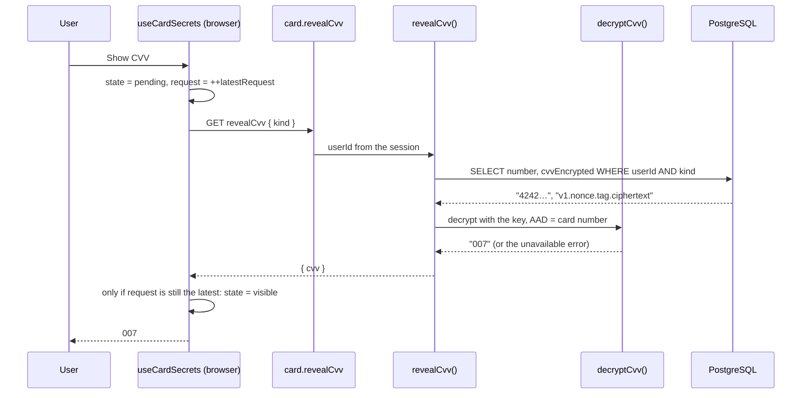

# 20 · Show CVV (decrypted on demand)

The 3-digit security code on the card face starts as `•••`. **Show CVV** asks the server for it. The server decrypts it from the database with **AES-256-GCM**, using a key that only the server has, and sends it back. **Copy CVV** copies it, and **Hide CVV** hides it again. The CVV is never stored in plain text, never part of the normal card data, and never kept in the browser's query cache.

## At a glance

| | |
| --- | --- |
| **Route** | `/card` (the CVV box on the card face) |
| **Frontend** | `card-details.tsx` (`SecurityCode`), hook `use-card-secrets.ts` (**client**) |
| **API** | `card.revealCvv({ kind })` (protected query, called on demand) |
| **Backend** | `card.service.ts` (`revealCvv`), `card-cvv.server.ts` (`encryptCvv`, `decryptCvv`, `newCvvCredentials`), `env.ts` (`CARD_ENCRYPTION_KEY`) |
| **Database** | reads `Card.number` and `Card.cvvEncrypted` for `(userId, kind)` |
| **Secret** | `CARD_ENCRYPTION_KEY`: 64 hex characters = 32 bytes, server only |
| **Tests** | `card-cvv.test.ts` (5 CVV tests); the encryption traces and the browser flow were run for this review |
| **Deep dive** | [Cards](../05-features/04-cards.md), [Security concepts: AES-GCM](../01-foundations/05-security-concepts.md) |

## What the user can do

| Button (name) | Enabled when | Result |
| --- | --- | --- |
| **Show CVV** (eye) | card unlocked and not loading | spinner, then the 3 digits; the button becomes **Hide CVV** (`aria-pressed="true"`) |
| **Hide CVV** | CVV shown | back to `•••` |
| **Copy CVV** | CVV shown | copies it; the button is renamed "CVV copied", and a hidden status says "CVV copied." |

## How it works

1. **Show CVV** runs `toggleCvv`: the state becomes `pending` (spinner) and the hook calls `utils.client.card.revealCvv.query({ kind })` directly, **outside** React Query's cache.
2. `revealCvv` loads the card **by `(userId, kind)`**, so a user can only ever reach their own two cards, and calls `decryptCvv(cvvEncrypted, number, CARD_ENCRYPTION_KEY)`.
3. `decryptCvv` checks the key and the stored format, decrypts with AES-256-GCM, and **verifies the authentication tag** with the card number as extra authenticated data. Any problem gives one message: "Your card security details are temporarily unavailable."
4. If no newer action happened meanwhile, the state becomes `visible` with the digits.
5. Locking the card, switching cards, or leaving the page throws the CVV away.

## Structure



## Files and locations

| Layer | File | Role |
| --- | --- | --- |
| Frontend | `gobank/src/features/card/components/card-details.tsx` | `SecurityCode`: digits, Copy, Show/Hide |
| Hook (client) | `gobank/src/features/card/hooks/use-card-secrets.ts` | the CVV state machine, stale-answer guard, copy |
| API | `gobank/src/features/card/card.router.ts` | `revealCvv` |
| Service | `gobank/src/features/card/card.service.ts` | `revealCvv` |
| Crypto | `gobank/src/features/card/card-cvv.server.ts` | encrypt, decrypt, new CVV (`server-only`) |
| Config | `gobank/src/env.ts` | validates `CARD_ENCRYPTION_KEY` |
| Tests | `gobank/src/features/card/card-cvv.test.ts` | CVV encryption tests |

## Frontend

<!-- code: gobank/src/features/card/hooks/use-card-secrets.ts -->
**`gobank/src/features/card/hooks/use-card-secrets.ts`** · all 88 lines

```ts
 1 │ "use client";
 2 │
 3 │ import { useEffect, useRef, useState } from "react";
 4 │ import { api } from "~/trpc/react";
 5 │ import type { CardKind } from "../components/bank-card";
 6 │
 7 │ type CvvState =
 8 │   | { status: "hidden" | "pending" }
 9 │   | { status: "visible"; cvv: string }
10 │   | { status: "error"; message: string };
11 │
12 │ type CopyStatus = "idle" | "copied" | "error";
13 │
14 │ const COPY_FAILED = "Could not copy CVV. Try again.";
15 │
16 │ function errorText(cvv: CvvState, copyStatus: CopyStatus) {
17 │   if (cvv.status === "error") return cvv.message;
18 │   if (copyStatus === "error") return COPY_FAILED;
19 │   return null;
20 │ }
21 │
22 │ export function useCardSecrets(kind: CardKind, locked: boolean) {
23 │   const utils = api.useUtils();
24 │   const [numberShown, setNumberShown] = useState(false);
25 │   const [cvv, setCvv] = useState<CvvState>({ status: "hidden" });
26 │   const [copyStatus, setCopyStatus] = useState<CopyStatus>("idle");
27 │   const latestRequest = useRef(0);
28 │
29 │   useEffect(() => {
30 │     if (!locked) return;
31 │
32 │     latestRequest.current += 1;
33 │     setNumberShown(false);
34 │     setCvv({ status: "hidden" });
35 │     setCopyStatus("idle");
36 │   }, [locked]);
37 │
38 │   const toggleNumber = () => setNumberShown((shown) => !shown);
39 │
40 │   const toggleCvv = async () => {
41 │     if (locked) return;
42 │
43 │     const request = ++latestRequest.current;
44 │     const isLatest = () => request === latestRequest.current;
45 │     setCopyStatus("idle");
46 │
47 │     if (cvv.status === "visible") {
48 │       setCvv({ status: "hidden" });
49 │       return;
50 │     }
51 │
52 │     setCvv({ status: "pending" });
53 │
54 │     try {
55 │       const details = await utils.client.card.revealCvv.query({ kind });
56 │       if (isLatest()) setCvv({ status: "visible", cvv: details.cvv });
57 │     } catch (error) {
58 │       const message =
59 │         error instanceof Error ? error.message : "Could not load your CVV.";
60 │       if (isLatest()) setCvv({ status: "error", message });
61 │     }
62 │   };
63 │
64 │   const copyCvv = async () => {
65 │     if (locked || cvv.status !== "visible") return;
66 │
67 │     const request = latestRequest.current;
68 │     const isLatest = () => request === latestRequest.current;
69 │
70 │     try {
71 │       await navigator.clipboard.writeText(cvv.cvv);
72 │       if (isLatest()) setCopyStatus("copied");
73 │     } catch {
74 │       if (isLatest()) setCopyStatus("error");
75 │     }
76 │   };
77 │
78 │   return {
79 │     numberShown: numberShown && !locked,
80 │     cvvShown: !locked && cvv.status === "visible" ? cvv.cvv : null,
81 │     cvvLoading: cvv.status === "pending",
82 │     copied: !locked && copyStatus === "copied",
83 │     error: locked ? null : errorText(cvv, copyStatus),
84 │     toggleNumber,
85 │     toggleCvv,
86 │     copyCvv,
87 │   };
88 │ }
```
<!-- /code -->

<!-- code: gobank/src/features/card/components/card-details.tsx 32-85 -->
**`gobank/src/features/card/components/card-details.tsx`** · lines 32–85

```tsx
32 │ function SecurityCode({
33 │   cvv,
34 │   loading,
35 │   copied,
36 │   locked,
37 │   onToggle,
38 │   onCopy,
39 │ }: {
40 │   cvv: string | null;
41 │   loading: boolean;
42 │   copied: boolean;
43 │   locked: boolean;
44 │   onToggle: () => void;
45 │   onCopy: () => void;
46 │ }) {
47 │   const shown = cvv !== null;
48 │
49 │   return (
50 │     <div aria-label="Card security code" className="flex shrink-0 flex-col">
51 │       <span className="text-[9px] tracking-[0.18em] text-white/55">CVV</span>
52 │
53 │       <div className="flex h-7 items-center gap-0.5">
54 │         <span className="min-w-6 text-[13px] font-medium text-white tabular-nums">
55 │           {cvv ?? "•••"}
56 │         </span>
57 │
58 │         <button
59 │           type="button"
60 │           aria-label={copied ? "CVV copied" : "Copy CVV"}
61 │           disabled={locked || !shown}
62 │           onClick={onCopy}
63 │           className={ICON_ACTION}
64 │         >
65 │           {copied ? (
66 │             <Check size={14} aria-hidden />
67 │           ) : (
68 │             <Copy size={14} aria-hidden />
69 │           )}
70 │         </button>
71 │
72 │         <button
73 │           type="button"
74 │           aria-label={shown ? "Hide CVV" : "Show CVV"}
75 │           aria-pressed={shown}
76 │           disabled={locked || loading}
77 │           onClick={onToggle}
78 │           className={ICON_ACTION}
79 │         >
80 │           <CvvIcon loading={loading} shown={shown} />
81 │         </button>
82 │       </div>
83 │     </div>
84 │   );
85 │ }
```
<!-- /code -->

<!-- code: gobank/src/features/card/components/card-details.tsx 131-139 -->
**`gobank/src/features/card/components/card-details.tsx`** · lines 131–139

```tsx
131 │       <span role="status" className="sr-only">
132 │         {secrets.copied ? "CVV copied." : ""}
133 │       </span>
134 │
135 │       {secrets.error ? (
136 │         <p role="alert" className="text-danger mt-1 text-[13px]">
137 │           {secrets.error}
138 │         </p>
139 │       ) : null}
```
<!-- /code -->

## Backend

<!-- code: gobank/src/features/card/card.router.ts 9-11 -->
**`gobank/src/features/card/card.router.ts`** · lines 9–11

```ts
 9 │   revealCvv: protectedProcedure
10 │     .input(z.object({ kind: cardKind }))
11 │     .query(({ ctx, input }) => revealCvv(ctx.userId, input.kind)),
```
<!-- /code -->

<!-- code: gobank/src/features/card/card.service.ts 57-66 -->
**`gobank/src/features/card/card.service.ts`** · lines 57–66

```ts
57 │ export async function revealCvv(userId: string, kind: CardKind) {
58 │   const card = await db.card.findUniqueOrThrow({
59 │     where: { userId_kind: { userId, kind } },
60 │     select: { number: true, cvvEncrypted: true },
61 │   });
62 │
63 │   return {
64 │     cvv: decryptCvv(card.cvvEncrypted, card.number, env.CARD_ENCRYPTION_KEY),
65 │   };
66 │ }
```
<!-- /code -->

<!-- code: gobank/src/features/card/card-cvv.server.ts -->
**`gobank/src/features/card/card-cvv.server.ts`** · all 100 lines

```ts
  1 │ import "server-only";
  2 │ import {
  3 │   createCipheriv,
  4 │   createDecipheriv,
  5 │   randomBytes,
  6 │   randomInt,
  7 │ } from "node:crypto";
  8 │ import { fail } from "~/server/errors";
  9 │
 10 │ const ALGORITHM = "aes-256-gcm";
 11 │ const FORMAT_VERSION = "v1";
 12 │ const ENCRYPTED_CVV = /^v1\.[a-f0-9]{24}\.[a-f0-9]{32}\.[a-f0-9]{6}$/i;
 13 │ const THREE_DIGITS = /^\d{3}$/;
 14 │ const HEX_KEY = /^[a-f0-9]{64}$/i;
 15 │
 16 │ const UNAVAILABLE = "Your card security details are temporarily unavailable.";
 17 │
 18 │ const additionalData = (cardNumber: string) =>
 19 │   Buffer.from(`GoBank card CVV:${cardNumber}`);
 20 │
 21 │ function encryptionKey(key: string | undefined) {
 22 │   if (!key || !HEX_KEY.test(key)) return fail("BAD_REQUEST", UNAVAILABLE);
 23 │
 24 │   return Buffer.from(key, "hex");
 25 │ }
 26 │
 27 │ function randomCvv(excludedCvv?: string) {
 28 │   let cvv: string;
 29 │   do {
 30 │     cvv = randomInt(1000).toString().padStart(3, "0");
 31 │   } while (cvv === excludedCvv);
 32 │
 33 │   return cvv;
 34 │ }
 35 │
 36 │ export function newCvvCredentials(
 37 │   cardNumber: string,
 38 │   key: string | undefined,
 39 │   excludedCvv?: string,
 40 │ ) {
 41 │   const cvv = randomCvv(excludedCvv);
 42 │
 43 │   return { cvv, cvvEncrypted: encryptCvv(cvv, cardNumber, key) };
 44 │ }
 45 │
 46 │ export function encryptCvv(
 47 │   cvv: string,
 48 │   cardNumber: string,
 49 │   key: string | undefined,
 50 │ ) {
 51 │   if (!THREE_DIGITS.test(cvv)) fail("BAD_REQUEST", UNAVAILABLE);
 52 │
 53 │   const nonce = randomBytes(12);
 54 │   const cipher = createCipheriv(ALGORITHM, encryptionKey(key), nonce);
 55 │   cipher.setAAD(additionalData(cardNumber));
 56 │
 57 │   const ciphertext = Buffer.concat([
 58 │     cipher.update(cvv, "utf8"),
 59 │     cipher.final(),
 60 │   ]);
 61 │   const tag = cipher.getAuthTag();
 62 │
 63 │   return [
 64 │     FORMAT_VERSION,
 65 │     nonce.toString("hex"),
 66 │     tag.toString("hex"),
 67 │     ciphertext.toString("hex"),
 68 │   ].join(".");
 69 │ }
 70 │
 71 │ export function decryptCvv(
 72 │   encrypted: string,
 73 │   cardNumber: string,
 74 │   key: string | undefined,
 75 │ ) {
 76 │   const secret = encryptionKey(key);
 77 │   if (!ENCRYPTED_CVV.test(encrypted)) fail("BAD_REQUEST", UNAVAILABLE);
 78 │
 79 │   const [, nonce = "", tag = "", ciphertext = ""] = encrypted.split(".");
 80 │
 81 │   try {
 82 │     const decipher = createDecipheriv(
 83 │       ALGORITHM,
 84 │       secret,
 85 │       Buffer.from(nonce, "hex"),
 86 │     );
 87 │     decipher.setAAD(additionalData(cardNumber));
 88 │     decipher.setAuthTag(Buffer.from(tag, "hex"));
 89 │
 90 │     const cvv = Buffer.concat([
 91 │       decipher.update(Buffer.from(ciphertext, "hex")),
 92 │       decipher.final(),
 93 │     ]).toString("utf8");
 94 │
 95 │     if (!THREE_DIGITS.test(cvv)) fail("BAD_REQUEST", UNAVAILABLE);
 96 │     return cvv;
 97 │   } catch {
 98 │     return fail("BAD_REQUEST", UNAVAILABLE);
 99 │   }
100 │ }
```
<!-- /code -->

## Database

| Column | Example | Meaning |
| --- | --- | --- |
| `Card.number` | `4242000000000000` | also used as the **AAD** that ties the ciphertext to this card |
| `Card.cvvEncrypted` | `v1.67bed5677cfeebd8f6edf648.31d7b8f13e5e19a00acc10c6e66b4f8d.d09d0c` | version · nonce · tag · ciphertext (hex) |

The plain CVV reaches the browser at **registration**, in the card preview shown on the review step ([02](02-registration.md)). After that it exists only in server memory, briefly, after each decryption, and in this screen's state while it is shown.

## The complicated parts, explained step by step

### 1. The stored format, piece by piece

<!-- code: gobank/src/features/card/card-cvv.server.ts 46-69 -->
**`gobank/src/features/card/card-cvv.server.ts`** · lines 46–69

```ts
46 │ export function encryptCvv(
47 │   cvv: string,
48 │   cardNumber: string,
49 │   key: string | undefined,
50 │ ) {
51 │   if (!THREE_DIGITS.test(cvv)) fail("BAD_REQUEST", UNAVAILABLE);
52 │
53 │   const nonce = randomBytes(12);
54 │   const cipher = createCipheriv(ALGORITHM, encryptionKey(key), nonce);
55 │   cipher.setAAD(additionalData(cardNumber));
56 │
57 │   const ciphertext = Buffer.concat([
58 │     cipher.update(cvv, "utf8"),
59 │     cipher.final(),
60 │   ]);
61 │   const tag = cipher.getAuthTag();
62 │
63 │   return [
64 │     FORMAT_VERSION,
65 │     nonce.toString("hex"),
66 │     tag.toString("hex"),
67 │     ciphertext.toString("hex"),
68 │   ].join(".");
69 │ }
```
<!-- /code -->

Real output of `encryptCvv("007", "4242000000000000", key)` (random test key, run for this review):

```text
v1.67bed5677cfeebd8f6edf648.31d7b8f13e5e19a00acc10c6e66b4f8d.d09d0c
```

| Part | Value | Size | Meaning |
| --- | --- | --- | --- |
| version | `v1` | | lets a future `v2` (a new key or algorithm) be told apart |
| nonce | `67bed5677cfeebd8f6edf648` | 12 bytes (24 hex) | random for every encryption (`randomBytes(12)`), never reused with the same key |
| tag | `31d7b8f13e5e19a00acc10c6e66b4f8d` | 16 bytes (32 hex) | the GCM **authentication tag**: proof that nothing was changed |
| ciphertext | `d09d0c` | 3 bytes (6 hex) | the encrypted `"007"` (GCM does not pad: 3 characters in, 3 bytes out) |

The pattern on line 12 checks exactly these lengths before decrypting: `^v1\.[a-f0-9]{24}\.[a-f0-9]{32}\.[a-f0-9]{6}$`.

**Encrypting the same CVV twice** gave `…d09d0c` and `v1.651a9128c70cfdf1d864f68c.941ee908…4db37048.60aa94`: completely different, because the nonce is new each time. Someone reading the database cannot even tell whether two cards share a CVV.

### 2. The card number as "additional authenticated data"

<!-- code: gobank/src/features/card/card-cvv.server.ts 18-19 -->
**`gobank/src/features/card/card-cvv.server.ts`** · lines 18–19

```ts
18 │ const additionalData = (cardNumber: string) =>
19 │   Buffer.from(`GoBank card CVV:${cardNumber}`);
```
<!-- /code -->

The AAD is **not** encrypted, but it is **included in the tag**. Decryption must be given the same AAD, or the tag check fails.

| Attack on the stored data | Without the AAD | With the AAD (`GoBank card CVV:<number>`) |
| --- | --- | --- |
| copy card A's `cvvEncrypted` into card B's row | B would show A's CVV | the tag fails: "temporarily unavailable" |

What happened for each case, run for this review (the CVV was encrypted for card `4242000000000000`):

| Decrypt with | Result |
| --- | --- |
| the right card, the right key | **`007`** (the leading zeros are kept: it is a string) |
| card number `5555000000000000` | "Your card security details are temporarily unavailable." |
| another random key | "…temporarily unavailable." |
| the last hex digit of the ciphertext changed | "…temporarily unavailable." (the tag no longer matches) |
| one hex digit of the tag changed | "…temporarily unavailable." |
| the text `hello` | "…temporarily unavailable." (fails the format check) |
| no key configured | "…temporarily unavailable." |

**One message for every failure** (lines 16, 22, 77, 95, 98) means an attacker learns nothing about **why** it failed. The real error stays on the server.

### 3. Where the key comes from

<!-- code: gobank/src/features/card/card-cvv.server.ts 21-25 -->
**`gobank/src/features/card/card-cvv.server.ts`** · lines 21–25

```ts
21 │ function encryptionKey(key: string | undefined) {
22 │   if (!key || !HEX_KEY.test(key)) return fail("BAD_REQUEST", UNAVAILABLE);
23 │
24 │   return Buffer.from(key, "hex");
25 │ }
```
<!-- /code -->

| Value of `CARD_ENCRYPTION_KEY` | Result |
| --- | --- |
| 64 hex characters | `Buffer.from(key, "hex")` = the 32 bytes AES-256 needs |
| set, but not 64 hex characters | `env.ts` refuses it at **startup** (`.regex(/^[a-f0-9]{64}$/i)`), so the mistake is found before anyone uses the app |
| missing (the variable is optional) | the app starts, but every CVV operation fails with "temporarily unavailable". That includes **creating** cards, so **registration** fails too; existing users can still sign in, pay and move money |

<!-- code: gobank/src/env.ts 7-10 -->
**`gobank/src/env.ts`** · lines 7–10

```ts
 7 │     CARD_ENCRYPTION_KEY: z
 8 │       .string()
 9 │       .regex(/^[a-f0-9]{64}$/i)
10 │       .optional(),
```
<!-- /code -->

The file starts with `import "server-only"`: if browser code ever imported it, the **build** would fail, so the key and the decryption code can never be shipped to the browser.

**Creating the key:** `npm run card:setup-key` runs this script once per environment:

<!-- code: gobank/scripts/setup-card-key.ts -->
**`gobank/scripts/setup-card-key.ts`** · all 59 lines

```ts
 1 │ import { spawnSync } from "node:child_process";
 2 │ import { randomBytes } from "node:crypto";
 3 │ import { appendFile, readFile } from "node:fs/promises";
 4 │ import { fileURLToPath } from "node:url";
 5 │
 6 │ const appDirectory = fileURLToPath(new URL("../", import.meta.url));
 7 │ const environmentFile = new URL("../.env", import.meta.url);
 8 │
 9 │ const KEY_LINE = /^\s*(?:export\s+)?CARD_ENCRYPTION_KEY\s*=/m;
10 │
11 │ const isMissingFile = (error: unknown) =>
12 │   typeof error === "object" &&
13 │   error !== null &&
14 │   "code" in error &&
15 │   error.code === "ENOENT";
16 │
17 │ async function readEnvironmentFile() {
18 │   try {
19 │     return await readFile(environmentFile, "utf8");
20 │   } catch (error) {
21 │     if (isMissingFile(error)) return "";
22 │     throw error;
23 │   }
24 │ }
25 │
26 │ function envFileIsIgnoredByGit() {
27 │   const result = spawnSync("git", ["check-ignore", "--quiet", ".env"], {
28 │     cwd: appDirectory,
29 │   });
30 │
31 │   return result.status === 0;
32 │ }
33 │
34 │ const existing = await readEnvironmentFile();
35 │ const keyAlreadySet =
36 │   Boolean(process.env.CARD_ENCRYPTION_KEY) || KEY_LINE.test(existing);
37 │
38 │ if (keyAlreadySet) {
39 │   console.log("CARD_ENCRYPTION_KEY already exists; no changes made.");
40 │ } else {
41 │   if (!envFileIsIgnoredByGit()) {
42 │     throw new Error(
43 │       "Keep .env ignored by Git before configuring card encryption.",
44 │     );
45 │   }
46 │
47 │   const newKey = randomBytes(32).toString("hex");
48 │   const startsOnNewLine = existing.length > 0 && !existing.endsWith("\n");
49 │
50 │   await appendFile(
51 │     environmentFile,
52 │     `${startsOnNewLine ? "\n" : ""}CARD_ENCRYPTION_KEY="${newKey}"\n`,
53 │     { mode: 0o600 },
54 │   );
55 │
56 │   console.log(
57 │     "Card encryption configured locally. Reuse the same private key for every app sharing this database.",
58 │   );
59 │ }
```
<!-- /code -->

| Step | Lines | Why |
| --- | --- | --- |
| a key already in the environment or in `.env` → change nothing | 34–39 | a second run must never replace the key: every CVV encrypted with the old key would become unreadable |
| `git check-ignore --quiet .env` must succeed | 26–32, 41–45 | refuses to write a secret into a file that Git would commit ("Keep .env ignored by Git before configuring card encryption.") |
| `randomBytes(32).toString("hex")` | 47 | 32 random bytes = the 64 hex characters `env.ts` expects |
| append `CARD_ENCRYPTION_KEY="…"` with file mode `0o600` | 48–54 | only the file's owner can read it, and a missing newline is added first |
| "Reuse the same private key for every app sharing this database." | 56–58 | two servers with different keys could not read each other's CVVs |

### 4. Ignoring answers that arrive too late

<!-- code: gobank/src/features/card/hooks/use-card-secrets.ts 40-62 -->
**`gobank/src/features/card/hooks/use-card-secrets.ts`** · lines 40–62

```ts
40 │   const toggleCvv = async () => {
41 │     if (locked) return;
42 │
43 │     const request = ++latestRequest.current;
44 │     const isLatest = () => request === latestRequest.current;
45 │     setCopyStatus("idle");
46 │
47 │     if (cvv.status === "visible") {
48 │       setCvv({ status: "hidden" });
49 │       return;
50 │     }
51 │
52 │     setCvv({ status: "pending" });
53 │
54 │     try {
55 │       const details = await utils.client.card.revealCvv.query({ kind });
56 │       if (isLatest()) setCvv({ status: "visible", cvv: details.cvv });
57 │     } catch (error) {
58 │       const message =
59 │         error instanceof Error ? error.message : "Could not load your CVV.";
60 │       if (isLatest()) setCvv({ status: "error", message });
61 │     }
62 │   };
```
<!-- /code -->

Every **Show CVV** takes a new number: `request = ++latestRequest.current`. When the answer arrives, it is used only if `request === latestRequest.current`.

| Time | Event | `latestRequest` | State |
| --- | --- | --- | --- |
| t0 | **Show CVV** (request 1) | 1 | pending |
| t1 | the user **locks** the card before the answer arrives: the effect on lines 29–36 runs | **2** | hidden |
| t2 | the answer of request 1 arrives | 2 | `1 !== 2` → **ignored**, stays hidden |

Without the counter, a CVV could appear on a card that was just locked. The same guard protects the copy status (lines 67–75).

### 5. Not cached in the browser's query store

<!-- code: gobank/src/features/card/hooks/use-card-secrets.ts 55-55 -->
**`gobank/src/features/card/hooks/use-card-secrets.ts`** · line 55

```ts
55 │       const details = await utils.client.card.revealCvv.query({ kind });
```
<!-- /code -->

| Approach | Where the CVV would stay |
| --- | --- |
| `api.card.revealCvv.useQuery()` | in React Query's cache for the whole session, readable by any component, and refetched automatically |
| `utils.client.card.revealCvv.query()` (used) | only in this component's state; gone when hidden, locked, switched or unmounted |

Checked in Chromium: showing the CVV a **second** time made a **second** request, so nothing had been cached. The request was `GET /api/trpc/card.revealCvv?batch=1&input={"0":{"json":{"kind":"physical"}}}`. The CVV is in the **response body**, not the URL.

**A limitation found:** that response had **no `Cache-Control` header**. Browsers do not reuse such a response, but they are allowed to store it in their disk cache. Sending `Cache-Control: no-store` for this procedure, or fetching the CVV with a POST mutation, would close that gap ([Limitations](../09-defense/03-limitations-and-future-work.md#2-security-limitations)).

### 6. What the lock does and does not do here

<!-- code: gobank/src/features/card/hooks/use-card-secrets.ts 29-36 -->
**`gobank/src/features/card/hooks/use-card-secrets.ts`** · lines 29–36

```ts
29 │   useEffect(() => {
30 │     if (!locked) return;
31 │
32 │     latestRequest.current += 1;
33 │     setNumberShown(false);
34 │     setCvv({ status: "hidden" });
35 │     setCopyStatus("idle");
36 │   }, [locked]);
```
<!-- /code -->

| Layer | Locked card |
| --- | --- |
| this hook | clears the number, the CVV and the copy status; `toggleCvv` and `copyCvv` return early |
| `CardDetails` | the face is blurred, `inert` and `aria-hidden` ([21](21-card-lock.md)) |
| the server's `revealCvv` | **does not check `locked`**: it only checks that the card is yours |

The lock is a **payment** block (enforced by `spend()` on the server). Hiding a locked card's CVV is a screen decision. The card's owner could still call `card.revealCvv` directly. That is their own data, so it does not open any access to other people's cards.

## Rules and limits

| Rule | Value |
| --- | --- |
| Algorithm | AES-256-GCM, 12-byte random nonce, 16-byte tag |
| AAD | `GoBank card CVV:` + the card number |
| Key | `CARD_ENCRYPTION_KEY`, 64 hex characters (server only) |
| Who can reveal | only the signed-in owner, for their own `(userId, kind)` |
| Client storage | component state only; cleared on hide, lock, switch or leave |

## Messages

| Text | When |
| --- | --- |
| CVV · `•••` | hidden |
| Show CVV / Hide CVV · Copy CVV / CVV copied | button names |
| CVV copied. | screen-reader status |
| Could not copy CVV. Try again. | the clipboard refused |
| Your card security details are temporarily unavailable. | any decryption or key problem |
| Could not load your CVV. | a non-`Error` failure (fallback) |

## Tests

`card-cvv.test.ts` (Node's test runner, part of `npm test`):

| Test | Proves |
| --- | --- |
| an encrypted CVV decrypts back with its leading zeros | `"007"` stays `"007"` |
| encrypting the same CVV twice gives two different results | the random nonce |
| a CVV cannot be read with the wrong card or the wrong key | the AAD and the key are both required |
| a CVV that was changed after encryption is rejected | the tag check |
| encryption needs a key and a 3-digit CVV | bad input is refused |

**Also run for this review:** the format, nonce, tag and tamper traces above (with the project's own functions), and in Chromium: Copy CVV disabled before showing, **Show CVV** → 3 digits with `aria-pressed="true"`, **Copy CVV** → the clipboard held the same digits and the status said "CVV copied.", **Hide CVV** → `•••`, a second **Show** → a second request, and **Lock** → the CVV was cleared.
