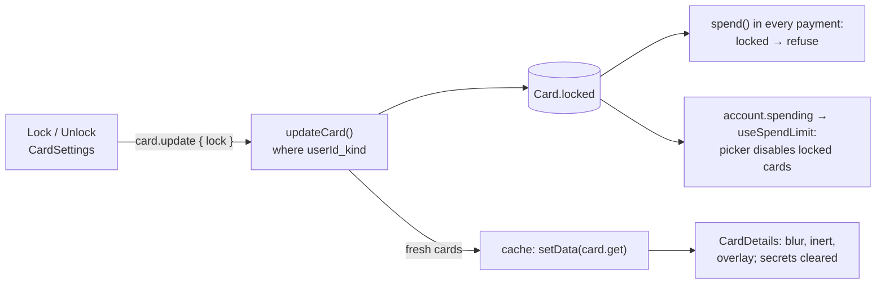

# 21 · Lock and unlock a card

Each card can be **locked** on its own. A locked card cannot pay for anything (transfers, bills, load, paying a request). On My card its face is blurred behind a **Card locked** overlay, and in every payment form it is greyed out in the card picker. If **both** cards are locked, spending stops until one is unlocked. Unlocking is one more tap.

## At a glance

| | |
| --- | --- |
| **Route** | `/card` (the **Lock** / **Unlock** button in the card settings box) |
| **Frontend** | `card-settings.tsx` (`useCardUpdate`, lock button, message), `card-details.tsx` (blur, `inert`, overlay), `my-card-screen.module.css`, `use-card-secrets.ts` (clears secrets); in payment forms: `card-picker.tsx`, `card-locked-notice.tsx`, `use-spend-limit.ts` |
| **API** | `card.update({ lock: { kind, locked } })` (protected mutation) |
| **Backend** | `card.router.ts`, `card.service.ts` (`updateCard`); enforcement in the ledger's `spend()` |
| **Database** | updates `Card.locked` for `(userId, kind)` |
| **Tests** | `verify-core.ts` (`checkCardLocks`); checked in Chromium and on the test database for this review |
| **Deep dive** | [Cards](../05-features/04-cards.md) |

## What the user can do

| Where | Card unlocked | Card locked |
| --- | --- | --- |
| card settings title | "Physical card unlocked" (green) · "Can pay transfers, bills and load." | "Physical card locked" (grey) · "Payments with this card are blocked." |
| button | **Lock** | **Unlock** |
| after tapping | "Physical card locked." / "Physical card unlocked." (status message) | |
| card face | normal; number and CVV can be shown | blurred, not clickable, hidden from screen readers; overlay **Card locked** |
| payment forms | selectable in **Pay with** | shown as **Locked**, disabled |
| both cards locked | | notice "Both of your cards are locked, so spending is paused. Unlock one in My card" and the amount message "Both cards are locked. Unlock one to spend" |

## How it works

1. **Lock** calls `card.update({ lock: { kind, locked: true } })` (Zod: `kind` is `physical`/`virtual`, `locked` a boolean).
2. `updateCard` runs `tx.card.update({ where: { userId_kind: { userId, kind } }, data: { locked } })` in a transaction, then returns the fresh `getCard` result.
3. In the browser, `onMutate` first **cancels** any `card.get` request in flight. `onSuccess` writes the returned cards straight into the cache (`setData`) and shows the message.
4. With `locked` true, `CardDetails` blurs the face and makes it `inert`, and `useCardSecrets` hides the number and the CVV.
5. On every later payment, `spend()` reads the chosen card **inside the payment's transaction** and refuses it if it is locked: "This card is locked. Unlock it or pay with your other card."

## Structure



## Files and locations

| Layer | File | Role |
| --- | --- | --- |
| Frontend | `gobank/src/features/card/components/card-settings.tsx` | lock button, `useCardUpdate`, message |
| Frontend | `gobank/src/features/card/components/card-details.tsx` | locked face, overlay |
| Styles | `gobank/src/features/card/components/my-card-screen.module.css` | `cardFaceLocked`, `cardLockOverlay` |
| Hook | `gobank/src/features/card/hooks/use-card-secrets.ts` | clears number and CVV on lock |
| Payment UI | `gobank/src/features/card/components/card-picker.tsx` | "Locked", disabled |
| Payment UI | `gobank/src/features/card/components/card-locked-notice.tsx` | both locked |
| Payment hook | `gobank/src/shared/hooks/use-spend-limit.ts` | `locked`, card fallback |
| API | `gobank/src/features/card/card.router.ts` | `update` |
| Service | `gobank/src/features/card/card.service.ts` | `updateCard` |
| Ledger | `gobank/src/server/ledger.ts` | `spend()` lines 145–147 |

## Frontend

<!-- code: gobank/src/features/card/components/card-settings.tsx 15-56 -->
**`gobank/src/features/card/components/card-settings.tsx`** · lines 15–56

```tsx
15 │ const CARD_NAME: Record<CardKind, string> = {
16 │   physical: "Physical card",
17 │   virtual: "Virtual card",
18 │ };
19 │
20 │ const OUTLINE_BUTTON =
21 │   "border-line-strong text-ink bg-surface enabled:hover:bg-surface-raised focus-visible:outline-brand inline-flex min-h-10 shrink-0 items-center gap-1.5 rounded-lg border px-3 text-[13px] font-medium focus-visible:outline-2 disabled:opacity-45";
22 │
23 │ const SAVE_BUTTON =
24 │   "bg-brand enabled:hover:bg-brand-hover focus-visible:outline-brand disabled:bg-brand/35 min-h-9 rounded-lg px-3 text-[13px] font-medium text-white focus-visible:outline-2 focus-visible:outline-offset-2 disabled:text-white/65";
25 │
26 │ function lockButtonLabel(saving: boolean, locked: boolean) {
27 │   if (saving) return "Saving…";
28 │   return locked ? "Unlock" : "Lock";
29 │ }
30 │
31 │ function useCardUpdate() {
32 │   const utils = api.useUtils();
33 │   const [message, setMessage] = useState("");
34 │
35 │   const update = api.card.update.useMutation({
36 │     onMutate: () => utils.card.get.cancel(),
37 │     onSuccess: (updated, settings) => {
38 │       utils.card.get.setData(undefined, updated);
39 │
40 │       if (!settings.lock) {
41 │         setMessage("Daily limit saved.");
42 │         return;
43 │       }
44 │
45 │       const nowLocked = updated[settings.lock.kind].locked;
46 │       setMessage(
47 │         `${CARD_NAME[settings.lock.kind]} ${nowLocked ? "locked" : "unlocked"}.`,
48 │       );
49 │     },
50 │   });
51 │
52 │   const savingLock = update.isPending && update.variables.lock !== undefined;
53 │   const savingLimit = update.isPending && !savingLock;
54 │
55 │   return { update, message, setMessage, savingLock, savingLimit };
56 │ }
```
<!-- /code -->

<!-- code: gobank/src/features/card/components/card-settings.tsx 127-215 -->
**`gobank/src/features/card/components/card-settings.tsx`** · lines 127–215

```tsx
127 │ export function CardSettings({
128 │   kind,
129 │   locked,
130 │   cardDailyLimit,
131 │ }: {
132 │   kind: CardKind;
133 │   locked: boolean;
134 │   cardDailyLimit: number;
135 │ }) {
136 │   const { update, message, setMessage, savingLock, savingLimit } =
137 │     useCardUpdate();
138 │
139 │   const toggleLock = () => {
140 │     setMessage("");
141 │     update.mutate({ lock: { kind, locked: !locked } });
142 │   };
143 │
144 │   const saveLimit = (centavos: number) => {
145 │     setMessage("");
146 │     update.mutate({ cardDailyLimit: centavos });
147 │   };
148 │
149 │   const clearFeedback = () => {
150 │     setMessage("");
151 │     update.reset();
152 │   };
153 │
154 │   const feedback = errorMessage(update.error) ?? message;
155 │
156 │   return (
157 │     <section
158 │       aria-label="Card settings"
159 │       className="border-line mt-5 rounded-2xl border p-4"
160 │     >
161 │       <div className="flex items-center justify-between gap-3">
162 │         <div>
163 │           <h2
164 │             className={cn(
165 │               "text-[14px] font-medium",
166 │               locked ? "text-ink-muted" : "text-brand",
167 │             )}
168 │           >
169 │             {CARD_NAME[kind]} {locked ? "locked" : "unlocked"}
170 │           </h2>
171 │           <p className="text-ink-muted mt-1 text-[12px]">
172 │             {locked
173 │               ? "Payments with this card are blocked."
174 │               : "Can pay transfers, bills and load."}
175 │           </p>
176 │         </div>
177 │
178 │         <button
179 │           type="button"
180 │           disabled={update.isPending}
181 │           onClick={toggleLock}
182 │           className={OUTLINE_BUTTON}
183 │         >
184 │           {locked ? (
185 │             <LockKeyholeOpen size={15} aria-hidden />
186 │           ) : (
187 │             <Lock size={15} aria-hidden />
188 │           )}
189 │           {lockButtonLabel(savingLock, locked)}
190 │         </button>
191 │       </div>
192 │
193 │       <DailyLimitField
194 │         key={cardDailyLimit}
195 │         cardDailyLimit={cardDailyLimit}
196 │         busy={update.isPending}
197 │         saving={savingLimit}
198 │         onSave={saveLimit}
199 │         onEdit={clearFeedback}
200 │       />
201 │
202 │       {feedback ? (
203 │         <p
204 │           role={update.error ? "alert" : "status"}
205 │           className={cn(
206 │             "mt-3 text-[13px]",
207 │             update.error ? "text-danger" : "text-brand",
208 │           )}
209 │         >
210 │           {feedback}
211 │         </p>
212 │       ) : null}
213 │     </section>
214 │   );
215 │ }
```
<!-- /code -->

<!-- code: gobank/src/features/card/components/card-details.tsx 87-129 -->
**`gobank/src/features/card/components/card-details.tsx`** · lines 87–129

```tsx
 87 │ export function CardDetails({ card }: { card: Card }) {
 88 │   const locked = card.locked;
 89 │   const secrets = useCardSecrets(card.kind, locked);
 90 │
 91 │   return (
 92 │     <section aria-label="Card details" className="mt-4">
 93 │       <div className={styles.cardStage}>
 94 │         <div className={styles.switchCard}>
 95 │           <div
 96 │             className={cn(styles.cardFace, locked && styles.cardFaceLocked)}
 97 │             inert={locked}
 98 │             aria-hidden={locked}
 99 │           >
100 │             <BankCard
101 │               key={locked ? "locked" : "unlocked"}
102 │               brand={card.brand}
103 │               fullName={card.user.fullName}
104 │               number={card.number}
105 │               hideNumber={!secrets.numberShown}
106 │               onToggleNumber={locked ? undefined : secrets.toggleNumber}
107 │               expiresAt={card.expiresAt}
108 │               kind={card.kind}
109 │               securityDetails={
110 │                 <SecurityCode
111 │                   cvv={secrets.cvvShown}
112 │                   loading={secrets.cvvLoading}
113 │                   copied={secrets.copied}
114 │                   locked={locked}
115 │                   onToggle={() => void secrets.toggleCvv()}
116 │                   onCopy={() => void secrets.copyCvv()}
117 │                 />
118 │               }
119 │             />
120 │           </div>
121 │         </div>
122 │
123 │         {locked ? (
124 │           <div role="status" className={styles.cardLockOverlay}>
125 │             <Lock size={30} strokeWidth={1.6} aria-hidden />
126 │             <p className="text-[14px] font-medium">Card locked</p>
127 │           </div>
128 │         ) : null}
129 │       </div>
```
<!-- /code -->

## Backend

<!-- code: gobank/src/features/card/card.router.ts 13-25 -->
**`gobank/src/features/card/card.router.ts`** · lines 13–25

```ts
13 │   update: protectedProcedure
14 │     .input(
15 │       z.object({
16 │         lock: z.object({ kind: cardKind, locked: z.boolean() }).optional(),
17 │         cardDailyLimit: z
18 │           .number()
19 │           .int()
20 │           .min(0)
21 │           .max(MAX_DAILY_LIMIT_CENTAVOS)
22 │           .optional(),
23 │       }),
24 │     )
25 │     .mutation(({ ctx, input }) => updateCard(ctx.userId, input)),
```
<!-- /code -->

<!-- code: gobank/src/features/card/card.service.ts 34-55 -->
**`gobank/src/features/card/card.service.ts`** · lines 34–55

```ts
34 │ export async function updateCard(
35 │   userId: string,
36 │   { lock, cardDailyLimit }: CardSettings,
37 │ ) {
38 │   await db.$transaction(async (tx) => {
39 │     if (lock) {
40 │       await tx.card.update({
41 │         where: { userId_kind: { userId, kind: lock.kind } },
42 │         data: { locked: lock.locked },
43 │       });
44 │     }
45 │
46 │     if (cardDailyLimit !== undefined) {
47 │       await tx.user.update({
48 │         where: { id: userId },
49 │         data: { cardDailyLimit },
50 │       });
51 │     }
52 │   });
53 │
54 │   return getCard(userId);
55 │ }
```
<!-- /code -->

<!-- code: gobank/src/server/ledger.ts 145-147 -->
**`gobank/src/server/ledger.ts`** · lines 145–147

```ts
145 │   const usedCard = user.cards[0];
146 │   if (!usedCard) return fail("NOT_FOUND", MESSAGES.cardNotFound);
147 │   if (usedCard.locked) fail("BAD_REQUEST", MESSAGES.cardLocked);
```
<!-- /code -->

## Database

The SQL for locking the virtual card, captured from PostgreSQL's log:

```sql
BEGIN;
UPDATE "Card" SET "locked" = $1, "updatedAt" = $2
WHERE ("userId" = $3 AND "kind" = $4) RETURNING …;
-- $1 = true, $3 = <the signed-in user>, $4 = 'virtual'
COMMIT;
```

| Column | Meaning |
| --- | --- |
| `Card.locked` | `false` by default; one flag **per card** |
| `@@unique([userId, kind])` | gives Prisma the compound key `userId_kind`, used in the `where` |

**How the lock got here** (the migrations tell the story):

| Migration | Where the lock lived |
| --- | --- |
| `20260923000000_init` | one card per user, with its own `locked` |
| `20261008010000_dual_cards_shared_policy` | two cards per user; the lock moved to the **user** (`User.cardLocked`), shared by both cards |
| `20261103010000_per_card_lock` | back on **each card**: `Card.locked` is copied from `User.cardLocked`, which is then dropped |

<!-- code: gobank/prisma/migrations/20261103010000_per_card_lock/migration.sql -->
**`gobank/prisma/migrations/20261103010000_per_card_lock/migration.sql`** · all 12 lines

```sql
 1 │ BEGIN;
 2 │
 3 │ ALTER TABLE "Card" ADD COLUMN "locked" BOOLEAN NOT NULL DEFAULT false;
 4 │
 5 │ UPDATE "Card" AS card
 6 │ SET "locked" = account."cardLocked"
 7 │ FROM "User" AS account
 8 │ WHERE account."id" = card."userId";
 9 │
10 │ ALTER TABLE "User" DROP COLUMN "cardLocked";
11 │
12 │ COMMIT;
```
<!-- /code -->

The `UPDATE … FROM` copies each user's old shared lock to both of their cards, so nobody's card became unlocked by the migration. Details: [Migration history](../03-database/02-migration-history.md).

## The complicated parts, explained step by step

### 1. The browser never sends a card ID

<!-- code: gobank/src/features/card/card.service.ts 39-44 -->
**`gobank/src/features/card/card.service.ts`** · lines 39–44

```ts
39 │     if (lock) {
40 │       await tx.card.update({
41 │         where: { userId_kind: { userId, kind: lock.kind } },
42 │         data: { locked: lock.locked },
43 │       });
44 │     }
```
<!-- /code -->

| The request contains | The server adds | So the row is |
| --- | --- | --- |
| `{ lock: { kind: "virtual", locked: true } }` | `userId` from the session (`ctx.userId`) | **this user's** virtual card, and no other |

There is no card ID to change in the request, so one user cannot lock or unlock **another** user's card. The compound unique key `userId_kind` also guarantees that exactly one row matches.

### 2. Updating the screen without waiting for a refetch

<!-- code: gobank/src/features/card/components/card-settings.tsx 31-56 -->
**`gobank/src/features/card/components/card-settings.tsx`** · lines 31–56

```tsx
31 │ function useCardUpdate() {
32 │   const utils = api.useUtils();
33 │   const [message, setMessage] = useState("");
34 │
35 │   const update = api.card.update.useMutation({
36 │     onMutate: () => utils.card.get.cancel(),
37 │     onSuccess: (updated, settings) => {
38 │       utils.card.get.setData(undefined, updated);
39 │
40 │       if (!settings.lock) {
41 │         setMessage("Daily limit saved.");
42 │         return;
43 │       }
44 │
45 │       const nowLocked = updated[settings.lock.kind].locked;
46 │       setMessage(
47 │         `${CARD_NAME[settings.lock.kind]} ${nowLocked ? "locked" : "unlocked"}.`,
48 │       );
49 │     },
50 │   });
51 │
52 │   const savingLock = update.isPending && update.variables.lock !== undefined;
53 │   const savingLimit = update.isPending && !savingLock;
54 │
55 │   return { update, message, setMessage, savingLock, savingLimit };
56 │ }
```
<!-- /code -->

| Step | Code | Why |
| --- | --- | --- |
| before the request | `onMutate: () => utils.card.get.cancel()` | a `card.get` request that started **before** the lock could finish **after** it and paint the card as unlocked again |
| success | `utils.card.get.setData(undefined, updated)` | `updateCard` already returns the fresh cards, so the screen updates at once |
| success | the message `"Physical card locked."` built from `updated[kind].locked` | it reports what the **server** saved, not what the button asked for |
| afterwards | the global `MutationCache.onSettled` invalidates every query (`trpc/query-client.ts`) | balances and payment forms refetch too |

`savingLock` and `savingLimit` (lines 52–53) use `update.variables` to tell which save is running. Only the button that was pressed shows "Saving…".

### 3. What "locked" looks like, and why it is also unreachable

<!-- code: gobank/src/features/card/components/card-details.tsx 93-129 -->
**`gobank/src/features/card/components/card-details.tsx`** · lines 93–129

```tsx
 93 │       <div className={styles.cardStage}>
 94 │         <div className={styles.switchCard}>
 95 │           <div
 96 │             className={cn(styles.cardFace, locked && styles.cardFaceLocked)}
 97 │             inert={locked}
 98 │             aria-hidden={locked}
 99 │           >
100 │             <BankCard
101 │               key={locked ? "locked" : "unlocked"}
102 │               brand={card.brand}
103 │               fullName={card.user.fullName}
104 │               number={card.number}
105 │               hideNumber={!secrets.numberShown}
106 │               onToggleNumber={locked ? undefined : secrets.toggleNumber}
107 │               expiresAt={card.expiresAt}
108 │               kind={card.kind}
109 │               securityDetails={
110 │                 <SecurityCode
111 │                   cvv={secrets.cvvShown}
112 │                   loading={secrets.cvvLoading}
113 │                   copied={secrets.copied}
114 │                   locked={locked}
115 │                   onToggle={() => void secrets.toggleCvv()}
116 │                   onCopy={() => void secrets.copyCvv()}
117 │                 />
118 │               }
119 │             />
120 │           </div>
121 │         </div>
122 │
123 │         {locked ? (
124 │           <div role="status" className={styles.cardLockOverlay}>
125 │             <Lock size={30} strokeWidth={1.6} aria-hidden />
126 │             <p className="text-[14px] font-medium">Card locked</p>
127 │           </div>
128 │         ) : null}
129 │       </div>
```
<!-- /code -->

<!-- code: gobank/src/features/card/components/my-card-screen.module.css 16-34 -->
**`gobank/src/features/card/components/my-card-screen.module.css`** · lines 16–34

```css
16 │ .cardFaceLocked {
17 │   filter: blur(5px);
18 │   opacity: 0.4;
19 │   pointer-events: none;
20 │   user-select: none;
21 │ }
22 │
23 │ .cardLockOverlay {
24 │   position: absolute;
25 │   inset: 0;
26 │   display: flex;
27 │   flex-direction: column;
28 │   align-items: center;
29 │   justify-content: center;
30 │   gap: 8px;
31 │   color: #fff;
32 │   pointer-events: none;
33 │   animation: card-lock 180ms ease-out;
34 │ }
```
<!-- /code -->

| Technique | Effect | Checked in Chromium |
| --- | --- | --- |
| `cardFaceLocked`: `filter: blur(5px)`, `opacity: 0.4`, `pointer-events: none` | the face fades out (220 ms transition) and cannot be clicked | the filter was animating toward `blur(5px)` |
| `inert` | the browser removes every button inside from the Tab order and from clicks | `inert` present |
| `aria-hidden` | screen readers skip the blurred face | `aria-hidden="true"` |
| overlay `role="status"` "Card locked" | the new state is announced | text "Card locked" |
| `key={locked ? "locked" : "unlocked"}` on `BankCard` | a fresh `BankCard`, so its "Card number copied" state is gone | |
| the effect in `useCardSecrets` (lines 29–36) | hides the number and the CVV, and ignores a CVV answer still on its way ([20 §4](20-show-cvv.md#4-ignoring-answers-that-arrive-too-late)) | the CVV went back to `•••` |

### 4. The real enforcement is on the server, inside the payment

<!-- code: gobank/src/server/ledger.ts 131-147 -->
**`gobank/src/server/ledger.ts`** · lines 131–147

```ts
131 │ export async function spend(tx: Tx, { card, ...entry }: Spending) {
132 │   await tx.$queryRaw`SELECT "id" FROM "User" WHERE "id" = ${entry.userId} FOR UPDATE`;
133 │
134 │   const user = await tx.user.findUniqueOrThrow({
135 │     where: { id: entry.userId },
136 │     select: {
137 │       cardDailyLimit: true,
138 │       cards: {
139 │         where: { kind: card },
140 │         select: { brand: true, number: true, locked: true },
141 │       },
142 │     },
143 │   });
144 │
145 │   const usedCard = user.cards[0];
146 │   if (!usedCard) return fail("NOT_FOUND", MESSAGES.cardNotFound);
147 │   if (usedCard.locked) fail("BAD_REQUEST", MESSAGES.cardLocked);
```
<!-- /code -->

The screens only **help**. The rule is in `spend()`, which every card payment goes through:

| Order | Step |
| --- | --- |
| 1 | `SELECT … FOR UPDATE` on the payer's `User` row (line 132) |
| 2 | read the chosen card's `brand`, `number`, `locked` (lines 134–143) |
| 3 | `locked` → `fail("BAD_REQUEST", "This card is locked. Unlock it or pay with your other card.")`, and the transaction rolls back |

Timing: the lock takes effect for every payment that **reads the card after** the lock is committed. A payment that had already read the card a moment earlier may still finish. The card row is not locked, only the user row is, so this is "from now on" semantics, like a real card freeze.

`verify-core.ts` checks the rule: with the physical card locked, a physical-card transfer is refused, `getOverview` is **exactly unchanged**, and the same transfer with the **virtual** card succeeds and records `details.card.kind = "virtual"`.

### 5. In the payment forms

<!-- code: gobank/src/shared/hooks/use-spend-limit.ts 12-17 -->
**`gobank/src/shared/hooks/use-spend-limit.ts`** · lines 12–17

```ts
12 │   const cards = data?.cards ?? [];
13 │   const unlocked = cards.filter((item) => !item.locked);
14 │   const locked = cards.length > 0 && unlocked.length === 0;
15 │
16 │   const chosenIfUnlocked = unlocked.find((item) => item.kind === chosen);
17 │   const card = chosenIfUnlocked?.kind ?? unlocked[0]?.kind ?? "physical";
```
<!-- /code -->

<!-- code: gobank/src/features/card/components/card-picker.tsx 31-47 -->
**`gobank/src/features/card/components/card-picker.tsx`** · lines 31–47

```tsx
31 │         {cards.map((card) => {
32 │           const Icon = card.kind === "virtual" ? Smartphone : CreditCard;
33 │           const selected = card.kind === value && !card.locked;
34 │           return (
35 │             <button
36 │               key={card.kind}
37 │               type="button"
38 │               aria-pressed={selected}
39 │               disabled={card.locked}
40 │               onClick={() => onChange(card.kind)}
41 │               className={cn(
42 │                 "flex flex-col items-start gap-1 rounded-xl border p-3 text-left transition-colors disabled:cursor-not-allowed disabled:opacity-50",
43 │                 selected
44 │                   ? "border-brand bg-brand-soft"
45 │                   : "border-line enabled:hover:bg-surface-raised",
46 │               )}
47 │             >
```
<!-- /code -->

Checked in Chromium for this review:

| Cards | Picker (Buy load, step "Review load") | Amount step (Send money) |
| --- | --- | --- |
| physical **locked**, virtual unlocked | Physical: "Locked", `disabled`, `aria-pressed="false"`; Virtual: `aria-pressed="true"` (chosen automatically) | normal |
| **both** locked | | the notice "Both of your cards are locked, so spending is paused. Unlock one in My card", the message "Both cards are locked. Unlock one to spend", and **Review** disabled |

`selected = card.kind === value && !card.locked` in the picker means a locked card can never **look** selected, even for a moment while the data reloads.

## Rules and limits

| Rule | Value |
| --- | --- |
| Granularity | per card (physical and virtual separately) |
| Effect | blocks transfers, bills, load and request payments with that card |
| Does not block | deposits, receiving money, GoalSave moves, rewards, Bitcoin trades (none of them use a card) |
| Viewing a locked card | the screen hides its details; the server's `revealCvv` does not check the lock ([20 §6](20-show-cvv.md#6-what-the-lock-does-and-does-not-do-here)) |

## Messages

| Text | When |
| --- | --- |
| Physical card unlocked / locked · Can pay transfers, bills and load. / Payments with this card are blocked. | settings title and description |
| Lock / Unlock / Saving… | button |
| Physical card locked. / Virtual card unlocked. | after saving (`role="status"`) |
| Card locked | overlay on the face |
| Locked | the card in **Pay with** |
| Both of your cards are locked, so spending is paused. Unlock one in My card | `CardLockedNotice` |
| Both cards are locked. Unlock one to spend | amount check |
| This card is locked. Unlock it or pay with your other card. | server refusal |

## Tests

- `verify-core.ts` → `checkCardLocks`: lock physical → physical transfer refused, nothing changed; virtual transfer accepted; unlock physical in the same `updateCard` call that sets the daily limit to ₱0.
- **Checked in Chromium for this review:** lock and unlock (messages, title, `inert`, `aria-hidden`, overlay, CVV cleared), the picker with one locked card, and the payment forms with both locked. Both cards were unlocked again afterwards.
- **Captured on the test database:** the `UPDATE "Card"` above, and a lock change plus a limit change in **one** transaction (`BEGIN`, two `UPDATE`s, `COMMIT`).
