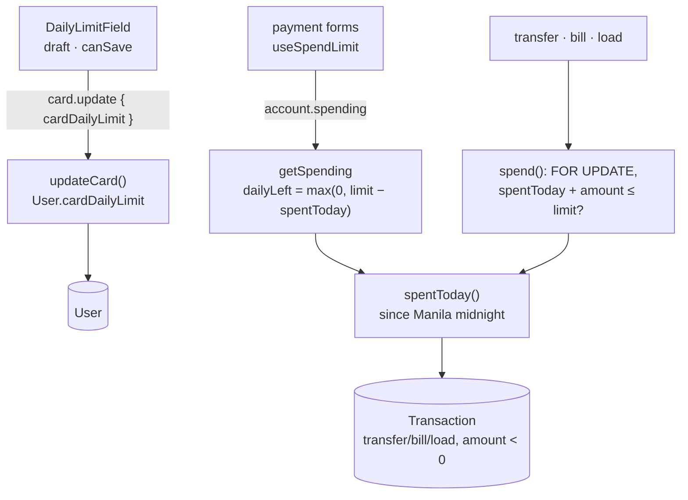

# 22 · Daily spending limit

One limit covers **both cards**: how much the user may spend per day on transfers, bills and load together. The default is **₱20,000**; the user can set anything from **₱0** (spending blocked) to **₱100,000** on My card. "A day" is a **Philippine calendar day**: it starts again at midnight in Manila, wherever the server runs. The limit is checked on the server, under a row lock, so simultaneous payments cannot get around it.

## At a glance

| | |
| --- | --- |
| **Route** | `/card` (the "Daily spending limit (both cards)" field); used by every card payment |
| **Frontend** | `card-settings.tsx` (`DailyLimitField`, `useCardUpdate`); in payment forms `use-spend-limit.ts` ("₱… left today", "Over your daily limit…") |
| **API** | `card.update({ cardDailyLimit })` (protected mutation), `account.spending` (`dailyLeft`) |
| **Backend** | `card.router.ts`, `card.service.ts` (`updateCard`), `card.rules.ts` (`MAX_DAILY_LIMIT_CENTAVOS`), `account.service.ts` (`getSpending`), ledger `spentToday()`, `startOfManilaDay()`, `spend()` |
| **Database** | `User.cardDailyLimit` (default 2,000,000; `CHECK >= 0`); sums today's negative `transfer`/`bill`/`load` rows in `Transaction` |
| **Tests** | `verify-core.ts` (`checkCardLocks`: limit ₱0 blocks a load); a concurrency test and the browser flow were run for this review |
| **Deep dive** | [The ledger §6–7](../04-server-core/04-ledger.md#6-spenttoday-card-spending-since-manila-midnight-lines-117129) |

## What the user can do

| Action | Result |
| --- | --- |
| see the current limit | the field shows it in pesos, for example `20000` |
| type a new amount, **Save** | "Daily limit saved." |
| type `0`, **Save** | every card payment is refused until it is raised again |
| type more than ₱100,000 | "Maximum ₱100,000.00", **Save** disabled |
| pay anything | the form shows "Balance ₱… · ₱… left today" and refuses amounts over what is left |

## How it works

1. `DailyLimitField` shows `String(toPesos(cardDailyLimit))` until the user types. Then it keeps a **draft**.
2. **Save** is enabled only if the draft is not empty, is a finite number, is ≥ 0 and ≤ ₱100,000, **and differs** from the saved limit.
3. `card.update({ cardDailyLimit })`: Zod checks an integer from 0 to 10,000,000 centavos; `updateCard` saves it on the **user** (not on a card).
4. Payment forms call `account.spending`. `getSpending` computes `dailyLeft = max(0, cardDailyLimit − spentToday)`.
5. Every card payment runs `spend()`: lock the user row, compute `spentToday` (Manila day), and refuse if `spent + amount > cardDailyLimit` with "This goes over your daily limit".

## Structure



## Files and locations

| Layer | File | Role |
| --- | --- | --- |
| Frontend | `gobank/src/features/card/components/card-settings.tsx` | `DailyLimitField`, save, message |
| Hook | `gobank/src/shared/hooks/use-spend-limit.ts` | "left today" hint and check in payment forms |
| Rule | `gobank/src/features/card/card.rules.ts` | `MAX_DAILY_LIMIT_CENTAVOS` = ₱100,000 |
| API | `gobank/src/features/card/card.router.ts` | `update` input |
| Service | `gobank/src/features/card/card.service.ts` | `updateCard` |
| Service | `gobank/src/features/account/account.service.ts` | `getSpending` (`dailyLeft`) |
| Ledger | `gobank/src/server/ledger.ts` | `SPENDING_KINDS`, `startOfManilaDay`, `spentToday`, `spend` |
| Schema | `gobank/prisma/schema.prisma`, migration `20261008010000_dual_cards_shared_policy` | the column, its default and its `CHECK` |

## Frontend

<!-- code: gobank/src/features/card/components/card-settings.tsx 58-125 -->
**`gobank/src/features/card/components/card-settings.tsx`** · lines 58–125

```tsx
 58 │ function DailyLimitField({
 59 │   cardDailyLimit,
 60 │   busy,
 61 │   saving,
 62 │   onSave,
 63 │   onEdit,
 64 │ }: {
 65 │   cardDailyLimit: number;
 66 │   busy: boolean;
 67 │   saving: boolean;
 68 │   onSave: (centavos: number) => void;
 69 │   onEdit: () => void;
 70 │ }) {
 71 │   const [draft, setDraft] = useState<string | null>(null);
 72 │
 73 │   const limit = draft ?? String(toPesos(cardDailyLimit));
 74 │   const centavos = toCentavos(Number(limit));
 75 │   const tooHigh = centavos > MAX_DAILY_LIMIT_CENTAVOS;
 76 │
 77 │   const canSave =
 78 │     limit.trim() !== "" &&
 79 │     Number.isFinite(centavos) &&
 80 │     centavos >= 0 &&
 81 │     !tooHigh &&
 82 │     centavos !== cardDailyLimit;
 83 │
 84 │   const submit = (event: FormEvent<HTMLFormElement>) => {
 85 │     event.preventDefault();
 86 │     if (!canSave || busy) return;
 87 │
 88 │     onSave(centavos);
 89 │   };
 90 │
 91 │   const edit = (value: string) => {
 92 │     if (!isPesoInput(value)) return;
 93 │
 94 │     setDraft(value);
 95 │     onEdit();
 96 │   };
 97 │
 98 │   return (
 99 │     <form onSubmit={submit} className="border-line mt-4 border-t pt-4">
100 │       <TextField
101 │         label="Daily spending limit (both cards)"
102 │         prefix="₱"
103 │         name="cardDailyLimit"
104 │         hint={`Up to ${peso(MAX_DAILY_LIMIT_CENTAVOS)} a day. ₱0 blocks spending.`}
105 │         error={tooHigh ? `Maximum ${peso(MAX_DAILY_LIMIT_CENTAVOS)}` : null}
106 │         type="text"
107 │         inputMode="decimal"
108 │         required
109 │         value={limit}
110 │         disabled={busy}
111 │         onChange={(event) => edit(event.target.value)}
112 │         trailing={
113 │           <button
114 │             type="submit"
115 │             aria-label="Save daily spending limit"
116 │             disabled={busy || !canSave}
117 │             className={SAVE_BUTTON}
118 │           >
119 │             {saving ? "Saving…" : "Save"}
120 │           </button>
121 │         }
122 │       />
123 │     </form>
124 │   );
125 │ }
```
<!-- /code -->

<!-- code: gobank/src/features/card/components/card-settings.tsx 144-147 -->
**`gobank/src/features/card/components/card-settings.tsx`** · lines 144–147

```tsx
144 │   const saveLimit = (centavos: number) => {
145 │     setMessage("");
146 │     update.mutate({ cardDailyLimit: centavos });
147 │   };
```
<!-- /code -->

<!-- code: gobank/src/shared/hooks/use-spend-limit.ts 31-40 -->
**`gobank/src/shared/hooks/use-spend-limit.ts`** · lines 31–40

```ts
31 │     if (amount > data.dailyLeft) {
32 │       return `Over your daily limit. ${peso(data.dailyLeft)} left today`;
33 │     }
34 │
35 │     return null;
36 │   };
37 │
38 │   const hint = data
39 │     ? `Balance ${peso(data.balance)} · ${peso(data.dailyLeft)} left today`
40 │     : `Up to ${peso(maximum)}`;
```
<!-- /code -->

## Backend

<!-- code: gobank/src/features/card/card.rules.ts -->
**`gobank/src/features/card/card.rules.ts`** · all 1 lines

```ts
1 │ export const MAX_DAILY_LIMIT_CENTAVOS = 10_000_000;
```
<!-- /code -->

<!-- code: gobank/src/features/card/card.router.ts 17-22 -->
**`gobank/src/features/card/card.router.ts`** · lines 17–22

```ts
17 │         cardDailyLimit: z
18 │           .number()
19 │           .int()
20 │           .min(0)
21 │           .max(MAX_DAILY_LIMIT_CENTAVOS)
22 │           .optional(),
```
<!-- /code -->

<!-- code: gobank/src/features/card/card.service.ts 46-51 -->
**`gobank/src/features/card/card.service.ts`** · lines 46–51

```ts
46 │     if (cardDailyLimit !== undefined) {
47 │       await tx.user.update({
48 │         where: { id: userId },
49 │         data: { cardDailyLimit },
50 │       });
51 │     }
```
<!-- /code -->

<!-- code: gobank/src/features/account/account.service.ts 45-49 -->
**`gobank/src/features/account/account.service.ts`** · lines 45–49

```ts
45 │   const { cards, ...limits } = account;
46 │
47 │   return {
48 │     ...limits,
49 │     dailyLeft: Math.max(0, account.cardDailyLimit - spent),
```
<!-- /code -->

<!-- code: gobank/src/server/ledger.ts 35-44 -->
**`gobank/src/server/ledger.ts`** · lines 35–44

```ts
35 │ const SPENDING_KINDS: TransactionKind[] = ["transfer", "bill", "load"];
36 │ const KINDS_THAT_EARN_POINTS: TransactionKind[] = ["transfer", "bill"];
37 │
38 │ const startOfManilaDay = (now: Date) => {
39 │   const manilaDate = now.toLocaleDateString("en-CA", {
40 │     timeZone: "Asia/Manila",
41 │   });
42 │
43 │   return new Date(`${manilaDate}T00:00:00+08:00`);
44 │ };
```
<!-- /code -->

<!-- code: gobank/src/server/ledger.ts 117-129 -->
**`gobank/src/server/ledger.ts`** · lines 117–129

```ts
117 │ export async function spentToday(tx: Tx, userId: string) {
118 │   const today = await tx.transaction.aggregate({
119 │     where: {
120 │       userId,
121 │       kind: { in: SPENDING_KINDS },
122 │       amount: { lt: 0 },
123 │       createdAt: { gte: startOfManilaDay(new Date()) },
124 │     },
125 │     _sum: { amount: true },
126 │   });
127 │
128 │   return -(today._sum.amount ?? 0);
129 │ }
```
<!-- /code -->

<!-- code: gobank/src/server/ledger.ts 149-152 -->
**`gobank/src/server/ledger.ts`** · lines 149–152

```ts
149 │   const spent = await spentToday(tx, entry.userId);
150 │   if (spent + entry.amount > user.cardDailyLimit) {
151 │     fail("BAD_REQUEST", MESSAGES.overDailyLimit);
152 │   }
```
<!-- /code -->

## Database

<!-- code: gobank/prisma/schema.prisma 59-59 -->
**`gobank/prisma/schema.prisma`** · line 59

```prisma
59 │   cardDailyLimit    Int       @default(2000000)
```
<!-- /code -->

<!-- code: gobank/prisma/migrations/20261008010000_dual_cards_shared_policy/migration.sql -->
**`gobank/prisma/migrations/20261008010000_dual_cards_shared_policy/migration.sql`** · all 21 lines

```sql
 1 │ BEGIN;
 2 │
 3 │ CREATE TYPE "CardKind" AS ENUM ('physical', 'virtual');
 4 │
 5 │ ALTER TABLE "User"
 6 │ ADD COLUMN "cardLocked" BOOLEAN NOT NULL DEFAULT false,
 7 │ ADD COLUMN "cardDailyLimit" INTEGER NOT NULL DEFAULT 2000000;
 8 │
 9 │ UPDATE "User" AS account
10 │ SET "cardLocked" = card."locked", "cardDailyLimit" = card."dailyLimit"
11 │ FROM "Card" AS card
12 │ WHERE account."id" = card."userId";
13 │
14 │ ALTER TABLE "Card" ADD COLUMN "kind" "CardKind" NOT NULL DEFAULT 'physical';
15 │ DROP INDEX "Card_userId_key";
16 │ CREATE UNIQUE INDEX "Card_userId_kind_key" ON "Card"("userId", "kind");
17 │
18 │ ALTER TABLE "Card" DROP COLUMN "locked", DROP COLUMN "dailyLimit";
19 │ ALTER TABLE "User" ADD CONSTRAINT "User_cardDailyLimit_check" CHECK ("cardDailyLimit" >= 0);
20 │
21 │ COMMIT;
```
<!-- /code -->

| What | Where |
| --- | --- |
| the limit | `User.cardDailyLimit`, centavos, default `2000000` (₱20,000) |
| never negative | `User_cardDailyLimit_check CHECK ("cardDailyLimit" >= 0)` |
| today's spending | not stored: computed each time from `Transaction` (`SUM(amount)` of today's negative transfer/bill/load rows) |

Computing instead of storing "spent today" means there is no counter to reset at midnight and no counter that can drift from the real history.

The migration above is where the limit became **shared**: before it, each user had one card with its own `dailyLimit`. It adds `User.cardDailyLimit`, copies every card's old limit to its owner (`UPDATE … FROM`), drops `Card.dailyLimit` and adds the `CHECK`. The lock it moved to the user at the same time was later moved back to each card ([21](21-card-lock.md#database)).

## The complicated parts, explained step by step

### 1. The field: a draft that disappears after saving

<!-- code: gobank/src/features/card/components/card-settings.tsx 71-82 -->
**`gobank/src/features/card/components/card-settings.tsx`** · lines 71–82

```tsx
71 │   const [draft, setDraft] = useState<string | null>(null);
72 │
73 │   const limit = draft ?? String(toPesos(cardDailyLimit));
74 │   const centavos = toCentavos(Number(limit));
75 │   const tooHigh = centavos > MAX_DAILY_LIMIT_CENTAVOS;
76 │
77 │   const canSave =
78 │     limit.trim() !== "" &&
79 │     Number.isFinite(centavos) &&
80 │     centavos >= 0 &&
81 │     !tooHigh &&
82 │     centavos !== cardDailyLimit;
```
<!-- /code -->

| Moment | `draft` | Field shows | `canSave` | Why |
| --- | --- | --- | --- | --- |
| first render (limit 2,000,000) | `null` | `20000` (`String(toPesos(2000000))`) | no | unchanged |
| user clears it | `""` | `` | no | empty |
| types `100000.01` | `"100000.01"` | `100000.01` | no | over ₱100,000: "Maximum ₱100,000.00" |
| types `20000.00` | `"20000.00"` | `20000.00` | **no** | 2,000,000 centavos = the saved value |
| types `15000` | `"15000"` | `15000` | **yes** | |
| **Save** succeeds, `cardDailyLimit` becomes 1,500,000 | the field is **re-created** (`key={cardDailyLimit}`, line 194) → `null` again | `15000`, from the server | no | unchanged |

The `key` trick resets the draft without an effect: a new `key` means a new `DailyLimitField` with fresh state, showing the value the **server** saved. Every row except the `20000.00` one was checked in Chromium. The limit was set to ₱15,000 and then back to ₱20,000.

Typing also clears an old "Daily limit saved." or an error (`onEdit` → `clearFeedback`, lines 149–152), so the message never describes a value that is no longer in the box.

### 2. When does the day start? Manila midnight, computed on any server

<!-- code: gobank/src/server/ledger.ts 38-44 -->
**`gobank/src/server/ledger.ts`** · lines 38–44

```ts
38 │ const startOfManilaDay = (now: Date) => {
39 │   const manilaDate = now.toLocaleDateString("en-CA", {
40 │     timeZone: "Asia/Manila",
41 │   });
42 │
43 │   return new Date(`${manilaDate}T00:00:00+08:00`);
44 │ };
```
<!-- /code -->

| `now` (UTC) | Manila date (`en-CA` → `YYYY-MM-DD`) | `startOfManilaDay` (UTC) |
| --- | --- | --- |
| 2026-11-04 02:44 | `2026-11-04` | **2026-11-03 16:00** (captured as the `$6` parameter of the real query) |
| 2026-11-03 15:59 | `2026-11-03` | 2026-11-02 16:00 |
| 2026-11-03 16:00 | `2026-11-04` (midnight in Manila) | 2026-11-03 16:00: **a new day** |

`toLocaleDateString` with `timeZone: "Asia/Manila"` gives the **Philippine** date even on a UTC server. `+08:00` turns that date's midnight back into an exact instant. The Philippines has no daylight-saving time, so `+08:00` is always right.

### 3. Spent today, and what counts

<!-- code: gobank/src/server/ledger.ts 117-129 -->
**`gobank/src/server/ledger.ts`** · lines 117–129

```ts
117 │ export async function spentToday(tx: Tx, userId: string) {
118 │   const today = await tx.transaction.aggregate({
119 │     where: {
120 │       userId,
121 │       kind: { in: SPENDING_KINDS },
122 │       amount: { lt: 0 },
123 │       createdAt: { gte: startOfManilaDay(new Date()) },
124 │     },
125 │     _sum: { amount: true },
126 │   });
127 │
128 │   return -(today._sum.amount ?? 0);
129 │ }
```
<!-- /code -->

| Counts | Does not count |
| --- | --- |
| outgoing **transfers** (including paying a request) | deposits |
| **bills** | money **received** (positive amounts) |
| **load** | GoalSave moves (`stash`), interest, rewards, Bitcoin (`exchange`) |

`SUM` of negative amounts is negative, so the function returns `-(sum ?? 0)`, a positive number of centavos. `?? 0` covers a day with no spending, when `SUM` returns `NULL`.

### 4. Simultaneous payments cannot sneak past the limit

<!-- code: gobank/src/server/ledger.ts 131-152 -->
**`gobank/src/server/ledger.ts`** · lines 131–152

```ts
131 │ export async function spend(tx: Tx, { card, ...entry }: Spending) {
132 │   await tx.$queryRaw`SELECT "id" FROM "User" WHERE "id" = ${entry.userId} FOR UPDATE`;
133 │
134 │   const user = await tx.user.findUniqueOrThrow({
135 │     where: { id: entry.userId },
136 │     select: {
137 │       cardDailyLimit: true,
138 │       cards: {
139 │         where: { kind: card },
140 │         select: { brand: true, number: true, locked: true },
141 │       },
142 │     },
143 │   });
144 │
145 │   const usedCard = user.cards[0];
146 │   if (!usedCard) return fail("NOT_FOUND", MESSAGES.cardNotFound);
147 │   if (usedCard.locked) fail("BAD_REQUEST", MESSAGES.cardLocked);
148 │
149 │   const spent = await spentToday(tx, entry.userId);
150 │   if (spent + entry.amount > user.cardDailyLimit) {
151 │     fail("BAD_REQUEST", MESSAGES.overDailyLimit);
152 │   }
```
<!-- /code -->

The danger: two payments both read "₱100 left" at the same moment, both pass, and together spend ₱180.

`spend()` prevents it by locking the user's row **before** reading today's spending:

| Time | Payment A (₱30) | Payment B (₱30) |
| --- | --- | --- |
| t1 | `SELECT … FOR UPDATE` → gets the lock | `SELECT … FOR UPDATE` → **waits** |
| t2 | spent today = X; X + 30 ≤ limit → `post()` → `COMMIT` | |
| t3 | | gets the lock; **reads spending again**: X + 30 (A's row is committed) |
| t4 | | X + 60 ≤ limit? then `post()`; otherwise "This goes over your daily limit" |

Under PostgreSQL's default isolation (Read Committed), every statement sees everything committed before it started, so B's `SUM` includes A's payment.

**Run on the test database for this review:** Dante's limit was set to (today's spending + ₱100), then 5 loads of ₱30 were fired **at the same moment**:

```text
spent today 166000, limit set to 176000 (room: 10000), dailyLeft per getSpending: 10000
fired 5 × 3000 at once: 3 succeeded, 2 refused (This goes over your daily limit)
spent after 175000 (≤ limit 176000: true), dailyLeft now 1000
```

Exactly 3 × ₱30 = ₱90 fit in ₱100. The other two were refused, and ₱10 is left. The limit was restored to ₱20,000 afterwards.

### 5. Lowering the limit below what was already spent

<!-- code: gobank/src/features/account/account.service.ts 49-49 -->
**`gobank/src/features/account/account.service.ts`** · line 49

```ts
49 │     dailyLeft: Math.max(0, account.cardDailyLimit - spent),
```
<!-- /code -->

| Spent today | New limit | `limit − spent` | `dailyLeft` shown |
| --- | --- | --- | --- |
| ₱1,660 | ₱20,000 | 18,340 | ₱18,340.00 |
| ₱1,660 | ₱1,000 | **−660** | **₱0.00** (`Math.max(0, …)`) |
| anything | ₱0 | negative | ₱0.00: every payment refused |

Tested: with the limit at ₱0, `dailyLeft` was 0 and a ₱10 load was refused with "This goes over your daily limit". Without `Math.max`, the form would say "−₱660.00 left today".

## Rules and limits

| Rule | Value | Where |
| --- | --- | --- |
| Range | ₱0 to ₱100,000 (0 to 10,000,000 centavos, whole centavos) | `card.rules.ts`, router, `CHECK` |
| Default | ₱20,000 | `@default(2000000)` |
| Scope | both cards together | `User.cardDailyLimit` |
| Counted | outgoing transfers, bills, load | `SPENDING_KINDS` |
| Day | Manila calendar day (UTC+8) | `startOfManilaDay` |
| ₱0 | blocks every card payment | `spend()` |

## Messages

| Text | When |
| --- | --- |
| Daily spending limit (both cards) · Up to ₱100,000.00 a day. ₱0 blocks spending. | field and hint |
| Maximum ₱100,000.00 | over the maximum |
| Save / Saving… · Daily limit saved. | saving |
| Balance ₱… · ₱… left today | payment forms |
| Over your daily limit. ₱… left today | payment forms, the amount is too high |
| This goes over your daily limit | server refusal |

## Tests

- `verify-core.ts` → `checkCardLocks`: `updateCard(owner, { lock: { kind: "physical", locked: false }, cardDailyLimit: 0 })`, then a ₱10 load is refused with "This goes over your daily limit".
- **Run on the test database for this review:** 5 simultaneous ₱30 loads against ₱100 of room (3 accepted, 2 refused) and the ₱0 case.
- **Checked in Chromium for this review:** the field showed `20000`, **Save** was disabled while unchanged and when empty, `100000.01` showed "Maximum ₱100,000.00", and saving `15000` showed "Daily limit saved." and kept `15000` (then it was set back to `20000`).
