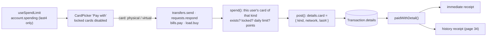

# 23 · Paying with a card ("Pay with" and receipts)

Four features take money out **with a card**: Send money ([14](14-send-money.md)), paying a money request ([16](16-request-inbox.md)), Pay bills ([17](17-pay-bills.md)) and Buy load ([18](18-buy-load.md)). They share one card picker (**Pay with**), one server function (`spend()`), and one way of recording the card on the payment, so that every receipt can say **"Paid with Physical · Discover •••• 1818"**. This page explains that shared path.

## At a glance

| | |
| --- | --- |
| **Route** | every payment screen: `/transfer`, `/notifications`, `/bills`, `/load`; receipts at `/transactions/<reference>` |
| **Frontend** | `card-picker.tsx`, `card-locked-notice.tsx`, `use-spend-limit.ts` (cards, choice, checks), `card-label.ts` (`paidWithDetail`, `networkName`), `receipt-screen.tsx`, `transaction-receipt.tsx` |
| **API** | `account.spending` (cards with **last 4 digits only**); each payment mutation sends `card: "physical" \| "virtual"` |
| **Backend** | ledger `spend()` (one function for every card payment), `account.service.ts` (`getSpending`), `shared/lib/schemas.ts` (`cardKind`) |
| **Database** | reads `Card` (`brand`, `number`, `locked`) by `(userId, kind)`; writes `Transaction.details.card = { kind, network, last4 }` |
| **Tests** | `verify-core.ts` (`checkCardLocks`); the label function and the forms were run for this review |
| **Deep dive** | [Cards](../05-features/04-cards.md), [The ledger §7](../04-server-core/04-ledger.md#7-spend-paying-with-a-card-lines-131169) |

## What the user can do

| Step | What they see |
| --- | --- |
| review step of any card payment | **Pay with**: two buttons, "Physical · Discover •••• 1818" and "Virtual · Visa •••• 4541"; a locked card shows "Locked" and cannot be chosen |
| pay | the button on the review step (Send ₱150.00, Pay ₱1,500.00, Buy ₱100.00, Confirm payment) |
| receipt | "Paid with · Physical · Discover •••• 1818" |
| later, in the history | the same "Paid with" line on the receipt page ([34](34-receipts.md)) |

## How it works

1. `useSpendLimit` loads `account.spending`. Its `cards` contain `kind`, `brand`, `locked` and **`last4`**; the full numbers are removed on the server (`getSpending` lines 50–53).
2. `CardPicker` shows them. The chosen card is the user's tap, or else the first **unlocked** card.
3. The payment mutation sends `card: "physical"` or `"virtual"`, never a card number or ID. Zod accepts only those two words (`cardKind`).
4. On the server, `spend()` locks the user row and loads **this user's** card of that kind. It refuses a missing or locked card, checks the daily limit, and calls `post()` with `details.card = { kind, network: brand, last4 }`.
5. The receipt (immediate, and later in the history) turns `details.card` into "Paid with …" with `paidWithDetail`.

## Structure



## Files and locations

| Layer | File | Role |
| --- | --- | --- |
| UI | `gobank/src/features/card/components/card-picker.tsx` | "Pay with" |
| UI | `gobank/src/features/card/components/card-locked-notice.tsx` | both cards locked |
| Hook | `gobank/src/shared/hooks/use-spend-limit.ts` | cards, the chosen card, the amount checks |
| Label | `gobank/src/features/card/card-label.ts` | `paidWithDetail`, `networkName` |
| Receipts | `gobank/src/shared/ui/transaction-receipt.tsx`, `gobank/src/features/activity/components/receipt-screen.tsx` | where the label appears |
| Service | `gobank/src/features/account/account.service.ts` | `getSpending` (last 4 digits only) |
| Ledger | `gobank/src/server/ledger.ts` | `spend()` |
| Validation | `gobank/src/shared/lib/schemas.ts` | `cardKind` |
| Callers | `transfer-form.tsx`, `notifications-screen.tsx`, `bill-payment.tsx`, `load-form.tsx` | the four card payments |

## Frontend

<!-- code: gobank/src/features/card/components/card-picker.tsx -->
**`gobank/src/features/card/components/card-picker.tsx`** · all 66 lines

```tsx
 1 │ import { CreditCard, Lock, Smartphone } from "lucide-react";
 2 │ import { cn } from "~/shared/lib/cn";
 3 │ import type { CardKind } from "../../../../generated/prisma";
 4 │ import { networkName } from "../card-label";
 5 │
 6 │ type PickerCard = {
 7 │   kind: CardKind;
 8 │   brand: string;
 9 │   last4: string;
10 │   locked: boolean;
11 │ };
12 │
13 │ export function CardPicker({
14 │   cards,
15 │   value,
16 │   onChange,
17 │   disabled,
18 │ }: {
19 │   cards: PickerCard[];
20 │   value: CardKind;
21 │   onChange: (kind: CardKind) => void;
22 │   disabled?: boolean;
23 │ }) {
24 │   if (!cards.length) return null;
25 │   return (
26 │     <fieldset className="mt-5" disabled={disabled}>
27 │       <legend className="text-ink mb-2 text-[14px] font-medium">
28 │         Pay with
29 │       </legend>
30 │       <div className="grid grid-cols-2 gap-2">
31 │         {cards.map((card) => {
32 │           const Icon = card.kind === "virtual" ? Smartphone : CreditCard;
33 │           const selected = card.kind === value && !card.locked;
34 │           return (
35 │             <button
36 │               key={card.kind}
37 │               type="button"
38 │               aria-pressed={selected}
39 │               disabled={card.locked}
40 │               onClick={() => onChange(card.kind)}
41 │               className={cn(
42 │                 "flex flex-col items-start gap-1 rounded-xl border p-3 text-left transition-colors disabled:cursor-not-allowed disabled:opacity-50",
43 │                 selected
44 │                   ? "border-brand bg-brand-soft"
45 │                   : "border-line enabled:hover:bg-surface-raised",
46 │               )}
47 │             >
48 │               <span className="text-ink flex items-center gap-1.5 text-[13px] font-medium">
49 │                 <Icon size={15} aria-hidden />
50 │                 {card.kind === "virtual" ? "Virtual" : "Physical"}
51 │                 {card.locked ? (
52 │                   <Lock size={12} className="text-ink-muted" aria-hidden />
53 │                 ) : null}
54 │               </span>
55 │               <span className="text-ink-muted text-[12px] tabular-nums">
56 │                 {card.locked
57 │                   ? "Locked"
58 │                   : `${networkName(card.brand)} •••• ${card.last4}`}
59 │               </span>
60 │             </button>
61 │           );
62 │         })}
63 │       </div>
64 │     </fieldset>
65 │   );
66 │ }
```
<!-- /code -->

<!-- code: gobank/src/shared/hooks/use-spend-limit.ts -->
**`gobank/src/shared/hooks/use-spend-limit.ts`** · all 51 lines

```ts
 1 │ "use client";
 2 │
 3 │ import { useState } from "react";
 4 │ import { peso } from "~/shared/lib/format";
 5 │ import { api } from "~/trpc/react";
 6 │ import type { CardKind } from "../../../generated/prisma";
 7 │
 8 │ export function useSpendLimit(maximum: number, minimum = 1) {
 9 │   const { data } = api.account.spending.useQuery();
10 │   const [chosen, setCard] = useState<CardKind | null>(null);
11 │
12 │   const cards = data?.cards ?? [];
13 │   const unlocked = cards.filter((item) => !item.locked);
14 │   const locked = cards.length > 0 && unlocked.length === 0;
15 │
16 │   const chosenIfUnlocked = unlocked.find((item) => item.kind === chosen);
17 │   const card = chosenIfUnlocked?.kind ?? unlocked[0]?.kind ?? "physical";
18 │
19 │   const check = (amount: number) => {
20 │     if (!Number.isFinite(amount) || amount <= 0) return null;
21 │     if (amount < minimum) return `Minimum ${peso(minimum)}`;
22 │     if (amount > maximum) return `Maximum ${peso(maximum)}`;
23 │
24 │     if (!data) return null;
25 │     if (locked) return "Both cards are locked. Unlock one to spend";
26 │
27 │     if (amount > data.balance) {
28 │       return `Insufficient balance. You have ${peso(data.balance)}`;
29 │     }
30 │
31 │     if (amount > data.dailyLeft) {
32 │       return `Over your daily limit. ${peso(data.dailyLeft)} left today`;
33 │     }
34 │
35 │     return null;
36 │   };
37 │
38 │   const hint = data
39 │     ? `Balance ${peso(data.balance)} · ${peso(data.dailyLeft)} left today`
40 │     : `Up to ${peso(maximum)}`;
41 │
42 │   return {
43 │     check,
44 │     hint,
45 │     cards,
46 │     card,
47 │     setCard,
48 │     locked,
49 │     valid: (amount: number) => amount >= minimum && check(amount) === null,
50 │   };
51 │ }
```
<!-- /code -->

<!-- code: gobank/src/features/card/card-label.ts -->
**`gobank/src/features/card/card-label.ts`** · all 18 lines

```ts
 1 │ import { CARD_BRANDS } from "./card-brands";
 2 │
 3 │ type CardUsed = { kind: string; network: string; last4: string };
 4 │
 5 │ export const networkName = (id: string) =>
 6 │   CARD_BRANDS.find((brand) => brand.id === id)?.name ??
 7 │   id.charAt(0).toUpperCase() + id.slice(1);
 8 │
 9 │ const cardLabel = ({ kind, network, last4 }: CardUsed) =>
10 │   `${kind === "virtual" ? "Virtual" : "Physical"} · ${networkName(network)} •••• ${last4}`;
11 │
12 │ export function paidWithDetail(details: unknown) {
13 │   if (typeof details !== "object" || details === null || !("card" in details))
14 │     return [];
15 │   const card = details.card as Partial<CardUsed> | null;
16 │   if (!card?.kind || !card.network || !card.last4) return [];
17 │   return [{ label: "Paid with", value: cardLabel(card as CardUsed) }];
18 │ }
```
<!-- /code -->

<!-- code: gobank/src/features/activity/components/receipt-screen.tsx 13-34 -->
**`gobank/src/features/activity/components/receipt-screen.tsx`** · lines 13–34

```tsx
13 │ function receiptDetails(transaction: Transaction): Detail[] {
14 │   const { counterparty, biller, savingsGoal, points } = transaction;
15 │
16 │   const details: Detail[] = [
17 │     { label: "Reference", value: transaction.reference },
18 │     { label: "Date", value: dateTime(transaction.createdAt) },
19 │     { label: "Balance after", value: peso(transaction.balanceAfter) },
20 │   ];
21 │
22 │   if (counterparty) {
23 │     const direction = transaction.amount < 0 ? "To" : "From";
24 │     details.push({ label: direction, value: `@${counterparty.username}` });
25 │   }
26 │
27 │   if (biller) details.push({ label: "Biller", value: biller.name });
28 │   if (savingsGoal) details.push({ label: "GoalSave", value: savingsGoal.name });
29 │   if (points) {
30 │     details.push({ label: "Points", value: points.toLocaleString("en-PH") });
31 │   }
32 │
33 │   return [...details, ...paidWithDetail(transaction.details)];
34 │ }
```
<!-- /code -->

## Backend

<!-- code: gobank/src/shared/lib/schemas.ts 19-19 -->
**`gobank/src/shared/lib/schemas.ts`** · line 19

```ts
19 │ export const cardKind = z.enum(["physical", "virtual"]);
```
<!-- /code -->

<!-- code: gobank/src/features/account/account.service.ts 29-55 -->
**`gobank/src/features/account/account.service.ts`** · lines 29–55

```ts
29 │ export const getSpending = async (userId: string) => {
30 │   const [account, spent] = await Promise.all([
31 │     db.user.findUniqueOrThrow({
32 │       where: { id: userId },
33 │       select: {
34 │         balance: true,
35 │         cardDailyLimit: true,
36 │         cards: {
37 │           select: { kind: true, brand: true, number: true, locked: true },
38 │           orderBy: { kind: "asc" },
39 │         },
40 │       },
41 │     }),
42 │     spentToday(db, userId),
43 │   ]);
44 │
45 │   const { cards, ...limits } = account;
46 │
47 │   return {
48 │     ...limits,
49 │     dailyLeft: Math.max(0, account.cardDailyLimit - spent),
50 │     cards: cards.map(({ number, ...card }) => ({
51 │       ...card,
52 │       last4: number.slice(-4),
53 │     })),
54 │   };
55 │ };
```
<!-- /code -->

<!-- code: gobank/src/server/ledger.ts 131-169 -->
**`gobank/src/server/ledger.ts`** · lines 131–169

```ts
131 │ export async function spend(tx: Tx, { card, ...entry }: Spending) {
132 │   await tx.$queryRaw`SELECT "id" FROM "User" WHERE "id" = ${entry.userId} FOR UPDATE`;
133 │
134 │   const user = await tx.user.findUniqueOrThrow({
135 │     where: { id: entry.userId },
136 │     select: {
137 │       cardDailyLimit: true,
138 │       cards: {
139 │         where: { kind: card },
140 │         select: { brand: true, number: true, locked: true },
141 │       },
142 │     },
143 │   });
144 │
145 │   const usedCard = user.cards[0];
146 │   if (!usedCard) return fail("NOT_FOUND", MESSAGES.cardNotFound);
147 │   if (usedCard.locked) fail("BAD_REQUEST", MESSAGES.cardLocked);
148 │
149 │   const spent = await spentToday(tx, entry.userId);
150 │   if (spent + entry.amount > user.cardDailyLimit) {
151 │     fail("BAD_REQUEST", MESSAGES.overDailyLimit);
152 │   }
153 │
154 │   const earnsPoints = KINDS_THAT_EARN_POINTS.includes(entry.kind);
155 │
156 │   return post(tx, {
157 │     ...entry,
158 │     amount: -entry.amount,
159 │     points: earnsPoints ? pointsEarned(entry.amount) : 0,
160 │     details: {
161 │       ...entry.details,
162 │       card: {
163 │         kind: card,
164 │         network: usedCard.brand,
165 │         last4: usedCard.number.slice(-4),
166 │       },
167 │     },
168 │   });
169 │ }
```
<!-- /code -->

## Database

| Table | Column | Use |
| --- | --- | --- |
| `Card` | `kind`, `brand`, `number`, `locked` | read inside the payment; the full `number` is read, but only its last 4 digits are copied into the payment |
| `Transaction` | `details` (JSON) | `{ "card": { "kind": "physical", "network": "discover", "last4": "1818" }, … }` on the **payer's** row only |

## The complicated parts, explained step by step

### 1. One function for four kinds of payment

| Feature | Calls | `kind` | Title | Other `details` | Points |
| --- | --- | --- | --- | --- | --- |
| Send money | `transfer()` → `spend()` | `transfer` | Transfer to @dante | `note` | yes |
| Pay a request | `respondToRequest` → `transfer()` → `spend()` | `transfer` | Transfer to @maricel | the request's `note` | yes |
| Pay bills | `payBill` → `spend()` | `bill` | Bill payment · Meralco | `accountNumber` | yes |
| Buy load | `buyLoad` → `spend()` | `load` | Mobile load · 0917 123 4567 | `mobile` | **no** |

Because every card payment goes through `spend()`, the card rules (exists, not locked, daily limit) cannot be forgotten in one feature. A new card feature would get them automatically.

### 2. The card is chosen by **kind**, and looked up on the server

<!-- code: gobank/src/server/ledger.ts 134-147 -->
**`gobank/src/server/ledger.ts`** · lines 134–147

```ts
134 │   const user = await tx.user.findUniqueOrThrow({
135 │     where: { id: entry.userId },
136 │     select: {
137 │       cardDailyLimit: true,
138 │       cards: {
139 │         where: { kind: card },
140 │         select: { brand: true, number: true, locked: true },
141 │       },
142 │     },
143 │   });
144 │
145 │   const usedCard = user.cards[0];
146 │   if (!usedCard) return fail("NOT_FOUND", MESSAGES.cardNotFound);
147 │   if (usedCard.locked) fail("BAD_REQUEST", MESSAGES.cardLocked);
```
<!-- /code -->

| The browser sends | The server does |
| --- | --- |
| `card: "virtual"` | `cards: { where: { kind: "virtual" } }` **inside this user's** row (`where: { id: entry.userId }`) |
| `card: "gold"` | Zod refuses it before the service runs (`z.enum(["physical", "virtual"])`) |
| a locked card (for example from an old screen) | "This card is locked. Unlock it or pay with your other card." |

The browser never handles a card number or a card ID in a payment, so there is nothing to tamper with.

### 3. A snapshot of the card, saved on the payment

<!-- code: gobank/src/server/ledger.ts 156-168 -->
**`gobank/src/server/ledger.ts`** · lines 156–168

```ts
156 │   return post(tx, {
157 │     ...entry,
158 │     amount: -entry.amount,
159 │     points: earnsPoints ? pointsEarned(entry.amount) : 0,
160 │     details: {
161 │       ...entry.details,
162 │       card: {
163 │         kind: card,
164 │         network: usedCard.brand,
165 │         last4: usedCard.number.slice(-4),
166 │       },
167 │     },
168 │   });
```
<!-- /code -->

`details.card` keeps three facts **as they were at payment time**. Real rows from the tests for these pages, read back from PostgreSQL (the column is `jsonb`, which stores keys shorter-first, so `card` comes before `accountNumber`):

| Payment | `details` saved |
| --- | --- |
| Maricel → Dante ₱150.00 | `{"card": {"kind": "physical", "last4": "8954", "network": "discover"}, "note": "Lunch"}` |
| Dante's ₱1,500.00 bill to Meralco | `{"card": {"kind": "physical", "last4": "1818", "network": "discover"}, "accountNumber": "0011223344"}` |
| the receiver's side of a transfer | `{"note": "Lunch"}`: **no card** (the receiver did not pay with a card, and should not learn the sender's) |

| Why store a copy instead of a link to the `Card` row | |
| --- | --- |
| only the last 4 digits are in the history | the full number is not copied into thousands of payment rows |
| the receipt never changes later | even if a card were replaced with a new number, old receipts would still show the card that was used |

### 4. Reading JSON from the database safely

<!-- code: gobank/src/features/card/card-label.ts 12-18 -->
**`gobank/src/features/card/card-label.ts`** · lines 12–18

```ts
12 │ export function paidWithDetail(details: unknown) {
13 │   if (typeof details !== "object" || details === null || !("card" in details))
14 │     return [];
15 │   const card = details.card as Partial<CardUsed> | null;
16 │   if (!card?.kind || !card.network || !card.last4) return [];
17 │   return [{ label: "Paid with", value: cardLabel(card as CardUsed) }];
18 │ }
```
<!-- /code -->

`details` is a JSON column, so its TypeScript type is "anything". `paidWithDetail` checks every step before building the label. Run with the project's function for this review:

| `details` | Result |
| --- | --- |
| `{ card: { kind: "physical", last4: "8954", network: "discover" }, note: "Lunch" }` | **Paid with · Physical · Discover •••• 8954** |
| `{ card: { kind: "virtual", last4: "4541", network: "visa" } }` | **Paid with · Virtual · Visa •••• 4541** |
| `{ note: "Lunch" }` (receiver) | nothing |
| `null` (a deposit) | nothing |
| `{ card: { kind: "physical" } }` (incomplete) | nothing |
| `{ card: null }`, or the string `"hello"` | nothing |
| `{ card: { kind: "physical", last4: "0000", network: "amex" } }` | Paid with · Physical · **Amex** •••• 0000 |

It returns an **array** (`[]` or one row), so callers can always write `...paidWithDetail(details)` into their list of receipt rows, with no `if`.

<!-- code: gobank/src/features/card/card-label.ts 5-7 -->
**`gobank/src/features/card/card-label.ts`** · lines 5–7

```ts
5 │ export const networkName = (id: string) =>
6 │   CARD_BRANDS.find((brand) => brand.id === id)?.name ??
7 │   id.charAt(0).toUpperCase() + id.slice(1);
```
<!-- /code -->

`networkName` uses the display name from `CARD_BRANDS` (`jcb` → "JCB"), or capitalizes an unknown ID (`amex` → "Amex") instead of crashing.

### 5. The picker is a real form group

<!-- code: gobank/src/features/card/components/card-picker.tsx 24-64 -->
**`gobank/src/features/card/components/card-picker.tsx`** · lines 24–64

```tsx
24 │   if (!cards.length) return null;
25 │   return (
26 │     <fieldset className="mt-5" disabled={disabled}>
27 │       <legend className="text-ink mb-2 text-[14px] font-medium">
28 │         Pay with
29 │       </legend>
30 │       <div className="grid grid-cols-2 gap-2">
31 │         {cards.map((card) => {
32 │           const Icon = card.kind === "virtual" ? Smartphone : CreditCard;
33 │           const selected = card.kind === value && !card.locked;
34 │           return (
35 │             <button
36 │               key={card.kind}
37 │               type="button"
38 │               aria-pressed={selected}
39 │               disabled={card.locked}
40 │               onClick={() => onChange(card.kind)}
41 │               className={cn(
42 │                 "flex flex-col items-start gap-1 rounded-xl border p-3 text-left transition-colors disabled:cursor-not-allowed disabled:opacity-50",
43 │                 selected
44 │                   ? "border-brand bg-brand-soft"
45 │                   : "border-line enabled:hover:bg-surface-raised",
46 │               )}
47 │             >
48 │               <span className="text-ink flex items-center gap-1.5 text-[13px] font-medium">
49 │                 <Icon size={15} aria-hidden />
50 │                 {card.kind === "virtual" ? "Virtual" : "Physical"}
51 │                 {card.locked ? (
52 │                   <Lock size={12} className="text-ink-muted" aria-hidden />
53 │                 ) : null}
54 │               </span>
55 │               <span className="text-ink-muted text-[12px] tabular-nums">
56 │                 {card.locked
57 │                   ? "Locked"
58 │                   : `${networkName(card.brand)} •••• ${card.last4}`}
59 │               </span>
60 │             </button>
61 │           );
62 │         })}
63 │       </div>
64 │     </fieldset>
```
<!-- /code -->

| Markup | Effect |
| --- | --- |
| `<fieldset>` + `<legend>Pay with</legend>` | screen readers announce "Pay with, group" before the two buttons |
| `<fieldset disabled={disabled}>` | while the payment is sending, **one** attribute disables both buttons |
| `aria-pressed={selected}` | each button is announced as a toggle, pressed or not |
| `disabled={card.locked}` + "Locked" | a locked card is visible but cannot be chosen |
| `if (!cards.length) return null` | nothing is drawn while the cards are still loading |

Checked in Chromium for this review: with the physical card locked, the picker showed "Physical · Locked" (disabled, `aria-pressed="false"`) and "Virtual · Visa •••• 4541" (`aria-pressed="true"`, chosen automatically).

## Rules and limits

| Rule | Value |
| --- | --- |
| Card payments | transfers, request payments, bills, load |
| Not card payments | deposits, GoalSave moves, rewards conversion, Bitcoin trades |
| Card choice | `physical` or `virtual` (by kind, per user) |
| Refused | missing card, locked card, over the daily limit, over the balance |
| Recorded | `details.card = { kind, network, last4 }` on the payer's row |

## Messages

| Text | When |
| --- | --- |
| Pay with · Physical / Virtual · Discover •••• 1818 · Locked | the picker |
| Paid with · Physical · Discover •••• 1818 | receipts |
| This card is locked. Unlock it or pay with your other card. | locked card (server) |
| Your card details were not found. | no card of that kind (server) |
| This goes over your daily limit / Insufficient balance | other `spend()` refusals |

## Tests

- `verify-core.ts` → `checkCardLocks`: a transfer with the virtual card stores `details.card.kind === "virtual"`; with the physical card locked, a physical payment is refused and nothing changes.
- **Run for this review:** `paidWithDetail` and `networkName` on every input in §4; the picker with a locked card in Chromium; the real `details` JSON in §3 from payments made during this review.
