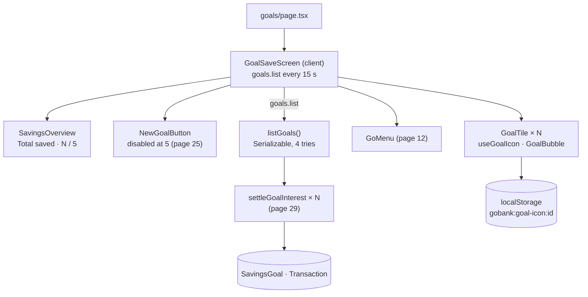

# 24 · GoalSave overview

**GoalSave** keeps money aside in up to **5 savings goals** ("Laptop", "Trip to Japan"), each earning **4% a year, compounded daily** ([29](29-savings-interest.md)). The `/goals` screen shows the **total saved**, a **"N / 5 goals"** meter, a **New goal** button, and one round **bubble** per goal with its icon, a progress ring toward its target, its balance, its rate and its target. The list refreshes itself every 15 seconds, so interest appears without reloading.

## At a glance

| | |
| --- | --- |
| **Route** | `/goals` (the GoalSave card on the dashboard, the GO menu) |
| **Frontend** | page `gobank/src/app/(app)/goals/page.tsx`; `goalsave-screen.tsx` (**client**: overview, tiles, New goal), `goal-bubble.tsx`, `goal-art.tsx`, hook `use-goal-icon.ts`; `go-menu.tsx` ([12](12-go-menu.md)) |
| **API** | `goals.list` (protected query, refetched every 15 s) |
| **Backend** | `goals.router.ts`, `goals.service.ts` (`listGoals`, `savingsTransaction`), ledger `settleGoalInterest()` |
| **Database** | reads all `SavingsGoal` rows of the user; may update a goal and insert an `interest` `Transaction` when interest is due |
| **Browser storage** | `localStorage` key `gobank:goal-icon:<goalId>`, the chosen icon (not in the database) |
| **Tests** | `goals.rules.test.ts`, `savings-interest.test.ts`, `verify-core.ts` (`checkSavings`); checked in Chromium for this review |
| **Deep dive** | [GoalSave](../05-features/08-goalsave.md) |

## What the user can do

| Part | What it shows or does |
| --- | --- |
| **Total saved** | the sum of all goal balances (`—` while loading) |
| **N / 5 goals** + five bars | how many goals exist; the bars fill in sky blue |
| **New goal** | opens the creation form ([25](25-create-goal.md)); disabled at 5 goals, with "Goal limit reached" |
| goal tile | bubble (icon + progress ring), name, balance, "4.00% p.a.", "Target ₱20,000.00" if set; opens `/goals/<id>` ([26](26-goal-detail.md)) |
| notice | "“Laptop” created." after creating a goal |
| GO button | [12](12-go-menu.md) |

## How it works

1. `GoalSaveScreen` calls `goals.list` with `refetchInterval: 15_000`.
2. `listGoals` runs in a **Serializable** transaction (`savingsTransaction`, retried up to 4 times). It loads the goals oldest first and calls `settleGoalInterest` for each one.
3. Settling computes the interest since the last settlement. If at least one centavo was earned, it saves the new balance (compare-and-set) and writes an `interest` row ([29](29-savings-interest.md)). Otherwise it saves nothing.
4. The screen sums the balances for **Total saved** and draws one tile per goal. Each tile reads its icon from `localStorage`, or guesses one from the name.

## Structure



## Files and locations

| Layer | File | Role |
| --- | --- | --- |
| Page | `gobank/src/app/(app)/goals/page.tsx` | renders the screen, tab title "GoalSave" |
| Frontend (client) | `gobank/src/features/goals/components/goalsave-screen.tsx` | overview, tiles, New goal, notice |
| Frontend | `gobank/src/features/goals/components/goal-bubble.tsx` | progress ring + icon |
| Frontend | `gobank/src/features/goals/components/goal-art.tsx` | the 6 icons, guessing an icon from the name |
| Hook | `gobank/src/features/goals/hooks/use-goal-icon.ts` | icon per goal in `localStorage` |
| API | `gobank/src/features/goals/goals.router.ts` | `list` (and the other goal procedures) |
| Service | `gobank/src/features/goals/goals.service.ts` | `savingsTransaction`, `listGoals` |
| Ledger | `gobank/src/server/ledger.ts` | `settleGoalInterest`, `recordInterest` |
| Limit | `gobank/src/shared/lib/money.ts` | `MAX_GOALS = 5` |

## Frontend

<!-- code: gobank/src/app/(app)/goals/page.tsx -->
**`gobank/src/app/(app)/goals/page.tsx`** · all 10 lines

```tsx
 1 │ import type { Metadata } from "next";
 2 │ import { GoalSaveScreen } from "~/features/goals/components/goalsave-screen";
 3 │
 4 │ export const metadata: Metadata = {
 5 │   title: "GoalSave",
 6 │ };
 7 │
 8 │ export default function GoalsPage() {
 9 │   return <GoalSaveScreen />;
10 │ }
```
<!-- /code -->

<!-- code: gobank/src/features/goals/components/goalsave-screen.tsx -->
**`gobank/src/features/goals/components/goalsave-screen.tsx`** · all 220 lines

```tsx
  1 │ "use client";
  2 │
  3 │ import { Plus } from "lucide-react";
  4 │ import Link from "next/link";
  5 │ import { useRouter } from "next/navigation";
  6 │ import { useState } from "react";
  7 │ import { cn } from "~/shared/lib/cn";
  8 │ import { peso } from "~/shared/lib/format";
  9 │ import { MAX_GOALS } from "~/shared/lib/money";
 10 │ import { GoMenu } from "~/shared/ui/go-menu";
 11 │ import { PageHeader } from "~/shared/ui/page-header";
 12 │ import { errorMessage } from "~/trpc/error-message";
 13 │ import { api, type RouterOutputs } from "~/trpc/react";
 14 │ import { useGoalIcon } from "../hooks/use-goal-icon";
 15 │ import { CreateGoalForm } from "./create-goal-form";
 16 │ import { GoalBubble } from "./goal-bubble";
 17 │
 18 │ type Goal = RouterOutputs["goals"]["list"][number];
 19 │
 20 │ const REFRESH_EVERY_MS = 15_000;
 21 │
 22 │ function SavingsOverview({ goals }: { goals: Goal[] | undefined }) {
 23 │   const count = goals?.length ?? 0;
 24 │   const total = goals?.reduce((sum, goal) => sum + goal.balance, 0) ?? 0;
 25 │
 26 │   return (
 27 │     <section
 28 │       aria-label="Savings overview"
 29 │       className="bg-surface rounded-[28px] border border-white/[.08] p-6"
 30 │     >
 31 │       <p className="text-ink-muted text-[12px] font-medium">Total saved</p>
 32 │       <p className="mt-4 text-[clamp(1.8rem,8vw,2.5rem)] font-semibold tracking-tight break-all tabular-nums">
 33 │         {goals ? peso(total) : "—"}
 34 │       </p>
 35 │
 36 │       <div className="mt-6 flex items-center justify-between gap-4 border-t border-white/[.07] pt-4">
 37 │         <p className="text-ink-muted text-[11px]">
 38 │           {goals ? count : "—"} / {MAX_GOALS} goals
 39 │         </p>
 40 │         <div className="flex gap-1.5" aria-hidden>
 41 │           {Array.from({ length: MAX_GOALS }, (_, index) => (
 42 │             <span
 43 │               key={index}
 44 │               className={cn(
 45 │                 "h-1.5 w-6 rounded-full",
 46 │                 index < count ? "bg-sky" : "bg-white/10",
 47 │               )}
 48 │             />
 49 │           ))}
 50 │         </div>
 51 │       </div>
 52 │     </section>
 53 │   );
 54 │ }
 55 │
 56 │ function NewGoalButton({
 57 │   full,
 58 │   wide,
 59 │   onClick,
 60 │ }: {
 61 │   full: boolean;
 62 │   wide: boolean;
 63 │   onClick: () => void;
 64 │ }) {
 65 │   return (
 66 │     <button
 67 │       type="button"
 68 │       disabled={full}
 69 │       aria-describedby={full ? "goal-limit" : undefined}
 70 │       onClick={onClick}
 71 │       className={cn(
 72 │         "group focus-visible:outline-sky flex min-h-52 flex-col items-center justify-center gap-4 rounded-[28px] px-1 py-4 focus-visible:outline-2 focus-visible:outline-offset-4 disabled:cursor-not-allowed disabled:opacity-45",
 73 │         wide && "col-span-2",
 74 │       )}
 75 │     >
 76 │       <span className="text-sky bg-tile grid h-20 w-20 place-items-center rounded-full border border-white/10 transition-transform group-hover:scale-105">
 77 │         <Plus size={28} strokeWidth={1.7} aria-hidden />
 78 │       </span>
 79 │       <span className="text-[13px] font-semibold">New goal</span>
 80 │     </button>
 81 │   );
 82 │ }
 83 │
 84 │ function GoalTile({ goal }: { goal: Goal }) {
 85 │   const { icon } = useGoalIcon(goal.id, goal.name);
 86 │
 87 │   return (
 88 │     <Link
 89 │       href={`/goals/${goal.id}`}
 90 │       className="group focus-visible:outline-sky min-w-0 rounded-[28px] text-center focus-visible:outline-2 focus-visible:outline-offset-4"
 91 │     >
 92 │       <div className="transition-transform duration-200 group-hover:-translate-y-1">
 93 │         <GoalBubble
 94 │           icon={icon}
 95 │           balance={goal.balance}
 96 │           target={goal.targetAmount}
 97 │           label={goal.name}
 98 │         />
 99 │       </div>
100 │
101 │       <h2 className="text-ink-soft mt-4 text-[12px] font-medium break-words">
102 │         {goal.name}
103 │       </h2>
104 │       <p className="mt-1.5 text-[20px] font-semibold tracking-tight break-all tabular-nums">
105 │         {peso(goal.balance)}
106 │       </p>
107 │       <p className="text-sky mt-2 text-[10px]">
108 │         {(goal.annualInterestRate * 100).toFixed(2)}% p.a.
109 │       </p>
110 │
111 │       {goal.targetAmount !== null ? (
112 │         <p className="text-ink-faint mt-2 text-[10px] break-words">
113 │           Target {peso(goal.targetAmount)}
114 │         </p>
115 │       ) : null}
116 │     </Link>
117 │   );
118 │ }
119 │
120 │ export function GoalSaveScreen() {
121 │   const router = useRouter();
122 │   const utils = api.useUtils();
123 │   const goals = api.goals.list.useQuery(undefined, {
124 │     refetchInterval: REFRESH_EVERY_MS,
125 │   });
126 │   const [creating, setCreating] = useState(false);
127 │   const [notice, setNotice] = useState("");
128 │
129 │   const count = goals.data?.length ?? 0;
130 │   const full = count >= MAX_GOALS;
131 │
132 │   const startCreating = () => {
133 │     setNotice("");
134 │     setCreating(true);
135 │   };
136 │
137 │   const showCreatedGoal = (goal: Goal) => {
138 │     utils.goals.list.setData(undefined, (current) => [
139 │       ...(current ?? []).filter((item) => item.id !== goal.id),
140 │       goal,
141 │     ]);
142 │     setCreating(false);
143 │     setNotice(`“${goal.name}” created.`);
144 │     router.refresh();
145 │   };
146 │
147 │   if (creating) {
148 │     return (
149 │       <CreateGoalForm
150 │         onCancel={() => setCreating(false)}
151 │         onCreated={showCreatedGoal}
152 │       />
153 │     );
154 │   }
155 │
156 │   return (
157 │     <div className="bg-surface-sunken text-ink -mx-6 -mt-8 -mb-10 flex flex-1 flex-col gap-6 px-5 pt-7 pb-28">
158 │       <PageHeader title="GoalSave" back="/dashboard" />
159 │
160 │       <SavingsOverview goals={goals.data} />
161 │
162 │       {notice ? (
163 │         <p
164 │           role="status"
165 │           className="bg-surface-raised text-ink-soft rounded-2xl p-3 text-[12px]"
166 │         >
167 │           {notice}
168 │         </p>
169 │       ) : null}
170 │
171 │       {goals.isPending ? (
172 │         <p role="status" className="text-center text-sm">
173 │           Loading your goals…
174 │         </p>
175 │       ) : null}
176 │
177 │       {goals.isError ? (
178 │         <div role="alert">
179 │           <p className="text-danger mb-3 text-sm">
180 │             {errorMessage(goals.error)}
181 │           </p>
182 │           <button
183 │             type="button"
184 │             disabled={goals.isFetching}
185 │             onClick={() => void goals.refetch()}
186 │             className="min-h-10 rounded-xl border border-white/10 bg-white/5 px-4 text-[12px] font-medium focus-visible:outline-2 focus-visible:outline-offset-4 disabled:opacity-50"
187 │           >
188 │             Try again
189 │           </button>
190 │         </div>
191 │       ) : null}
192 │
193 │       {goals.data ? (
194 │         <>
195 │           <div className="grid grid-cols-2 items-start gap-x-5 gap-y-8 py-3">
196 │             <NewGoalButton
197 │               full={full}
198 │               wide={count === 0}
199 │               onClick={startCreating}
200 │             />
201 │             {goals.data.map((goal) => (
202 │               <GoalTile key={goal.id} goal={goal} />
203 │             ))}
204 │           </div>
205 │
206 │           {full ? (
207 │             <p
208 │               id="goal-limit"
209 │               className="text-ink-muted text-center text-[11px]"
210 │             >
211 │               Goal limit reached
212 │             </p>
213 │           ) : null}
214 │         </>
215 │       ) : null}
216 │
217 │       <GoMenu />
218 │     </div>
219 │   );
220 │ }
```
<!-- /code -->

<!-- code: gobank/src/features/goals/components/goal-bubble.tsx -->
**`gobank/src/features/goals/components/goal-bubble.tsx`** · all 64 lines

```tsx
 1 │ "use client";
 2 │
 3 │ import { cn } from "~/shared/lib/cn";
 4 │ import { GoalArt, type GoalIcon } from "./goal-art";
 5 │
 6 │ const progressOf = (balance: number, target: number | null) =>
 7 │   target ? Math.max(0, Math.min(1, balance / target)) : 0;
 8 │
 9 │ export function GoalBubble({
10 │   icon,
11 │   balance,
12 │   target,
13 │   label,
14 │   large = false,
15 │ }: {
16 │   icon: GoalIcon;
17 │   balance: number;
18 │   target: number | null;
19 │   label: string;
20 │   large?: boolean;
21 │ }) {
22 │   const progress = progressOf(balance, target);
23 │   const description = target
24 │     ? `${label}: ${Math.round(progress * 100)}% of target`
25 │     : label;
26 │
27 │   return (
28 │     <div
29 │       className={cn(
30 │         "bg-tile-sunken text-ink-bright relative mx-auto grid aspect-square w-full place-items-center rounded-full",
31 │         large ? "max-w-64" : "max-w-40",
32 │       )}
33 │     >
34 │       <svg
35 │         viewBox="0 0 120 120"
36 │         className="absolute inset-0 h-full w-full -rotate-90"
37 │         role="img"
38 │         aria-label={description}
39 │       >
40 │         <circle
41 │           cx="60"
42 │           cy="60"
43 │           r="55"
44 │           fill="none"
45 │           stroke="#39393f"
46 │           strokeWidth="4"
47 │         />
48 │         <circle
49 │           cx="60"
50 │           cy="60"
51 │           r="55"
52 │           fill="none"
53 │           className="stroke-sky"
54 │           strokeWidth="4"
55 │           strokeLinecap="round"
56 │           pathLength="100"
57 │           strokeDasharray={`${progress * 100} 100`}
58 │         />
59 │       </svg>
60 │
61 │       <GoalArt icon={icon} className="h-[42%] w-[42%]" />
62 │     </div>
63 │   );
64 │ }
```
<!-- /code -->

<!-- code: gobank/src/features/goals/components/goal-art.tsx -->
**`gobank/src/features/goals/components/goal-art.tsx`** · all 53 lines

```tsx
 1 │ import {
 2 │   CarFront,
 3 │   Gift,
 4 │   Heart,
 5 │   House,
 6 │   Plane,
 7 │   type LucideIcon,
 8 │ } from "lucide-react";
 9 │ import { PocketIcon } from "~/shared/ui/pocket-art";
10 │
11 │ export type GoalIcon = "safe" | "travel" | "home" | "gift" | "car" | "heart";
12 │
13 │ export const goalIcons: {
14 │   value: GoalIcon;
15 │   label: string;
16 │   Icon: LucideIcon | null;
17 │ }[] = [
18 │   { value: "safe", label: "Savings", Icon: null },
19 │   { value: "travel", label: "Travel", Icon: Plane },
20 │   { value: "home", label: "Home", Icon: House },
21 │   { value: "gift", label: "Gifts", Icon: Gift },
22 │   { value: "car", label: "Car", Icon: CarFront },
23 │   { value: "heart", label: "Health", Icon: Heart },
24 │ ];
25 │
26 │ const NAME_HINTS: [RegExp, GoalIcon][] = [
27 │   [/trip|travel|holiday|vacation/i, "travel"],
28 │   [/home|house|rent/i, "home"],
29 │   [/car|drive/i, "car"],
30 │   [/birthday|gift|wedding|party/i, "gift"],
31 │   [/health|emergency|family/i, "heart"],
32 │ ];
33 │
34 │ export function iconForGoal(name: string): GoalIcon {
35 │   const match = NAME_HINTS.find(([pattern]) => pattern.test(name));
36 │   return match ? match[1] : "safe";
37 │ }
38 │
39 │ export function GoalArt({
40 │   icon = "safe",
41 │   className,
42 │ }: {
43 │   icon?: GoalIcon;
44 │   className?: string;
45 │ }) {
46 │   const Icon = goalIcons.find((item) => item.value === icon)?.Icon;
47 │
48 │   if (!Icon) {
49 │     return <PocketIcon name="goal" className={className} strokeWidth={1.7} />;
50 │   }
51 │
52 │   return <Icon className={className} strokeWidth={1.6} aria-hidden />;
53 │ }
```
<!-- /code -->

<!-- code: gobank/src/features/goals/hooks/use-goal-icon.ts -->
**`gobank/src/features/goals/hooks/use-goal-icon.ts`** · all 36 lines

```ts
 1 │ import { useEffect, useState } from "react";
 2 │ import { goalIcons, iconForGoal, type GoalIcon } from "../components/goal-art";
 3 │
 4 │ const storageKey = (goalId: string) => `gobank:goal-icon:${goalId}`;
 5 │
 6 │ function storedIcon(goalId: string): GoalIcon | null {
 7 │   try {
 8 │     const stored = localStorage.getItem(storageKey(goalId));
 9 │     return goalIcons.find((item) => item.value === stored)?.value ?? null;
10 │   } catch {
11 │     return null;
12 │   }
13 │ }
14 │
15 │ export function saveGoalIcon(goalId: string, icon: GoalIcon) {
16 │   try {
17 │     localStorage.setItem(storageKey(goalId), icon);
18 │   } catch {
19 │     return;
20 │   }
21 │ }
22 │
23 │ export function useGoalIcon(goalId: string, goalName: string) {
24 │   const [icon, setIcon] = useState<GoalIcon>(() => iconForGoal(goalName));
25 │
26 │   useEffect(() => {
27 │     setIcon(storedIcon(goalId) ?? iconForGoal(goalName));
28 │   }, [goalId, goalName]);
29 │
30 │   const chooseIcon = (next: GoalIcon) => {
31 │     setIcon(next);
32 │     saveGoalIcon(goalId, next);
33 │   };
34 │
35 │   return { icon, setIcon: chooseIcon };
36 │ }
```
<!-- /code -->

## Backend

<!-- code: gobank/src/features/goals/goals.router.ts 17-18 -->
**`gobank/src/features/goals/goals.router.ts`** · lines 17–18

```ts
17 │ export const goalsRouter = createTRPCRouter({
18 │   list: protectedProcedure.query(({ ctx }) => listGoals(ctx.userId)),
```
<!-- /code -->

<!-- code: gobank/src/features/goals/goals.service.ts 9-40 -->
**`gobank/src/features/goals/goals.service.ts`** · lines 9–40

```ts
 9 │ async function savingsTransaction<T>(
10 │   work: (tx: Prisma.TransactionClient) => Promise<T>,
11 │ ) {
12 │   for (let attempt = 0; attempt < 4; attempt++) {
13 │     try {
14 │       return await db.$transaction(work, { isolationLevel: "Serializable" });
15 │     } catch (error) {
16 │       const writeConflict = asDatabaseError(error)?.code === "P2034";
17 │       const changedMeanwhile =
18 │         error instanceof AppError && error.code === "CONFLICT";
19 │
20 │       if (!writeConflict && !changedMeanwhile) throw error;
21 │     }
22 │   }
23 │
24 │   return fail("CONFLICT", MESSAGES.savingsChanged);
25 │ }
26 │
27 │ export const listGoals = (userId: string) =>
28 │   savingsTransaction(async (tx) => {
29 │     const savingsGoals = await tx.savingsGoal.findMany({
30 │       where: { userId },
31 │       orderBy: { createdAt: "asc" },
32 │     });
33 │
34 │     const settled: typeof savingsGoals = [];
35 │     for (const savingsGoal of savingsGoals) {
36 │       settled.push(await settleGoalInterest(tx, savingsGoal));
37 │     }
38 │
39 │     return settled;
40 │   });
```
<!-- /code -->

## Database

<!-- code: gobank/prisma/schema.prisma 134-150 -->
**`gobank/prisma/schema.prisma`** · lines 134–150

```prisma
134 │ model SavingsGoal {
135 │   id                   String   @id @default(cuid())
136 │   userId               String
137 │   name                 String
138 │   targetAmount         Int?
139 │   balance              Int      @default(0)
140 │   annualInterestRate   Float    @default(0.04)
141 │   interestRemainder    Float    @default(0)
142 │   interestCalculatedAt DateTime @default(now())
143 │   createdAt            DateTime @default(now())
144 │   updatedAt            DateTime @updatedAt
145 │
146 │   user         User          @relation(fields: [userId], references: [id], onDelete: Cascade)
147 │   transactions Transaction[]
148 │
149 │   @@unique([userId, name])
150 │ }
```
<!-- /code -->

| Column | Meaning |
| --- | --- |
| `name` | 1–40 characters; **unique per user** (`@@unique([userId, name])`) |
| `targetAmount` | centavos, or `NULL` for no target |
| `balance` | centavos in the goal (not part of the main balance) |
| `annualInterestRate` | `0.04` by default (there is no screen to change it) |
| `interestRemainder` | the fraction of a centavo carried to the next settlement (0 ≤ x < 1) |
| `interestCalculatedAt` | when interest was last settled |

The goal icon is **not** a column: it lives in the browser ([§3](#3-the-icon-lives-in-this-browser-only)).

## The complicated parts, explained step by step

### 1. Why a simple list runs in a Serializable transaction with retries

<!-- code: gobank/src/features/goals/goals.service.ts 9-25 -->
**`gobank/src/features/goals/goals.service.ts`** · lines 9–25

```ts
 9 │ async function savingsTransaction<T>(
10 │   work: (tx: Prisma.TransactionClient) => Promise<T>,
11 │ ) {
12 │   for (let attempt = 0; attempt < 4; attempt++) {
13 │     try {
14 │       return await db.$transaction(work, { isolationLevel: "Serializable" });
15 │     } catch (error) {
16 │       const writeConflict = asDatabaseError(error)?.code === "P2034";
17 │       const changedMeanwhile =
18 │         error instanceof AppError && error.code === "CONFLICT";
19 │
20 │       if (!writeConflict && !changedMeanwhile) throw error;
21 │     }
22 │   }
23 │
24 │   return fail("CONFLICT", MESSAGES.savingsChanged);
25 │ }
```
<!-- /code -->

Listing goals can **write**: it may pay interest. Every GoalSave operation therefore goes through `savingsTransaction`:

| Error | Meaning | What happens |
| --- | --- | --- |
| none | | the result is returned |
| `P2034` | PostgreSQL could not serialize this transaction with another one | try again (up to 4 attempts) |
| `AppError` with code `CONFLICT` | the goal changed between reading and writing (the compare-and-set in `settleGoalInterest` matched no row) | try again |
| anything else | for example "You can have up to 5 goals" | thrown at once, no retry |
| still failing after 4 attempts | | "Your savings changed. Please try again." |

**Run on the test database for this review:** two `getGoal` and one `listGoals` for the same goal, fired at the same moment, a year after its last settlement. All three succeeded, and exactly **one** interest row was written (₱40.80 on ₱1,000.00). PostgreSQL's log showed `SET TRANSACTION ISOLATION LEVEL SERIALIZABLE` on every one of these transactions.

### 2. Total, meter and refresh

<!-- code: gobank/src/features/goals/components/goalsave-screen.tsx 22-54 -->
**`gobank/src/features/goals/components/goalsave-screen.tsx`** · lines 22–54

```tsx
22 │ function SavingsOverview({ goals }: { goals: Goal[] | undefined }) {
23 │   const count = goals?.length ?? 0;
24 │   const total = goals?.reduce((sum, goal) => sum + goal.balance, 0) ?? 0;
25 │
26 │   return (
27 │     <section
28 │       aria-label="Savings overview"
29 │       className="bg-surface rounded-[28px] border border-white/[.08] p-6"
30 │     >
31 │       <p className="text-ink-muted text-[12px] font-medium">Total saved</p>
32 │       <p className="mt-4 text-[clamp(1.8rem,8vw,2.5rem)] font-semibold tracking-tight break-all tabular-nums">
33 │         {goals ? peso(total) : "—"}
34 │       </p>
35 │
36 │       <div className="mt-6 flex items-center justify-between gap-4 border-t border-white/[.07] pt-4">
37 │         <p className="text-ink-muted text-[11px]">
38 │           {goals ? count : "—"} / {MAX_GOALS} goals
39 │         </p>
40 │         <div className="flex gap-1.5" aria-hidden>
41 │           {Array.from({ length: MAX_GOALS }, (_, index) => (
42 │             <span
43 │               key={index}
44 │               className={cn(
45 │                 "h-1.5 w-6 rounded-full",
46 │                 index < count ? "bg-sky" : "bg-white/10",
47 │               )}
48 │             />
49 │           ))}
50 │         </div>
51 │       </div>
52 │     </section>
53 │   );
54 │ }
```
<!-- /code -->

| Code | Result |
| --- | --- |
| `goals?.reduce((sum, goal) => sum + goal.balance, 0)` | **Total saved** in centavos → `peso(total)` |
| `Array.from({ length: MAX_GOALS })`, filled while `index < count` | five bars: with 2 goals, the first 2 are blue |
| `goals ? … : "—"` | a dash while loading, never a wrong ₱0.00 |
| `refetchInterval: 15_000` (line 124) | every 15 s the list is fetched again, which also settles interest, so balances grow on screen |

The screen uses the same `-mx-6 -mt-8 -mb-10` trick as the dashboard to fill the frame with the darker background, and `pb-28` to leave room for the GO button ([11 §6](11-dashboard.md#6-the-negative-margins)).

### 3. The icon lives in this browser only

<!-- code: gobank/src/features/goals/hooks/use-goal-icon.ts 23-36 -->
**`gobank/src/features/goals/hooks/use-goal-icon.ts`** · lines 23–36

```ts
23 │ export function useGoalIcon(goalId: string, goalName: string) {
24 │   const [icon, setIcon] = useState<GoalIcon>(() => iconForGoal(goalName));
25 │
26 │   useEffect(() => {
27 │     setIcon(storedIcon(goalId) ?? iconForGoal(goalName));
28 │   }, [goalId, goalName]);
29 │
30 │   const chooseIcon = (next: GoalIcon) => {
31 │     setIcon(next);
32 │     saveGoalIcon(goalId, next);
33 │   };
34 │
35 │   return { icon, setIcon: chooseIcon };
36 │ }
```
<!-- /code -->

<!-- code: gobank/src/features/goals/components/goal-art.tsx 26-37 -->
**`gobank/src/features/goals/components/goal-art.tsx`** · lines 26–37

```tsx
26 │ const NAME_HINTS: [RegExp, GoalIcon][] = [
27 │   [/trip|travel|holiday|vacation/i, "travel"],
28 │   [/home|house|rent/i, "home"],
29 │   [/car|drive/i, "car"],
30 │   [/birthday|gift|wedding|party/i, "gift"],
31 │   [/health|emergency|family/i, "heart"],
32 │ ];
33 │
34 │ export function iconForGoal(name: string): GoalIcon {
35 │   const match = NAME_HINTS.find(([pattern]) => pattern.test(name));
36 │   return match ? match[1] : "safe";
37 │ }
```
<!-- /code -->

| Situation | Icon shown |
| --- | --- |
| the user picked "Travel" when creating "Laptop" (saved as `gobank:goal-icon:<id>` = `travel`, checked in Chromium) | Travel |
| nothing stored, name "Trip to Japan" | `travel` (the name matches `/trip\|travel\|holiday\|vacation/i`) |
| nothing stored, name "New house" | `home` |
| nothing stored, name "Laptop" | `safe` (no hint matches → the GoalSave icon) |
| another phone or browser | the guess from the name: the stored choice is not shared |

`useState(() => iconForGoal(goalName))` first renders the **guess** (the same on the server and in the browser), then the effect reads `localStorage`. Reading `localStorage` during the first render would crash on the server and make the HTML differ from the browser's first render. All `localStorage` calls are inside `try`, so a browser that blocks storage simply shows the guess.

### 4. The progress ring

<!-- code: gobank/src/features/goals/components/goal-bubble.tsx 6-7 -->
**`gobank/src/features/goals/components/goal-bubble.tsx`** · lines 6–7

```tsx
6 │ const progressOf = (balance: number, target: number | null) =>
7 │   target ? Math.max(0, Math.min(1, balance / target)) : 0;
```
<!-- /code -->

<!-- code: gobank/src/features/goals/components/goal-bubble.tsx 48-58 -->
**`gobank/src/features/goals/components/goal-bubble.tsx`** · lines 48–58

```tsx
48 │         <circle
49 │           cx="60"
50 │           cy="60"
51 │           r="55"
52 │           fill="none"
53 │           className="stroke-sky"
54 │           strokeWidth="4"
55 │           strokeLinecap="round"
56 │           pathLength="100"
57 │           strokeDasharray={`${progress * 100} 100`}
58 │         />
```
<!-- /code -->

| Balance / target | `progress` | `strokeDasharray` | `aria-label` |
| --- | --- | --- | --- |
| ₱0 / ₱20,000 | 0 | `0 100` | "Laptop: 0% of target" |
| ₱100 / ₱20,000 | 0.005 | `0.5 100` | "Laptop: **1%** of target" (`Math.round(0.5)` = 1) |
| ₱9,000 / ₱20,000 | 0.45 | `45 100` | "Laptop: 45% of target" |
| ₱25,000 / ₱20,000 | 1 (capped by `Math.min(1, …)`) | `100 100` | "Laptop: 100% of target" |
| any / no target | 0 | `0 100` | "Laptop" |

`pathLength="100"` tells the browser to treat the circle's length as 100 units, whatever its real size. A dash of `progress × 100` then draws exactly that share of the ring. `-rotate-90` on the SVG starts the ring at 12 o'clock instead of 3 o'clock. The first two rows were checked in Chromium (`0.5 100` and "1% of target"). The Overview tab on the goal page rounds **down** and showed **0%** for the same goal ([26 §3](26-goal-detail.md#3-two-rounding-rules-for-one-progress)).

## Rules and limits

| Rule | Value |
| --- | --- |
| Goals per user | 5 (`MAX_GOALS`) |
| Rate | 4% a year (`annualInterestRate` default 0.04), compounded daily |
| Refresh | every 15 s while the screen is open |
| Icon | per browser (`localStorage`); 6 choices |

## Messages

| Text | When |
| --- | --- |
| Total saved · N / 5 goals | overview |
| New goal · Goal limit reached | button and the note at 5 goals |
| “Laptop” created. | after creating a goal |
| Loading your goals… · Try again | load states |
| 4.00% p.a. · Target ₱20,000.00 | tile |
| Your savings changed. Please try again. | 4 failed attempts in a row |

## Tests

- `savings-interest.test.ts` and `goals.rules.test.ts` (unit tests, [29](29-savings-interest.md#tests) and [27](27-goal-transfers.md#tests)).
- `verify-core.ts` → `checkSavings` (real database): creates "Core savings" (target ₱1,000), moves ₱100 in and pretends a year passed. The goal is then between ₱104.00 and ₱104.20, a second read adds **no** more interest, and the main balance is unchanged. Another user can neither read nor close the goal, and closing returns exactly the goal's balance and deletes it.
- **Checked in Chromium for this review:** the dashboard card ("0 of 5 goals"), the overview, creating "Laptop" with the Travel icon (stored in `localStorage`), the tile ("₱0.00 · 4.00% p.a. · Target ₱20,000.00", "Laptop: 0% of target"), and after closing it, "₱0.00 · 0 / 5 goals".
- **Run on the test database:** the concurrent reads in §1.
