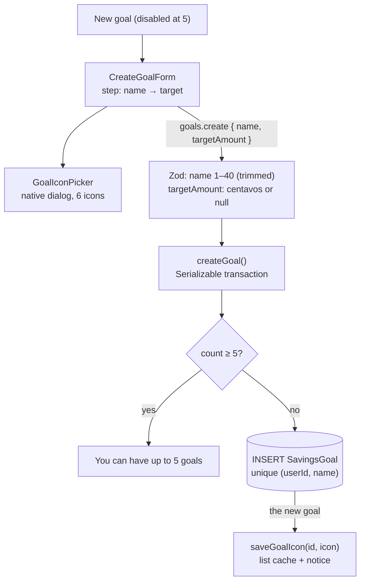

# 25 · Create a goal

**New goal** opens a two-step form on the GoalSave screen. Step 1: choose an **icon** and type a **name** (1–40 characters). Step 2: an optional **target amount** (₱0.01 to ₱1,000,000). **Create goal** saves it with ₱0.00, 4% a year, and interest counted from that moment. A user can have at most **5 goals**, and two goals cannot share a name.

## At a glance

| | |
| --- | --- |
| **Route** | `/goals` (the form replaces the list while it is open) |
| **Frontend** | `create-goal-form.tsx` (**client**), `goal-icon-picker.tsx` (a native `<dialog>`), `goal-art.tsx`, `use-goal-icon.ts` (`saveGoalIcon`), `goals.rules.ts` (`isValidGoalName`, `GOAL_NAME_MAX`); `goalsave-screen.tsx` (`showCreatedGoal`) |
| **API** | `goals.create({ name, targetAmount })` (protected mutation) |
| **Backend** | `goals.router.ts` (`name`, `centavos.nullish()`), `goals.service.ts` (`createGoal` inside `savingsTransaction`) |
| **Database** | counts the user's `SavingsGoal` rows; inserts one; `@@unique([userId, name])` |
| **Tests** | `goals.rules.test.ts` (name rules); the 5-goal race and the duplicate name were run on the test database, the form in Chromium |
| **Deep dive** | [GoalSave §4 and §6](../05-features/08-goalsave.md#creating-a-goal-create-goal-formtsx) |

## What the user can do

| Step | What is on screen | Button |
| --- | --- | --- |
| 1 | the round icon (tap → **Choose an icon**: Savings, Travel, Home, Gifts, Car, Health), **Goal name** with a counter like `6/40` | **Continue** (enabled with a valid name) |
| 2 | the name as a title, **Target amount** (optional), "Leave blank for no target." | **Create goal** / Creating… |
| back arrow | step 1 → back to the GoalSave list; step 2 → back to step 1 | |
| after | the list, with "“Laptop” created." and the new tile | |

## How it works

1. The form keeps `name`, `target`, `icon` (default `safe`) and `step`.
2. **Continue** is enabled when `isValidGoalName(name)`: 1–40 characters after trimming. The field also has `maxLength={40}`.
3. On step 2, an empty target means **no target** (`null`). A typed one must pass `isPesoInput` and be between 1 and 100,000,000 centavos.
4. **Create goal** sends `goals.create({ name: name.trim(), targetAmount })`. Zod re-checks both.
5. `createGoal` runs in `savingsTransaction` (**Serializable**, up to 4 attempts). It counts the user's goals and refuses a 6th ("You can have up to 5 goals"), then inserts the goal with `interestCalculatedAt: new Date()`.
6. On success, the form saves the chosen icon in `localStorage` (under the new goal's ID), and the screen adds the goal to the cached list, shows the notice, and refreshes the server data.

## Structure



## Files and locations

| Layer | File | Role |
| --- | --- | --- |
| Frontend (client) | `gobank/src/features/goals/components/create-goal-form.tsx` | the two steps and their checks |
| Frontend | `gobank/src/features/goals/components/goal-icon-picker.tsx` | icon button + bottom-sheet dialog |
| Frontend | `gobank/src/features/goals/components/goalsave-screen.tsx` | opens the form, `showCreatedGoal` |
| Rules | `gobank/src/features/goals/goals.rules.ts` | `GOAL_NAME_MAX`, `isValidGoalName` |
| Hook | `gobank/src/features/goals/hooks/use-goal-icon.ts` | `saveGoalIcon` |
| API | `gobank/src/features/goals/goals.router.ts` | `create` |
| Service | `gobank/src/features/goals/goals.service.ts` | `createGoal` |
| Errors | `gobank/src/server/errors.ts`, `gobank/src/server/trpc.ts` | "You can have up to 5 goals"; `P2002` → "That name is already taken" |

## Frontend

<!-- code: gobank/src/features/goals/components/create-goal-form.tsx -->
**`gobank/src/features/goals/components/create-goal-form.tsx`** · all 161 lines

```tsx
  1 │ "use client";
  2 │
  3 │ import { useState } from "react";
  4 │ import { isPesoInput } from "~/shared/lib/amount-input";
  5 │ import { MAX_TRANSACTION_CENTAVOS, toCentavos } from "~/shared/lib/money";
  6 │ import { BackButton } from "~/shared/ui/back-button";
  7 │ import { Button } from "~/shared/ui/button";
  8 │ import { TextField } from "~/shared/ui/text-field";
  9 │ import { errorMessage } from "~/trpc/error-message";
 10 │ import { api, type RouterOutputs } from "~/trpc/react";
 11 │ import { saveGoalIcon } from "../hooks/use-goal-icon";
 12 │ import { isValidGoalName, GOAL_NAME_MAX } from "../goals.rules";
 13 │ import type { GoalIcon } from "./goal-art";
 14 │ import { GoalIconPicker } from "./goal-icon-picker";
 15 │
 16 │ type Step = "name" | "target";
 17 │
 18 │ const TARGET_RANGE_ERROR =
 19 │   "Enter ₱0.01 to ₱1,000,000, with up to two decimal places.";
 20 │
 21 │ const CARD_CLASS =
 22 │   "animate-step-in bg-surface mt-8 rounded-[24px] border border-white/[.07] p-5";
 23 │
 24 │ function targetIsValid(typed: string, centavos: number | null) {
 25 │   if (centavos === null) return true;
 26 │
 27 │   return (
 28 │     isPesoInput(typed) && centavos > 0 && centavos <= MAX_TRANSACTION_CENTAVOS
 29 │   );
 30 │ }
 31 │
 32 │ function submitLabel(pending: boolean, step: Step) {
 33 │   if (pending) return "Creating…";
 34 │   return step === "name" ? "Continue" : "Create goal";
 35 │ }
 36 │
 37 │ export function CreateGoalForm({
 38 │   onCreated,
 39 │   onCancel,
 40 │ }: {
 41 │   onCreated: (goal: RouterOutputs["goals"]["create"]) => void;
 42 │   onCancel: () => void;
 43 │ }) {
 44 │   const [name, setName] = useState("");
 45 │   const [target, setTarget] = useState("");
 46 │   const [icon, setIcon] = useState<GoalIcon>("safe");
 47 │   const [step, setStep] = useState<Step>("name");
 48 │
 49 │   const create = api.goals.create.useMutation({
 50 │     onSuccess: (goal) => {
 51 │       saveGoalIcon(goal.id, icon);
 52 │       onCreated(goal);
 53 │     },
 54 │   });
 55 │
 56 │   const typedTarget = target.trim();
 57 │   const targetCentavos = typedTarget ? toCentavos(Number(typedTarget)) : null;
 58 │   const validTarget = targetIsValid(typedTarget, targetCentavos);
 59 │   const validName = isValidGoalName(name);
 60 │
 61 │   const canSubmit =
 62 │     validName && (step === "name" || validTarget) && !create.isPending;
 63 │
 64 │   const submit = () => {
 65 │     if (!canSubmit) return;
 66 │
 67 │     if (step === "name") {
 68 │       setStep("target");
 69 │       return;
 70 │     }
 71 │
 72 │     create.mutate({ name: name.trim(), targetAmount: targetCentavos });
 73 │   };
 74 │
 75 │   const goBack = () => {
 76 │     if (step === "name") onCancel();
 77 │     else setStep("name");
 78 │   };
 79 │
 80 │   return (
 81 │     <form
 82 │       className="bg-surface-sunken text-ink -mx-6 -mt-8 -mb-10 flex min-h-[calc(100dvh-1px)] flex-1 flex-col px-5 pt-7 pb-8"
 83 │       onSubmit={(event) => {
 84 │         event.preventDefault();
 85 │         submit();
 86 │       }}
 87 │     >
 88 │       <header className="relative flex min-h-11 items-center justify-center">
 89 │         <BackButton
 90 │           disabled={create.isPending}
 91 │           label={step === "name" ? "Back to GoalSave" : "Back to goal name"}
 92 │           onClick={goBack}
 93 │           className="absolute left-0"
 94 │         />
 95 │         <h1 className="text-[17px] font-semibold">New goal</h1>
 96 │       </header>
 97 │
 98 │       <div className="mt-9">
 99 │         <GoalIconPicker
100 │           value={icon}
101 │           onChange={setIcon}
102 │           disabled={create.isPending}
103 │         />
104 │       </div>
105 │
106 │       {step === "name" ? (
107 │         <div className={CARD_CLASS}>
108 │           <TextField
109 │             key="name"
110 │             label="Goal name"
111 │             value={name}
112 │             onChange={(event) => setName(event.target.value)}
113 │             required
114 │             maxLength={GOAL_NAME_MAX}
115 │             disabled={create.isPending}
116 │             autoFocus
117 │             hint={`${name.length}/${GOAL_NAME_MAX}`}
118 │           />
119 │         </div>
120 │       ) : (
121 │         <div className={CARD_CLASS}>
122 │           <h2 className="mb-5 text-[18px] font-semibold tracking-tight break-words">
123 │             {name}
124 │           </h2>
125 │           <TextField
126 │             key="target"
127 │             label="Target amount"
128 │             optional
129 │             prefix="₱"
130 │             inputMode="decimal"
131 │             value={target}
132 │             onChange={(event) => {
133 │               if (isPesoInput(event.target.value))
134 │                 setTarget(event.target.value);
135 │             }}
136 │             disabled={create.isPending}
137 │             autoFocus
138 │             aria-invalid={!validTarget}
139 │             error={validTarget ? null : TARGET_RANGE_ERROR}
140 │             hint="Leave blank for no target."
141 │           />
142 │         </div>
143 │       )}
144 │
145 │       {create.error ? (
146 │         <p
147 │           role="alert"
148 │           className="bg-danger-soft text-danger mt-5 rounded-2xl p-3 text-sm"
149 │         >
150 │           {errorMessage(create.error)}
151 │         </p>
152 │       ) : null}
153 │
154 │       <div className="mt-auto pt-10">
155 │         <Button type="submit" disabled={!canSubmit}>
156 │           {submitLabel(create.isPending, step)}
157 │         </Button>
158 │       </div>
159 │     </form>
160 │   );
161 │ }
```
<!-- /code -->

<!-- code: gobank/src/features/goals/components/goal-icon-picker.tsx -->
**`gobank/src/features/goals/components/goal-icon-picker.tsx`** · all 116 lines

```tsx
  1 │ "use client";
  2 │
  3 │ import { Check, Pencil, X } from "lucide-react";
  4 │ import { useRef } from "react";
  5 │ import { cn } from "~/shared/lib/cn";
  6 │ import { GoalArt, goalIcons, type GoalIcon } from "./goal-art";
  7 │
  8 │ function IconOption({
  9 │   icon,
 10 │   label,
 11 │   selected,
 12 │   onPick,
 13 │ }: {
 14 │   icon: GoalIcon;
 15 │   label: string;
 16 │   selected: boolean;
 17 │   onPick: (icon: GoalIcon) => void;
 18 │ }) {
 19 │   return (
 20 │     <button
 21 │       type="button"
 22 │       aria-pressed={selected}
 23 │       onClick={() => onPick(icon)}
 24 │       className="group text-ink-soft focus-visible:outline-sky relative flex flex-col items-center gap-2 rounded-2xl text-[11px] font-medium focus-visible:outline-2 focus-visible:outline-offset-4"
 25 │     >
 26 │       <span
 27 │         className={cn(
 28 │           "bg-tile relative grid aspect-square w-full place-items-center rounded-full border-2 transition-colors",
 29 │           selected
 30 │             ? "border-sky text-white"
 31 │             : "text-ink-soft border-transparent group-hover:border-white/20",
 32 │         )}
 33 │       >
 34 │         {selected ? (
 35 │           <span className="bg-sky absolute top-1 right-1 grid h-5 w-5 place-items-center rounded-full text-[#121214]">
 36 │             <Check size={12} aria-hidden />
 37 │           </span>
 38 │         ) : null}
 39 │         <GoalArt icon={icon} className="h-9 w-9" />
 40 │       </span>
 41 │       {label}
 42 │     </button>
 43 │   );
 44 │ }
 45 │
 46 │ export function GoalIconPicker({
 47 │   value,
 48 │   onChange,
 49 │   disabled = false,
 50 │ }: {
 51 │   value: GoalIcon;
 52 │   onChange: (icon: GoalIcon) => void;
 53 │   disabled?: boolean;
 54 │ }) {
 55 │   const dialog = useRef<HTMLDialogElement>(null);
 56 │
 57 │   const open = () => dialog.current?.showModal();
 58 │   const close = () => dialog.current?.close();
 59 │
 60 │   const pick = (icon: GoalIcon) => {
 61 │     onChange(icon);
 62 │     close();
 63 │   };
 64 │
 65 │   return (
 66 │     <>
 67 │       <button
 68 │         type="button"
 69 │         aria-label="Choose a savings icon"
 70 │         aria-haspopup="dialog"
 71 │         disabled={disabled}
 72 │         onClick={open}
 73 │         className="hover:border-sky/40 focus-visible:outline-sky bg-tile text-ink-bright relative mx-auto grid h-28 w-28 place-items-center rounded-full border border-white/10 transition-colors focus-visible:outline-2 focus-visible:outline-offset-4 disabled:opacity-50"
 74 │       >
 75 │         <GoalArt icon={value} className="h-11 w-11" />
 76 │         <span className="bg-tile-hover text-ink-bright absolute right-0 bottom-0 grid h-8 w-8 place-items-center rounded-full border border-white/10">
 77 │           <Pencil size={12} aria-hidden />
 78 │         </span>
 79 │       </button>
 80 │
 81 │       <dialog
 82 │         ref={dialog}
 83 │         aria-label="Choose a savings icon"
 84 │         className="text-ink bg-card fixed inset-x-0 top-auto bottom-0 mx-auto mb-0 max-h-[85dvh] w-full max-w-[440px] overflow-y-auto rounded-t-[28px] border border-white/10 p-6 shadow-2xl backdrop:bg-black/70 backdrop:backdrop-blur-sm"
 85 │       >
 86 │         <div className="bg-line-strong mx-auto mb-5 h-1 w-10 rounded-full" />
 87 │
 88 │         <div className="flex items-center justify-between gap-3">
 89 │           <h2 className="text-[18px] font-semibold tracking-tight">
 90 │             Choose an icon
 91 │           </h2>
 92 │           <button
 93 │             type="button"
 94 │             aria-label="Close icon picker"
 95 │             onClick={close}
 96 │             className="text-ink focus-visible:outline-sky bg-tile hover:bg-tile-hover grid h-10 w-10 shrink-0 place-items-center rounded-xl transition-colors focus-visible:outline-2 focus-visible:outline-offset-4"
 97 │           >
 98 │             <X size={18} aria-hidden />
 99 │           </button>
100 │         </div>
101 │
102 │         <div className="mt-6 mb-2 grid grid-cols-3 gap-3">
103 │           {goalIcons.map(({ value: icon, label }) => (
104 │             <IconOption
105 │               key={icon}
106 │               icon={icon}
107 │               label={label}
108 │               selected={value === icon}
109 │               onPick={pick}
110 │             />
111 │           ))}
112 │         </div>
113 │       </dialog>
114 │     </>
115 │   );
116 │ }
```
<!-- /code -->

<!-- code: gobank/src/features/goals/components/goalsave-screen.tsx 132-154 -->
**`gobank/src/features/goals/components/goalsave-screen.tsx`** · lines 132–154

```tsx
132 │   const startCreating = () => {
133 │     setNotice("");
134 │     setCreating(true);
135 │   };
136 │
137 │   const showCreatedGoal = (goal: Goal) => {
138 │     utils.goals.list.setData(undefined, (current) => [
139 │       ...(current ?? []).filter((item) => item.id !== goal.id),
140 │       goal,
141 │     ]);
142 │     setCreating(false);
143 │     setNotice(`“${goal.name}” created.`);
144 │     router.refresh();
145 │   };
146 │
147 │   if (creating) {
148 │     return (
149 │       <CreateGoalForm
150 │         onCancel={() => setCreating(false)}
151 │         onCreated={showCreatedGoal}
152 │       />
153 │     );
154 │   }
```
<!-- /code -->

<!-- code: gobank/src/features/goals/goals.rules.ts 1-11 -->
**`gobank/src/features/goals/goals.rules.ts`** · lines 1–11

```ts
 1 │ import { peso } from "~/shared/lib/format";
 2 │ import { MAX_TRANSACTION_CENTAVOS } from "~/shared/lib/money";
 3 │
 4 │ export const GOAL_NAME_MAX = 40;
 5 │
 6 │ export type GoalTransfer = "in" | "out";
 7 │
 8 │ export const isValidGoalName = (name: string) => {
 9 │   const length = name.trim().length;
10 │   return length > 0 && length <= GOAL_NAME_MAX;
11 │ };
```
<!-- /code -->

## Backend

<!-- code: gobank/src/features/goals/goals.router.ts 14-28 -->
**`gobank/src/features/goals/goals.router.ts`** · lines 14–28

```ts
14 │ const id = z.object({ id: z.string() });
15 │ const name = z.string().trim().min(1).max(GOAL_NAME_MAX);
16 │
17 │ export const goalsRouter = createTRPCRouter({
18 │   list: protectedProcedure.query(({ ctx }) => listGoals(ctx.userId)),
19 │
20 │   get: protectedProcedure
21 │     .input(id)
22 │     .query(({ ctx, input }) => getGoal(ctx.userId, input.id)),
23 │
24 │   create: protectedProcedure
25 │     .input(z.object({ name, targetAmount: centavos.nullish() }))
26 │     .mutation(({ ctx, input }) =>
27 │       createGoal(ctx.userId, input.name, input.targetAmount),
28 │     ),
```
<!-- /code -->

<!-- code: gobank/src/features/goals/goals.service.ts 65-81 -->
**`gobank/src/features/goals/goals.service.ts`** · lines 65–81

```ts
65 │ export const createGoal = (
66 │   userId: string,
67 │   name: string,
68 │   targetAmount?: number | null,
69 │ ) =>
70 │   savingsTransaction(async (tx) => {
71 │     const count = await tx.savingsGoal.count({ where: { userId } });
72 │     if (count >= MAX_GOALS) fail("BAD_REQUEST", MESSAGES.goalLimit);
73 │     return tx.savingsGoal.create({
74 │       data: {
75 │         userId,
76 │         name,
77 │         targetAmount,
78 │         interestCalculatedAt: new Date(),
79 │       },
80 │     });
81 │   });
```
<!-- /code -->

<!-- code: gobank/src/server/trpc.ts 34-43 -->
**`gobank/src/server/trpc.ts`** · lines 34–43

```ts
34 │   if (database?.code === "P2002") {
35 │     const target = database.meta?.target;
36 │     const field = Array.isArray(target) ? String(target.at(-1)) : "value";
37 │
38 │     return new TRPCError({
39 │       code: "CONFLICT",
40 │       message: `That ${field} is already taken`,
41 │     });
42 │   }
43 │
```
<!-- /code -->

## Database

| Column | Value on creation |
| --- | --- |
| `userId` | the signed-in user (from the session) |
| `name` | trimmed, 1–40 characters; unique per user |
| `targetAmount` | centavos, or `NULL` |
| `balance` | `0` (default) |
| `annualInterestRate` | `0.04` (default) |
| `interestRemainder` | `0` (default) |
| `interestCalculatedAt` | **now** (set explicitly by `createGoal`), so interest starts at creation |

## The complicated parts, explained step by step

### 1. Two steps, one form

<!-- code: gobank/src/features/goals/components/create-goal-form.tsx 56-78 -->
**`gobank/src/features/goals/components/create-goal-form.tsx`** · lines 56–78

```tsx
56 │   const typedTarget = target.trim();
57 │   const targetCentavos = typedTarget ? toCentavos(Number(typedTarget)) : null;
58 │   const validTarget = targetIsValid(typedTarget, targetCentavos);
59 │   const validName = isValidGoalName(name);
60 │
61 │   const canSubmit =
62 │     validName && (step === "name" || validTarget) && !create.isPending;
63 │
64 │   const submit = () => {
65 │     if (!canSubmit) return;
66 │
67 │     if (step === "name") {
68 │       setStep("target");
69 │       return;
70 │     }
71 │
72 │     create.mutate({ name: name.trim(), targetAmount: targetCentavos });
73 │   };
74 │
75 │   const goBack = () => {
76 │     if (step === "name") onCancel();
77 │     else setStep("name");
78 │   };
```
<!-- /code -->

| State | `canSubmit` | Enter / button does |
| --- | --- | --- |
| step `name`, name empty | no | nothing |
| step `name`, `Laptop` | yes | `setStep("target")`: **no** request yet |
| step `target`, target empty | yes (`targetCentavos === null` means "no target") | `create.mutate({ name: "Laptop", targetAmount: null })` |
| step `target`, `20000` | yes | `create.mutate({ name: "Laptop", targetAmount: 2000000 })` |
| step `target`, `2000000.01` | **no**, red "Enter ₱0.01 to ₱1,000,000, with up to two decimal places." | nothing |
| request running | no ("Creating…") | nothing: no double creation from a double tap |

The two `TextField`s have different `key`s (`"name"` and `"target"`), so React creates a fresh input on each step, and `autoFocus` puts the cursor in it. In Chromium the name field was focused when the form opened. Step 2 shows the name as a heading, so the user sees which goal they are setting a target for.

### 2. The icon picker: a bottom sheet made from `<dialog>`

<!-- code: gobank/src/features/goals/components/goal-icon-picker.tsx 55-63 -->
**`gobank/src/features/goals/components/goal-icon-picker.tsx`** · lines 55–63

```tsx
55 │   const dialog = useRef<HTMLDialogElement>(null);
56 │
57 │   const open = () => dialog.current?.showModal();
58 │   const close = () => dialog.current?.close();
59 │
60 │   const pick = (icon: GoalIcon) => {
61 │     onChange(icon);
62 │     close();
63 │   };
```
<!-- /code -->

| Step | Result (checked in Chromium) |
| --- | --- |
| tap the round icon ("Choose a savings icon", `aria-haspopup="dialog"`) | `showModal()`: a modal sheet opens at the bottom of the screen (`top-auto bottom-0`, rounded top corners), and the page behind is darkened and blurred (`backdrop:bg-black/70 backdrop:backdrop-blur-sm`) |
| the options | Savings, Travel, Home, Gifts, Car, Health; the current one has `aria-pressed="true"` (Savings at first) |
| tap **Travel** | `onChange("travel")` and `close()`: the sheet closes at once |
| Escape or **Close icon picker** | closes without a change |

Like the GO menu ([12](12-go-menu.md)), the native dialog gives focus trapping, Escape and the backdrop for free. The choice is kept only in the form's state until the goal exists. Then `onSuccess` calls `saveGoalIcon(goal.id, icon)`, because the storage key needs the **new goal's ID**, which only the server knows.

### 3. The limit of 5, safe even when two taps arrive together

<!-- code: gobank/src/features/goals/goals.service.ts 70-80 -->
**`gobank/src/features/goals/goals.service.ts`** · lines 70–80

```ts
70 │   savingsTransaction(async (tx) => {
71 │     const count = await tx.savingsGoal.count({ where: { userId } });
72 │     if (count >= MAX_GOALS) fail("BAD_REQUEST", MESSAGES.goalLimit);
73 │     return tx.savingsGoal.create({
74 │       data: {
75 │         userId,
76 │         name,
77 │         targetAmount,
78 │         interestCalculatedAt: new Date(),
79 │       },
80 │     });
```
<!-- /code -->

"Count, then insert" is a classic race. At PostgreSQL's default isolation, two transactions can both count 4 and both insert. GoBank runs this inside `savingsTransaction` at **Serializable**:

| Time | Create A | Create B |
| --- | --- | --- |
| t1 | counts 4 goals | counts 4 goals |
| t2 | inserts → `COMMIT` | inserts → `COMMIT` **refused**: "could not serialize access" (`P2034`) |
| t3 | | `savingsTransaction` tries again: counts **5** → "You can have up to 5 goals" |

**Run on the test database for this review:** a user with 4 goals fired 3 `createGoal` calls at the same moment. Result: **1 created, 2 refused** with "You can have up to 5 goals", and exactly **5** goals in the end. PostgreSQL's log showed `ERROR: could not serialize access due to concurrent update` twice, followed by the successful retries.

### 4. Duplicate names: the database decides

<!-- code: gobank/src/server/trpc.ts 34-43 -->
**`gobank/src/server/trpc.ts`** · lines 34–43

```ts
34 │   if (database?.code === "P2002") {
35 │     const target = database.meta?.target;
36 │     const field = Array.isArray(target) ? String(target.at(-1)) : "value";
37 │
38 │     return new TRPCError({
39 │       code: "CONFLICT",
40 │       message: `That ${field} is already taken`,
41 │     });
42 │   }
43 │
```
<!-- /code -->

`@@unique([userId, name])` means one user cannot have two goals called "Laptop", while different users can. The form does not check this itself. The database refuses the insert:

| Step | Value (run on the test database) |
| --- | --- |
| error | `P2002`, `meta.target = ["userId", "name"]`; PostgreSQL: `duplicate key value violates unique constraint "SavingsGoal_userId_name_key"` |
| `savingsTransaction` | not `P2034`, not `CONFLICT` → no retry, rethrown |
| `toTRPCError` | `field = target.at(-1)` = `"name"` → **"That name is already taken"** (`CONFLICT`) |
| screen | the red box under the form |

Letting the unique index decide is race-proof: two tabs creating "Laptop" at the same moment still end with one goal.

### 5. Showing the new goal at once

<!-- code: gobank/src/features/goals/components/goalsave-screen.tsx 137-145 -->
**`gobank/src/features/goals/components/goalsave-screen.tsx`** · lines 137–145

```tsx
137 │   const showCreatedGoal = (goal: Goal) => {
138 │     utils.goals.list.setData(undefined, (current) => [
139 │       ...(current ?? []).filter((item) => item.id !== goal.id),
140 │       goal,
141 │     ]);
142 │     setCreating(false);
143 │     setNotice(`“${goal.name}” created.`);
144 │     router.refresh();
145 │   };
```
<!-- /code -->

| Line | Effect |
| --- | --- |
| `utils.goals.list.setData(…)` | the new goal is appended to the cached list (filtering its ID first, in case it is already there): the tile appears without waiting for a refetch |
| `setCreating(false)` | back to the list |
| `setNotice("“Laptop” created.")` | a `role="status"` message, also read by screen readers |
| `router.refresh()` | asks the server to render the current route again and clears Next.js's client-side cache of visited pages, so the dashboard's "N of 5 goals" is fresh when the user goes back |

## Rules and limits

| Rule | Value | Where |
| --- | --- | --- |
| Goals per user | 5 | `MAX_GOALS`, checked in a Serializable transaction |
| Name | 1–40 characters after trimming, unique per user | `goals.rules.ts`, router, `@@unique` |
| Target | optional; ₱0.01 to ₱1,000,000 | form + `centavos.nullish()` |
| Starting balance | ₱0.00 | default |
| Interest | from the moment of creation | `interestCalculatedAt: new Date()` |
| Icon | 6 choices, saved in this browser | `goalIcons`, `localStorage` |

## Messages

| Text | When |
| --- | --- |
| New goal · Goal name · 6/40 | step 1 |
| Choose an icon · Choose a savings icon · Close icon picker | icon picker |
| Target amount · Optional · Leave blank for no target. | step 2 |
| Enter ₱0.01 to ₱1,000,000, with up to two decimal places. | target out of range |
| Continue / Create goal / Creating… | button |
| Back to GoalSave / Back to goal name | back button names |
| You can have up to 5 goals | the 6th goal (server) |
| That name is already taken | duplicate name (server) |
| “Laptop” created. | after creating |

## Tests

- `goals.rules.test.ts`: "a goal name needs 1 to 40 characters" (`Trip` valid, spaces only invalid, 41 characters invalid).
- **Run on the test database for this review:** 3 simultaneous creates at 4 goals (1 created, 2 refused, 5 in total) and the duplicate name (`P2002` on `["userId", "name"]`).
- **Checked in Chromium for this review:** autofocus, the `6/40` counter, the icon sheet (options, `aria-pressed`, closing on a pick), the target error for `2000000.01`, creating "Laptop" with a ₱20,000 target, the notice, and the Travel icon stored in `localStorage`.
