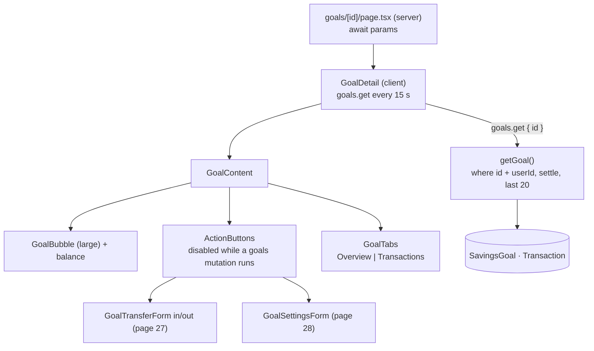

# 26 · Goal detail and tabs

Tapping a goal opens `/goals/<id>`: the goal's name, a large **bubble** with its progress ring, the **balance**, three round buttons (**Transfer in**, **Transfer out**, **Settings**), and two tabs. **Overview** shows the rate, the target and the progress; **Transactions** lists the goal's last 20 moves and interest payments. Like the list, the page refreshes itself every 15 seconds.

## At a glance

| | |
| --- | --- |
| **Route** | `/goals/<id>` |
| **Frontend** | page `gobank/src/app/(app)/goals/[id]/page.tsx` (server, reads `params`); `goal-detail.tsx` (**client**: `GoalDetail`, `GoalContent`, `ActionButtons`), `goal-tabs.tsx`, `goal-bubble.tsx`, `use-goal-icon.ts`; the forms: `goal-transfer-form.tsx` ([27](27-goal-transfers.md)), `goal-settings-form.tsx` ([28](28-goal-settings-and-close.md)) |
| **API** | `goals.get({ id })` (protected query, refetched every 15 s) |
| **Backend** | `goals.service.ts` (`getGoal`, `settleOwnedGoal`), ledger `settleGoalInterest()` |
| **Database** | reads one `SavingsGoal` **by ID and owner** and its last 20 `Transaction` rows; may settle interest ([29](29-savings-interest.md)) |
| **Tests** | `verify-core.ts` (`checkSavings`: another user cannot read the goal); checked in Chromium for this review |
| **Deep dive** | [GoalSave §6](../05-features/08-goalsave.md#goalsid-goal-detailtsx) |

## What the user can do

| Part | What it does |
| --- | --- |
| back arrow | to `/goals` |
| bubble + balance | progress ring toward the target, the goal's balance in large type |
| **Transfer in** / **Transfer out** | open the transfer form under the buttons ([27](27-goal-transfers.md)) |
| **Settings** | name, target, icon, close the goal ([28](28-goal-settings-and-close.md)) |
| **Overview** tab | Annual growth rate "4.00% p.a.", Target (or "Not set"), Progress (or "—") |
| **Transactions** tab | the last 20 rows: "GoalSave deposit · Laptop · Nov 4 · +₱100.00", interest rows; or "No transfers yet" |
| ← / → keys on the tabs | switch tab and move focus |

## How it works

1. The server page waits for `params` (a Promise in Next.js 15), reads `id` and renders the client `GoalDetail`.
2. `GoalDetail` calls `goals.get({ id })` every 15 s and shows "Loading your GoalSave…", an error with **Try again**, or the content.
3. `getGoal` runs in `savingsTransaction`. It loads the goal with `where: { id, userId }`, so another user's goal is "Not found". It settles interest (saved only if at least 1 centavo was earned) and adds the goal's last 20 transactions.
4. `GoalContent` shows the bubble, the balance and the buttons. While **any** GoalSave change is saving, the buttons are disabled (`useIsMutating`).
5. Only one form is open at a time (`action`). After a success, the form closes and a message appears ("Transfer complete.", "Goal settings saved.").

## Structure



## Files and locations

| Layer | File | Role |
| --- | --- | --- |
| Page (server) | `gobank/src/app/(app)/goals/[id]/page.tsx` | reads the `id` from the URL |
| Frontend (client) | `gobank/src/features/goals/components/goal-detail.tsx` | loading, error, content, actions, messages |
| Frontend | `gobank/src/features/goals/components/goal-tabs.tsx` | the two tabs, keyboard support |
| Frontend | `gobank/src/features/goals/components/goal-bubble.tsx` | the ring ([24 §4](24-goalsave-overview.md#4-the-progress-ring)) |
| Service | `gobank/src/features/goals/goals.service.ts` | `getGoal`, `settleOwnedGoal` |
| Ledger | `gobank/src/server/ledger.ts` | `settleGoalInterest` |

## Frontend

<!-- code: gobank/src/app/(app)/goals/[id]/page.tsx -->
**`gobank/src/app/(app)/goals/[id]/page.tsx`** · all 16 lines

```tsx
 1 │ import type { Metadata } from "next";
 2 │ import { GoalDetail } from "~/features/goals/components/goal-detail";
 3 │
 4 │ export const metadata: Metadata = {
 5 │   title: "GoalSave",
 6 │ };
 7 │
 8 │ export default async function GoalDetailPage({
 9 │   params,
10 │ }: {
11 │   params: Promise<{ id: string }>;
12 │ }) {
13 │   const { id } = await params;
14 │
15 │   return <GoalDetail id={id} />;
16 │ }
```
<!-- /code -->

<!-- code: gobank/src/features/goals/components/goal-detail.tsx -->
**`gobank/src/features/goals/components/goal-detail.tsx`** · all 164 lines

```tsx
  1 │ "use client";
  2 │
  3 │ import { useIsMutating } from "@tanstack/react-query";
  4 │ import { ArrowDownLeft, ArrowUpRight, Settings2 } from "lucide-react";
  5 │ import { useState } from "react";
  6 │ import { cn } from "~/shared/lib/cn";
  7 │ import { peso } from "~/shared/lib/format";
  8 │ import { PageHeader } from "~/shared/ui/page-header";
  9 │ import { errorMessage } from "~/trpc/error-message";
 10 │ import { api, type RouterOutputs } from "~/trpc/react";
 11 │ import { useGoalIcon } from "../hooks/use-goal-icon";
 12 │ import { GoalBubble } from "./goal-bubble";
 13 │ import { GoalSettingsForm } from "./goal-settings-form";
 14 │ import { GoalTabs } from "./goal-tabs";
 15 │ import { GoalTransferForm } from "./goal-transfer-form";
 16 │
 17 │ type Goal = RouterOutputs["goals"]["get"];
 18 │ type Action = "in" | "out" | "settings";
 19 │
 20 │ const ACTIONS = [
 21 │   { id: "in", label: "Transfer in", icon: ArrowDownLeft },
 22 │   { id: "out", label: "Transfer out", icon: ArrowUpRight },
 23 │   { id: "settings", label: "Settings", icon: Settings2 },
 24 │ ] as const;
 25 │
 26 │ const REFRESH_EVERY_MS = 15_000;
 27 │ const SAVINGS_CHANGES = { mutationKey: [["goals"]] };
 28 │
 29 │ function ActionButtons({
 30 │   disabled,
 31 │   onSelect,
 32 │ }: {
 33 │   disabled: boolean;
 34 │   onSelect: (action: Action) => void;
 35 │ }) {
 36 │   return (
 37 │     <div className="grid grid-cols-3 gap-2 px-4 py-5">
 38 │       {ACTIONS.map(({ id, label, icon: Icon }) => (
 39 │         <button
 40 │           key={id}
 41 │           type="button"
 42 │           disabled={disabled}
 43 │           onClick={() => onSelect(id)}
 44 │           className="group focus-visible:outline-sky flex min-h-20 flex-col items-center gap-2 rounded-2xl py-2 focus-visible:outline-2 focus-visible:outline-offset-4 disabled:opacity-45"
 45 │         >
 46 │           <span
 47 │             className={cn(
 48 │               "bg-tile group-hover:bg-tile-hover grid h-14 w-14 place-items-center rounded-full border border-white/[.08] transition-colors",
 49 │               id === "in" ? "text-sky" : "text-ink-bright",
 50 │             )}
 51 │           >
 52 │             <Icon size={25} aria-hidden />
 53 │           </span>
 54 │           <span className="text-[11px] font-semibold">{label}</span>
 55 │         </button>
 56 │       ))}
 57 │     </div>
 58 │   );
 59 │ }
 60 │
 61 │ function GoalContent({ goal }: { goal: Goal }) {
 62 │   const { icon, setIcon } = useGoalIcon(goal.id, goal.name);
 63 │   const [action, setAction] = useState<Action | null>(null);
 64 │   const [message, setMessage] = useState("");
 65 │   const saving = useIsMutating(SAVINGS_CHANGES) > 0;
 66 │
 67 │   const open = (next: Action) => {
 68 │     setMessage("");
 69 │     setAction(next);
 70 │   };
 71 │
 72 │   const finish = (doneMessage: string) => {
 73 │     setAction(null);
 74 │     setMessage(doneMessage);
 75 │   };
 76 │
 77 │   const close = () => setAction(null);
 78 │
 79 │   return (
 80 │     <div className="bg-surface-sunken text-ink -mx-6 -mt-8 -mb-10 flex flex-1 flex-col pt-7">
 81 │       <div className="px-5">
 82 │         <PageHeader title={goal.name} back="/goals" />
 83 │       </div>
 84 │
 85 │       <section className="px-8 pt-7 pb-4 text-center">
 86 │         <GoalBubble
 87 │           icon={icon}
 88 │           balance={goal.balance}
 89 │           target={goal.targetAmount}
 90 │           label={goal.name}
 91 │           large
 92 │         />
 93 │         <h1 className="mt-4 text-[36px] font-bold tracking-tight break-all tabular-nums">
 94 │           {peso(goal.balance)}
 95 │         </h1>
 96 │       </section>
 97 │
 98 │       <ActionButtons disabled={saving} onSelect={open} />
 99 │
100 │       <div className="bg-surface flex-1 rounded-t-[30px] px-5 pt-5 pb-10 shadow-[0_-8px_24px_-20px_#00000080]">
101 │         {message ? (
102 │           <p
103 │             role="status"
104 │             className="bg-brand-soft text-ink-soft mb-4 rounded-2xl p-3 text-sm"
105 │           >
106 │             {message}
107 │           </p>
108 │         ) : null}
109 │
110 │         {action === "in" || action === "out" ? (
111 │           <GoalTransferForm
112 │             key={action}
113 │             goalId={goal.id}
114 │             goalBalance={goal.balance}
115 │             direction={action}
116 │             onDone={finish}
117 │             onCancel={close}
118 │           />
119 │         ) : null}
120 │
121 │         {action === "settings" ? (
122 │           <GoalSettingsForm
123 │             goal={goal}
124 │             icon={icon}
125 │             onIconChange={setIcon}
126 │             onDone={finish}
127 │             onCancel={close}
128 │           />
129 │         ) : null}
130 │
131 │         <GoalTabs goal={goal} />
132 │       </div>
133 │     </div>
134 │   );
135 │ }
136 │
137 │ export function GoalDetail({ id }: { id: string }) {
138 │   const query = api.goals.get.useQuery(
139 │     { id },
140 │     { refetchInterval: REFRESH_EVERY_MS },
141 │   );
142 │
143 │   if (query.isPending) return <p role="status">Loading your GoalSave…</p>;
144 │
145 │   if (query.isError) {
146 │     return (
147 │       <div>
148 │         <PageHeader title="GoalSave" back="/goals" />
149 │         <p role="alert" className="text-danger mt-8">
150 │           {errorMessage(query.error)}
151 │         </p>
152 │         <button
153 │           type="button"
154 │           onClick={() => void query.refetch()}
155 │           className="bg-tile text-ink-bright mt-5 rounded-xl border border-white/10 px-5 py-3 focus-visible:outline-2 focus-visible:outline-offset-4"
156 │         >
157 │           Try again
158 │         </button>
159 │       </div>
160 │     );
161 │   }
162 │
163 │   return <GoalContent goal={query.data} />;
164 │ }
```
<!-- /code -->

<!-- code: gobank/src/features/goals/components/goal-tabs.tsx -->
**`gobank/src/features/goals/components/goal-tabs.tsx`** · all 148 lines

```tsx
  1 │ "use client";
  2 │
  3 │ import { useState, type KeyboardEvent } from "react";
  4 │ import { cn } from "~/shared/lib/cn";
  5 │ import { peso, shortDate } from "~/shared/lib/format";
  6 │ import type { RouterOutputs } from "~/trpc/react";
  7 │
  8 │ type Goal = RouterOutputs["goals"]["get"];
  9 │ type Tab = "overview" | "transactions";
 10 │
 11 │ const TABS: { id: Tab; label: string }[] = [
 12 │   { id: "overview", label: "Overview" },
 13 │   { id: "transactions", label: "Transactions" },
 14 │ ];
 15 │
 16 │ const otherTab = (tab: Tab): Tab =>
 17 │   tab === "overview" ? "transactions" : "overview";
 18 │
 19 │ function progressLabel(balance: number, target: number | null) {
 20 │   if (!target) return "—";
 21 │   return `${Math.min(100, Math.floor((balance / target) * 100))}%`;
 22 │ }
 23 │
 24 │ function OverviewRow({
 25 │   label,
 26 │   value,
 27 │   highlight = false,
 28 │ }: {
 29 │   label: string;
 30 │   value: string;
 31 │   highlight?: boolean;
 32 │ }) {
 33 │   return (
 34 │     <div className="flex items-center justify-between gap-3 py-5 text-sm">
 35 │       <dt>{label}</dt>
 36 │       <dd className={cn("font-semibold", highlight && "text-sky")}>{value}</dd>
 37 │     </div>
 38 │   );
 39 │ }
 40 │
 41 │ function GoalOverview({ goal }: { goal: Goal }) {
 42 │   const rate = `${(goal.annualInterestRate * 100).toFixed(2)}% p.a.`;
 43 │   const target = goal.targetAmount ? peso(goal.targetAmount) : "Not set";
 44 │
 45 │   return (
 46 │     <dl className="divide-line divide-y">
 47 │       <OverviewRow label="Annual growth rate" value={rate} highlight />
 48 │       <OverviewRow label="Target" value={target} />
 49 │       <OverviewRow
 50 │         label="Progress"
 51 │         value={progressLabel(goal.balance, goal.targetAmount)}
 52 │       />
 53 │     </dl>
 54 │   );
 55 │ }
 56 │
 57 │ function GoalTransactions({ goal }: { goal: Goal }) {
 58 │   if (goal.transactions.length === 0) {
 59 │     return (
 60 │       <p className="text-ink-muted py-7 text-center text-sm">
 61 │         No transfers yet
 62 │       </p>
 63 │     );
 64 │   }
 65 │
 66 │   return (
 67 │     <ul className="divide-line divide-y">
 68 │       {goal.transactions.map((entry) => {
 69 │         const movedIntoGoal = entry.kind === "stash" && entry.amount > 0;
 70 │
 71 │         return (
 72 │           <li
 73 │             key={entry.id}
 74 │             className="flex items-center justify-between gap-4 py-4"
 75 │           >
 76 │             <div>
 77 │               <p className="text-[13px] font-medium">{entry.title}</p>
 78 │               <p className="text-ink-muted mt-1 text-[11px]">
 79 │                 {shortDate(entry.createdAt)}
 80 │               </p>
 81 │             </div>
 82 │             <span
 83 │               className={cn(
 84 │                 "text-[13px] font-semibold tabular-nums",
 85 │                 movedIntoGoal ? "text-ink" : "text-brand",
 86 │               )}
 87 │             >
 88 │               {movedIntoGoal ? "−" : "+"}
 89 │               {peso(Math.abs(entry.amount))}
 90 │             </span>
 91 │           </li>
 92 │         );
 93 │       })}
 94 │     </ul>
 95 │   );
 96 │ }
 97 │
 98 │ export function GoalTabs({ goal }: { goal: Goal }) {
 99 │   const [tab, setTab] = useState<Tab>("overview");
100 │
101 │   const switchWithArrows = (event: KeyboardEvent) => {
102 │     if (event.key !== "ArrowLeft" && event.key !== "ArrowRight") return;
103 │
104 │     event.preventDefault();
105 │     const next = otherTab(tab);
106 │     setTab(next);
107 │     document.getElementById(`goal-${next}`)?.focus();
108 │   };
109 │
110 │   return (
111 │     <>
112 │       <div
113 │         role="tablist"
114 │         aria-label="Goal details"
115 │         className="mb-5 flex rounded-2xl border border-white/[.07] bg-[#121214] p-1"
116 │       >
117 │         {TABS.map(({ id, label }) => (
118 │           <button
119 │             key={id}
120 │             id={`goal-${id}`}
121 │             role="tab"
122 │             aria-selected={tab === id}
123 │             aria-controls="goal-panel"
124 │             tabIndex={tab === id ? 0 : -1}
125 │             onKeyDown={switchWithArrows}
126 │             onClick={() => setTab(id)}
127 │             className={cn(
128 │               "focus-visible:outline-sky h-11 flex-1 rounded-xl text-[13px] font-medium transition-colors focus-visible:outline-2 focus-visible:outline-offset-2",
129 │               tab === id
130 │                 ? "bg-tile-hover text-white"
131 │                 : "text-ink-muted hover:text-white",
132 │             )}
133 │           >
134 │             {label}
135 │           </button>
136 │         ))}
137 │       </div>
138 │
139 │       <div id="goal-panel" role="tabpanel" aria-labelledby={`goal-${tab}`}>
140 │         {tab === "overview" ? (
141 │           <GoalOverview goal={goal} />
142 │         ) : (
143 │           <GoalTransactions goal={goal} />
144 │         )}
145 │       </div>
146 │     </>
147 │   );
148 │ }
```
<!-- /code -->

## Backend

<!-- code: gobank/src/features/goals/goals.router.ts 20-22 -->
**`gobank/src/features/goals/goals.router.ts`** · lines 20–22

```ts
20 │   get: protectedProcedure
21 │     .input(id)
22 │     .query(({ ctx, input }) => getGoal(ctx.userId, input.id)),
```
<!-- /code -->

<!-- code: gobank/src/features/goals/goals.service.ts 42-63 -->
**`gobank/src/features/goals/goals.service.ts`** · lines 42–63

```ts
42 │ const settleOwnedGoal = async (
43 │   tx: Prisma.TransactionClient,
44 │   userId: string,
45 │   id: string,
46 │   persist = false,
47 │ ) =>
48 │   settleGoalInterest(
49 │     tx,
50 │     await tx.savingsGoal.findUniqueOrThrow({ where: { id, userId } }),
51 │     persist,
52 │   );
53 │
54 │ export const getGoal = (userId: string, id: string) =>
55 │   savingsTransaction(async (tx) => {
56 │     const savingsGoal = await settleOwnedGoal(tx, userId, id);
57 │     const transactions = await tx.transaction.findMany({
58 │       where: { savingsGoalId: id, userId },
59 │       orderBy: { createdAt: "desc" },
60 │       take: 20,
61 │     });
62 │     return { ...savingsGoal, transactions };
63 │   });
```
<!-- /code -->

## Database

| Read | Query |
| --- | --- |
| the goal | `SavingsGoal` where `id` **and** `userId` |
| its history | `Transaction` where `savingsGoalId = id` **and** `userId`, newest first, at most 20: GoalSave moves (`stash`) and `interest` rows |

## The complicated parts, explained step by step

### 1. A goal can only be opened by its owner

<!-- code: gobank/src/features/goals/goals.service.ts 42-52 -->
**`gobank/src/features/goals/goals.service.ts`** · lines 42–52

```ts
42 │ const settleOwnedGoal = async (
43 │   tx: Prisma.TransactionClient,
44 │   userId: string,
45 │   id: string,
46 │   persist = false,
47 │ ) =>
48 │   settleGoalInterest(
49 │     tx,
50 │     await tx.savingsGoal.findUniqueOrThrow({ where: { id, userId } }),
51 │     persist,
52 │   );
```
<!-- /code -->

| Who opens `/goals/<id>` | `findUniqueOrThrow({ where: { id, userId } })` | Result |
| --- | --- | --- |
| the owner | finds it | the goal |
| another signed-in user with the same URL | no row (`userId` differs) → `P2025` | `toTRPCError` → **"Not found"** |
| an ID that does not exist | `P2025` | "Not found" |

Both cases give the **same** answer, so a stranger cannot even tell whether a goal ID exists. Run for this review on the test database: Dante opening another user's goal got `P2025` ("Not found"). `verify-core.ts` checks the same rule for `getGoal` and `removeGoal`.

### 2. Reading `params` in Next.js 15

<!-- code: gobank/src/app/(app)/goals/[id]/page.tsx -->
**`gobank/src/app/(app)/goals/[id]/page.tsx`** · all 16 lines

```tsx
 1 │ import type { Metadata } from "next";
 2 │ import { GoalDetail } from "~/features/goals/components/goal-detail";
 3 │
 4 │ export const metadata: Metadata = {
 5 │   title: "GoalSave",
 6 │ };
 7 │
 8 │ export default async function GoalDetailPage({
 9 │   params,
10 │ }: {
11 │   params: Promise<{ id: string }>;
12 │ }) {
13 │   const { id } = await params;
14 │
15 │   return <GoalDetail id={id} />;
16 │ }
```
<!-- /code -->

In Next.js 15, a page's `params` is a **Promise**, so the server page is `async` and does `const { id } = await params`. It only passes the ID on. All data loading happens in the client component, which can refetch every 15 s and react to taps.

### 3. Two rounding rules for one progress

<!-- code: gobank/src/features/goals/components/goal-tabs.tsx 19-22 -->
**`gobank/src/features/goals/components/goal-tabs.tsx`** · lines 19–22

```tsx
19 │ function progressLabel(balance: number, target: number | null) {
20 │   if (!target) return "—";
21 │   return `${Math.min(100, Math.floor((balance / target) * 100))}%`;
22 │ }
```
<!-- /code -->

<!-- code: gobank/src/features/goals/components/goal-bubble.tsx 22-25 -->
**`gobank/src/features/goals/components/goal-bubble.tsx`** · lines 22–25

```tsx
22 │   const progress = progressOf(balance, target);
23 │   const description = target
24 │     ? `${label}: ${Math.round(progress * 100)}% of target`
25 │     : label;
```
<!-- /code -->

| Balance / target | Bubble (`Math.round`) | Overview tab (`Math.floor`, max 100) |
| --- | --- | --- |
| ₱100 / ₱20,000 (0.5%) | **1%** | **0%** |
| ₱9,950 / ₱20,000 (49.75%) | 50% | 49% |
| ₱20,000 / ₱20,000 | 100% | 100% |
| ₱25,000 / ₱20,000 | 100% (capped earlier, in `progressOf`) | 100% (`Math.min`) |
| no target | the name only | "—" |

The first row was **seen in Chromium for this review**: the bubble's label said "Laptop: 1% of target" and the tab said "Progress 0%". Rounding **down** is the stricter choice ("you have not reached 1% yet"). Using one shared helper would make both agree ([Limitations](../09-defense/03-limitations-and-future-work.md#3-product-and-ux-limitations)).

### 4. The Transactions tab: signs from the goal's point of view

<!-- code: gobank/src/features/goals/components/goal-tabs.tsx 66-91 -->
**`gobank/src/features/goals/components/goal-tabs.tsx`** · lines 66–91

```tsx
66 │   return (
67 │     <ul className="divide-line divide-y">
68 │       {goal.transactions.map((entry) => {
69 │         const movedIntoGoal = entry.kind === "stash" && entry.amount > 0;
70 │
71 │         return (
72 │           <li
73 │             key={entry.id}
74 │             className="flex items-center justify-between gap-4 py-4"
75 │           >
76 │             <div>
77 │               <p className="text-[13px] font-medium">{entry.title}</p>
78 │               <p className="text-ink-muted mt-1 text-[11px]">
79 │                 {shortDate(entry.createdAt)}
80 │               </p>
81 │             </div>
82 │             <span
83 │               className={cn(
84 │                 "text-[13px] font-semibold tabular-nums",
85 │                 movedIntoGoal ? "text-ink" : "text-brand",
86 │               )}
87 │             >
88 │               {movedIntoGoal ? "−" : "+"}
89 │               {peso(Math.abs(entry.amount))}
90 │             </span>
91 │           </li>
```
<!-- /code -->

The rows are the **main account's** history rows that belong to this goal. Their `amount` is the change of the **main** balance: moving ₱1,000 into the goal is `−100000`. The tab flips that into the goal's point of view. Real rows from the test on this page set:

| Row | `kind` | `amount` (main account) | `movedIntoGoal` (line 69) | Shown |
| --- | --- | --- | --- | --- |
| GoalSave deposit · Goal A | `stash` | −100000 | **false** | **+₱1,000.00** (green) |
| Interest earned · Goal A | `interest` | +4080 | false (not `stash`) | **+₱40.80** (green) |
| GoalSave withdrawal · Goal A | `stash` | +104080 | **true** | **−₱1,040.80** (normal color) |

**Read it carefully:** despite its name, `movedIntoGoal` is `true` for a **withdrawal**, because `amount > 0` means the **main** account received money. The displayed signs are right ("+" when the goal grew, "−" when it shrank), but the variable would be clearer as `movedOutOfGoal`. In Chromium, after moving ₱100 in, the tab showed "GoalSave deposit · Laptop · Nov 4 · +₱100.00".

### 5. Accessible tabs with arrow keys

<!-- code: gobank/src/features/goals/components/goal-tabs.tsx 98-147 -->
**`gobank/src/features/goals/components/goal-tabs.tsx`** · lines 98–147

```tsx
 98 │ export function GoalTabs({ goal }: { goal: Goal }) {
 99 │   const [tab, setTab] = useState<Tab>("overview");
100 │
101 │   const switchWithArrows = (event: KeyboardEvent) => {
102 │     if (event.key !== "ArrowLeft" && event.key !== "ArrowRight") return;
103 │
104 │     event.preventDefault();
105 │     const next = otherTab(tab);
106 │     setTab(next);
107 │     document.getElementById(`goal-${next}`)?.focus();
108 │   };
109 │
110 │   return (
111 │     <>
112 │       <div
113 │         role="tablist"
114 │         aria-label="Goal details"
115 │         className="mb-5 flex rounded-2xl border border-white/[.07] bg-[#121214] p-1"
116 │       >
117 │         {TABS.map(({ id, label }) => (
118 │           <button
119 │             key={id}
120 │             id={`goal-${id}`}
121 │             role="tab"
122 │             aria-selected={tab === id}
123 │             aria-controls="goal-panel"
124 │             tabIndex={tab === id ? 0 : -1}
125 │             onKeyDown={switchWithArrows}
126 │             onClick={() => setTab(id)}
127 │             className={cn(
128 │               "focus-visible:outline-sky h-11 flex-1 rounded-xl text-[13px] font-medium transition-colors focus-visible:outline-2 focus-visible:outline-offset-2",
129 │               tab === id
130 │                 ? "bg-tile-hover text-white"
131 │                 : "text-ink-muted hover:text-white",
132 │             )}
133 │           >
134 │             {label}
135 │           </button>
136 │         ))}
137 │       </div>
138 │
139 │       <div id="goal-panel" role="tabpanel" aria-labelledby={`goal-${tab}`}>
140 │         {tab === "overview" ? (
141 │           <GoalOverview goal={goal} />
142 │         ) : (
143 │           <GoalTransactions goal={goal} />
144 │         )}
145 │       </div>
146 │     </>
147 │   );
```
<!-- /code -->

| Attribute | Value | Why |
| --- | --- | --- |
| `role="tablist"` / `role="tab"` / `role="tabpanel"` | | screen readers announce "tab, 1 of 2" |
| `aria-selected` | `true` on the current tab | |
| `tabIndex` | `0` on the current tab, `-1` on the other | **roving tabindex**: Tab enters the tab list once, the arrows move inside it |
| `aria-controls="goal-panel"` / `aria-labelledby="goal-<tab>"` | | ties the tabs and the panel together |
| ← / → (`switchWithArrows`) | switch to the other tab **and focus it** | the standard keyboard pattern for tabs |

Checked in Chromium: with focus on **Overview**, pressing → moved focus to `goal-transactions`, set its `aria-selected="true"`, and gave Overview `tabindex="-1"`.

### 6. One open form, and buttons that wait for saving

<!-- code: gobank/src/features/goals/components/goal-detail.tsx 61-77 -->
**`gobank/src/features/goals/components/goal-detail.tsx`** · lines 61–77

```tsx
61 │ function GoalContent({ goal }: { goal: Goal }) {
62 │   const { icon, setIcon } = useGoalIcon(goal.id, goal.name);
63 │   const [action, setAction] = useState<Action | null>(null);
64 │   const [message, setMessage] = useState("");
65 │   const saving = useIsMutating(SAVINGS_CHANGES) > 0;
66 │
67 │   const open = (next: Action) => {
68 │     setMessage("");
69 │     setAction(next);
70 │   };
71 │
72 │   const finish = (doneMessage: string) => {
73 │     setAction(null);
74 │     setMessage(doneMessage);
75 │   };
76 │
77 │   const close = () => setAction(null);
```
<!-- /code -->

| Code | Effect |
| --- | --- |
| `useIsMutating({ mutationKey: [["goals"]] }) > 0` | `true` while **any** `goals.*` mutation is pending. tRPC's mutation keys look like `[["goals", "move"]]`, and React Query matches the prefix `[["goals"]]` |
| `ActionButtons disabled={saving}` | no second change can start while one is saving |
| `action` state: `in` / `out` / `settings` / `null` | only one form at a time |
| `key={action}` on `GoalTransferForm` | switching from "in" to "out" creates a fresh form, so a typed amount does not carry over |
| `finish(message)` | closes the form and shows the result (`role="status"`) |

## Rules and limits

| Rule | Value |
| --- | --- |
| Who can open | only the goal's owner |
| History shown | the last 20 rows of this goal (moves and interest) |
| Refresh | every 15 s |
| Progress | bubble rounds to nearest; the Overview tab rounds down |

## Messages

| Text | When |
| --- | --- |
| Loading your GoalSave… · Try again | load states |
| Not found | not your goal, or no such goal |
| Transfer in · Transfer out · Settings | action buttons |
| Overview · Transactions | tabs |
| Annual growth rate · Target · Progress · Not set · — | Overview rows |
| No transfers yet | empty Transactions tab |
| Transfer complete. / Goal settings saved. | after a form succeeds |

## Tests

- `verify-core.ts` → `checkSavings`: `getGoal(other.id, goal.id)` and `removeGoal(other.id, goal.id)` are both refused.
- **Run on the test database for this review:** the "Not found" (`P2025`) for another user, and the three history rows in §4.
- **Checked in Chromium for this review:** the bubble vs. Overview progress (1% vs. 0%), the Transactions tab row after a ₱100 move, and the arrow-key tab switching.
