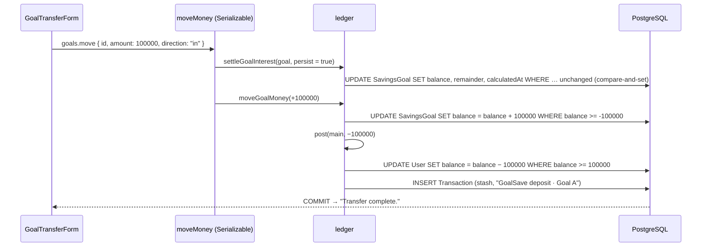

# 27 · Move money in and out of a goal

On a goal's page, **Transfer in** moves money from the **main balance** into the goal, and **Transfer out** moves it back. No card is used, so card locks and the daily limit do not apply, and nothing leaves the user's own accounts. Each move first settles the interest earned so far, then changes both balances in **one Serializable transaction**, and writes one history row ("GoalSave deposit · Laptop" or "GoalSave withdrawal · Laptop").

## At a glance

| | |
| --- | --- |
| **Route** | `/goals/<id>` (**Transfer in** / **Transfer out** buttons) |
| **Frontend** | `goal-transfer-form.tsx` (**client**), `goals.rules.ts` (`goalAmountError`), `goal-detail.tsx` (opens the form, shows "Transfer complete.") |
| **API** | `goals.move({ id, amount, direction: "in" \| "out" })` (protected mutation); `account.spending` for the main balance hint |
| **Backend** | `goals.service.ts` (`moveMoney` in `savingsTransaction`), ledger `settleGoalInterest()` (with `persist = true`), `moveGoalMoney()`, `post()` |
| **Database** | updates `SavingsGoal.balance` and `User.balance` in opposite directions; inserts one `Transaction` (`kind = stash`, `savingsGoalId`) |
| **Tests** | `goals.rules.test.ts` (6 amount tests), `verify-core.ts` (`checkSavings`); the SQL and the refusals were run on the test database, the form in Chromium |
| **Deep dive** | [GoalSave §6: Moving money](../05-features/08-goalsave.md#moving-money-goal-transfer-formtsx) |

## What the user can do

| Form | Hint | Refused when | Button |
| --- | --- | --- | --- |
| **Transfer in** | "From your main balance of ₱950.00" | more than the main balance: "Insufficient balance. You have ₱950.00" | **Confirm transfer** / Saving… |
| **Transfer out** | "Available: ₱100.00" | more than the goal holds: "Only ₱100.00 is in this goal" | **Confirm transfer** / Saving… |
| both | | ₱0 → "Enter an amount above ₱0.00"; over ₱1,000,000 → "Maximum ₱1,000,000.00" | **Cancel** closes the form |

## How it works

1. The form checks the amount with `goalAmountError(typed, centavos, available, direction)`. `available` is the **goal's** balance for "out" and the **main** balance (from `account.spending`) for "in".
2. **Confirm transfer** sends `goals.move({ id, amount, direction })`. Zod accepts whole centavos up to ₱1,000,000 and `in`/`out` only.
3. `moveMoney` runs in `savingsTransaction` (Serializable, up to 4 attempts):
   1. `settleOwnedGoal(…, persist = true)`: close off the interest earned **up to now**, at the **old** balance.
   2. `moveGoalMoney(tx, userId, id, ±amount)`: change the goal's balance with a conditional `UPDATE` (out: only if the goal has enough).
   3. `post()` the opposite change on the main balance (in: only if the main balance has enough), with a `stash` history row.
4. Success: the form closes with "Transfer complete."; every query reloads, so the bubble, the balance and the tab update.

## Structure



## Files and locations

| Layer | File | Role |
| --- | --- | --- |
| Frontend (client) | `gobank/src/features/goals/components/goal-transfer-form.tsx` | amount, hint, errors, submit |
| Rules | `gobank/src/features/goals/goals.rules.ts` | `goalAmountError`, `GoalTransfer` |
| Frontend | `gobank/src/features/goals/components/goal-detail.tsx` | opens the form, shows the message |
| API | `gobank/src/features/goals/goals.router.ts` | `move` |
| Service | `gobank/src/features/goals/goals.service.ts` | `moveMoney`, `savingsTransaction` |
| Ledger | `gobank/src/server/ledger.ts` | `settleGoalInterest`, `moveGoalMoney`, `post` |
| Tests | `gobank/src/features/goals/goals.rules.test.ts` | the amount rules |

## Frontend

<!-- code: gobank/src/features/goals/components/goal-transfer-form.tsx -->
**`gobank/src/features/goals/components/goal-transfer-form.tsx`** · all 106 lines

```tsx
  1 │ "use client";
  2 │
  3 │ import { useState } from "react";
  4 │ import { isPesoInput } from "~/shared/lib/amount-input";
  5 │ import { peso } from "~/shared/lib/format";
  6 │ import { MAX_TRANSACTION_CENTAVOS, toCentavos } from "~/shared/lib/money";
  7 │ import { Button } from "~/shared/ui/button";
  8 │ import { FormError } from "~/shared/ui/money-form-ui";
  9 │ import { TextField } from "~/shared/ui/text-field";
 10 │ import { errorMessage } from "~/trpc/error-message";
 11 │ import { api } from "~/trpc/react";
 12 │ import { goalAmountError, type GoalTransfer } from "../goals.rules";
 13 │
 14 │ const TITLE: Record<GoalTransfer, string> = {
 15 │   in: "Transfer in",
 16 │   out: "Transfer out",
 17 │ };
 18 │
 19 │ function transferHint(
 20 │   direction: GoalTransfer,
 21 │   goalBalance: number,
 22 │   mainBalance: number | undefined,
 23 │ ) {
 24 │   if (direction === "out") return `Available: ${peso(goalBalance)}`;
 25 │   if (mainBalance === undefined) return "Move money from your main balance.";
 26 │
 27 │   return `From your main balance of ${peso(mainBalance)}`;
 28 │ }
 29 │
 30 │ export function GoalTransferForm({
 31 │   goalId,
 32 │   goalBalance,
 33 │   direction,
 34 │   onDone,
 35 │   onCancel,
 36 │ }: {
 37 │   goalId: string;
 38 │   goalBalance: number;
 39 │   direction: GoalTransfer;
 40 │   onDone: (message: string) => void;
 41 │   onCancel: () => void;
 42 │ }) {
 43 │   const [amount, setAmount] = useState("");
 44 │   const spending = api.account.spending.useQuery();
 45 │   const move = api.goals.move.useMutation({
 46 │     onSuccess: () => onDone("Transfer complete."),
 47 │   });
 48 │
 49 │   const mainBalance = spending.data?.balance;
 50 │   const available =
 51 │     direction === "out"
 52 │       ? goalBalance
 53 │       : (mainBalance ?? MAX_TRANSACTION_CENTAVOS);
 54 │
 55 │   const centavos = toCentavos(Number(amount));
 56 │   const error = goalAmountError(amount, centavos, available, direction);
 57 │   const valid = centavos > 0 && !error;
 58 │
 59 │   const hint = transferHint(direction, goalBalance, mainBalance);
 60 │
 61 │   const submit = () => {
 62 │     if (!valid || move.isPending) return;
 63 │
 64 │     move.mutate({ id: goalId, amount: centavos, direction });
 65 │   };
 66 │
 67 │   return (
 68 │     <form
 69 │       className="bg-surface-raised mb-5 space-y-4 rounded-[22px] p-4"
 70 │       onSubmit={(event) => {
 71 │         event.preventDefault();
 72 │         submit();
 73 │       }}
 74 │     >
 75 │       <h2 className="text-lg font-bold">{TITLE[direction]}</h2>
 76 │
 77 │       <TextField
 78 │         label="Amount"
 79 │         value={amount}
 80 │         inputMode="decimal"
 81 │         prefix="₱"
 82 │         disabled={move.isPending}
 83 │         hint={hint}
 84 │         error={error}
 85 │         onChange={(event) => {
 86 │           if (isPesoInput(event.target.value)) setAmount(event.target.value);
 87 │         }}
 88 │       />
 89 │
 90 │       <FormError error={errorMessage(move.error)} />
 91 │
 92 │       <Button type="submit" disabled={move.isPending || !valid}>
 93 │         {move.isPending ? "Saving…" : "Confirm transfer"}
 94 │       </Button>
 95 │
 96 │       <button
 97 │         type="button"
 98 │         disabled={move.isPending}
 99 │         onClick={onCancel}
100 │         className="text-ink-muted hover:text-ink h-11 w-full rounded-xl text-sm font-medium focus-visible:outline-2 focus-visible:outline-offset-4"
101 │       >
102 │         Cancel
103 │       </button>
104 │     </form>
105 │   );
106 │ }
```
<!-- /code -->

<!-- code: gobank/src/features/goals/goals.rules.ts -->
**`gobank/src/features/goals/goals.rules.ts`** · all 31 lines

```ts
 1 │ import { peso } from "~/shared/lib/format";
 2 │ import { MAX_TRANSACTION_CENTAVOS } from "~/shared/lib/money";
 3 │
 4 │ export const GOAL_NAME_MAX = 40;
 5 │
 6 │ export type GoalTransfer = "in" | "out";
 7 │
 8 │ export const isValidGoalName = (name: string) => {
 9 │   const length = name.trim().length;
10 │   return length > 0 && length <= GOAL_NAME_MAX;
11 │ };
12 │
13 │ export function goalAmountError(
14 │   typed: string,
15 │   centavos: number,
16 │   available = MAX_TRANSACTION_CENTAVOS,
17 │   direction?: GoalTransfer,
18 │ ) {
19 │   if (!typed.trim()) return null;
20 │   if (!(centavos > 0)) return "Enter an amount above ₱0.00";
21 │
22 │   if (centavos > MAX_TRANSACTION_CENTAVOS) {
23 │     return `Maximum ${peso(MAX_TRANSACTION_CENTAVOS)}`;
24 │   }
25 │
26 │   if (centavos <= available) return null;
27 │
28 │   return direction === "out"
29 │     ? `Only ${peso(available)} is in this goal`
30 │     : `Insufficient balance. You have ${peso(available)}`;
31 │ }
```
<!-- /code -->

## Backend

<!-- code: gobank/src/features/goals/goals.router.ts 38-42 -->
**`gobank/src/features/goals/goals.router.ts`** · lines 38–42

```ts
38 │   move: protectedProcedure
39 │     .input(id.extend({ amount: centavos, direction: z.enum(["in", "out"]) }))
40 │     .mutation(({ ctx, input }) =>
41 │       moveMoney(ctx.userId, input.id, input.amount, input.direction),
42 │     ),
```
<!-- /code -->

<!-- code: gobank/src/features/goals/goals.service.ts 93-107 -->
**`gobank/src/features/goals/goals.service.ts`** · lines 93–107

```ts
 93 │ export const moveMoney = (
 94 │   userId: string,
 95 │   id: string,
 96 │   amountCentavos: number,
 97 │   direction: "in" | "out",
 98 │ ) =>
 99 │   savingsTransaction(async (tx) => {
100 │     await settleOwnedGoal(tx, userId, id, true);
101 │     return moveGoalMoney(
102 │       tx,
103 │       userId,
104 │       id,
105 │       direction === "in" ? amountCentavos : -amountCentavos,
106 │     );
107 │   });
```
<!-- /code -->

<!-- code: gobank/src/server/ledger.ts 212-235 -->
**`gobank/src/server/ledger.ts`** · lines 212–235

```ts
212 │ export async function moveGoalMoney(
213 │   tx: Tx,
214 │   userId: string,
215 │   savingsGoalId: string,
216 │   amount: number,
217 │ ) {
218 │   const savingsGoal = await orFailWith(
219 │     tx.savingsGoal.update({
220 │       where: { id: savingsGoalId, userId, balance: { gte: -amount } },
221 │       data: { balance: { increment: amount } },
222 │     }),
223 │     MESSAGES.notEnoughInGoal,
224 │   );
225 │
226 │   const action = amount > 0 ? "deposit" : "withdrawal";
227 │
228 │   return post(tx, {
229 │     userId,
230 │     kind: "stash",
231 │     title: `GoalSave ${action} · ${savingsGoal.name}`,
232 │     amount: -amount,
233 │     savingsGoalId,
234 │   });
235 │ }
```
<!-- /code -->

## Database

| Table | Transfer in ₱1,000 | Transfer out ₱1,000 |
| --- | --- | --- |
| `SavingsGoal.balance` | +100000 | −100000 (only if ≥ 100000) |
| `User.balance` | −100000 (only if ≥ 100000) | +100000 (only if it stays ≤ the cap) |
| `Transaction` | `kind = stash`, "GoalSave deposit · Goal A", `amount = −100000`, `savingsGoalId` | `kind = stash`, "GoalSave withdrawal · Goal A", `amount = +100000` |
| `SavingsGoal.interestCalculatedAt`, `interestRemainder` | saved by the settlement first | same |

The history row belongs to the **main** account, which is why its amount has the main account's sign. The goal's Transactions tab flips it ([26 §4](26-goal-detail.md#4-the-transactions-tab-signs-from-the-goals-point-of-view)).

## The complicated parts, explained step by step

### 1. The amount rules, shared by "in", "out" and the settings target

<!-- code: gobank/src/features/goals/goals.rules.ts 13-31 -->
**`gobank/src/features/goals/goals.rules.ts`** · lines 13–31

```ts
13 │ export function goalAmountError(
14 │   typed: string,
15 │   centavos: number,
16 │   available = MAX_TRANSACTION_CENTAVOS,
17 │   direction?: GoalTransfer,
18 │ ) {
19 │   if (!typed.trim()) return null;
20 │   if (!(centavos > 0)) return "Enter an amount above ₱0.00";
21 │
22 │   if (centavos > MAX_TRANSACTION_CENTAVOS) {
23 │     return `Maximum ${peso(MAX_TRANSACTION_CENTAVOS)}`;
24 │   }
25 │
26 │   if (centavos <= available) return null;
27 │
28 │   return direction === "out"
29 │     ? `Only ${peso(available)} is in this goal`
30 │     : `Insufficient balance. You have ${peso(available)}`;
31 │ }
```
<!-- /code -->

| Call | Result (from `goals.rules.test.ts` and Chromium) |
| --- | --- |
| `goalAmountError("", 0)` | `null`: no error while the field is still empty |
| `goalAmountError("0", 0)` | "Enter an amount above ₱0.00" |
| `goalAmountError("2000000", 200000000)` | "Maximum ₱1,000,000.00" |
| `goalAmountError("700", 70000, 63801, "out")` | **"Only ₱638.01 is in this goal"** |
| `goalAmountError("700", 70000, 50000, "in")` | **"Insufficient balance. You have ₱500.00"** |
| `goalAmountError("100", 10000, 50000, "in")` | `null` |
| typed `100.01` on "out" with ₱100.00 in the goal (Chromium) | "Only ₱100.00 is in this goal" |

When the main balance has not loaded yet, "in" uses `MAX_TRANSACTION_CENTAVOS` as `available` (form line 53), so the form never blocks a valid amount by mistake. The server still checks the real balance.

### 2. Settle first, then move: why `persist = true`

<!-- code: gobank/src/features/goals/goals.service.ts 99-106 -->
**`gobank/src/features/goals/goals.service.ts`** · lines 99–106

```ts
 99 │   savingsTransaction(async (tx) => {
100 │     await settleOwnedGoal(tx, userId, id, true);
101 │     return moveGoalMoney(
102 │       tx,
103 │       userId,
104 │       id,
105 │       direction === "in" ? amountCentavos : -amountCentavos,
106 │     );
```
<!-- /code -->

Interest is computed from `interestCalculatedAt` to now on the balance at that time. Moving money **without** settling first would get this wrong:

| Without settling first | With `settleOwnedGoal(…, true)` first |
| --- | --- |
| a goal with ₱0 since January gets ₱10,000 in December | the settlement at the December move earns ₱0 (the balance was ₱0) and sets `interestCalculatedAt = December` |
| the next read computes January → now on **₱10,000** | the next read computes December → now on ₱10,000 |
| about ₱400 of interest for money that was not there | correct: interest only for the time the money was in the goal |

`persist = true` saves the new settle time and remainder **even when less than one centavo was earned**. In the captured SQL below, the settlement `UPDATE` ran with `balance = 0` and a new `interestCalculatedAt`, although nothing was earned.

### 3. The SQL of one "Transfer in" (captured)

A real ₱1,000.00 move into "Goal A" for a test user, from PostgreSQL's log:

| # | Statement | Real parameters | From |
| --- | --- | --- | --- |
| 1 | `BEGIN; SET TRANSACTION ISOLATION LEVEL SERIALIZABLE` | | `savingsTransaction` |
| 2 | `SELECT … FROM "SavingsGoal" WHERE "id" = $1 AND "userId" = $2` | the goal, the user | `settleOwnedGoal` |
| 3 | `UPDATE "SavingsGoal" SET "balance" = $1, "interestRemainder" = $2, "interestCalculatedAt" = $3 WHERE "id" = $5 AND "userId" = $6 AND "balance" = $7 AND "interestCalculatedAt" = $8` | `$1 = 0`, `$2 = 0`, `$7 = 0`, `$8` = the old settle time | settlement, **compare-and-set** |
| 4 | `UPDATE "SavingsGoal" SET "balance" = "balance" + $1 WHERE "id" = $3 AND "userId" = $4 AND "balance" >= $5` | `$1 = 100000`, `$5 = -100000` | `moveGoalMoney` |
| 5 | `UPDATE "User" SET "balance" = "balance" + $1 … WHERE "balance" >= $5 AND "balance" <= $6 …` | `$1 = -100000`, `$5 = 100000` | `post()` |
| 6 | `INSERT INTO "Transaction" (…, "savingsGoalId", …)` | `'stash'`, `'GoalSave deposit · Goal A'`, `-100000`, balanceAfter `900000` | `post()` |
| 7 | `COMMIT` | | |

Reading statement 4: `balance >= -amount`. For "in" that is `balance >= -100000`, always true. For "out" ₱1,000 it becomes `balance >= 100000`: the goal must hold at least ₱1,000. Statement 5 is the mirror image for the main balance.

### 4. Two conditional updates, one transaction

<!-- code: gobank/src/server/ledger.ts 212-235 -->
**`gobank/src/server/ledger.ts`** · lines 212–235

```ts
212 │ export async function moveGoalMoney(
213 │   tx: Tx,
214 │   userId: string,
215 │   savingsGoalId: string,
216 │   amount: number,
217 │ ) {
218 │   const savingsGoal = await orFailWith(
219 │     tx.savingsGoal.update({
220 │       where: { id: savingsGoalId, userId, balance: { gte: -amount } },
221 │       data: { balance: { increment: amount } },
222 │     }),
223 │     MESSAGES.notEnoughInGoal,
224 │   );
225 │
226 │   const action = amount > 0 ? "deposit" : "withdrawal";
227 │
228 │   return post(tx, {
229 │     userId,
230 │     kind: "stash",
231 │     title: `GoalSave ${action} · ${savingsGoal.name}`,
232 │     amount: -amount,
233 │     savingsGoalId,
234 │   });
235 │ }
```
<!-- /code -->

| Direction | Goal check (statement 4) | Main-account check (`post`) | Message if refused |
| --- | --- | --- | --- |
| in | none needed | main balance ≥ amount | "Insufficient balance" |
| out | goal balance ≥ amount | main balance + amount ≤ ₱21,474,836.47 | "Not enough in this goal" / "This transaction would exceed the account limit" |

If either check fails, the error leaves the transaction and **both** updates are rolled back. Money can never disappear from the goal without arriving in the main account, or the other way round. Tested on the database: moving out one centavo more than the goal held was refused with "Not enough in this goal", and nothing changed.

### 5. The form's hint changes with the direction

<!-- code: gobank/src/features/goals/components/goal-transfer-form.tsx 19-28 -->
**`gobank/src/features/goals/components/goal-transfer-form.tsx`** · lines 19–28

```tsx
19 │ function transferHint(
20 │   direction: GoalTransfer,
21 │   goalBalance: number,
22 │   mainBalance: number | undefined,
23 │ ) {
24 │   if (direction === "out") return `Available: ${peso(goalBalance)}`;
25 │   if (mainBalance === undefined) return "Move money from your main balance.";
26 │
27 │   return `From your main balance of ${peso(mainBalance)}`;
28 │ }
```
<!-- /code -->

| Direction | Main balance loaded | Hint (Chromium) |
| --- | --- | --- |
| in | yes | "From your main balance of ₱950.00" |
| in | not yet | "Move money from your main balance." |
| out | (not needed) | "Available: ₱100.00" |

When there is an error, `TextField` shows it **instead of** the hint, in red, with `role="alert"`.

## Rules and limits

| Rule | Value |
| --- | --- |
| Amount | ₱0.01 to ₱1,000,000.00 per move |
| In | at most the main balance |
| Out | at most the goal balance |
| Card, lock, daily limit, points | not involved (money stays inside the user's own accounts) |
| Isolation | Serializable, up to 4 attempts |

## Messages

| Text | When |
| --- | --- |
| Transfer in / Transfer out | form titles |
| From your main balance of ₱… / Move money from your main balance. / Available: ₱… | hints |
| Enter an amount above ₱0.00 / Maximum ₱1,000,000.00 | amount checks |
| Insufficient balance. You have ₱… | in, more than the main balance (form) |
| Only ₱… is in this goal | out, more than the goal (form) |
| Insufficient balance / Not enough in this goal / This transaction would exceed the account limit | server refusals |
| Confirm transfer / Saving… · Cancel | buttons |
| Transfer complete. | success |
| Your savings changed. Please try again. | 4 attempts failed |

## Tests

- `goals.rules.test.ts` (unit): the empty field, zero, the maximum, "out" over the goal balance (₱638.01), "in" over the main balance (₱500.00), and a valid amount.
- `verify-core.ts` → `checkSavings`: moves ₱100 in, and closing later returns everything.
- **Run on the test database for this review:** the SQL in §3 and the "Not enough in this goal" refusal.
- **Checked in Chromium for this review:** the "in" hint with the real main balance, a ₱100 move ("Transfer complete."), and the "out" error for ₱100.01.
