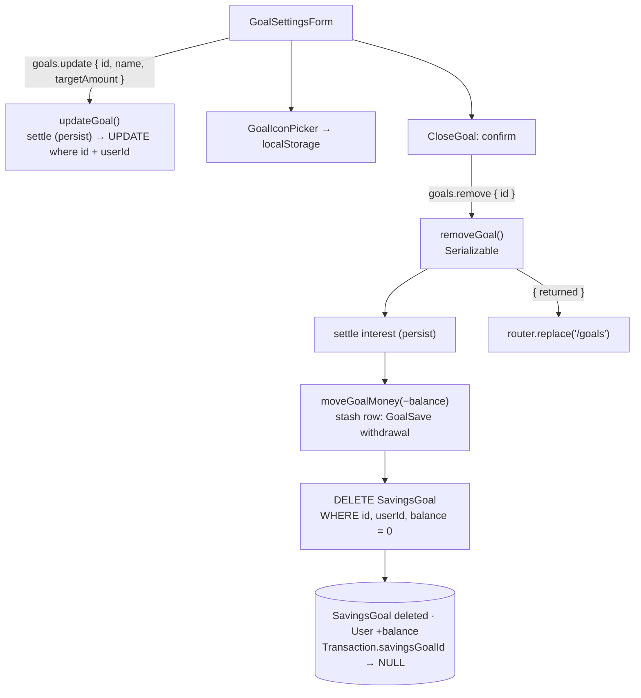

# 28 · Goal settings and closing a goal

**Settings** on a goal's page lets the user change the **icon**, the **name** and the **savings target** (or remove the target), and **close** the goal. Closing asks for confirmation ("Close this goal?"), moves the whole balance, including the interest earned up to that second, back to the main account, deletes the goal, and goes back to the GoalSave list. The goal's past moves stay in the main history.

## At a glance

| | |
| --- | --- |
| **Route** | `/goals/<id>` (**Settings** button) |
| **Frontend** | `goal-settings-form.tsx` (**client**: `GoalSettingsForm`, `CloseGoal`), `goal-icon-picker.tsx`, `use-goal-icon.ts`, `goals.rules.ts` |
| **API** | `goals.update({ id, name, targetAmount })`, `goals.remove({ id })` (protected mutations) |
| **Backend** | `goals.service.ts` (`updateGoal`, `removeGoal`), ledger `settleGoalInterest()` (`persist = true`), `moveGoalMoney()` |
| **Database** | update: `SavingsGoal.name`, `targetAmount`; close: settles interest, moves the balance back (`SavingsGoal` → `User`, one `stash` row), deletes the `SavingsGoal`; `Transaction.savingsGoalId` becomes `NULL` (`onDelete: SetNull`) |
| **Tests** | `verify-core.ts` (`checkSavings`: close returns everything); the close and the leftover history were run on the test database, the screens in Chromium |
| **Deep dive** | [GoalSave §6: Settings and closing](../05-features/08-goalsave.md#settings-and-closing-goal-settings-formtsx) |

## What the user can do

| Part | What it does |
| --- | --- |
| icon | opens **Choose an icon** ([25 §2](25-create-goal.md#2-the-icon-picker-a-bottom-sheet-made-from-dialog)); saved in this browser at once |
| **Goal name** | 1–40 characters, unique per user |
| **Savings target** (optional) | "Leave blank to remove your target." |
| **Save settings** / Saving… | "Goal settings saved." |
| **Close goal** | shows the confirmation box |
| **Close goal and return savings** / Closing goal… | closes it, back to `/goals` |
| **Keep goal** | hides the confirmation |
| **Cancel** | closes the settings form |

## How it works

1. The form starts with the goal's name and target in pesos (`String(toPesos(targetAmount))`, or empty).
2. **Save settings** is enabled for a valid name and a valid or empty target. It sends `goals.update({ id, name: name.trim(), targetAmount: null or centavos })`.
3. `updateGoal` settles the interest with `persist = true`, then updates the goal **where `id` and `userId`** match.
4. Changing the icon does not call the server: `onIconChange` → `useGoalIcon`'s `setIcon` → `localStorage`.
5. **Close goal** → confirmation → `goals.remove({ id })`. `removeGoal` settles the interest (`persist = true`), moves the **whole** balance back with `moveGoalMoney(−balance)`, deletes the goal **only if its balance is now 0**, and returns `{ returned }`.
6. On success the browser goes to `/goals` (`router.replace`) and refreshes.

## Structure



## Files and locations

| Layer | File | Role |
| --- | --- | --- |
| Frontend (client) | `gobank/src/features/goals/components/goal-settings-form.tsx` | settings form and the close confirmation |
| Frontend | `gobank/src/features/goals/components/goal-icon-picker.tsx` | icon sheet |
| Hook | `gobank/src/features/goals/hooks/use-goal-icon.ts` | icon in `localStorage` |
| Rules | `gobank/src/features/goals/goals.rules.ts` | name and target checks |
| API | `gobank/src/features/goals/goals.router.ts` | `update`, `remove` |
| Service | `gobank/src/features/goals/goals.service.ts` | `updateGoal`, `removeGoal` |
| Ledger | `gobank/src/server/ledger.ts` | `settleGoalInterest`, `moveGoalMoney` |
| Schema | `gobank/prisma/schema.prisma` | `Transaction.savingsGoal` with `onDelete: SetNull` |

## Frontend

<!-- code: gobank/src/features/goals/components/goal-settings-form.tsx -->
**`gobank/src/features/goals/components/goal-settings-form.tsx`** · all 195 lines

```tsx
  1 │ "use client";
  2 │
  3 │ import { useRouter } from "next/navigation";
  4 │ import { useState } from "react";
  5 │ import { isPesoInput } from "~/shared/lib/amount-input";
  6 │ import { peso } from "~/shared/lib/format";
  7 │ import { toCentavos, toPesos } from "~/shared/lib/money";
  8 │ import { Button } from "~/shared/ui/button";
  9 │ import { FormError } from "~/shared/ui/money-form-ui";
 10 │ import { TextField } from "~/shared/ui/text-field";
 11 │ import { errorMessage } from "~/trpc/error-message";
 12 │ import { api } from "~/trpc/react";
 13 │ import {
 14 │   goalAmountError,
 15 │   isValidGoalName,
 16 │   GOAL_NAME_MAX,
 17 │ } from "../goals.rules";
 18 │ import type { GoalIcon } from "./goal-art";
 19 │ import { GoalIconPicker } from "./goal-icon-picker";
 20 │
 21 │ type Goal = {
 22 │   id: string;
 23 │   name: string;
 24 │   balance: number;
 25 │   targetAmount: number | null;
 26 │ };
 27 │
 28 │ function CloseGoal({
 29 │   goalId,
 30 │   balance,
 31 │   disabled,
 32 │ }: {
 33 │   goalId: string;
 34 │   balance: number;
 35 │   disabled: boolean;
 36 │ }) {
 37 │   const router = useRouter();
 38 │   const [confirming, setConfirming] = useState(false);
 39 │
 40 │   const remove = api.goals.remove.useMutation({
 41 │     onSuccess: () => {
 42 │       router.replace("/goals");
 43 │       router.refresh();
 44 │     },
 45 │   });
 46 │
 47 │   const busy = disabled || remove.isPending || remove.isSuccess;
 48 │
 49 │   if (!confirming) {
 50 │     return (
 51 │       <button
 52 │         type="button"
 53 │         disabled={busy}
 54 │         onClick={() => setConfirming(true)}
 55 │         className="text-danger h-11 w-full text-sm font-medium disabled:opacity-45"
 56 │       >
 57 │         Close goal
 58 │       </button>
 59 │     );
 60 │   }
 61 │
 62 │   return (
 63 │     <div
 64 │       className="border-line space-y-3 rounded-xl border p-4"
 65 │       role="region"
 66 │       aria-label="Close goal confirmation"
 67 │     >
 68 │       <h3 className="font-semibold">Close this goal?</h3>
 69 │       <p className="text-ink-soft text-[13px] leading-relaxed">
 70 │         {peso(balance)} will return to your main account. This goal will be
 71 │         removed, and past transfers will stay in your account activity.
 72 │       </p>
 73 │
 74 │       <FormError error={errorMessage(remove.error)} />
 75 │
 76 │       <button
 77 │         type="button"
 78 │         disabled={busy}
 79 │         onClick={() => remove.mutate({ id: goalId })}
 80 │         className="bg-danger-soft text-danger h-11 w-full rounded-xl text-sm font-semibold disabled:opacity-45"
 81 │       >
 82 │         {remove.isPending ? "Closing goal…" : "Close goal and return savings"}
 83 │       </button>
 84 │       <button
 85 │         type="button"
 86 │         disabled={busy}
 87 │         onClick={() => setConfirming(false)}
 88 │         className="text-ink-muted h-10 w-full text-sm"
 89 │       >
 90 │         Keep goal
 91 │       </button>
 92 │     </div>
 93 │   );
 94 │ }
 95 │
 96 │ export function GoalSettingsForm({
 97 │   goal,
 98 │   icon,
 99 │   onIconChange,
100 │   onDone,
101 │   onCancel,
102 │ }: {
103 │   goal: Goal;
104 │   icon: GoalIcon;
105 │   onIconChange: (icon: GoalIcon) => void;
106 │   onDone: (message: string) => void;
107 │   onCancel: () => void;
108 │ }) {
109 │   const [name, setName] = useState(goal.name);
110 │   const [target, setTarget] = useState(
111 │     goal.targetAmount ? String(toPesos(goal.targetAmount)) : "",
112 │   );
113 │
114 │   const update = api.goals.update.useMutation({
115 │     onSuccess: () => onDone("Goal settings saved."),
116 │   });
117 │
118 │   const targetCentavos = toCentavos(Number(target));
119 │   const noTarget = target.trim() === "";
120 │   const targetError = goalAmountError(target, targetCentavos);
121 │   const validTarget = noTarget || (targetCentavos > 0 && !targetError);
122 │   const canSave = isValidGoalName(name) && validTarget && !update.isPending;
123 │
124 │   const submit = () => {
125 │     if (!canSave) return;
126 │
127 │     update.mutate({
128 │       id: goal.id,
129 │       name: name.trim(),
130 │       targetAmount: noTarget ? null : targetCentavos,
131 │     });
132 │   };
133 │
134 │   return (
135 │     <form
136 │       className="bg-surface-raised mb-5 space-y-4 rounded-[22px] p-4"
137 │       onSubmit={(event) => {
138 │         event.preventDefault();
139 │         submit();
140 │       }}
141 │     >
142 │       <h2 className="text-lg font-bold">Goal settings</h2>
143 │
144 │       <GoalIconPicker
145 │         value={icon}
146 │         onChange={onIconChange}
147 │         disabled={update.isPending}
148 │       />
149 │
150 │       <TextField
151 │         label="Goal name"
152 │         value={name}
153 │         onChange={(event) => setName(event.target.value)}
154 │         required
155 │         maxLength={GOAL_NAME_MAX}
156 │         disabled={update.isPending}
157 │       />
158 │
159 │       <TextField
160 │         label="Savings target"
161 │         optional
162 │         value={target}
163 │         inputMode="decimal"
164 │         prefix="₱"
165 │         disabled={update.isPending}
166 │         hint="Leave blank to remove your target."
167 │         error={targetError}
168 │         onChange={(event) => {
169 │           if (isPesoInput(event.target.value)) setTarget(event.target.value);
170 │         }}
171 │       />
172 │
173 │       <FormError error={errorMessage(update.error)} />
174 │
175 │       <Button type="submit" disabled={!canSave}>
176 │         {update.isPending ? "Saving…" : "Save settings"}
177 │       </Button>
178 │
179 │       <CloseGoal
180 │         goalId={goal.id}
181 │         balance={goal.balance}
182 │         disabled={update.isPending}
183 │       />
184 │
185 │       <button
186 │         type="button"
187 │         disabled={update.isPending}
188 │         onClick={onCancel}
189 │         className="text-ink-muted hover:text-ink h-11 w-full rounded-xl text-sm font-medium focus-visible:outline-2 focus-visible:outline-offset-4"
190 │       >
191 │         Cancel
192 │       </button>
193 │     </form>
194 │   );
195 │ }
```
<!-- /code -->

## Backend

<!-- code: gobank/src/features/goals/goals.router.ts 30-46 -->
**`gobank/src/features/goals/goals.router.ts`** · lines 30–46

```ts
30 │   update: protectedProcedure
31 │     .input(
32 │       id.extend({ name: name.optional(), targetAmount: centavos.nullish() }),
33 │     )
34 │     .mutation(({ ctx, input: { id, ...fields } }) =>
35 │       updateGoal(ctx.userId, id, fields),
36 │     ),
37 │
38 │   move: protectedProcedure
39 │     .input(id.extend({ amount: centavos, direction: z.enum(["in", "out"]) }))
40 │     .mutation(({ ctx, input }) =>
41 │       moveMoney(ctx.userId, input.id, input.amount, input.direction),
42 │     ),
43 │
44 │   remove: protectedProcedure
45 │     .input(id)
46 │     .mutation(({ ctx, input }) => removeGoal(ctx.userId, input.id)),
```
<!-- /code -->

<!-- code: gobank/src/features/goals/goals.service.ts 83-91 -->
**`gobank/src/features/goals/goals.service.ts`** · lines 83–91

```ts
83 │ export const updateGoal = (
84 │   userId: string,
85 │   id: string,
86 │   fields: SavingsGoalFields,
87 │ ) =>
88 │   savingsTransaction(async (tx) => {
89 │     await settleOwnedGoal(tx, userId, id, true);
90 │     return tx.savingsGoal.update({ where: { id, userId }, data: fields });
91 │   });
```
<!-- /code -->

<!-- code: gobank/src/features/goals/goals.service.ts 109-119 -->
**`gobank/src/features/goals/goals.service.ts`** · lines 109–119

```ts
109 │ export const removeGoal = (userId: string, id: string) =>
110 │   savingsTransaction(async (tx) => {
111 │     const savingsGoal = await settleOwnedGoal(tx, userId, id, true);
112 │
113 │     if (savingsGoal.balance > 0) {
114 │       await moveGoalMoney(tx, userId, savingsGoal.id, -savingsGoal.balance);
115 │     }
116 │
117 │     await tx.savingsGoal.delete({ where: { id, userId, balance: 0 } });
118 │     return { returned: savingsGoal.balance };
119 │   });
```
<!-- /code -->

## Database

<!-- code: gobank/prisma/schema.prisma 180-183 -->
**`gobank/prisma/schema.prisma`** · lines 180–183

```prisma
180 │   user         User         @relation(fields: [userId], references: [id], onDelete: Cascade)
181 │   counterparty User?        @relation("Counterparty", fields: [counterpartyId], references: [id], onDelete: SetNull)
182 │   savingsGoal  SavingsGoal? @relation(fields: [savingsGoalId], references: [id], onDelete: SetNull)
183 │   biller       Biller?      @relation(fields: [billerId], references: [id], onDelete: SetNull)
```
<!-- /code -->

| Action | `SavingsGoal` | `User` | `Transaction` |
| --- | --- | --- | --- |
| Save settings | `name`, `targetAmount` (`NULL` = no target); settle time/remainder | | an `interest` row if ≥ 1 centavo was due |
| Close | settled, emptied, then **deleted** | `balance + returned` | `interest` row (if due), a `stash` row "GoalSave withdrawal · …"; **all** the goal's rows keep existing with `savingsGoalId = NULL` |

## The complicated parts, explained step by step

### 1. Closing in three guarded steps

<!-- code: gobank/src/features/goals/goals.service.ts 109-119 -->
**`gobank/src/features/goals/goals.service.ts`** · lines 109–119

```ts
109 │ export const removeGoal = (userId: string, id: string) =>
110 │   savingsTransaction(async (tx) => {
111 │     const savingsGoal = await settleOwnedGoal(tx, userId, id, true);
112 │
113 │     if (savingsGoal.balance > 0) {
114 │       await moveGoalMoney(tx, userId, savingsGoal.id, -savingsGoal.balance);
115 │     }
116 │
117 │     await tx.savingsGoal.delete({ where: { id, userId, balance: 0 } });
118 │     return { returned: savingsGoal.balance };
119 │   });
```
<!-- /code -->

| Line | Step | Guard |
| --- | --- | --- |
| 110 | everything inside `savingsTransaction` (Serializable) | all or nothing; retried on conflicts |
| 111 | `settleOwnedGoal(tx, userId, id, true)`: interest up to **this second**, at the current balance | the goal must be the user's (`where: { id, userId }`) |
| 113–115 | if the balance is above 0, `moveGoalMoney(tx, userId, id, −balance)` → the goal goes to 0 and the main account gets it (one `stash` row) | `balance >= balance` on the goal, and the main account must stay under its cap |
| 117 | `delete({ where: { id, userId, balance: 0 } })` | **a last check**: the goal is deleted only if it really is empty now |
| 118 | `return { returned: savingsGoal.balance }` | the balance **after** settling, which is what was moved |

**Run on the test database for this review:** a goal with ₱1,000.00, "a year later":

| Step | Value |
| --- | --- |
| settlement | +₱40.80 interest (one `interest` row), balance ₱1,040.80 |
| move back | "GoalSave withdrawal · Goal A", +104080 on the main account |
| `removeGoal` returned | `{ "returned": 104080 }` |
| main balance | **+₱1,040.80** |
| the goal | deleted |

### 2. The history survives the goal

<!-- code: gobank/prisma/schema.prisma 180-183 -->
**`gobank/prisma/schema.prisma`** · lines 180–183

```prisma
180 │   user         User         @relation(fields: [userId], references: [id], onDelete: Cascade)
181 │   counterparty User?        @relation("Counterparty", fields: [counterpartyId], references: [id], onDelete: SetNull)
182 │   savingsGoal  SavingsGoal? @relation(fields: [savingsGoalId], references: [id], onDelete: SetNull)
183 │   biller       Biller?      @relation(fields: [billerId], references: [id], onDelete: SetNull)
```
<!-- /code -->

`onDelete: SetNull` on `Transaction.savingsGoal` means deleting a goal does **not** delete its history rows. Their `savingsGoalId` just becomes `NULL`. The three rows of the closed test goal, read back afterwards:

| Title | `amount` | `savingsGoalId` | Visible where |
| --- | --- | --- | --- |
| GoalSave deposit · Goal A | −100000 | `NULL` | main history (`stash`) |
| Interest earned · Goal A | +4080 | `NULL` | **nowhere in the app**: the main history leaves out `interest` rows, and the goal's tab is gone |
| GoalSave withdrawal · Goal A | +104080 | `NULL` | main history |

The confirmation text promises "past transfers will stay in your account activity", which is true for the deposits and withdrawals. The interest is not lost, because the withdrawal row's amount includes it, but its separate lines become invisible. This is listed in [Limitations](../09-defense/03-limitations-and-future-work.md#3-product-and-ux-limitations). (A receipt is still reachable by its reference, because `getTransaction` does not filter by kind.)

### 3. The confirmation and the "busy" state

<!-- code: gobank/src/features/goals/components/goal-settings-form.tsx 28-94 -->
**`gobank/src/features/goals/components/goal-settings-form.tsx`** · lines 28–94

```tsx
28 │ function CloseGoal({
29 │   goalId,
30 │   balance,
31 │   disabled,
32 │ }: {
33 │   goalId: string;
34 │   balance: number;
35 │   disabled: boolean;
36 │ }) {
37 │   const router = useRouter();
38 │   const [confirming, setConfirming] = useState(false);
39 │
40 │   const remove = api.goals.remove.useMutation({
41 │     onSuccess: () => {
42 │       router.replace("/goals");
43 │       router.refresh();
44 │     },
45 │   });
46 │
47 │   const busy = disabled || remove.isPending || remove.isSuccess;
48 │
49 │   if (!confirming) {
50 │     return (
51 │       <button
52 │         type="button"
53 │         disabled={busy}
54 │         onClick={() => setConfirming(true)}
55 │         className="text-danger h-11 w-full text-sm font-medium disabled:opacity-45"
56 │       >
57 │         Close goal
58 │       </button>
59 │     );
60 │   }
61 │
62 │   return (
63 │     <div
64 │       className="border-line space-y-3 rounded-xl border p-4"
65 │       role="region"
66 │       aria-label="Close goal confirmation"
67 │     >
68 │       <h3 className="font-semibold">Close this goal?</h3>
69 │       <p className="text-ink-soft text-[13px] leading-relaxed">
70 │         {peso(balance)} will return to your main account. This goal will be
71 │         removed, and past transfers will stay in your account activity.
72 │       </p>
73 │
74 │       <FormError error={errorMessage(remove.error)} />
75 │
76 │       <button
77 │         type="button"
78 │         disabled={busy}
79 │         onClick={() => remove.mutate({ id: goalId })}
80 │         className="bg-danger-soft text-danger h-11 w-full rounded-xl text-sm font-semibold disabled:opacity-45"
81 │       >
82 │         {remove.isPending ? "Closing goal…" : "Close goal and return savings"}
83 │       </button>
84 │       <button
85 │         type="button"
86 │         disabled={busy}
87 │         onClick={() => setConfirming(false)}
88 │         className="text-ink-muted h-10 w-full text-sm"
89 │       >
90 │         Keep goal
91 │       </button>
92 │     </div>
93 │   );
94 │ }
```
<!-- /code -->

| State | Shown |
| --- | --- |
| `confirming = false` | a red **Close goal** text button |
| `confirming = true` | a box (`role="region"`, "Close goal confirmation") with the exact amount: "₱100.00 will return to your main account. This goal will be removed, and past transfers will stay in your account activity." |
| request running | "Closing goal…", every button disabled (`busy`) |
| `remove.isSuccess` | still `busy`, so nothing can be tapped while the page changes |
| success | `router.replace("/goals")` + `router.refresh()` |

`router.replace` (not `push`) removes the deleted goal's page from the browser history: pressing **Back** afterwards does not try to open a goal that no longer exists. Checked in Chromium: the box showed the text above for a ₱100 goal, and after closing, the list showed "₱0.00 · 0 / 5 goals".

### 4. Saving settings settles interest first, too

<!-- code: gobank/src/features/goals/goals.service.ts 83-91 -->
**`gobank/src/features/goals/goals.service.ts`** · lines 83–91

```ts
83 │ export const updateGoal = (
84 │   userId: string,
85 │   id: string,
86 │   fields: SavingsGoalFields,
87 │ ) =>
88 │   savingsTransaction(async (tx) => {
89 │     await settleOwnedGoal(tx, userId, id, true);
90 │     return tx.savingsGoal.update({ where: { id, userId }, data: fields });
91 │   });
```
<!-- /code -->

Renaming or changing the target does not change the balance, but `updateGoal` still settles with `persist = true` before the `UPDATE`. That gives every write the same order: settle, then change. It also means a settings save can never overwrite a settlement made at the same moment, because the compare-and-set and the Serializable retry handle that.

| Field sent | Result |
| --- | --- |
| `targetAmount: null` (field emptied) | the target is removed: "Target · Not set", ring shows the name only |
| `targetAmount: 2000000` | target ₱20,000.00 |
| `name: "Laptop"` while another goal of this user is called "Laptop" | `P2002` → "That name is already taken" ([25 §4](25-create-goal.md#4-duplicate-names-the-database-decides)) |

### 5. The target field starts from the saved value

<!-- code: gobank/src/features/goals/components/goal-settings-form.tsx 109-122 -->
**`gobank/src/features/goals/components/goal-settings-form.tsx`** · lines 109–122

```tsx
109 │   const [name, setName] = useState(goal.name);
110 │   const [target, setTarget] = useState(
111 │     goal.targetAmount ? String(toPesos(goal.targetAmount)) : "",
112 │   );
113 │
114 │   const update = api.goals.update.useMutation({
115 │     onSuccess: () => onDone("Goal settings saved."),
116 │   });
117 │
118 │   const targetCentavos = toCentavos(Number(target));
119 │   const noTarget = target.trim() === "";
120 │   const targetError = goalAmountError(target, targetCentavos);
121 │   const validTarget = noTarget || (targetCentavos > 0 && !targetError);
122 │   const canSave = isValidGoalName(name) && validTarget && !update.isPending;
```
<!-- /code -->

| Saved `targetAmount` | Field starts as |
| --- | --- |
| `2000000` | `20000` |
| `1500050` | `15000.5` (`String(15000.5)`; the field shows no trailing zero) |
| `null` | empty |

`goalAmountError(target, targetCentavos)` is called without `available`, so only the "above ₱0" and "maximum" rules apply to a target.

## Rules and limits

| Rule | Value |
| --- | --- |
| Name | 1–40 characters, unique per user |
| Target | optional; ₱0.01 to ₱1,000,000 |
| Icon | 6 choices, per browser |
| Close | returns the whole balance (with interest up to that second) to the main account |
| After closing | the goal is deleted; deposits and withdrawals stay in the main history; interest lines are no longer shown |

## Messages

| Text | When |
| --- | --- |
| Goal settings · Goal name · Savings target · Leave blank to remove your target. | form |
| Save settings / Saving… · Goal settings saved. | saving |
| Close goal · Close this goal? · ₱… will return to your main account. This goal will be removed, and past transfers will stay in your account activity. | closing |
| Close goal and return savings / Closing goal… · Keep goal · Cancel | buttons |
| That name is already taken | duplicate name (server) |
| Not found | not your goal (server) |

## Tests

- `verify-core.ts` → `checkSavings`: another user's `removeGoal` is refused; the owner's `removeGoal` returns exactly the settled balance, the main balance grows by exactly that, and the goal row is gone.
- **Run on the test database for this review:** the close in §1 and the leftover history in §2.
- **Checked in Chromium for this review:** the confirmation box and its text, closing a ₱100 goal, and the list afterwards.
