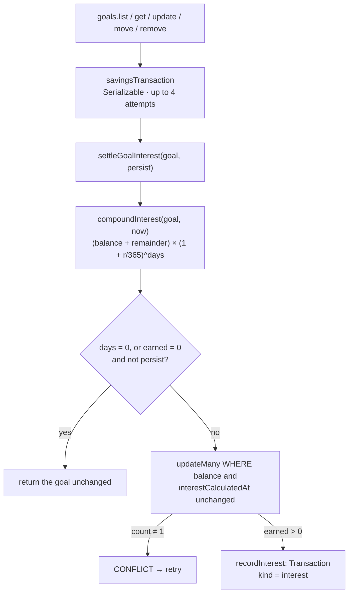

# 29 · Savings interest (automatic)

Every goal earns **4% a year, compounded daily**. Nobody presses a button and there is no nightly job. Interest is calculated **whenever a goal is read or changed**, from the last settlement to that moment, to the fraction of a day. Whole centavos are added to the goal; the leftover **fraction of a centavo** is carried to the next calculation, so nothing is lost or paid twice. Each payment of at least one centavo writes an "Interest earned · Laptop" row.

## At a glance

| | |
| --- | --- |
| **Route** | none of its own; runs on every `goals.list` ([24](24-goalsave-overview.md)), `goals.get` ([26](26-goal-detail.md)), `goals.update`, `goals.move` and `goals.remove` ([27](27-goal-transfers.md), [28](28-goal-settings-and-close.md)) |
| **Frontend** | none directly: the screens refetch every 15 s, so new interest appears by itself; the rate is shown as "4.00% p.a." |
| **Backend** | `shared/lib/savings-interest.ts` (`compoundInterest`), ledger `settleGoalInterest()` and `recordInterest()`, `goals.service.ts` (`savingsTransaction`, `settleOwnedGoal`) |
| **Database** | `SavingsGoal.balance`, `interestRemainder`, `interestCalculatedAt`, `annualInterestRate`; `Transaction` rows with `kind = interest` |
| **Tests** | `savings-interest.test.ts` (4 tests), `verify-core.ts` (`checkSavings`); traces and a concurrency check were run for this review |
| **Deep dive** | [GoalSave §2: the interest math](../05-features/08-goalsave.md#2-the-interest-math-savings-interestts) |

## How it works

1. A GoalSave read or write calls `settleGoalInterest(tx, goal, persist)`.
2. `compoundInterest(goal, now)`: `days` = exact time since `interestCalculatedAt` (fractions allowed). The new exact balance is `(balance + interestRemainder) × (1 + 0.04/365)^days`. The goal keeps the whole centavos (`Math.floor`), and the rest becomes the new `interestRemainder`.
3. If nothing needs saving (no time passed, or less than 1 centavo earned on a **read**), the goal is returned unchanged.
4. Otherwise a **compare-and-set** `updateMany` saves the new balance, remainder and time, but only if the goal's balance and settle time are still the ones that were read. If another request got there first, it fails with `CONFLICT` and `savingsTransaction` retries.
5. If at least one centavo was earned, `recordInterest` writes an `interest` history row. It goes into the goal's Transactions tab, not the main history.

## Structure



## Files and locations

| Layer | File | Role |
| --- | --- | --- |
| Math | `gobank/src/shared/lib/savings-interest.ts` | `compoundInterest` (pure function, no database) |
| Ledger | `gobank/src/server/ledger.ts` | `settleGoalInterest`, `recordInterest` |
| Service | `gobank/src/features/goals/goals.service.ts` | `savingsTransaction`, `settleOwnedGoal`, who calls with `persist = true` |
| Tests | `gobank/src/shared/lib/savings-interest.test.ts` | the math |
| Schema | `gobank/prisma/schema.prisma`, migration `20261006000400_stash_compound_interest` | the interest columns and their `CHECK` |

## Frontend

There is no interest screen. Interest shows up in three places:

| Where | What |
| --- | --- |
| goal tiles and the goal page | the balance grows; "4.00% p.a." from `annualInterestRate` |
| the goal's **Transactions** tab | "Interest earned · Laptop · +₱40.80" ([26 §4](26-goal-detail.md#4-the-transactions-tab-signs-from-the-goals-point-of-view)) |
| the receipt of that row | `/transactions/<reference>` ([34](34-receipts.md)) |

## Backend

<!-- code: gobank/src/shared/lib/savings-interest.ts -->
**`gobank/src/shared/lib/savings-interest.ts`** · all 40 lines

```ts
 1 │ const DAY_MS = 24 * 60 * 60 * 1000;
 2 │ const DAYS_PER_YEAR = 365;
 3 │ const MAX_SAVINGS_CENTAVOS = 2_000_000_000;
 4 │
 5 │ type Savings = {
 6 │   balance: number;
 7 │   annualInterestRate: number;
 8 │   interestRemainder: number;
 9 │   interestCalculatedAt: Date;
10 │ };
11 │
12 │ const daysBetween = (from: Date, to: Date) =>
13 │   Math.max(0, (to.getTime() - from.getTime()) / DAY_MS);
14 │
15 │ const dailyGrowth = (annualRate: number, days: number) =>
16 │   Math.exp(days * Math.log1p(annualRate / DAYS_PER_YEAR));
17 │
18 │ export function compoundInterest(savings: Savings, now: Date) {
19 │   const days = daysBetween(savings.interestCalculatedAt, now);
20 │   if (!Number.isFinite(days)) throw new Error("Invalid savings date.");
21 │   if (days === 0) return { ...savings, earned: 0, days: 0 };
22 │
23 │   const exactBalance =
24 │     (savings.balance + savings.interestRemainder) *
25 │     dailyGrowth(savings.annualInterestRate, days);
26 │   const balance = Math.floor(exactBalance);
27 │
28 │   if (!Number.isSafeInteger(balance) || balance > MAX_SAVINGS_CENTAVOS) {
29 │     throw new Error("Savings interest exceeds the account limit.");
30 │   }
31 │
32 │   return {
33 │     ...savings,
34 │     balance,
35 │     interestRemainder: exactBalance - balance,
36 │     interestCalculatedAt: now,
37 │     earned: balance - savings.balance,
38 │     days,
39 │   };
40 │ }
```
<!-- /code -->

<!-- code: gobank/src/server/ledger.ts 237-296 -->
**`gobank/src/server/ledger.ts`** · lines 237–296

```ts
237 │ async function recordInterest(
238 │   tx: Tx,
239 │   savingsGoal: SavingsGoal,
240 │   result: ReturnType<typeof compoundInterest>,
241 │ ) {
242 │   const user = await tx.user.findUniqueOrThrow({
243 │     where: { id: savingsGoal.userId },
244 │     select: { balance: true },
245 │   });
246 │
247 │   await tx.transaction.create({
248 │     data: {
249 │       userId: savingsGoal.userId,
250 │       savingsGoalId: savingsGoal.id,
251 │       reference: newReference(),
252 │       kind: "interest",
253 │       title: `Interest earned · ${savingsGoal.name}`,
254 │       amount: result.earned,
255 │       balanceAfter: user.balance,
256 │       details: {
257 │         savingsBalanceAfter: result.balance,
258 │         annualRate: savingsGoal.annualInterestRate,
259 │         days: result.days,
260 │       },
261 │     },
262 │   });
263 │ }
264 │
265 │ export async function settleGoalInterest(
266 │   tx: Tx,
267 │   savingsGoal: SavingsGoal,
268 │   persist = false,
269 │ ) {
270 │   const result = compoundInterest(savingsGoal, new Date());
271 │
272 │   const nothingToSave = result.days === 0 || (result.earned === 0 && !persist);
273 │   if (nothingToSave) return savingsGoal;
274 │
275 │   const settled = {
276 │     balance: result.balance,
277 │     interestRemainder: result.interestRemainder,
278 │     interestCalculatedAt: result.interestCalculatedAt,
279 │     updatedAt: result.interestCalculatedAt,
280 │   };
281 │
282 │   const updated = await tx.savingsGoal.updateMany({
283 │     where: {
284 │       id: savingsGoal.id,
285 │       userId: savingsGoal.userId,
286 │       balance: savingsGoal.balance,
287 │       interestCalculatedAt: savingsGoal.interestCalculatedAt,
288 │     },
289 │     data: settled,
290 │   });
291 │   if (updated.count !== 1) fail("CONFLICT", MESSAGES.savingsChanged);
292 │
293 │   if (result.earned > 0) await recordInterest(tx, savingsGoal, result);
294 │
295 │   return { ...savingsGoal, ...settled };
296 │ }
```
<!-- /code -->

<!-- code: gobank/src/features/goals/goals.service.ts 42-52 -->
**`gobank/src/features/goals/goals.service.ts`** · lines 42–52

```ts
42 │ const settleOwnedGoal = async (
43 │   tx: Prisma.TransactionClient,
44 │   userId: string,
45 │   id: string,
46 │   persist = false,
47 │ ) =>
48 │   settleGoalInterest(
49 │     tx,
50 │     await tx.savingsGoal.findUniqueOrThrow({ where: { id, userId } }),
51 │     persist,
52 │   );
```
<!-- /code -->

## Database

<!-- code: gobank/prisma/schema.prisma 134-150 -->
**`gobank/prisma/schema.prisma`** · lines 134–150

```prisma
134 │ model SavingsGoal {
135 │   id                   String   @id @default(cuid())
136 │   userId               String
137 │   name                 String
138 │   targetAmount         Int?
139 │   balance              Int      @default(0)
140 │   annualInterestRate   Float    @default(0.04)
141 │   interestRemainder    Float    @default(0)
142 │   interestCalculatedAt DateTime @default(now())
143 │   createdAt            DateTime @default(now())
144 │   updatedAt            DateTime @updatedAt
145 │
146 │   user         User          @relation(fields: [userId], references: [id], onDelete: Cascade)
147 │   transactions Transaction[]
148 │
149 │   @@unique([userId, name])
150 │ }
```
<!-- /code -->

| Column | Meaning | Example after a year on ₱1,000 |
| --- | --- | --- |
| `balance` | whole centavos | `104080` |
| `interestRemainder` | the fraction of a centavo not yet paid (0 ≤ x < 1) | `0.8493` |
| `interestCalculatedAt` | the moment interest was last settled | the time of that read |
| `annualInterestRate` | `0.04` | `0.04` |

The interest row it wrote, read back from the test database:

```json
{ "title": "Interest earned · Goal A", "amount": 4080, "balanceAfter": 900000,
  "details": { "days": 365.0000000810185, "annualRate": 0.04, "savingsBalanceAfter": 104080 } }
```

`balanceAfter` is the **main** balance, which does not change (interest goes into the goal). The goal's new balance is in `details.savingsBalanceAfter`. `days` is not exactly 365, because the read happened a few milliseconds after the "one year ago" timestamp set by the test.

## The complicated parts, explained step by step

### 1. The formula, and why `log1p`

<!-- code: gobank/src/shared/lib/savings-interest.ts 12-16 -->
**`gobank/src/shared/lib/savings-interest.ts`** · lines 12–16

```ts
12 │ const daysBetween = (from: Date, to: Date) =>
13 │   Math.max(0, (to.getTime() - from.getTime()) / DAY_MS);
14 │
15 │ const dailyGrowth = (annualRate: number, days: number) =>
16 │   Math.exp(days * Math.log1p(annualRate / DAYS_PER_YEAR));
```
<!-- /code -->

```text
balance_after = (balance + remainder) × (1 + r / 365) ^ days
              = (balance + remainder) × exp(days × log1p(r / 365))
```

| Value | Computed with Node |
| --- | --- |
| one day's factor `1 + 0.04/365` | 1.0001095890 |
| one year's factor `exp(365 × log1p(0.04/365))` | **1.0408084931**, so ₱1,000 grows to ₱1,040.808… |

`Math.log1p(x)` computes `log(1 + x)` accurately when `x` is tiny (here 0.0001096). Writing `Math.log(1 + x)` would first round `1 + x` to the nearest double and lose digits. With `exp` and `log`, `days` can be a fraction: half a day is just `0.5`.

### 2. Whole centavos now, the fraction later

<!-- code: gobank/src/shared/lib/savings-interest.ts 18-40 -->
**`gobank/src/shared/lib/savings-interest.ts`** · lines 18–40

```ts
18 │ export function compoundInterest(savings: Savings, now: Date) {
19 │   const days = daysBetween(savings.interestCalculatedAt, now);
20 │   if (!Number.isFinite(days)) throw new Error("Invalid savings date.");
21 │   if (days === 0) return { ...savings, earned: 0, days: 0 };
22 │
23 │   const exactBalance =
24 │     (savings.balance + savings.interestRemainder) *
25 │     dailyGrowth(savings.annualInterestRate, days);
26 │   const balance = Math.floor(exactBalance);
27 │
28 │   if (!Number.isSafeInteger(balance) || balance > MAX_SAVINGS_CENTAVOS) {
29 │     throw new Error("Savings interest exceeds the account limit.");
30 │   }
31 │
32 │   return {
33 │     ...savings,
34 │     balance,
35 │     interestRemainder: exactBalance - balance,
36 │     interestCalculatedAt: now,
37 │     earned: balance - savings.balance,
38 │     days,
39 │   };
40 │ }
```
<!-- /code -->

Run with the project's function (rate 4%, starting with no remainder):

| Saved | Time | New balance | Earned | Carried remainder |
| --- | --- | --- | --- | --- |
| ₱1,000.00 | 1 hour | 100000 | **0** | 0.4566 |
| ₱1,000.00 | 1 day | 100010 | 10 (₱0.10) | 0.9589 |
| ₱1,000.00 | 30 days | 100329 | 329 | 0.2901 |
| ₱1,000.00 | 365 days | **104080** | **4080 (₱40.80)** | 0.8493 |
| ₱100.00 | 1 day | 10001 | 1 | 0.0959 |
| ₱20,000.00 | 1 day | 2000219 | 219 (₱2.19) | 0.1781 |

`Math.floor` never pays a centavo that was not fully earned, and `interestRemainder` keeps the part that was cut off, so it is paid later instead of lost.

### 3. Checking often gives exactly the same result

| Path | After the first step | After the second step |
| --- | --- | --- |
| ₱1,000: half a day, then another half day | 100005, remainder 0.4793 | **100010, remainder 0.9589** |
| ₱1,000: one step of a full day | | **100010, remainder 0.9589** |

Mathematically, `(b × g(d₁)) × g(d₂) = b × g(d₁ + d₂)`, and carrying the remainder makes the rounding disappear too. The unit test checks it over a year: settling ₱1.00 **every day for 365 days** ends at exactly the same 104 centavos as settling **once**. This is why GoBank can settle **lazily**, only when a goal is looked at, with no background job, and still pay exactly the right amount.

### 4. Reads save only when there is money to pay

<!-- code: gobank/src/server/ledger.ts 270-273 -->
**`gobank/src/server/ledger.ts`** · lines 270–273

```ts
270 │   const result = compoundInterest(savingsGoal, new Date());
271 │
272 │   const nothingToSave = result.days === 0 || (result.earned === 0 && !persist);
273 │   if (nothingToSave) return savingsGoal;
```
<!-- /code -->

| Called from | `persist` | 1 hour on ₱1,000 (earned 0) | 1 day on ₱1,000 (earned 10) |
| --- | --- | --- | --- |
| `goals.list`, `goals.get` (reads) | `false` | **nothing written**: the next read recomputes from the old time | saved + interest row |
| `update`, `move`, `remove` (writes) | `true` | the new time and remainder are **saved**, even with 0 earned | saved + interest row |

Not saving on reads keeps the 15-second refresh from writing to the database every time. It is still exact: the next calculation starts from the old time **and** the old remainder. Writes must persist, because they are about to change the balance (see [27 §2](27-goal-transfers.md#2-settle-first-then-move-why-persist--true)).

### 5. Paying interest exactly once, even at the same moment

<!-- code: gobank/src/server/ledger.ts 282-291 -->
**`gobank/src/server/ledger.ts`** · lines 282–291

```ts
282 │   const updated = await tx.savingsGoal.updateMany({
283 │     where: {
284 │       id: savingsGoal.id,
285 │       userId: savingsGoal.userId,
286 │       balance: savingsGoal.balance,
287 │       interestCalculatedAt: savingsGoal.interestCalculatedAt,
288 │     },
289 │     data: settled,
290 │   });
291 │   if (updated.count !== 1) fail("CONFLICT", MESSAGES.savingsChanged);
```
<!-- /code -->

| Time | Read A | Read B |
| --- | --- | --- |
| t1 | reads the goal: balance 100000, settled a year ago | reads the same |
| t2 | `updateMany … WHERE balance = 100000 AND interestCalculatedAt = <a year ago>` → **1 row**, then the interest row | |
| t3 | | the same `updateMany` → **0 rows** (the balance is now 104080) → `CONFLICT` |
| t4 | | `savingsTransaction` retries: reads 104080 settled just now → nothing more to pay |

**Run on the test database for this review:** two `getGoal` and one `listGoals` for a goal with ₱1,000.00 settled "a year ago", fired at the same moment. All three succeeded, and exactly **one** interest row (₱40.80) was written. The goal ended at 104080 with remainder 0.8493.

### 6. Safety limits

| Situation | What `compoundInterest` does (tested for this review) |
| --- | --- |
| the clock went **backwards** (the saved time is in the future) | `days = max(0, …)` = 0 → earns nothing |
| an invalid date | throws "Invalid savings date." |
| the result would pass ₱20,000,000 (`MAX_SAVINGS_CENTAVOS`) or stop being a safe integer | throws "Savings interest exceeds the account limit." (₱20,000,000 for a year → thrown) |
| the input object | **never changed**: a new object is returned (unit test) |

The database also guards the stored values. The constraints as they exist in a fully migrated database (read from PostgreSQL's `pg_constraint` for this review):

| Constraint | Definition |
| --- | --- |
| `SavingsGoal_balance_check` | `CHECK (balance >= 0)` |
| `SavingsGoal_valid_interest` | `CHECK ("annualInterestRate" >= 0 AND "annualInterestRate" <= 1 AND "interestRemainder" >= 0 AND "interestRemainder" < 1)` |

The second one was written in migration `20261006000400_stash_compound_interest` with the **old** names (`"interestRate"`, `"interestCarry"` on the table `"Stash"`). Migration `20261010000000_clear_savings_bitcoin_names` renamed the table and the columns, and PostgreSQL kept the constraint attached to the renamed columns. See [Migration history](../03-database/02-migration-history.md).

## Rules and limits

| Rule | Value |
| --- | --- |
| Rate | 4% a year (`annualInterestRate` 0.04 by default; no screen to change it) |
| Compounding | daily, on fractional days: `(1 + r/365)^days` |
| Paid | whole centavos, rounded down; the fraction is carried |
| When | on every GoalSave read or write (lazy settlement) |
| Saved on reads | only if at least 1 centavo was earned |
| Maximum | ₱20,000,000 per goal after interest |
| History | one `interest` row per payment, in the goal's tab (not in the main history) |

## Messages

| Text | When |
| --- | --- |
| 4.00% p.a. · Annual growth rate | tiles and the Overview tab |
| Interest earned · Laptop | the history row |
| Your savings changed. Please try again. | 4 conflicting attempts in a row |

## Tests

`savings-interest.test.ts` (unit):

| Test | Proves |
| --- | --- |
| a year of daily compounding at 4% earns the expected interest | ₱1,000 → 104,080 centavos, 4,080 earned |
| calculating interest does not change the original savings | the function is pure |
| interest is never paid twice for the same days | settling again at the same moment, or for an earlier time, earns 0 |
| checking every day earns the same as checking once a year | the path independence in §3 |

- `verify-core.ts` → `checkSavings`: after "a year", the goal is between ₱104.00 and ₱104.20, a second read pays nothing more, and the main balance is unchanged.
- **Run for this review:** the traces in §1–3 and §6 with the project's function, and the concurrent reads in §5 on the test database.
