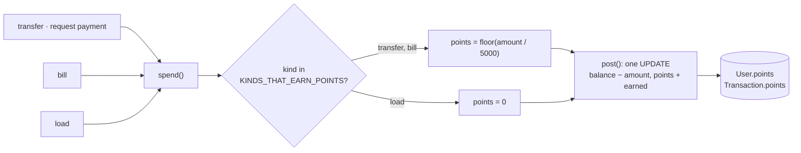

# 30 · Earning points (GoRewards)

Every **transfer** (including paying a money request) and every **bill payment** earns **1 point per ₱50**, counted per payment and rounded down. Loads, deposits, GoalSave moves and Bitcoin trades earn nothing, and neither does **receiving** money. Points are added in the **same database statement** as the payment itself, so a payment and its points always succeed or fail together. 100 points convert to ₱1.00 ([31](31-rewards-and-convert.md)).

## At a glance

| | |
| --- | --- |
| **Route** | none of its own; happens inside `/transfer`, `/notifications` (paying a request), `/bills` |
| **Frontend** | where points are shown: dashboard balance card and GoRewards card ([11](11-dashboard.md)), the bill receipt ("Points earned +30", [17](17-pay-bills.md)), history receipts ("Points", [34](34-receipts.md)), the Rewards screen ([31](31-rewards-and-convert.md), [32](32-rewards-history.md)) |
| **Backend** | ledger `spend()` (`KINDS_THAT_EARN_POINTS`, `pointsEarned`), `post()` (the points part of the conditional `UPDATE`); `shared/lib/money.ts` |
| **Database** | `User.points` (`CHECK >= 0`), `Transaction.points` on the payer's row |
| **Tests** | `verify-core.ts` (`checkBillsAndLoad`: exactly 1 point after a ₱50 bill and a ₱100 load); the transfer and bill rows of this review |
| **Deep dive** | [Rewards §1–2](../05-features/09-rewards.md#2-earning-happens-inside-the-payment) |

## What the user sees

| Where | Example |
| --- | --- |
| dashboard balance card | "30 points" |
| dashboard GoRewards card | "GoRewards · 30 points" |
| bill receipt | "Points earned · +30" (₱1,500.00 bill) |
| history receipt of a transfer or bill | "Points · 3" |
| Rewards → History | "Transfer to @dante · Nov 4 · ₱150.00 spent · +3 pts" |

## How it works

1. A transfer, request payment or bill calls `spend()` ([23](23-pay-with-card.md)).
2. `spend()` decides: `earnsPoints = KINDS_THAT_EARN_POINTS.includes(kind)`, where the list is `["transfer", "bill"]`.
3. If so, `points = pointsEarned(amount) = floor(amount ÷ 5000)`. Otherwise 0.
4. `post()` adds **both** in one conditional `UPDATE`: `balance = balance − amount, points = points + earned`, only if the balance is enough **and** the points stay ≤ 2,147,483,647.
5. The payer's history row stores `points`. The receiver's row of a transfer stores `0`.

## Structure



## Files and locations

| Layer | File | Role |
| --- | --- | --- |
| Rules | `gobank/src/shared/lib/money.ts` | `pointsEarned`, `CENTAVOS_PER_POINT_EARNED`, `MAX_REWARD_POINTS` |
| Ledger | `gobank/src/server/ledger.ts` | `KINDS_THAT_EARN_POINTS`, `spend()`, `post()` |
| Display | `gobank/src/features/dashboard/components/balance-card.tsx`, `feature-grid.tsx` | points on the dashboard |
| Display | `gobank/src/features/bills/components/bill-payment.tsx` | "Points earned" on the bill receipt |
| Display | `gobank/src/features/activity/components/receipt-screen.tsx` | "Points" on a history receipt |

## Frontend

<!-- code: gobank/src/features/bills/components/bill-payment.tsx 157-166 -->
**`gobank/src/features/bills/components/bill-payment.tsx`** · lines 157–166

```tsx
157 │         <TransactionSummary
158 │           amount={Math.abs(pay.data.amount)}
159 │           details={[
160 │             { label: "Account", value: maskDigits(accountNumber) },
161 │             { label: "Reference", value: pay.data.reference },
162 │             { label: "Date", value: dateTime(pay.data.createdAt) },
163 │             { label: "Points earned", value: `+${pay.data.points}` },
164 │             { label: "Balance", value: peso(pay.data.balanceAfter) },
165 │             ...paidWithDetail(pay.data.details),
166 │           ]}
```
<!-- /code -->

<!-- code: gobank/src/features/activity/components/receipt-screen.tsx 29-31 -->
**`gobank/src/features/activity/components/receipt-screen.tsx`** · lines 29–31

```tsx
29 │   if (points) {
30 │     details.push({ label: "Points", value: points.toLocaleString("en-PH") });
31 │   }
```
<!-- /code -->

## Backend

<!-- code: gobank/src/shared/lib/money.ts -->
**`gobank/src/shared/lib/money.ts`** · all 18 lines

```ts
 1 │ export const MAX_GOALS = 5;
 2 │ export const MAX_TRANSACTION_CENTAVOS = 100_000_000;
 3 │ export const MAX_BALANCE_CENTAVOS = 2_147_483_647;
 4 │ export const MAX_REWARD_POINTS = 2_147_483_647;
 5 │ export const MIN_REDEEM_POINTS = 100;
 6 │
 7 │ const CENTAVOS_PER_POINT_EARNED = 5000;
 8 │ const CENTAVOS_PER_POINT_REDEEMED = 1;
 9 │
10 │ export const toCentavos = (pesos: number) => Math.round(pesos * 100);
11 │
12 │ export const toPesos = (centavos: number) => centavos / 100;
13 │
14 │ export const pointsEarned = (spent: number) =>
15 │   Math.floor(spent / CENTAVOS_PER_POINT_EARNED);
16 │
17 │ export const pointsValue = (points: number) =>
18 │   points * CENTAVOS_PER_POINT_REDEEMED;
```
<!-- /code -->

<!-- code: gobank/src/server/ledger.ts 35-36 -->
**`gobank/src/server/ledger.ts`** · lines 35–36

```ts
35 │ const SPENDING_KINDS: TransactionKind[] = ["transfer", "bill", "load"];
36 │ const KINDS_THAT_EARN_POINTS: TransactionKind[] = ["transfer", "bill"];
```
<!-- /code -->

<!-- code: gobank/src/server/ledger.ts 154-159 -->
**`gobank/src/server/ledger.ts`** · lines 154–159

```ts
154 │   const earnsPoints = KINDS_THAT_EARN_POINTS.includes(entry.kind);
155 │
156 │   return post(tx, {
157 │     ...entry,
158 │     amount: -entry.amount,
159 │     points: earnsPoints ? pointsEarned(entry.amount) : 0,
```
<!-- /code -->

<!-- code: gobank/src/server/ledger.ts 80-103 -->
**`gobank/src/server/ledger.ts`** · lines 80–103

```ts
 80 │ export async function post(
 81 │   tx: Tx,
 82 │   { userId, amount, points = 0, reference = newReference(), ...rest }: Entry,
 83 │ ) {
 84 │   const moneyOut = Math.max(0, -amount);
 85 │   const moneyIn = Math.max(0, amount);
 86 │   const pointsOut = Math.max(0, -points);
 87 │   const pointsIn = Math.max(0, points);
 88 │
 89 │   const user = await orFailWith(
 90 │     tx.user.update({
 91 │       where: {
 92 │         id: userId,
 93 │         balance: { gte: moneyOut, lte: MAX_BALANCE_CENTAVOS - moneyIn },
 94 │         points: { gte: pointsOut, lte: MAX_REWARD_POINTS - pointsIn },
 95 │       },
 96 │       data: {
 97 │         balance: { increment: amount },
 98 │         points: { increment: points },
 99 │       },
100 │       select: { balance: true },
101 │     }),
102 │     () => whyPostFailed(tx, userId, amount, points),
103 │   );
```
<!-- /code -->

## Database

| Column | Meaning |
| --- | --- |
| `User.points` | the current points; `CHECK ("points" >= 0)` (first migration) |
| `Transaction.points` | `+N` on a payment that earned points, `−N` on a conversion ([31](31-rewards-and-convert.md)), `0` otherwise |

## The complicated parts, explained step by step

### 1. Per payment, rounded down

<!-- code: gobank/src/shared/lib/money.ts 7-15 -->
**`gobank/src/shared/lib/money.ts`** · lines 7–15

```ts
 7 │ const CENTAVOS_PER_POINT_EARNED = 5000;
 8 │ const CENTAVOS_PER_POINT_REDEEMED = 1;
 9 │
10 │ export const toCentavos = (pesos: number) => Math.round(pesos * 100);
11 │
12 │ export const toPesos = (centavos: number) => centavos / 100;
13 │
14 │ export const pointsEarned = (spent: number) =>
15 │   Math.floor(spent / CENTAVOS_PER_POINT_EARNED);
```
<!-- /code -->

| Payment | `floor(amount / 5000)` |
| --- | --- |
| ₱49.99 (4999) | **0** |
| ₱50.00 (5000) | 1 |
| ₱99.99 (9999) | 1 |
| ₱149.99 (14999) | 2 |
| ₱150.00 (15000) | **3** (the transfer made for this review: `points = 3` on the row) |
| ₱1,500.00 (150000) | **30** (the bill made for this review: "Points earned +30") |
| ₱1,000,000.00 (the maximum) | 20,000 |

Each payment is rounded **on its own**: two payments of ₱25 earn 0 + 0 = **0** points, while one ₱50 payment earns **1**. Splitting a payment never earns more. The real rate: 1 point per ₱50 spent, and a point is worth ₱0.01, so the cash back is **0.02%** (₱1 per ₱5,000). The constants are named (`CENTAVOS_PER_POINT_EARNED`, `CENTAVOS_PER_POINT_REDEEMED`), so the rate is easy to tune.

### 2. Which payments earn

<!-- code: gobank/src/server/ledger.ts 35-36 -->
**`gobank/src/server/ledger.ts`** · lines 35–36

```ts
35 │ const SPENDING_KINDS: TransactionKind[] = ["transfer", "bill", "load"];
36 │ const KINDS_THAT_EARN_POINTS: TransactionKind[] = ["transfer", "bill"];
```
<!-- /code -->

| Action | `kind` | Goes through `spend()` | Earns points |
| --- | --- | --- | --- |
| Send money / pay a request | `transfer` | yes | **yes**, for the payer |
| Receive money | `transfer` (positive) | no (`post()` only) | no |
| Pay bills | `bill` | yes | **yes** |
| Buy load | `load` | yes | **no** |
| Deposit, GoalSave move, interest, Bitcoin, cash back | `deposit`, `stash`, `interest`, `exchange`, `reward` | no | no |

Tested in `verify-core.ts`: a ₱50 bill (1 point) and a ₱100 load (0 points) leave the user with exactly **1** point.

### 3. Points and money in one statement

<!-- code: gobank/src/server/ledger.ts 84-101 -->
**`gobank/src/server/ledger.ts`** · lines 84–101

```ts
 84 │   const moneyOut = Math.max(0, -amount);
 85 │   const moneyIn = Math.max(0, amount);
 86 │   const pointsOut = Math.max(0, -points);
 87 │   const pointsIn = Math.max(0, points);
 88 │
 89 │   const user = await orFailWith(
 90 │     tx.user.update({
 91 │       where: {
 92 │         id: userId,
 93 │         balance: { gte: moneyOut, lte: MAX_BALANCE_CENTAVOS - moneyIn },
 94 │         points: { gte: pointsOut, lte: MAX_REWARD_POINTS - pointsIn },
 95 │       },
 96 │       data: {
 97 │         balance: { increment: amount },
 98 │         points: { increment: points },
 99 │       },
100 │       select: { balance: true },
101 │     }),
```
<!-- /code -->

From the real ₱150.00 transfer of this review ([14 §6](14-send-money.md#6-the-whole-transfer-as-postgresql-saw-it)):

| Parameter | Value | Meaning |
| --- | --- | --- |
| `$1` | −15000 | the balance change |
| `$2` | **3** | the points change |
| `$5` | 15000 | the balance must be at least ₱150.00 |
| `$7` | 0 | nothing taken from points |
| `$8` | 2147483644 | points must stay ≤ `MAX_REWARD_POINTS` after adding 3 |

Because one `UPDATE` changes both, there is no moment when the money has left but the points are missing, or the other way round. If the payment is refused (balance, card lock, daily limit), no points are given.

### 4. A ceiling for points

`MAX_REWARD_POINTS` is 2,147,483,647, the largest PostgreSQL `INT`. The condition `points <= MAX_REWARD_POINTS − pointsIn` refuses a payment that would overflow the column, with "This transaction would exceed the account limit". At 1 point per ₱50, that would take more than ₱107 billion of spending, so in practice it only guards against bad data.

## Rules and limits

| Rule | Value |
| --- | --- |
| Rate | 1 point per ₱50 (5,000 centavos) per payment, rounded down |
| Earned on | transfers (incl. request payments) and bills, by the payer |
| Not earned on | load, deposits, receiving money, GoalSave, interest, Bitcoin, cash back |
| Value | 1 point = ₱0.01 when converted (in steps of 100 points, [31](31-rewards-and-convert.md)) |
| Maximum | 2,147,483,647 points |

## Messages

| Text | Where |
| --- | --- |
| N points | dashboard balance card and GoRewards card |
| Points earned · +N | bill receipt |
| Points · N | history receipt |
| 1 pt per ₱50 spent | Rewards → History header |

## Tests

- `verify-core.ts` → `checkBillsAndLoad`: after a ₱50 bill and a ₱100 load, `getOverview(owner).points === 1`.
- **Rows made during this review:** the ₱150 transfer had `points = 3` (and the receiver's row `0`), and the ₱1,500 bill showed "Points earned +30" in Chromium.
- **Computed with Node:** the rounding table in §1.
