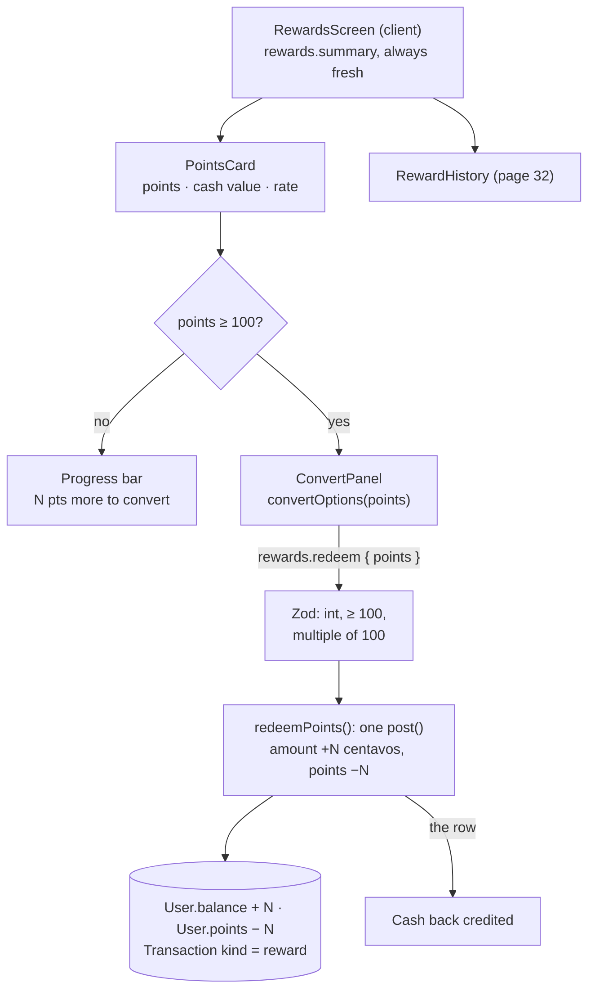

# 31 · Rewards screen and converting points

**Rewards** (`/rewards`, the GoRewards card on the dashboard) shows the user's points, their cash value, the conversion rate (**100 pts = ₱1.00**), and either a progress bar toward the first ₱1.00 or a **Convert to cash** button. Converting is done in **whole hundreds** of points. The user picks 100, 500, 1,000… or **All**, and the cash is added to the main balance at once, with a receipt. Below it is the points history ([32](32-rewards-history.md)).

## At a glance

| | |
| --- | --- |
| **Route** | `/rewards` |
| **Frontend** | page `gobank/src/app/(app)/rewards/page.tsx`; `rewards-screen.tsx` (**client**: `PointsCard`, `Progress`, `ConvertPanel`, receipt), `rewards.rules.ts` (`pointsToNextPeso`, `redeemablePoints`, `convertOptions`); `reward-history.tsx` ([32](32-rewards-history.md)) |
| **API** | `rewards.summary` (protected query, always refetched on open), `rewards.redeem({ points })` (protected mutation) |
| **Backend** | `rewards.router.ts` (Zod: 100 ≤ points, multiple of 100), `rewards.service.ts` (`getRewardsSummary`, `redeemPoints` = one `post()`) |
| **Database** | `User.points` −N and `User.balance` +N centavos in **one** conditional `UPDATE`; one `Transaction` (`kind = reward`, "Cash back · 500 points") |
| **Tests** | `rewards.rules.test.ts` (4 tests); redemption, Zod and a race were run on the test database, the screen in Chromium |
| **Deep dive** | [Rewards §3–5](../05-features/09-rewards.md#3-the-api-and-service) |

## What the user can do

| Points | Card shows | Action |
| --- | --- | --- |
| 30 | "30 pts", Cash value ₱0.30, a progress bar (30%), "70 pts more to convert to cash" | **Convert to cash** disabled |
| 1,250 | "1,250 pts", Cash value ₱12.50 | **Convert to cash** → choices **100 · 500 · 1,000 · All** (All = 1,200 is preselected) |
| after picking 500 | "Get ₱5.00 for 500 pts" | converts → receipt "Cash back credited" |
| receipt | ₱5.00 · Points used 500 · Reference · Date · Main balance | **Done** → back to Rewards (750 pts) |

## How it works

1. `rewards.summary` loads with `staleTime: 0` and `refetchOnMount: "always"`, so the points are fresh every time the screen opens.
2. Below 100 points, `Progress` shows how far the user is (`pointsToNextPeso`). From 100 points, **Convert to cash** opens `ConvertPanel`.
3. The panel offers `convertOptions(points)`: up to 4 choices that end with **all** the convertible points (`redeemablePoints` = whole hundreds).
4. **Get ₱… for … pts** sends `rewards.redeem({ points })`. Zod requires an integer ≥ 100, ≤ the maximum, and a multiple of 100.
5. `redeemPoints` runs **one `post()`** in a transaction: `amount = +points` centavos (1 point = 1 centavo), `points = −points`, `kind = "reward"`, title "Cash back · 500 points".
6. The receipt shows the server's row. **Done** resets the screen, and the invalidated queries reload the points and the history.

## Structure



## Files and locations

| Layer | File | Role |
| --- | --- | --- |
| Page | `gobank/src/app/(app)/rewards/page.tsx` | renders the screen, tab title "Rewards" |
| Frontend (client) | `gobank/src/features/rewards/components/rewards-screen.tsx` | card, progress, convert panel, receipt |
| Rules | `gobank/src/features/rewards/rewards.rules.ts` | the progress and the choices |
| API | `gobank/src/features/rewards/rewards.router.ts` | `summary`, `history`, `redeem` |
| Service | `gobank/src/features/rewards/rewards.service.ts` | `redeemPoints`, `getRewardsSummary`, `listRewardActivity` |
| Constants | `gobank/src/shared/lib/money.ts` | `MIN_REDEEM_POINTS = 100`, `pointsValue`, `MAX_REWARD_POINTS` |
| Ledger | `gobank/src/server/ledger.ts` | `post()` |
| Tests | `gobank/src/features/rewards/rewards.rules.test.ts` | the rules |

## Frontend

<!-- code: gobank/src/app/(app)/rewards/page.tsx -->
**`gobank/src/app/(app)/rewards/page.tsx`** · all 10 lines

```tsx
 1 │ import type { Metadata } from "next";
 2 │ import { RewardsScreen } from "~/features/rewards/components/rewards-screen";
 3 │
 4 │ export const metadata: Metadata = {
 5 │   title: "Rewards",
 6 │ };
 7 │
 8 │ export default function RewardsPage() {
 9 │   return <RewardsScreen />;
10 │ }
```
<!-- /code -->

<!-- code: gobank/src/features/rewards/components/rewards-screen.tsx -->
**`gobank/src/features/rewards/components/rewards-screen.tsx`** · all 264 lines

```tsx
  1 │ "use client";
  2 │
  3 │ import { Gem } from "lucide-react";
  4 │ import { useState, type ReactNode } from "react";
  5 │ import { cn } from "~/shared/lib/cn";
  6 │ import { dateTime, peso } from "~/shared/lib/format";
  7 │ import { MIN_REDEEM_POINTS, pointsValue } from "~/shared/lib/money";
  8 │ import { Button } from "~/shared/ui/button";
  9 │ import { FormError } from "~/shared/ui/money-form-ui";
 10 │ import { PageHeader } from "~/shared/ui/page-header";
 11 │ import { TransactionReceipt } from "~/shared/ui/transaction-receipt";
 12 │ import { TransactionSummary } from "~/shared/ui/transaction-summary";
 13 │ import { errorMessage } from "~/trpc/error-message";
 14 │ import { api } from "~/trpc/react";
 15 │ import {
 16 │   convertOptions,
 17 │   pointsToNextPeso,
 18 │   redeemablePoints,
 19 │ } from "../rewards.rules";
 20 │ import { RewardHistory } from "./reward-history";
 21 │
 22 │ const formatPoints = (points: number) => points.toLocaleString("en-PH");
 23 │
 24 │ export function RewardsScreen() {
 25 │   const summary = api.rewards.summary.useQuery(undefined, {
 26 │     staleTime: 0,
 27 │     refetchOnMount: "always",
 28 │   });
 29 │   const redeem = api.rewards.redeem.useMutation();
 30 │   const [converting, setConverting] = useState(false);
 31 │
 32 │   if (redeem.data) {
 33 │     return (
 34 │       <TransactionReceipt
 35 │         title="Cash back credited"
 36 │         onDone={() => {
 37 │           redeem.reset();
 38 │           setConverting(false);
 39 │         }}
 40 │       >
 41 │         <TransactionSummary
 42 │           amount={Math.abs(redeem.data.amount)}
 43 │           amountClassName="text-brand"
 44 │           details={[
 45 │             {
 46 │               label: "Points used",
 47 │               value: formatPoints(Math.abs(redeem.data.points)),
 48 │             },
 49 │             { label: "Reference", value: redeem.data.reference },
 50 │             { label: "Date", value: dateTime(redeem.data.createdAt) },
 51 │             { label: "Main balance", value: peso(redeem.data.balanceAfter) },
 52 │           ]}
 53 │         />
 54 │       </TransactionReceipt>
 55 │     );
 56 │   }
 57 │
 58 │   const stopConverting = () => {
 59 │     redeem.reset();
 60 │     setConverting(false);
 61 │   };
 62 │
 63 │   return (
 64 │     <div className="flex flex-1 flex-col">
 65 │       <PageHeader title="Rewards" back="/dashboard" />
 66 │
 67 │       {summary.isPending ? (
 68 │         <div
 69 │           role="status"
 70 │           aria-label="Loading"
 71 │           className="bg-surface-raised mt-6 h-56 animate-pulse rounded-[24px]"
 72 │         />
 73 │       ) : null}
 74 │
 75 │       {summary.error ? (
 76 │         <div className="pt-7">
 77 │           <FormError error={errorMessage(summary.error)} />
 78 │           <Button
 79 │             variant="outline"
 80 │             className="mt-4"
 81 │             onClick={() => void summary.refetch()}
 82 │           >
 83 │             Try again
 84 │           </Button>
 85 │         </div>
 86 │       ) : null}
 87 │
 88 │       {summary.data ? (
 89 │         <div className="space-y-8 pt-6">
 90 │           <PointsCard points={summary.data.points}>
 91 │             {converting ? (
 92 │               <ConvertPanel
 93 │                 points={summary.data.points}
 94 │                 pending={redeem.isPending}
 95 │                 error={errorMessage(redeem.error)}
 96 │                 onConfirm={(points) => redeem.mutate({ points })}
 97 │                 onCancel={stopConverting}
 98 │               />
 99 │             ) : (
100 │               <Progress points={summary.data.points}>
101 │                 <Button
102 │                   className="mt-5"
103 │                   disabled={summary.data.points < MIN_REDEEM_POINTS}
104 │                   onClick={() => setConverting(true)}
105 │                 >
106 │                   Convert to cash
107 │                 </Button>
108 │               </Progress>
109 │             )}
110 │           </PointsCard>
111 │
112 │           <section aria-labelledby="history-heading">
113 │             <div className="mb-3 flex items-baseline justify-between">
114 │               <h2
115 │                 id="history-heading"
116 │                 className="text-ink text-[15px] font-semibold"
117 │               >
118 │                 History
119 │               </h2>
120 │               <p className="text-ink-muted text-[12px]">1 pt per ₱50 spent</p>
121 │             </div>
122 │             <RewardHistory />
123 │           </section>
124 │         </div>
125 │       ) : null}
126 │     </div>
127 │   );
128 │ }
129 │
130 │ function PointsCard({
131 │   points,
132 │   children,
133 │ }: {
134 │   points: number;
135 │   children: ReactNode;
136 │ }) {
137 │   const rate = `${formatPoints(MIN_REDEEM_POINTS)} pts = ${peso(pointsValue(MIN_REDEEM_POINTS))}`;
138 │
139 │   return (
140 │     <section className="bg-surface-raised text-ink rounded-[28px] px-6 py-6 shadow-[0_10px_26px_-12px_#00000080]">
141 │       <div className="flex items-center justify-between">
142 │         <p className="text-ink-muted text-[13px]">GoRewards points</p>
143 │         <Gem size={16} className="text-ink-muted" aria-hidden />
144 │       </div>
145 │
146 │       <p className="mt-2 text-[40px] leading-none font-semibold tracking-tight tabular-nums">
147 │         {formatPoints(points)}
148 │         <span className="text-ink-muted ml-2 text-[15px] font-medium">pts</span>
149 │       </p>
150 │
151 │       <dl className="border-line mt-6 grid grid-cols-2 gap-4 border-t pt-4">
152 │         <SummaryItem label="Cash value" value={peso(pointsValue(points))} />
153 │         <SummaryItem label="Conversion rate" value={rate} />
154 │       </dl>
155 │
156 │       {children}
157 │     </section>
158 │   );
159 │ }
160 │
161 │ function SummaryItem({ label, value }: { label: string; value: string }) {
162 │   return (
163 │     <div className="min-w-0">
164 │       <dt className="text-ink-muted text-[12px]">{label}</dt>
165 │       <dd className="text-ink mt-1 truncate text-[14px] font-medium tabular-nums">
166 │         {value}
167 │       </dd>
168 │     </div>
169 │   );
170 │ }
171 │
172 │ function Progress({
173 │   points,
174 │   children,
175 │ }: {
176 │   points: number;
177 │   children: ReactNode;
178 │ }) {
179 │   const missing = pointsToNextPeso(points);
180 │   const progress = Math.min(100, (points / MIN_REDEEM_POINTS) * 100);
181 │
182 │   if (!missing) return children;
183 │
184 │   return (
185 │     <>
186 │       <div
187 │         className="bg-line mt-6 h-1.5 overflow-hidden rounded-full"
188 │         role="progressbar"
189 │         aria-label={`Points toward ${peso(pointsValue(MIN_REDEEM_POINTS))}`}
190 │         aria-valuemin={0}
191 │         aria-valuemax={100}
192 │         aria-valuenow={Math.round(progress)}
193 │       >
194 │         <span
195 │           className="bg-ink-soft block h-full rounded-full"
196 │           style={{ width: `${progress}%` }}
197 │         />
198 │       </div>
199 │
200 │       <p className="text-ink-muted mt-2 text-[12.5px]">
201 │         {formatPoints(missing)} pts more to convert to cash
202 │       </p>
203 │
204 │       {children}
205 │     </>
206 │   );
207 │ }
208 │
209 │ function ConvertPanel({
210 │   points,
211 │   pending,
212 │   error,
213 │   onConfirm,
214 │   onCancel,
215 │ }: {
216 │   points: number;
217 │   pending: boolean;
218 │   error: string | null;
219 │   onConfirm: (points: number) => void;
220 │   onCancel: () => void;
221 │ }) {
222 │   const max = redeemablePoints(points);
223 │   const options = convertOptions(points);
224 │   const [selected, setSelected] = useState(max);
225 │
226 │   return (
227 │     <div className="border-line mt-6 border-t pt-5">
228 │       <p className="text-ink-soft mb-3 text-[13px]">Points to convert</p>
229 │       <div className="grid grid-cols-4 gap-2" role="radiogroup">
230 │         {options.map((value) => (
231 │           <button
232 │             key={value}
233 │             type="button"
234 │             role="radio"
235 │             aria-checked={selected === value}
236 │             disabled={pending}
237 │             onClick={() => setSelected(value)}
238 │             className={cn(
239 │               "h-11 rounded-xl border text-[13px] font-medium tabular-nums transition-colors",
240 │               selected === value
241 │                 ? "border-ink text-ink bg-white/5"
242 │                 : "text-ink-soft border-line hover:bg-white/5",
243 │             )}
244 │           >
245 │             {value === max && options.length > 1 ? "All" : formatPoints(value)}
246 │           </button>
247 │         ))}
248 │       </div>
249 │       <FormError error={error} />
250 │       <Button
251 │         className="mt-4"
252 │         disabled={pending}
253 │         onClick={() => onConfirm(selected)}
254 │       >
255 │         {pending
256 │           ? "Converting…"
257 │           : `Get ${peso(pointsValue(selected))} for ${formatPoints(selected)} pts`}
258 │       </Button>
259 │       <Button variant="ghost" disabled={pending} onClick={onCancel}>
260 │         Cancel
261 │       </Button>
262 │     </div>
263 │   );
264 │ }
```
<!-- /code -->

<!-- code: gobank/src/features/rewards/rewards.rules.ts -->
**`gobank/src/features/rewards/rewards.rules.ts`** · all 17 lines

```ts
 1 │ import { MIN_REDEEM_POINTS } from "~/shared/lib/money";
 2 │
 3 │ const REDEEM_PRESETS = [100, 500, 1000, 5000];
 4 │ const MAX_OPTIONS = 4;
 5 │
 6 │ export const pointsToNextPeso = (points: number) =>
 7 │   points >= MIN_REDEEM_POINTS ? 0 : MIN_REDEEM_POINTS - points;
 8 │
 9 │ export const redeemablePoints = (points: number) =>
10 │   Math.floor(points / MIN_REDEEM_POINTS) * MIN_REDEEM_POINTS;
11 │
12 │ export function convertOptions(points: number) {
13 │   const max = redeemablePoints(points);
14 │   const smallerPresets = REDEEM_PRESETS.filter((preset) => preset < max);
15 │
16 │   return [...smallerPresets, max].slice(-MAX_OPTIONS);
17 │ }
```
<!-- /code -->

## Backend

<!-- code: gobank/src/features/rewards/rewards.router.ts -->
**`gobank/src/features/rewards/rewards.router.ts`** · all 36 lines

```ts
 1 │ import { z } from "zod";
 2 │ import { MAX_REWARD_POINTS, MIN_REDEEM_POINTS } from "~/shared/lib/money";
 3 │ import { createTRPCRouter, protectedProcedure } from "~/server/trpc";
 4 │ import {
 5 │   getRewardsSummary,
 6 │   listRewardActivity,
 7 │   redeemPoints,
 8 │ } from "./rewards.service";
 9 │
10 │ export const rewardsRouter = createTRPCRouter({
11 │   summary: protectedProcedure.query(({ ctx }) => getRewardsSummary(ctx.userId)),
12 │   history: protectedProcedure
13 │     .input(
14 │       z.object({
15 │         cursor: z.string().nullish(),
16 │         limit: z.number().int().min(1).max(50).default(20),
17 │       }),
18 │     )
19 │     .query(({ ctx, input }) =>
20 │       listRewardActivity(ctx.userId, input.cursor, input.limit),
21 │     ),
22 │   redeem: protectedProcedure
23 │     .input(
24 │       z.object({
25 │         points: z
26 │           .number()
27 │           .int()
28 │           .min(MIN_REDEEM_POINTS)
29 │           .max(MAX_REWARD_POINTS)
30 │           .refine((value) => value % MIN_REDEEM_POINTS === 0, {
31 │             message: `Redeem in multiples of ${MIN_REDEEM_POINTS} points.`,
32 │           }),
33 │       }),
34 │     )
35 │     .mutation(({ ctx, input }) => redeemPoints(ctx.userId, input.points)),
36 │ });
```
<!-- /code -->

<!-- code: gobank/src/features/rewards/rewards.service.ts 1-40 -->
**`gobank/src/features/rewards/rewards.service.ts`** · lines 1–40

```ts
 1 │ import { pointsValue } from "~/shared/lib/money";
 2 │ import { activityFields } from "~/features/activity/activity.fields";
 3 │ import { db } from "~/server/db";
 4 │ import { post } from "~/server/ledger";
 5 │ import { pageArgs, toPage } from "~/server/pagination";
 6 │
 7 │ export const redeemPoints = (userId: string, points: number) =>
 8 │   db.$transaction((tx) =>
 9 │     post(tx, {
10 │       userId,
11 │       kind: "reward",
12 │       title: `Cash back · ${points.toLocaleString("en-PH")} points`,
13 │       amount: pointsValue(points),
14 │       points: -points,
15 │     }),
16 │   );
17 │
18 │ export async function getRewardsSummary(userId: string) {
19 │   const [user, earned, redeemed] = await Promise.all([
20 │     db.user.findUniqueOrThrow({
21 │       where: { id: userId },
22 │       select: { points: true },
23 │     }),
24 │     db.transaction.aggregate({
25 │       where: { userId, points: { gt: 0 } },
26 │       _sum: { points: true },
27 │     }),
28 │     db.transaction.aggregate({
29 │       where: { userId, kind: "reward", points: { lt: 0 } },
30 │       _sum: { points: true, amount: true },
31 │     }),
32 │   ]);
33 │
34 │   return {
35 │     points: user.points,
36 │     lifetimeEarned: earned._sum.points ?? 0,
37 │     lifetimeRedeemed: Math.abs(redeemed._sum.points ?? 0),
38 │     cashBackReceived: redeemed._sum.amount ?? 0,
39 │   };
40 │ }
```
<!-- /code -->

## Database

The SQL of converting 200 points, captured from PostgreSQL's log (test user with 250 points and ₱0):

```sql
UPDATE "User" SET "balance" = "balance" + $1, "points" = "points" + $2, …
WHERE "id" = $4 AND ("balance" >= $5 AND "balance" <= $6 AND "points" >= $7 AND "points" <= $8)
-- $1 = 200, $2 = -200, $5 = 0, $6 = 2147483447, $7 = 200, $8 = 2147483647
INSERT INTO "Transaction" (…) VALUES (…, 'reward', 'Cash back · 200 points', 200, 200, -200, …)
```

`$7 = 200` is the guard: the points must be **at least 200** before the change. `$6` keeps the balance under the account cap after adding ₱2.00.

## The complicated parts, explained step by step

### 1. The choices: hundreds only, ending with "All"

<!-- code: gobank/src/features/rewards/rewards.rules.ts 3-17 -->
**`gobank/src/features/rewards/rewards.rules.ts`** · lines 3–17

```ts
 3 │ const REDEEM_PRESETS = [100, 500, 1000, 5000];
 4 │ const MAX_OPTIONS = 4;
 5 │
 6 │ export const pointsToNextPeso = (points: number) =>
 7 │   points >= MIN_REDEEM_POINTS ? 0 : MIN_REDEEM_POINTS - points;
 8 │
 9 │ export const redeemablePoints = (points: number) =>
10 │   Math.floor(points / MIN_REDEEM_POINTS) * MIN_REDEEM_POINTS;
11 │
12 │ export function convertOptions(points: number) {
13 │   const max = redeemablePoints(points);
14 │   const smallerPresets = REDEEM_PRESETS.filter((preset) => preset < max);
15 │
16 │   return [...smallerPresets, max].slice(-MAX_OPTIONS);
17 │ }
```
<!-- /code -->

| Points | `redeemablePoints` (whole hundreds) | Presets smaller than that | `convertOptions` (last 4) | Shown |
| --- | --- | --- | --- | --- |
| 99 | 0 | | (Convert is disabled below 100) | |
| 250 | 200 | 100 | `[100, 200]` | 100 · **All** |
| 500 | 500 | 100 | `[100, 500]` | 100 · **All** |
| 1,250 | 1,200 | 100, 500, 1000 | `[100, 500, 1000, 1200]` | 100 · 500 · 1,000 · **All** (seen in Chromium) |
| 6,000 | 6,000 | 100, 500, 1000, 5000 | `[500, 1000, 5000, 6000]` | 500 · 1,000 · 5,000 · **All** |

`.slice(-MAX_OPTIONS)` keeps the **last** four, so the biggest choices stay and the smallest drop off. The last choice is always "everything I can convert", labelled **All** whenever there is more than one choice. The panel starts with it selected (`useState(max)`). The choices are a `role="radiogroup"` of `role="radio"` buttons with `aria-checked`, the correct pattern for "pick exactly one". The rows for 250, 500 and 6,000 are unit tests.

### 2. The progress bar below 100 points

<!-- code: gobank/src/features/rewards/components/rewards-screen.tsx 172-207 -->
**`gobank/src/features/rewards/components/rewards-screen.tsx`** · lines 172–207

```tsx
172 │ function Progress({
173 │   points,
174 │   children,
175 │ }: {
176 │   points: number;
177 │   children: ReactNode;
178 │ }) {
179 │   const missing = pointsToNextPeso(points);
180 │   const progress = Math.min(100, (points / MIN_REDEEM_POINTS) * 100);
181 │
182 │   if (!missing) return children;
183 │
184 │   return (
185 │     <>
186 │       <div
187 │         className="bg-line mt-6 h-1.5 overflow-hidden rounded-full"
188 │         role="progressbar"
189 │         aria-label={`Points toward ${peso(pointsValue(MIN_REDEEM_POINTS))}`}
190 │         aria-valuemin={0}
191 │         aria-valuemax={100}
192 │         aria-valuenow={Math.round(progress)}
193 │       >
194 │         <span
195 │           className="bg-ink-soft block h-full rounded-full"
196 │           style={{ width: `${progress}%` }}
197 │         />
198 │       </div>
199 │
200 │       <p className="text-ink-muted mt-2 text-[12.5px]">
201 │         {formatPoints(missing)} pts more to convert to cash
202 │       </p>
203 │
204 │       {children}
205 │     </>
206 │   );
207 │ }
```
<!-- /code -->

| Points | `pointsToNextPeso` | Bar width | `aria-valuenow` | Text |
| --- | --- | --- | --- | --- |
| 30 | 70 | 30% | 30 | "70 pts more to convert to cash" (seen in Chromium) |
| 41 | 59 | 41% | 41 | "59 pts more to convert to cash" (unit test value) |
| 100 or more | 0 | (no bar) | | **Convert to cash** |

`role="progressbar"` with `aria-valuemin/max/now` and the label "Points toward ₱1.00" lets a screen reader say "Points toward ₱1.00, 30 percent".

### 3. Converting is one `post()`: money and points in one statement

<!-- code: gobank/src/features/rewards/rewards.service.ts 7-16 -->
**`gobank/src/features/rewards/rewards.service.ts`** · lines 7–16

```ts
 7 │ export const redeemPoints = (userId: string, points: number) =>
 8 │   db.$transaction((tx) =>
 9 │     post(tx, {
10 │       userId,
11 │       kind: "reward",
12 │       title: `Cash back · ${points.toLocaleString("en-PH")} points`,
13 │       amount: pointsValue(points),
14 │       points: -points,
15 │     }),
16 │   );
```
<!-- /code -->

| Field passed to `post()` | Value for 500 points |
| --- | --- |
| `kind` | `reward` |
| `title` | "Cash back · 500 points" (`toLocaleString("en-PH")` gives "1,000 points" for 1000) |
| `amount` | `pointsValue(500)` = **+500** centavos (₱5.00) |
| `points` | **−500** |

`post()` checks **both** guards in its single `UPDATE`: the points cannot go below 0, and the balance cannot pass the cap. If either fails, nothing changes. `whyPostFailed` then names the problem: "Not enough points" or "This transaction would exceed the account limit".

**Run on the test database for this review** (temporary user):

| Case | Result |
| --- | --- |
| 50 points, convert 100 | "Not enough points" |
| 250 points, convert 200 | ₱2.00 credited, 50 points left, row "Cash back · 200 points" (`amount 200`, `points −200`) |
| 250 points, **5 conversions of 100 fired at once** | **2** succeeded, **3** "Not enough points"; 50 points left, ₱2.00 more credited |
| summary afterwards | `lifetimeRedeemed: 400`, `cashBackReceived: 400` |

The race result follows from the conditional `UPDATE`: each conversion waits for the previous one's row lock, then re-checks `points >= 100` against the new value.

### 4. The server's own checks on the number

<!-- code: gobank/src/features/rewards/rewards.router.ts 22-35 -->
**`gobank/src/features/rewards/rewards.router.ts`** · lines 22–35

```ts
22 │   redeem: protectedProcedure
23 │     .input(
24 │       z.object({
25 │         points: z
26 │           .number()
27 │           .int()
28 │           .min(MIN_REDEEM_POINTS)
29 │           .max(MAX_REWARD_POINTS)
30 │           .refine((value) => value % MIN_REDEEM_POINTS === 0, {
31 │             message: `Redeem in multiples of ${MIN_REDEEM_POINTS} points.`,
32 │           }),
33 │       }),
34 │     )
35 │     .mutation(({ ctx, input }) => redeemPoints(ctx.userId, input.points)),
```
<!-- /code -->

The screen only offers valid choices, but the API can be called directly. Results of running the router's schema:

| `points` sent | Zod messages |
| --- | --- |
| 99 | "Number must be greater than or equal to 100" and "Redeem in multiples of 100 points." |
| 150 | "Redeem in multiples of 100 points." |
| 100.5 | "Expected integer, received float" and "Redeem in multiples of 100 points." |
| 100, 2500 | accepted |

### 5. Always-fresh points, and a receipt that stays on Rewards

<!-- code: gobank/src/features/rewards/components/rewards-screen.tsx 24-56 -->
**`gobank/src/features/rewards/components/rewards-screen.tsx`** · lines 24–56

```tsx
24 │ export function RewardsScreen() {
25 │   const summary = api.rewards.summary.useQuery(undefined, {
26 │     staleTime: 0,
27 │     refetchOnMount: "always",
28 │   });
29 │   const redeem = api.rewards.redeem.useMutation();
30 │   const [converting, setConverting] = useState(false);
31 │
32 │   if (redeem.data) {
33 │     return (
34 │       <TransactionReceipt
35 │         title="Cash back credited"
36 │         onDone={() => {
37 │           redeem.reset();
38 │           setConverting(false);
39 │         }}
40 │       >
41 │         <TransactionSummary
42 │           amount={Math.abs(redeem.data.amount)}
43 │           amountClassName="text-brand"
44 │           details={[
45 │             {
46 │               label: "Points used",
47 │               value: formatPoints(Math.abs(redeem.data.points)),
48 │             },
49 │             { label: "Reference", value: redeem.data.reference },
50 │             { label: "Date", value: dateTime(redeem.data.createdAt) },
51 │             { label: "Main balance", value: peso(redeem.data.balanceAfter) },
52 │           ]}
53 │         />
54 │       </TransactionReceipt>
55 │     );
56 │   }
```
<!-- /code -->

| Choice | Why |
| --- | --- |
| `staleTime: 0`, `refetchOnMount: "always"` | the project default keeps data fresh for 30 s, but points change with every payment: opening Rewards right after paying a bill must show the new points |
| **Done** → `redeem.reset()` and `setConverting(false)` | the user stays on Rewards and sees the new total (750 pts in the browser test), instead of being sent to the dashboard |
| the receipt uses `redeem.data` | the amount, points, reference and **Main balance** come from the server's row |

The summary also returns `lifetimeEarned`, `lifetimeRedeemed` and `cashBackReceived`, but the screen uses only `points`. These totals are listed in [Limitations](../09-defense/03-limitations-and-future-work.md#3-product-and-ux-limitations).

## Rules and limits

| Rule | Value |
| --- | --- |
| Rate | 100 points = ₱1.00 (1 point = 1 centavo) |
| Minimum | 100 points |
| Step | whole hundreds |
| Choices | up to 4, the last = all convertible points |
| Credited to | the main balance, at once |
| Points | never below 0 (`post()` guard and `CHECK (points >= 0)`) |

## Messages

| Text | When |
| --- | --- |
| GoRewards points · N pts · Cash value · Conversion rate · 100 pts = ₱1.00 | points card |
| N pts more to convert to cash | below 100 points |
| Convert to cash · Points to convert · All · Get ₱5.00 for 500 pts / Converting… · Cancel | converting |
| Cash back credited · Points used · Reference · Date · Main balance | receipt |
| Not enough points | the points ran out (server) |
| Redeem in multiples of 100 points. | API called with a bad number |
| Try again | the summary failed to load |

## Tests

`rewards.rules.test.ts` (unit):

| Test | Checks |
| --- | --- |
| the progress bar counts points left until the first ₱1.00 | 41 → 59; 100 → 0; 150 → 0 |
| only whole hundreds of points can be converted | 99 → 0; 250 → 200 |
| convert options end with converting every point you can | 250 → `[100, 200]`; 500 → `[100, 500]` |
| at most four convert options are shown | 6,000 → `[500, 1000, 5000, 6000]` |

There is no integration test for `redeemPoints` in `verify-core.ts`. For this review it was run on the test database (§3), with the Zod schema (§4), and in Chromium: 30 points (bar, disabled button), then 1,250 points (choices, "All" preselected), converting 500 (receipt ₱5.00, then 750 pts and a "Cash back · −500 pts · +₱5.00" history row). Dante's points were restored afterwards.
