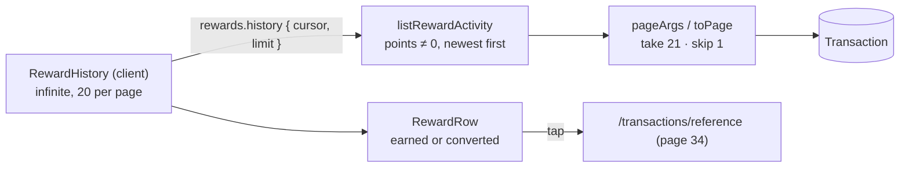

# 32 · Rewards history

Under the points card, **History** lists every movement of points, newest first, 20 at a time: payments that **earned** points ("Bill payment · Meralco · Nov 4 · ₱1,500.00 spent · +30 pts") and **conversions** ("Cash back · Nov 4 · −500 pts · +₱5.00"). Each row opens the payment's receipt.

## At a glance

| | |
| --- | --- |
| **Route** | `/rewards` (the **History** section) |
| **Frontend** | `reward-history.tsx` (**client**: `RewardHistory`, `RewardRow`, `rewardIcon`), inside `rewards-screen.tsx` |
| **API** | `rewards.history({ cursor, limit })` (protected query, infinite, always refetched on open) |
| **Backend** | `rewards.service.ts` (`listRewardActivity`), `server/pagination.ts` (`pageArgs`, `toPage`), `activity.fields.ts` (`activityFields`) |
| **Database** | reads the user's `Transaction` rows where `points ≠ 0` |
| **Tests** | the history rows were checked in Chromium and on the test database for this review |
| **Deep dive** | [Rewards §3 and §5](../05-features/09-rewards.md#reward-historytsx) |

## What the user can do

| Row type | Icon | Title | Second line | Right side |
| --- | --- | --- | --- | --- |
| earned on a **bill** | receipt | "Bill payment · Meralco" | "Nov 4 · ₱1,500.00 spent" | **+30 pts** |
| earned on a **transfer** | arrow up-right | "Transfer to @dante" | "Nov 4 · ₱150.00 spent" | **+3 pts** |
| **converted** | banknote (green) | "Cash back" | "Nov 4" | **−500 pts** and **+₱5.00** (green) |
| any row | | | | tap → `/transactions/<reference>` ([34](34-receipts.md)) |
| no points yet | gem | "No points yet. Send money or pay a bill to start earning." | | |
| more than 20 rows | | | | **Load more** |

## How it works

1. `RewardHistory` calls `rewards.history.useInfiniteQuery({ limit: 20 })`, with `staleTime: 0` and `refetchOnMount: "always"` like the summary.
2. `listRewardActivity` selects the user's transactions with `points: { not: 0 }`, newest first (`createdAt desc, id desc`), with `pageArgs(cursor, limit)` (`take: limit + 1`, `skip: 1` after a cursor).
3. `toPage` returns 20 items and the next cursor. **Load more** fetches the next page. **Retry** fetches only the failed page.
4. `RewardRow` decides from the sign of `points`: positive = earned, negative = converted.

## Structure



## Files and locations

| Layer | File | Role |
| --- | --- | --- |
| Frontend (client) | `gobank/src/features/rewards/components/reward-history.tsx` | list, rows, empty state, paging |
| Frontend | `gobank/src/features/rewards/components/rewards-screen.tsx` | the "History · 1 pt per ₱50 spent" section |
| API | `gobank/src/features/rewards/rewards.router.ts` | `history` |
| Service | `gobank/src/features/rewards/rewards.service.ts` | `listRewardActivity` |
| Pagination | `gobank/src/server/pagination.ts` | `pageArgs`, `toPage` |
| Fields | `gobank/src/features/activity/activity.fields.ts` | the 7 columns returned per row |

## Frontend

<!-- code: gobank/src/features/rewards/components/reward-history.tsx -->
**`gobank/src/features/rewards/components/reward-history.tsx`** · all 133 lines

```tsx
  1 │ "use client";
  2 │
  3 │ import { ArrowUpRight, Banknote, Gem, ReceiptText } from "lucide-react";
  4 │ import Link from "next/link";
  5 │ import { cn } from "~/shared/lib/cn";
  6 │ import { peso, shortDate } from "~/shared/lib/format";
  7 │ import { Button } from "~/shared/ui/button";
  8 │ import { FormError } from "~/shared/ui/money-form-ui";
  9 │ import { errorMessage } from "~/trpc/error-message";
 10 │ import { api, type RouterOutputs } from "~/trpc/react";
 11 │
 12 │ type RewardItem = RouterOutputs["rewards"]["history"]["items"][number];
 13 │
 14 │ export function RewardHistory() {
 15 │   const history = api.rewards.history.useInfiniteQuery(
 16 │     { limit: 20 },
 17 │     {
 18 │       getNextPageParam: (page) => page.next ?? undefined,
 19 │       staleTime: 0,
 20 │       refetchOnMount: "always",
 21 │     },
 22 │   );
 23 │   const items = history.data?.pages.flatMap((page) => page.items) ?? [];
 24 │   const isEmpty = items.length === 0 && !history.error;
 25 │
 26 │   const retry = () => {
 27 │     if (history.isFetchNextPageError) void history.fetchNextPage();
 28 │     else void history.refetch();
 29 │   };
 30 │
 31 │   if (history.isLoading) {
 32 │     return (
 33 │       <p role="status" className="text-ink-muted py-8 text-center text-[14px]">
 34 │         Loading history…
 35 │       </p>
 36 │     );
 37 │   }
 38 │
 39 │   return (
 40 │     <div>
 41 │       {isEmpty ? (
 42 │         <div className="border-line flex flex-col items-center gap-3 rounded-2xl border px-5 py-9 text-center">
 43 │           <Gem size={24} className="text-ink-faint" aria-hidden />
 44 │           <p className="text-ink-muted text-[13.5px]">
 45 │             No points yet. Send money or pay a bill to start earning.
 46 │           </p>
 47 │         </div>
 48 │       ) : (
 49 │         <ul className="border-line divide-line divide-y rounded-2xl border">
 50 │           {items.map((item) => (
 51 │             <li key={item.id}>
 52 │               <RewardRow item={item} />
 53 │             </li>
 54 │           ))}
 55 │         </ul>
 56 │       )}
 57 │
 58 │       {history.error ? (
 59 │         <div className="mt-4">
 60 │           <FormError error={errorMessage(history.error)} />
 61 │           <Button variant="ghost" disabled={history.isFetching} onClick={retry}>
 62 │             {history.isFetching ? "Retrying…" : "Retry"}
 63 │           </Button>
 64 │         </div>
 65 │       ) : null}
 66 │
 67 │       {!history.error && history.hasNextPage ? (
 68 │         <Button
 69 │           variant="outline"
 70 │           className="mt-4"
 71 │           disabled={history.isFetching}
 72 │           onClick={() => void history.fetchNextPage()}
 73 │         >
 74 │           {history.isFetchingNextPage ? "Loading…" : "Load more"}
 75 │         </Button>
 76 │       ) : null}
 77 │     </div>
 78 │   );
 79 │ }
 80 │
 81 │ function rewardIcon(item: RewardItem) {
 82 │   if (item.points < 0) return Banknote;
 83 │   return item.kind === "bill" ? ReceiptText : ArrowUpRight;
 84 │ }
 85 │
 86 │ function RewardRow({ item }: { item: RewardItem }) {
 87 │   const redeemed = item.points < 0;
 88 │   const Icon = rewardIcon(item);
 89 │   const spent = redeemed ? "" : ` · ${peso(Math.abs(item.amount))} spent`;
 90 │
 91 │   return (
 92 │     <Link
 93 │       href={`/transactions/${item.reference}`}
 94 │       className="hover:bg-surface-raised flex items-center gap-3 px-4 py-3.5 transition-colors first:rounded-t-2xl last:rounded-b-2xl"
 95 │     >
 96 │       <span
 97 │         className={cn(
 98 │           "grid h-9 w-9 shrink-0 place-items-center rounded-full",
 99 │           redeemed
100 │             ? "bg-brand-soft text-brand"
101 │             : "bg-surface-raised text-ink-soft",
102 │         )}
103 │       >
104 │         <Icon size={16} aria-hidden />
105 │       </span>
106 │       <span className="min-w-0 flex-1">
107 │         <span className="text-ink block truncate text-[14px] font-medium">
108 │           {redeemed ? "Cash back" : item.title}
109 │         </span>
110 │         <span className="text-ink-muted block truncate text-[12px]">
111 │           {shortDate(item.createdAt)}
112 │           {spent}
113 │         </span>
114 │       </span>
115 │       <span className="shrink-0 text-right">
116 │         <span
117 │           className={cn(
118 │             "block text-[14px] font-semibold tabular-nums",
119 │             redeemed ? "text-ink-soft" : "text-ink",
120 │           )}
121 │         >
122 │           {redeemed ? "−" : "+"}
123 │           {Math.abs(item.points).toLocaleString("en-PH")} pts
124 │         </span>
125 │         {redeemed ? (
126 │           <span className="text-brand block text-[12px] tabular-nums">
127 │             +{peso(item.amount)}
128 │           </span>
129 │         ) : null}
130 │       </span>
131 │     </Link>
132 │   );
133 │ }
```
<!-- /code -->

<!-- code: gobank/src/features/rewards/components/rewards-screen.tsx 112-123 -->
**`gobank/src/features/rewards/components/rewards-screen.tsx`** · lines 112–123

```tsx
112 │           <section aria-labelledby="history-heading">
113 │             <div className="mb-3 flex items-baseline justify-between">
114 │               <h2
115 │                 id="history-heading"
116 │                 className="text-ink text-[15px] font-semibold"
117 │               >
118 │                 History
119 │               </h2>
120 │               <p className="text-ink-muted text-[12px]">1 pt per ₱50 spent</p>
121 │             </div>
122 │             <RewardHistory />
123 │           </section>
```
<!-- /code -->

## Backend

<!-- code: gobank/src/features/rewards/rewards.router.ts 12-21 -->
**`gobank/src/features/rewards/rewards.router.ts`** · lines 12–21

```ts
12 │   history: protectedProcedure
13 │     .input(
14 │       z.object({
15 │         cursor: z.string().nullish(),
16 │         limit: z.number().int().min(1).max(50).default(20),
17 │       }),
18 │     )
19 │     .query(({ ctx, input }) =>
20 │       listRewardActivity(ctx.userId, input.cursor, input.limit),
21 │     ),
```
<!-- /code -->

<!-- code: gobank/src/features/rewards/rewards.service.ts 42-55 -->
**`gobank/src/features/rewards/rewards.service.ts`** · lines 42–55

```ts
42 │ export async function listRewardActivity(
43 │   userId: string,
44 │   cursor: string | null | undefined,
45 │   limit: number,
46 │ ) {
47 │   const rows = await db.transaction.findMany({
48 │     where: { userId, points: { not: 0 } },
49 │     select: activityFields,
50 │     orderBy: [{ createdAt: "desc" }, { id: "desc" }],
51 │     ...pageArgs(cursor, limit),
52 │   });
53 │
54 │   return toPage(rows, limit);
55 │ }
```
<!-- /code -->

<!-- code: gobank/src/server/pagination.ts -->
**`gobank/src/server/pagination.ts`** · all 11 lines

```ts
 1 │ export const pageArgs = (cursor: string | null | undefined, limit: number) => ({
 2 │   take: limit + 1,
 3 │   ...(cursor ? { cursor: { id: cursor }, skip: 1 } : {}),
 4 │ });
 5 │
 6 │ export function toPage<T extends { id: string }>(rows: T[], limit: number) {
 7 │   const items = rows.slice(0, limit);
 8 │   const next = rows.length > limit ? (items.at(-1)?.id ?? null) : null;
 9 │
10 │   return { items, next };
11 │ }
```
<!-- /code -->

## Database

| Read | Rule |
| --- | --- |
| `Transaction` | `userId` = me **and** `points <> 0` |
| columns | `id`, `reference`, `kind`, `title`, `amount`, `points`, `createdAt` (`activityFields`) |
| order | `createdAt DESC, id DESC` |
| page | 20 (+1 to know if there is more) |

The same `Transaction` table is the source of truth for points: there is no separate "points ledger". `User.points` is the running total, and these rows explain it.

## The complicated parts, explained step by step

### 1. One list, two kinds of rows, told apart by a sign

<!-- code: gobank/src/features/rewards/components/reward-history.tsx 81-133 -->
**`gobank/src/features/rewards/components/reward-history.tsx`** · lines 81–133

```tsx
 81 │ function rewardIcon(item: RewardItem) {
 82 │   if (item.points < 0) return Banknote;
 83 │   return item.kind === "bill" ? ReceiptText : ArrowUpRight;
 84 │ }
 85 │
 86 │ function RewardRow({ item }: { item: RewardItem }) {
 87 │   const redeemed = item.points < 0;
 88 │   const Icon = rewardIcon(item);
 89 │   const spent = redeemed ? "" : ` · ${peso(Math.abs(item.amount))} spent`;
 90 │
 91 │   return (
 92 │     <Link
 93 │       href={`/transactions/${item.reference}`}
 94 │       className="hover:bg-surface-raised flex items-center gap-3 px-4 py-3.5 transition-colors first:rounded-t-2xl last:rounded-b-2xl"
 95 │     >
 96 │       <span
 97 │         className={cn(
 98 │           "grid h-9 w-9 shrink-0 place-items-center rounded-full",
 99 │           redeemed
100 │             ? "bg-brand-soft text-brand"
101 │             : "bg-surface-raised text-ink-soft",
102 │         )}
103 │       >
104 │         <Icon size={16} aria-hidden />
105 │       </span>
106 │       <span className="min-w-0 flex-1">
107 │         <span className="text-ink block truncate text-[14px] font-medium">
108 │           {redeemed ? "Cash back" : item.title}
109 │         </span>
110 │         <span className="text-ink-muted block truncate text-[12px]">
111 │           {shortDate(item.createdAt)}
112 │           {spent}
113 │         </span>
114 │       </span>
115 │       <span className="shrink-0 text-right">
116 │         <span
117 │           className={cn(
118 │             "block text-[14px] font-semibold tabular-nums",
119 │             redeemed ? "text-ink-soft" : "text-ink",
120 │           )}
121 │         >
122 │           {redeemed ? "−" : "+"}
123 │           {Math.abs(item.points).toLocaleString("en-PH")} pts
124 │         </span>
125 │         {redeemed ? (
126 │           <span className="text-brand block text-[12px] tabular-nums">
127 │             +{peso(item.amount)}
128 │           </span>
129 │         ) : null}
130 │       </span>
131 │     </Link>
132 │   );
133 │ }
```
<!-- /code -->

| `points` | `amount` | Title shown | Second line | Right side |
| --- | --- | --- | --- | --- |
| **+30** (bill) | −150000 | the row's title "Bill payment · Meralco" | date + " · ₱1,500.00 spent" (`peso(Math.abs(amount))`) | "+30 pts" |
| **+3** (transfer) | −15000 | "Transfer to @dante" | date + " · ₱150.00 spent" | "+3 pts" |
| **−500** (conversion) | +500 | **"Cash back"** (fixed text, not the row's title) | date only | "−500 pts" and "+₱5.00" |

`rewardIcon` picks the icon: a negative `points` → banknote; else a bill → receipt; else (transfer) → arrow. The conversion row's own title is "Cash back · 500 points". The list shows the shorter "Cash back" because the points are already on the right.

### 2. Why `points ≠ 0` is the right filter

| Row | `points` | In the list? |
| --- | --- | --- |
| Transfer to @dante ₱150 | 3 | yes |
| Transfer from @maricel (the receiver's side) | 0 | no: receiving earns nothing |
| Transfer of ₱25 | 0 (`floor(2500 / 5000)`) | no: too small to earn |
| Bill payment ₱1,500 | 30 | yes |
| Mobile load | 0 | no: load earns nothing |
| Cash back · 500 points | −500 | yes |
| Deposit, GoalSave, interest, Bitcoin | 0 | no |

The filter matches the rule "show what changed my points" exactly, without listing kinds. If a new kind of payment ever earned points, it would appear here automatically.

### 3. Fresh on every visit

<!-- code: gobank/src/features/rewards/components/reward-history.tsx 14-29 -->
**`gobank/src/features/rewards/components/reward-history.tsx`** · lines 14–29

```tsx
14 │ export function RewardHistory() {
15 │   const history = api.rewards.history.useInfiniteQuery(
16 │     { limit: 20 },
17 │     {
18 │       getNextPageParam: (page) => page.next ?? undefined,
19 │       staleTime: 0,
20 │       refetchOnMount: "always",
21 │     },
22 │   );
23 │   const items = history.data?.pages.flatMap((page) => page.items) ?? [];
24 │   const isEmpty = items.length === 0 && !history.error;
25 │
26 │   const retry = () => {
27 │     if (history.isFetchNextPageError) void history.fetchNextPage();
28 │     else void history.refetch();
29 │   };
```
<!-- /code -->

| Option | Effect |
| --- | --- |
| `staleTime: 0`, `refetchOnMount: "always"` | the list is reloaded every time Rewards opens, so a bill paid a moment ago is already there |
| `getNextPageParam: (page) => page.next ?? undefined` | `undefined` tells React Query there is no next page, which hides **Load more** |
| `retry`: `fetchNextPage()` if the **next** page failed, else `refetch()` | a failed "Load more" does not throw away the pages already shown |

In Chromium, after converting 500 points and tapping **Done**, the first row was already "Cash back · Nov 4 · −500 pts · +₱5.00", because the conversion invalidated every query.

### 4. Paging with a cursor

<!-- code: gobank/src/server/pagination.ts -->
**`gobank/src/server/pagination.ts`** · all 11 lines

```ts
 1 │ export const pageArgs = (cursor: string | null | undefined, limit: number) => ({
 2 │   take: limit + 1,
 3 │   ...(cursor ? { cursor: { id: cursor }, skip: 1 } : {}),
 4 │ });
 5 │
 6 │ export function toPage<T extends { id: string }>(rows: T[], limit: number) {
 7 │   const items = rows.slice(0, limit);
 8 │   const next = rows.length > limit ? (items.at(-1)?.id ?? null) : null;
 9 │
10 │   return { items, next };
11 │ }
```
<!-- /code -->

`pageArgs` asks for **21** rows (`limit + 1`), and `toPage` keeps 20 and uses the 20th row's `id` as the next cursor only if a 21st came back. The next page starts **after** that row (`skip: 1`). This is the same pattern as the money-request inbox, where the cursor SQL was captured and explained ([16 §5](16-request-inbox.md#5-cursor-pagination-20-at-a-time-without-skipping-or-repeating)). Here `pageArgs` uses `cursor: { id }` without the user filter, but the query's own `where: { userId, … }` keeps every row the user's own.

## Rules and limits

| Rule | Value |
| --- | --- |
| Rows | every transaction that changed points (`points ≠ 0`) |
| Order | newest first |
| Page size | 20 (router allows 1–50) |
| Tap | opens the receipt of that transaction |

## Messages

| Text | When |
| --- | --- |
| History · 1 pt per ₱50 spent | section header |
| Loading history… | first load |
| No points yet. Send money or pay a bill to start earning. | empty |
| Cash back · −N pts · +₱… | conversion row |
| ₱… spent · +N pts | earning row |
| Load more / Loading… · Retry / Retrying… | paging and errors |

## Tests

There is no automated test for the history list. Checked for this review:

- **Chromium:** Dante's history showed "Bill payment · Meralco · Nov 4 · ₱1,500.00 spent · +30 pts", and after a conversion, "Cash back · Nov 4 · −500 pts · +₱5.00" at the top.
- **Test database:** `listRewardActivity` for a test user returned exactly its three conversion rows (−100, −100, −200 points), newest first, with `next: null`.
